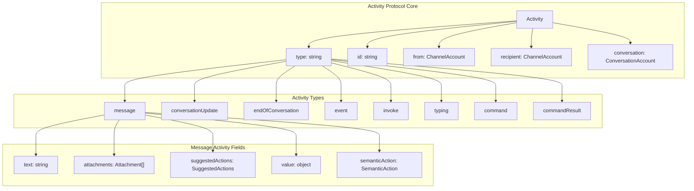
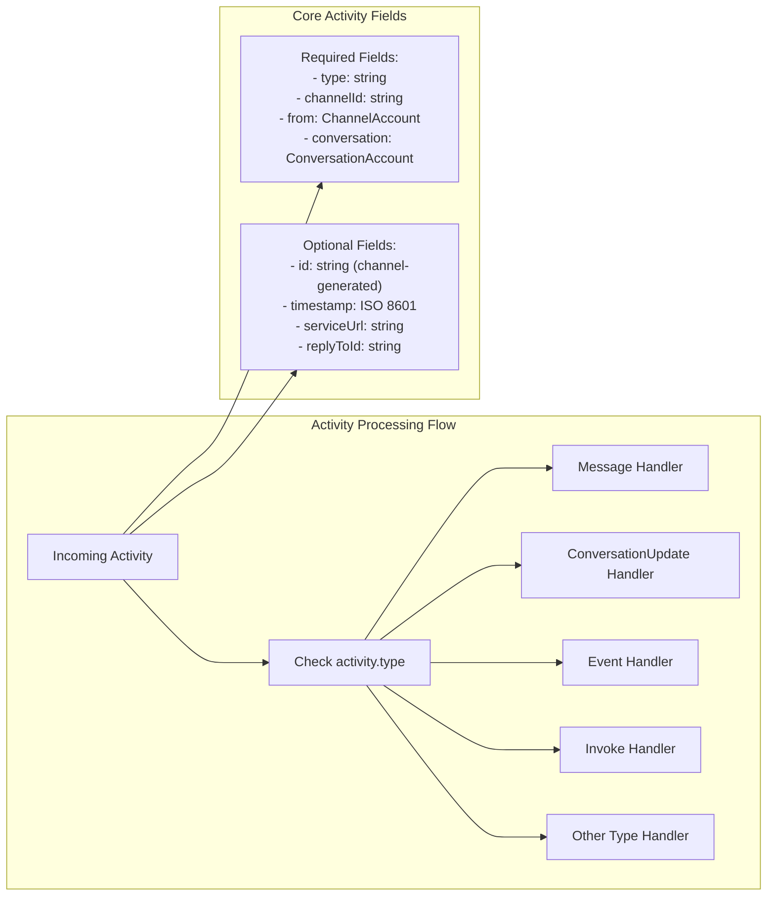
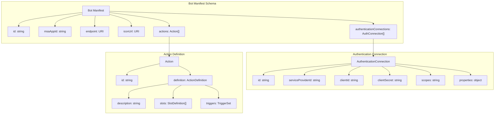
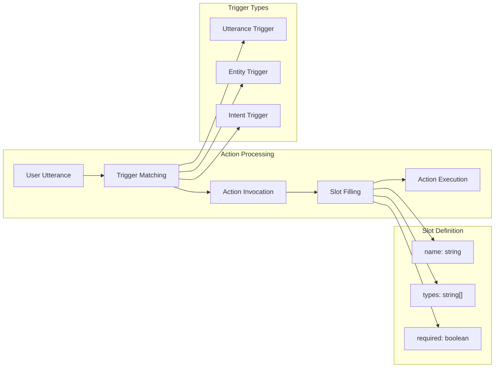
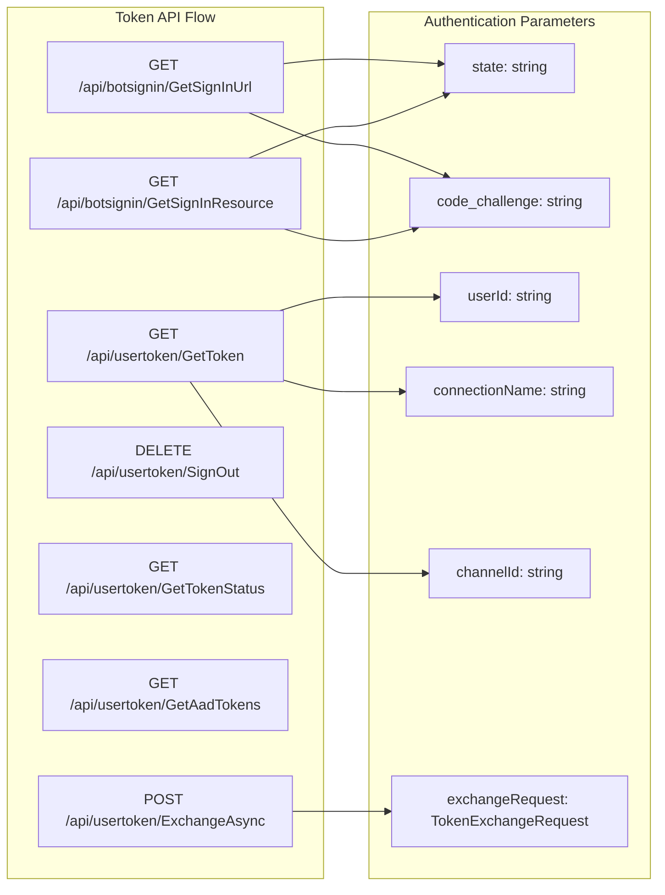
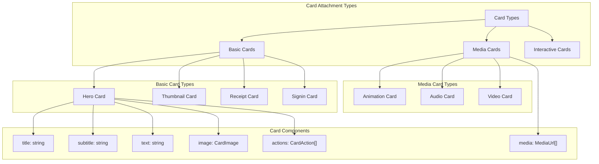
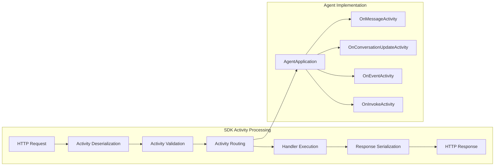
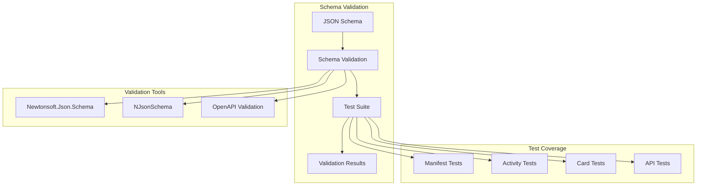

<!-- source: DeepWiki mcp.deepwiki.com · repo microsoft/Agents · page 8.2 Activity Protocol Specification · fetched 2026-10-26 -->

# Protocol Specifications

Relevant source files

The following files were used as context for generating this wiki page:

- [specs/activity/protocol-activity.md](specs/activity/protocol-activity.md)
- [specs/activity/protocol-cards.md](specs/activity/protocol-cards.md)
- [specs/channel-api/ChannelAPI-OpenAPI.yaml](specs/channel-api/ChannelAPI-OpenAPI.yaml)
- [specs/channel-api/TokenAPI-OpenAPI.yaml](specs/channel-api/TokenAPI-OpenAPI.yaml)
- [specs/manifest/bot-manifest.md](specs/manifest/bot-manifest.md)
- [specs/manifest/example.man](specs/manifest/example.man)
- [specs/manifest/manifest.json](specs/manifest/manifest.json)
- [specs/manifest/schemas/SchemaManifestTests/SchemaManifestTests.csproj](specs/manifest/schemas/SchemaManifestTests/SchemaManifestTests.csproj)
- [specs/manifest/schemas/SchemaManifestTests/SchemaManifestTests.sln](specs/manifest/schemas/SchemaManifestTests/SchemaManifestTests.sln)
- [specs/manifest/schemas/SchemaManifestTests/ValidateSchemaTests.cs](specs/manifest/schemas/SchemaManifestTests/ValidateSchemaTests.cs)
- [specs/manifest/schemas/readme.md](specs/manifest/schemas/readme.md)

This document provides detailed specifications for the protocols and data formats used by the Microsoft 365 Agents SDK. These specifications define the structure, semantics, and communication patterns that enable interoperability between agents, clients, and channels within the Microsoft ecosystem.

The specifications covered here focus on the wire-level protocols and data schemas. For information about implementing agents using these protocols, see [Building Agents](#2). For authentication patterns and security considerations, see [Authentication](#3).

## Activity Protocol

The Activity Protocol is the core messaging protocol used by the Microsoft 365 Agents SDK. It defines a standardized format for representing conversational actions between humans and automated software.

### Protocol Overview

The Activity Protocol defines activities as JSON objects with a flat structure containing name/value pairs. Each activity must include a `type` field that controls the meaning and available fields for that activity.

**Sources:** [specs/activity/protocol-activity.md:1-570]()

### Activity Types and Processing

The protocol specifies different activity types for various conversational scenarios:

| Activity Type | Purpose | Key Fields |
|---------------|---------|------------|
| `message` | Content intended for conversational interface | `text`, `attachments`, `suggestedActions` |
| `conversationUpdate` | Changes in conversation membership | `membersAdded`, `membersRemoved`, `topicName` |
| `endOfConversation` | Signals end of conversation | `code`, `text` |
| `event` | Programmatic information exchange | `name`, `value` |
| `invoke` | Synchronous request/response pattern | `name`, `value` |
| `typing` | Typing indicator | - |
| `command` | Command execution request | `name`, `value` |
| `commandResult` | Command execution response | `name`, `value` |

**Sources:** [specs/activity/protocol-activity.md:335-570](), [specs/activity/protocol-activity.md:501-570]()

### Message Activity Structure

Message activities represent the primary content exchange mechanism:

```mermaid
graph TB
    subgraph "Message Activity Components"
        MessageActivity["Message Activity"]
        TextContent["text: string<br/>(Markdown, plain, or XML)"]
        TextFormat["textFormat: 'markdown' | 'plain' | 'xml'"]
        Attachments["attachments: Attachment[]"]
        AttachmentLayout["attachmentLayout: 'list' | 'carousel'"]
        SuggestedActions["suggestedActions: SuggestedActions"]
        InputHint["inputHint: 'accepting' | 'expecting' | 'ignoring'"]
        Speak["speak: SSML or plain text"]
        Value["value: object"]
        SemanticAction["semanticAction: SemanticAction"]
        ListenFor["listenFor: string[]"]
    end
    
    subgraph "Attachment Types"
        AdaptiveCard["Adaptive Card"]
        HeroCard["Hero Card"]
        ThumbnailCard["Thumbnail Card"]
        ReceiptCard["Receipt Card"]
        SigninCard["Signin Card"]
        FileAttachment["File Attachment"]
    end
    
    MessageActivity --> TextContent
    MessageActivity --> TextFormat
    MessageActivity --> Attachments
    MessageActivity --> AttachmentLayout
    MessageActivity --> SuggestedActions
    MessageActivity --> InputHint
    MessageActivity --> Speak
    MessageActivity --> Value
    MessageActivity --> SemanticAction
    MessageActivity --> ListenFor
    
    Attachments --> AdaptiveCard
    Attachments --> HeroCard
    Attachments --> ThumbnailCard
    Attachments --> ReceiptCard
    Attachments --> SigninCard
    Attachments --> FileAttachment
```

**Sources:** [specs/activity/protocol-activity.md:335-491]()

## Bot Manifest Specification

The Bot Manifest format describes the capabilities and configuration of agents implementing the Activity Protocol. It enables registration, discovery, and invocation of agent services.

### Manifest Structure

The manifest provides essential metadata for agent registration and discovery:

| Field | Type | Purpose |
|-------|------|---------|
| `id` | string | Unique identifier for the bot |
| `msaAppId` | string | Microsoft App ID for authentication |
| `endpoint` | URI | Bot's messaging endpoint |
| `iconUrl` | URI | Bot's icon for display |
| `authenticationConnections` | array | OAuth connection configurations |
| `actions` | array | Supported actions and their triggers |

**Sources:** [specs/manifest/bot-manifest.md:1-50](), [specs/manifest/example.man:1-48](), [specs/manifest/manifest.json:1-50]()

### Action and Trigger System

**Sources:** [specs/manifest/example.man:19-47](), [specs/manifest/manifest.json:24-50]()

## Channel API Specification

The Channel API defines the REST endpoints used for communication between agents and channels. It provides operations for sending activities, managing conversations, and handling attachments.

### Core API Endpoints

```mermaid
graph TB
    subgraph "Channel API Operations"
        ConversationOps["Conversation Operations"]
        ActivityOps["Activity Operations"]
        AttachmentOps["Attachment Operations"]
        MemberOps["Member Operations"]
    end
    
    subgraph "Conversation Endpoints"
        CreateConversation["POST /v3/conversations"]
        GetConversations["GET /v3/conversations"]
        GetConversationMembers["GET /v3/conversations/{id}/members"]
        UpdateActivity["PUT /v3/conversations/{id}/activities/{activityId}"]
        DeleteActivity["DELETE /v3/conversations/{id}/activities/{activityId}"]
    end
    
    subgraph "Activity Endpoints"
        SendToConversation["POST /v3/conversations/{id}/activities"]
        ReplyToActivity["POST /v3/conversations/{id}/activities/{activityId}"]
        GetActivityMembers["GET /v3/conversations/{id}/activities/{activityId}/members"]
        SendActivity["POST /v3/conversations/{id}/activities/{activityId}"]
    end
    
    subgraph "Attachment Endpoints"
        GetAttachmentInfo["GET /v3/attachments/{attachmentId}"]
        GetAttachment["GET /v3/attachments/{attachmentId}/views/{viewId}"]
        UploadAttachment["POST /v3/conversations/{id}/attachments"]
    end
    
    ConversationOps --> CreateConversation
    ConversationOps --> GetConversations
    ConversationOps --> GetConversationMembers
    ConversationOps --> UpdateActivity
    ConversationOps --> DeleteActivity
    
    ActivityOps --> SendToConversation
    ActivityOps --> ReplyToActivity
    ActivityOps --> GetActivityMembers
    ActivityOps --> SendActivity
    
    AttachmentOps --> GetAttachmentInfo
    AttachmentOps --> GetAttachment
    AttachmentOps --> UploadAttachment
```

**Sources:** [specs/channel-api/ChannelAPI-OpenAPI.yaml:1-50]()

### Authentication API

**Sources:** [specs/channel-api/TokenAPI-OpenAPI.yaml:1-50]()

## Activity Protocol Cards

The Activity Protocol Cards specification defines rich interactive card formats that can be included as attachments in message activities.

### Card Types and Structure

**Sources:** [specs/activity/protocol-cards.md:1-50]()

## Protocol Implementation Guidelines

The Microsoft 365 Agents SDK implements these protocols through several key components:

### Activity Processing Pipeline

### Protocol Compliance Requirements

| Requirement | Level | Description |
|-------------|-------|-------------|
| Activity Schema | MUST | All activities must conform to the Activity Protocol schema |
| Activity Types | MUST | Implementations must handle unknown activity types gracefully |
| Field Validation | MUST | Required fields must be validated and present |
| Channel ID | MUST | Activities must include valid channelId |
| Timestamp Format | SHOULD | Use ISO 8601 UTC format with explicit Z marker |
| Error Handling | SHOULD | Provide meaningful error responses for invalid activities |
| Backwards Compatibility | SHOULD | Support older protocol versions where possible |

**Sources:** [specs/activity/protocol-activity.md:120-200]()

## Schema Validation and Testing

The protocol specifications include comprehensive schema validation:

**Sources:** [specs/manifest/schemas/SchemaManifestTests/ValidateSchemaTests.cs:1-50](), [specs/manifest/schemas/SchemaManifestTests/SchemaManifestTests.csproj:1-26]()

These protocol specifications ensure interoperability across the Microsoft 365 ecosystem and provide a foundation for building robust, scalable agents that can communicate effectively with users and other services.

---

