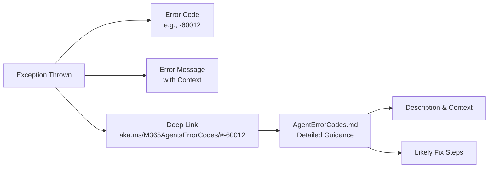
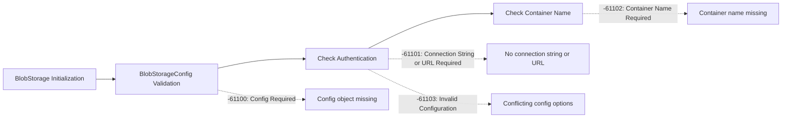
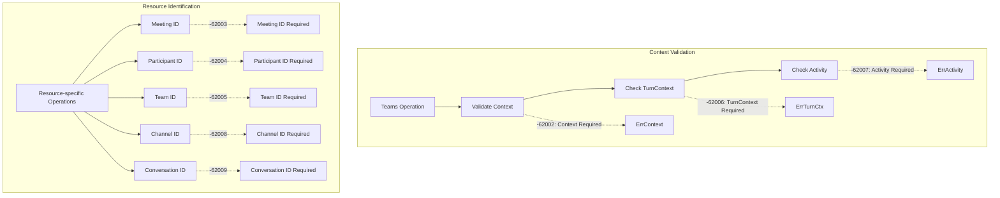
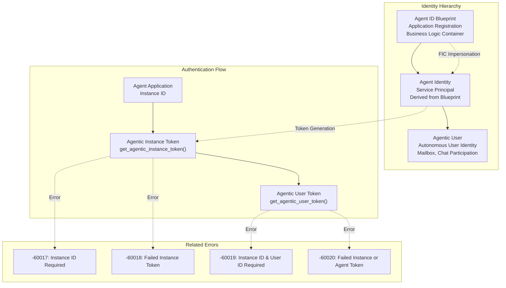
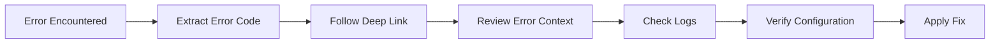
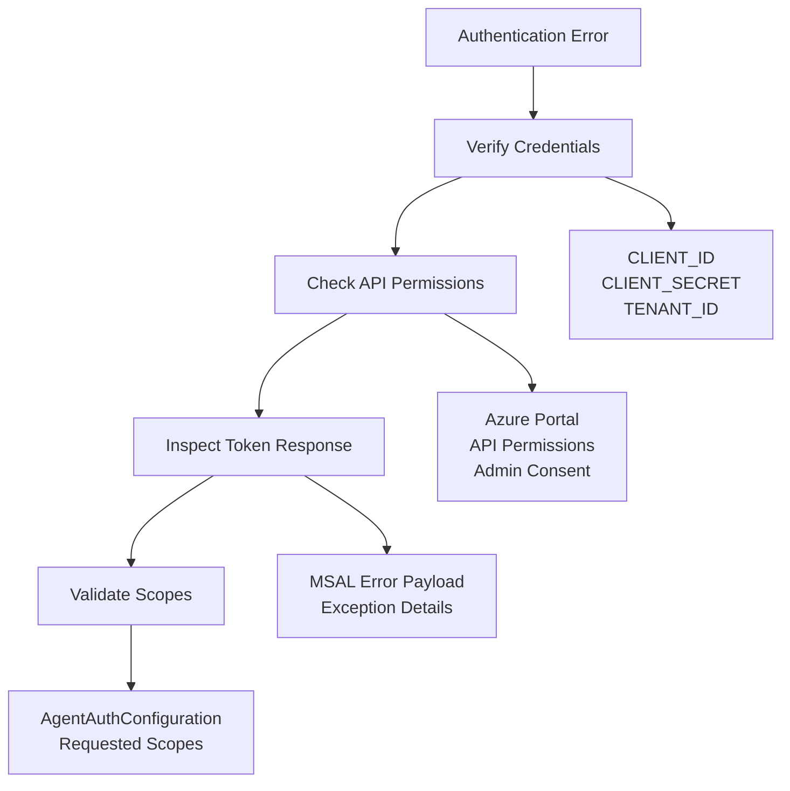

<!-- source: DeepWiki mcp.deepwiki.com · repo microsoft/Agents · page 8.3 Error Handling and Troubleshooting · fetched 2026-10-26 -->

# Error Handling and Troubleshooting

<details>
<summary>Relevant source files</summary>

The following files were used as context for generating this wiki page:

- [.github/ISSUE_TEMPLATE/activity-protocol-spec-change-request.md](.github/ISSUE_TEMPLATE/activity-protocol-spec-change-request.md)
- [.github/ISSUE_TEMPLATE/bug_report.md](.github/ISSUE_TEMPLATE/bug_report.md)
- [.github/ISSUE_TEMPLATE/feature-request-for-agent-sdk.md](.github/ISSUE_TEMPLATE/feature-request-for-agent-sdk.md)
- [AgentErrorCodes.md](AgentErrorCodes.md)

</details>


This document provides a comprehensive reference for error handling, troubleshooting, and debugging in the Microsoft 365 Agents SDK across all three language implementations (.NET, JavaScript, and Python). It covers the standardized error code system, common error patterns, debugging strategies, and issue reporting procedures.

For information about development tools and debugging techniques, see [Development Tools and Debugging](#8.4). For protocol-level specifications, see [Activity Protocol Specification](#8.2).

## Purpose and Scope

The M365 Agents SDK implements a standardized error handling system across all language implementations, using numeric error codes with deep-linkable documentation. When exceptions are thrown, they include:
- A numeric error code identifying the specific error condition
- A descriptive error message with contextual details
- A deep link (via aka.ms) to detailed troubleshooting information

This system enables developers to quickly identify and resolve issues by following the error code link to specific guidance. This document serves as the central reference for all SDK error codes, their meanings, and resolution strategies.

## Error Code Architecture

### Error Code Ranges by Language

The SDK uses non-overlapping numeric ranges to organize errors by language and subsystem:

| Language | Error Code Range | Subsystems |
|----------|-----------------|------------|
| Python | -60000 to -66999 | Authentication (-60000), Storage Cosmos DB (-61000), Storage Blob (-61100), Teams (-62000), Hosting (-63000), Activity (-64000), Copilot Studio (-65000), General/Validation (-66000) |
| C# | -40000 to -40100 | Authentication |
| C# | -50000 to -50100 | Builder/Hosting (Token providers, routing, streaming, OBO, agentic auth) |
| C# | -50500 to -50600 | Connector/Channel (Bot Framework connector operations) |
| C# | -90000 to -90100 | Client/Agent (Agent host configuration, discovery, communication) |
| JavaScript | TBD | (Not fully documented in current specification) |

**Sources:** [AgentErrorCodes.md:1-44]()

### Error Code Structure



**Sources:** [AgentErrorCodes.md:4-19]()

### Exception Implementation Patterns

Each language implements error codes consistently but with language-specific patterns:

#### C# Error Definition Pattern

[AgentErrorCodes.md:6-9]() shows C# errors use `AgentErrorDefinition` with error code, resource string, and deep link:

```csharp
internal static readonly AgentErrorDefinition AttributeSelectorNotFound = 
    new AgentErrorDefinition(-50002, Properties.Resources.AttributeSelectorNotFound, 
    "https://aka.ms/M365AgentsErrorCodes/#-50002");
```

#### Python Error Message Pattern

[AgentErrorCodes.md:11-17]() shows Python errors use `ErrorMessage` with message template and code:

```python
ErrorMessage(
    "Failed to acquire token. {0}",
    -60012,
)
```

**Sources:** [AgentErrorCodes.md:6-17]()

## Error Categories and Common Patterns

### Authentication Errors

Authentication errors occur during token acquisition, MSAL configuration, and identity authentication flows.

#### Python Authentication Errors (-60000 to -60999)

```mermaid
graph TB
    subgraph "Token Acquisition Flow"
        GetToken["MsalAuth.get_access_token()"]
        ValidateURL["Validate Resource URL"]
        AcquireToken["MSAL Token Acquisition"]
        
        GetToken --> ValidateURL
        ValidateURL --> AcquireToken
        
        ValidateURL -."-60013: Invalid Instance URL".-> ErrorInvalidURL["Invalid URL Format"]
        AcquireToken -."-60012: Failed to Acquire Token".-> ErrorAcquire["MSAL Failure"]
    end
    
    subgraph "OBO Flow"
        OBORequest["acquire_token_on_behalf_of()"]
        CheckAuth["Check Auth Type"]
        ExchangeToken["Token Exchange"]
        
        OBORequest --> CheckAuth
        CheckAuth --> ExchangeToken
        
        CheckAuth -."-60014: OBO Not Supported<br/>with Managed Identity".-> ErrorMI["Managed Identity<br/>Incompatible"]
        CheckAuth -."-60015: OBO Not Supported<br/>with Auth Type".-> ErrorType["Unsupported<br/>Auth Type"]
    end
    
    subgraph "Agentic Authentication"
        AgenticToken["get_agentic_instance_token()"]
        ValidateIDs["Validate Instance ID"]
        AcquireAgenticToken["Acquire Agent Token"]
        
        AgenticToken --> ValidateIDs
        ValidateIDs --> AcquireAgenticToken
        
        ValidateIDs -."-60017: Instance ID Required".-> ErrorNoID["Missing Instance ID"]
        AcquireAgenticToken -."-60018: Failed Agentic Token".-> ErrorAgenticFail["Token Acquisition Failed"]
    end
```



**Key Authentication Errors:**

| Error Code | Error Name | Context | Primary Fix |
|------------|------------|---------|-------------|
| -60012 | Failed to Acquire Token | MSAL authentication failure during token acquisition | Verify client ID, secret, tenant ID, and API permissions |
| -60013 | Invalid Instance URL | Malformed resource URL passed to authentication | Verify URL format (e.g., `https://graph.microsoft.com`) |
| -60014 | OBO Not Supported with Managed Identity | Attempting OBO flow with Managed Identity auth | Use Confidential Client Application with secret/certificate |
| -60015 | OBO Not Supported with Auth Type | OBO attempted with unsupported auth type | Set `AUTH_TYPE` to `AuthTypes.ClientSecret` or `ClientCertificate` |
| -60016 | Authentication Type Not Supported | Unrecognized authentication type in configuration | Use supported types: ClientSecret, ClientCertificate, ManagedIdentity |
| -60017 | Agent Application Instance ID Required | Missing instance ID for agentic authentication | Provide valid agent application instance ID |
| -60018 | Failed to Acquire Agentic Instance Token | Agentic token acquisition failure | Verify agent registration and instance ID configuration |
| -60019 | Agent Application Instance ID and User ID Required | Missing required IDs for agentic user token | Provide both agent instance ID and agentic user ID |
| -60020 | Failed to Acquire Instance or Agent Token | Prerequisite token failure for agentic user token | Troubleshoot -60018 first, then verify agentic user ID |

**Sources:** [AgentErrorCodes.md:72-185]()

#### C# Authentication Errors (-40000 to -40100)

[AgentErrorCodes.md:36]() indicates C# authentication errors cover MSAL configuration, authentication modules, connection management, and provider configuration in the -40000 to -40100 range.

**Sources:** [AgentErrorCodes.md:36]()

### Storage Errors

Storage errors occur during state persistence operations with Cosmos DB or Azure Blob Storage.

#### Cosmos DB Storage Errors (-61000 to -61999)

```mermaid
graph TB
    subgraph "Configuration Validation"
        ValidateConfig["CosmosDBStorageConfig.validate_cosmos_db_config()"]
        CheckConfig["Check Config Object"]
        CheckEndpoint["Check Endpoint"]
        CheckAuthKey["Check Auth Key"]
        CheckDatabaseID["Check Database ID"]
        CheckContainerID["Check Container ID"]
        
        ValidateConfig --> CheckConfig
        CheckConfig --> CheckEndpoint
        CheckEndpoint --> CheckAuthKey
        CheckAuthKey --> CheckDatabaseID
        CheckDatabaseID --> CheckContainerID
        
        CheckConfig -."-61000: Config Required".-> ErrConfig
        CheckEndpoint -."-61001: Endpoint Required".-> ErrEndpoint
        CheckAuthKey -."-61002: Auth Key Required".-> ErrKey
        CheckDatabaseID -."-61003: Database ID Required".-> ErrDB
        CheckContainerID -."-61004: Container ID Required".-> ErrContainer
    end
    
    subgraph "Partition Key Validation"
        PartitionOps["Storage Operations"]
        ValidatePartitionKey["Validate Partition Key"]
        CheckPartitionMatch["Check Partition Match"]
        CheckPartitionPath["Check Partition Path"]
        
        PartitionOps --> ValidatePartitionKey
        ValidatePartitionKey --> CheckPartitionMatch
        CheckPartitionMatch --> CheckPartitionPath
        
        ValidatePartitionKey -."-61006: Invalid Partition Key".-> ErrPartKey
        CheckPartitionMatch -."-61009: Partition Key Not Found".-> ErrPartMissing
        CheckPartitionPath -."-61007: Invalid Partition Key Path".-> ErrPartPath
    end
    
    subgraph "Storage Operations"
        StoreOps["Store/Retrieve Data"]
        ValidateKey["Validate Storage Key"]
        ExecuteOperation["Execute Cosmos Operation"]
        
        StoreOps --> ValidateKey
        ValidateKey --> ExecuteOperation
        
        ValidateKey -."-61005: Key Cannot Be Empty".-> ErrEmptyKey
        ValidateKey -."-61011: Invalid Key Suffix".-> ErrKeySuffix
    end
```



**Common Cosmos DB Errors:**

| Error Code | Error Name | Validation Context | Resolution |
|------------|------------|-------------------|------------|
| -61000 | Config Required | `CosmosDBStorageConfig` object is None | Create valid config with all parameters |
| -61001 | Endpoint Required | `cosmos_db_endpoint` missing | Provide endpoint: `https://<account>.documents.azure.com:443/` |
| -61002 | Auth Key Required | `auth_key` missing | Provide primary/secondary key from Azure Portal |
| -61003 | Database ID Required | `database_id` missing | Specify existing database name |
| -61004 | Container ID Required | `container_id` missing | Specify existing container name |
| -61005 | Key Cannot Be Empty | Storage key is empty/null | Ensure conversation/user IDs are properly initialized |
| -61006 | Invalid Partition Key | Mismatch between item and config partition keys | Align partition key values with storage configuration |
| -61007 | Invalid Partition Key Path | Container partition path doesn't match config | Update config or recreate container (path is immutable) |
| -61008 | Compatibility Mode Conflict | Using compatibility mode with partitioned storage | Choose one mode or the other, not both |
| -61009 | Partition Key Not Found | State object missing partition key property | Implement partition key in custom state classes |
| -61010 | Invalid Partition Key Value | Partition key value improperly formatted | Validate partition key format and type |
| -61011 | Invalid Key Suffix Characters | `key_suffix` contains forbidden characters (\, ?, /, #, *) | Remove invalid characters or URL-encode suffix |

**Sources:** [AgentErrorCodes.md:187-355]()

#### Blob Storage Errors (-61100 to -61199)



| Error Code | Error Name | Issue | Fix |
|------------|------------|-------|-----|
| -61100 | Blob Config Required | `BlobStorageConfig` is None | Provide valid config object |
| -61101 | Connection String or URL Required | Neither connection string nor container URL provided | Provide either connection string or container URL with auth |
| -61102 | Container Name Required | `container_name` not specified | Set container name (3-63 chars, lowercase) |
| -61103 | Invalid Configuration | Conflicting configuration parameters | Review config for logical consistency |

**Sources:** [AgentErrorCodes.md:357-409]()

### Teams Integration Errors (-62000 to -62999)

Teams errors occur during Teams-specific operations involving channels, meetings, and participants.



**Key Teams Errors:**

| Error Code | Error Name | Operation Context | Resolution |
|------------|------------|------------------|------------|
| -62000 | Bad Request | Malformed Teams service request | Verify request parameters and data format |
| -62001 | Not Implemented | Unsupported Teams feature | Check SDK version, use alternative approach |
| -62002 | Context Required | Teams operation without context | Ensure Teams context is available from activity |
| -62003 | Meeting ID Required | Meeting operation without meeting ID | Extract meeting ID from Teams context |
| -62004 | Participant ID Required | Participant operation without ID | Query participant list first |
| -62005 | Team ID Required | Team operation without team ID | Extract team ID from conversation |
| -62006 | TurnContext Required | Operation needs turn context | Pass valid TurnContext from handler |
| -62007 | Activity Required | Operation needs activity object | Extract from `context.activity` |
| -62008 | Channel ID Required | Channel operation without ID | Extract channel ID from conversation reference |
| -62009 | Conversation ID Required | Operation needs conversation ID | Extract from activity or turn context |

**Sources:** [AgentErrorCodes.md:412-542]()

### Hosting and Adapter Errors (-63000 to -63999)

Hosting errors occur during agent initialization, request processing, and runtime operations.

```mermaid
graph TB
    subgraph "Agent Initialization"
        StartAgent["start_agent_process()"]
        ValidateAdapter["Validate Adapter"]
        ValidateAgentApp["Validate AgentApplication"]
        
        StartAgent --> ValidateAdapter
        ValidateAdapter --> ValidateAgentApp
        
        ValidateAdapter -."-63000: Adapter Required".-> ErrAdapter["CloudAdapter missing"]
        ValidateAgentApp -."-63001: Agent Application Required".-> ErrApp["AgentApplication missing"]
    end
    
    subgraph "Request Processing"
        ProcessReq["CloudAdapter.process()"]
        ValidateRequest["Validate Request"]
        ValidateAgent["Validate Agent"]
        ValidateAuth["Validate Authentication"]
        
        ProcessReq --> ValidateRequest
        ValidateRequest --> ValidateAgent
        ValidateAgent --> ValidateAuth
        
        ValidateRequest -."-63002: Request Required".-> ErrReq["HTTP request missing"]
        ValidateAgent -."-63003: Agent Required".-> ErrAgentProc["Agent instance missing"]
        ValidateAuth -."-63010: Auth Header Required".-> ErrAuthHdr["Authorization header missing"]
        ValidateAuth -."-63011: Invalid Auth Header".-> ErrAuthInvalid["Auth header malformed"]
    end
    
    subgraph "Turn Context Operations"
        TurnOps["Turn Context Operations"]
        ValidateTurnContext["Validate TurnContext"]
        ValidateActivity["Validate Activity"]
        ValidateAppID["Validate App ID"]
        
        TurnOps --> ValidateTurnContext
        ValidateTurnContext --> ValidateActivity
        ValidateActivity --> ValidateAppID
        
        ValidateTurnContext -."-63005: TurnContext Required".-> ErrTurn
        ValidateActivity -."-63006: Activity Required".-> ErrAct
        ValidateAppID -."-63007: App ID Required".-> ErrAppID["CLIENT_ID missing"]
    end
    
    subgraph "Streaming Operations"
        StreamOps["Streaming Response"]
        CheckStreamState["Check Stream State"]
        WriteStream["Write to Stream"]
        
        StreamOps --> CheckStreamState
        CheckStreamState --> WriteStream
        
        CheckStreamState -."-63004: Stream Already Ended".-> ErrStream["Stream closed"]
    end
```



**Critical Hosting Errors:**

| Error Code | Error Name | Component | Fix |
|------------|------------|-----------|-----|
| -63000 | Adapter Required | `start_agent_process()` | Initialize `CloudAdapter` with connection manager |
| -63001 | Agent Application Required | `start_agent_process()` | Create `AgentApplication` instance |
| -63002 | Request Required | `CloudAdapter.process()` | Pass HTTP request from web framework |
| -63003 | Agent Required | `CloudAdapter.process()` | Pass agent instance to adapter |
| -63004 | Stream Already Ended | Streaming response | Check stream state before operations |
| -63005 | TurnContext Required | Turn operations | Ensure handler receives valid TurnContext |
| -63006 | Activity Required | Activity processing | Verify activity creation/extraction |
| -63007 | App ID Required | Authentication | Set `CLIENT_ID` in `AgentAuthConfiguration` |
| -63008 | Invalid Activity Type | Activity validation | Set valid `ActivityTypes` value |
| -63009 | Conversation ID Required | State management | Extract conversation ID from activity |
| -63010 | Auth Header Required | Request authentication | Verify Bot Framework/channel configuration |
| -63011 | Invalid Auth Header | Header parsing | Check "Bearer <token>" format |
| -63012 | Claims Identity Required | Authorization | Ensure JWT middleware creates claims identity |
| -63013 | Channel Service Route Not Found | Route handling | Use `channel_service_route_table` helper |

**Sources:** [AgentErrorCodes.md:544-761]()

## Agentic Identity and Configuration

The SDK implements a three-tier identity architecture for autonomous agents that requires specific configuration.

### Agentic Identity Concepts



**Key Terms:**

- **Agent ID Blueprint:** Application holding business logic with ability to create and manage agent identities. Matches Agent ID configured in Azure Bot Service.
- **Agent Identity:** App-like identity (service principal) representing an autonomous agent. Created and managed by parent Blueprint via FIC impersonation.
- **Agentic User:** Autonomous agent identity acting like a user account with mailbox and chat capabilities.
- **Agentic Instance ID:** Identifier for specific agent instance in agentic authentication scenarios.
- **Agentic Instance Token:** Token obtained via `get_agentic_instance_token()` for agent-to-agent/service communication.

**Sources:** [AgentErrorCodes.md:46-66]()

## Debugging Strategies

### Enabling Debug Logging

Each SDK implementation provides logging mechanisms to trace error conditions:

#### Python Logging Configuration

Configure Python logging to see detailed error traces:

```python
import logging

logging.basicConfig(
    level=logging.DEBUG,
    format='%(asctime)s - %(name)s - %(levelname)s - %(message)s'
)

# Enable SDK-specific loggers
logging.getLogger('agents').setLevel(logging.DEBUG)
logging.getLogger('msal').setLevel(logging.DEBUG)
```

### Common Debugging Patterns



**Debugging Checklist:**

1. **Extract Error Code:** Note the negative error code from exception
2. **Follow Deep Link:** Use aka.ms link to reach specific error documentation
3. **Review Context:** Read "Description & Context" section for error details
4. **Check Application Logs:** Look for preceding warnings or related errors
5. **Verify Configuration:** Validate configuration against error guidance
6. **Check Environment:** Verify environment variables, secrets, and credentials
7. **Test Isolation:** Isolate the failing component to narrow scope
8. **Apply Fix:** Implement suggested resolution from documentation

**Sources:** [AgentErrorCodes.md:1-44]()

### Authentication Debugging

For authentication errors (-60000 to -60999, -40000 to -40100):



**Authentication Debug Steps:**

1. **Verify Credentials:**
   - Confirm `CLIENT_ID`, `CLIENT_SECRET`, `TENANT_ID` are correct
   - Check client secret expiration in Azure Portal
   - Validate certificate thumbprint (if using certificate auth)

2. **Check API Permissions:**
   - Navigate to Azure Portal → App Registration → API Permissions
   - Verify required permissions are granted
   - Ensure admin consent is provided for tenant-wide permissions

3. **Inspect Token Response:**
   - Review MSAL error payload in exception message
   - Check for specific error codes like `invalid_client`, `invalid_grant`
   - Look for expiration or revocation messages

4. **Validate Configuration:**
   - Confirm `AUTH_TYPE` matches authentication method
   - For OBO: Verify using Confidential Client (not Managed Identity)
   - For Agentic: Ensure instance ID and user ID are provided

**Sources:** [AgentErrorCodes.md:72-185]()

### Storage Debugging

For storage errors (-61000 to -61999):

**Cosmos DB Configuration Validation:**

```python
# Verify all required Cosmos DB configuration
config = CosmosDBStorageConfig(
    cosmos_db_endpoint="https://<account>.documents.azure.com:443/",
    auth_key="<primary-key>",  # Or use credential parameter
    database_id="bot-database",
    container_id="bot-storage",
    partition_key_path="/partitionKey",  # Must match container definition
    compatibility_mode=False  # Don't mix with partitioned storage
)

# Validate config before use
CosmosDBStorageConfig.validate_cosmos_db_config(config)
```

**Partition Key Troubleshooting:**

1. Verify container partition key path matches configuration
2. Ensure state objects include partition key property
3. Check partition key values are not None or empty
4. Don't mix compatibility mode with partitioned storage

**Sources:** [AgentErrorCodes.md:187-355]()

## Issue Reporting

When encountering issues not resolved by error documentation, follow the structured issue reporting process.

### Bug Report Template

Use the GitHub issue template at [.github/ISSUE_TEMPLATE/bug_report.md]():

**Required Information:**

1. **Language/Version:**
   - Language: .NET / JavaScript / Python
   - Package version: Specific SDK version
   - SDK Use: Agents Hosting / Clients / Tools

2. **Hosting Information (if applicable):**
   - Hosting type: Cloud / OnPrem
   - Deployment: AppServices, Containers (type)
   - Azure Bot Services: Yes/No
   - Client: MSTeams, WebChat, other
   - Runtime version: dotnet/node/python version

3. **Bug Description:**
   - Clear description of the issue
   - Stack trace information
   - Error codes if available

4. **Reproduction Steps:**
   - How to reproduce the error
   - Code snippets
   - Channel type
   - Special configuration details

5. **Expected Behavior:**
   - What should happen instead

6. **Additional Context:**
   - Screenshots if applicable
   - Environment details
   - Related configuration

**Sources:** [.github/ISSUE_TEMPLATE/bug_report.md:1-43]()

### Feature Requests

Use the feature request template at [.github/ISSUE_TEMPLATE/feature-request-for-agent-sdk.md]() to suggest SDK enhancements.

**Sources:** [.github/ISSUE_TEMPLATE/feature-request-for-agent-sdk.md:1-21]()

### Protocol Specification Changes

For changes to the Activity Protocol, use the spec change request template at [.github/ISSUE_TEMPLATE/activity-protocol-spec-change-request.md]():

- Type: Add or Change
- Proposal description
- Justification for change

**Sources:** [.github/ISSUE_TEMPLATE/activity-protocol-spec-change-request.md:1-15]()

## Error Code Quick Reference

### Python Error Code Map

| Range | Subsystem | Key Concerns |
|-------|-----------|--------------|
| -60000 to -60999 | Authentication | Token acquisition, MSAL config, agentic identity |
| -61000 to -61099 | Cosmos DB Storage | Config validation, partition keys, storage operations |
| -61100 to -61199 | Blob Storage | Connection strings, container config |
| -62000 to -62999 | Teams Integration | Context, meetings, channels, participants |
| -63000 to -63999 | Hosting | Adapter config, turn context, authentication, streaming |
| -64000 to -64999 | Activity Protocol | Activity validation, channel configuration |
| -65000 to -65999 | Copilot Studio | Power Platform connections, agent config |
| -66000 to -66999 | General/Validation | Configuration validation, serialization, state |

**Sources:** [AgentErrorCodes.md:23-33]()

### C# Error Code Map

| Range | Subsystem | Key Concerns |
|-------|-----------|--------------|
| -40000 to -40100 | Authentication | MSAL config, auth modules, connection management |
| -50000 to -50100 | Builder/Hosting | Token providers, routing, streaming, OBO, agentic auth |
| -50500 to -50600 | Connector/Channel | Conversations, activities, members, attachments, tokens |
| -90000 to -90100 | Client/Agent | Agent host config, discovery, communication, token providers |

**Sources:** [AgentErrorCodes.md:34-40]()

## Best Practices

### Proactive Error Prevention

1. **Configuration Validation:**
   - Validate all configuration objects at startup
   - Use SDK validation methods before operations
   - Check required fields are non-null and properly formatted

2. **Authentication Setup:**
   - Rotate secrets before expiration
   - Test authentication in isolation before deployment
   - Use managed identity where possible for production

3. **State Management:**
   - Implement partition keys correctly from the start
   - Don't mix compatibility mode with partitioned storage
   - Validate storage keys before operations

4. **Context Handling:**
   - Always check for null context objects
   - Verify activity types before type-specific operations
   - Extract IDs safely with null checks

5. **Error Handling Patterns:**
   ```python
   try:
       # SDK operation
       token = await auth.get_access_token(resource)
   except Exception as e:
       # Error code is in exception
       logger.error(f"Error {e.code}: {e.message}")
       # Follow deep link for resolution
       # Implement fallback or retry logic
   ```

### Testing Strategies

1. **Unit Test Error Paths:**
   - Mock invalid configurations
   - Test authentication failures
   - Verify error code mapping

2. **Integration Testing:**
   - Test with real Azure services in dev environment
   - Validate end-to-end authentication flows
   - Verify storage operations

3. **Error Recovery Testing:**
   - Test token refresh scenarios
   - Verify retry logic for transient errors
   - Validate graceful degradation

**Sources:** [AgentErrorCodes.md:1-761]()

---

This documentation is automatically linked from SDK exceptions via aka.ms deep links. When you encounter an error, follow the link in the exception message for specific guidance on that error code.

---

