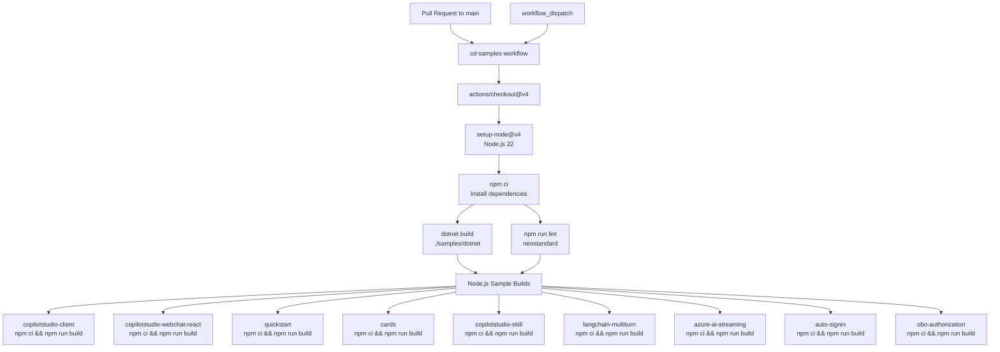
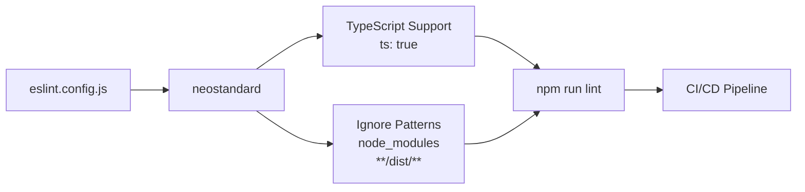
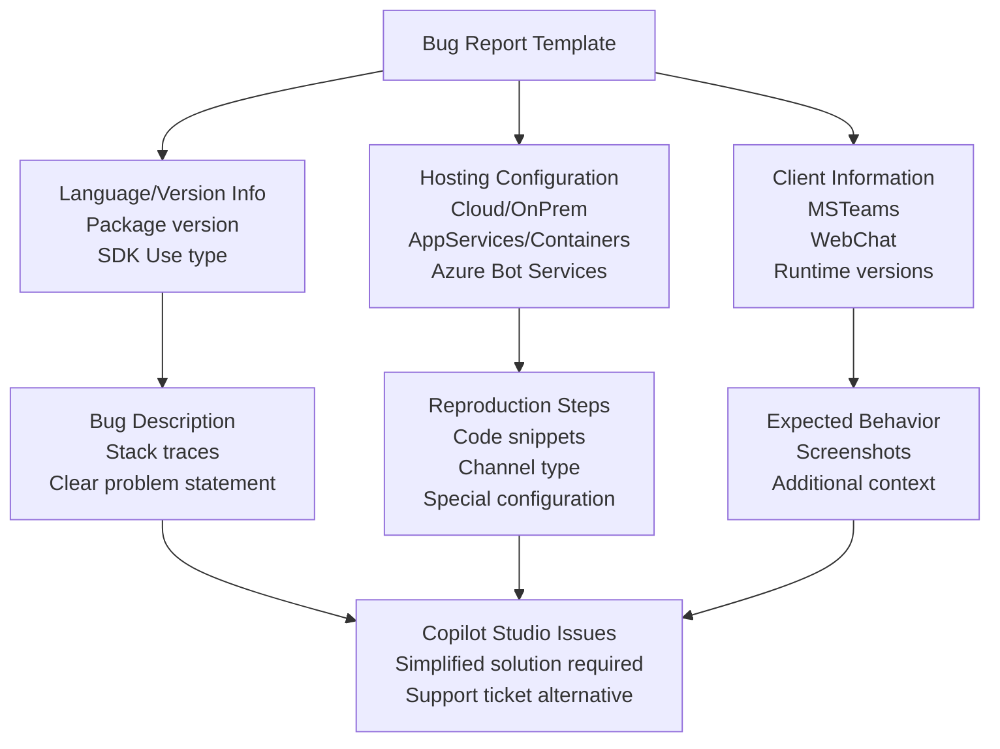
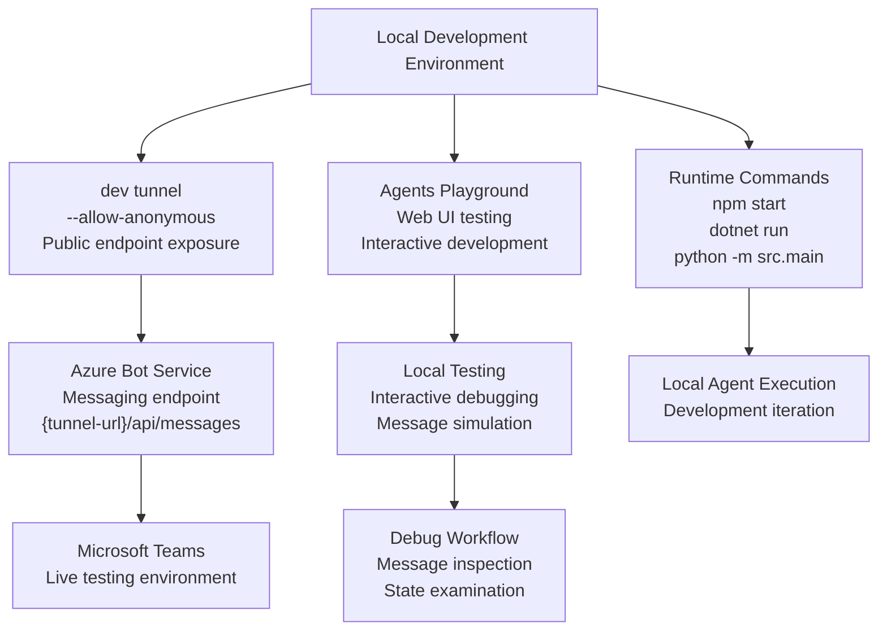

<!-- source: DeepWiki mcp.deepwiki.com · repo microsoft/Agents · page 8.4 Development Tools and Debugging · fetched 2026-10-26 -->

# Development Tools and Debugging

Relevant source files

The following files were used as context for generating this wiki page:

- [.github/workflows/cd-samples.yml](.github/workflows/cd-samples.yml)
- [eslint.config.js](eslint.config.js)
- [samples/nodejs/copilotstudio-webclient/web/index.html](samples/nodejs/copilotstudio-webclient/web/index.html)
- [samples/nodejs/quickstart/README.md](samples/nodejs/quickstart/README.md)
- [samples/nodejs/quickstart/env.TEMPLATE](samples/nodejs/quickstart/env.TEMPLATE)
- [samples/nodejs/quickstart/package.json](samples/nodejs/quickstart/package.json)
- [samples/nodejs/quickstart/src/index.ts](samples/nodejs/quickstart/src/index.ts)
- [samples/nodejs/quickstart/tsconfig.json](samples/nodejs/quickstart/tsconfig.json)

This page covers the development tools, debugging techniques, and quality assurance processes available when building agents with the Microsoft 365 Agents SDK. It includes automated testing pipelines, code quality tools, local development environments, and issue reporting mechanisms.

For information about local development setup and hosting environments, see [Local Development](#4.2). For details about building and deploying agents, see [CI/CD and Build Pipeline](#4.3).

## CI/CD Pipeline and Automated Testing

The Microsoft 365 Agents SDK includes a comprehensive continuous integration and deployment pipeline that automatically validates code quality and builds sample applications across multiple programming languages.

### GitHub Actions Workflow

The primary CI/CD pipeline is defined in the `cd-samples` workflow, which executes on every pull request to the main branch and can be manually triggered via workflow dispatch.

### Build Validation Process

The pipeline validates multiple components simultaneously:

| Component Type | Build Command | Working Directory |
|---|---|---|
| .NET Samples | `dotnet build` | `./samples/dotnet` |
| Node.js Dependencies | `npm ci` | Root directory |
| Copilot Studio Client | `npm ci && npm run build` | `./samples/nodejs/copilotstudio-client/` |
| React WebChat | `npm ci && npm run build` | `./samples/nodejs/copilotstudio-webchat-react/` |
| QuickStart Sample | `npm ci && npm run build` | `./samples/nodejs/quickstart` |
| Cards Sample | `npm ci && npm run build` | `./samples/nodejs/cards/` |
| Copilot Studio Skill | `npm ci && npm run build` | `./samples/nodejs/copilotstudio-skill/` |
| LangChain Multi-turn | `npm ci && npm run build` | `./samples/nodejs/langchain-multiturn/` |
| Azure AI Streaming | `npm ci && npm run build` | `./samples/nodejs/azure-ai-streaming/` |
| Auto Sign-in | `npm ci && npm run build` | `./samples/nodejs/auto-signin/` |
| OBO Authorization | `npm ci && npm run build` | `./samples/nodejs/obo-authorization/` |

Sources: [.github/workflows/cd-samples.yml:1-86]()

## Code Quality and Linting

The SDK enforces code quality through automated linting using the `neostandard` configuration, which provides TypeScript-aware linting rules.

### ESLint Configuration

The linting configuration excludes generated files and dependencies while ensuring TypeScript code quality across the entire repository.

Sources: [eslint.config.js:1-4](), [.github/workflows/cd-samples.yml:30-31]()

## Issue Reporting and Bug Tracking

The SDK provides structured issue templates to facilitate effective bug reporting and feature requests, enabling developers to provide comprehensive information for debugging and development.

### Bug Report Template Structure

### Issue Template Categories

The SDK provides three primary issue template types:

| Template | Purpose | Required Information |
|---|---|---|
| Bug Report | Report SDK functionality issues | Language version, hosting details, reproduction steps, stack traces |
| Feature Request | Suggest new SDK capabilities | Problem description, proposed solution, alternatives considered |
| Activity Protocol Spec Change | Request protocol modifications | Change type (Add/Change), detailed proposal with justification |

### Bug Report Information Requirements

When reporting bugs, developers must provide:

- **Language/Version**: Package version, SDK use case (Agents Hosting/Clients/Tools)
- **Hosting Details**: Cloud/OnPrem deployment, AppServices/Containers, Azure Bot Services usage
- **Client Environment**: MSTeams/WebChat/other, runtime versions (.NET/Node.js/Python)
- **Reproduction Information**: Code snippets, channel type, special configuration
- **Stack Traces**: Complete error information and expected behavior

For Copilot Studio-related issues, the template requires either a simplified Power Platform solution demonstrating the problem or suggests creating a Microsoft Support ticket for complex scenarios.

Sources: [.github/ISSUE_TEMPLATE/bug_report.md:1-43](), [.github/ISSUE_TEMPLATE/feature-request-for-agent-sdk.md:1-21](), [.github/ISSUE_TEMPLATE/activity-protocol-spec-change-request.md:1-15]()

## Local Development Tools

While not directly visible in the provided files, the development ecosystem includes several tools for local development and testing based on the system overview:

### Development Environment Components

### Development Workflow Integration

The local development tools integrate with the CI/CD pipeline to provide a complete development experience from local testing through production deployment.

Sources: Based on system architecture overview and inferred from sample structure patterns

## Debugging Best Practices

When debugging agents in the Microsoft 365 Agents SDK ecosystem, developers should follow structured approaches based on the deployment environment and integration points.

### Debugging Checklist by Environment

| Environment | Key Areas | Tools |
|---|---|---|
| Local Development | Message routing, state management, authentication flow | dev tunnel, Agents Playground, local logs |
| Azure Bot Service | Messaging endpoint configuration, OAuth connections | Azure portal, Bot Service logs, Application Insights |
| Microsoft Teams | App manifest, permissions, channel-specific behavior | Teams Developer Portal, Teams client debugging |
| Copilot Studio | Skill integration, API invocation, token exchange | Copilot Studio testing environment, OBO flow debugging |

### Common Debugging Scenarios

Based on the bug report template structure, common debugging scenarios include:

- **Authentication Issues**: OBO token exchange failures, auto sign-in problems, multi-provider OAuth conflicts
- **Hosting Problems**: AppService/Container deployment issues, messaging endpoint misconfiguration
- **Client Integration**: Teams app manifest errors, WebChat integration problems, channel-specific failures
- **AI Integration**: Azure OpenAI streaming issues, Semantic Kernel function calling problems, LangChain workflow failures

Sources: [.github/ISSUE_TEMPLATE/bug_report.md:16-21](), inferred from CI/CD sample validation patterns