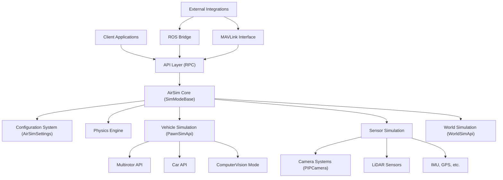
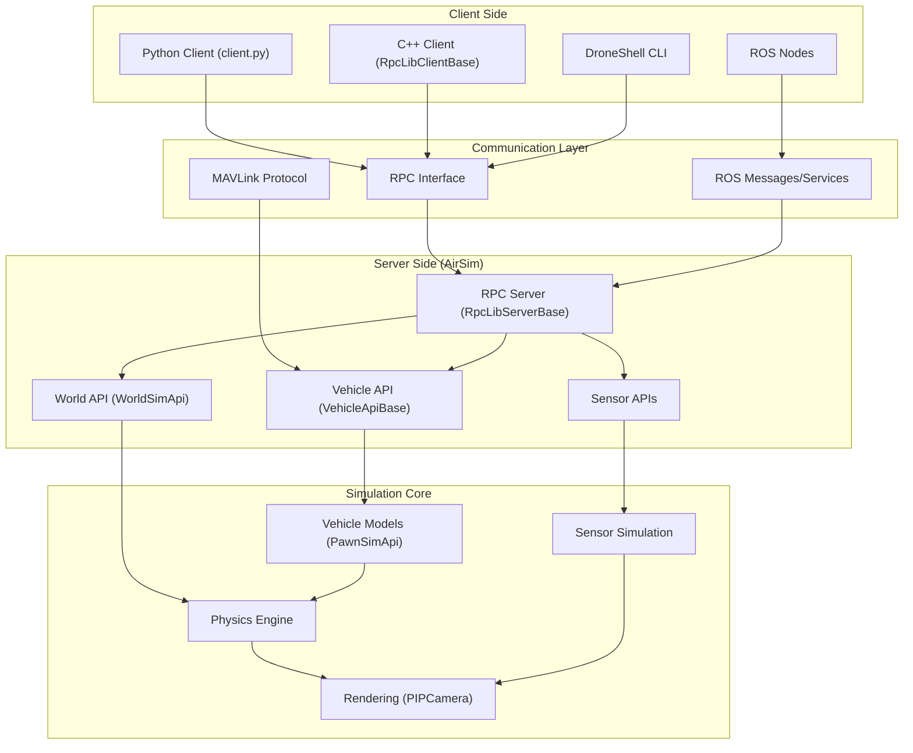
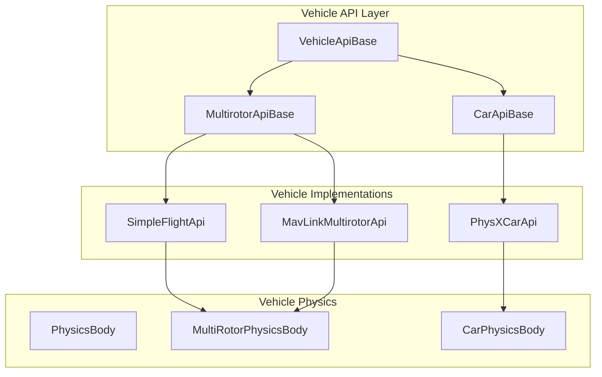

<!-- source: DeepWiki mcp.deepwiki.com · repo microsoft/AirSim · page 1 Overview · fetched 2026-10-26 -->

# Overview

Relevant source files

The following files were used as context for generating this wiki page:

- [AirLib/include/api/RpcLibClientBase.hpp](AirLib/include/api/RpcLibClientBase.hpp)
- [AirLib/include/api/VehicleSimApiBase.hpp](AirLib/include/api/VehicleSimApiBase.hpp)
- [AirLib/include/api/WorldSimApiBase.hpp](AirLib/include/api/WorldSimApiBase.hpp)
- [AirLib/include/common/AirSimSettings.hpp](AirLib/include/common/AirSimSettings.hpp)
- [AirLib/src/api/RpcLibClientBase.cpp](AirLib/src/api/RpcLibClientBase.cpp)
- [AirLib/src/api/RpcLibServerBase.cpp](AirLib/src/api/RpcLibServerBase.cpp)
- [PythonClient/airsim/client.py](PythonClient/airsim/client.py)
- [README.md](README.md)
- [Unity/AirLibWrapper/AirsimWrapper/Source/PawnSimApi.cpp](Unity/AirLibWrapper/AirsimWrapper/Source/PawnSimApi.cpp)
- [Unity/AirLibWrapper/AirsimWrapper/Source/PawnSimApi.h](Unity/AirLibWrapper/AirsimWrapper/Source/PawnSimApi.h)
- [Unity/AirLibWrapper/AirsimWrapper/Source/WorldSimApi.cpp](Unity/AirLibWrapper/AirsimWrapper/Source/WorldSimApi.cpp)
- [Unity/AirLibWrapper/AirsimWrapper/Source/WorldSimApi.h](Unity/AirLibWrapper/AirsimWrapper/Source/WorldSimApi.h)
- [Unreal/Plugins/AirSim/Content/Blueprints/BP_CameraDirector.uasset](Unreal/Plugins/AirSim/Content/Blueprints/BP_CameraDirector.uasset)
- [Unreal/Plugins/AirSim/Content/Blueprints/BP_SimHUDWidget.uasset](Unreal/Plugins/AirSim/Content/Blueprints/BP_SimHUDWidget.uasset)
- [Unreal/Plugins/AirSim/Source/AirBlueprintLib.cpp](Unreal/Plugins/AirSim/Source/AirBlueprintLib.cpp)
- [Unreal/Plugins/AirSim/Source/AirBlueprintLib.h](Unreal/Plugins/AirSim/Source/AirBlueprintLib.h)
- [Unreal/Plugins/AirSim/Source/CameraDirector.cpp](Unreal/Plugins/AirSim/Source/CameraDirector.cpp)
- [Unreal/Plugins/AirSim/Source/CameraDirector.h](Unreal/Plugins/AirSim/Source/CameraDirector.h)
- [Unreal/Plugins/AirSim/Source/PIPCamera.cpp](Unreal/Plugins/AirSim/Source/PIPCamera.cpp)
- [Unreal/Plugins/AirSim/Source/PIPCamera.h](Unreal/Plugins/AirSim/Source/PIPCamera.h)
- [Unreal/Plugins/AirSim/Source/PawnSimApi.cpp](Unreal/Plugins/AirSim/Source/PawnSimApi.cpp)
- [Unreal/Plugins/AirSim/Source/PawnSimApi.h](Unreal/Plugins/AirSim/Source/PawnSimApi.h)
- [Unreal/Plugins/AirSim/Source/SimHUD/SimHUD.cpp](Unreal/Plugins/AirSim/Source/SimHUD/SimHUD.cpp)
- [Unreal/Plugins/AirSim/Source/SimHUD/SimHUD.h](Unreal/Plugins/AirSim/Source/SimHUD/SimHUD.h)
- [Unreal/Plugins/AirSim/Source/SimHUD/SimHUDWidget.h](Unreal/Plugins/AirSim/Source/SimHUD/SimHUDWidget.h)
- [Unreal/Plugins/AirSim/Source/SimMode/SimModeBase.cpp](Unreal/Plugins/AirSim/Source/SimMode/SimModeBase.cpp)
- [Unreal/Plugins/AirSim/Source/SimMode/SimModeBase.h](Unreal/Plugins/AirSim/Source/SimMode/SimModeBase.h)
- [Unreal/Plugins/AirSim/Source/WorldSimApi.cpp](Unreal/Plugins/AirSim/Source/WorldSimApi.cpp)
- [Unreal/Plugins/AirSim/Source/WorldSimApi.h](Unreal/Plugins/AirSim/Source/WorldSimApi.h)
- [docs/code_structure.md](docs/code_structure.md)
- [docs/coding_guidelines.md](docs/coding_guidelines.md)
- [docs/images/unreal_versions.png](docs/images/unreal_versions.png)
- [docs/playback.md](docs/playback.md)
- [docs/use_precompiled.md](docs/use_precompiled.md)

AirSim is an open-source, cross-platform simulator for autonomous vehicles built on Unreal Engine (with experimental Unity support). It provides a platform for AI research to experiment with deep learning, computer vision, and reinforcement learning algorithms for autonomous vehicles like drones and cars.

For setup instructions, see [Installation and Setup](#1.1). For details on the underlying architecture, see [Core Architecture](#1.2).

## Purpose and Capabilities

AirSim offers:

- Physics-rich simulation for drones, cars, and other autonomous systems
- Software-in-the-loop (SITL) and hardware-in-the-loop (HITL) simulation with flight controllers like PX4 and ArduPilot
- Cross-platform support for Windows, Linux, and macOS
- Realistic environments with weather effects, time-of-day settings, and dynamic world manipulation
- Extensive sensor simulation (cameras, LiDAR, IMU, GPS, barometer, magnetometer, etc.)
- APIs in multiple languages (Python, C++, C#, Java) via RPC
- Integration with robotics frameworks (ROS1, ROS2) and flight controllers (MAVLink)

## System Architecture

### High-Level Architecture

Sources: [README.md:7-20]()), [AirLib/include/common/AirSimSettings.hpp:30-37](), [Unreal/Plugins/AirSim/Source/SimMode/SimModeBase.cpp:30-45]()

### Client-Server Communication

AirSim uses a client-server architecture where clients communicate with the simulation via RPC (Remote Procedure Call):

Sources: [PythonClient/airsim/client.py:12-20](), [AirLib/src/api/RpcLibClientBase.cpp:49-70](), [AirLib/src/api/RpcLibServerBase.cpp:42-80]()

## Core Components

### Simulation Modes

AirSim supports different simulation modes depending on the vehicle type:

| Simulation Mode | Description | Main Class |
|-----------------|-------------|------------|
| Multirotor | Simulates drones with realistic physics | `SimModeWorldMultiRotor` |
| Car | Simulates cars with PhysX-based physics | `SimModeCar` |
| ComputerVision | No vehicle simulation, focuses on camera/sensor data | `SimModeComputerVision` |

Sources: [Unreal/Plugins/AirSim/Source/SimHUD/SimHUD.cpp:6-8](), [AirLib/include/common/AirSimSettings.hpp:42-44]()

### Vehicle System

Vehicle simulation in AirSim follows a layered architecture:

Sources: [AirLib/include/common/AirSimSettings.hpp:31-37](), [AirLib/include/api/VehicleSimApiBase.hpp:19-31](), [Unreal/Plugins/AirSim/Source/PawnSimApi.h:25-40]()

### Sensor Systems

AirSim simulates various sensors needed for autonomous vehicle research:

| Sensor Type | Description | Main Classes |
|-------------|-------------|--------------|
| Cameras | RGB, depth, segmentation, surface normals, etc. | `PIPCamera`, `UnrealImageCapture` |
| LiDAR | Point cloud data | `LidarSimple` |
| IMU | Acceleration and angular velocity | `ImuBase` |
| GPS | Geolocation data | `GpsBase` |
| Barometer | Altitude data | `BarometerBase` |
| Magnetometer | Compass/orientation data | `MagnetometerBase` |
| Distance Sensor | Obstacle detection | `DistanceBase` |

Sources: [Unreal/Plugins/AirSim/Source/PIPCamera.cpp:39-48](), [AirLib/include/common/AirSimSettings.hpp:232-256]()

## Configuration System

AirSim is configured using a `settings.json` file that allows customization of:

- Vehicle types and settings
- Camera and sensor configurations
- Recording settings
- Environment parameters
- Physics engine settings
- API and communication settings

The settings are managed by the `AirSimSettings` class, which parses the JSON file and provides configuration to all components of the system.

Sources: [AirLib/include/common/AirSimSettings.hpp:385-416](), [AirLib/include/common/AirSimSettings.hpp:435-480]()

## API System

AirSim provides APIs for:

1. **Vehicle Control**
   - Movement commands (e.g., moveByVelocity, moveToPosition)
   - State retrieval (e.g., getPosition, getOrientation)
   - Vehicle-specific controls (e.g., arm/disarm, takeoff/land for drones)

2. **Sensor Data Retrieval**
   - Camera images (RGB, depth, segmentation, etc.)
   - LiDAR point clouds
   - IMU, GPS, and other sensor readings

3. **World Manipulation**
   - Object creation and manipulation
   - Environment control (weather, time of day)
   - Simulation control (pause, reset, etc.)

APIs are accessible through:
- Python client (`client.py`)
- C++ client (`RpcLibClientBase`)
- ROS interface
- Direct C++ API within the simulation

Sources: [PythonClient/airsim/client.py:13-147](), [AirLib/include/api/RpcLibClientBase.hpp:35-80](), [Unreal/Plugins/AirSim/Source/WorldSimApi.h:12-52]()

## External Integrations

### ROS Integration

AirSim provides ROS integration that allows:
- Publishing sensor data to ROS topics
- Subscribing to control commands from ROS
- Using ROS services for high-level operations

### MAVLink Integration

AirSim can communicate with MAVLink-compatible flight controllers:
- Software-in-the-loop (SITL) with PX4 or ArduPilot
- Hardware-in-the-loop (HITL) testing
- Connection to ground control stations like QGroundControl

Sources: [AirLib/include/common/AirSimSettings.hpp:292-344](), [Unreal/Plugins/AirSim/Source/WorldSimApi.cpp:28-40]()

## Getting Started

To use AirSim:

1. Download precompiled binaries or build from source
2. Configure `settings.json` for your needs
3. Connect using Python, C++, or other client interfaces
4. Control vehicles and retrieve sensor data through the API

For more detailed examples, see [Usage Examples](#1.3).

Sources: [README.md:24-60](), [docs/use_precompiled.md:1-7]()

---

