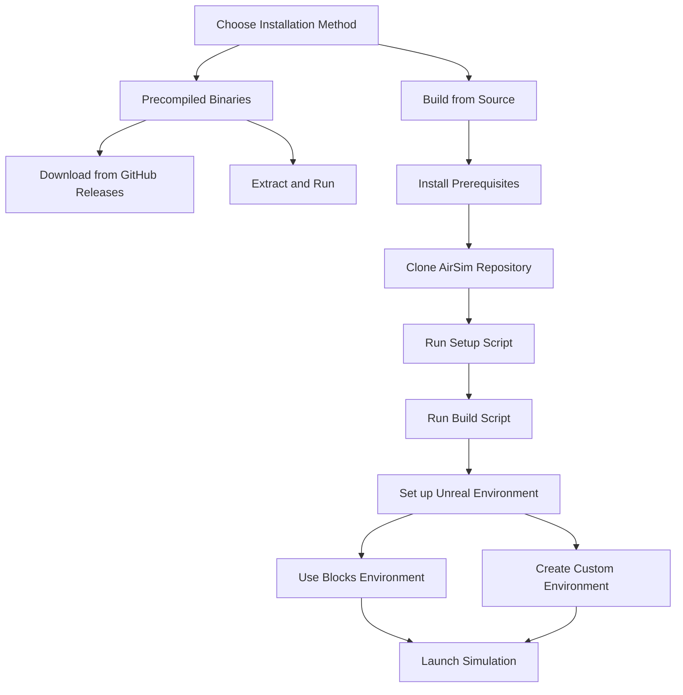
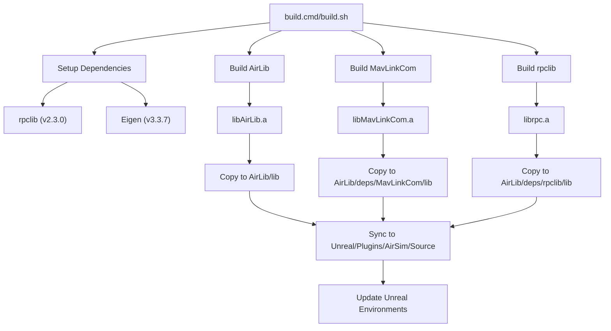
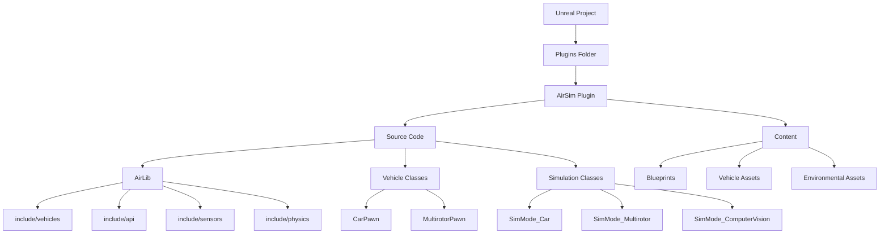

<!-- source: DeepWiki mcp.deepwiki.com · repo microsoft/AirSim · page 1.1 Installation and Setup · fetched 2026-10-26 -->

# Installation and Setup

<details>
<summary>Relevant source files</summary>

The following files were used as context for generating this wiki page:

- [.gitignore](.gitignore)
- [README.md](README.md)
- [Unreal/Environments/Blocks/.gitignore](Unreal/Environments/Blocks/.gitignore)
- [Unreal/Environments/Blocks/Blocks.uproject](Unreal/Environments/Blocks/Blocks.uproject)
- [Unreal/Environments/Blocks/GenerateProjectFiles.sh](Unreal/Environments/Blocks/GenerateProjectFiles.sh)
- [build.cmd](build.cmd)
- [build.sh](build.sh)
- [build_docs.sh](build_docs.sh)
- [cmake/cmake-modules/CommonSetup.cmake](cmake/cmake-modules/CommonSetup.cmake)
- [docs/build_linux.md](docs/build_linux.md)
- [docs/build_macos.md](docs/build_macos.md)
- [docs/build_windows.md](docs/build_windows.md)
- [docs/code_structure.md](docs/code_structure.md)
- [docs/coding_guidelines.md](docs/coding_guidelines.md)
- [docs/flight_controller.md](docs/flight_controller.md)
- [docs/images/unreal_versions.png](docs/images/unreal_versions.png)
- [docs/modify_recording_data.md](docs/modify_recording_data.md)
- [docs/playback.md](docs/playback.md)
- [docs/unreal_custenv.md](docs/unreal_custenv.md)
- [docs/unreal_upgrade.md](docs/unreal_upgrade.md)
- [docs/use_precompiled.md](docs/use_precompiled.md)
- [mkdocs.yml](mkdocs.yml)
- [setup.sh](setup.sh)

</details>


This document provides comprehensive instructions for installing and setting up AirSim on Windows, Linux, and macOS. It covers installation options including using precompiled binaries and building from source code. For information about API usage after installation, see [Core APIs](#3) and [Python Client API](#3).

## Installation Options

AirSim can be installed using precompiled binaries or built from source.

### Diagram: AirSim Installation Workflow



Sources: [README.md:24-38](https://github.com/microsoft/AirSim/blob/master/README.md), [docs/use_precompiled.md:1-13]()

## Using Precompiled Binaries

The quickest way to get started with AirSim is to download precompiled binaries:

### Windows and Linux
1. Download binaries for your chosen environment from the [AirSim GitHub releases page](https://github.com/microsoft/AirSim/releases)
2. Extract the files (use 7zip for multi-part archives - .001, .002, etc.)
3. Run the executable to start the simulation

### macOS
Precompiled binaries are not available for macOS. You'll need to build from source.

For lower-end GPUs, you can run AirSim in reduced resolution mode:
- Windows: Create a `run.bat` file with `start EnvironmentName -ResX=640 -ResY=480 -windowed`
- Linux: Use `./Blocks.sh -ResX=640 -ResY=480 -windowed`

Sources: [docs/use_precompiled.md:1-37]()

## Building from Source

### Prerequisites

| Platform | Requirements |
|----------|--------------|
| Windows  | - Windows 10 (64-bit)<br>- Visual Studio 2022 with Desktop C++ Development, Windows 10 SDK 10.0.19041<br>- Unreal Engine 4.27 |
| Linux    | - Ubuntu 18.04 LTS (recommended)<br>- LLVM/Clang 8<br>- CMake 3.10.0+ |
| macOS    | - macOS Catalina (10.15) or newer<br>- LLVM/Clang from Homebrew<br>- CMake 3.19.2+ |

Sources: [docs/build_windows.md:1-18](), [docs/build_linux.md:1-12](), [docs/build_macos.md:1-12]()

### Build System Architecture

The following diagram illustrates how the build scripts compile and assemble AirSim components:



Sources: [build.cmd:83-143](), [build.sh:98-143](), [cmake/cmake-modules/CommonSetup.cmake:1-100]()

### Windows Build Instructions

1. **Install Unreal Engine 4.27**
   - Download and install the Epic Games Launcher
   - In the Unreal Engine tab, install UE 4.27
   - Make sure UE 4.27 is set as "current" using the dropdown next to the Launch button

2. **Install Visual Studio 2022**
   - Select "Desktop Development with C++" and "Windows 10 SDK 10.0.19041"
   - Also select the latest .NET Framework SDK under "Individual Components"

3. **Clone and Build AirSim**
   - Start "Developer Command Prompt for VS 2022"
   - Clone the repository: `git clone https://github.com/Microsoft/AirSim.git`
   - Navigate to the AirSim directory: `cd AirSim`
   - Run the build script: `build.cmd`

4. **Build Unreal Project**
   - Open the Unreal Engine
   - Navigate to the Blocks environment in `AirSim\Unreal\Environments\Blocks`
   - Double-click the .sln file to open the project in Visual Studio
   - Set "Blocks" as the StartUp project and ensure build configuration is "Development Editor" and "x64"
   - Build and run the project

Sources: [docs/build_windows.md:1-50](), [build.cmd:1-224]()

### Linux Build Instructions

1. **Register with Epic Games and Build Unreal Engine**
   ```bash
   git clone -b 4.27 git@github.com:EpicGames/UnrealEngine.git
   cd UnrealEngine
   ./Setup.sh
   ./GenerateProjectFiles.sh
   make
   ```

2. **Clone and Build AirSim**
   ```bash
   git clone https://github.com/Microsoft/AirSim.git
   cd AirSim
   ./setup.sh
   ./build.sh  # Use ./build.sh --debug for debug build
   ```

3. **Launch Unreal Engine with AirSim**
   ```bash
   cd UnrealEngine
   ./Engine/Binaries/Linux/UE4Editor
   ```
   - Choose Browse and select `AirSim/Unreal/Environments/Blocks/Blocks.uproject`
   - If prompted to rebuild, choose Yes
   - After Unreal Editor loads, press Play button

Sources: [docs/build_linux.md:15-66](), [setup.sh:1-202](), [build.sh:1-159]()

### macOS Build Instructions

1. **Install Unreal Engine 4.27**
   - Download and install the Epic Games Launcher
   - In the Library tab, install Unreal Engine 4.27
   - Make sure UE 4.27 is set as "current"

2. **Clone and Build AirSim**
   ```bash
   git clone https://github.com/Microsoft/AirSim.git
   cd AirSim
   ./setup.sh
   ./build.sh
   ```

3. **Generate and Open Unreal Project**
   ```bash
   cd AirSim/Unreal/Environments/Blocks
   ./GenerateProjectFiles.sh /Users/Shared/Epic\ Games/UE_4.27/
   ```
   - Open the generated Blocks.xcworkspace
   - Build and run the project

Sources: [docs/build_macos.md:13-56](), [Unreal/Environments/Blocks/GenerateProjectFiles.sh:1-30]()

## Setting Up the Unreal Environment

After building AirSim, you need to set up an Unreal environment:

### AirSim Components in Unreal Engine



Sources: [docs/code_structure.md:1-54]()

### Using the Blocks Environment

The easiest way to get started is with the provided Blocks environment:

1. Navigate to `AirSim/Unreal/Environments/Blocks`
2. For Windows:
   - Open the .sln file
   - Set "Blocks" as the StartUp project
   - Set the build configuration to "Development Editor" and "x64"
   - Build and run

3. For Linux:
   - Launch Unreal Editor: `./UnrealEngine/Engine/Binaries/Linux/UE4Editor`
   - Browse to Blocks.uproject: `AirSim/Unreal/Environments/Blocks/Blocks.uproject`
   - After Unreal Editor loads, press Play

4. For macOS:
   - Open the generated Blocks.xcworkspace
   - Press Build and run in XCode
   - After Unreal Editor loads, press Play

### Creating a Custom Environment

To use AirSim with your own Unreal environment:

1. Create or obtain an Unreal project
2. Copy `AirSim/Unreal/Plugins` folder to your project's root folder
3. Edit your project's .uproject file to include AirSim:
   ```json
   {
     "FileVersion": 3,
     "EngineAssociation": "4.27",
     "Modules": [
       {
         "Name": "YourProjectName",
         "Type": "Runtime",
         "LoadingPhase": "Default",
         "AdditionalDependencies": [
           "AirSim"
         ]
       }
     ],
     "Plugins": [
       {
         "Name": "AirSim",
         "Enabled": true
       }
     ]
   }
   ```
4. In Unreal Editor, go to `Window/World Settings` and set `GameMode Override` to `AirSimGameMode`
5. Go to 'Edit->Editor Preferences', search for 'CPU' and ensure that 'Use Less CPU when in Background' is unchecked

Sources: [docs/unreal_custenv.md:1-145](), [Unreal/Environments/Blocks/Blocks.uproject:1-30]()

## Configuring AirSim

AirSim can be configured through the `settings.json` file located in:
- Windows: `Documents\AirSim`
- Linux/macOS: `~/Documents/AirSim`

Basic configuration to set vehicle type:
```json
{
  "SettingsVersion": 1.2,
  "SimMode": "Multirotor"  // or "Car" or "ComputerVision"
}
```

For detailed configuration options, see [Settings](#2).

Sources: [README.md:67-81]()

## Remote Control Setup (Optional)

For manual control of a multirotor:
- You can use a remote control (RC) such as an Xbox controller
- Alternatively, use APIs for programmatic control
- In Computer Vision mode, you can move around using keyboard controls

See [Remote Control](#1.3) for more details.

Sources: [README.md:49-53](), [docs/build_windows.md:29-34](), [docs/build_linux.md:67-72](), [docs/build_macos.md:60-65]()

## Troubleshooting Common Issues

### Windows
- Ensure you're using Visual Studio 2022
- Make sure you have all required Visual Studio components installed
- AirSim requires Unreal Engine 4.27; other versions may cause compatibility issues

### Linux
- If encountering issues building Unreal Engine, check Epic Games documentation
- Run `sudo apt-get update` and ensure you have all required development libraries
- Permission issues might require using `sudo` for certain operations

### macOS
- Make sure you have the correct version of LLVM/Clang and CMake installed
- XCode and command-line tools may be required for some operations

### General Issues
- If using a lower-end GPU, run in lower resolution mode as described in the precompiled binaries section
- If experiencing crashes or performance issues, check the settings.json configuration
- Make sure all prerequisites are installed correctly before building

Sources: [.gitignore:1-406](), [build.cmd:56-62](), [build.sh:76-79]()

## Next Steps

After successful installation, you can:
1. Learn about [API usage](#3) for programmatic control
2. Configure [settings.json](#2) for customized simulation
3. Create a [custom environment](#1.2) for your specific needs
4. Set up [remote control](#1.3) for manual flight

---

