<!-- source: DeepWiki mcp.deepwiki.com · repo microsoft/AirSim · page 1.2 Core Architecture · fetched 2026-10-26 -->

# Core Architecture

Relevant source files

The following files were used as context for generating this wiki page:

- [AirLib/AirLib.vcxproj](AirLib/AirLib.vcxproj)
- [AirLib/AirLib.vcxproj.filters](AirLib/AirLib.vcxproj.filters)
- [AirLib/include/api/RpcLibClientBase.hpp](AirLib/include/api/RpcLibClientBase.hpp)
- [AirLib/include/api/VehicleSimApiBase.hpp](AirLib/include/api/VehicleSimApiBase.hpp)
- [AirLib/include/api/WorldSimApiBase.hpp](AirLib/include/api/WorldSimApiBase.hpp)
- [AirLib/include/common/AirSimSettings.hpp](AirLib/include/common/AirSimSettings.hpp)
- [AirLib/src/api/RpcLibClientBase.cpp](AirLib/src/api/RpcLibClientBase.cpp)
- [AirLib/src/api/RpcLibServerBase.cpp](AirLib/src/api/RpcLibServerBase.cpp)
- [AirLibUnitTests/AirLibUnitTests.vcxproj](AirLibUnitTests/AirLibUnitTests.vcxproj)
- [DroneServer/DroneServer.vcxproj](DroneServer/DroneServer.vcxproj)
- [DroneShell/DroneShell.vcxproj](DroneShell/DroneShell.vcxproj)
- [Examples/Examples.vcxproj](Examples/Examples.vcxproj)
- [HelloCar/HelloCar.vcxproj](HelloCar/HelloCar.vcxproj)
- [HelloDrone/HelloDrone.vcxproj](HelloDrone/HelloDrone.vcxproj)
- [MavLinkCom/MavLinkCom.vcxproj](MavLinkCom/MavLinkCom.vcxproj)
- [MavLinkCom/MavLinkTest/MavLinkTest.vcxproj](MavLinkCom/MavLinkTest/MavLinkTest.vcxproj)
- [PythonClient/airsim/client.py](PythonClient/airsim/client.py)
- [SGM/src/sgmstereo/sgmstereo.vcxproj](SGM/src/sgmstereo/sgmstereo.vcxproj)
- [SGM/src/stereoPipeline/stereoPipeline.vcxproj](SGM/src/stereoPipeline/stereoPipeline.vcxproj)
- [Unity/AirLibWrapper/AirsimWrapper/Source/PawnSimApi.cpp](Unity/AirLibWrapper/AirsimWrapper/Source/PawnSimApi.cpp)
- [Unity/AirLibWrapper/AirsimWrapper/Source/PawnSimApi.h](Unity/AirLibWrapper/AirsimWrapper/Source/PawnSimApi.h)
- [Unity/AirLibWrapper/AirsimWrapper/Source/WorldSimApi.cpp](Unity/AirLibWrapper/AirsimWrapper/Source/WorldSimApi.cpp)
- [Unity/AirLibWrapper/AirsimWrapper/Source/WorldSimApi.h](Unity/AirLibWrapper/AirsimWrapper/Source/WorldSimApi.h)
- [Unreal/Plugins/AirSim/Content/Blueprints/BP_CameraDirector.uasset](Unreal/Plugins/AirSim/Content/Blueprints/BP_CameraDirector.uasset)
- [Unreal/Plugins/AirSim/Content/Blueprints/BP_SimHUDWidget.uasset](Unreal/Plugins/AirSim/Content/Blueprints/BP_SimHUDWidget.uasset)
- [Unreal/Plugins/AirSim/Source/AirBlueprintLib.cpp](Unreal/Plugins/AirSim/Source/AirBlueprintLib.cpp)
- [Unreal/Plugins/AirSim/Source/AirBlueprintLib.h](Unreal/Plugins/AirSim/Source/AirBlueprintLib.h)
- [Unreal/Plugins/AirSim/Source/CameraDirector.cpp](Unreal/Plugins/AirSim/Source/CameraDirector.cpp)
- [Unreal/Plugins/AirSim/Source/CameraDirector.h](Unreal/Plugins/AirSim/Source/CameraDirector.h)
- [Unreal/Plugins/AirSim/Source/PIPCamera.cpp](Unreal/Plugins/AirSim/Source/PIPCamera.cpp)
- [Unreal/Plugins/AirSim/Source/PIPCamera.h](Unreal/Plugins/AirSim/Source/PIPCamera.h)
- [Unreal/Plugins/AirSim/Source/PawnSimApi.cpp](Unreal/Plugins/AirSim/Source/PawnSimApi.cpp)
- [Unreal/Plugins/AirSim/Source/PawnSimApi.h](Unreal/Plugins/AirSim/Source/PawnSimApi.h)
- [Unreal/Plugins/AirSim/Source/SimHUD/SimHUD.cpp](Unreal/Plugins/AirSim/Source/SimHUD/SimHUD.cpp)
- [Unreal/Plugins/AirSim/Source/SimHUD/SimHUD.h](Unreal/Plugins/AirSim/Source/SimHUD/SimHUD.h)
- [Unreal/Plugins/AirSim/Source/SimHUD/SimHUDWidget.h](Unreal/Plugins/AirSim/Source/SimHUD/SimHUDWidget.h)
- [Unreal/Plugins/AirSim/Source/SimMode/SimModeBase.cpp](Unreal/Plugins/AirSim/Source/SimMode/SimModeBase.cpp)
- [Unreal/Plugins/AirSim/Source/SimMode/SimModeBase.h](Unreal/Plugins/AirSim/Source/SimMode/SimModeBase.h)
- [Unreal/Plugins/AirSim/Source/WorldSimApi.cpp](Unreal/Plugins/AirSim/Source/WorldSimApi.cpp)
- [Unreal/Plugins/AirSim/Source/WorldSimApi.h](Unreal/Plugins/AirSim/Source/WorldSimApi.h)

## Purpose and Scope

This document describes the core architectural components of AirSim, their interactions, and the primary communication model used in the system. It covers the simulation engine, API interfaces, client-server communication, and key classes that form the foundation of the AirSim platform. 

For information about vehicle configuration, see [Vehicle Configuration](#2.1). For details on sensor setup, see [Sensor Configuration](#2.2). For examples of using the Python client API, see [Python Client API](#3).

## High-Level Architecture Overview

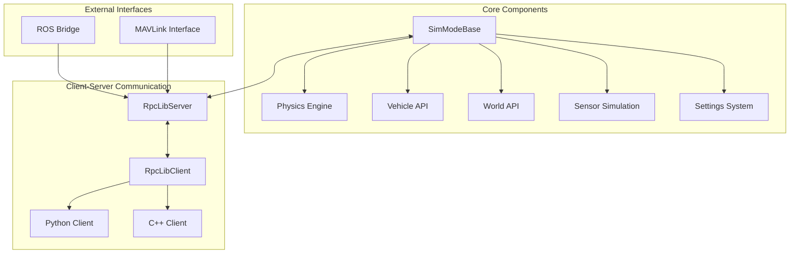

AirSim consists of several interconnected systems:

1. **SimModeBase**: The central controller that manages the simulation environment
2. **API Server**: Exposes simulation functionality to external clients through RPC
3. **Vehicle APIs**: Interfaces for controlling vehicles (cars, multirotors)
4. **World API**: Interface for interacting with the simulation world (objects, environment)
5. **Sensor Simulation**: Systems for cameras, LiDAR, IMU, and other sensors
6. **Settings System**: Configuration management through settings.json

Sources: [Unreal/Plugins/AirSim/Source/SimMode/SimModeBase.h](), [AirLib/include/api/WorldSimApiBase.hpp](), [AirLib/include/api/RpcLibServerBase.hpp]()

## Client-Server Architecture

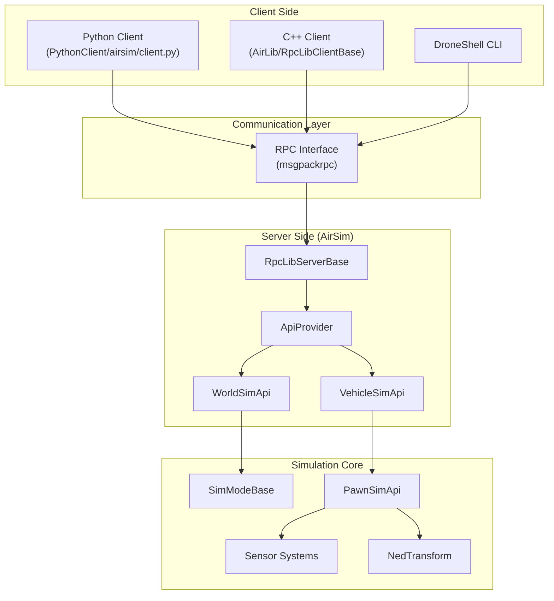

The client-server architecture allows multiple clients to connect to the simulation:

1. **Clients** (Python, C++, DroneShell) communicate with AirSim via RPC calls
2. **RpcLibServerBase** handles incoming requests and routes them to the appropriate APIs
3. **ApiProvider** manages access to vehicle and world simulation APIs
4. **Simulation Core** implements the actual simulation logic

Sources: [PythonClient/airsim/client.py](), [AirLib/src/api/RpcLibClientBase.cpp](), [AirLib/src/api/RpcLibServerBase.cpp]()

## Core Components in Detail

### SimModeBase

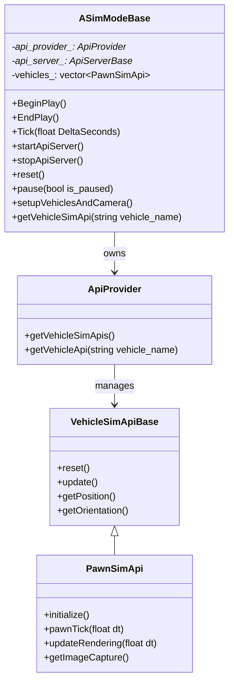

The `ASimModeBase` class (defined in [Unreal/Plugins/AirSim/Source/SimMode/SimModeBase.h]()) is the central controller of the simulation. Key methods include:

- `BeginPlay()`: Initializes the simulation, including physics, vehicles, and API server
- `startApiServer()`: Creates and starts the RPC server for client connections
- `setupVehiclesAndCamera()`: Creates vehicle pawns and cameras based on settings
- `getVehicleSimApi()`: Provides access to specific vehicle APIs

SimModeBase also manages the global NED (North-East-Down) transform, which converts between simulation and real-world coordinates.

Sources: [Unreal/Plugins/AirSim/Source/SimMode/SimModeBase.cpp](), [Unreal/Plugins/AirSim/Source/SimMode/SimModeBase.h]()

### RPC Server and Client

AirSim uses the RpcLib library for client-server communication:

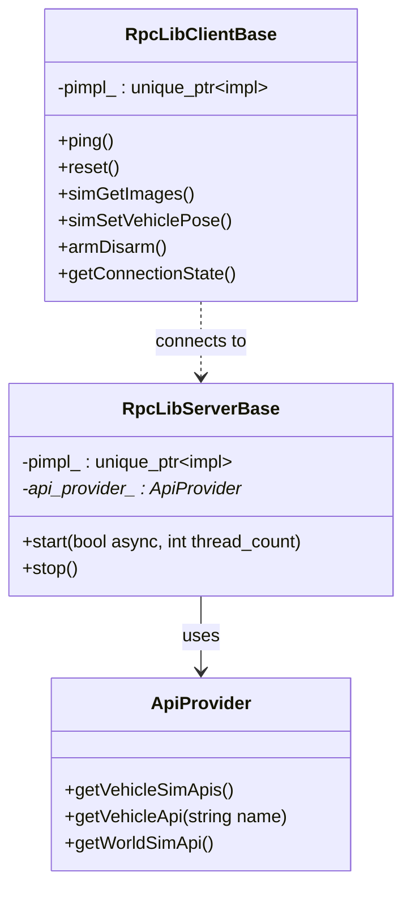

The API server (`RpcLibServerBase` in [AirLib/src/api/RpcLibServerBase.cpp]()) exposes simulation functionality through RPC calls. Each client connects to this server to interact with the simulation.

The client side (`RpcLibClientBase` in [AirLib/src/api/RpcLibClientBase.cpp]() or `client.py` in [PythonClient/airsim/client.py]()) provides methods that map to server functions, making it easy to control the simulation programmatically.

Sources: [AirLib/src/api/RpcLibServerBase.cpp](), [AirLib/src/api/RpcLibClientBase.cpp](), [PythonClient/airsim/client.py]()

### World and Vehicle APIs

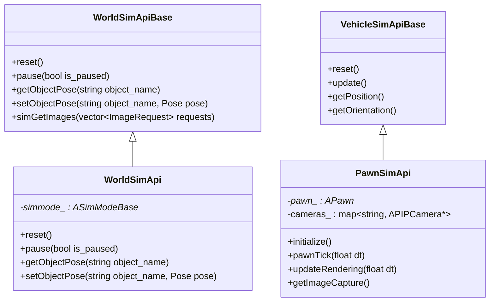

AirSim has two main API interfaces:

1. **WorldSimApi** ([Unreal/Plugins/AirSim/Source/WorldSimApi.cpp]()): Interacts with the simulation world, managing objects, environment, and physics
2. **PawnSimApi** ([Unreal/Plugins/AirSim/Source/PawnSimApi.cpp]()): Controls vehicles, handling position, orientation, sensors, and camera views

These APIs are exposed through the RPC server, allowing clients to interact with both the world and vehicles.

Sources: [Unreal/Plugins/AirSim/Source/WorldSimApi.h](), [Unreal/Plugins/AirSim/Source/PawnSimApi.h](), [AirLib/include/api/WorldSimApiBase.hpp]()

### Settings System

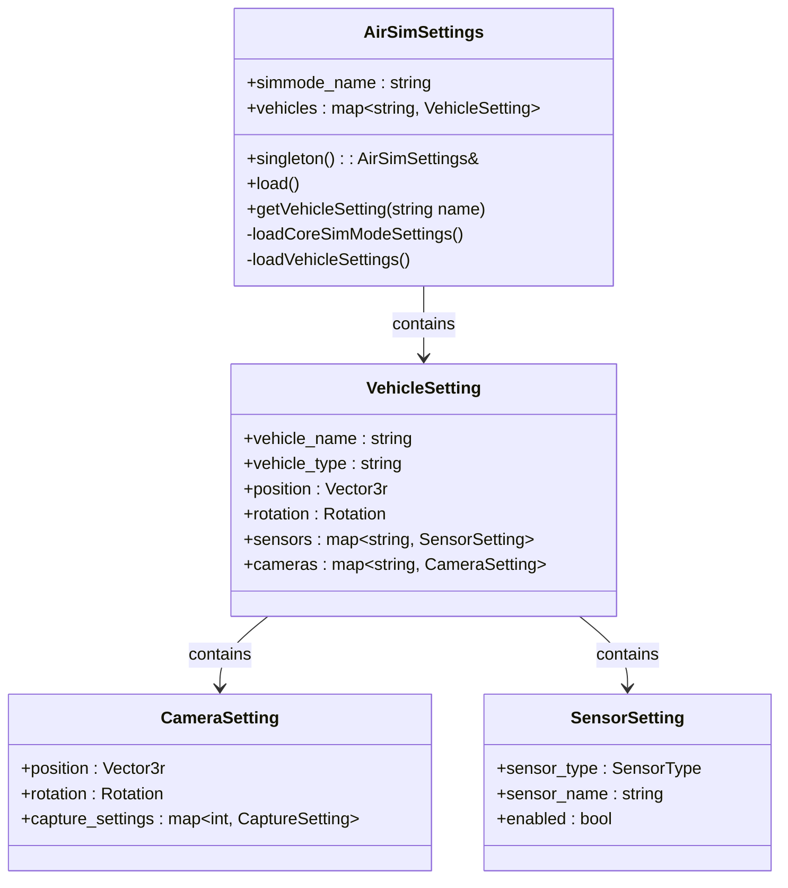

The `AirSimSettings` class ([AirLib/include/common/AirSimSettings.hpp]()) manages configuration from the settings.json file. It stores:

- Global simulation settings (physics engine, time of day)
- Vehicle settings (type, position, sensors)
- Camera settings (position, resolution, field of view)
- Recording settings

The settings are loaded at startup and accessed throughout the application using the singleton pattern.

Sources: [AirLib/include/common/AirSimSettings.hpp]()

### Camera System

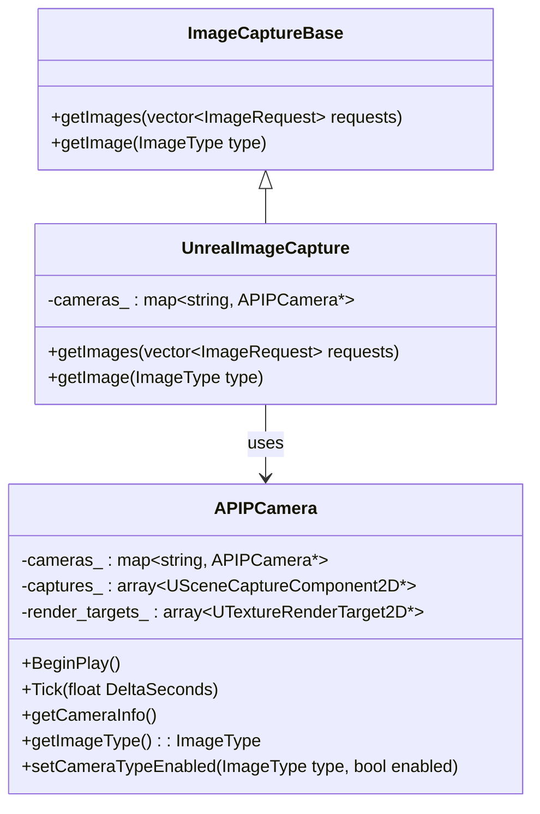

The camera system is based on the `APIPCamera` class ([Unreal/Plugins/AirSim/Source/PIPCamera.cpp]()), which supports multiple camera types:

- RGB (Scene)
- Depth
- Segmentation
- Surface Normals
- Infrared
- Optical Flow

Each camera can be independently enabled/disabled and configured with different resolutions, field of view, and post-processing settings.

Sources: [Unreal/Plugins/AirSim/Source/PIPCamera.h](), [Unreal/Plugins/AirSim/Source/PIPCamera.cpp]()

## Initialization Flow

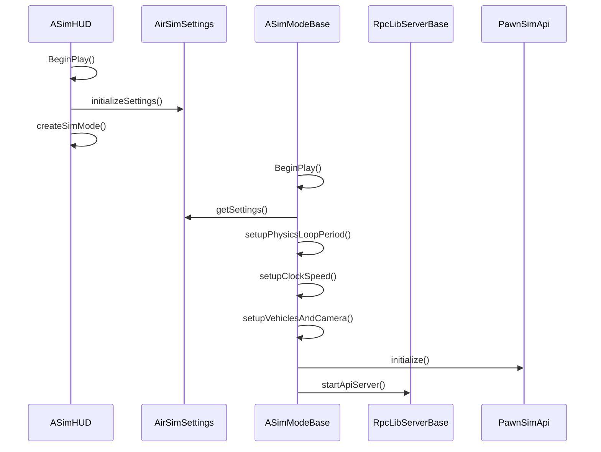

When AirSim starts, the initialization sequence is:

1. `ASimHUD` begins play and initializes settings from settings.json
2. It creates an appropriate SimMode based on the configuration
3. SimMode sets up physics, timing, vehicles, and cameras
4. Each vehicle's `PawnSimApi` is initialized
5. The API server is started to accept client connections

Sources: [Unreal/Plugins/AirSim/Source/SimHUD/SimHUD.cpp](), [Unreal/Plugins/AirSim/Source/SimMode/SimModeBase.cpp]()

## Client-Side API Usage

The most common way to interact with AirSim is through the Python client API. Here's how the communication flow works:

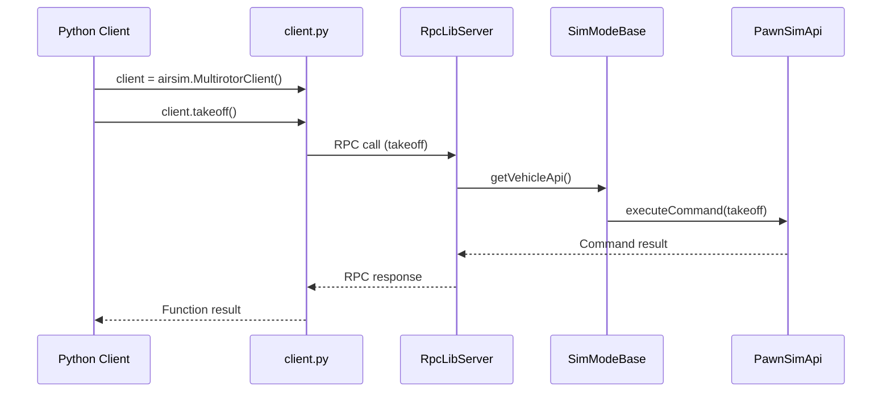

The Python client wraps RPC calls to the server, which then routes commands to the appropriate vehicle or world API.

Sources: [PythonClient/airsim/client.py](), [AirLib/src/api/RpcLibClientBase.cpp](), [AirLib/src/api/RpcLibServerBase.cpp]()

## Coordinate Systems and Transforms

AirSim uses multiple coordinate systems and transforms between them:

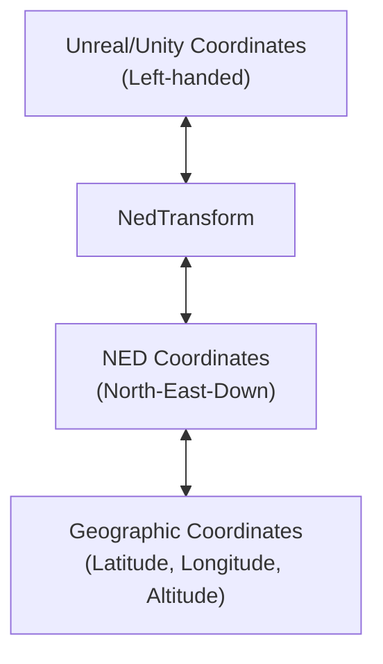

The `NedTransform` class handles conversions between:
- Engine coordinates (Unreal/Unity, left-handed)
- NED coordinates (North-East-Down, used in aviation)
- Geographic coordinates (latitude, longitude, altitude)

This allows for seamless integration with real-world navigation and control systems.

Sources: [Unreal/Plugins/AirSim/Source/NedTransform.h](), [Unreal/Plugins/AirSim/Source/PawnSimApi.cpp]()

## Sensor Architecture

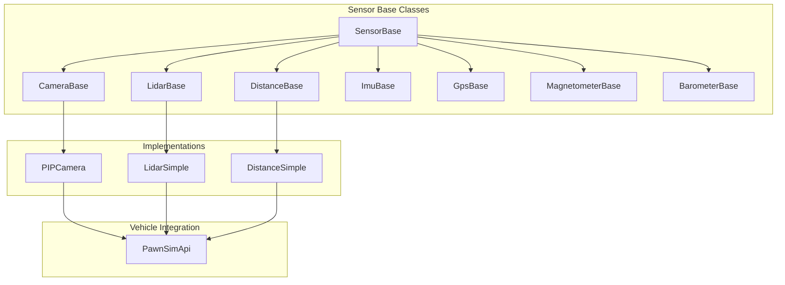

AirSim provides a flexible sensor architecture with base classes for different sensor types and specific implementations. Each sensor can be configured through settings.json and accessed through the vehicle API.

Sources: [Unreal/Plugins/AirSim/Source/PIPCamera.h](), [AirLib/include/sensors/lidar/LidarSimple.hpp]()

## Conclusion

AirSim's core architecture is designed around a client-server model with clear separation between the simulation core and client interfaces. The modular design allows for:

1. Supporting multiple vehicle types through a common API
2. Adding new sensors and capabilities without changing client code
3. Cross-platform support (Unreal, Unity) through abstraction layers
4. Integration with external systems like ROS and MAVLink

This design makes AirSim a powerful and flexible platform for autonomous vehicle research and development.

Sources: [SimModeBase.cpp](), [WorldSimApi.cpp](), [PawnSimApi.cpp](), [RpcLibClientBase.cpp](), [RpcLibServerBase.cpp]()

---

