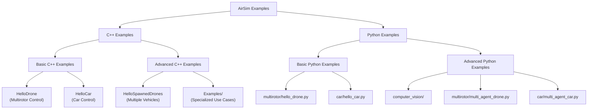
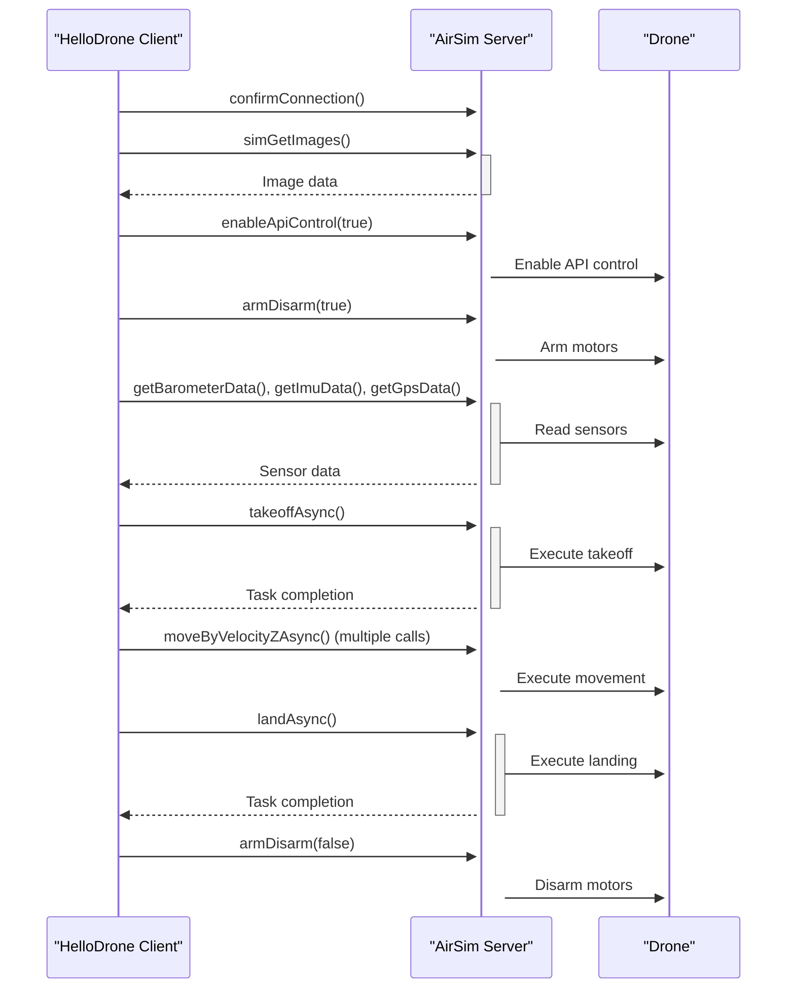
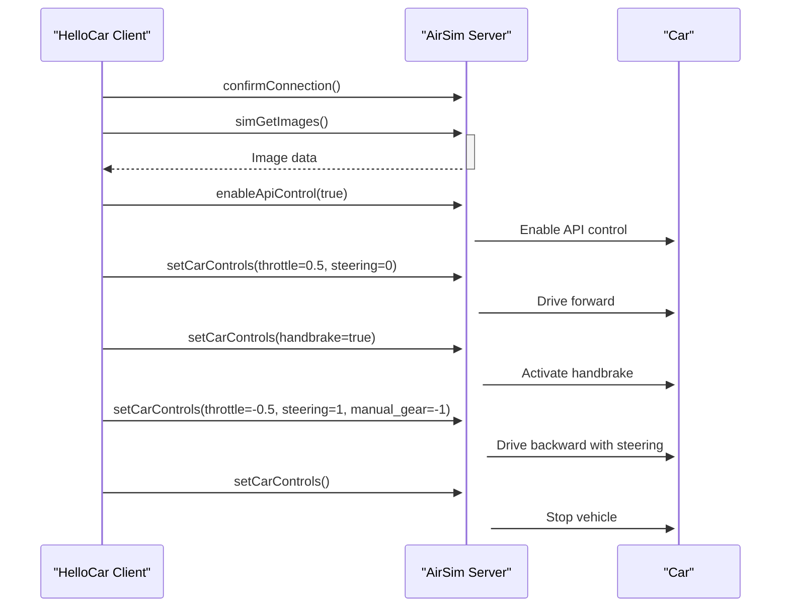
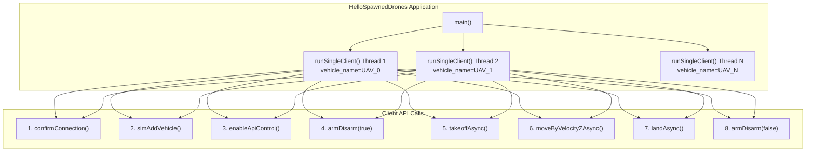
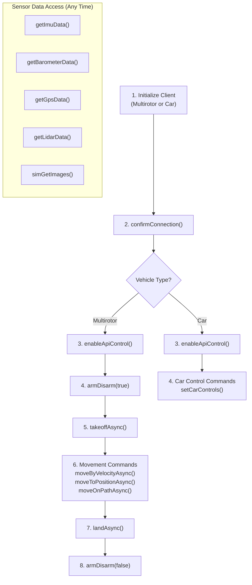
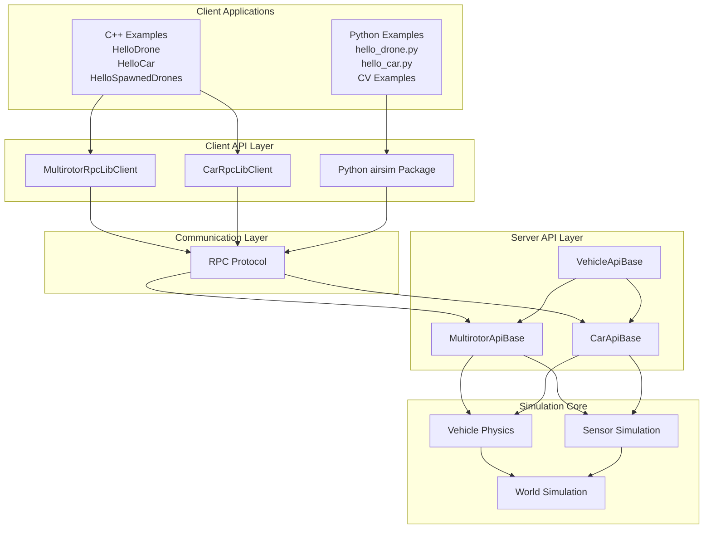

<!-- source: DeepWiki mcp.deepwiki.com · repo microsoft/AirSim · page 1.3 Usage Examples · fetched 2026-10-26 -->

# Usage Examples

Relevant source files

The following files were used as context for generating this wiki page:

- [AirLib/include/api/VehicleApiBase.hpp](AirLib/include/api/VehicleApiBase.hpp)
- [Examples/Examples.vcxproj.filters](Examples/Examples.vcxproj.filters)
- [Examples/main.cpp](Examples/main.cpp)
- [HelloCar/main.cpp](HelloCar/main.cpp)
- [HelloDrone/main.cpp](HelloDrone/main.cpp)
- [HelloSpawnedDrones/HelloSpawnedDrones.cpp](HelloSpawnedDrones/HelloSpawnedDrones.cpp)
- [HelloSpawnedDrones/HelloSpawnedDrones.vcxproj](HelloSpawnedDrones/HelloSpawnedDrones.vcxproj)
- [HelloSpawnedDrones/HelloSpawnedDrones.vcxproj.filters](HelloSpawnedDrones/HelloSpawnedDrones.vcxproj.filters)
- [PythonClient/PythonClient.pyproj](PythonClient/PythonClient.pyproj)
- [docs/apis_cpp.md](docs/apis_cpp.md)

This page provides practical examples of how to use AirSim's API for controlling vehicles and collecting simulation data. You'll find guidance on using both C++ and Python interfaces for common tasks such as vehicle control, sensor data retrieval, and computer vision applications. For information about the core architecture, see [Core Architecture](#1.2), and for detailed API documentation, see [Python Client API](#3) or [C++ API and Examples](#4).

## Example Organization

AirSim provides examples in multiple programming languages and for different vehicle types:

Sources: [PythonClient/PythonClient.pyproj:27-97](), [HelloDrone/main.cpp](), [HelloCar/main.cpp](), [HelloSpawnedDrones/HelloSpawnedDrones.cpp]()

## Basic Vehicle Control

### Hello Drone (C++)

The HelloDrone example demonstrates basic control of a multirotor drone using C++:

Key operations demonstrated:
- Connecting to the AirSim server and confirming connection
- Getting camera images from the drone
- Reading sensor data (barometer, IMU, GPS, magnetometer)
- Taking off, flying in a square pattern, and landing
- Arming and disarming the vehicle

Sources: [HelloDrone/main.cpp:21-139]()

### Hello Car (C++)

The HelloCar example demonstrates basic control of a car:

Key operations demonstrated:
- Connecting to the AirSim server
- Capturing camera images 
- Setting car controls (throttle, steering, handbrake)
- Switching to manual gear for reverse driving

Sources: [HelloCar/main.cpp:25-89]()

### Python Examples

AirSim provides equivalent Python examples for both vehicles:

- **hello_drone.py**: Demonstrates drone control with the Python API
- **hello_car.py**: Demonstrates car control with the Python API

The Python API follows similar patterns to the C++ examples with a more concise syntax. These examples are located in `PythonClient/multirotor/` and `PythonClient/car/` directories.

Sources: [PythonClient/PythonClient.pyproj:89-96]()

## Advanced Usage Examples

### Multi-Vehicle Control

The HelloSpawnedDrones example demonstrates how to spawn and control multiple drones programmatically:

Key features demonstrated:
- Creating multiple vehicles dynamically using `simAddVehicle()`
- Controlling each vehicle in a separate thread
- Coordinating vehicles to fly at different altitudes 
- Vehicle-specific API calls using the vehicle name parameter

Sources: [HelloSpawnedDrones/HelloSpawnedDrones.cpp:18-119](), [HelloSpawnedDrones/HelloSpawnedDrones.cpp:121-164]()

### Computer Vision Examples

AirSim includes several examples for computer vision applications:

- **cv_mode.py**: Demonstrates using AirSim in Computer Vision mode
- **cv_capture.py**: Shows how to capture images from different camera types
- **segmentation.py**: Demonstrates semantic segmentation with AirSim
- **ground_truth.py**: Shows how to extract ground truth data

These examples demonstrate capturing various image types:
- RGB images (`ImageType.Scene`)
- Depth maps (`ImageType.DepthPlanar`)
- Segmentation maps (`ImageType.Segmentation`)
- Surface normals (`ImageType.SurfaceNormals`)

Sources: [PythonClient/PythonClient.pyproj:44-53]()

## API Interaction Patterns

Most AirSim examples follow similar patterns for interacting with the API:

Sources: [HelloDrone/main.cpp:21-139](), [HelloCar/main.cpp:25-89](), [AirLib/include/api/VehicleApiBase.hpp:36-224]()

## Specialized Examples

### Stand-Alone Sensors

The Examples folder contains specialized examples for:

- **StandAloneSensors**: Demonstrates how to generate IMU, barometer, and magnetometer data independently of vehicle simulation
- **StandAlonePhysics**: Shows how to use AirSim's physics engine independently
- **DataCollection**: Contains tools for generating data for machine learning, including stereo image pairs

Sources: [Examples/main.cpp:15-52](), [Examples/main.cpp:54-61](), [Examples/main.cpp:63-83]()

### Depth Navigation

AirSim includes examples for depth-based navigation:

- **DepthNavThreshold**: Simple depth-based obstacle avoidance
- **DepthNavCost**: More sophisticated cost-based navigation using depth information

These examples demonstrate how to use depth information from cameras to navigate through environments autonomously.

Sources: [Examples/main.cpp:93-123](), [Examples/main.cpp:125-167]()

## Example-to-Architecture Mapping

This diagram shows how the examples map to AirSim's architecture:

Sources: [AirLib/include/api/VehicleApiBase.hpp:29-35](), [HelloDrone/main.cpp:12-22](), [HelloCar/main.cpp:12-25]()

## Getting Started with Examples

To run the examples:

1. **C++ Examples**:
   - Build the AirSim solution in Visual Studio 
   - Run the desired example executable (HelloDrone, HelloCar, etc.)

2. **Python Examples**:
   - Install the AirSim package: `pip install airsim`
   - Navigate to the PythonClient directory
   - Run the desired example: `python multirotor/hello_drone.py`

3. **Common Requirements**:
   - Make sure the UE4 editor or packaged game with AirSim is running
   - For car examples, ensure settings.json has `"SimMode": "Car"`
   - For drone examples, ensure settings.json has `"SimMode": "Multirotor"`

For more detailed API documentation, see the [Python API](#3) or [C++ API](#4) pages.

---

