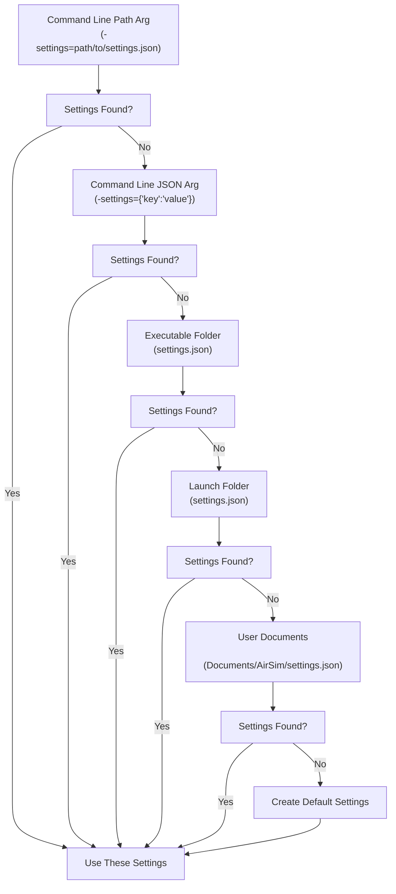
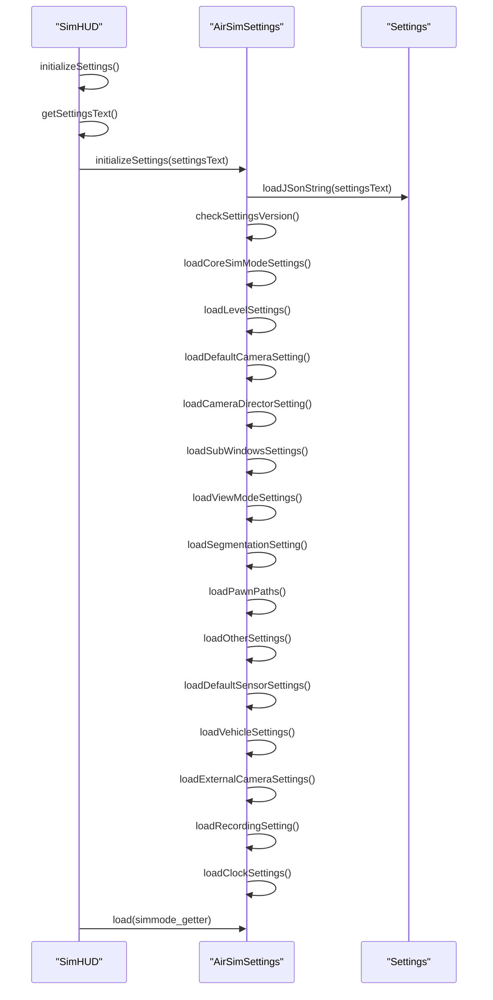
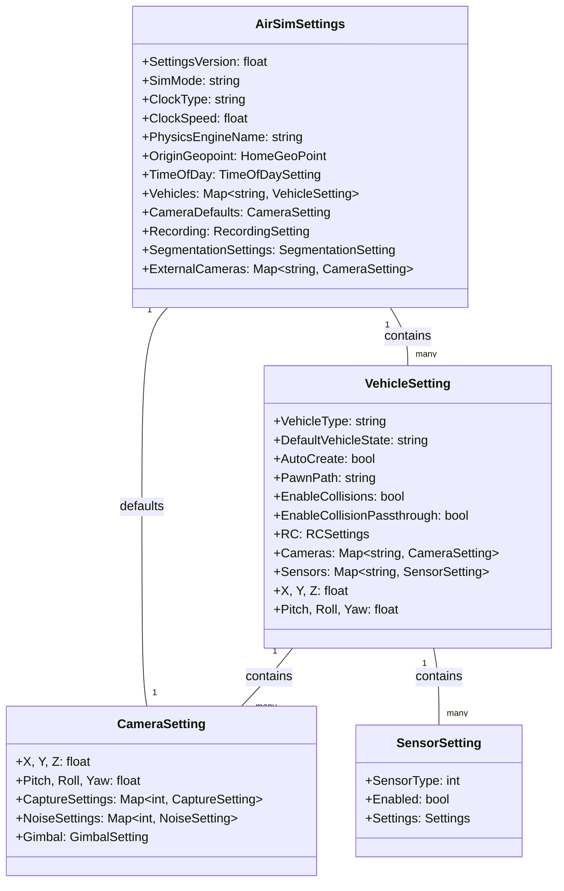
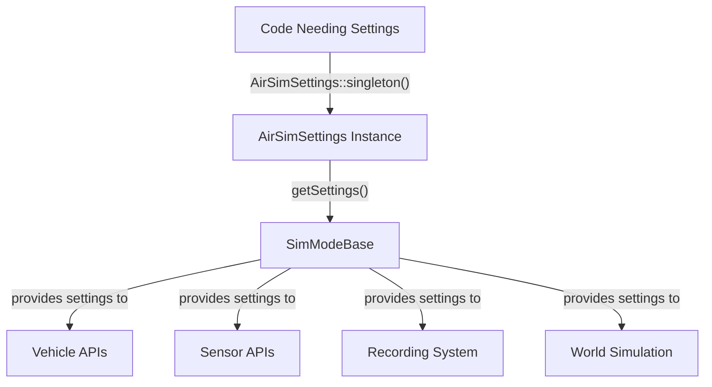
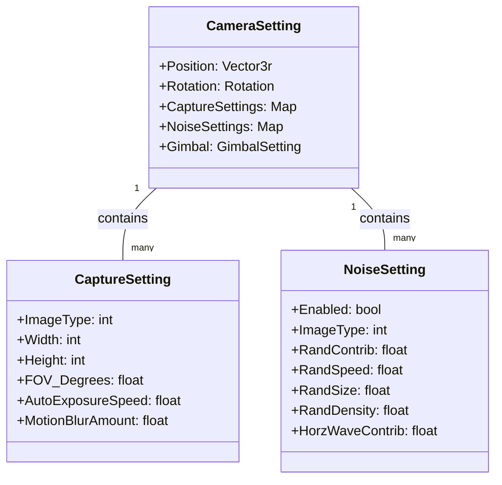
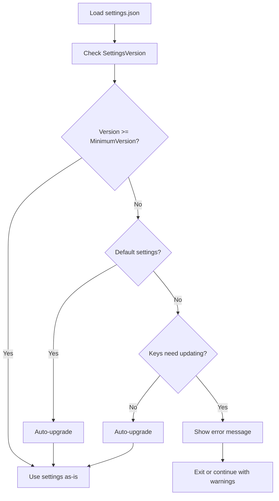
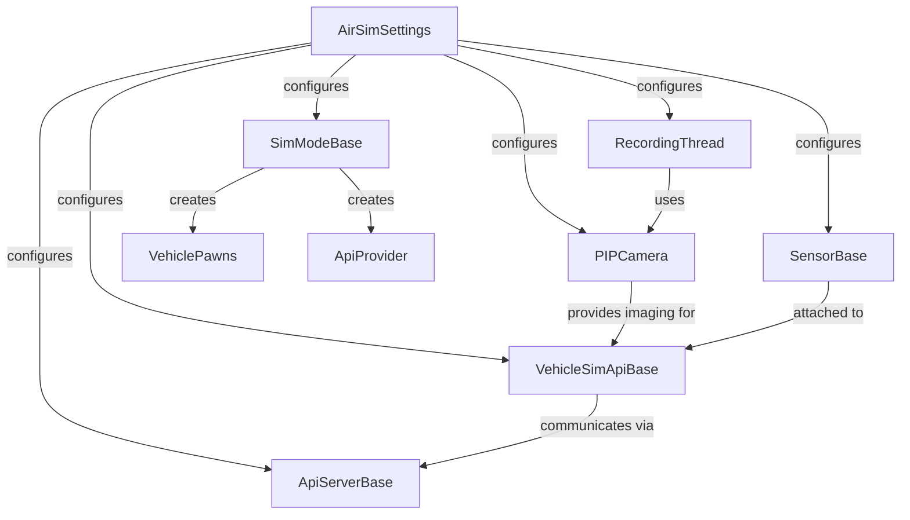

<!-- source: DeepWiki mcp.deepwiki.com · repo microsoft/AirSim · page 2 Configuration System · fetched 2026-10-26 -->

# Configuration System

<details>
<summary>Relevant source files</summary>

The following files were used as context for generating this wiki page:

- [AirLib/include/common/AirSimSettings.hpp](AirLib/include/common/AirSimSettings.hpp)
- [Unreal/Plugins/AirSim/Content/Blueprints/BP_CameraDirector.uasset](Unreal/Plugins/AirSim/Content/Blueprints/BP_CameraDirector.uasset)
- [Unreal/Plugins/AirSim/Content/Blueprints/BP_SimHUDWidget.uasset](Unreal/Plugins/AirSim/Content/Blueprints/BP_SimHUDWidget.uasset)
- [Unreal/Plugins/AirSim/Source/AirBlueprintLib.cpp](Unreal/Plugins/AirSim/Source/AirBlueprintLib.cpp)
- [Unreal/Plugins/AirSim/Source/AirBlueprintLib.h](Unreal/Plugins/AirSim/Source/AirBlueprintLib.h)
- [Unreal/Plugins/AirSim/Source/CameraDirector.cpp](Unreal/Plugins/AirSim/Source/CameraDirector.cpp)
- [Unreal/Plugins/AirSim/Source/CameraDirector.h](Unreal/Plugins/AirSim/Source/CameraDirector.h)
- [Unreal/Plugins/AirSim/Source/PIPCamera.cpp](Unreal/Plugins/AirSim/Source/PIPCamera.cpp)
- [Unreal/Plugins/AirSim/Source/PIPCamera.h](Unreal/Plugins/AirSim/Source/PIPCamera.h)
- [Unreal/Plugins/AirSim/Source/SimHUD/SimHUD.cpp](Unreal/Plugins/AirSim/Source/SimHUD/SimHUD.cpp)
- [Unreal/Plugins/AirSim/Source/SimHUD/SimHUD.h](Unreal/Plugins/AirSim/Source/SimHUD/SimHUD.h)
- [Unreal/Plugins/AirSim/Source/SimHUD/SimHUDWidget.h](Unreal/Plugins/AirSim/Source/SimHUD/SimHUDWidget.h)
- [Unreal/Plugins/AirSim/Source/SimMode/SimModeBase.cpp](Unreal/Plugins/AirSim/Source/SimMode/SimModeBase.cpp)
- [Unreal/Plugins/AirSim/Source/SimMode/SimModeBase.h](Unreal/Plugins/AirSim/Source/SimMode/SimModeBase.h)
- [docs/apis.md](docs/apis.md)
- [docs/custom_drone.md](docs/custom_drone.md)
- [docs/image_apis.md](docs/image_apis.md)
- [docs/px4_build.md](docs/px4_build.md)
- [docs/px4_lockstep.md](docs/px4_lockstep.md)
- [docs/px4_setup.md](docs/px4_setup.md)
- [docs/px4_sitl.md](docs/px4_sitl.md)
- [docs/px4_sitl_wsl2.md](docs/px4_sitl_wsl2.md)
- [docs/remote_control.md](docs/remote_control.md)
- [docs/settings.md](docs/settings.md)

</details>


The AirSim Configuration System provides a centralized way to customize the simulation environment, vehicles, sensors, and other aspects of the AirSim simulator. This document explains how the configuration system works, its architecture, and how to use it effectively to configure AirSim for different scenarios.

## Overview

AirSim uses a configuration system based on JSON files to allow users to customize the simulation environment. The main configuration file is called `settings.json`, and it contains settings for the simulation mode, vehicles, cameras, sensors, and other aspects of the simulation.

The configuration system is designed to be flexible and extensible, allowing users to customize almost every aspect of the simulation. It supports a variety of settings, from basic ones like selecting the vehicle type to advanced ones like configuring sensor parameters.

Sources: [AirLib/include/common/AirSimSettings.hpp:22-237](), [docs/settings.md:1-42]()

## Configuration Sources and Loading Order

AirSim searches for settings in the following order, using the first match found:



If no settings file is found, AirSim creates a default `settings.json` file in the user's Documents/AirSim folder with minimal settings.

Sources: [Unreal/Plugins/AirSim/Source/SimHUD/SimHUD.cpp:319-334](), [docs/settings.md:3-26]()

## Settings Initialization Process

When AirSim starts, it initializes the configuration system through the following process:



This process ensures that all settings are properly loaded and validated before the simulation starts.

Sources: [Unreal/Plugins/AirSim/Source/SimHUD/SimHUD.cpp:219-234](), [AirLib/include/common/AirSimSettings.hpp:435-456]()

## Configuration Structure

The AirSim configuration file is a hierarchical JSON document with the following main sections:



Sources: [AirLib/include/common/AirSimSettings.hpp:47-417](), [docs/settings.md:43-153]()

## Accessing Settings in Code

AirSim provides a singleton pattern to access settings throughout the codebase:



The `AirSimSettings::singleton()` method returns a reference to the global AirSimSettings instance, which can be used to access all configured settings.

Sources: [AirLib/include/common/AirSimSettings.hpp:422-426](), [Unreal/Plugins/AirSim/Source/SimMode/SimModeBase.cpp:434-437]()

## Key Settings Components

The AirSim configuration system includes several key components:

### SimMode

The `SimMode` setting determines which simulation mode to use:

- `"Multirotor"`: Drone simulation
- `"Car"`: Car simulation
- `"ComputerVision"`: Computer vision mode (no physics)
- `""`: Prompt user to select mode

Sources: [AirLib/include/common/AirSimSettings.hpp:42-44](), [docs/settings.md:212-218]()

### Vehicles

The `Vehicles` section contains settings for each vehicle in the simulation. Each vehicle has a name and type, along with numerous configuration options:

```
{
  "Vehicles": {
    "SimpleFlight": {
      "VehicleType": "SimpleFlight",
      "AutoCreate": true,
      "Sensors": {
        "Imu": {
          "SensorType": 2,
          "Enabled": true
        }
      },
      "Cameras": {
        "front_center": {
          "CaptureSettings": [
            {
              "ImageType": 0,
              "Width": 640,
              "Height": 480
            }
          ]
        }
      }
    }
  }
}
```

Sources: [AirLib/include/common/AirSimSettings.hpp:257-289](), [docs/settings.md:366-207]()

### Cameras

Camera settings allow configuration of both attached vehicle cameras and external cameras:



Sources: [AirLib/include/common/AirSimSettings.hpp:198-218](), [docs/settings.md:312-355]()

### Sensors

AirSim supports various sensors that can be configured through settings:

- IMU
- GPS
- Magnetometer
- Barometer
- Distance Sensor
- Lidar

Each sensor has its own configuration parameters defined in the settings.

Sources: [AirLib/include/common/AirSimSettings.hpp:225-255](), [docs/settings.md:216-218](), [docs/lidar.md]()

## Using Settings to Configure the Simulation

### Basic Configuration

A minimal settings.json file might look like:

```json
{
  "SettingsVersion": 1.2,
  "SimMode": "Multirotor"
}
```

This configures AirSim to use the multirotor simulation mode with default settings.

Sources: [docs/settings.md:29-36]()

### Vehicle Configuration

To configure a vehicle, add a `Vehicles` section:

```json
{
  "SettingsVersion": 1.2,
  "SimMode": "Multirotor",
  "Vehicles": {
    "MyDrone": {
      "VehicleType": "SimpleFlight",
      "X": 0, "Y": 0, "Z": -2,
      "Yaw": 90
    }
  }
}
```

This creates a drone named "MyDrone" using the SimpleFlight flight controller, positioned at coordinates (0, 0, -2) with a 90-degree yaw rotation.

Sources: [docs/settings.md:159-178]()

### Camera Configuration

To configure cameras, add a `Cameras` section within a vehicle:

```json
{
  "Vehicles": {
    "MyDrone": {
      "Cameras": {
        "high_res": {
          "CaptureSettings": [
            {
              "ImageType": 0,
              "Width": 1920,
              "Height": 1080,
              "FOV_Degrees": 90
            }
          ]
        }
      }
    }
  }
}
```

This configures a high-resolution camera for the drone.

Sources: [docs/settings.md:183-196](), [docs/image_apis.md:186-207]()

### Recording Configuration

To configure recording, add a `Recording` section:

```json
{
  "Recording": {
    "RecordOnMove": true,
    "RecordInterval": 0.05,
    "Folder": "D:\\AirSimRecordings",
    "Enabled": true
  }
}
```

This enables recording whenever the vehicle moves, saving data to the specified folder.

Sources: [AirLib/include/common/AirSimSettings.hpp:67-84](), [docs/settings.md:266-286]()

## Configuration Versioning

AirSim configuration files include a `SettingsVersion` field to ensure compatibility with different versions of AirSim:



The current minimum settings version is 1.2. If an older settings file is used, AirSim will attempt to upgrade it or show an error message.

Sources: [AirLib/include/common/AirSimSettings.hpp:381-382](), [AirLib/include/common/AirSimSettings.hpp:521-567]()

## Settings API

AirSim provides several programmatic ways to work with settings:

1. **Creating Default Settings**:
   ```cpp
   AirSimSettings::createDefaultSettingsFile();
   ```

2. **Loading Settings from JSON**:
   ```cpp
   AirSimSettings::initializeSettings(json_string);
   ```

3. **Adding a Vehicle at Runtime**:
   ```cpp
   AirSimSettings::singleton().addVehicleSetting(vehicle_name, vehicle_type, pose, pawn_path);
   ```

4. **Getting a Vehicle Setting**:
   ```cpp
   const VehicleSetting* setting = AirSimSettings::singleton().getVehicleSetting(vehicle_name);
   ```

Sources: [AirLib/include/common/AirSimSettings.hpp:467-505](), [Unreal/Plugins/AirSim/Source/SimMode/SimModeBase.cpp:651-677]()

## Integration with Other Systems

The configuration system integrates with several other components of AirSim:



This integration ensures that all components are properly configured according to the user's settings.

Sources: [Unreal/Plugins/AirSim/Source/SimMode/SimModeBase.cpp:142-147](), [Unreal/Plugins/AirSim/Source/PIPCamera.cpp:362-417]()

## Common Configuration Scenarios

### Multi-Vehicle Simulation

To configure multiple vehicles:

```json
{
  "Vehicles": {
    "Drone1": {
      "VehicleType": "SimpleFlight",
      "X": 0, "Y": 0, "Z": -2
    },
    "Drone2": {
      "VehicleType": "SimpleFlight",
      "X": 5, "Y": 0, "Z": -2
    }
  }
}
```

Sources: [docs/multi_vehicle.md]()

### PX4 SITL Integration

To configure PX4 Software-in-the-Loop:

```json
{
  "Vehicles": {
    "PX4": {
      "VehicleType": "PX4Multirotor",
      "UseSerial": false,
      "UseTcp": true,
      "TcpPort": 4560,
      "ControlPortLocal": 14540,
      "ControlPortRemote": 14580
    }
  }
}
```

Sources: [docs/px4_sitl.md:54-86](), [docs/px4_setup.md:32-53]()

## Debugging Configuration Issues

When facing configuration issues, check the following:

1. **Settings File Location**: Ensure the settings.json file is in one of the expected locations.
2. **JSON Format**: Validate the JSON syntax using a JSON validator.
3. **Settings Version**: Make sure the SettingsVersion is at least 1.2.
4. **Log Messages**: Check the AirSim log messages for warnings or errors related to settings.

AirSim logs configuration-related warnings to help diagnose issues:

```cpp
for (const auto& warning : AirSimSettings::singleton().warning_messages) {
    UAirBlueprintLib::LogMessageString(warning, "", LogDebugLevel::Failure);
}
```

Sources: [Unreal/Plugins/AirSim/Source/SimHUD/SimHUD.cpp:227-233]()

## Conclusion

The AirSim Configuration System provides a flexible and powerful way to customize the simulation environment. By understanding how the system works and the available configuration options, users can tailor AirSim to their specific needs, whether they're working on drone research, autonomous driving, or computer vision applications.

For detailed information on specific configuration options, refer to the [settings documentation](settings.md).

---

