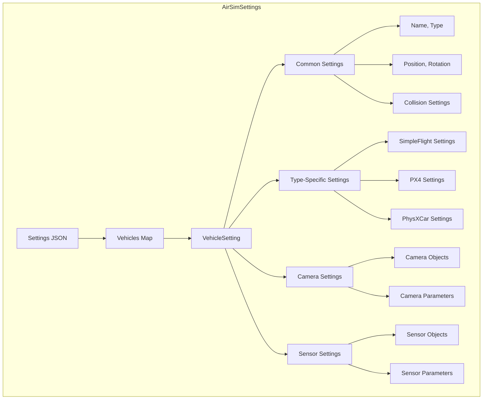
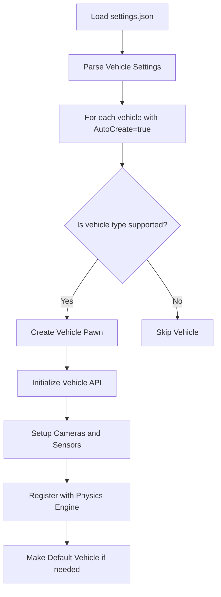
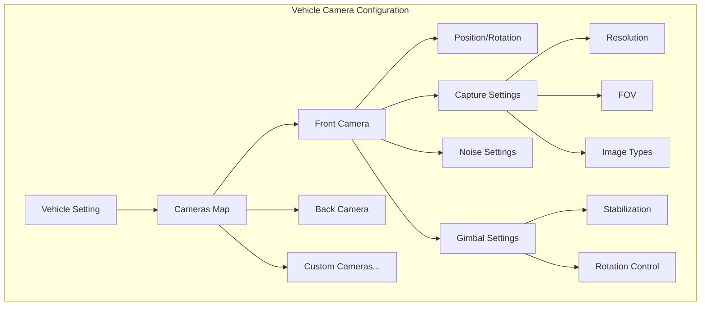
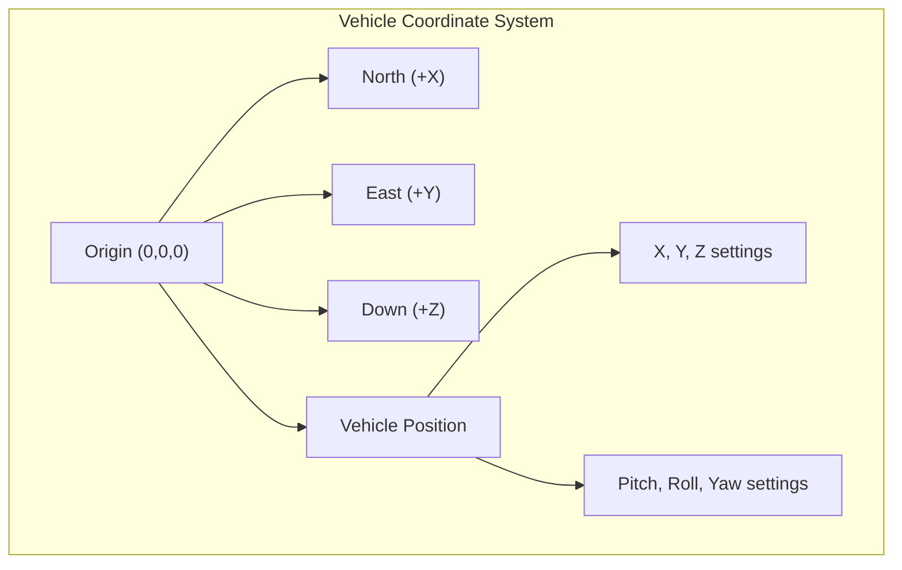

<!-- source: DeepWiki mcp.deepwiki.com · repo microsoft/AirSim · page 2.1 Vehicle Configuration · fetched 2026-10-26 -->

# Vehicle Configuration

<details>
<summary>Relevant source files</summary>

The following files were used as context for generating this wiki page:

- [AirLib/include/common/AirSimSettings.hpp](AirLib/include/common/AirSimSettings.hpp)
- [AirLib/include/vehicles/multirotor/firmwares/mavlink/MavLinkMultirotorApi.hpp](AirLib/include/vehicles/multirotor/firmwares/mavlink/MavLinkMultirotorApi.hpp)
- [MavLinkCom/include/MavLinkConnection.hpp](MavLinkCom/include/MavLinkConnection.hpp)
- [MavLinkCom/include/MavLinkLog.hpp](MavLinkCom/include/MavLinkLog.hpp)
- [MavLinkCom/include/MavLinkMessageBase.hpp](MavLinkCom/include/MavLinkMessageBase.hpp)
- [MavLinkCom/src/MavLinkConnection.cpp](MavLinkCom/src/MavLinkConnection.cpp)
- [MavLinkCom/src/MavLinkLog.cpp](MavLinkCom/src/MavLinkLog.cpp)
- [MavLinkCom/src/MavLinkMessageBase.cpp](MavLinkCom/src/MavLinkMessageBase.cpp)
- [MavLinkCom/src/impl/MavLinkConnectionImpl.cpp](MavLinkCom/src/impl/MavLinkConnectionImpl.cpp)
- [MavLinkCom/src/impl/MavLinkConnectionImpl.hpp](MavLinkCom/src/impl/MavLinkConnectionImpl.hpp)
- [MavLinkCom/src/serial_com/wifi.cpp](MavLinkCom/src/serial_com/wifi.cpp)
- [PythonClient/multirotor/path.py](PythonClient/multirotor/path.py)
- [PythonClient/multirotor/state.py](PythonClient/multirotor/state.py)
- [PythonClient/multirotor/takeoff.py](PythonClient/multirotor/takeoff.py)
- [Unreal/Plugins/AirSim/Content/Blueprints/BP_CameraDirector.uasset](Unreal/Plugins/AirSim/Content/Blueprints/BP_CameraDirector.uasset)
- [Unreal/Plugins/AirSim/Content/Blueprints/BP_SimHUDWidget.uasset](Unreal/Plugins/AirSim/Content/Blueprints/BP_SimHUDWidget.uasset)
- [Unreal/Plugins/AirSim/Source/AirBlueprintLib.cpp](Unreal/Plugins/AirSim/Source/AirBlueprintLib.cpp)
- [Unreal/Plugins/AirSim/Source/AirBlueprintLib.h](Unreal/Plugins/AirSim/Source/AirBlueprintLib.h)
- [Unreal/Plugins/AirSim/Source/CameraDirector.cpp](Unreal/Plugins/AirSim/Source/CameraDirector.cpp)
- [Unreal/Plugins/AirSim/Source/CameraDirector.h](Unreal/Plugins/AirSim/Source/CameraDirector.h)
- [Unreal/Plugins/AirSim/Source/PIPCamera.cpp](Unreal/Plugins/AirSim/Source/PIPCamera.cpp)
- [Unreal/Plugins/AirSim/Source/PIPCamera.h](Unreal/Plugins/AirSim/Source/PIPCamera.h)
- [Unreal/Plugins/AirSim/Source/SimHUD/SimHUD.cpp](Unreal/Plugins/AirSim/Source/SimHUD/SimHUD.cpp)
- [Unreal/Plugins/AirSim/Source/SimHUD/SimHUD.h](Unreal/Plugins/AirSim/Source/SimHUD/SimHUD.h)
- [Unreal/Plugins/AirSim/Source/SimHUD/SimHUDWidget.h](Unreal/Plugins/AirSim/Source/SimHUD/SimHUDWidget.h)
- [Unreal/Plugins/AirSim/Source/SimMode/SimModeBase.cpp](Unreal/Plugins/AirSim/Source/SimMode/SimModeBase.cpp)
- [Unreal/Plugins/AirSim/Source/SimMode/SimModeBase.h](Unreal/Plugins/AirSim/Source/SimMode/SimModeBase.h)
- [docs/apis.md](docs/apis.md)
- [docs/custom_drone.md](docs/custom_drone.md)
- [docs/image_apis.md](docs/image_apis.md)
- [docs/px4_build.md](docs/px4_build.md)
- [docs/px4_lockstep.md](docs/px4_lockstep.md)
- [docs/px4_setup.md](docs/px4_setup.md)
- [docs/px4_sitl.md](docs/px4_sitl.md)
- [docs/px4_sitl_wsl2.md](docs/px4_sitl_wsl2.md)
- [docs/remote_control.md](docs/remote_control.md)
- [docs/settings.md](docs/settings.md)

</details>


This page explains how to configure vehicles in AirSim, including multirotors, cars, and other supported vehicle types. Vehicle configuration controls the vehicle type, position, sensors, and other characteristics that determine how the vehicle behaves in simulation.

## Overview of Vehicle Configuration

In AirSim, vehicles are defined in the `settings.json` file under the `"Vehicles"` section. Each vehicle has a name (key in the JSON object) and a collection of settings that determine its type, position, orientation, and capabilities.



Sources: [AirLib/include/common/AirSimSettings.hpp:257-290](), [docs/settings.md:366-368]()

## Supported Vehicle Types

AirSim supports several vehicle types, each with their own specific settings:

| Vehicle Type | Description | Configuration Key | 
|--------------|-------------|-------------------|
| Multirotor (SimpleFlight) | Default multirotor with a simple flight controller | `"SimpleFlight"` |
| Multirotor (PX4) | Multirotor using PX4 flight stack | `"PX4"` |
| Car | Physics-based car simulation | `"PhysXCar"` |
| ArduCopter | Multirotor using ArduPilot | `"ArduCopter"` |
| ArduRover | Ground vehicle using ArduPilot | `"ArduRover"` |
| ComputerVision | No vehicle, just cameras | `"ComputerVision"` |

Vehicle type is specified using the `"VehicleType"` setting within each vehicle's configuration object.

Sources: [AirLib/include/common/AirSimSettings.hpp:31-37](), [docs/settings.md:212-218]()

## Vehicle Creation Process

When AirSim starts, it reads the vehicle configuration from `settings.json` and creates vehicles accordingly:



Sources: [Unreal/Plugins/AirSim/Source/SimMode/SimModeBase.cpp:680-746](), [Unreal/Plugins/AirSim/Source/SimMode/SimModeBase.cpp:601-630]()

## Common Vehicle Settings

These settings apply to all vehicle types:

| Setting | Description | Default |
|---------|-------------|---------|
| `VehicleType` | Type of vehicle (e.g., "SimpleFlight", "PhysXCar") | - |
| `DefaultVehicleState` | Initial state ("Armed" for drones) | `""` |
| `AutoCreate` | Whether to automatically create the vehicle at startup | `true` |
| `PawnPath` | Custom Unreal pawn blueprint path | `""` |
| `EnableCollisionPassthrogh` | Allow passing through collisions | `false` |
| `EnableCollisions` | Enable collision detection | `true` |
| `AllowAPIAlways` | Always allow API control | `true` |
| `EnableTrace` | Enable debug tracing | `false` |
| `X`, `Y`, `Z` | Position coordinates (NED frame, meters) | `NaN` (use player start) |
| `Pitch`, `Roll`, `Yaw` | Rotation (degrees) | `NaN` (use player start) |

Sources: [AirLib/include/common/AirSimSettings.hpp:257-290](), [docs/settings.md:160-198]()

## Vehicle Type-Specific Settings

### Multirotor Settings

For multirotors (SimpleFlight, PX4, etc.), additional settings include:

```json
{
  "Vehicles": {
    "MyMultirotor": {
      "VehicleType": "SimpleFlight",
      "RC": {
        "RemoteControlID": 0,
        "AllowAPIWhenDisconnected": false
      }
    }
  }
}
```

### PX4/MavLink-specific Settings

For PX4 or other MavLink-based vehicles:

```json
{
  "Vehicles": {
    "PX4Drone": {
      "VehicleType": "PX4",
      "UseSerial": false,
      "UseTcp": true,
      "TcpPort": 4560,
      "ControlPortLocal": 14540,
      "ControlPortRemote": 14580
    }
  }
}
```

Sources: [AirLib/include/common/AirSimSettings.hpp:292-349](), [AirLib/include/vehicles/multirotor/firmwares/mavlink/MavLinkMultirotorApi.hpp:61-75](), [docs/px4_sitl.md:54-86]()

### Car Settings

For PhysXCar vehicles:

```json
{
  "Vehicles": {
    "MyCar": {
      "VehicleType": "PhysXCar",
      "RC": {
        "RemoteControlID": -1
      }
    }
  }
}
```

Sources: [docs/settings.md:179-199]()

## Camera Configuration

Each vehicle can have multiple cameras, defined in the `"Cameras"` section of the vehicle configuration:



Example camera configuration:

```json
"Cameras": {
  "front_center": {
    "CaptureSettings": [
      {
        "ImageType": 0,
        "Width": 640,
        "Height": 480,
        "FOV_Degrees": 90
      }
    ],
    "X": 0.25, "Y": 0, "Z": 0.1,
    "Pitch": 0, "Roll": 0, "Yaw": 0
  }
}
```

Sources: [Unreal/Plugins/AirSim/Source/PIPCamera.cpp:362-416](), [docs/settings.md:76-129](), [docs/image_apis.md:135-148]()

## Sensor Configuration

AirSim supports various sensors that can be attached to vehicles, including IMU, GPS, barometer, magnetometer, distance sensors, and lidar:

```json
"Sensors": {
  "Imu": {
    "SensorType": 2,
    "Enabled": true
  },
  "Gps": {
    "SensorType": 3,
    "Enabled": true
  },
  "Lidar": {
    "SensorType": 6,
    "Enabled": true,
    "NumberOfChannels": 16,
    "PointsPerSecond": 10000
  }
}
```

These sensors are defined in the vehicle's `"Sensors"` section and can be configured with type-specific parameters.

Sources: [AirLib/include/common/AirSimSettings.hpp:232-256](), [docs/settings.md:70-75]()

## Vehicle Position and Orientation

Vehicle position is specified in the NED (North-East-Down) coordinate system in meters relative to the origin point:



When `X`, `Y`, `Z`, `Pitch`, `Roll`, or `Yaw` are set to NaN (the default), the vehicle uses the position and orientation from the Player Start location in the Unreal environment.

Sources: [Unreal/Plugins/AirSim/Source/SimMode/SimModeBase.cpp:607-612](), [docs/settings.md:236-237](), [docs/apis.md:236-238]()

## Example Vehicle Configurations

### SimpleFlight Multirotor

```json
"Vehicles": {
  "MyDrone": {
    "VehicleType": "SimpleFlight",
    "DefaultVehicleState": "Armed",
    "EnableCollisions": true,
    "EnableCollisionPassthrogh": false,
    "Cameras": {
      "front_center": {
        "CaptureSettings": [
          {
            "ImageType": 0,
            "Width": 640,
            "Height": 480
          }
        ]
      }
    },
    "X": 0, "Y": 0, "Z": -2,
    "Pitch": 0, "Roll": 0, "Yaw": 90
  }
}
```

### PX4 Multirotor

```json
"Vehicles": {
  "PX4Drone": {
    "VehicleType": "PX4",
    "UseTcp": true,
    "TcpPort": 4560,
    "ControlPortLocal": 14540,
    "ControlPortRemote": 14580,
    "Cameras": {
      "front_center": {
        "CaptureSettings": [
          {
            "ImageType": 0,
            "Width": 640,
            "Height": 480
          }
        ]
      }
    }
  }
}
```

Sources: [docs/px4_sitl.md:54-86](), [docs/settings.md:160-199]()

### PhysXCar

```json
"Vehicles": {
  "MyCar": {
    "VehicleType": "PhysXCar",
    "X": 0, "Y": 0, "Z": 0,
    "EnableCollisions": true,
    "Cameras": {
      "front_center": {
        "CaptureSettings": [
          {
            "ImageType": 0,
            "Width": 640,
            "Height": 480
          }
        ]
      },
      "fpv": {
        "X": 0.25, "Y": 0, "Z": 0.1,
        "CaptureSettings": [
          {
            "ImageType": 0,
            "Width": 640,
            "Height": 480
          }
        ]
      }
    }
  }
}
```

Sources: [docs/settings.md:179-199](), [docs/image_apis.md:140-143]()

## Creating Vehicles at Runtime

AirSim allows you to create vehicles dynamically at runtime using the API:

```python
client.simCreateVehicle("NewDrone", "SimpleFlight", airsim.Pose(airsim.Vector3r(0, 0, -5)), "")
```

This API is implemented in `SimModeBase::createVehicleAtRuntime()`, which creates a new vehicle with the specified name, type, and position.

Sources: [Unreal/Plugins/AirSim/Source/SimMode/SimModeBase.cpp:652-677]()

## Default Vehicle Settings

If no vehicles are specified in `settings.json`, AirSim creates default vehicles based on the simulation mode:
- In Multirotor mode: A SimpleFlight drone
- In Car mode: A PhysXCar

These defaults ensure that you always have a vehicle to control even without explicit configuration.

Sources: [Unreal/Plugins/AirSim/Source/SimHUD/SimHUD.cpp:219-233](), [Unreal/Plugins/AirSim/Source/SimMode/SimModeBase.cpp:700-716]()

---

