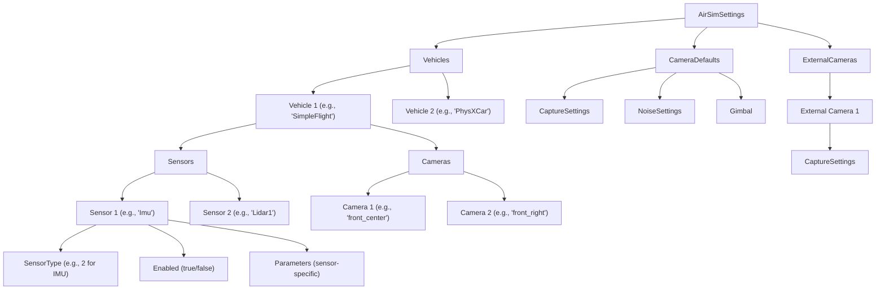
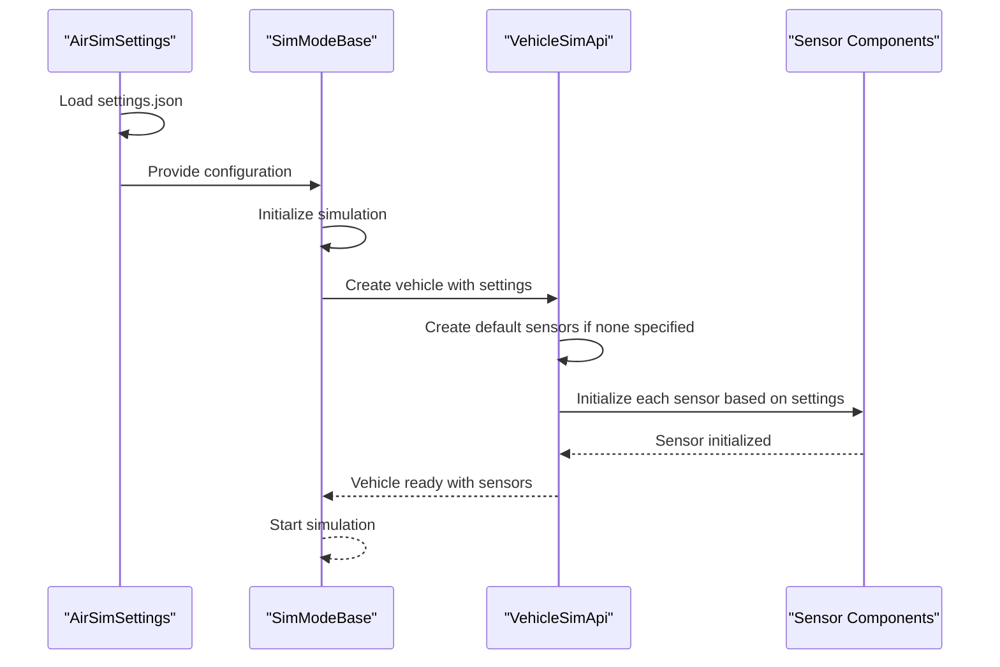

<!-- source: DeepWiki mcp.deepwiki.com · repo microsoft/AirSim · page 2.2 Sensor Configuration · fetched 2026-10-26 -->

# Sensor Configuration

<details>
<summary>Relevant source files</summary>

The following files were used as context for generating this wiki page:

- [AirLib/include/common/AirSimSettings.hpp](AirLib/include/common/AirSimSettings.hpp)
- [Unreal/Plugins/AirSim/Content/Blueprints/BP_CameraDirector.uasset](Unreal/Plugins/AirSim/Content/Blueprints/BP_CameraDirector.uasset)
- [Unreal/Plugins/AirSim/Content/Blueprints/BP_SimHUDWidget.uasset](Unreal/Plugins/AirSim/Content/Blueprints/BP_SimHUDWidget.uasset)
- [Unreal/Plugins/AirSim/Source/AirBlueprintLib.cpp](Unreal/Plugins/AirSim/Source/AirBlueprintLib.cpp)
- [Unreal/Plugins/AirSim/Source/AirBlueprintLib.h](Unreal/Plugins/AirSim/Source/AirBlueprintLib.h)
- [Unreal/Plugins/AirSim/Source/CameraDirector.cpp](Unreal/Plugins/AirSim/Source/CameraDirector.cpp)
- [Unreal/Plugins/AirSim/Source/CameraDirector.h](Unreal/Plugins/AirSim/Source/CameraDirector.h)
- [Unreal/Plugins/AirSim/Source/PIPCamera.cpp](Unreal/Plugins/AirSim/Source/PIPCamera.cpp)
- [Unreal/Plugins/AirSim/Source/PIPCamera.h](Unreal/Plugins/AirSim/Source/PIPCamera.h)
- [Unreal/Plugins/AirSim/Source/SimHUD/SimHUD.cpp](Unreal/Plugins/AirSim/Source/SimHUD/SimHUD.cpp)
- [Unreal/Plugins/AirSim/Source/SimHUD/SimHUD.h](Unreal/Plugins/AirSim/Source/SimHUD/SimHUD.h)
- [Unreal/Plugins/AirSim/Source/SimHUD/SimHUDWidget.h](Unreal/Plugins/AirSim/Source/SimHUD/SimHUDWidget.h)
- [Unreal/Plugins/AirSim/Source/SimMode/SimModeBase.cpp](Unreal/Plugins/AirSim/Source/SimMode/SimModeBase.cpp)
- [Unreal/Plugins/AirSim/Source/SimMode/SimModeBase.h](Unreal/Plugins/AirSim/Source/SimMode/SimModeBase.h)
- [docs/CHANGELOG.md](docs/CHANGELOG.md)
- [docs/airsim_ros_pkgs.md](docs/airsim_ros_pkgs.md)
- [docs/airsim_tutorial_pkgs.md](docs/airsim_tutorial_pkgs.md)
- [docs/apis.md](docs/apis.md)
- [docs/azure.md](docs/azure.md)
- [docs/custom_drone.md](docs/custom_drone.md)
- [docs/distance_sensor.md](docs/distance_sensor.md)
- [docs/image_apis.md](docs/image_apis.md)
- [docs/lidar.md](docs/lidar.md)
- [docs/px4_build.md](docs/px4_build.md)
- [docs/px4_lockstep.md](docs/px4_lockstep.md)
- [docs/px4_setup.md](docs/px4_setup.md)
- [docs/px4_sitl.md](docs/px4_sitl.md)
- [docs/px4_sitl_wsl2.md](docs/px4_sitl_wsl2.md)
- [docs/remote_control.md](docs/remote_control.md)
- [docs/sensors.md](docs/sensors.md)
- [docs/settings.md](docs/settings.md)
- [tools/install_ros_deps.sh](tools/install_ros_deps.sh)

</details>


This page documents how to configure sensors in AirSim. AirSim supports a variety of sensors that can be configured via the `settings.json` file. We'll cover the available sensor types, how to configure them, and how they integrate with the simulation environment.

For information about how to access sensor data using APIs, see [APIs](apis.md).

## Sensor Types in AirSim

AirSim supports the following types of sensors:

| Sensor Type | Enum Value | Description |
|-------------|------------|-------------|
| Camera | N/A* | Various camera types including Scene, Depth, Segmentation, etc. |
| Barometer | 1 | Measures atmospheric pressure |
| IMU | 2 | Inertial Measurement Unit - measures linear acceleration and angular velocity |
| GPS | 3 | Global Positioning System - provides position in the world |
| Magnetometer | 4 | Measures magnetic field |
| Distance Sensor | 5 | Measures distance to nearest object |
| Lidar | 6 | Light Detection and Ranging - creates point cloud of surroundings |

*Cameras are configured differently than other sensors and do not use an enum value.

Sources: [AirLib/include/common/AirSimSettings.hpp:11-256](AirLib/include/common/AirSimSettings.hpp:11-256), [docs/sensors.md:1-26](docs/sensors.md:1-26)

## Sensor Configuration Hierarchy

In AirSim, sensor settings are organized hierarchically in the `settings.json` file:



Sources: [AirLib/include/common/AirSimSettings.hpp:225-255](AirLib/include/common/AirSimSettings.hpp:225-255), [AirLib/include/common/AirSimSettings.hpp:257-290](AirLib/include/common/AirSimSettings.hpp:257-290), [docs/settings.md:201-208](docs/settings.md:201-208)

## Default Sensors

If no sensors are specified in the `settings.json` file, AirSim provides default sensors based on the vehicle type:

### Multirotor
- IMU
- Magnetometer
- GPS
- Barometer

### Car
- IMU
- GPS

Sources: [docs/sensors.md:16-26](docs/sensors.md:16-26)

## General Sensor Configuration

All sensors (except cameras) follow a common configuration pattern in the `settings.json` file:

```json
{
  "Vehicles": {
    "VehicleName": {
      "Sensors": {
        "SensorName": {
          "SensorType": <sensor_type_enum>,
          "Enabled": true,
          // Sensor-specific parameters...
        }
      }
    }
  }
}
```

Where:
- `VehicleName` is the name of the vehicle (e.g., "SimpleFlight" for drones, "PhysXCar" for cars)
- `SensorName` is a user-defined name for the sensor
- `SensorType` is the enum value from the table above
- `Enabled` is a boolean flag to enable/disable the sensor
- Additional parameters are specific to each sensor type

Sources: [AirLib/include/common/AirSimSettings.hpp:225-255](AirLib/include/common/AirSimSettings.hpp:225-255)

## Camera Configuration

Cameras have a more complex configuration structure compared to other sensors. They're configured under the "Cameras" section of a vehicle and can also have default settings in the "CameraDefaults" section.

### Camera Types

AirSim supports the following camera types, represented by the `ImageType` enum:

| ImageType Value | Description |
|-----------------|-------------|
| 0 | Scene - regular RGB camera view |
| 1 | DepthPlanar - depth map in planar representation |
| 2 | DepthPerspective - depth map in perspective projection |
| 3 | DepthVis - depth visualization |
| 4 | DisparityNormalized - normalized disparity |
| 5 | Segmentation - semantic segmentation |
| 6 | SurfaceNormals - surface normals |
| 7 | Infrared - infrared camera view |
| 8 | OpticalFlow - optical flow |
| 9 | OpticalFlowVis - optical flow visualization |

Sources: [Unreal/Plugins/AirSim/Source/PIPCamera.cpp:39-48](Unreal/Plugins/AirSim/Source/PIPCamera.cpp:39-48), [docs/image_apis.md:212-220](docs/image_apis.md:212-220)

### Camera Settings Structure

```json
{
  "CameraDefaults": {
    "CaptureSettings": [
      {
        "ImageType": 0,
        "Width": 256,
        "Height": 144,
        "FOV_Degrees": 90,
        "AutoExposureSpeed": 100,
        "AutoExposureBias": 0,
        "AutoExposureMaxBrightness": 0.64,
        "AutoExposureMinBrightness": 0.03,
        "MotionBlurAmount": 0,
        "TargetGamma": 1.0,
        "ProjectionMode": "",
        "OrthoWidth": 5.12
      }
    ],
    "NoiseSettings": [
      {
        "Enabled": false,
        "ImageType": 0,
        "RandContrib": 0.2,
        "RandSpeed": 100000.0,
        "RandSize": 500.0,
        "RandDensity": 2,
        "HorzWaveContrib": 0.03,
        "HorzWaveStrength": 0.08,
        "HorzWaveVertSize": 1.0,
        "HorzWaveScreenSize": 1.0,
        "HorzNoiseLinesContrib": 1.0,
        "HorzNoiseLinesDensityY": 0.01,
        "HorzNoiseLinesDensityXY": 0.5,
        "HorzDistortionContrib": 1.0,
        "HorzDistortionStrength": 0.002
      }
    ],
    "Gimbal": {
      "Stabilization": 0,
      "Pitch": 0, "Roll": 0, "Yaw": 0
    }
  },
  "Vehicles": {
    "VehicleName": {
      "Cameras": {
        "CameraName": {
          // Same structure as CameraDefaults, but specific to this camera
        }
      }
    }
  }
}
```

Sources: [AirLib/include/common/AirSimSettings.hpp:136-160](AirLib/include/common/AirSimSettings.hpp:136-160), [AirLib/include/common/AirSimSettings.hpp:162-186](AirLib/include/common/AirSimSettings.hpp:162-186), [AirLib/include/common/AirSimSettings.hpp:128-135](AirLib/include/common/AirSimSettings.hpp:128-135)

## External Cameras

AirSim supports external cameras that aren't attached to any vehicle. These are configured in the "ExternalCameras" section of the `settings.json` file:

```json
{
  "ExternalCameras": {
    "FixedCamera1": {
      "X": 0, "Y": 0, "Z": -2,
      "Pitch": 0, "Roll": 0, "Yaw": 0,
      "CaptureSettings": [
        {
          "ImageType": 0,
          "Width": 1280,
          "Height": 720,
          "FOV_Degrees": 90
        }
      ]
    }
  }
}
```

External cameras have the same configuration options as vehicle-mounted cameras.

Sources: [Unreal/Plugins/AirSim/Source/SimMode/SimModeBase.cpp:464-489](Unreal/Plugins/AirSim/Source/SimMode/SimModeBase.cpp:464-489), [docs/settings.md:201-208](docs/settings.md:201-208)

## Sensor Initialization and Configuration Flow

Let's visualize how sensors are initialized and configured in AirSim:



Sources: [Unreal/Plugins/AirSim/Source/SimMode/SimModeBase.cpp:680-746](Unreal/Plugins/AirSim/Source/SimMode/SimModeBase.cpp:680-746), [Unreal/Plugins/AirSim/Source/SimHUD/SimHUD.cpp:219-234](Unreal/Plugins/AirSim/Source/SimHUD/SimHUD.cpp:219-234)

## Detailed Sensor Configuration Options

### Barometer Settings

```json
{
  "Sensors": {
    "Barometer": {
      "SensorType": 1,
      "Enabled": true,
      "PressureFactorSigma": 0.0001825
    }
  }
}
```

The `PressureFactorSigma` parameter controls the noise in the pressure reading.

### IMU Settings

```json
{
  "Sensors": {
    "Imu": {
      "SensorType": 2,
      "Enabled": true,
      "AngularRandomWalk": 0.3,
      "GyroBiasStabilityTau": 500,
      "GyroBiasStability": 4.6,
      "VelocityRandomWalk": 0.24,
      "AccelBiasStabilityTau": 800,
      "AccelBiasStability": 36
    }
  }
}
```

Key parameters:
- `AngularRandomWalk`: Angular random walk for gyroscope
- `GyroBiasStabilityTau`: Time constant for gyro bias stability
- `GyroBiasStability`: Gyro bias stability
- `VelocityRandomWalk`: Velocity random walk for accelerometer
- `AccelBiasStabilityTau`: Time constant for accelerometer bias stability
- `AccelBiasStability`: Accelerometer bias stability

### GPS Settings

```json
{
  "Sensors": {
    "Gps": {
      "SensorType": 3,
      "Enabled": true,
      "EphTimeConstant": 0.9,
      "EphInitialError": 0.0,
      "EphFinalError": 0.0,
      "EphMaxError": 0.0,
      "EpvTimeConstant": 0.9,
      "EpvInitialError": 0.0,
      "EpvFinalError": 0.0,
      "EpvMaxError": 0.0
    }
  }
}
```

Key parameters:
- `EphTimeConstant`: Time constant for horizontal position accuracy
- `EphInitialError`: Initial horizontal position accuracy
- `EphFinalError`: Final horizontal position accuracy
- `EphMaxError`: Maximum horizontal position accuracy
- `EpvTimeConstant`: Time constant for vertical position accuracy
- `EpvInitialError`: Initial vertical position accuracy
- `EpvFinalError`: Final vertical position accuracy
- `EpvMaxError`: Maximum vertical position accuracy

### Lidar Settings

```json
{
  "Sensors": {
    "Lidar1": {
      "SensorType": 6,
      "Enabled": true,
      "NumberOfChannels": 16,
      "PointsPerSecond": 10000,
      "X": 0, "Y": 0, "Z": -1,
      "Roll": 0, "Pitch": 0, "Yaw": 0,
      "VerticalFOVUpper": -15,
      "VerticalFOVLower": -25,
      "HorizontalFOVStart": -20,
      "HorizontalFOVEnd": 20,
      "RotationsPerSecond": 10,
      "DrawDebugPoints": true,
      "DataFrame": "SensorLocalFrame"
    }
  }
}
```

Key parameters:
- `NumberOfChannels`: Number of vertical lasers
- `PointsPerSecond`: Number of points captured per second
- `X`, `Y`, `Z`: Position relative to vehicle in meters (NED coordinates)
- `Roll`, `Pitch`, `Yaw`: Orientation in degrees
- `VerticalFOVUpper`/`Lower`: Vertical field of view limits in degrees
- `HorizontalFOVStart`/`End`: Horizontal field of view limits in degrees
- `RotationsPerSecond`: How fast the lidar rotates
- `DrawDebugPoints`: Whether to visualize points in simulation
- `DataFrame`: Coordinate frame for point cloud data

Sources: [docs/lidar.md](docs/lidar.md), [docs/sensors.md](docs/sensors.md)

## Camera Distortion and Effects

AirSim supports simulating camera distortion and various post-processing effects.

### Distortion Parameters

You can set distortion parameters using the API:

```python
client.simSetDistortionParam("K1", 0.1)  # Radial distortion coefficient
client.simSetDistortionParam("K2", 0.2)  # Radial distortion coefficient
client.simSetDistortionParam("K3", 0.0)  # Radial distortion coefficient
client.simSetDistortionParam("P1", 0.01) # Tangential distortion coefficient
client.simSetDistortionParam("P2", 0.01) # Tangential distortion coefficient
```

Sources: [Unreal/Plugins/AirSim/Source/PIPCamera.cpp:342-352](Unreal/Plugins/AirSim/Source/PIPCamera.cpp:342-352), [Unreal/Plugins/AirSim/Source/PIPCamera.cpp:357-360](Unreal/Plugins/AirSim/Source/PIPCamera.cpp:357-360)

### Noise Settings

Camera sensors can simulate various types of noise and artifacts:

```json
"NoiseSettings": {
  "Enabled": true,
  "ImageType": 0,
  "RandContrib": 0.2,        // Random noise contribution
  "RandSpeed": 100000.0,     // How fast noise changes
  "RandSize": 500.0,         // Size of noise blobs
  "RandDensity": 2,          // Density of noise
  "HorzWaveContrib": 0.03,   // Horizontal wave distortion
  "HorzWaveStrength": 0.08,  // Wave strength
  "HorzWaveVertSize": 1.0,   // Vertical size of waves
  "HorzWaveScreenSize": 1.0, // Screen-space size of waves
  "HorzNoiseLinesContrib": 1.0, // Horizontal noise lines
  "HorzNoiseLinesDensityY": 0.01, // Vertical density of lines
  "HorzNoiseLinesDensityXY": 0.5, // Horizontal density of lines
  "HorzDistortionContrib": 1.0,   // Horizontal distortion
  "HorzDistortionStrength": 0.002 // Strength of distortion
}
```

Sources: [AirLib/include/common/AirSimSettings.hpp:162-186](AirLib/include/common/AirSimSettings.hpp:162-186), [Unreal/Plugins/AirSim/Source/PIPCamera.cpp:516-538](Unreal/Plugins/AirSim/Source/PIPCamera.cpp:516-538)

## Sensor Positioning and Orientation

Sensors can be positioned and oriented relative to the vehicle using:

- `X`, `Y`, `Z`: Position in NED (North-East-Down) coordinates
- `Roll`, `Pitch`, `Yaw`: Orientation in degrees

In NED coordinates, +X is North, +Y is East, and +Z is Down, so a negative Z value places the sensor above the vehicle.

Example of positioning a Lidar 1 meter above the vehicle:

```json
{
  "Lidar1": {
    "SensorType": 6,
    "Enabled": true,
    "X": 0, "Y": 0, "Z": -1,  // 1 meter above the vehicle
    "Roll": 0, "Pitch": 0, "Yaw": 45  // Rotated 45 degrees
  }
}
```

Sources: [Unreal/Plugins/AirSim/Source/SimMode/SimModeBase.cpp:605-613](Unreal/Plugins/AirSim/Source/SimMode/SimModeBase.cpp:605-613), [docs/apis.md:237-238](docs/apis.md:237-238)

## Gimbal Configuration

Cameras can be mounted on a simulated gimbal for stabilization:

```json
"Gimbal": {
  "Stabilization": 0.7,  // 0 to 1, how much stabilization to apply
  "Pitch": 0,            // Initial pitch in degrees
  "Roll": 0,             // Initial roll in degrees
  "Yaw": 0               // Initial yaw in degrees
}
```

With stabilization enabled, the camera will maintain its orientation regardless of vehicle movements, simulating a physical gimbal.

Sources: [Unreal/Plugins/AirSim/Source/PIPCamera.cpp:302-318](Unreal/Plugins/AirSim/Source/PIPCamera.cpp:302-318), [docs/settings.md:356-357](docs/settings.md:356-357)

## Complete Camera Configuration Example

Here's a more complete example of configuring a camera with various settings:

```json
{
  "Vehicles": {
    "SimpleFlight": {
      "Cameras": {
        "front_center": {
          "CaptureSettings": [
            {
              "ImageType": 0,  // Scene view
              "Width": 1280,
              "Height": 720,
              "FOV_Degrees": 90,
              "AutoExposureSpeed": 100,
              "AutoExposureBias": 0,
              "AutoExposureMaxBrightness": 0.64,
              "AutoExposureMinBrightness": 0.03,
              "MotionBlurAmount": 0,
              "TargetGamma": 1.0
            },
            {
              "ImageType": 5,  // Segmentation view
              "Width": 1280,
              "Height": 720,
              "FOV_Degrees": 90
            }
          ],
          "NoiseSettings": [
            {
              "Enabled": true,
              "ImageType": 0,
              "RandContrib": 0.2
            }
          ],
          "X": 0.25, "Y": 0, "Z": 0,
          "Pitch": 0, "Roll": 0, "Yaw": 0,
          "Gimbal": {
            "Stabilization": 0.7,
            "Pitch": -10,  // Tilted down slightly
            "Roll": 0,
            "Yaw": 0
          }
        }
      }
    }
  }
}
```

Sources: [AirLib/include/common/AirSimSettings.hpp:198-216](AirLib/include/common/AirSimSettings.hpp:198-216), [Unreal/Plugins/AirSim/Source/PIPCamera.cpp:362-417](Unreal/Plugins/AirSim/Source/PIPCamera.cpp:362-417)

## Conclusion

This document covered how to configure sensors in AirSim. For more detailed information:
- For information about how to retrieve sensor data, see [APIs](apis.md)
- For camera-specific details, see [Image APIs](image_apis.md)
- For lidar-specific information, see [Lidar Documentation](lidar.md)
- For general sensor information, see [Sensors Documentation](sensors.md)

By properly configuring sensors, you can create realistic simulation environments that accurately model the behavior of real-world sensors, which is essential for developing and testing autonomous vehicle algorithms.

---

