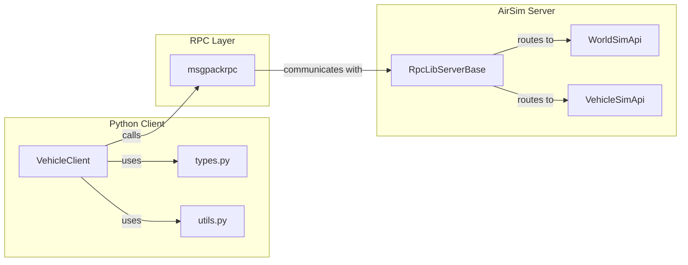
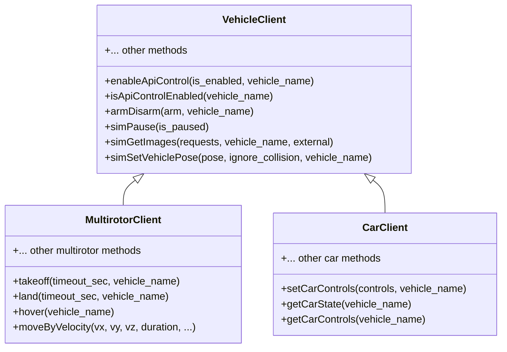
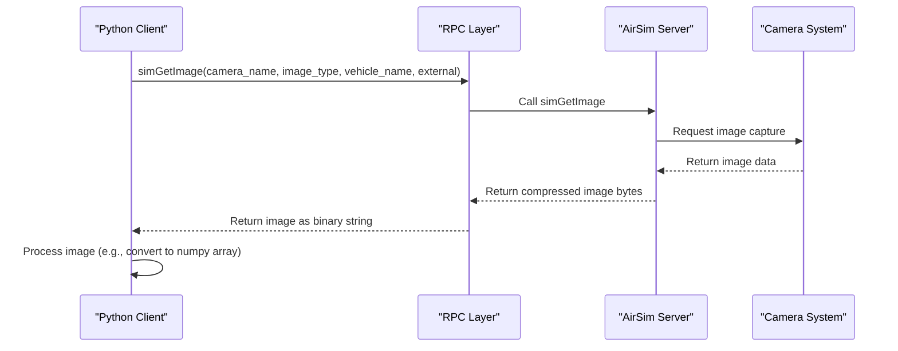
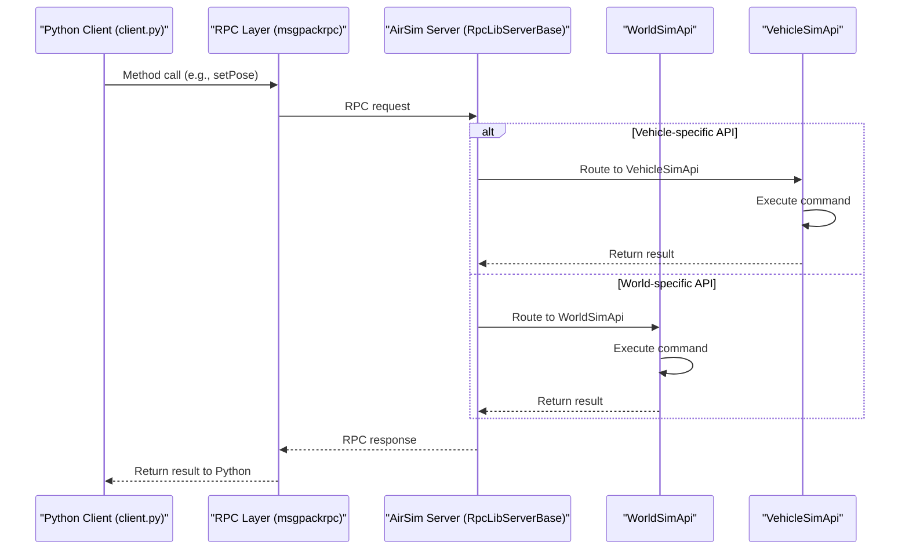

<!-- source: DeepWiki mcp.deepwiki.com · repo microsoft/AirSim · page 3 Python Client API · fetched 2026-10-26 -->

# Python Client API

<details>
<summary>Relevant source files</summary>

The following files were used as context for generating this wiki page:

- [AirLib/include/api/RpcLibClientBase.hpp](AirLib/include/api/RpcLibClientBase.hpp)
- [AirLib/include/api/VehicleApiBase.hpp](AirLib/include/api/VehicleApiBase.hpp)
- [AirLib/include/api/VehicleSimApiBase.hpp](AirLib/include/api/VehicleSimApiBase.hpp)
- [AirLib/include/api/WorldSimApiBase.hpp](AirLib/include/api/WorldSimApiBase.hpp)
- [AirLib/src/api/RpcLibClientBase.cpp](AirLib/src/api/RpcLibClientBase.cpp)
- [AirLib/src/api/RpcLibServerBase.cpp](AirLib/src/api/RpcLibServerBase.cpp)
- [PythonClient/PythonClient.pyproj](PythonClient/PythonClient.pyproj)
- [PythonClient/airsim/client.py](PythonClient/airsim/client.py)
- [Unity/AirLibWrapper/AirsimWrapper/Source/PawnSimApi.cpp](Unity/AirLibWrapper/AirsimWrapper/Source/PawnSimApi.cpp)
- [Unity/AirLibWrapper/AirsimWrapper/Source/PawnSimApi.h](Unity/AirLibWrapper/AirsimWrapper/Source/PawnSimApi.h)
- [Unity/AirLibWrapper/AirsimWrapper/Source/WorldSimApi.cpp](Unity/AirLibWrapper/AirsimWrapper/Source/WorldSimApi.cpp)
- [Unity/AirLibWrapper/AirsimWrapper/Source/WorldSimApi.h](Unity/AirLibWrapper/AirsimWrapper/Source/WorldSimApi.h)
- [Unreal/Plugins/AirSim/Source/PawnSimApi.cpp](Unreal/Plugins/AirSim/Source/PawnSimApi.cpp)
- [Unreal/Plugins/AirSim/Source/PawnSimApi.h](Unreal/Plugins/AirSim/Source/PawnSimApi.h)
- [Unreal/Plugins/AirSim/Source/WorldSimApi.cpp](Unreal/Plugins/AirSim/Source/WorldSimApi.cpp)
- [Unreal/Plugins/AirSim/Source/WorldSimApi.h](Unreal/Plugins/AirSim/Source/WorldSimApi.h)

</details>


The Python Client API provides a comprehensive interface for controlling vehicles and accessing sensor data in AirSim. This API enables you to programmatically interact with the simulation environment from Python, making it ideal for developing and testing autonomous vehicle algorithms, computer vision applications, and machine learning models.

This document covers the core functionality and usage of the Python client. For information about specific vehicle controls, see [Vehicle Control API](#3.1), and for sensor data retrieval, see [Sensor Data Retrieval](#3.2).

## Architecture Overview

The Python Client API is built on a client-server architecture. Your Python code (client) communicates with the AirSim simulation (server) through Remote Procedure Calls (RPC) using the msgpack-rpc protocol.



Sources: [PythonClient/airsim/client.py:1-17](PythonClient/airsim/client.py:1-17), [AirLib/src/api/RpcLibClientBase.cpp:1-66](AirLib/src/api/RpcLibClientBase.cpp:1-66), [AirLib/src/api/RpcLibServerBase.cpp:1-83](AirLib/src/api/RpcLibServerBase.cpp:1-83)

## Installation and Setup

To use the Python Client API, you need to install the `airsim` package:

```bash
pip install msgpack-rpc-python
pip install airsim
```

Alternatively, you can install directly from the AirSim repository:

```bash
pip install msgpack-rpc-python
cd PythonClient
pip install -e .
```

Sources: [PythonClient/PythonClient.pyproj:1-134](PythonClient/PythonClient.pyproj:1-134), [PythonClient/airsim/client.py:6-7](PythonClient/airsim/client.py:6-7)

## Basic Usage

Here's a simple example of how to connect to AirSim and perform basic operations:

```python
import airsim

# Connect to the AirSim simulator
client = airsim.VehicleClient()
client.confirmConnection()

# Enable API control and arm the vehicle
client.enableApiControl(True)
client.armDisarm(True)

# Get state information
position = client.getPosition()
orientation = client.getOrientation()
```

Sources: [PythonClient/airsim/client.py:134-159](PythonClient/airsim/client.py:134-159)

## Client API Class Structure

The Python Client API consists of several key classes and components:



Sources: [PythonClient/airsim/client.py:13-793](PythonClient/airsim/client.py:13-793)

## Core API Functions

The Python Client API provides access to several categories of functionality:

### Connection and Configuration

| Method | Description |
|--------|-------------|
| `__init__(ip, port, timeout_value)` | Constructor that establishes connection to the AirSim server |
| `ping()` | Tests if the connection is established |
| `confirmConnection()` | Verifies connection and checks version compatibility |
| `getClientVersion()` | Returns the client API version |
| `getServerVersion()` | Returns the server API version |

Sources: [PythonClient/airsim/client.py:14-48](PythonClient/airsim/client.py:14-48), [PythonClient/airsim/client.py:134-159](PythonClient/airsim/client.py:134-159)

### Common Vehicle Controls

| Method | Description |
|--------|-------------|
| `reset()` | Resets the vehicle to its original starting state |
| `enableApiControl(is_enabled, vehicle_name)` | Enables or disables API control |
| `isApiControlEnabled(vehicle_name)` | Returns true if API control is established |
| `armDisarm(arm, vehicle_name)` | Arms or disarms the vehicle |
| `simSetVehiclePose(pose, ignore_collision, vehicle_name)` | Sets the pose of the vehicle |
| `simGetVehiclePose(vehicle_name)` | Gets the pose of the vehicle |

Sources: [PythonClient/airsim/client.py:19-85](PythonClient/airsim/client.py:19-85), [PythonClient/airsim/client.py:449-474](PythonClient/airsim/client.py:449-474)

### Simulation Control

| Method | Description |
|--------|-------------|
| `simPause(is_paused)` | Pauses or unpauses the simulation |
| `simIsPause()` | Returns true if the simulation is paused |
| `simContinueForTime(seconds)` | Continues the simulation for the specified time |
| `simContinueForFrames(frames)` | Continues the simulation for the specified frames |
| `simSetTimeOfDay(is_enabled, ...)` | Controls the position of the sun in the environment |
| `simEnableWeather(enable)` | Enables or disables weather effects |
| `simSetWeatherParameter(param, val)` | Sets specific weather parameters |

Sources: [PythonClient/airsim/client.py:87-122](PythonClient/airsim/client.py:87-122), [PythonClient/airsim/client.py:222-261](PythonClient/airsim/client.py:222-261)

### Camera and Image Capture



| Method | Description |
|--------|-------------|
| `simGetImage(camera_name, image_type, vehicle_name, external)` | Gets a single image from a camera |
| `simGetImages(requests, vehicle_name, external)` | Gets multiple images based on the provided requests |
| `simSetCameraPose(camera_name, pose, vehicle_name, external)` | Sets the pose of a camera |
| `simSetCameraFov(camera_name, fov_degrees, vehicle_name, external)` | Sets the field of view of a camera |
| `simGetCameraInfo(camera_name, vehicle_name, external)` | Gets information about a camera |

Sources: [PythonClient/airsim/client.py:262-344](PythonClient/airsim/client.py:262-344), [PythonClient/airsim/client.py:710-793](PythonClient/airsim/client.py:710-793)

### Sensor APIs

| Method | Description |
|--------|-------------|
| `getImuData(imu_name, vehicle_name)` | Gets data from an IMU sensor |
| `getBarometerData(barometer_name, vehicle_name)` | Gets data from a barometer sensor |
| `getMagnetometerData(magnetometer_name, vehicle_name)` | Gets data from a magnetometer sensor |
| `getGpsData(gps_name, vehicle_name)` | Gets data from a GPS sensor |
| `getDistanceSensorData(distance_sensor_name, vehicle_name)` | Gets data from a distance sensor |
| `getLidarData(lidar_name, vehicle_name)` | Gets data from a lidar sensor |

Sources: [PythonClient/airsim/client.py:841-886](PythonClient/airsim/client.py:841-886)

### Environment and Scene Manipulation

| Method | Description |
|--------|-------------|
| `simListSceneObjects(name_regex)` | Lists objects in the scene that match the regex |
| `simLoadLevel(level_name)` | Loads a level specified by its name |
| `simSpawnObject(object_name, asset_name, pose, scale, physics_enabled, is_blueprint)` | Spawns an object in the world |
| `simDestroyObject(object_name)` | Removes an object from the world |
| `simGetObjectPose(object_name)` | Gets the pose of an object |
| `simSetObjectPose(object_name, pose, teleport)` | Sets the pose of an object |

Sources: [PythonClient/airsim/client.py:544-604](PythonClient/airsim/client.py:544-604)

## Communication Flow

The following diagram illustrates how the Python Client communicates with the AirSim server:



Sources: [PythonClient/airsim/client.py:1-17](PythonClient/airsim/client.py:1-17), [AirLib/src/api/RpcLibClientBase.cpp:73-240](AirLib/src/api/RpcLibClientBase.cpp:73-240), [AirLib/src/api/RpcLibServerBase.cpp:84-200](AirLib/src/api/RpcLibServerBase.cpp:84-200)

## Data Types and Structures

The Python Client API uses various data structures to represent vehicle state, sensor data, and simulation parameters:

| Type | Description |
|------|-------------|
| `Pose` | Represents position and orientation |
| `Vector3r` | 3D vector (x, y, z) |
| `Quaternionr` | Quaternion for orientation |
| `ImageRequest` | Request for camera images |
| `ImageResponse` | Response containing image data |
| `CollisionInfo` | Information about collisions |
| `KinematicsState` | Kinematic state of a vehicle |
| `EnvironmentState` | Environment state information |

Sources: [PythonClient/airsim/client.py:4](PythonClient/airsim/client.py:4), [PythonClient/airsim/types.py](PythonClient/airsim/types.py)

## Vehicle-Specific Extensions

The `VehicleClient` is extended by vehicle-specific client classes:

### Multirotor Client

The `MultirotorClient` extends `VehicleClient` with additional methods for multirotor control:

```python
# Example code for multirotor control
client = airsim.MultirotorClient()
client.confirmConnection()
client.enableApiControl(True)
client.armDisarm(True)

# Take off
client.takeoffAsync().join()

# Fly to a position
client.moveToPositionAsync(10, 10, -10, 5).join()

# Land
client.landAsync().join()
```

### Car Client

The `CarClient` extends `VehicleClient` with additional methods for car control:

```python
# Example code for car control
client = airsim.CarClient()
client.confirmConnection()
client.enableApiControl(True)

# Set car controls
controls = airsim.CarControls()
controls.throttle = 1.0
controls.steering = 0.5
client.setCarControls(controls)
```

Sources: [PythonClient/airsim/client.py:13-14](PythonClient/airsim/client.py:13-14)

## Multi-Vehicle Support

The Python Client API supports controlling multiple vehicles in the simulation:

```python
# Connect to the simulation
client = airsim.MultirotorClient()
client.confirmConnection()

# Enable API control for multiple drones
client.enableApiControl(True, "Drone1")
client.enableApiControl(True, "Drone2")

# Arm both drones
client.armDisarm(True, "Drone1")
client.armDisarm(True, "Drone2")

# Control individual drones
client.moveToPositionAsync(10, 0, -10, 5, vehicle_name="Drone1")
client.moveToPositionAsync(-10, 0, -10, 5, vehicle_name="Drone2")
```

Many API functions accept an optional `vehicle_name` parameter to specify which vehicle to control.

Sources: [PythonClient/airsim/client.py:50-58](PythonClient/airsim/client.py:50-58), [PythonClient/airsim/client.py:73-85](PythonClient/airsim/client.py:73-85)

## Error Handling and Connection Management

The Python Client includes error checking and connection management:

```python
try:
    client = airsim.VehicleClient()
    client.confirmConnection()
    # Your code here
except Exception as e:
    print(f"An error occurred: {str(e)}")
finally:
    # Reset API controls when done
    client.enableApiControl(False)
```

The `confirmConnection()` method verifies that:
1. The server is responding to pings
2. Client and server versions are compatible
3. Any version requirements are met

Sources: [PythonClient/airsim/client.py:134-159](PythonClient/airsim/client.py:134-159)

## Summary

The Python Client API provides a comprehensive interface for interacting with the AirSim simulation. It enables control of vehicles, retrieval of sensor data, and manipulation of the environment through a simple Python interface. The client-server architecture allows for flexible deployment options, with the simulation potentially running on a different machine than the client code.

For advanced use cases, the API supports async operations, multi-vehicle control, and detailed simulation parameter adjustments. By understanding the core components of this API, you can develop sophisticated autonomous vehicle algorithms and test them in the AirSim environment.

---

