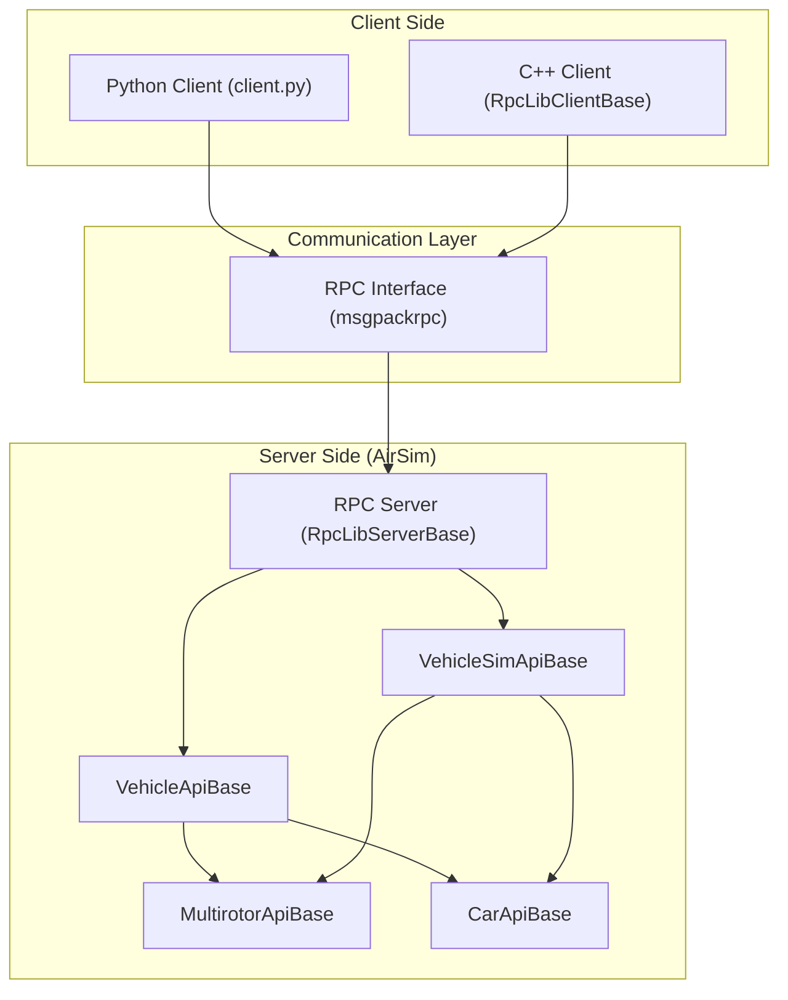
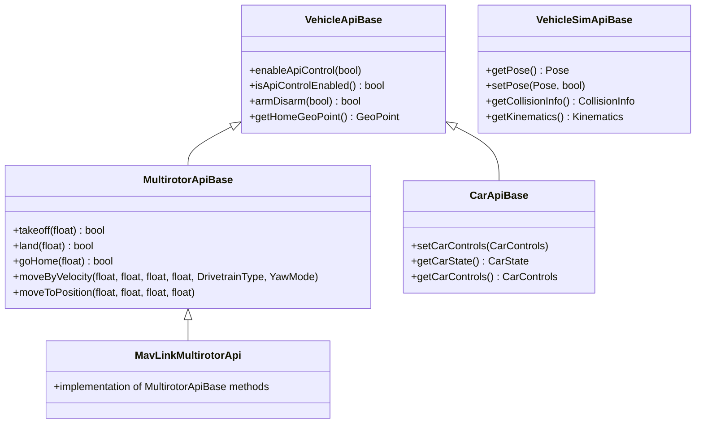
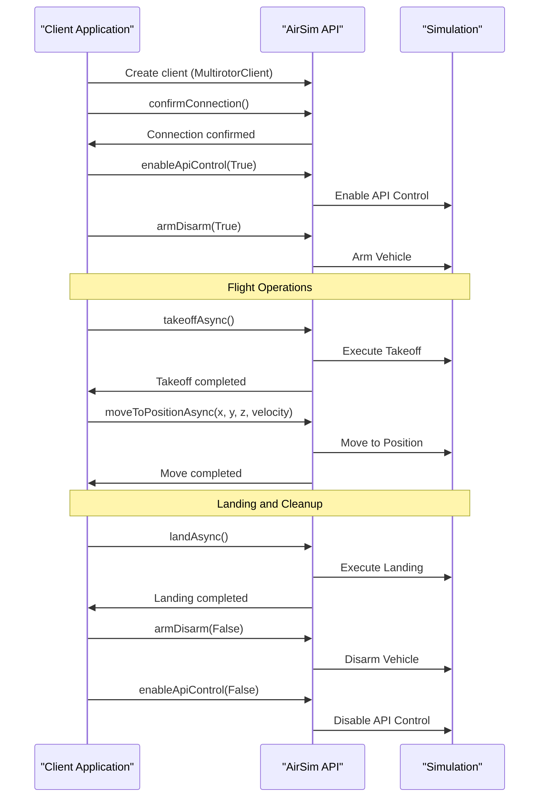

<!-- source: DeepWiki mcp.deepwiki.com · repo microsoft/AirSim · page 3.1 Vehicle Control API · fetched 2026-10-26 -->

# Vehicle Control API

<details>
<summary>Relevant source files</summary>

The following files were used as context for generating this wiki page:

- [AirLib/include/api/RpcLibClientBase.hpp](AirLib/include/api/RpcLibClientBase.hpp)
- [AirLib/include/api/VehicleApiBase.hpp](AirLib/include/api/VehicleApiBase.hpp)
- [AirLib/include/api/VehicleSimApiBase.hpp](AirLib/include/api/VehicleSimApiBase.hpp)
- [AirLib/include/api/WorldSimApiBase.hpp](AirLib/include/api/WorldSimApiBase.hpp)
- [AirLib/include/vehicles/multirotor/firmwares/mavlink/MavLinkMultirotorApi.hpp](AirLib/include/vehicles/multirotor/firmwares/mavlink/MavLinkMultirotorApi.hpp)
- [AirLib/src/api/RpcLibClientBase.cpp](AirLib/src/api/RpcLibClientBase.cpp)
- [AirLib/src/api/RpcLibServerBase.cpp](AirLib/src/api/RpcLibServerBase.cpp)
- [MavLinkCom/include/MavLinkConnection.hpp](MavLinkCom/include/MavLinkConnection.hpp)
- [MavLinkCom/include/MavLinkLog.hpp](MavLinkCom/include/MavLinkLog.hpp)
- [MavLinkCom/include/MavLinkMessageBase.hpp](MavLinkCom/include/MavLinkMessageBase.hpp)
- [MavLinkCom/src/MavLinkConnection.cpp](MavLinkCom/src/MavLinkConnection.cpp)
- [MavLinkCom/src/MavLinkLog.cpp](MavLinkCom/src/MavLinkLog.cpp)
- [MavLinkCom/src/MavLinkMessageBase.cpp](MavLinkCom/src/MavLinkMessageBase.cpp)
- [MavLinkCom/src/impl/MavLinkConnectionImpl.cpp](MavLinkCom/src/impl/MavLinkConnectionImpl.cpp)
- [MavLinkCom/src/impl/MavLinkConnectionImpl.hpp](MavLinkCom/src/impl/MavLinkConnectionImpl.hpp)
- [MavLinkCom/src/serial_com/wifi.cpp](MavLinkCom/src/serial_com/wifi.cpp)
- [PythonClient/PythonClient.pyproj](PythonClient/PythonClient.pyproj)
- [PythonClient/airsim/client.py](PythonClient/airsim/client.py)
- [PythonClient/multirotor/path.py](PythonClient/multirotor/path.py)
- [PythonClient/multirotor/state.py](PythonClient/multirotor/state.py)
- [PythonClient/multirotor/takeoff.py](PythonClient/multirotor/takeoff.py)
- [Unity/AirLibWrapper/AirsimWrapper/Source/PawnSimApi.cpp](Unity/AirLibWrapper/AirsimWrapper/Source/PawnSimApi.cpp)
- [Unity/AirLibWrapper/AirsimWrapper/Source/PawnSimApi.h](Unity/AirLibWrapper/AirsimWrapper/Source/PawnSimApi.h)
- [Unity/AirLibWrapper/AirsimWrapper/Source/WorldSimApi.cpp](Unity/AirLibWrapper/AirsimWrapper/Source/WorldSimApi.cpp)
- [Unity/AirLibWrapper/AirsimWrapper/Source/WorldSimApi.h](Unity/AirLibWrapper/AirsimWrapper/Source/WorldSimApi.h)
- [Unreal/Plugins/AirSim/Source/PawnSimApi.cpp](Unreal/Plugins/AirSim/Source/PawnSimApi.cpp)
- [Unreal/Plugins/AirSim/Source/PawnSimApi.h](Unreal/Plugins/AirSim/Source/PawnSimApi.h)
- [Unreal/Plugins/AirSim/Source/WorldSimApi.cpp](Unreal/Plugins/AirSim/Source/WorldSimApi.cpp)
- [Unreal/Plugins/AirSim/Source/WorldSimApi.h](Unreal/Plugins/AirSim/Source/WorldSimApi.h)

</details>


The Vehicle Control API in AirSim enables programmatic control of vehicles within the simulation environment. This document covers the core API functions for controlling vehicles, including basic operations like enabling API control, arming/disarming, and vehicle movement. For information about retrieving sensor data from vehicles, see [Sensor Data Retrieval](#3.2).

## Architecture

The Vehicle Control API is built on a client-server architecture, where commands are sent from a client application to the AirSim simulation server using Remote Procedure Calls (RPC).



Sources:
- [PythonClient/airsim/client.py]()
- [AirLib/src/api/RpcLibClientBase.cpp]()
- [AirLib/src/api/RpcLibServerBase.cpp]()
- [AirLib/include/api/VehicleApiBase.hpp]()
- [AirLib/include/api/VehicleSimApiBase.hpp]()

## Class Hierarchy

The Vehicle Control API follows an object-oriented design with a hierarchy of interfaces and implementations:



Sources:
- [AirLib/include/api/VehicleApiBase.hpp]()
- [AirLib/include/api/VehicleSimApiBase.hpp]()
- [AirLib/include/vehicles/multirotor/firmwares/mavlink/MavLinkMultirotorApi.hpp]()

## Common API Functions

These core functions are available for all vehicle types:

| Function | Description |
|----------|-------------|
| `enableApiControl(is_enabled, vehicle_name='')` | Enables/disables API control for the vehicle |
| `isApiControlEnabled(vehicle_name='')` | Checks if API control is enabled |
| `armDisarm(arm, vehicle_name='')` | Arms/disarms the vehicle |
| `reset()` | Resets the vehicle to its original state |
| `simGetVehiclePose(vehicle_name='')` | Gets the current pose of the vehicle |
| `simSetVehiclePose(pose, ignore_collision, vehicle_name='')` | Sets the pose of the vehicle |
| `getHomeGeoPoint(vehicle_name='')` | Gets the home geo-location |

Sources:
- [PythonClient/airsim/client.py:49-86]()
- [AirLib/src/api/RpcLibClientBase.cpp:91-104]()

## Vehicle-Specific APIs

### Multirotor API

The Multirotor API provides functions specific to controlling multirotor aircraft:

| Function | Description |
|----------|-------------|
| `takeoffAsync(timeout_sec=20, vehicle_name='')` | Initiates takeoff and waits for it to complete |
| `landAsync(timeout_sec=60, vehicle_name='')` | Initiates landing and waits for it to complete |
| `goHomeAsync(timeout_sec=3e+38, vehicle_name='')` | Commands the vehicle to return to home position |
| `moveByVelocityAsync(vx, vy, vz, duration, ...)` | Moves the vehicle by velocity components |
| `moveToPositionAsync(x, y, z, velocity, ...)` | Moves the vehicle to a specific position |
| `moveOnPathAsync(path, velocity, ...)` | Moves the vehicle along a specified path |
| `hoverAsync(vehicle_name='')` | Commands the vehicle to hover at the current position |
| `moveByRollPitchYawZAsync(roll, pitch, yaw, z, ...)` | Moves by specifying roll, pitch, yaw angles and z position |
| `moveByRollPitchYawThrottleAsync(roll, pitch, yaw, throttle, ...)` | Moves by specifying roll, pitch, yaw angles and throttle |
| `moveByRollPitchYawrateThrottleAsync(roll, pitch, yaw_rate, throttle, ...)` | Moves by specifying roll, pitch angles, yaw rate and throttle |
| `moveByAngleRatesZAsync(roll_rate, pitch_rate, yaw_rate, z, ...)` | Moves by specifying roll, pitch, yaw rates and z position |
| `moveByAngleRatesThrottleAsync(roll_rate, pitch_rate, yaw_rate, throttle, ...)` | Moves by specifying roll, pitch, yaw rates and throttle |

Sources:
- [PythonClient/airsim/client.py:1083-1399]()
- [PythonClient/multirotor/path.py]()

### Car API

The Car API provides functions specific to controlling cars:

| Function | Description |
|----------|-------------|
| `setCarControls(controls, vehicle_name='')` | Sets controls for the car (throttle, steering, brake) |
| `getCarControls(vehicle_name='')` | Gets the current control settings for the car |
| `getCarState(vehicle_name='')` | Gets the car's current state |

Sources:
- [PythonClient/airsim/client.py:1485-1526]()

## Workflow for Vehicle Control

Here's a typical workflow for controlling a vehicle using the Vehicle Control API:



Sources:
- [PythonClient/multirotor/takeoff.py]()
- [PythonClient/multirotor/navigate.py]()

## Examples

### Basic Control Example

```python
import airsim

# Connect to the AirSim simulator
client = airsim.MultirotorClient()
client.confirmConnection()

# Enable API control and arm the vehicle
client.enableApiControl(True)
client.armDisarm(True)

# Take off and hover at 5 meters
client.takeoffAsync().join()
client.moveToZAsync(-5, 1).join()

# Move to a position (10, 10, -5) at 5 m/s
client.moveToPositionAsync(10, 10, -5, 5).join()

# Land and cleanup
client.landAsync().join()
client.armDisarm(False)
client.enableApiControl(False)
```

### Path Following Example

```python
import airsim

client = airsim.MultirotorClient()
client.confirmConnection()
client.enableApiControl(True)
client.armDisarm(True)

client.takeoffAsync().join()

# Create a path of 3D points
path = [airsim.Vector3r(0, 0, -5),
        airsim.Vector3r(10, 0, -5),
        airsim.Vector3r(10, 10, -5),
        airsim.Vector3r(0, 10, -5),
        airsim.Vector3r(0, 0, -5)]

# Follow the path at 5 m/s
result = client.moveOnPathAsync(path, 5, 
                              120, 
                              airsim.DrivetrainType.ForwardOnly, 
                              airsim.YawMode(False, 0)).join()

client.landAsync().join()
client.armDisarm(False)
```

### Car Control Example

```python
import airsim

# Connect to the AirSim simulator
client = airsim.CarClient()
client.confirmConnection()
client.enableApiControl(True)

# Set car controls
car_controls = airsim.CarControls()
car_controls.throttle = 0.5  # 50% throttle
car_controls.steering = 0.0  # No steering (straight)
client.setCarControls(car_controls)

# Drive for 3 seconds
import time
time.sleep(3)

# Apply brakes
car_controls.throttle = 0.0
car_controls.brake = 1.0
client.setCarControls(car_controls)

# Release control when done
client.enableApiControl(False)
```

Sources:
- [PythonClient/multirotor/path.py]()
- [PythonClient/car/hello_car.py]()

## Error Handling

When using the Vehicle Control API, it's important to handle the following common error conditions:

1. **Connection failures**: Always check the connection status with `confirmConnection()` before sending commands
2. **API control not enabled**: Ensure API control is enabled with `enableApiControl(True)` before sending commands
3. **Vehicle not armed**: For multirotors, ensure the vehicle is armed with `armDisarm(True)` before flight commands
4. **Invalid positions/velocities**: Ensure position and velocity commands are within the vehicle's capabilities
5. **Timeouts**: For async operations, consider using appropriate timeout values

---

