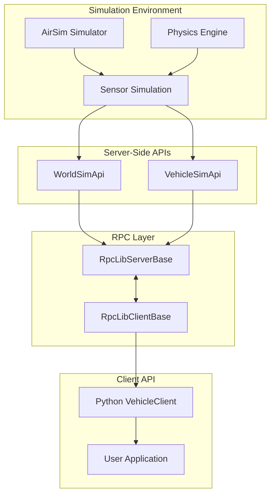
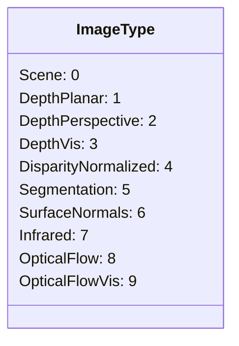
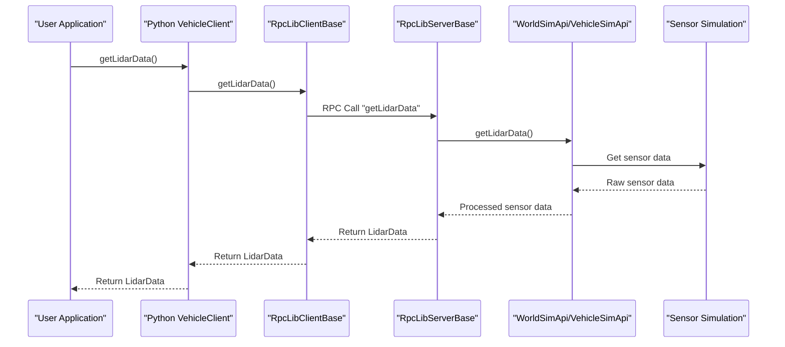
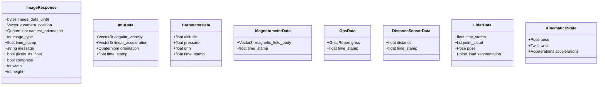

<!-- source: DeepWiki mcp.deepwiki.com · repo microsoft/AirSim · page 3.2 Sensor Data Retrieval · fetched 2026-10-26 -->

# Sensor Data Retrieval

<details>
<summary>Relevant source files</summary>

The following files were used as context for generating this wiki page:

- [AirLib/include/api/RpcLibClientBase.hpp](AirLib/include/api/RpcLibClientBase.hpp)
- [AirLib/include/api/VehicleSimApiBase.hpp](AirLib/include/api/VehicleSimApiBase.hpp)
- [AirLib/include/api/WorldSimApiBase.hpp](AirLib/include/api/WorldSimApiBase.hpp)
- [AirLib/include/common/CommonStructs.hpp](AirLib/include/common/CommonStructs.hpp)
- [AirLib/src/api/RpcLibClientBase.cpp](AirLib/src/api/RpcLibClientBase.cpp)
- [AirLib/src/api/RpcLibServerBase.cpp](AirLib/src/api/RpcLibServerBase.cpp)
- [PythonClient/airsim/client.py](PythonClient/airsim/client.py)
- [PythonClient/airsim/types.py](PythonClient/airsim/types.py)
- [Unity/AirLibWrapper/AirsimWrapper/Source/PawnSimApi.cpp](Unity/AirLibWrapper/AirsimWrapper/Source/PawnSimApi.cpp)
- [Unity/AirLibWrapper/AirsimWrapper/Source/PawnSimApi.h](Unity/AirLibWrapper/AirsimWrapper/Source/PawnSimApi.h)
- [Unity/AirLibWrapper/AirsimWrapper/Source/WorldSimApi.cpp](Unity/AirLibWrapper/AirsimWrapper/Source/WorldSimApi.cpp)
- [Unity/AirLibWrapper/AirsimWrapper/Source/WorldSimApi.h](Unity/AirLibWrapper/AirsimWrapper/Source/WorldSimApi.h)
- [Unreal/Plugins/AirSim/Source/PawnSimApi.cpp](Unreal/Plugins/AirSim/Source/PawnSimApi.cpp)
- [Unreal/Plugins/AirSim/Source/PawnSimApi.h](Unreal/Plugins/AirSim/Source/PawnSimApi.h)
- [Unreal/Plugins/AirSim/Source/WorldSimApi.cpp](Unreal/Plugins/AirSim/Source/WorldSimApi.cpp)
- [Unreal/Plugins/AirSim/Source/WorldSimApi.h](Unreal/Plugins/AirSim/Source/WorldSimApi.h)
- [docs/CHANGELOG.md](docs/CHANGELOG.md)
- [docs/airsim_ros_pkgs.md](docs/airsim_ros_pkgs.md)
- [docs/airsim_tutorial_pkgs.md](docs/airsim_tutorial_pkgs.md)
- [docs/azure.md](docs/azure.md)
- [docs/distance_sensor.md](docs/distance_sensor.md)
- [docs/lidar.md](docs/lidar.md)
- [docs/sensors.md](docs/sensors.md)
- [tools/install_ros_deps.sh](tools/install_ros_deps.sh)

</details>


This document explains how to retrieve sensor data from the AirSim simulation using the Python Client API. AirSim provides access to various simulated sensors including cameras, IMU, GPS, barometer, magnetometer, distance sensors, and LiDAR. Understanding how to properly retrieve and work with this sensor data is essential for developing and testing autonomous vehicle algorithms.

For information on sensor configuration, see [Configuration System](#2.2).

## Sensor Data Retrieval Architecture

Before diving into specific sensor APIs, it's important to understand how sensor data flows from the simulation to your client application.



Sources: [PythonClient/airsim/client.py](). [AirLib/src/api/RpcLibClientBase.cpp](). [AirLib/src/api/RpcLibServerBase.cpp](). [Unreal/Plugins/AirSim/Source/WorldSimApi.cpp]().

## Available Sensors

AirSim supports the following sensor types:

| Sensor Type | Enum Value | Description | Retrieval Method |
|-------------|------------|-------------|------------------|
| Camera | N/A | RGB, depth, segmentation images | `simGetImage()`, `simGetImages()` |
| IMU | 2 | Acceleration, angular velocity | `getImuData()` |
| Barometer | 1 | Altitude, pressure | `getBarometerData()` |
| Magnetometer | 4 | Magnetic field | `getMagnetometerData()` |
| GPS | 3 | Position in geodetic coordinates | `getGpsData()` |
| Distance Sensor | 5 | Distance measurements | `getDistanceSensorData()` |
| LiDAR | 6 | 3D point cloud data | `getLidarData()` |

Sources: [docs/sensors.md](). [PythonClient/airsim/client.py:840-883]().

## Camera Data Retrieval

Cameras are the most complex sensors in AirSim, offering multiple image types (RGB, depth, segmentation, etc.) and configuration options.

### Single Image Retrieval

To retrieve a single image from a camera, use the `simGetImage()` method:

```python
# Get a scene image from front_center camera
image = client.simGetImage("front_center", airsim.ImageType.Scene)
# Convert to numpy array
img1d = np.frombuffer(image, dtype=np.uint8)
# Reshape to image dimensions
img_rgb = img1d.reshape(height, width, 3)
```

Sources: [PythonClient/airsim/client.py:266-290]().

### Multiple Image Retrieval

For retrieving multiple images at once (more efficient), use the `simGetImages()` method:

```python
# Request RGB and depth images from front camera
requests = [
    airsim.ImageRequest("front_center", airsim.ImageType.Scene),
    airsim.ImageRequest("front_center", airsim.ImageType.DepthPlanar, True)
]
responses = client.simGetImages(requests)
```

Sources: [PythonClient/airsim/client.py:295-310]().

### Image Types

AirSim supports various image types that can be specified in the `ImageRequest`:



Sources: [PythonClient/airsim/types.py:22-60]().

## IMU, GPS, and Other Basic Sensors

AirSim provides simple methods to retrieve data from basic sensors.

### IMU Data

```python
imu_data = client.getImuData()
# Access components
acceleration = imu_data.linear_acceleration
angular_velocity = imu_data.angular_velocity
orientation = imu_data.orientation
```

Sources: [PythonClient/airsim/client.py:841-851]().

### GPS Data

```python
gps_data = client.getGpsData()
# Access components
latitude = gps_data.gnss.geo_point.latitude
longitude = gps_data.gnss.geo_point.longitude
altitude = gps_data.gnss.geo_point.altitude
```

Sources: [PythonClient/airsim/client.py:874-883]().

### Barometer Data

```python
barometer_data = client.getBarometerData()
# Access altitude and pressure
altitude = barometer_data.altitude
pressure = barometer_data.pressure
```

Sources: [PythonClient/airsim/client.py:852-861]().

### Magnetometer Data

```python
magnetometer_data = client.getMagnetometerData()
# Access magnetic field
magnetic_field = magnetometer_data.magnetic_field_body
```

Sources: [PythonClient/airsim/client.py:863-872]().

### Distance Sensor Data

```python
distance_data = client.getDistanceSensorData()
# Access distance
distance = distance_data.distance
```

Sources: [PythonClient/airsim/client.py:885-895]().

## LiDAR Data Retrieval

LiDAR sensors provide 3D point cloud data which is useful for obstacle detection, mapping, and navigation.

```python
lidar_data = client.getLidarData()

# Check if valid data is received
if (len(lidar_data.point_cloud) >= 3):
    # Reshape and parse the point cloud
    points = np.array(lidar_data.point_cloud, dtype=np.float32).reshape(-1, 3)
    
    # Each point is a 3D vector of x,y,z coordinates
    # Process the points as needed
```

LiDAR parameters can be configured in settings.json to control the number of channels, points per second, rotation rate, field of view, etc.

Sources: [docs/lidar.md](). [PythonClient/airsim/client.py]().

## Advanced Sensor Data

### Collision Information

Detect and retrieve information about collisions:

```python
collision_info = client.simGetCollisionInfo()
if collision_info.has_collided:
    position = collision_info.position
    normal = collision_info.normal
    impact_point = collision_info.impact_point
    penetration_depth = collision_info.penetration_depth
    collision_time = collision_info.time_stamp
    object_name = collision_info.object_name
    object_id = collision_info.object_id
```

Sources: [PythonClient/airsim/client.py:439-448]().

### Ground Truth Data

AirSim provides access to ground truth data about vehicle kinematics and environment:

```python
# Get ground truth kinematics
kinematics = client.simGetGroundTruthKinematics()
position = kinematics.position
orientation = kinematics.orientation
linear_velocity = kinematics.linear_velocity
angular_velocity = kinematics.angular_velocity

# Get ground truth environment data
env_data = client.simGetGroundTruthEnvironment()
```

Sources: [PythonClient/airsim/client.py:794-837]().

### Object Detection

AirSim supports an object detection API which can be used to simulate object detection sensors:

```python
# First, add names of objects you want to detect
client.simAddDetectionFilterMeshName("camera_name", airsim.ImageType.Scene, "ObjectName")

# Set detection radius (in cm)
client.simSetDetectionFilterRadius("camera_name", airsim.ImageType.Scene, 200)

# Get detections
detections = client.simGetDetections("camera_name", airsim.ImageType.Scene)

# Process detections
for detection in detections:
    name = detection.name
    relative_pose = detection.relative_pose
    box2D = detection.box2D
    box3D = detection.box3D
```

Sources: [PythonClient/airsim/client.py:635-691]().

## Data Flow Between Client and Server

The following diagram illustrates how sensor data requests flow between the client and server components:



Sources: [PythonClient/airsim/client.py](). [AirLib/src/api/RpcLibClientBase.cpp](). [AirLib/src/api/RpcLibServerBase.cpp]().

## Sensor Data Structures

AirSim defines various data structures for different sensor types. Here are the main ones:



Sources: [PythonClient/airsim/types.py](). [AirLib/include/common/CommonStructs.hpp]().

## Working with Multiple Vehicles

When working with multiple vehicles, you can specify the vehicle name in the sensor data retrieval methods:

```python
# Get IMU data from specific vehicle
imu_data = client.getImuData("imu_sensor_name", "vehicle_name")

# Get camera image from specific vehicle
image = client.simGetImage("camera_name", airsim.ImageType.Scene, "vehicle_name")
```

This applies to all sensor data retrieval methods, allowing you to retrieve data from specific sensors on specific vehicles.

Sources: [PythonClient/airsim/client.py:841-895]().

## Performance Considerations

When retrieving sensor data, especially image and LiDAR data, be mindful of the performance impact:

1. Use `simGetImages()` with multiple requests rather than multiple calls to `simGetImage()` when possible
2. Consider reducing image resolution or LiDAR point density for performance-critical applications
3. Use compressed images and decompress them on the client side to reduce network bandwidth
4. Be mindful of the request frequency to avoid overwhelming the simulation

The data retrieval itself happens via RPC (Remote Procedure Call), so there may be some latency between the client and server, especially over network connections.

Sources: [PythonClient/airsim/client.py:266-310]().

## Example: Basic Sensor Data Collection

Here's a complete example that collects data from multiple sensors:

```python
import airsim
import numpy as np
import time

# Connect to the AirSim simulator
client = airsim.VehicleClient()
client.confirmConnection()

try:
    # Enable API control
    client.enableApiControl(True)
    
    # Get sensor data from various sensors
    imu_data = client.getImuData()
    barometer_data = client.getBarometerData()
    gps_data = client.getGpsData()
    magnetometer_data = client.getMagnetometerData()
    
    # Get LiDAR data
    lidar_data = client.getLidarData()
    if len(lidar_data.point_cloud) >= 3:
        points = np.array(lidar_data.point_cloud, dtype=np.float32).reshape(-1, 3)
        print(f"LiDAR points: {points.shape[0]}")
    
    # Get camera images
    responses = client.simGetImages([
        airsim.ImageRequest("0", airsim.ImageType.Scene),
        airsim.ImageRequest("0", airsim.ImageType.DepthVis)
    ])
    
    for i, response in enumerate(responses):
        if response.pixels_as_float:
            # Depth image
            depth_img = np.array(response.image_data_float, dtype=np.float32)
            print(f"Depth image shape: {depth_img.shape}")
        else:
            # RGB image
            img1d = np.frombuffer(response.image_data_uint8, dtype=np.uint8)
            img_rgb = img1d.reshape(response.height, response.width, 3)
            print(f"RGB image shape: {img_rgb.shape}")
            
finally:
    # Always disable API control before disconnecting
    client.enableApiControl(False)
```

Sources: [PythonClient/airsim/client.py]().

---

