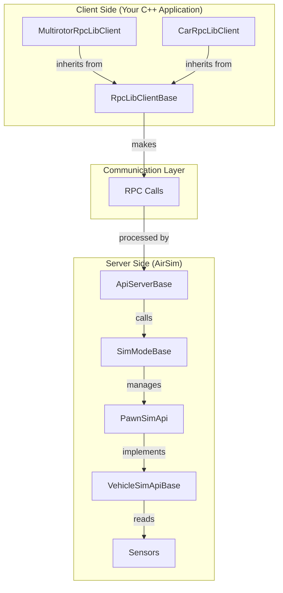
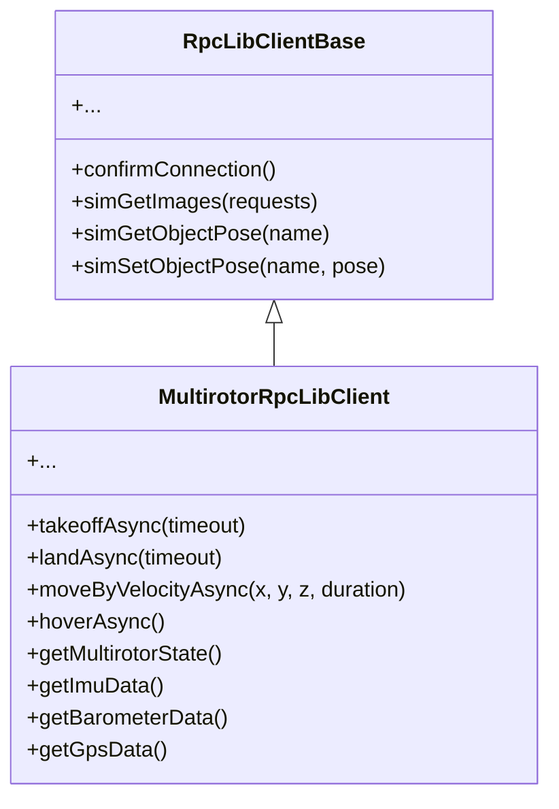
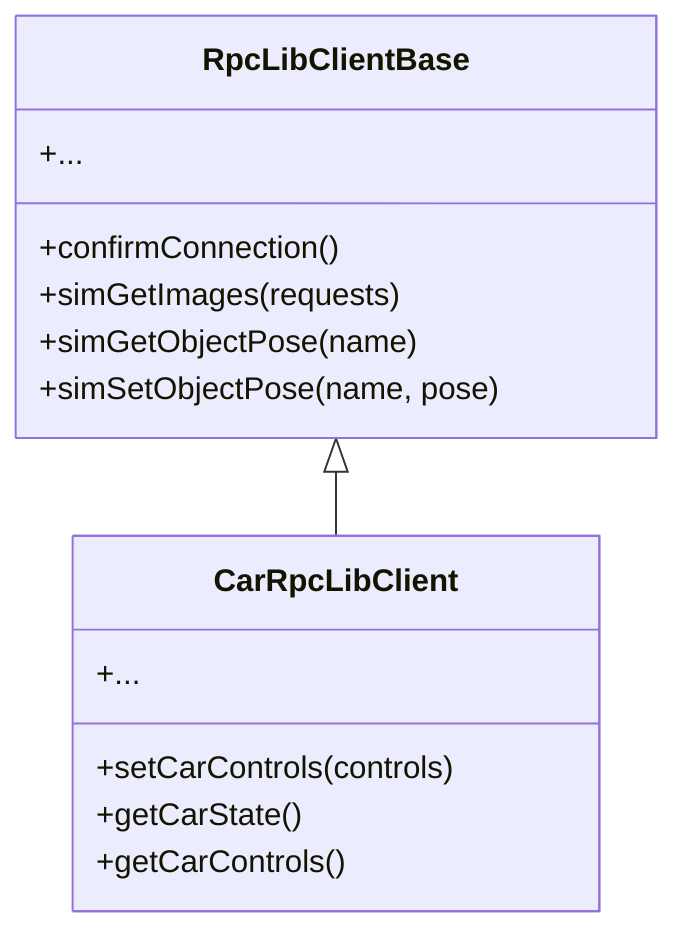
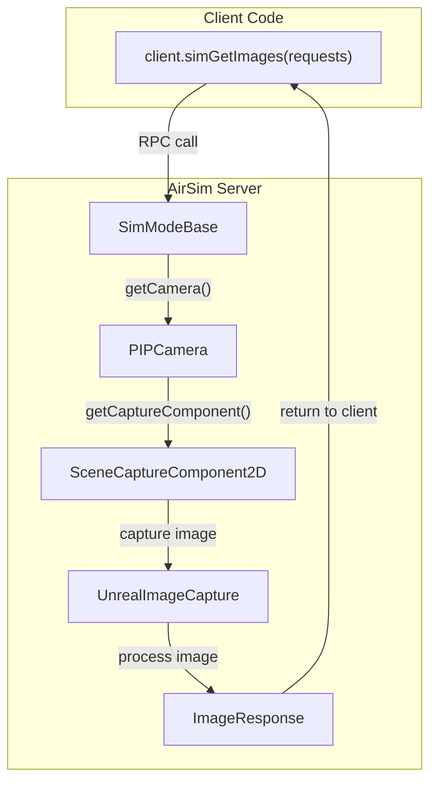
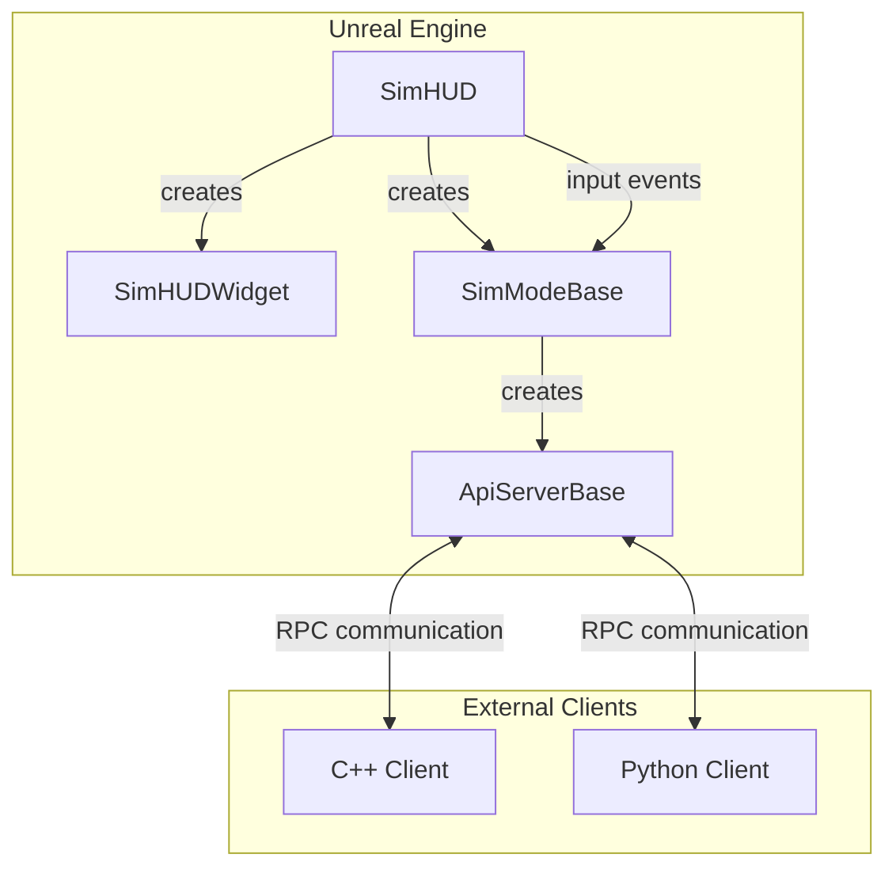
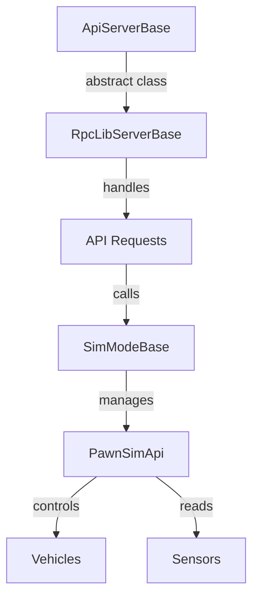

<!-- source: DeepWiki mcp.deepwiki.com · repo microsoft/AirSim · page 4 C++ API and Examples · fetched 2026-10-26 -->

# C++ API and Examples

<details>
<summary>Relevant source files</summary>

The following files were used as context for generating this wiki page:

- [AirLib/AirLib.vcxproj](AirLib/AirLib.vcxproj)
- [AirLib/AirLib.vcxproj.filters](AirLib/AirLib.vcxproj.filters)
- [AirLib/include/common/AirSimSettings.hpp](AirLib/include/common/AirSimSettings.hpp)
- [AirLibUnitTests/AirLibUnitTests.vcxproj](AirLibUnitTests/AirLibUnitTests.vcxproj)
- [DroneServer/DroneServer.vcxproj](DroneServer/DroneServer.vcxproj)
- [DroneShell/DroneShell.vcxproj](DroneShell/DroneShell.vcxproj)
- [Examples/Examples.vcxproj](Examples/Examples.vcxproj)
- [Examples/Examples.vcxproj.filters](Examples/Examples.vcxproj.filters)
- [Examples/main.cpp](Examples/main.cpp)
- [HelloCar/HelloCar.vcxproj](HelloCar/HelloCar.vcxproj)
- [HelloCar/main.cpp](HelloCar/main.cpp)
- [HelloDrone/HelloDrone.vcxproj](HelloDrone/HelloDrone.vcxproj)
- [HelloDrone/main.cpp](HelloDrone/main.cpp)
- [HelloSpawnedDrones/HelloSpawnedDrones.cpp](HelloSpawnedDrones/HelloSpawnedDrones.cpp)
- [HelloSpawnedDrones/HelloSpawnedDrones.vcxproj](HelloSpawnedDrones/HelloSpawnedDrones.vcxproj)
- [HelloSpawnedDrones/HelloSpawnedDrones.vcxproj.filters](HelloSpawnedDrones/HelloSpawnedDrones.vcxproj.filters)
- [MavLinkCom/MavLinkCom.vcxproj](MavLinkCom/MavLinkCom.vcxproj)
- [MavLinkCom/MavLinkTest/MavLinkTest.vcxproj](MavLinkCom/MavLinkTest/MavLinkTest.vcxproj)
- [SGM/src/sgmstereo/sgmstereo.vcxproj](SGM/src/sgmstereo/sgmstereo.vcxproj)
- [SGM/src/stereoPipeline/stereoPipeline.vcxproj](SGM/src/stereoPipeline/stereoPipeline.vcxproj)
- [Unreal/Plugins/AirSim/Content/Blueprints/BP_CameraDirector.uasset](Unreal/Plugins/AirSim/Content/Blueprints/BP_CameraDirector.uasset)
- [Unreal/Plugins/AirSim/Content/Blueprints/BP_SimHUDWidget.uasset](Unreal/Plugins/AirSim/Content/Blueprints/BP_SimHUDWidget.uasset)
- [Unreal/Plugins/AirSim/Source/AirBlueprintLib.cpp](Unreal/Plugins/AirSim/Source/AirBlueprintLib.cpp)
- [Unreal/Plugins/AirSim/Source/AirBlueprintLib.h](Unreal/Plugins/AirSim/Source/AirBlueprintLib.h)
- [Unreal/Plugins/AirSim/Source/CameraDirector.cpp](Unreal/Plugins/AirSim/Source/CameraDirector.cpp)
- [Unreal/Plugins/AirSim/Source/CameraDirector.h](Unreal/Plugins/AirSim/Source/CameraDirector.h)
- [Unreal/Plugins/AirSim/Source/PIPCamera.cpp](Unreal/Plugins/AirSim/Source/PIPCamera.cpp)
- [Unreal/Plugins/AirSim/Source/PIPCamera.h](Unreal/Plugins/AirSim/Source/PIPCamera.h)
- [Unreal/Plugins/AirSim/Source/SimHUD/SimHUD.cpp](Unreal/Plugins/AirSim/Source/SimHUD/SimHUD.cpp)
- [Unreal/Plugins/AirSim/Source/SimHUD/SimHUD.h](Unreal/Plugins/AirSim/Source/SimHUD/SimHUD.h)
- [Unreal/Plugins/AirSim/Source/SimHUD/SimHUDWidget.h](Unreal/Plugins/AirSim/Source/SimHUD/SimHUDWidget.h)
- [Unreal/Plugins/AirSim/Source/SimMode/SimModeBase.cpp](Unreal/Plugins/AirSim/Source/SimMode/SimModeBase.cpp)
- [Unreal/Plugins/AirSim/Source/SimMode/SimModeBase.h](Unreal/Plugins/AirSim/Source/SimMode/SimModeBase.h)
- [docs/apis_cpp.md](docs/apis_cpp.md)

</details>


This document provides a comprehensive guide to using AirSim's C++ API for programmatic control of vehicles, sensor data access, and environment interaction. For information about the Python API, please see [Python Client API](#3).

## Core Architecture

The AirSim C++ API follows a client-server architecture where your C++ application communicates with the AirSim simulation through remote procedure calls (RPC).



Sources: [AirLib/include/api/RpcLibClientBase.hpp](), [Unreal/Plugins/AirSim/Source/SimMode/SimModeBase.cpp:80-176](), [Unreal/Plugins/AirSim/Source/SimMode/SimModeBase.cpp:316-319]()

## Setting Up Your C++ Project

To use the AirSim C++ API in your project, you need to configure the following:

### Include and Library Paths

```
Include folders:
- $(ProjectDir)..\AirLib\deps\rpclib\include
- $(ProjectDir)..\AirLib\deps\eigen3
- $(ProjectDir)..\AirLib\include

Library folders:
- $(ProjectDir)\..\AirLib\deps\MavLinkCom\lib\$(Platform)\$(Configuration)
- $(ProjectDir)\..\AirLib\deps\rpclib\lib\$(Platform)\$(Configuration)
- $(ProjectDir)\..\AirLib\lib\$(Platform)\$(Configuration)

Required libraries:
- rpc.lib
```

The fastest way to understand the setup is to examine the examples included in the AirSim solution: HelloCar and HelloDrone.

Sources: [HelloCar/HelloCar.vcxproj](), [HelloDrone/HelloDrone.vcxproj](), [docs/apis_cpp.md:10-15]()

## Vehicle APIs

AirSim provides specialized client classes for different vehicle types, which all inherit from the base `RpcLibClientBase` class.

### Multirotor API

The `MultirotorRpcLibClient` provides methods to control drones:



Sources: [HelloDrone/main.cpp:21-139](), [vehicles/multirotor/api/MultirotorRpcLibClient.hpp]()

### Car API

The `CarRpcLibClient` provides methods to control cars:



Sources: [HelloCar/main.cpp:25-95](), [vehicles/car/api/CarRpcLibClient.hpp]()

## Sensor APIs

### Camera and Image Capture

AirSim provides comprehensive APIs for camera control and image capture. You can request different image types (RGB, depth, segmentation, etc.) from multiple cameras attached to a vehicle.



Image capture example:

```cpp
// Request images from different cameras with different types
const std::vector<ImageRequest> request{
    ImageRequest("0", ImageType::Scene),           // RGB camera
    ImageRequest("1", ImageType::DepthPlanar, true) // Depth camera
};

// Get the images
const std::vector<ImageResponse>& response = client.simGetImages(request);

// Process the images
for (const ImageResponse& image_info : response) {
    // Access RGB data as uint8 array
    if (!image_info.pixels_as_float) {
        // Use image_info.image_data_uint8
    }
    // Access depth data as float array
    else {
        // Use image_info.image_data_float
    }
}
```

Sources: [Unreal/Plugins/AirSim/Source/PIPCamera.cpp:42-48](), [Unreal/Plugins/AirSim/Source/PIPCamera.cpp:257-299](), [HelloDrone/main.cpp:32-57]()

### IMU, GPS, and Other Sensors

AirSim provides APIs to access other sensor data:

```cpp
// Get barometer data
auto barometer_data = client.getBarometerData();
std::cout << "Altitude: " << barometer_data.altitude << std::endl;

// Get IMU data
auto imu_data = client.getImuData();
std::cout << "Angular velocity: " << imu_data.angular_velocity << std::endl;

// Get GPS data
auto gps_data = client.getGpsData();
std::cout << "GPS position: " << gps_data.gnss.geo_point << std::endl;
```

Sources: [HelloDrone/main.cpp:65-92]()

## Examples

### Controlling a Drone

The following example shows basic drone control operations:

```cpp
// Create the client
msr::airlib::MultirotorRpcLibClient client;

// Connect to the simulator
client.confirmConnection();

// Enable API control and arm
client.enableApiControl(true);
client.armDisarm(true);

// Take off
float takeoff_timeout = 5;
client.takeoffAsync(takeoff_timeout)->waitOnLastTask();

// Fly in a square pattern
float speed = 3.0f;
float size = 10.0f;
float duration = size / speed;
float z = -10.0f; // 10 meters above ground

// Forward
client.moveByVelocityZAsync(speed, 0, z, duration);
std::this_thread::sleep_for(std::chrono::duration<double>(duration));

// Right
client.moveByVelocityZAsync(0, speed, z, duration);
std::this_thread::sleep_for(std::chrono::duration<double>(duration));

// Backward
client.moveByVelocityZAsync(-speed, 0, z, duration);
std::this_thread::sleep_for(std::chrono::duration<double>(duration));

// Left
client.moveByVelocityZAsync(0, -speed, z, duration);
std::this_thread::sleep_for(std::chrono::duration<double>(duration));

// Switch to hover mode
client.hoverAsync()->waitOnLastTask();

// Land
client.landAsync()->waitOnLastTask();

// Disarm
client.armDisarm(false);
```

Sources: [HelloDrone/main.cpp:59-139]()

### Controlling a Car

The following example shows basic car control operations:

```cpp
// Create the client
msr::airlib::CarRpcLibClient client;

// Connect to the simulator
client.confirmConnection();

// Enable API control
client.enableApiControl(true);

// Drive forward
msr::airlib::CarApiBase::CarControls controls;
controls.throttle = 0.5f;
controls.steering = 0.0f;
client.setCarControls(controls);

// Wait for 3 seconds
std::this_thread::sleep_for(std::chrono::seconds(3));

// Apply handbrake
controls.handbrake = true;
client.setCarControls(controls);

// Release handbrake and drive backward
controls.handbrake = false;
controls.throttle = -0.5f;
controls.steering = 0.5f; // Turn while reversing
client.setCarControls(controls);

// Reset controls
client.setCarControls(msr::airlib::CarApiBase::CarControls());
```

Sources: [HelloCar/main.cpp:63-95]()

### Spawning Multiple Vehicles at Runtime

The AirSim C++ API allows spawning additional vehicles dynamically:

```cpp
// Create a client
msr::airlib::MultirotorRpcLibClient client;
client.confirmConnection();

// Spawn a new drone
const std::string vehicle_name = "Drone2";
const msr::airlib::Pose pose(msr::airlib::Vector3r(0, 5.0f, 0), 
                            msr::airlib::Quaternionr(0, 0, 0, 0));
client.simAddVehicle(vehicle_name, "simpleflight", pose, "");

// Control the new drone
client.enableApiControl(true, vehicle_name);
client.armDisarm(true, vehicle_name);
client.takeoffAsync(5, vehicle_name)->waitOnLastTask();
```

Sources: [HelloSpawnedDrones/HelloSpawnedDrones.cpp:30-48](), [Unreal/Plugins/AirSim/Source/SimMode/SimModeBase.cpp:652-676]()

## Advanced Features

### Camera Manipulation

AirSim provides detailed control over camera properties:

```cpp
// Get PIP cameras for the vehicle
const auto& cameras = client.simGetVehicleCameras();

// Configure camera settings
CameraSetting settings;
settings.width = 1280;
settings.height = 720;
settings.fov_degrees = 90.0f;
client.simSetCameraSetting("0", settings);

// Get camera information
const auto camera_info = client.simGetCameraInfo("0");
```

Sources: [Unreal/Plugins/AirSim/Source/PIPCamera.cpp:329-417]()

### Recording Data

You can record simulation data for later analysis:

```cpp
// Start recording
client.startRecording();

// Run your simulation
// ...

// Stop recording
client.stopRecording();
```

Sources: [Unreal/Plugins/AirSim/Source/SimMode/SimModeBase.cpp:491-514]()

## Working with the SimHUD

The SimHUD provides visualization and debugging functions. It manages the API server and handles input events.



The SimHUD:
1. Initializes the simulation mode
2. Creates the API server
3. Sets up keyboard bindings for controlling the simulation
4. Manages recording features
5. Controls view modes and camera settings

Sources: [Unreal/Plugins/AirSim/Source/SimHUD/SimHUD.cpp:19-47](), [Unreal/Plugins/AirSim/Source/SimHUD/SimHUD.cpp:315-337]()

## API Server Implementation

On the server side, the API is implemented by:



The API server:
1. Listens for client connections
2. Processes API requests
3. Dispatches calls to the appropriate simulation components
4. Returns results to the client

Sources: [Unreal/Plugins/AirSim/Source/SimMode/SimModeBase.cpp:315-566]()

## Common Troubleshooting

1. **Connection Issues**: 
   - Make sure AirSim is running and initialized
   - Check that the API server is enabled (`enable_rpc` in settings.json)
   - Verify firewall settings if connecting remotely

2. **Vehicle Control Issues**:
   - Ensure `enableApiControl(true)` is called
   - Check if the vehicle is armed with `armDisarm(true)`
   - Verify that the correct vehicle name is used for multi-vehicle simulations

3. **Build Issues**:
   - Make sure all dependency paths are correctly set
   - Check that the AirLib project is built with the same configuration as your project

Sources: [AirLib/include/api/RpcLibClientBase.hpp](), [HelloDrone/main.cpp:141-145]()

## Conclusion

The AirSim C++ API provides powerful programmatic control over the simulation environment. Through simple client classes, you can control vehicles, access sensor data, and interact with the environment. The examples provided demonstrate the foundation of what's possible, and the modular design allows for extension to support advanced simulation scenarios.

For more complex projects, you may want to explore the additional features available in the [Python API](#3) or consider contributing to the AirSim project directly to extend its capabilities.

---

