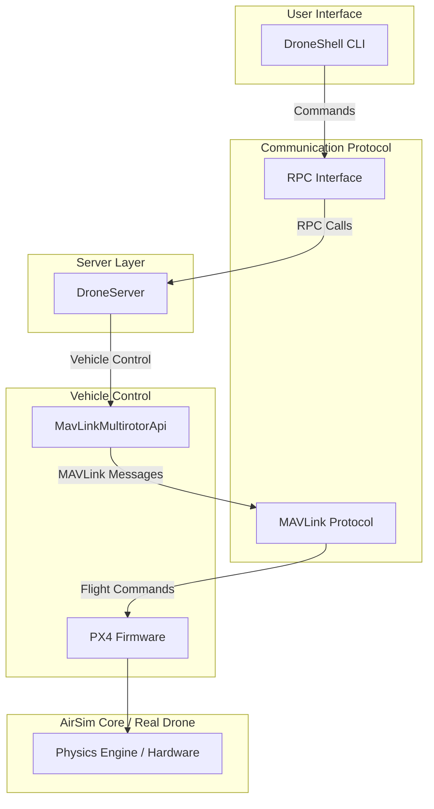
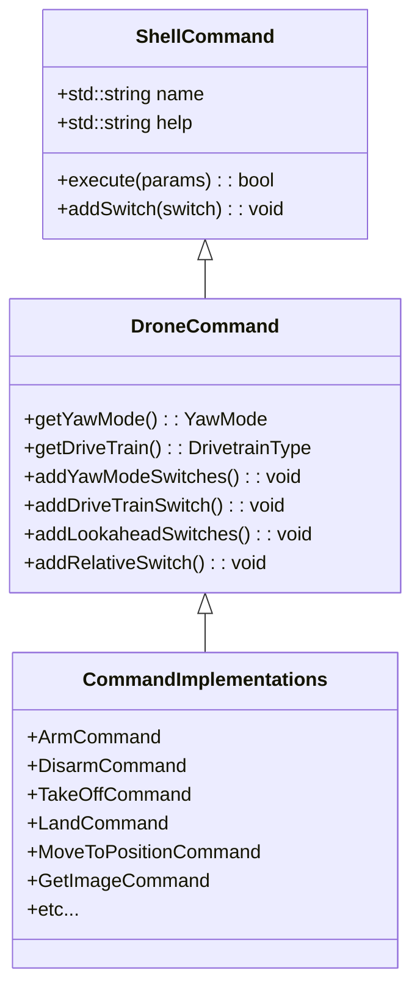
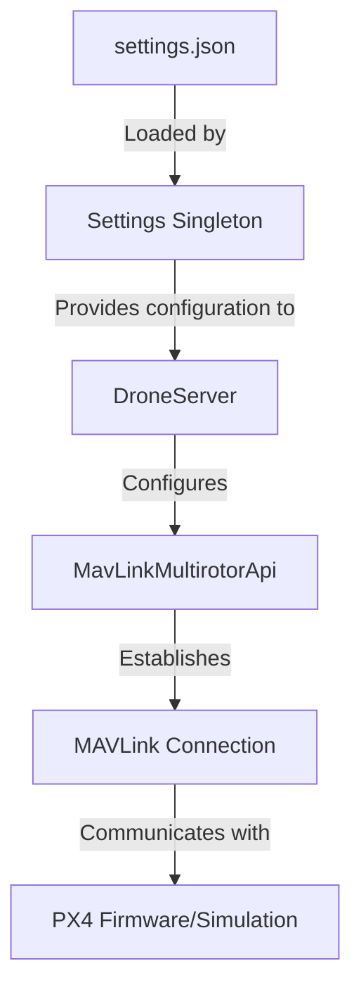
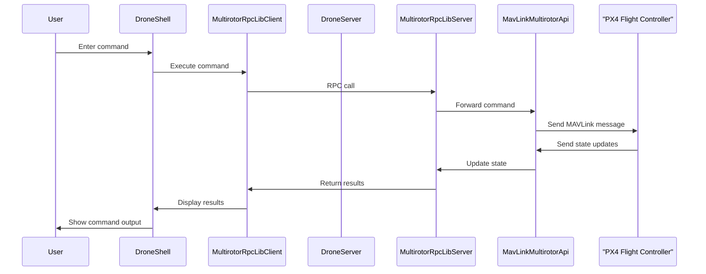

<!-- source: DeepWiki mcp.deepwiki.com · repo microsoft/AirSim · page 4.1 DroneShell and DroneServer · fetched 2026-10-26 -->

# DroneShell and DroneServer

<details>
<summary>Relevant source files</summary>

The following files were used as context for generating this wiki page:

- [DroneServer/main.cpp](DroneServer/main.cpp)
- [DroneShell/src/main.cpp](DroneShell/src/main.cpp)

</details>


DroneShell and DroneServer are command-line tools in AirSim that facilitate drone control through a client-server architecture. These components enable users to interact with multirotor vehicles in both simulation and real-world environments using consistent APIs.

For information about the Python API which provides similar functionality, see [Python Client API](#3).

## Architecture Overview

DroneShell and DroneServer form a client-server pair that connects to AirSim's simulation environment or real drones using MAVLink.



Sources: [DroneShell/src/main.cpp:1425-1431](), [DroneServer/main.cpp:88-94]()

## DroneShell

DroneShell is a command-line interface (CLI) that allows users to send commands to a drone through the DroneServer. It provides a rich set of commands for controlling drones, capturing images, and monitoring drone state.

### Connecting to the Server

DroneShell connects to a server address (default is localhost) specified via command-line arguments:

```
DroneShell [-server 127.0.0.1]
```

Sources: [DroneShell/src/main.cpp:1393-1420]()

### Command Structure

DroneShell commands follow a consistent structure with command names and optional switches for parameters:

```
CommandName -switch1 value1 -switch2 value2
```

Each command is implemented as a class derived from `DroneCommand` and registered with the shell interface.



Sources: [DroneShell/src/main.cpp:52-100](), [DroneShell/src/main.cpp:1461-1525]()

### Available Commands

DroneShell supports numerous commands for drone control and monitoring. Here's a summary of key commands:

| Command | Description | Example |
|---------|-------------|---------|
| Arm | Arms the motors | `Arm` |
| Disarm | Disarms the motors | `Disarm` |
| TakeOff | Initiates takeoff | `TakeOff -z -5` |
| Land | Lands the drone | `Land` |
| GoHome | Returns to takeoff point | `GoHome` |
| MoveToPosition | Moves to a specific position | `MoveToPosition -x 10 -y 20 -z -5` |
| MoveByVelocity | Moves with specified velocity | `MoveByVelocity -vx 1 -vy 0 -vz 0` |
| RotateToYaw | Rotates to specific yaw angle | `RotateToYaw -yaw 90` |
| Hover | Hovers in place | `Hover` |
| GetImage | Captures an image | `GetImage -type scene` |

Most movement commands support additional switches for controlling the drone's behavior:
- `-yaw`, `-yaw_rate`: Control the drone's orientation
- `-duration`: How long to execute the command
- `-drivetrain`: Specify the drivetrain type
- `-r`: Use relative coordinates instead of absolute

Sources: [DroneShell/src/main.cpp:102-1166]()

### Executing Complex Maneuvers

DroneShell includes commands for predefined complex maneuvers:

| Command | Description |
|---------|-------------|
| BackForthByPosition | Moves back and forth along a line |
| SquareByPosition | Flies in a square pattern |
| CircleByPath | Flies in a circle using path commands |
| MoveOnPath | Follows a custom path defined by coordinates |

Sources: [DroneShell/src/main.cpp:754-1166]()

## DroneServer

DroneServer connects to a drone (real or simulated) via MAVLink and exposes an RPC interface for clients like DroneShell to connect to.

### Starting the Server

DroneServer requires a parameter to indicate whether it's connecting to a simulated drone or a real one:

```
DroneServer 0       # For real drone
DroneServer 1       # For simulation
```

Sources: [DroneServer/main.cpp:18-32]()

### Configuration

DroneServer reads configuration from the AirSim settings file, typically located at `~/Documents/AirSim/settings.json`. The settings include:

- MAVLink connection details
- IP addresses and ports for various components
- Serial port settings if using a serial connection



Sources: [DroneServer/main.cpp:33-86]()

### Server Operation

After initialization, the server performs the following operations in a continuous loop:

1. Process incoming messages from the flight controller
2. Display status messages
3. Send telemetry data to connected clients
4. Process commands from clients

Sources: [DroneServer/main.cpp:107-121]()

## Communication Pipeline

The entire communication pipeline from user input to drone action flows as follows:



Sources: [DroneShell/src/main.cpp:32-47](), [DroneServer/main.cpp:88-94]()

## Common Usage Examples

### Basic Flight Operations

To perform a basic flight operation using DroneShell:

1. Start DroneServer:
   ```
   DroneServer 1  # For simulation
   ```

2. In another terminal, start DroneShell:
   ```
   DroneShell
   ```

3. Execute flight commands in sequence:
   ```
   RequestControl
   Arm
   TakeOff
   MoveToPosition -x 10 -y 0 -z -5
   Land
   Disarm
   ```

Sources: [DroneShell/src/main.cpp:1461-1525]()

### Capturing Images

To capture images using DroneShell:

```
GetImage -type scene -name flight_view
GetImage -type depth -name depth_map
GetImage -type segmentation -name segmentation
```

Images are saved to a date-based folder in the AirSim app data directory.

Sources: [DroneShell/src/main.cpp:1271-1371]()

### Executing Complex Maneuvers

For a square pattern flight:

```
SquareByPath -length 5 -velocity 2 -z -5
```

For recording and playing back a flight path:

```
RecordPose  # At various points in flight
PlayPose    # To replay the recorded path
```

Sources: [DroneShell/src/main.cpp:935-1000](), [DroneShell/src/main.cpp:1168-1269]()

## Integrating with Real Drones

When using DroneServer with real drones:

1. Ensure the physical drone is using PX4 firmware
2. Configure the connection settings in `settings.json`:
   - Set `UseSerial` to true for hardware connections
   - Configure serial port and baud rate appropriately
3. Run DroneServer with the real drone parameter:
   ```
   DroneServer 0
   ```

Sources: [DroneServer/main.cpp:27-31](), [DroneServer/main.cpp:71-79]()

This enables using the same DroneShell commands for both simulated and real drones, providing a consistent interface across environments.

---

