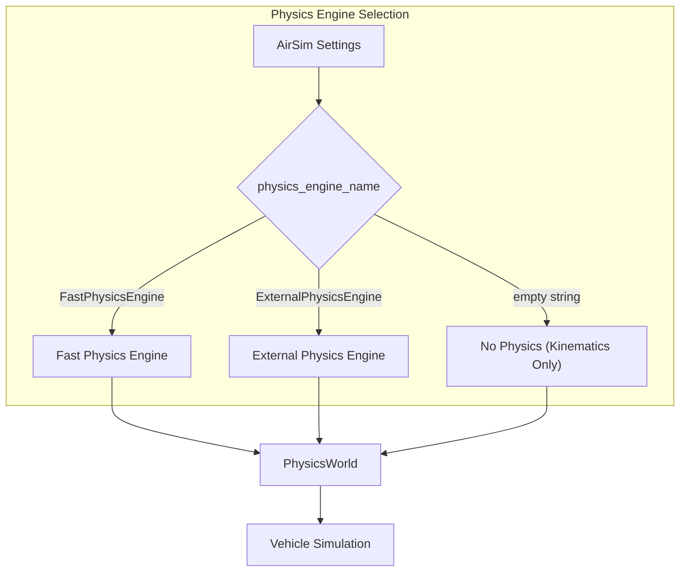
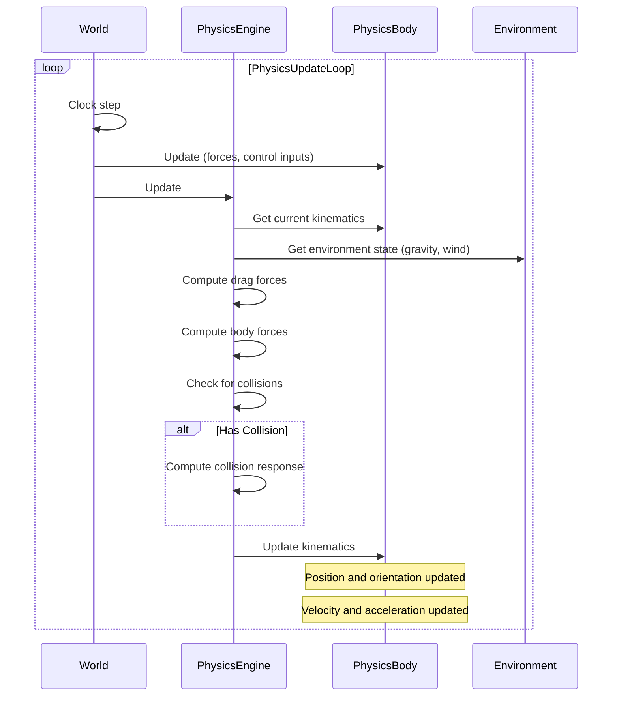
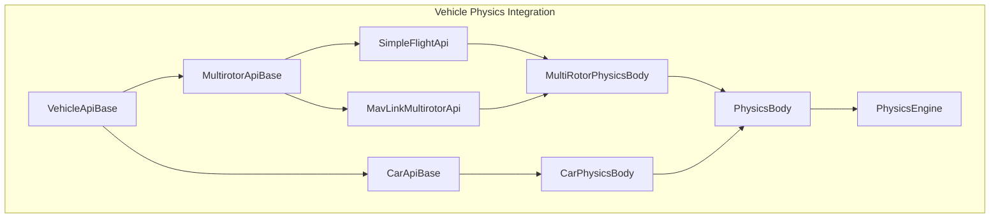
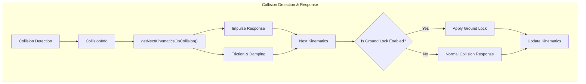
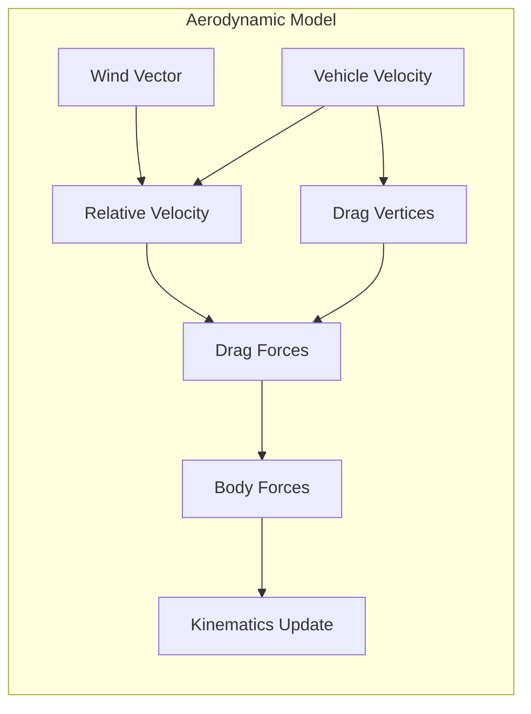
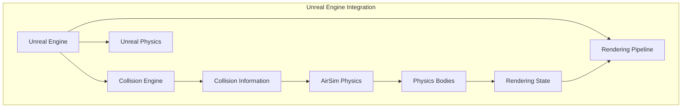

<!-- source: DeepWiki mcp.deepwiki.com · repo microsoft/AirSim · page 5 Physics Engine · fetched 2026-10-26 -->

# Physics Engine

<details>
<summary>Relevant source files</summary>

The following files were used as context for generating this wiki page:

- [AirLib/AirLib.vcxproj](AirLib/AirLib.vcxproj)
- [AirLib/AirLib.vcxproj.filters](AirLib/AirLib.vcxproj.filters)
- [AirLib/include/common/common_utils/ScheduledExecutor.hpp](AirLib/include/common/common_utils/ScheduledExecutor.hpp)
- [AirLib/include/physics/FastPhysicsEngine.hpp](AirLib/include/physics/FastPhysicsEngine.hpp)
- [AirLib/include/physics/PhysicsBody.hpp](AirLib/include/physics/PhysicsBody.hpp)
- [AirLib/include/physics/PhysicsWorld.hpp](AirLib/include/physics/PhysicsWorld.hpp)
- [AirLib/include/physics/World.hpp](AirLib/include/physics/World.hpp)
- [AirLibUnitTests/AirLibUnitTests.vcxproj](AirLibUnitTests/AirLibUnitTests.vcxproj)
- [DroneServer/DroneServer.vcxproj](DroneServer/DroneServer.vcxproj)
- [DroneShell/DroneShell.vcxproj](DroneShell/DroneShell.vcxproj)
- [Examples/Examples.vcxproj](Examples/Examples.vcxproj)
- [HelloCar/HelloCar.vcxproj](HelloCar/HelloCar.vcxproj)
- [HelloDrone/HelloDrone.vcxproj](HelloDrone/HelloDrone.vcxproj)
- [MavLinkCom/MavLinkCom.vcxproj](MavLinkCom/MavLinkCom.vcxproj)
- [MavLinkCom/MavLinkTest/MavLinkTest.vcxproj](MavLinkCom/MavLinkTest/MavLinkTest.vcxproj)
- [SGM/src/sgmstereo/sgmstereo.vcxproj](SGM/src/sgmstereo/sgmstereo.vcxproj)
- [SGM/src/stereoPipeline/stereoPipeline.vcxproj](SGM/src/stereoPipeline/stereoPipeline.vcxproj)
- [Unreal/Plugins/AirSim/Source/SimMode/SimModeWorldBase.cpp](Unreal/Plugins/AirSim/Source/SimMode/SimModeWorldBase.cpp)
- [Unreal/Plugins/AirSim/Source/SimMode/SimModeWorldBase.h](Unreal/Plugins/AirSim/Source/SimMode/SimModeWorldBase.h)
- [Unreal/Plugins/AirSim/Source/Vehicles/Multirotor/MultirotorPawnSimApi.cpp](Unreal/Plugins/AirSim/Source/Vehicles/Multirotor/MultirotorPawnSimApi.cpp)
- [Unreal/Plugins/AirSim/Source/Vehicles/Multirotor/MultirotorPawnSimApi.h](Unreal/Plugins/AirSim/Source/Vehicles/Multirotor/MultirotorPawnSimApi.h)

</details>


The AirSim Physics Engine is responsible for simulating realistic physical behavior of vehicles in the simulation environment. This document explains the architecture, implementation, and usage of the physics system that powers AirSim. It covers the internal physics simulation mechanisms, collision handling, and how physics interacts with vehicles and the environment.

## Core Architecture

The physics system in AirSim is designed with a modular architecture that separates physics simulation from vehicle-specific implementations. This separation allows for different physics engines to be used while maintaining consistent behavior across vehicle types.

```mermaid
classDiagram
    class "PhysicsEngineBase" {
        <<abstract>>
        +update()
        +reset()
        +insert(PhysicsBody*)
        +erase_remove(PhysicsBody*)
        +setWind(Vector3r)
    }
    
    class "FastPhysicsEngine" {
        -enable_ground_lock_: bool
        -wind_: Vector3r
        +update()
        +reset()
        +getNextKinematicsNoCollision()
        +getNextKinematicsOnCollision()
        +getDragWrench()
        +getBodyWrench()
    }
    
    class "ExternalPhysicsEngine" {
        +update()
        +reset()
    }
    
    class "PhysicsBody" {
        <<abstract>>
        -mass_: real_T
        -inertia_: Matrix3x3r
        -kinematics_: Kinematics*
        -environment_: Environment*
        -wrench_: Wrench
        -collision_info_: CollisionInfo
        +updateKinematics(State)
        +getWrenchVertex(uint)
        +getDragVertex(uint)
    }
    
    class "World" {
        -physics_engine_: PhysicsEngineBase*
        -executor_: ScheduledExecutor
        +update()
        +reset()
        +pause(bool)
        +isPaused()
        +startAsyncUpdator()
        +stopAsyncUpdator()
    }
    
    class "PhysicsWorld" {
        -world_: World
        -update_period_nanos_: uint64_t
        +lock()
        +unlock()
        +reset()
        +addBody(UpdatableObject*)
        +updateStateReport()
    }
    
    class "ASimModeWorldBase" {
        -physics_world_: PhysicsWorld*
        -physics_engine_: PhysicsEngineBase*
        +createPhysicsEngine()
        +registerPhysicsBody()
    }
    
    PhysicsEngineBase <|-- FastPhysicsEngine
    PhysicsEngineBase <|-- ExternalPhysicsEngine
    PhysicsBody --o PhysicsEngineBase
    PhysicsEngineBase --* World
    World --* PhysicsWorld
    PhysicsWorld --* ASimModeWorldBase
```

**Key Components:**

1. **PhysicsEngineBase**: Abstract base class that defines the interface for all physics engines.
2. **FastPhysicsEngine**: The default physics implementation in AirSim, providing efficient rigid body dynamics.
3. **ExternalPhysicsEngine**: Interface for connecting to external physics engines.
4. **PhysicsBody**: Base class representing physical objects that can be simulated.
5. **World**: Container for physics objects that manages the simulation loop.
6. **PhysicsWorld**: High-level manager for physics simulation within AirSim.
7. **SimModeWorldBase**: Integrates physics into the AirSim simulation environment.

Sources: [AirLib/include/physics/PhysicsEngineBase.hpp](), [AirLib/include/physics/FastPhysicsEngine.hpp](), [AirLib/include/physics/PhysicsBody.hpp](), [AirLib/include/physics/World.hpp](), [AirLib/include/physics/PhysicsWorld.hpp](), [Unreal/Plugins/AirSim/Source/SimMode/SimModeWorldBase.h]()

## Physics Engine Types

AirSim supports multiple physics engine implementations that can be configured through settings:



### FastPhysicsEngine

The `FastPhysicsEngine` is the default physics implementation in AirSim. It provides:

- 6DOF rigid body dynamics (three translational, three rotational degrees of freedom)
- Aerodynamic forces including drag
- Collision detection and response
- Ground interaction with optional ground lock

This engine is optimized for vehicle simulation and balances performance with accuracy.

### ExternalPhysicsEngine

The `ExternalPhysicsEngine` provides an interface to connect to external physics engines. This allows for:
- Integration with specialized physics systems
- Custom physics implementations
- Hardware-in-the-loop simulation

### No Physics Engine

AirSim can run without a physics engine, relying solely on kinematics. This is useful for:
- Simplified simulation scenarios
- Performance optimization when physics is not needed
- Custom physics implementations outside AirSim

Sources: [Unreal/Plugins/AirSim/Source/SimMode/SimModeWorldBase.cpp:62-87](), [AirLib/include/physics/FastPhysicsEngine.hpp]()

## Physics Simulation Loop

The physics engine operates in a distinct update loop that can run asynchronously from the rendering and API systems.



### Update Cycle

Each physics update cycle includes the following steps:

1. **Force computation**:
   - External forces (gravity, wind)
   - Vehicle-specific forces (thrust, control inputs)
   - Aerodynamic forces (drag)

2. **Collision handling**:
   - Detect collisions with the environment
   - Compute collision response (impulses)
   - Apply special handling for ground contact

3. **Kinematics update**:
   - Update position and orientation
   - Update linear and angular velocity
   - Update linear and angular acceleration

### Timing and Synchronization

The physics loop operates at a configurable frequency:

```cpp
// Default physics update period is 3ms (approximately 333Hz)
long long physics_loop_period_ = 3000000LL; //3ms
```

The update frequency can be customized based on simulation requirements - higher frequencies provide more accurate simulation at the cost of performance.

Sources: [AirLib/include/physics/FastPhysicsEngine.hpp:325-450](), [AirLib/include/physics/World.hpp:43-53](), [Unreal/Plugins/AirSim/Source/SimMode/SimModeWorldBase.h:73]()

## Vehicle Physics Integration

AirSim provides specialized physics implementations for different vehicle types that integrate with the core physics engine.



### Multirotor Physics

For multirotor vehicles (drones), the physics simulation includes:

- Rotor dynamics and thrust generation
- Aerodynamic forces and moments
- Inertial effects
- Control system integration

The `MultiRotorPhysicsBody` class implements the specialized physics for multirotor vehicles, handling the complex interactions between rotors, aerodynamics, and control inputs.

### Car Physics

Car physics simulation includes:

- Wheel dynamics
- Suspension
- Engine and drivetrain
- Steering and braking

Each vehicle type provides its own implementation of forces and dynamics while using the common physics engine framework for integration, collision detection, and environment interaction.

Sources: [AirLib/include/vehicles/multirotor/MultiRotorPhysicsBody.hpp](), [Unreal/Plugins/AirSim/Source/Vehicles/Multirotor/MultirotorPawnSimApi.cpp:19-24]()

## Collision Handling

AirSim's physics engine implements a sophisticated collision detection and response system.



### Collision Detection

Collision information is passed to the physics engine from the rendering engine, providing:

- Collision point
- Collision normal
- Penetration depth
- Object information

### Collision Response

When a collision is detected, the physics engine:

1. Computes an impulse-based response
2. Applies friction forces at the contact point
3. Updates the vehicle's kinematics

A special case is ground collision, which can use "ground lock" to stabilize vehicles on the ground and prevent bouncing:

```cpp
if (enable_ground_lock && ground_collision) {
    float pitch, roll, yaw;
    VectorMath::toEulerianAngle(next.pose.orientation, pitch, roll, yaw);
    pitch = roll = 0;
    next.pose.orientation = VectorMath::toQuaternion(pitch, roll, yaw);

    //there is a lot of random angular velocity when vehicle is on the ground
    next.twist.angular = Vector3r::Zero();

    // also eliminate any linear velocity due to twist - since we are sitting on the ground there shouldn't be any.
    next.twist.linear = Vector3r::Zero();
    next.pose.position = collision_info.position;
    body.setGrounded(true);

    // but we do want to "feel" the ground when we hit it (we should see a small z-acc bump)
    // equal and opposite our downward velocity.
    next.accelerations.linear = -0.5f * body.getMass() * vcur_avg;
}
```

Sources: [AirLib/include/physics/FastPhysicsEngine.hpp:129-252]()

## Aerodynamic Forces

The physics engine models aerodynamic forces that affect vehicle movement, particularly important for aircraft simulation.



### Drag Model

The aerodynamic drag model:

1. Computes relative velocity between the vehicle and air (including wind)
2. For each drag vertex on the body:
   - Computes velocity at the vertex
   - Calculates drag force proportional to velocity squared
   - Applies drag force and resulting torque

```cpp
// Use relative velocity of the body wrt wind
const Vector3r relative_vel = linear_vel - wind_world;
const Vector3r linear_vel_body = VectorMath::transformToBodyFrame(relative_vel, orientation);

for (uint vi = 0; vi < body.dragVertexCount(); ++vi) {
    const auto& vertex = body.getDragVertex(vi);
    const Vector3r vel_vertex = linear_vel_body + angular_vel_body.cross(vertex.getPosition());
    const real_T vel_comp = vertex.getNormal().dot(vel_vertex);
    //if vel_comp is -ve then we cull the face. If velocity too low then drag is not generated
    if (vel_comp > kDragMinVelocity) {
        const Vector3r drag_force = vertex.getNormal() * (-vertex.getDragFactor() * air_density * vel_comp * vel_comp);
        const Vector3r drag_torque = vertex.getPosition().cross(drag_force);

        wrench.force += drag_force;
        wrench.torque += drag_torque;
    }
}
```

### Wind Effects

The physics engine supports wind modeling, which affects vehicle movement. The wind is represented as a 3D vector that can be:

1. Set through settings.json
2. Modified at runtime via API calls
3. Used to compute relative airspeed for aerodynamic forces

Sources: [AirLib/include/physics/FastPhysicsEngine.hpp:264-300](), [Unreal/Plugins/AirSim/Source/SimMode/SimModeWorldBase.cpp:76]()

## Physics Engine Configuration

The physics engine can be configured through the settings.json file:

```json
{
  "PhysicsEngineName": "FastPhysicsEngine",
  "FastPhysicsEngine": {
    "EnableGroundLock": true
  },
  "Wind": {
    "X": 0, 
    "Y": 0, 
    "Z": 0
  }
}
```

### Common Configuration Options

| Setting | Description | Default |
|---------|-------------|---------|
| PhysicsEngineName | The physics engine to use (FastPhysicsEngine, ExternalPhysicsEngine, or empty for none) | "" |
| EnableGroundLock | Whether to lock vehicles to the ground when landing/resting | true |
| Wind | 3D vector representing wind velocity in world coordinates | (0,0,0) |

The physics update rate can also be configured in code:

```cpp
void ASimModeWorldBase::setPhysicsLoopPeriod(long long period)
{
    physics_loop_period_ = period;
}
```

Sources: [Unreal/Plugins/AirSim/Source/SimMode/SimModeWorldBase.cpp:62-86](), [AirLib/include/physics/FastPhysicsEngine.hpp:25-27]()

## Integration with Unreal Engine

AirSim's physics engine integrates with the Unreal Engine through a well-defined interface, allowing the simulation to leverage both systems:



The key aspects of this integration include:

1. **Collision information flow**: Unreal Engine detects collisions and passes this information to AirSim's physics
2. **Rendering state updates**: AirSim's physics updates vehicle positions and orientations, which are then used for rendering
3. **Synchronization**: The physics loop runs independently but can be synchronized with the rendering frame rate

This separation allows AirSim to maintain its own specialized physics for vehicle simulation while leveraging Unreal Engine's powerful rendering and collision detection capabilities.

Sources: [Unreal/Plugins/AirSim/Source/SimMode/SimModeWorldBase.cpp](), [Unreal/Plugins/AirSim/Source/Vehicles/Multirotor/MultirotorPawnSimApi.cpp:50-65]()

## Advanced Scenarios: Pause and Resume

AirSim's physics engine supports pausing and resuming simulation, which is useful for debugging, analysis, or synchronizing with external systems:

```cpp
// Pause physics simulation
void ASimModeWorldBase::pause(bool is_paused)
{
    physics_world_->pause(is_paused);
    ASimModeBase::pause(is_paused);
}

// Continue simulation for a specific time
void ASimModeWorldBase::continueForTime(double seconds)
{
    physics_world_->continueForTime(seconds);
}

// Continue simulation for a specific number of frames
void ASimModeWorldBase::continueForFrames(uint32_t frames)
{
    physics_world_->continueForFrames(frames);
}
```

This functionality is implemented using a scheduled executor that manages the physics update thread, allowing precise control over simulation timing.

Sources: [Unreal/Plugins/AirSim/Source/SimMode/SimModeWorldBase.cpp:89-137](), [AirLib/include/common/common_utils/ScheduledExecutor.hpp]()

## Conclusion

AirSim's physics engine provides a robust and flexible system for simulating vehicle dynamics in virtual environments. Its modular design allows for different physics implementations while maintaining a consistent interface for vehicle control and sensor simulation.

The physics engine balances accuracy with performance, providing realistic behavior for autonomous vehicle development and testing. Features like ground lock, collision response, and aerodynamic modeling make it particularly suitable for drone and car simulation.

By understanding the physics engine architecture and configuration options, users can tailor the simulation to their specific needs, whether for simple testing or high-fidelity physics research.

---

