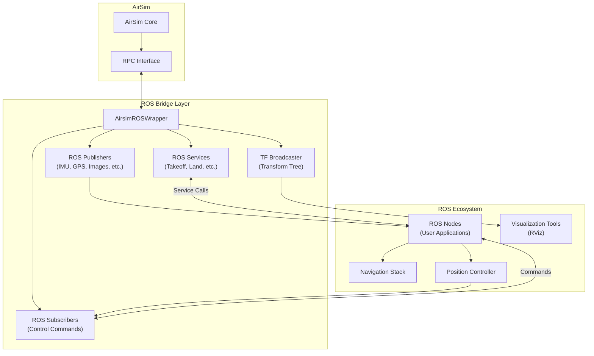
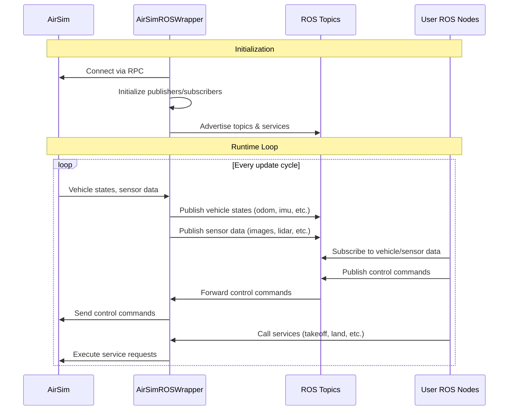
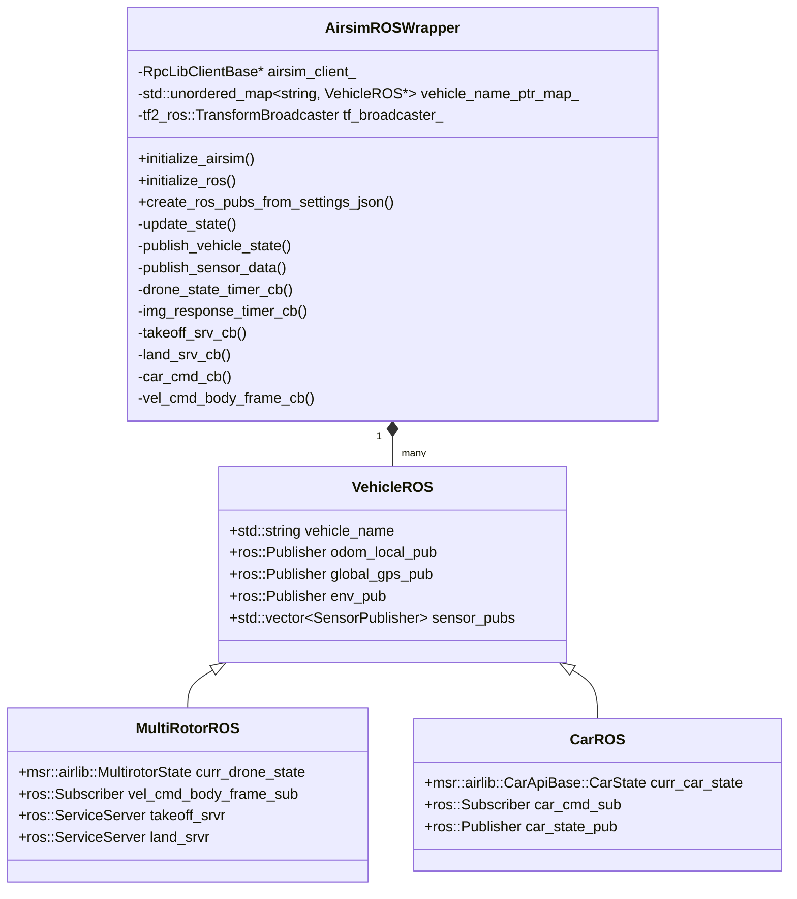
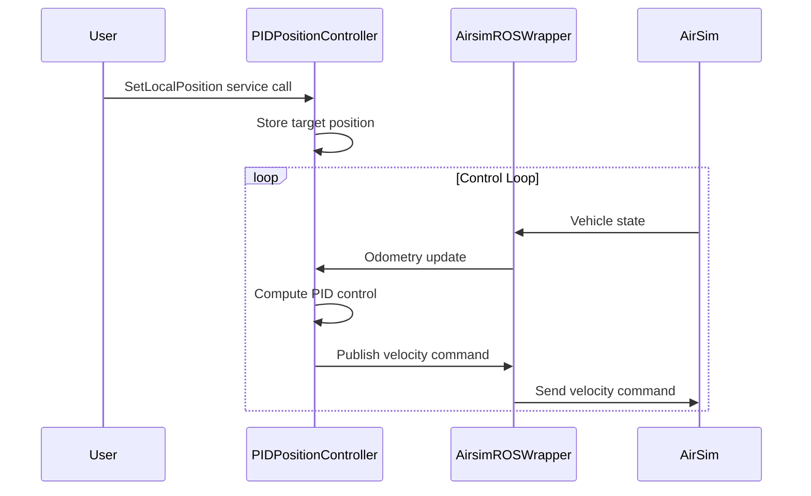
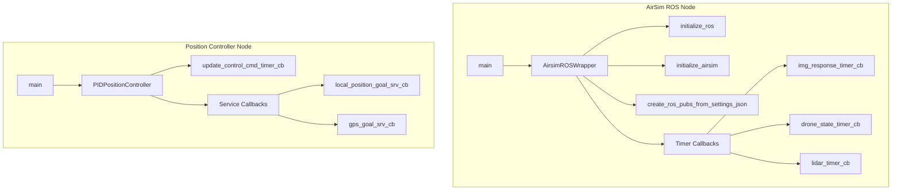

<!-- source: DeepWiki mcp.deepwiki.com · repo microsoft/AirSim · page 6 ROS Integration · fetched 2026-10-26 -->

# ROS Integration

<details>
<summary>Relevant source files</summary>

The following files were used as context for generating this wiki page:

- [ros/src/airsim_ros_pkgs/CMakeLists.txt](ros/src/airsim_ros_pkgs/CMakeLists.txt)
- [ros/src/airsim_ros_pkgs/include/airsim_ros_wrapper.h](ros/src/airsim_ros_pkgs/include/airsim_ros_wrapper.h)
- [ros/src/airsim_ros_pkgs/include/airsim_settings_parser.h](ros/src/airsim_ros_pkgs/include/airsim_settings_parser.h)
- [ros/src/airsim_ros_pkgs/include/pd_position_controller_simple.h](ros/src/airsim_ros_pkgs/include/pd_position_controller_simple.h)
- [ros/src/airsim_ros_pkgs/launch/airsim_node.launch](ros/src/airsim_ros_pkgs/launch/airsim_node.launch)
- [ros/src/airsim_ros_pkgs/launch/position_controller_simple.launch](ros/src/airsim_ros_pkgs/launch/position_controller_simple.launch)
- [ros/src/airsim_ros_pkgs/package.xml](ros/src/airsim_ros_pkgs/package.xml)
- [ros/src/airsim_ros_pkgs/rviz/default.rviz](ros/src/airsim_ros_pkgs/rviz/default.rviz)
- [ros/src/airsim_ros_pkgs/scripts/car_joy.py](ros/src/airsim_ros_pkgs/scripts/car_joy.py)
- [ros/src/airsim_ros_pkgs/src/airsim_node.cpp](ros/src/airsim_ros_pkgs/src/airsim_node.cpp)
- [ros/src/airsim_ros_pkgs/src/airsim_ros_wrapper.cpp](ros/src/airsim_ros_pkgs/src/airsim_ros_wrapper.cpp)
- [ros/src/airsim_ros_pkgs/src/airsim_settings_parser.cpp](ros/src/airsim_ros_pkgs/src/airsim_settings_parser.cpp)
- [ros/src/airsim_ros_pkgs/src/pd_position_controller_simple.cpp](ros/src/airsim_ros_pkgs/src/pd_position_controller_simple.cpp)
- [ros/src/airsim_tutorial_pkgs/launch/front_stereo_and_center_mono/default.rviz](ros/src/airsim_tutorial_pkgs/launch/front_stereo_and_center_mono/default.rviz)
- [ros/src/airsim_tutorial_pkgs/launch/front_stereo_and_center_mono/depth_to_pointcloud.launch](ros/src/airsim_tutorial_pkgs/launch/front_stereo_and_center_mono/depth_to_pointcloud.launch)
- [ros/src/airsim_tutorial_pkgs/scripts/multi_drone_json_creator.py](ros/src/airsim_tutorial_pkgs/scripts/multi_drone_json_creator.py)
- [ros2/src/airsim_ros_pkgs/include/airsim_ros_wrapper.h](ros2/src/airsim_ros_pkgs/include/airsim_ros_wrapper.h)
- [ros2/src/airsim_ros_pkgs/include/pd_position_controller_simple.h](ros2/src/airsim_ros_pkgs/include/pd_position_controller_simple.h)
- [ros2/src/airsim_ros_pkgs/src/airsim_node.cpp](ros2/src/airsim_ros_pkgs/src/airsim_node.cpp)
- [ros2/src/airsim_ros_pkgs/src/airsim_ros_wrapper.cpp](ros2/src/airsim_ros_pkgs/src/airsim_ros_wrapper.cpp)
- [ros2/src/airsim_ros_pkgs/src/airsim_settings_parser.cpp](ros2/src/airsim_ros_pkgs/src/airsim_settings_parser.cpp)
- [ros2/src/airsim_ros_pkgs/src/pd_position_controller_simple.cpp](ros2/src/airsim_ros_pkgs/src/pd_position_controller_simple.cpp)
- [ros2/src/airsim_ros_pkgs/src/pd_position_controller_simple_node.cpp](ros2/src/airsim_ros_pkgs/src/pd_position_controller_simple_node.cpp)

</details>


This document describes the integration between AirSim and the Robot Operating System (ROS). It covers the architecture, setup process, available functionalities, and usage patterns for both ROS 1 and ROS 2 implementations.

## 1. Overview

AirSim provides ROS integration to leverage ROS's extensive ecosystem for robotics development. This integration allows users to:

- Control vehicles in AirSim using ROS interfaces
- Access sensor data (cameras, IMU, GPS, etc.) through ROS topics
- Utilize ROS tools for visualization, debugging, and algorithm development
- Connect AirSim simulations with existing ROS-based robotics stacks

The integration is available for both ROS 1 (Melodic/Noetic) and ROS 2 (Foxy/Galactic), with similar functionality but different API implementations reflecting the differences between ROS versions.

## 2. Architecture

The ROS integration architecture consists of several key components:



### 2.1 Key Components

1. **AirsimROSWrapper**: The central component that bridges AirSim and ROS. It:
   - Connects to AirSim via RPC
   - Creates ROS publishers for sensor data
   - Sets up subscribers for control commands
   - Establishes service servers for actions like takeoff and landing
   - Manages coordinate frame transformations

2. **PID Position Controller**: An optional component that provides high-level position control commands based on waypoints.

3. **Message Types**: Custom message types defined in the `airsim_ros_pkgs` package for communication.

4. **Coordinate Systems**: Manages transformations between AirSim's NED (North-East-Down) and ROS's ENU (East-North-Up) coordinate systems.

## 3. Communication Flow



## 4. Setting Up ROS with AirSim

### 4.1 Prerequisites

- ROS installed (Melodic/Noetic for ROS 1, Foxy/Galactic for ROS 2)
- AirSim built from source
- Catkin workspace (ROS 1) or Colcon workspace (ROS 2)

### 4.2 Building the ROS Wrapper

For ROS 1:

1. Clone AirSim and build it
2. Set up a catkin workspace and clone or link the AirSim repo to the `src` directory
3. Build the workspace with `catkin build` or `catkin_make`

For ROS 2:

1. Clone AirSim and build it
2. Set up a colcon workspace and clone or link the AirSim repo to the `src` directory 
3. Build the workspace with `colcon build --packages-select airsim_ros_pkgs`

### 4.3 Launch Files

The package includes several launch files to start the AirSim ROS bridge:

- `airsim_node.launch`: Launches the main ROS wrapper
- `position_controller_simple.launch`: Launches the PID position controller
- Other specialized launch files for specific scenarios

## 5. Core Components

### 5.1 AirsimROSWrapper

The core component connecting AirSim with ROS is the `AirsimROSWrapper` class:



Key methods include:
- `initialize_ros()`: Sets up ROS publishers, subscribers, and services
- `initialize_airsim()`: Connects to AirSim via RPC
- Various callback methods for handling commands and publishing data

### 5.2 Position Controller

The `PIDPositionController` provides higher-level position control for vehicles:

- Accepts position goals via ROS services
- Implements a PID controller for position tracking
- Publishes velocity commands to AirSim



## 6. Available Topics and Services

### 6.1 Main Topics

| Topic | Type | Description |
|-------|------|-------------|
| `~/[vehicle_name]/odom_local_ned` | `nav_msgs/Odometry` | Vehicle odometry in NED frame |
| `~/[vehicle_name]/imu/[imu_name]` | `sensor_msgs/Imu` | IMU data |
| `~/[vehicle_name]/gps/[gps_name]` | `sensor_msgs/NavSatFix` | GPS data |
| `~/[vehicle_name]/lidar/[lidar_name]` | `sensor_msgs/PointCloud2` | LiDAR point cloud |
| `~/[vehicle_name]/[camera_name]/[img_type]` | `sensor_msgs/Image` | Camera images (various types) |
| `~/[vehicle_name]/vel_cmd_body_frame` | `airsim_ros_pkgs/VelCmd` | Velocity commands in body frame |
| `~/[vehicle_name]/vel_cmd_world_frame` | `airsim_ros_pkgs/VelCmd` | Velocity commands in world frame |
| `~/[vehicle_name]/car_cmd` | `airsim_ros_pkgs/CarControls` | Car control commands |
| `~/[vehicle_name]/car_state` | `airsim_ros_pkgs/CarState` | Car state information |

### 6.2 Services

| Service | Type | Description |
|---------|------|-------------|
| `~/[vehicle_name]/takeoff` | `airsim_ros_pkgs/Takeoff` | Command to takeoff |
| `~/[vehicle_name]/land` | `airsim_ros_pkgs/Land` | Command to land |
| `~/reset` | `airsim_ros_pkgs/Reset` | Reset the simulation |
| `~/local_position_goal` | `airsim_ros_pkgs/SetLocalPosition` | Set position goal in local frame |
| `~/gps_goal` | `airsim_ros_pkgs/SetGPSPosition` | Set position goal in GPS coordinates |

## 7. Coordinate Frames

AirSim ROS Bridge handles the coordinate frame transformations between:

- AirSim's NED (North-East-Down) coordinate system
- ROS's ENU (East-North-Up) coordinate system

The bridge publishes the necessary TF transforms:

```
world_ned (AirSim's world frame)
└── world_enu (ROS standard frame)
    └── [vehicle_name] (Vehicle frame)
        ├── [vehicle_name]/odom_local_enu (Vehicle odometry frame)
        ├── [camera_name]/[camera_type] (Camera frames)
        └── [lidar_name] (LiDAR frames)
```

## 8. Configuring Sensors

Sensors in AirSim are configured through the `settings.json` file, and the ROS wrapper automatically creates corresponding publishers based on this configuration.

Example sensor configuration in `settings.json`:

```
{
  "SeeDocsAt": "https://github.com/Microsoft/AirSim/blob/master/docs/settings.md",
  "SettingsVersion": 1.2,
  "SimMode": "Multirotor",
  "Vehicles": {
    "drone_1": {
      "VehicleType": "SimpleFlight",
      "Cameras": {
        "front_center_custom": {
          "CaptureSettings": [
            {
              "ImageType": 0,
              "Width": 640,
              "Height": 480
            }
          ]
        }
      },
      "Sensors": {
        "LidarCustom": {
          "SensorType": 6,
          "Enabled": true
        }
      }
    }
  }
}
```

## 9. Using the ROS Integration

### 9.1 Basic Usage

1. Start the AirSim environment
2. Launch the ROS wrapper:
   ```
   # For ROS 1
   roslaunch airsim_ros_pkgs airsim_node.launch
   
   # For ROS 2
   ros2 launch airsim_ros_pkgs airsim_node.launch.py
   ```

3. Use ROS tools to interact with AirSim:
   ```
   # View camera images
   rosrun image_view image_view image:=/airsim_node/drone_1/front_center_custom/Scene
   
   # Visualize data in RViz
   rosrun rviz rviz -d $(rospack find airsim_ros_pkgs)/rviz/default.rviz
   ```

### 9.2 Controlling Vehicles

#### 9.2.1 Using the Position Controller

1. Launch the position controller:
   ```
   roslaunch airsim_ros_pkgs position_controller_simple.launch
   ```

2. Send position goals:
   ```
   # Set local position
   rosservice call /airsim_node/local_position_goal "x: 10.0
   y: 10.0
   z: -2.0
   yaw: 0.0
   vehicle_name: 'drone_1'"
   
   # Set GPS position
   rosservice call /airsim_node/gps_goal "latitude: 47.641468
   longitude: -122.140165
   altitude: 100.0
   yaw: 0.0
   vehicle_name: 'drone_1'"
   ```

#### 9.2.2 Direct Vehicle Control

For direct control of a multirotor:

```
# Velocity command in body frame
rostopic pub /airsim_node/drone_1/vel_cmd_body_frame airsim_ros_pkgs/VelCmd "header:
  seq: 0
  stamp: {secs: 0, nsecs: 0}
  frame_id: ''
twist:
  linear: {x: 1.0, y: 0.0, z: 0.0}
  angular: {x: 0.0, y: 0.0, z: 0.0}"
```

For controlling a car:

```
# Car command
rostopic pub /airsim_node/PhysXCar/car_cmd airsim_ros_pkgs/CarControls "header:
  seq: 0
  stamp: {secs: 0, nsecs: 0}
  frame_id: ''
throttle: 0.5
brake: 0.0
steering: 0.0
handbrake: false
manual: false
manual_gear: 0
gear_immediate: true"
```

### 9.3 Working with Multiple Vehicles

AirSim ROS wrapper automatically detects all vehicles defined in the settings file and creates corresponding topics and services. Each vehicle has its own namespace (e.g., `/airsim_node/drone_1/`, `/airsim_node/drone_2/`).

For controlling multiple vehicles simultaneously, you can use the group command topics:

```
rostopic pub /airsim_node/all_robots/vel_cmd_body_frame airsim_ros_pkgs/VelCmd "..."
```

## 10. Implementation Details

### 10.1 ROS Node Structure



### 10.2 Communication Classes

The ROS wrapper uses the following key classes to manage communication with AirSim:

1. `AirsimROSWrapper`: The main class managing all ROS interactions
2. `VehicleROS`: Base class for vehicle-specific functionality
3. `MultiRotorROS`: Derived class for multirotor vehicles
4. `CarROS`: Derived class for car vehicles
5. `SensorPublisher`: Handles publishing of sensor data

### 10.3 Message Flow

1. Sensor data from AirSim → ROS
   - AirSim provides data via RPC calls
   - `AirsimROSWrapper` processes data
   - Data published to ROS topics

2. Commands from ROS → AirSim
   - ROS nodes publish commands to topics
   - `AirsimROSWrapper` receives commands via subscribers
   - Commands are sent to AirSim via RPC

## 11. Differences Between ROS 1 and ROS 2 Implementations

The ROS 1 and ROS 2 implementations share the same core functionality but differ in API design:

| Feature | ROS 1 | ROS 2 |
|---------|-------|-------|
| Node Structure | `airsim_node.cpp` | `airsim_node.cpp` with sub-nodes |
| Threading | Uses `ros::AsyncSpinner` | Uses ROS 2 executors |
| Parameters | Parameter server | ROS 2 parameters API |
| Services | Using boost::function | Using std::function and lambdas |
| Message Types | ROS 1 messages | ROS 2 messages |
| Build System | catkin | colcon |

## 12. Advanced Usage

### 12.1 Using with External Planners

The ROS integration allows you to use AirSim with external path planners and navigation stacks:

1. Set up a position controller to accept waypoints
2. Generate waypoints with your planner
3. Send waypoints to the position controller
4. The controller handles low-level vehicle control

### 12.2 Joystick Control

The package includes support for joystick control of vehicles:

```
# For car control with joystick
roslaunch airsim_ros_pkgs airsim_node.launch
rosrun joy joy_node
rosrun airsim_ros_pkgs car_joy.py
```

## 13. Troubleshooting

Common issues and solutions:

1. **No connection to AirSim**
   - Ensure AirSim is running before starting ROS nodes
   - Check IP address if running on different machines

2. **Missing sensor topics**
   - Verify sensor configuration in `settings.json`
   - Check topic names with `rostopic list`

3. **Coordinate frame issues**
   - Verify that `world_frame_id` parameter matches your setup
   - Check TF tree with `rosrun tf2_tools view_frames.py`

4. **Performance issues**
   - Adjust update rates in launch files
   - Reduce image resolution in settings

## References

The AirSim ROS integration consists of several key components found in:

- [ros/src/airsim_ros_pkgs/src/airsim_ros_wrapper.cpp]() - Main ROS 1 wrapper implementation
- [ros2/src/airsim_ros_pkgs/src/airsim_ros_wrapper.cpp]() - Main ROS 2 wrapper implementation
- [ros/src/airsim_ros_pkgs/src/pd_position_controller_simple.cpp]() - Position controller for ROS 1
- [ros2/src/airsim_ros_pkgs/src/pd_position_controller_simple.cpp]() - Position controller for ROS 2
- [ros/src/airsim_ros_pkgs/include/airsim_ros_wrapper.h]() - Header for ROS 1 wrapper
- [ros2/src/airsim_ros_pkgs/include/airsim_ros_wrapper.h]() - Header for ROS 2 wrapper

For additional information on AirSim settings, refer to the AirSim documentation.

---

