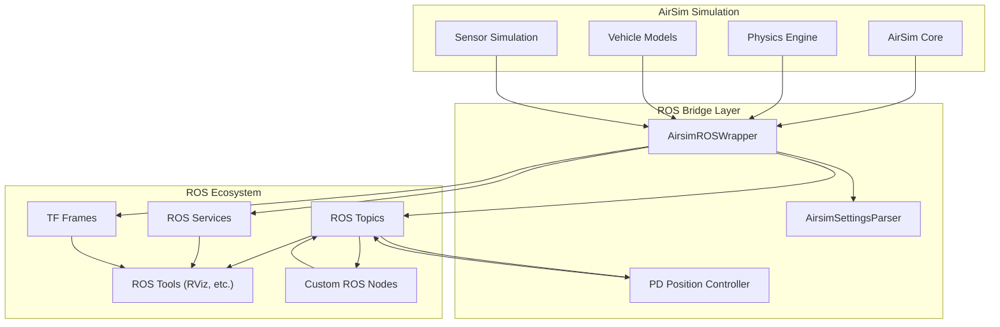
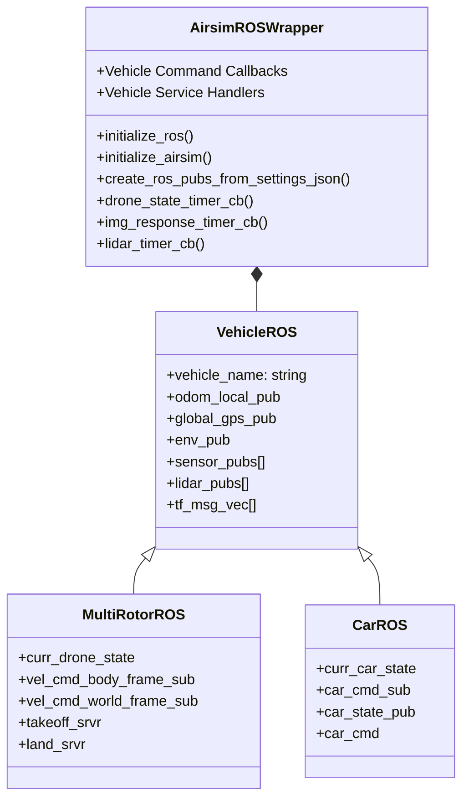
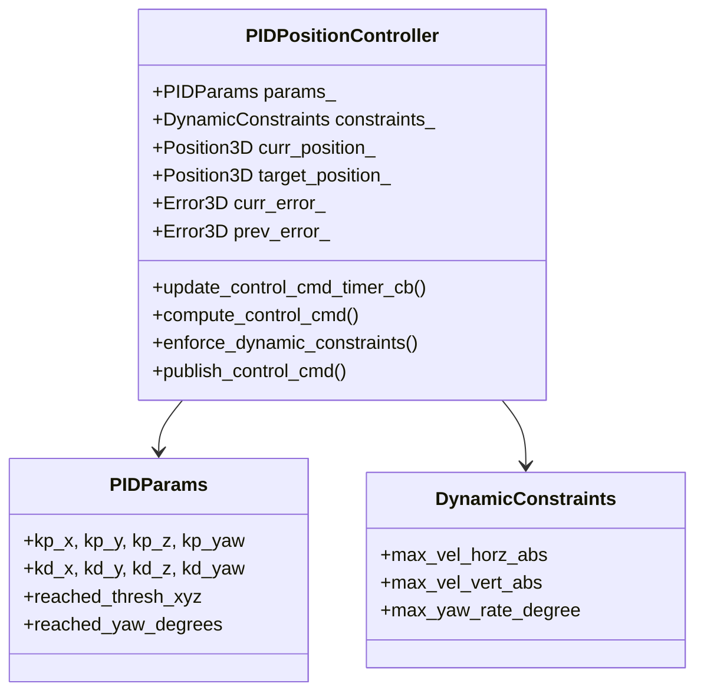
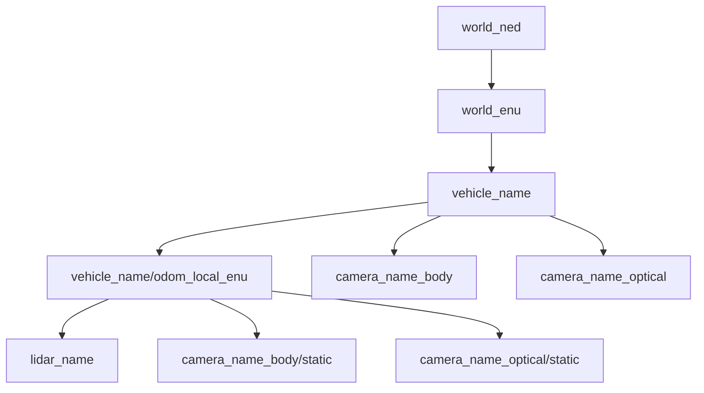
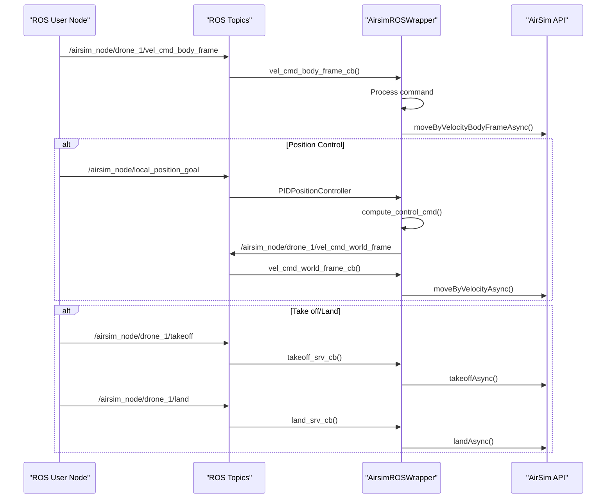
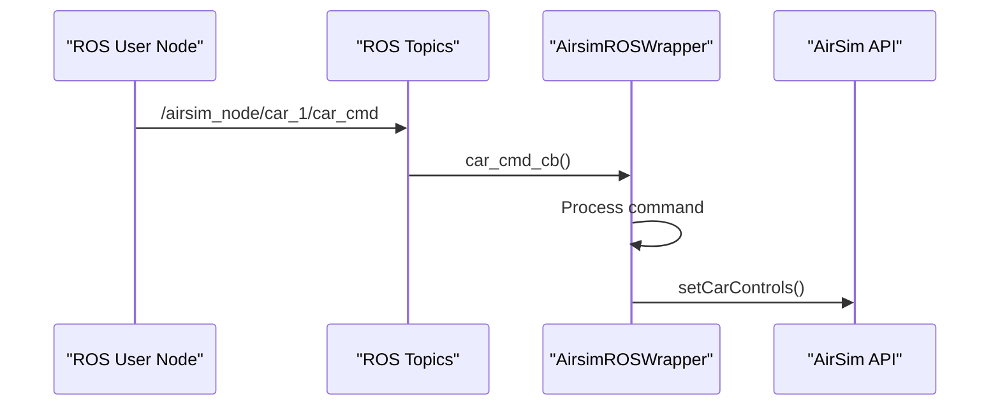
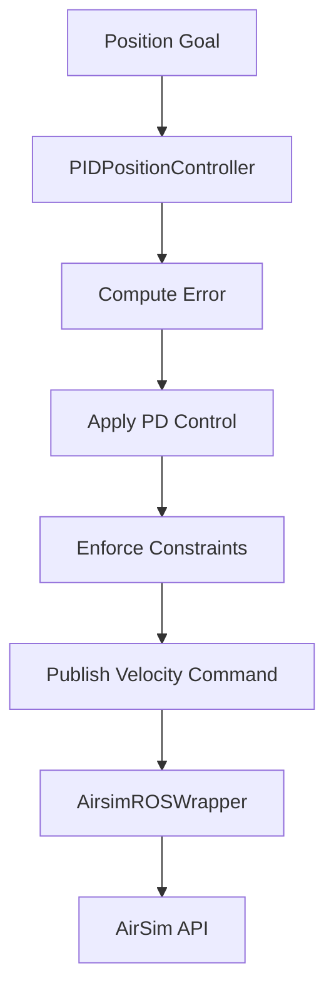
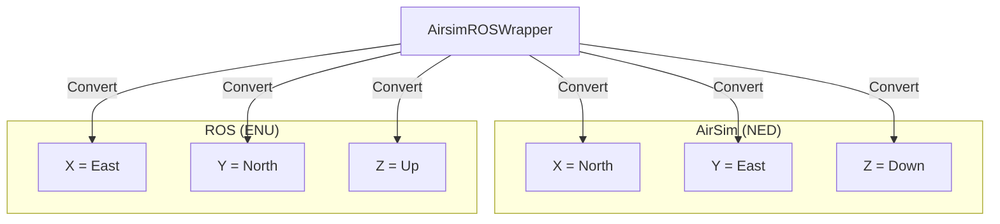

<!-- source: DeepWiki mcp.deepwiki.com · repo microsoft/AirSim · page 6.1 ROS1 Integration · fetched 2026-10-26 -->

# ROS1 Integration

<details>
<summary>Relevant source files</summary>

The following files were used as context for generating this wiki page:

- [ros/src/airsim_ros_pkgs/CMakeLists.txt](ros/src/airsim_ros_pkgs/CMakeLists.txt)
- [ros/src/airsim_ros_pkgs/include/airsim_ros_wrapper.h](ros/src/airsim_ros_pkgs/include/airsim_ros_wrapper.h)
- [ros/src/airsim_ros_pkgs/launch/airsim_node.launch](ros/src/airsim_ros_pkgs/launch/airsim_node.launch)
- [ros/src/airsim_ros_pkgs/launch/position_controller_simple.launch](ros/src/airsim_ros_pkgs/launch/position_controller_simple.launch)
- [ros/src/airsim_ros_pkgs/package.xml](ros/src/airsim_ros_pkgs/package.xml)
- [ros/src/airsim_ros_pkgs/rviz/default.rviz](ros/src/airsim_ros_pkgs/rviz/default.rviz)
- [ros/src/airsim_ros_pkgs/src/airsim_node.cpp](ros/src/airsim_ros_pkgs/src/airsim_node.cpp)
- [ros/src/airsim_ros_pkgs/src/airsim_ros_wrapper.cpp](ros/src/airsim_ros_pkgs/src/airsim_ros_wrapper.cpp)
- [ros/src/airsim_ros_pkgs/src/pd_position_controller_simple.cpp](ros/src/airsim_ros_pkgs/src/pd_position_controller_simple.cpp)
- [ros/src/airsim_tutorial_pkgs/launch/front_stereo_and_center_mono/default.rviz](ros/src/airsim_tutorial_pkgs/launch/front_stereo_and_center_mono/default.rviz)
- [ros/src/airsim_tutorial_pkgs/launch/front_stereo_and_center_mono/depth_to_pointcloud.launch](ros/src/airsim_tutorial_pkgs/launch/front_stereo_and_center_mono/depth_to_pointcloud.launch)
- [ros/src/airsim_tutorial_pkgs/scripts/multi_drone_json_creator.py](ros/src/airsim_tutorial_pkgs/scripts/multi_drone_json_creator.py)

</details>


This document details the integration between AirSim and ROS1 (Robot Operating System), allowing users to leverage ROS's extensive ecosystem with AirSim's simulation capabilities. For information about ROS2 integration, see page [ROS2 Integration](#6.2).

## Architecture Overview

The AirSim ROS1 integration provides a bridge between AirSim's simulation environment and the ROS ecosystem. This allows AirSim-simulated vehicles and sensors to communicate with ROS nodes, enabling the use of standard ROS tools like RViz, tf, navigation stacks, and custom algorithms.



Sources: [ros/src/airsim_ros_pkgs/src/airsim_ros_wrapper.cpp:1-110](), [ros/src/airsim_ros_pkgs/include/airsim_ros_wrapper.h:1-100]()

## Core Components

### AirsimROSWrapper

The central component of the ROS1 integration is the `AirsimROSWrapper` class, which facilitates bidirectional communication between AirSim and ROS. It's responsible for:

1. Creating ROS publishers for AirSim sensor data
2. Setting up subscribers to receive commands
3. Implementing service handlers for vehicle operations
4. Managing coordinate frame transformations
5. Converting between AirSim and ROS data types



Sources: [ros/src/airsim_ros_pkgs/include/airsim_ros_wrapper.h:118-399](), [ros/src/airsim_ros_pkgs/src/airsim_ros_wrapper.cpp:28-111]()

### PD Position Controller

A simple PD (Proportional-Derivative) position controller is provided to enable easy position control for drones:



Sources: [ros/src/airsim_ros_pkgs/src/pd_position_controller_simple.cpp:3-341]()

## Setup and Configuration

### Installation

The AirSim ROS packages are built using standard catkin tools:

1. Clone the AirSim repository
2. Set up ROS dependencies
3. Build the packages using catkin

The CMakeLists.txt includes necessary dependencies like tf2, cv_bridge, image_transport, and others.

Sources: [ros/src/airsim_ros_pkgs/CMakeLists.txt:1-142](), [ros/src/airsim_ros_pkgs/package.xml:1-46]()

### Launch Files

AirSim's ROS integration can be started using launch files:

```
# Basic AirSim Node
roslaunch airsim_ros_pkgs airsim_node.launch

# With Position Controller
roslaunch airsim_ros_pkgs position_controller_simple.launch
```

The airsim_node.launch file starts the main AirSim ROS wrapper with configurable parameters:

```xml
<node name="airsim_node" pkg="airsim_ros_pkgs" type="airsim_node" output="$(arg output)">
    <param name="is_vulkan" type="bool" value="false" /> 
    <param name="update_airsim_img_response_every_n_sec" type="double" value="0.05" /> 
    <param name="update_airsim_control_every_n_sec" type="double" value="0.01" />
    <param name="update_lidar_every_n_sec" type="double" value="0.01" />
    <param name="publish_clock" type="bool" value="$(arg publish_clock)" />
    <param name="host_ip" type="string" value="$(arg host)" />
</node>
```

Sources: [ros/src/airsim_ros_pkgs/launch/airsim_node.launch:1-20](), [ros/src/airsim_ros_pkgs/launch/position_controller_simple.launch:1-19]()

## ROS Interface

### Topics and Message Types

The AirSim ROS wrapper automatically creates topics based on the vehicle configuration in settings.json. The following table shows the main topic patterns:

| Topic Pattern | Message Type | Description |
|---------------|--------------|-------------|
| `/airsim_node/<vehicle_name>/odom_local_ned` | `nav_msgs/Odometry` | Vehicle odometry (NED frame) |
| `/airsim_node/<vehicle_name>/odom_local_enu` | `nav_msgs/Odometry` | Vehicle odometry (ENU frame) |
| `/airsim_node/<vehicle_name>/global_gps` | `sensor_msgs/NavSatFix` | Global GPS position |
| `/airsim_node/<vehicle_name>/imu/<sensor_name>` | `sensor_msgs/Imu` | IMU data |
| `/airsim_node/<vehicle_name>/lidar/<sensor_name>` | `sensor_msgs/PointCloud2` | LiDAR point cloud |
| `/airsim_node/<vehicle_name>/<camera_name>/<image_type>` | `sensor_msgs/Image` | Camera images (Scene, Depth, etc.) |
| `/airsim_node/<vehicle_name>/environment` | `airsim_ros_pkgs/Environment` | Environment data |
| `/airsim_node/<vehicle_name>/car_state` | `airsim_ros_pkgs/CarState` | Car state (for car simulations) |

Command topics include:

| Topic Pattern | Message Type | Description |
|---------------|--------------|-------------|
| `/airsim_node/<vehicle_name>/vel_cmd_body_frame` | `airsim_ros_pkgs/VelCmd` | Velocity command in body frame |
| `/airsim_node/<vehicle_name>/vel_cmd_world_frame` | `airsim_ros_pkgs/VelCmd` | Velocity command in world frame |
| `/airsim_node/<vehicle_name>/car_cmd` | `airsim_ros_pkgs/CarControls` | Car control commands |
| `/airsim_node/gimbal_angle_quat_cmd` | `airsim_ros_pkgs/GimbalAngleQuatCmd` | Gimbal control using quaternions |
| `/airsim_node/gimbal_angle_euler_cmd` | `airsim_ros_pkgs/GimbalAngleEulerCmd` | Gimbal control using Euler angles |

Additionally, there are group command topics for controlling multiple vehicles:

| Topic Pattern | Message Type | Description |
|---------------|--------------|-------------|
| `/airsim_node/all_robots/vel_cmd_body_frame` | `airsim_ros_pkgs/VelCmd` | Velocity command for all drones |
| `/airsim_node/group_of_robots/vel_cmd_body_frame` | `airsim_ros_pkgs/VelCmdGroup` | Velocity command for a group of drones |

Sources: [ros/src/airsim_ros_pkgs/src/airsim_ros_wrapper.cpp:112-350]()

### Services

The wrapper provides the following services:

| Service Name | Service Type | Description |
|--------------|--------------|-------------|
| `/airsim_node/<vehicle_name>/takeoff` | `airsim_ros_pkgs/Takeoff` | Command drone to take off |
| `/airsim_node/<vehicle_name>/land` | `airsim_ros_pkgs/Land` | Command drone to land |
| `/airsim_node/reset` | `airsim_ros_pkgs/Reset` | Reset the simulation |
| `/airsim_node/all_robots/takeoff` | `airsim_ros_pkgs/Takeoff` | Take off all drones |
| `/airsim_node/all_robots/land` | `airsim_ros_pkgs/Land` | Land all drones |
| `/airsim_node/group_of_robots/takeoff` | `airsim_ros_pkgs/TakeoffGroup` | Take off a group of drones |
| `/airsim_node/group_of_robots/land` | `airsim_ros_pkgs/LandGroup` | Land a group of drones |
| `/airsim_node/local_position_goal` | `airsim_ros_pkgs/SetLocalPosition` | Set position goal in local frame |
| `/airsim_node/gps_goal` | `airsim_ros_pkgs/SetGPSPosition` | Set position goal using GPS coordinates |

Sources: [ros/src/airsim_ros_pkgs/src/airsim_ros_wrapper.cpp:352-449](), [ros/src/airsim_ros_pkgs/src/pd_position_controller_simple.cpp:105-260]()

### TF Frames

The wrapper publishes TF transforms for vehicle frames and sensor frames:



The world frame can be configured to use either NED (North-East-Down) or ENU (East-North-Up) coordinate systems. The default is NED to match AirSim's internal representation.

Sources: [ros/src/airsim_ros_pkgs/src/airsim_ros_wrapper.cpp:244-259](), [ros/src/airsim_ros_pkgs/src/airsim_ros_wrapper.cpp:356-400]()

## Vehicle Control

### Drone Control

Drones can be controlled via velocity commands in either body frame or world frame:



Sources: [ros/src/airsim_ros_pkgs/src/airsim_ros_wrapper.cpp:487-603](), [ros/src/airsim_ros_pkgs/src/pd_position_controller_simple.cpp:290-341]()

### Car Control

Cars are controlled via throttle, steering, brake, and other parameters:



Sources: [ros/src/airsim_ros_pkgs/src/airsim_ros_wrapper.cpp:466-480]()

### Position Controller

The PD position controller enables waypoint navigation by converting position goals to velocity commands:



Sources: [ros/src/airsim_ros_pkgs/src/pd_position_controller_simple.cpp:262-341]()

## Sensor Data

### Camera Images

Camera images from AirSim are published as ROS sensor_msgs/Image messages. Multiple image types are supported:

1. Scene - RGB images
2. DepthPlanar - Depth images
3. DepthPerspective - Perspective depth
4. DepthVis - Visualized depth
5. DisparityNormalized - Normalized disparity
6. Segmentation - Semantic segmentation
7. SurfaceNormals - Surface normals
8. Infrared - Infrared images

Example of converting AirSim depth images to point clouds:

```xml
<node pkg="nodelet" type="nodelet" name="airsim_depth2cloud" args="load depth_image_proc/point_cloud_xyzrgb depth_to_pointcloud_manager">
    <remap from="depth_registered/image_rect" to="/airsim_node/drone_1/front_left_custom/DepthPlanar"/>
    <remap from="depth_registered/points" to="/airsim_node/drone_1/front_left_custom/DepthPlanar/registered/points"/>
    <remap from="rgb/image_rect_color" to="/airsim_node/drone_1/front_left_custom/Scene"/>
    <remap from="rgb/camera_info" to="/airsim_node/drone_1/front_left_custom/Scene/camera_info"/>
</node>
```

Sources: [ros/src/airsim_ros_pkgs/src/airsim_ros_wrapper.cpp:193-233](), [ros/src/airsim_tutorial_pkgs/launch/front_stereo_and_center_mono/depth_to_pointcloud.launch:1-18]()

### LiDAR Data

LiDAR data is published as sensor_msgs/PointCloud2 messages. The wrapper converts AirSim's LiDAR data format to ROS point cloud format.

Sources: [ros/src/airsim_ros_pkgs/src/airsim_ros_wrapper.cpp:727-786]()

### IMU, GPS, and Other Sensors

The wrapper publishes various other sensor data:

- IMU data as sensor_msgs/Imu
- GPS data as sensor_msgs/NavSatFix
- Barometer data as airsim_ros_pkgs/Altimeter
- Magnetometer data as sensor_msgs/MagneticField
- Distance sensor data as sensor_msgs/Range

Sources: [ros/src/airsim_ros_pkgs/src/airsim_ros_wrapper.cpp:243-281]()

## Coordinate Systems

AirSim uses the NED (North-East-Down) coordinate system internally, while ROS typically uses ENU (East-North-Up). The wrapper handles conversion between these coordinate systems:



The coordinate system can be configured via ROS parameters:
- `coordinate_system_enu` (boolean): Use ENU coordinates if true
- `world_frame_id`: The name of the world frame

Sources: [ros/src/airsim_ros_pkgs/src/airsim_ros_wrapper.cpp:94-100](), [ros/src/airsim_ros_pkgs/src/airsim_ros_wrapper.cpp:680-725]()

## Usage Examples

### Visualizing in RViz

AirSim provides RViz configuration files to visualize data:

```bash
roslaunch airsim_ros_pkgs airsim_node.launch
rosrun rviz rviz -d $(rospack find airsim_ros_pkgs)/rviz/default.rviz
```

The RViz configuration shows the TF tree, point clouds, and odometry:

Sources: [ros/src/airsim_ros_pkgs/rviz/default.rviz:1-294]()

### Multi-Drone Control

For controlling multiple drones, you can use the group command topics and services:

```python
# Python example for controlling a group of drones
vel_cmd_group_pub = rospy.Publisher('/airsim_node/group_of_robots/vel_cmd_body_frame', VelCmdGroup, queue_size=1)
cmd = VelCmdGroup()
cmd.vehicle_names = ['drone_1', 'drone_2', 'drone_3']
cmd.twist.linear.x = 1.0  # Forward velocity
vel_cmd_group_pub.publish(cmd)
```

```bash
# Take off multiple drones
rosservice call /airsim_node/group_of_robots/takeoff "vehicle_names: ['drone_1', 'drone_2', 'drone_3']
waitOnLastTask: true"
```

Sources: [ros/src/airsim_ros_pkgs/src/airsim_ros_wrapper.cpp:508-528](), [ros/src/airsim_tutorial_pkgs/scripts/multi_drone_json_creator.py:1-78]()

## Conclusion

The AirSim ROS1 integration provides a robust bridge between AirSim's simulation capabilities and the ROS ecosystem. This enables users to leverage ROS tools for perception, navigation, and control while using AirSim's high-fidelity simulation.

For more information on general AirSim usage, refer to the [Overview](#1) page.

---

