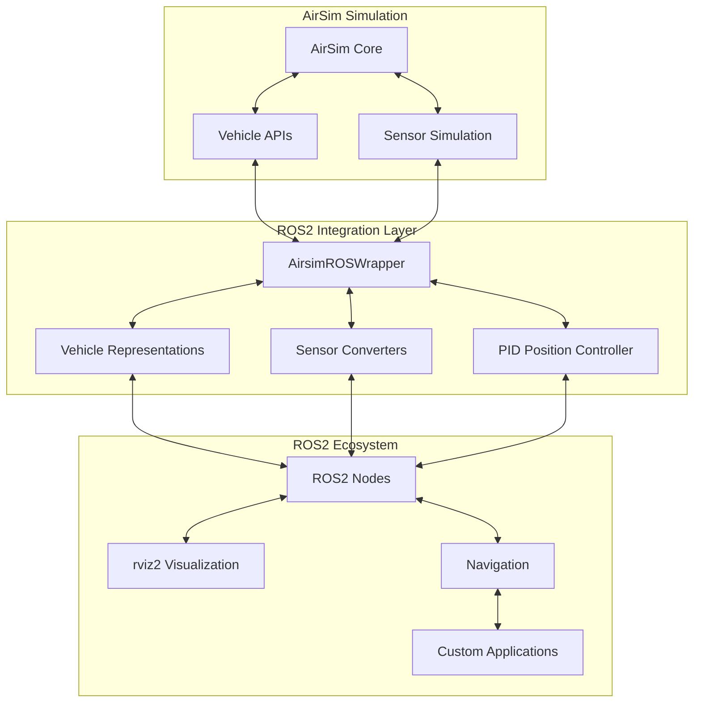
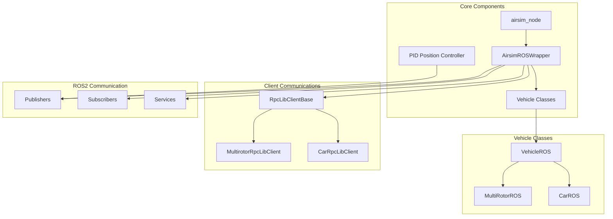
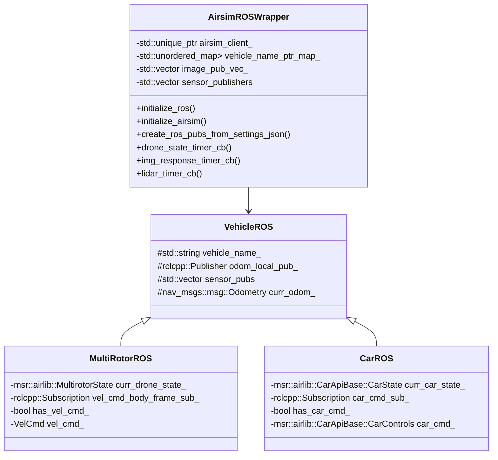

<!-- source: DeepWiki mcp.deepwiki.com · repo microsoft/AirSim · page 6.2 ROS2 Integration · fetched 2026-10-26 -->

# ROS2 Integration

<details>
<summary>Relevant source files</summary>

The following files were used as context for generating this wiki page:

- [ros/src/airsim_ros_pkgs/include/airsim_settings_parser.h](ros/src/airsim_ros_pkgs/include/airsim_settings_parser.h)
- [ros/src/airsim_ros_pkgs/include/pd_position_controller_simple.h](ros/src/airsim_ros_pkgs/include/pd_position_controller_simple.h)
- [ros/src/airsim_ros_pkgs/scripts/car_joy.py](ros/src/airsim_ros_pkgs/scripts/car_joy.py)
- [ros/src/airsim_ros_pkgs/src/airsim_settings_parser.cpp](ros/src/airsim_ros_pkgs/src/airsim_settings_parser.cpp)
- [ros2/src/airsim_ros_pkgs/include/airsim_ros_wrapper.h](ros2/src/airsim_ros_pkgs/include/airsim_ros_wrapper.h)
- [ros2/src/airsim_ros_pkgs/include/pd_position_controller_simple.h](ros2/src/airsim_ros_pkgs/include/pd_position_controller_simple.h)
- [ros2/src/airsim_ros_pkgs/src/airsim_node.cpp](ros2/src/airsim_ros_pkgs/src/airsim_node.cpp)
- [ros2/src/airsim_ros_pkgs/src/airsim_ros_wrapper.cpp](ros2/src/airsim_ros_pkgs/src/airsim_ros_wrapper.cpp)
- [ros2/src/airsim_ros_pkgs/src/airsim_settings_parser.cpp](ros2/src/airsim_ros_pkgs/src/airsim_settings_parser.cpp)
- [ros2/src/airsim_ros_pkgs/src/pd_position_controller_simple.cpp](ros2/src/airsim_ros_pkgs/src/pd_position_controller_simple.cpp)
- [ros2/src/airsim_ros_pkgs/src/pd_position_controller_simple_node.cpp](ros2/src/airsim_ros_pkgs/src/pd_position_controller_simple_node.cpp)

</details>


This page documents AirSim's integration with Robot Operating System 2 (ROS2), providing a comprehensive bridge between AirSim and the ROS2 ecosystem. For information about the ROS1 integration, see [ROS1 Integration](#6.1).

## Overview

The AirSim ROS2 integration enables you to control vehicles (both cars and drones) in the AirSim simulation through ROS2 interfaces, and access all sensor data through standard ROS2 topics. This integration makes it easier to use AirSim within a broader robotics workflow, leveraging ROS2's improved messaging infrastructure, quality of service settings, and modern design patterns.

## Architecture

The ROS2 integration follows a layered architecture that bridges AirSim's internal APIs to the ROS2 ecosystem.

### High-Level Architecture Diagram



Sources: [ros2/src/airsim_ros_pkgs/src/airsim_ros_wrapper.cpp](), [ros2/src/airsim_ros_pkgs/include/airsim_ros_wrapper.h](), [ros2/src/airsim_ros_pkgs/src/airsim_node.cpp]()

### Component Diagram



Sources: [ros2/src/airsim_ros_pkgs/src/airsim_node.cpp](), [ros2/src/airsim_ros_pkgs/src/airsim_ros_wrapper.cpp:27-59](), [ros2/src/airsim_ros_pkgs/include/airsim_ros_wrapper.h:115-137]()

## Core Classes and Components

### AirsimROSWrapper

The central component of the ROS2 integration is the `AirsimROSWrapper` class, which handles:

1. Connection to AirSim simulation
2. Creation of ROS2 publishers, subscribers, and services
3. Conversion between AirSim data formats and ROS2 messages
4. Management of vehicle representations
5. Coordination of sensor data acquisition and publishing



Sources: [ros2/src/airsim_ros_pkgs/include/airsim_ros_wrapper.h:103-374](), [ros2/src/airsim_ros_pkgs/src/airsim_ros_wrapper.cpp:27-59]()

### Vehicle Representation Classes

The ROS2 integration uses three main classes for vehicle representation:

1. `VehicleROS`: Base abstract class for all vehicles
2. `MultiRotorROS`: Extends `VehicleROS` for multirotor (drone) specific functionality
3. `CarROS`: Extends `VehicleROS` for car specific functionality

Each vehicle instance in the simulation gets its own instance of the appropriate derived class, which manages the vehicle's state, subscriptions, publishers, and services.

Sources: [ros2/src/airsim_ros_pkgs/include/airsim_ros_wrapper.h:133-191]()

### PID Position Controller

The ROS2 integration includes a basic PID position controller (`PIDPositionController`) that enables high-level control of vehicle position:

- Accepts position goals (either local coordinates or GPS coordinates)
- Computes control commands using PID control
- Publishes velocity commands to move the vehicle to the target position

This controller runs as a separate ROS2 node alongside the main AirSim node.

Sources: [ros2/src/airsim_ros_pkgs/include/pd_position_controller_simple.h](), [ros2/src/airsim_ros_pkgs/src/pd_position_controller_simple.cpp](), [ros2/src/airsim_ros_pkgs/src/pd_position_controller_simple_node.cpp]()

## ROS2 Topics and Services

The ROS2 integration exposes AirSim functionality through a variety of ROS2 topics and services:

### Common Topics

| Topic | Type | Description |
|-------|------|-------------|
| `~/<vehicle_name>/odom_local_ned` | `nav_msgs/msg/Odometry` | Vehicle odometry in NED frame |
| `~/<vehicle_name>/global_gps` | `sensor_msgs/msg/NavSatFix` | Global GPS position |
| `~/<vehicle_name>/environment` | `airsim_interfaces/msg/Environment` | Environment data (air pressure, temperature, etc.) |
| `~/origin_geo_point` | `airsim_interfaces/msg/GPSYaw` | Origin GPS coordinates |
| `~/clock` | `rosgraph_msgs/msg/Clock` | Simulation clock (if enabled) |

### Multirotor-Specific Topics

| Topic | Type | Description |
|-------|------|-------------|
| `~/<vehicle_name>/vel_cmd_body_frame` | `airsim_interfaces/msg/VelCmd` | Velocity command in body frame |
| `~/<vehicle_name>/vel_cmd_world_frame` | `airsim_interfaces/msg/VelCmd` | Velocity command in world frame |
| `~/all_robots/vel_cmd_body_frame` | `airsim_interfaces/msg/VelCmd` | Velocity command for all vehicles in body frame |
| `~/all_robots/vel_cmd_world_frame` | `airsim_interfaces/msg/VelCmd` | Velocity command for all vehicles in world frame |
| `~/group_of_robots/vel_cmd_body_frame` | `airsim_interfaces/msg/VelCmdGroup` | Velocity command for a group of vehicles in body frame |
| `~/group_of_robots/vel_cmd_world_frame` | `airsim_interfaces/msg/VelCmdGroup` | Velocity command for a group of vehicles in world frame |
| `~/gimbal_angle_quat_cmd` | `airsim_interfaces/msg/GimbalAngleQuatCmd` | Gimbal angle command (quaternion) |
| `~/gimbal_angle_euler_cmd` | `airsim_interfaces/msg/GimbalAngleEulerCmd` | Gimbal angle command (Euler angles) |

### Car-Specific Topics

| Topic | Type | Description |
|-------|------|-------------|
| `~/<vehicle_name>/car_cmd` | `airsim_interfaces/msg/CarControls` | Car control commands |
| `~/<vehicle_name>/car_state` | `airsim_interfaces/msg/CarState` | Car state information |

### Sensor Topics

| Topic | Type | Description |
|-------|------|-------------|
| `~/<vehicle_name>/<camera_name>/<image_type>` | `sensor_msgs/msg/Image` | Camera images (various types) |
| `~/<vehicle_name>/<camera_name>/<image_type>/camera_info` | `sensor_msgs/msg/CameraInfo` | Camera calibration info |
| `~/<vehicle_name>/lidar/<lidar_name>` | `sensor_msgs/msg/PointCloud2` | LiDAR point cloud |
| `~/<vehicle_name>/imu/<imu_name>` | `sensor_msgs/msg/Imu` | IMU data |
| `~/<vehicle_name>/gps/<gps_name>` | `sensor_msgs/msg/NavSatFix` | GPS data |
| `~/<vehicle_name>/magnetometer/<mag_name>` | `sensor_msgs/msg/MagneticField` | Magnetometer data |
| `~/<vehicle_name>/distance/<distance_name>` | `sensor_msgs/msg/Range` | Distance sensor data |
| `~/<vehicle_name>/altimeter/<alt_name>` | `airsim_interfaces/msg/Altimeter` | Altimeter data |

### Services

| Service | Type | Description |
|---------|------|-------------|
| `~/<vehicle_name>/takeoff` | `airsim_interfaces/srv/Takeoff` | Take off (multirotors only) |
| `~/<vehicle_name>/land` | `airsim_interfaces/srv/Land` | Land (multirotors only) |
| `~/all_robots/takeoff` | `airsim_interfaces/srv/Takeoff` | Take off all vehicles |
| `~/all_robots/land` | `airsim_interfaces/srv/Land` | Land all vehicles |
| `~/group_of_robots/takeoff` | `airsim_interfaces/srv/TakeoffGroup` | Take off a group of vehicles |
| `~/group_of_robots/land` | `airsim_interfaces/srv/LandGroup` | Land a group of vehicles |
| `~/reset` | `airsim_interfaces/srv/Reset` | Reset the simulation |
| `~/local_position_goal` | `airsim_interfaces/srv/SetLocalPosition` | Set position goal (if using PID controller) |
| `~/gps_goal` | `airsim_interfaces/srv/SetGPSPosition` | Set GPS goal (if using PID controller) |

Sources: [ros2/src/airsim_ros_pkgs/src/airsim_ros_wrapper.cpp:114-326](), [ros2/src/airsim_ros_pkgs/src/pd_position_controller_simple.cpp:82-85]()

## Position Controller Usage

The PID position controller can be used for automated vehicle control. It runs as a separate node that:

1. Subscribes to the vehicle's odometry and the simulation's origin GPS coordinates
2. Provides services to set position goals (either in local coordinates or GPS coordinates)
3. Computes velocity commands to reach those goals using PID control
4. Publishes these commands to the appropriate velocity command topics

### Position Controller Parameters

| Parameter | Description | Default Value |
|-----------|-------------|---------------|
| `kp_x`, `kp_y`, `kp_z` | Proportional gains | 0.5 |
| `kp_yaw` | Proportional gain for yaw | 0.5 |
| `kd_x`, `kd_y`, `kd_z` | Derivative gains | 0.1 |
| `kd_yaw` | Derivative gain for yaw | 0.1 |
| `reached_thresh_xyz` | Position threshold for goal reached | 0.5 m |
| `reached_yaw_degrees` | Yaw threshold for goal reached | 5.0 degrees |
| `max_vel_horz_abs` | Maximum horizontal velocity | 1.0 m/s |
| `max_vel_vert_abs` | Maximum vertical velocity | 0.5 m/s |
| `max_yaw_rate_degree` | Maximum yaw rate | 10.0 degrees/s |
| `update_control_every_n_sec` | Control update rate | configurable |

Sources: [ros2/src/airsim_ros_pkgs/include/pd_position_controller_simple.h:30-76](), [ros2/src/airsim_ros_pkgs/src/pd_position_controller_simple.cpp:4-33]()

## Getting Started

### 1. Building the ROS2 Package

The AirSim ROS2 integration is contained in the `ros2` directory of the AirSim repository. To build it:

1. Build AirSim according to standard instructions
2. Navigate to the `ros2` directory
3. Build using colcon:
   ```
   colcon build
   ```

### 2. Launching the ROS2 Node

Before launching, you need to start the AirSim simulation. Then:

1. Source the ROS2 workspace:
   ```
   source install/setup.bash
   ```

2. Launch the AirSim ROS2 node:
   ```
   ros2 run airsim_ros_pkgs airsim_node --ros-args -p host_ip:=localhost
   ```

3. To use the position controller (optional):
   ```
   ros2 run airsim_ros_pkgs pid_position_controller_simple_node
   ```

### 3. Configurable Parameters

| Parameter | Description | Default |
|-----------|-------------|---------|
| `host_ip` | IP address of the AirSim simulation | "localhost" |
| `is_vulkan` | Whether Vulkan is being used (affects image encoding) | false |
| `world_frame_id` | Frame ID for the world coordinate system | "world_ned" |
| `update_airsim_control_every_n_sec` | Update rate for control commands | varies |
| `update_airsim_img_response_every_n_sec` | Update rate for images | varies |
| `update_lidar_every_n_sec` | Update rate for LiDAR data | varies |

Sources: [ros2/src/airsim_ros_pkgs/src/airsim_ros_wrapper.cpp:96-112](), [ros2/src/airsim_ros_pkgs/src/airsim_node.cpp:5-14]()

## Vehicle Control Examples

### Controlling Multirotors

To send velocity commands to a multirotor in the body frame:

```
ros2 topic pub /airsim_node/<vehicle_name>/vel_cmd_body_frame airsim_interfaces/msg/VelCmd \
  "{twist: {linear: {x: 1.0, y: 0.0, z: 0.0}, angular: {z: 0.0}}}"
```

To take off a multirotor:

```
ros2 service call /airsim_node/<vehicle_name>/takeoff airsim_interfaces/srv/Takeoff
```

### Controlling Cars

To send control commands to a car:

```
ros2 topic pub /airsim_node/<vehicle_name>/car_cmd airsim_interfaces/msg/CarControls \
  "{throttle: 0.5, steering: 0.0, brake: 0.0, handbrake: false, manual: false, gear_immediate: true, manual_gear: 1}"
```

### Using the Position Controller

To send a local position goal:

```
ros2 service call /airsim_node/local_position_goal airsim_interfaces/srv/SetLocalPosition \
  "{x: 10.0, y: 10.0, z: -2.0, yaw: 0.0}"
```

To send a GPS position goal:

```
ros2 service call /airsim_node/gps_goal airsim_interfaces/srv/SetGPSPosition \
  "{latitude: 47.641468, longitude: -122.140165, altitude: 122.0, yaw: 0.0}"
```

Sources: [ros2/src/airsim_ros_pkgs/src/airsim_ros_wrapper.cpp:483-545](), [ros2/src/airsim_ros_pkgs/src/pd_position_controller_simple.cpp:115-229]()

## Conclusion

The AirSim ROS2 integration provides a comprehensive bridge between AirSim and the ROS2 ecosystem, enabling the use of AirSim in modern robotics workflows. The integration supports both multirotors and cars, exposes all sensor data through standard ROS2 interfaces, and includes a basic position controller for automated vehicle control.

By leveraging this integration, developers can use the extensive tools and libraries available in the ROS2 ecosystem while benefiting from AirSim's high-fidelity simulation capabilities.

---

