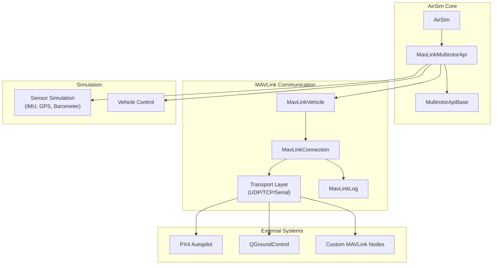
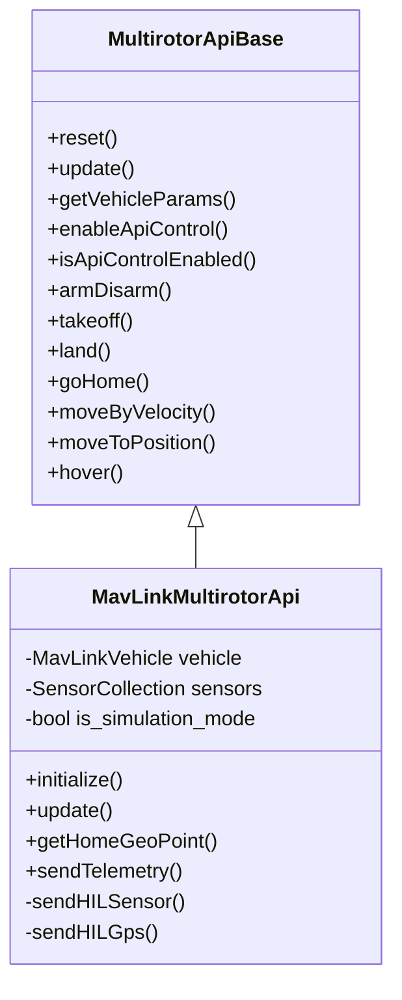
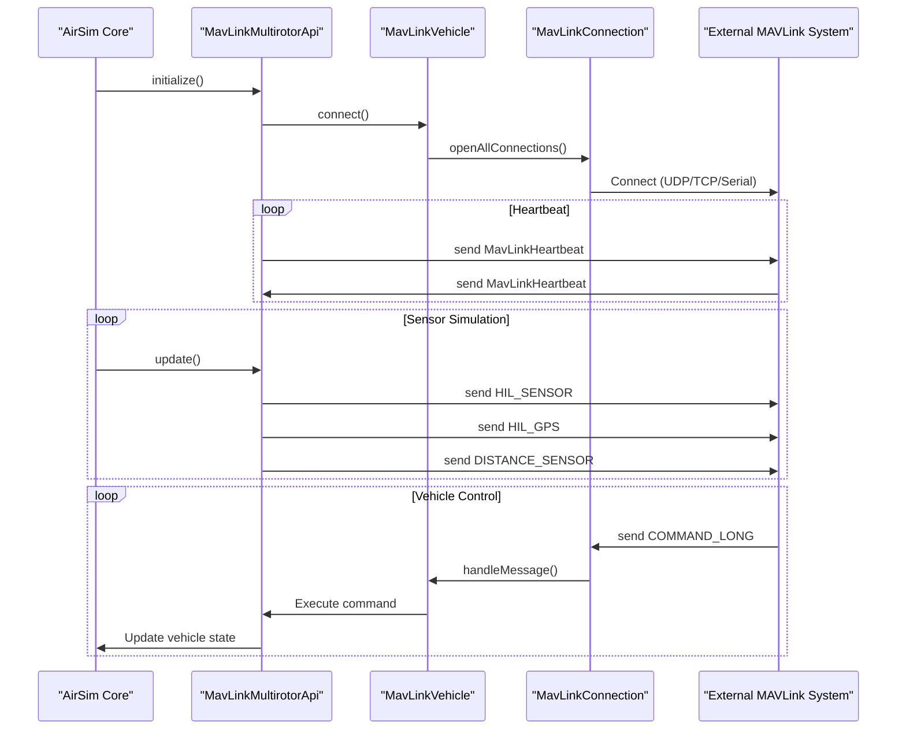
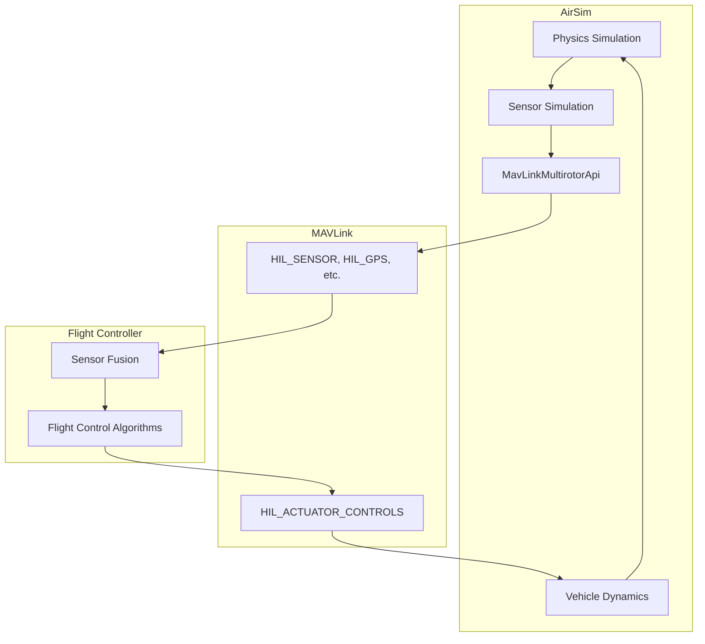
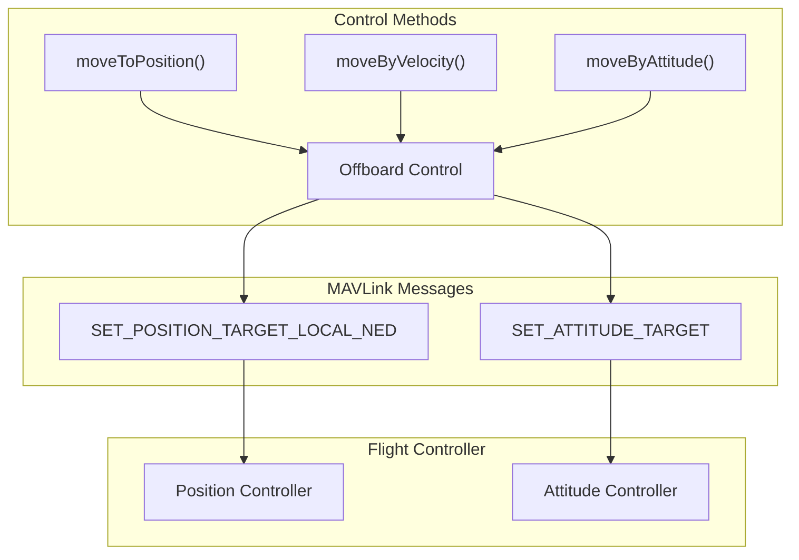

<!-- source: DeepWiki mcp.deepwiki.com · repo microsoft/AirSim · page 7 MAVLink Integration · fetched 2026-10-26 -->

# MAVLink Integration

<details>
<summary>Relevant source files</summary>

The following files were used as context for generating this wiki page:

- [AirLib/include/vehicles/multirotor/firmwares/mavlink/MavLinkMultirotorApi.hpp](AirLib/include/vehicles/multirotor/firmwares/mavlink/MavLinkMultirotorApi.hpp)
- [MavLinkCom/MavLinkTest/Commands.cpp](MavLinkCom/MavLinkTest/Commands.cpp)
- [MavLinkCom/MavLinkTest/Commands.h](MavLinkCom/MavLinkTest/Commands.h)
- [MavLinkCom/MavLinkTest/main.cpp](MavLinkCom/MavLinkTest/main.cpp)
- [MavLinkCom/include/MavLinkConnection.hpp](MavLinkCom/include/MavLinkConnection.hpp)
- [MavLinkCom/include/MavLinkLog.hpp](MavLinkCom/include/MavLinkLog.hpp)
- [MavLinkCom/include/MavLinkMessageBase.hpp](MavLinkCom/include/MavLinkMessageBase.hpp)
- [MavLinkCom/include/MavLinkNode.hpp](MavLinkCom/include/MavLinkNode.hpp)
- [MavLinkCom/include/MavLinkVehicle.hpp](MavLinkCom/include/MavLinkVehicle.hpp)
- [MavLinkCom/src/MavLinkConnection.cpp](MavLinkCom/src/MavLinkConnection.cpp)
- [MavLinkCom/src/MavLinkLog.cpp](MavLinkCom/src/MavLinkLog.cpp)
- [MavLinkCom/src/MavLinkMessageBase.cpp](MavLinkCom/src/MavLinkMessageBase.cpp)
- [MavLinkCom/src/MavLinkNode.cpp](MavLinkCom/src/MavLinkNode.cpp)
- [MavLinkCom/src/MavLinkVehicle.cpp](MavLinkCom/src/MavLinkVehicle.cpp)
- [MavLinkCom/src/impl/MavLinkConnectionImpl.cpp](MavLinkCom/src/impl/MavLinkConnectionImpl.cpp)
- [MavLinkCom/src/impl/MavLinkConnectionImpl.hpp](MavLinkCom/src/impl/MavLinkConnectionImpl.hpp)
- [MavLinkCom/src/impl/MavLinkFtpClientImpl.cpp](MavLinkCom/src/impl/MavLinkFtpClientImpl.cpp)
- [MavLinkCom/src/impl/MavLinkNodeImpl.cpp](MavLinkCom/src/impl/MavLinkNodeImpl.cpp)
- [MavLinkCom/src/impl/MavLinkNodeImpl.hpp](MavLinkCom/src/impl/MavLinkNodeImpl.hpp)
- [MavLinkCom/src/impl/MavLinkVehicleImpl.cpp](MavLinkCom/src/impl/MavLinkVehicleImpl.cpp)
- [MavLinkCom/src/impl/MavLinkVehicleImpl.hpp](MavLinkCom/src/impl/MavLinkVehicleImpl.hpp)
- [MavLinkCom/src/serial_com/wifi.cpp](MavLinkCom/src/serial_com/wifi.cpp)
- [PythonClient/multirotor/path.py](PythonClient/multirotor/path.py)
- [PythonClient/multirotor/state.py](PythonClient/multirotor/state.py)
- [PythonClient/multirotor/takeoff.py](PythonClient/multirotor/takeoff.py)

</details>


This page documents the MAVLink integration in AirSim, which enables communication between AirSim and external flight controllers or ground control stations using the MAVLink protocol. MAVLink (Micro Air Vehicle Link) is a lightweight messaging protocol commonly used for communication with drones and other unmanned vehicles.

For information about PX4 integration specifically, see [PX4 Integration](#7.1).

## Overview

AirSim's MAVLink integration allows for both software-in-the-loop (SITL) and hardware-in-the-loop (HITL) testing with flight controllers. It supports connecting to external MAVLink-capable systems like PX4, communicating vehicle state information, receiving control commands, and simulating sensor data.



Sources: [AirLib/include/vehicles/multirotor/firmwares/mavlink/MavLinkMultirotorApi.hpp:46-59](), [MavLinkCom/MavLinkTest/main.cpp:97-172]()

## Key Components

### MavLinkMultirotorApi

The `MavLinkMultirotorApi` class is the core of the MAVLink integration, implementing the `MultirotorApiBase` interface to provide MAVLink-specific functionality:

- Initializes and manages MAVLink connections
- Handles sensor simulation for HITL/SITL
- Processes incoming MAVLink messages
- Implements vehicle control methods (takeoff, land, move, etc.)
- Manages telemetry data transmission



Sources: [AirLib/include/vehicles/multirotor/firmwares/mavlink/MavLinkMultirotorApi.hpp:46-143]()

### MavLinkConnection

The `MavLinkConnection` class manages communication with external MAVLink systems through different transport mechanisms:

- UDP for network-based communication (typical for SITL)
- TCP for reliable network connections
- Serial for direct hardware connections (typical for HITL)

It handles message serialization/deserialization and provides subscribe/unsubscribe mechanisms for message handlers.

Sources: [MavLinkCom/src/impl/MavLinkConnectionImpl.cpp:50-72](), [MavLinkCom/include/MavLinkConnection.hpp:52-77]()

### MavLinkVehicle

The `MavLinkVehicle` class provides high-level control over MAVLink-capable vehicles:

- Arming/disarming the vehicle
- Takeoff and landing
- Setting flight modes
- Position and velocity control
- Retrieving vehicle state information

Sources: [MavLinkCom/src/MavLinkVehicle.cpp:25-41](), [MavLinkCom/include/MavLinkVehicle.hpp:25-39]()

### MavLinkLog

The `MavLinkLog` system handles logging of MAVLink communications for debugging and analysis:

- Binary logging in .mavlink format
- JSON logging for human-readable analysis
- Timestamped message recording

Sources: [MavLinkCom/src/MavLinkLog.cpp:14-146](), [MavLinkCom/include/MavLinkLog.hpp:18-45]()

## Communication Flow

The communication flow between AirSim and external MAVLink systems follows this pattern:



Sources: [AirLib/include/vehicles/multirotor/firmwares/mavlink/MavLinkMultirotorApi.hpp:126-232](), [MavLinkCom/src/impl/MavLinkConnectionImpl.cpp:404-578]()

## Configuration Options

MAVLink integration in AirSim can be configured through the `settings.json` file:

| Setting | Description | Default |
|---------|-------------|---------|
| `LocalHostIp` | IP address of local interface to use | `"127.0.0.1"` |
| `UseSerial` | Use serial connection instead of UDP | `false` |
| `SerialPort` | Name of serial port (if UseSerial is true) | `""` |
| `SerialBaudRate` | Baud rate for serial connection | `115200` |
| `UdpIp` | Remote IP address for UDP connection | `"127.0.0.1"` |
| `UdpPort` | Remote port for UDP connection | `14560` |
| `UseTcp` | Use TCP connection instead of UDP | `false` |
| `TcpPort` | Port for TCP connection | `4560` |
| `LogViewerHostIp` | IP address for MavLink Log Viewer | `"127.0.0.1"` |
| `LogViewerPort` | Port for MavLink Log Viewer | `14388` |
| `QgcHostIp` | IP address for QGroundControl | `"127.0.0.1"` |
| `QgcPort` | Port for QGroundControl | `14550` |

Example configuration:

```json
{
  "SettingsVersion": 1.2,
  "SimMode": "Multirotor",
  "Vehicles": {
    "PX4": {
      "VehicleType": "PX4Multirotor",
      "UseSerial": false,
      "UseTcp": true,
      "TcpPort": 4560,
      "ControlPortLocal": 14540,
      "ControlPortRemote": 14580,
      "params": {
        "NAV_RCL_ACT": 0,
        "NAV_DLL_ACT": 0
      }
    }
  }
}
```

Sources: [AirLib/include/vehicles/multirotor/firmwares/mavlink/MavLinkMultirotorApi.hpp:61-75](), [MavLinkCom/MavLinkTest/main.cpp:102-139]()

## Supported MAVLink Messages

AirSim's MAVLink integration handles a variety of MAVLink message types:

### Outgoing Messages (AirSim to External)

| Message | Purpose |
|---------|---------|
| `HEARTBEAT` | Connection maintenance |
| `HIL_SENSOR` | Simulated IMU, barometer data |
| `HIL_GPS` | Simulated GPS data |
| `HIL_STATE_QUATERNION` | Simulated vehicle attitude |
| `DISTANCE_SENSOR` | Simulated distance sensor readings |
| `SYSTEM_TIME` | Synchronization of simulation time |

### Incoming Messages (External to AirSim)

| Message | Purpose |
|---------|---------|
| `HEARTBEAT` | Connection maintenance |
| `COMMAND_LONG` | Vehicle commands (arm, takeoff, etc.) |
| `SET_POSITION_TARGET_LOCAL_NED` | Position control |
| `SET_ATTITUDE_TARGET` | Attitude control |
| `HIL_ACTUATOR_CONTROLS` | Control surface/motor commands |
| `STATUSTEXT` | Status and error messages |

Sources: [AirLib/include/vehicles/multirotor/firmwares/mavlink/MavLinkMultirotorApi.hpp:164-214](), [MavLinkCom/src/impl/MavLinkVehicleImpl.cpp:152-418]()

## HIL (Hardware-in-the-Loop) Mode

AirSim supports HIL mode for testing with real flight controller hardware. In this mode:

1. AirSim simulates sensor data (IMU, GPS, barometer, etc.)
2. This data is sent to the flight controller via MAVLink
3. The flight controller processes the data and sends back actuator commands
4. AirSim applies these commands to the simulated vehicle



Sources: [AirLib/include/vehicles/multirotor/firmwares/mavlink/MavLinkMultirotorApi.hpp:164-193](), [MavLinkCom/MavLinkTest/main.cpp:406-431]()

## SITL (Software-in-the-Loop) Mode

For SITL testing, AirSim connects to a software-based flight controller (like PX4 SITL):

1. The connection is typically established via UDP or TCP
2. AirSim and the flight controller run on the same or different machines
3. The same sensor simulation and control flow as HIL is used

Sources: [MavLinkCom/MavLinkTest/main.cpp:113-118]()

## Offboard Control

AirSim supports MAVLink offboard control mode, allowing it to directly control the vehicle's position, velocity, or attitude:



Sources: [AirLib/include/vehicles/multirotor/firmwares/mavlink/MavLinkMultirotorApi.hpp:757-812](), [MavLinkCom/src/impl/MavLinkVehicleImpl.cpp:586-650]()

## Common Use Cases

### 1. Connecting to PX4 SITL

```python
import setup_path
import airsim
import sys

# Connect to the drone
client = airsim.MultirotorClient()
client.confirmConnection()
client.enableApiControl(True)

# Arm the drone
client.armDisarm(True)

# Take off
client.takeoffAsync().join()

# Move to a position
client.moveToPositionAsync(10, 0, -5, 5).join()

# Land
client.landAsync().join()
```

Sources: [PythonClient/multirotor/takeoff.py:13-32](), [PythonClient/multirotor/path.py:10-54]()

### 2. Hardware-in-the-Loop Testing

For HITL testing with real flight controller hardware, configure the serial connection in `settings.json`:

```json
{
  "Vehicles": {
    "PX4": {
      "VehicleType": "PX4Multirotor",
      "UseSerial": true,
      "SerialPort": "COM4",  // or "/dev/ttyACM0" on Linux
      "SerialBaudRate": 115200
    }
  }
}
```

Sources: [MavLinkCom/src/impl/MavLinkConnectionImpl.cpp:107-121]()

## Troubleshooting

### Common Issues

| Issue | Possible Solution |
|-------|-------------------|
| Connection failures | Check if the flight controller is running and port settings are correct |
| "command rejected" messages | Ensure the vehicle is armed and in the correct flight mode |
| Sensor data not received | Verify HIL mode is properly configured on the flight controller |
| Vehicle doesn't respond to commands | Check if AirSim has API control enabled (`enableApiControl(True)`) |
| Erratic behavior | Check for conflicts in control (e.g., RC override, safety switches) |

Sources: [AirLib/include/vehicles/multirotor/firmwares/mavlink/MavLinkMultirotorApi.hpp:223-232](), [MavLinkCom/src/impl/MavLinkConnectionImpl.cpp:223-244]()

### Viewing MAVLink Messages

You can enable MAVLink logging to analyze the communication:

```json
{
  "Vehicles": {
    "PX4": {
      "LogViewerHostIp": "127.0.0.1",
      "LogViewerPort": 14388,
      "LogMavlinkToFile": true,
      "LogsDirectory": "path/to/logs"
    }
  }
}
```

The logs can be viewed with tools like QGroundControl or MAVLink Inspector.

Sources: [AirLib/include/vehicles/multirotor/firmwares/mavlink/MavLinkMultirotorApi.hpp:351-383](), [MavLinkCom/src/MavLinkLog.cpp:49-78]()

## Integration with External Tools

AirSim's MAVLink integration works with various external tools:

- **QGroundControl**: For mission planning and vehicle monitoring
- **MAVLink Inspector**: For debugging MAVLink communication
- **PX4 SITL**: For software-in-the-loop testing with PX4
- **Custom MAVLink applications**: Using the same protocol

Sources: [MavLinkCom/MavLinkTest/main.cpp:138-139](), [AirLib/include/vehicles/multirotor/firmwares/mavlink/MavLinkMultirotorApi.hpp:351-357]()

---

