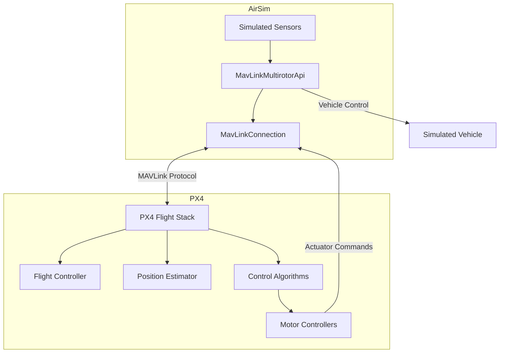
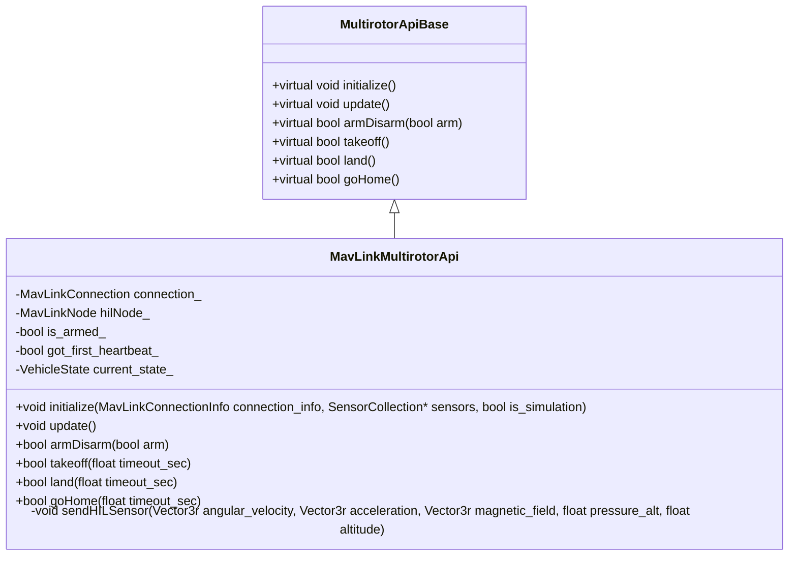
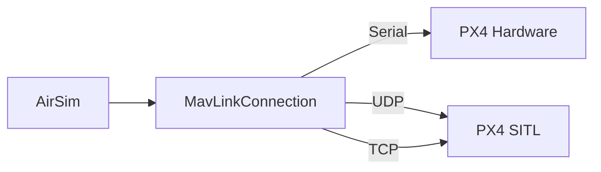
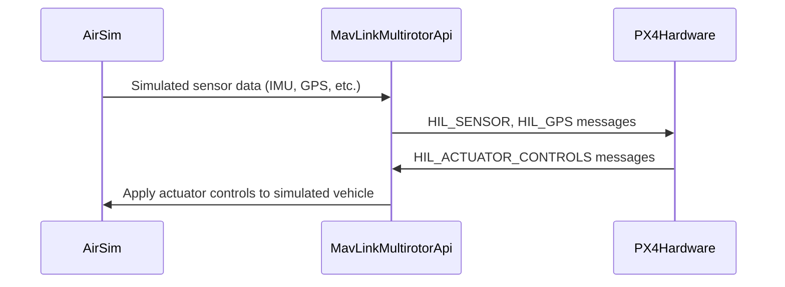
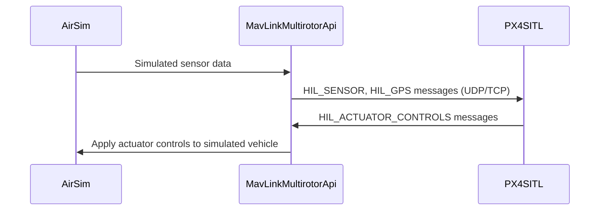
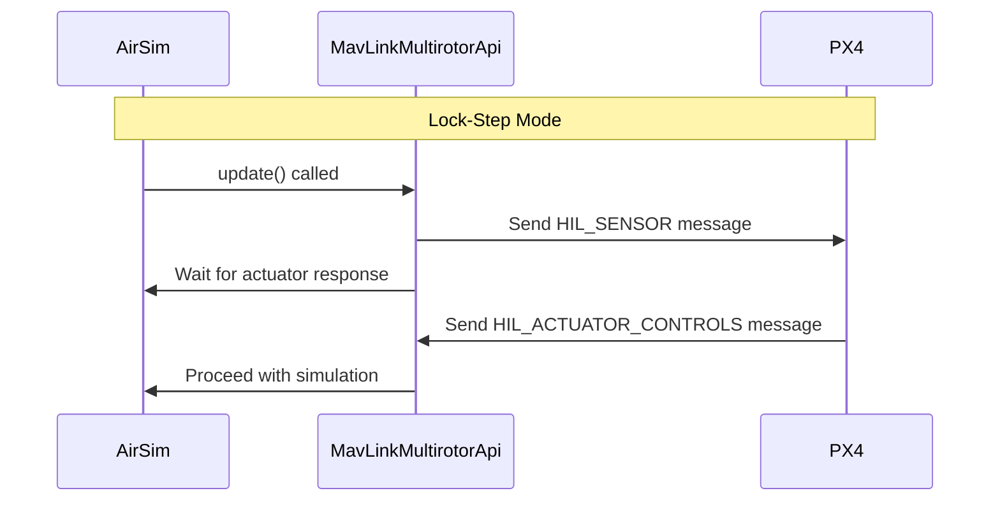

<!-- source: DeepWiki mcp.deepwiki.com · repo microsoft/AirSim · page 7.1 PX4 Integration · fetched 2026-10-26 -->

# PX4 Integration

<details>
<summary>Relevant source files</summary>

The following files were used as context for generating this wiki page:

- [AirLib/include/vehicles/multirotor/firmwares/mavlink/MavLinkMultirotorApi.hpp](AirLib/include/vehicles/multirotor/firmwares/mavlink/MavLinkMultirotorApi.hpp)
- [MavLinkCom/MavLinkTest/Commands.cpp](MavLinkCom/MavLinkTest/Commands.cpp)
- [MavLinkCom/MavLinkTest/Commands.h](MavLinkCom/MavLinkTest/Commands.h)
- [MavLinkCom/MavLinkTest/main.cpp](MavLinkCom/MavLinkTest/main.cpp)
- [MavLinkCom/include/MavLinkConnection.hpp](MavLinkCom/include/MavLinkConnection.hpp)
- [MavLinkCom/include/MavLinkLog.hpp](MavLinkCom/include/MavLinkLog.hpp)
- [MavLinkCom/include/MavLinkMessageBase.hpp](MavLinkCom/include/MavLinkMessageBase.hpp)
- [MavLinkCom/include/MavLinkNode.hpp](MavLinkCom/include/MavLinkNode.hpp)
- [MavLinkCom/include/MavLinkVehicle.hpp](MavLinkCom/include/MavLinkVehicle.hpp)
- [MavLinkCom/src/MavLinkConnection.cpp](MavLinkCom/src/MavLinkConnection.cpp)
- [MavLinkCom/src/MavLinkLog.cpp](MavLinkCom/src/MavLinkLog.cpp)
- [MavLinkCom/src/MavLinkMessageBase.cpp](MavLinkCom/src/MavLinkMessageBase.cpp)
- [MavLinkCom/src/MavLinkNode.cpp](MavLinkCom/src/MavLinkNode.cpp)
- [MavLinkCom/src/MavLinkVehicle.cpp](MavLinkCom/src/MavLinkVehicle.cpp)
- [MavLinkCom/src/impl/MavLinkConnectionImpl.cpp](MavLinkCom/src/impl/MavLinkConnectionImpl.cpp)
- [MavLinkCom/src/impl/MavLinkConnectionImpl.hpp](MavLinkCom/src/impl/MavLinkConnectionImpl.hpp)
- [MavLinkCom/src/impl/MavLinkFtpClientImpl.cpp](MavLinkCom/src/impl/MavLinkFtpClientImpl.cpp)
- [MavLinkCom/src/impl/MavLinkNodeImpl.cpp](MavLinkCom/src/impl/MavLinkNodeImpl.cpp)
- [MavLinkCom/src/impl/MavLinkNodeImpl.hpp](MavLinkCom/src/impl/MavLinkNodeImpl.hpp)
- [MavLinkCom/src/impl/MavLinkVehicleImpl.cpp](MavLinkCom/src/impl/MavLinkVehicleImpl.cpp)
- [MavLinkCom/src/impl/MavLinkVehicleImpl.hpp](MavLinkCom/src/impl/MavLinkVehicleImpl.hpp)
- [MavLinkCom/src/serial_com/wifi.cpp](MavLinkCom/src/serial_com/wifi.cpp)
- [PythonClient/multirotor/path.py](PythonClient/multirotor/path.py)
- [PythonClient/multirotor/state.py](PythonClient/multirotor/state.py)
- [PythonClient/multirotor/takeoff.py](PythonClient/multirotor/takeoff.py)

</details>


This page documents the integration between AirSim and the PX4 flight controller. It explains how AirSim establishes communication with PX4, the architecture of the integration, and the features it provides. This integration enables both Hardware-in-the-Loop (HITL) and Software-in-the-Loop (SITL) simulation modes with PX4. If you're looking for information about general MAVLink integration, see [MAVLink Integration](#7).

## Overview

AirSim provides robust integration with PX4, a popular open-source flight controller firmware used in many drones and unmanned aerial vehicles. This integration allows users to develop and test PX4-specific applications within AirSim's simulation environment.

The integration relies on the MAVLink protocol, which is a lightweight messaging protocol designed specifically for unmanned vehicles. AirSim implements a MAVLink interface that can communicate with PX4 either running as a Software-in-the-Loop (SITL) simulation or on actual hardware for Hardware-in-the-Loop (HITL) simulation.

### Communication Architecture



Sources: [AirLib/include/vehicles/multirotor/firmwares/mavlink/MavLinkMultirotorApi.hpp:47-738](), [MavLinkCom/src/impl/MavLinkVehicleImpl.cpp:111-155]()

## Integration Components

### MavLinkMultirotorApi

The `MavLinkMultirotorApi` class is the core component that handles communication with PX4. It inherits from `MultirotorApiBase` and implements the necessary interfaces to control a multirotor vehicle through MAVLink.



Sources: [AirLib/include/vehicles/multirotor/firmwares/mavlink/MavLinkMultirotorApi.hpp:46-853]()

The class handles all aspects of communication with PX4, including:

- Initializing the MAVLink connection
- Sending simulated sensor data to PX4
- Receiving actuator controls from PX4
- Processing vehicle commands (arm/disarm, takeoff, landing, etc.)
- Tracking vehicle state

### Connection Types

AirSim supports multiple connection methods to communicate with PX4:

1. **Serial Connection**: Used typically for hardware-in-the-loop testing with real PX4 hardware
2. **UDP Connection**: Common for SITL testing, allows communication over network
3. **TCP Connection**: Alternative for SITL, provides reliable connection



Sources: [MavLinkCom/src/impl/MavLinkConnectionImpl.cpp:50-121]()

## Hardware-in-the-Loop vs. Software-in-the-Loop

AirSim provides two primary modes for working with PX4:

### Hardware-in-the-Loop (HITL)

In HITL mode, AirSim communicates with actual PX4 hardware (like a Pixhawk controller). This allows for testing flight software on the real hardware while the sensors and physical environment are simulated.



Sources: [AirLib/include/vehicles/multirotor/firmwares/mavlink/MavLinkMultirotorApi.hpp:126-174]()

### Software-in-the-Loop (SITL)

In SITL mode, both AirSim and PX4 are running in software simulation. PX4 SITL is a compiled version of the PX4 firmware that can run directly on your development computer.



Sources: [MavLinkCom/MavLinkTest/main.cpp:116-117]()

## Lock-Step Simulation

AirSim provides a "lock-step" mode for PX4 simulation that ensures perfect synchronization between AirSim and PX4. In this mode, AirSim waits for PX4 to process each set of sensor data before advancing the simulation, ensuring deterministic behavior.



This feature is configured in the `settings.json` file:

```json
{
  "Vehicles": {
    "PX4": {
      "LockStep": true
    }
  }
}
```

Sources: [AirLib/include/vehicles/multirotor/firmwares/mavlink/MavLinkMultirotorApi.hpp:140-153]()

## Data Flow

The communication between AirSim and PX4 involves several types of data:

### Sensor Data (AirSim to PX4)

AirSim simulates various sensors and sends their data to PX4:

1. **IMU Data**: Accelerometer and gyroscope readings
2. **GPS Data**: Position, velocity, and altitude
3. **Barometer Data**: Pressure and altitude
4. **Magnetometer Data**: Magnetic field readings
5. **Distance Sensor Data**: Distance measurements

Sources: [AirLib/include/vehicles/multirotor/firmwares/mavlink/MavLinkMultirotorApi.hpp:164-174]()

### Actuator Controls (PX4 to AirSim)

PX4 processes the sensor data, runs its control algorithms, and sends back actuator control commands:


Sources: [AirLib/include/vehicles/multirotor/firmwares/mavlink/MavLinkMultirotorApi.hpp:319-326]()

### Commands and Telemetry

In addition to the primary sensor and actuator data, AirSim and PX4 exchange various commands and telemetry:

1. **Commands**: AirSim can send commands to PX4 (arm/disarm, takeoff, land, etc.)
2. **Heartbeats**: Regular messages confirming connectivity
3. **Vehicle State**: PX4 sends status updates, mode changes, etc.

Sources: [AirLib/include/vehicles/multirotor/firmwares/mavlink/MavLinkMultirotorApi.hpp:337-507]()

## Configuration

### PX4 Settings in AirSim

To configure PX4 integration in AirSim, add the following to your `settings.json` file:

```json
{
  "SettingsVersion": 1.2,
  "SimMode": "Multirotor",
  "Vehicles": {
    "PX4": {
      "VehicleType": "PX4Multirotor",
      "UseSerial": false,
      "UseTcp": true,
      "TcpPort": 4560,
      "ControlIp": "127.0.0.1",
      "ControlPort": 14580,
      "LockStep": true,
      "Parameters": {
        "NAV_RCL_ACT": 0,
        "NAV_DLL_ACT": 0
      }
    }
  }
}
```

This configuration:
- Sets up a TCP connection to PX4 SITL on localhost
- Enables lock-step simulation
- Configures PX4 parameters (disabling RC loss and data link loss failsafes)

### Starting PX4 SITL for AirSim

To use PX4 SITL with AirSim, you need to compile and run PX4 with the AirSim configuration. The typical command to start PX4 SITL is:

```bash
make px4_sitl_default none_iris
```

For HITL testing with hardware, you need to:
1. Flash PX4 firmware to your flight controller
2. Connect the controller to your computer
3. Configure AirSim to use the appropriate serial port

## Programming with PX4 in AirSim

### Using the Python API

The AirSim Python API provides an easy way to control PX4-enabled vehicles:

```python
import airsim
import time

# Connect to the vehicle
client = airsim.MultirotorClient()
client.confirmConnection()
client.enableApiControl(True)

# Arm the drone
client.armDisarm(True)

# Take off
client.takeoffAsync().join()

# Fly to a position
client.moveToPositionAsync(10, 0, -10, 5).join()

# Land
client.landAsync().join()

# Disarm
client.armDisarm(False)
```

Sources: [PythonClient/multirotor/path.py:1-56]()

### Vehicle State Monitoring

You can monitor the state of the PX4-controlled vehicle:

```python
state = client.getMultirotorState()
print(f"Armed: {state.armed}")
print(f"Position: {state.kinematics_estimated.position}")
print(f"Orientation: {state.kinematics_estimated.orientation}")
```

Sources: [PythonClient/multirotor/state.py:1-21]()

## Troubleshooting

### Common Issues

1. **Connection Problems**:
   - Check that PX4 SITL is running correctly
   - Verify that the IP addresses and ports in `settings.json` match your PX4 configuration
   - Ensure there are no firewalls blocking communication

2. **Sensor Data Issues**:
   - If PX4 reports sensor errors, check the AirSim configuration
   - For GPS issues, ensure that the simulated drone has a clear view of the sky

3. **Control Problems**:
   - Ensure that API control is enabled: `client.enableApiControl(True)`
   - Verify that the drone is armed before attempting takeoff
   - Check flight modes and make sure PX4 is in the expected mode

4. **Lock-Step Issues**:
   - If lock-step mode causes timeouts, it may indicate performance problems
   - Try disabling lock-step mode for better performance if exact timing is not critical

Sources: [AirLib/include/vehicles/multirotor/firmwares/mavlink/MavLinkMultirotorApi.hpp:222-226](), [AirLib/include/vehicles/multirotor/firmwares/mavlink/MavLinkMultirotorApi.hpp:144-149]()

## Conclusion

The PX4 integration in AirSim provides a powerful platform for developing and testing PX4-based drone applications in a simulated environment. Whether using SITL for rapid development or HITL for hardware verification, AirSim offers a comprehensive solution for PX4 development.

The integration leverages the MAVLink protocol to establish a robust communication channel between AirSim and PX4, allowing for realistic sensor simulation and accurate vehicle control. This enables developers to test their PX4 flight code thoroughly before deploying it on real drones.

Sources: [AirLib/include/vehicles/multirotor/firmwares/mavlink/MavLinkMultirotorApi.hpp:47-853](), [MavLinkCom/src/impl/MavLinkVehicleImpl.cpp:111-155](), [MavLinkCom/MavLinkTest/main.cpp:104-117]()

---

