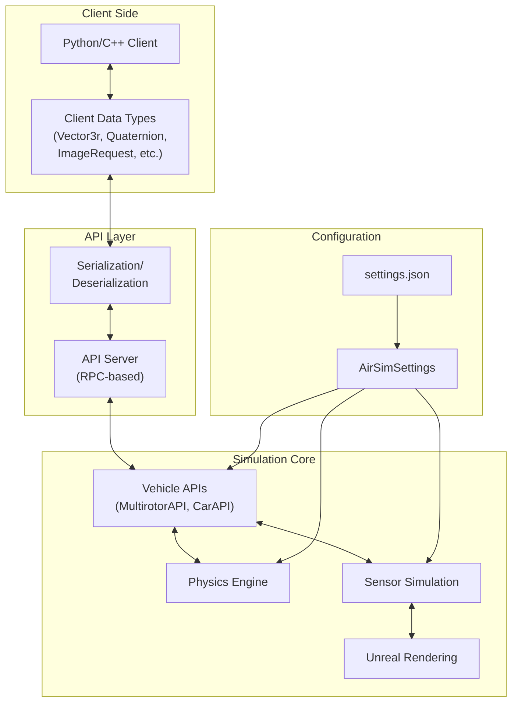

<!-- source: DeepWiki mcp.deepwiki.com · repo microsoft/AirSim · page 8 Data Types and Structures · fetched 2026-10-26 -->

# Data Types and Structures

<details>
<summary>Relevant source files</summary>

The following files were used as context for generating this wiki page:

- [AirLib/include/common/AirSimSettings.hpp](AirLib/include/common/AirSimSettings.hpp)
- [AirLib/include/common/CommonStructs.hpp](AirLib/include/common/CommonStructs.hpp)
- [PythonClient/airsim/types.py](PythonClient/airsim/types.py)
- [Unreal/Plugins/AirSim/Content/Blueprints/BP_CameraDirector.uasset](Unreal/Plugins/AirSim/Content/Blueprints/BP_CameraDirector.uasset)
- [Unreal/Plugins/AirSim/Content/Blueprints/BP_SimHUDWidget.uasset](Unreal/Plugins/AirSim/Content/Blueprints/BP_SimHUDWidget.uasset)
- [Unreal/Plugins/AirSim/Source/AirBlueprintLib.cpp](Unreal/Plugins/AirSim/Source/AirBlueprintLib.cpp)
- [Unreal/Plugins/AirSim/Source/AirBlueprintLib.h](Unreal/Plugins/AirSim/Source/AirBlueprintLib.h)
- [Unreal/Plugins/AirSim/Source/CameraDirector.cpp](Unreal/Plugins/AirSim/Source/CameraDirector.cpp)
- [Unreal/Plugins/AirSim/Source/CameraDirector.h](Unreal/Plugins/AirSim/Source/CameraDirector.h)
- [Unreal/Plugins/AirSim/Source/PIPCamera.cpp](Unreal/Plugins/AirSim/Source/PIPCamera.cpp)
- [Unreal/Plugins/AirSim/Source/PIPCamera.h](Unreal/Plugins/AirSim/Source/PIPCamera.h)
- [Unreal/Plugins/AirSim/Source/SimHUD/SimHUD.cpp](Unreal/Plugins/AirSim/Source/SimHUD/SimHUD.cpp)
- [Unreal/Plugins/AirSim/Source/SimHUD/SimHUD.h](Unreal/Plugins/AirSim/Source/SimHUD/SimHUD.h)
- [Unreal/Plugins/AirSim/Source/SimHUD/SimHUDWidget.h](Unreal/Plugins/AirSim/Source/SimHUD/SimHUDWidget.h)
- [Unreal/Plugins/AirSim/Source/SimMode/SimModeBase.cpp](Unreal/Plugins/AirSim/Source/SimMode/SimModeBase.cpp)
- [Unreal/Plugins/AirSim/Source/SimMode/SimModeBase.h](Unreal/Plugins/AirSim/Source/SimMode/SimModeBase.h)

</details>


This document provides a comprehensive overview of the core data types and structures used throughout AirSim. These structures are essential for representing vehicle state, sensor data, configuration settings, and communication between different components of the system. For information about the API functions that operate on these data types, see the [Python Client API](#3) and [C++ API and Examples](#4) pages.

## Core Data Structures

AirSim uses a collection of fundamental data structures to represent positions, orientations, and physics properties across the simulation environment.

### Vector and Quaternion Types

```mermaid
classDiagram
    class "Vector3r" {
        +float x_val
        +float y_val
        +float z_val
        +static nanVector3r()
        +containsNan()
        +dot(Vector3r)
        +cross(Vector3r)
        +get_length()
        +distance_to(Vector3r)
    }
    
    class "Quaternionr" {
        +float w_val
        +float x_val
        +float y_val
        +float z_val
        +static nanQuaternionr()
        +containsNan()
        +dot(Quaternionr)
        +cross(Quaternionr)
        +rotate(Quaternionr)
        +conjugate()
        +inverse()
        +get_length()
    }
    
    class "Pose" {
        +Vector3r position
        +Quaternionr orientation
        +static nanPose()
        +containsNan()
    }
    
    Pose --> "1" Vector3r
    Pose --> "1" Quaternionr
```

Sources:
- [AirLib/include/common/CommonStructs.hpp:89-263](AirLib/include/common/CommonStructs.hpp:89-263)
- [PythonClient/airsim/types.py:89-263](PythonClient/airsim/types.py:89-263)

These fundamental data types are used extensively throughout AirSim to represent:

- **Vector3r**: 3D vectors for position, velocity, and angular measurements
- **Quaternionr**: Orientation representation using quaternions
- **Pose**: Combined position and orientation

Both C++ and Python implementations include utility methods for mathematical operations (dot products, cross products), conversions, and utilities to check for NaN values.

### Physical Property Types

```mermaid
classDiagram
    class "Twist" {
        +Vector3r linear
        +Vector3r angular
        +static zero()
    }
    
    class "Wrench" {
        +Vector3r force
        +Vector3r torque
        +static zero()
    }
    
    class "Momentums" {
        +Vector3r linear
        +Vector3r angular
        +static zero()
    }
    
    class "Accelerations" {
        +Vector3r linear
        +Vector3r angular
        +static zero()
    }
    
    Twist --> "2" Vector3r
    Wrench --> "2" Vector3r
    Momentums --> "2" Vector3r
    Accelerations --> "2" Vector3r
```

Sources:
- [AirLib/include/common/CommonStructs.hpp:16-125](AirLib/include/common/CommonStructs.hpp:16-125)

The physical property structures represent various dynamic properties:

- **Twist**: Combines linear and angular velocity
- **Wrench**: Combines force and torque
- **Momentums**: Linear and angular momentum
- **Accelerations**: Linear and angular acceleration

These data types are primarily used in the physics engine and vehicle simulation components to model realistic dynamics.

### Covariance and State Types

```mermaid
classDiagram
    class "PoseWithCovariance" {
        +Pose pose
        +vector<real_T> covariance
    }
    
    class "TwistWithCovariance" {
        +Twist twist
        +vector<real_T> covariance
    }
    
    class "Odometry" {
        +PoseWithCovariance pose
        +TwistWithCovariance twist
    }
    
    Odometry --> "1" PoseWithCovariance
    Odometry --> "1" TwistWithCovariance
    PoseWithCovariance --> "1" Pose
    TwistWithCovariance --> "1" Twist
```

Sources:
- [AirLib/include/common/CommonStructs.hpp:127-164](AirLib/include/common/CommonStructs.hpp:127-164)

These structures combine physical properties with uncertainty information:

- **PoseWithCovariance**: Position and orientation with associated uncertainty matrix
- **TwistWithCovariance**: Velocities with associated uncertainty matrix
- **Odometry**: Full state estimate including both pose and velocity with uncertainties

These structures are used in state estimation, sensor fusion, and control algorithms where tracking uncertainty is important.

## Geographic Data Types

```mermaid
classDiagram
    class "GeoPoint" {
        +double latitude
        +double longitude
        +float altitude
        +set(double, double, float)
        +to_string()
    }
    
    class "HomeGeoPoint" {
        +GeoPoint home_geo_point
        +double lat_rad
        +double lon_rad
        +double cos_lat
        +double sin_lat
        +initialize(GeoPoint)
    }
    
    HomeGeoPoint --> "1" GeoPoint
```

Sources:
- [AirLib/include/common/CommonStructs.hpp:166-217](AirLib/include/common/CommonStructs.hpp:166-217)
- [PythonClient/airsim/types.py:274-279](PythonClient/airsim/types.py:274-279)

Geographic data types are used to represent global positioning information:

- **GeoPoint**: Represents a point in geographic coordinates (latitude, longitude, altitude)
- **HomeGeoPoint**: Extends GeoPoint with precalculated values for coordinate transformations

These are essential for GPS-related functionality and mapping between global and local coordinate systems.

## Camera and Imaging Types

```mermaid
classDiagram
    class "ImageType" {
        +Scene
        +DepthPlanar
        +DepthPerspective
        +DepthVis
        +DisparityNormalized
        +Segmentation
        +SurfaceNormals
        +Infrared
        +OpticalFlow
        +OpticalFlowVis
    }
    
    class "ProjectionMatrix" {
        +float matrix[4][4]
        +setTo(float)
    }
    
    class "CameraInfo" {
        +Pose pose
        +float fov
        +ProjectionMatrix proj_mat
    }
    
    class "ImageRequest" {
        +string camera_name
        +ImageType image_type
        +bool pixels_as_float
        +bool compress
    }
    
    class "ImageResponse" {
        +uint8[] image_data_uint8
        +float[] image_data_float
        +Vector3r camera_position
        +Quaternionr camera_orientation
        +uint64 time_stamp
        +string message
        +float pixels_as_float
        +bool compress
        +int width
        +int height
        +ImageType image_type
    }
    
    CameraInfo --> "1" Pose
    CameraInfo --> "1" ProjectionMatrix
    ImageRequest --> "1" ImageType
    ImageResponse --> "1" ImageType
    ImageResponse --> "1" Vector3r
    ImageResponse --> "1" Quaternionr
```

Sources:
- [AirLib/include/common/CommonStructs.hpp:220-271](AirLib/include/common/CommonStructs.hpp:220-271)
- [PythonClient/airsim/types.py:22-60](PythonClient/airsim/types.py:22-60)
- [PythonClient/airsim/types.py:311-337](PythonClient/airsim/types.py:311-337)
- [Unreal/Plugins/AirSim/Source/PIPCamera.h:29-30](Unreal/Plugins/AirSim/Source/PIPCamera.h:29-30)
- [Unreal/Plugins/AirSim/Source/PIPCamera.cpp:39-48](Unreal/Plugins/AirSim/Source/PIPCamera.cpp:39-48)

The camera and imaging types are used for controlling cameras and acquiring different types of images:

- **ImageType**: Enum defining different image types (RGB, depth, segmentation, etc.)
- **ProjectionMatrix**: Represents a camera projection matrix for 3D-to-2D transformations
- **CameraInfo**: Contains camera state information including pose, field of view, and projection matrix
- **ImageRequest**: Used to request images from cameras
- **ImageResponse**: Contains the response data from image requests

These types are central to AirSim's computer vision capabilities and allow for requesting various sensor data types.

## Collision and Detection Types

```mermaid
classDiagram
    class "CollisionInfo" {
        +bool has_collided
        +Vector3r normal
        +Vector3r impact_point
        +Vector3r position
        +float penetration_depth
        +uint64 time_stamp
        +string object_name
        +int object_id
    }
    
    class "Box2D" {
        +Vector2r min
        +Vector2r max
    }
    
    class "Box3D" {
        +Vector3r min
        +Vector3r max
    }
    
    CollisionInfo --> "3" Vector3r
```

Sources:
- [AirLib/include/common/CommonStructs.hpp:232-255](AirLib/include/common/CommonStructs.hpp:232-255)
- [AirLib/include/common/CommonStructs.hpp:273-298](AirLib/include/common/CommonStructs.hpp:273-298)
- [PythonClient/airsim/types.py:264-273](PythonClient/airsim/types.py:264-273)

These types provide information about collisions and spatial bounding:

- **CollisionInfo**: Contains detailed information about a collision event
- **Box2D/Box3D**: Represent 2D and 3D bounding boxes defined by min/max points

These are used in collision detection, object recognition, and spatial reasoning tasks.

## Configuration and Settings Structures

AirSim has an extensive settings system that uses nested structures to organize configuration parameters.

```mermaid
classDiagram
    class "AirSimSettings" {
        +string simmode_name
        +string level_name
        +vector<SubwindowSetting> subwindow_settings
        +RecordingSetting recording_setting
        +SegmentationSetting segmentation_setting
        +TimeOfDaySetting tod_setting
        +bool engine_sound
        +bool log_messages_visible
        +HomeGeoPoint origin_geopoint
        +map<string, PawnPath> pawn_paths
        +map<string, VehicleSetting*> vehicles
        +CameraSetting camera_defaults
        +CameraDirectorSetting camera_director
    }
    
    class "VehicleSetting" {
        +string vehicle_name
        +string vehicle_type
        +string default_vehicle_state
        +string pawn_path
        +bool allow_api_always
        +bool auto_create
        +Vector3r position
        +Rotation rotation
        +map<string, CameraSetting> cameras
        +map<string, SensorSetting*> sensors
        +RCSettings rc
    }
    
    class "CameraSetting" {
        +Vector3r position
        +Rotation rotation
        +GimbalSetting gimbal
        +map<int, CaptureSetting> capture_settings
        +map<int, NoiseSetting> noise_settings
    }
    
    class "SensorSetting" {
        +SensorBase::SensorType sensor_type
        +string sensor_name
        +bool enabled
        +Settings settings
    }
    
    AirSimSettings --> "*" "SubwindowSetting"
    AirSimSettings --> "1" "RecordingSetting"
    AirSimSettings --> "1" "SegmentationSetting"
    AirSimSettings --> "1" "TimeOfDaySetting"
    AirSimSettings --> "1" "HomeGeoPoint"
    AirSimSettings --> "*" "PawnPath"
    AirSimSettings --> "*" "VehicleSetting"
    AirSimSettings --> "1" "CameraSetting"
    AirSimSettings --> "1" "CameraDirectorSetting"
    VehicleSetting --> "*" "CameraSetting"
    VehicleSetting --> "*" "SensorSetting"
    VehicleSetting --> "1" "RCSettings"
    CameraSetting --> "*" "CaptureSetting"
    CameraSetting --> "*" "NoiseSetting"
    CameraSetting --> "1" "GimbalSetting"
```

Sources:
- [AirLib/include/common/AirSimSettings.hpp:23-437](AirLib/include/common/AirSimSettings.hpp:23-437)
- [Unreal/Plugins/AirSim/Source/SimMode/SimModeBase.cpp:402-437](Unreal/Plugins/AirSim/Source/SimMode/SimModeBase.cpp:402-437)

The configuration system is hierarchical:

- **AirSimSettings**: The root structure containing all simulation settings
- **VehicleSetting**: Configuration for individual vehicles including type, position, and sensors
- **CameraSetting**: Configuration for cameras including position, rotation, and capture settings
- **SensorSetting**: Base structure for different sensor types

Specialized sensor settings include:
- **BarometerSetting**, **ImuSetting**, **GpsSetting**, **MagnetometerSetting**, **DistanceSetting**, **LidarSetting**

These settings structures are populated from a `settings.json` file at startup and control most aspects of the simulation.

## Vehicle Control Structures

```mermaid
classDiagram
    class "RCData" {
        +uint64 timestamp
        +float pitch, roll, throttle, yaw
        +int switch1, switch2, switch3, switch4
        +int switch5, switch6, switch7, switch8
        +bool is_initialized
        +bool is_valid
    }
    
    class "YawMode" {
        +bool is_rate
        +float yaw_or_rate
    }
    
    class "DrivetrainType" {
        +enum MaxDegreeOfFreedom
        +enum ForwardOnly
    }
    
    class "CarControls" {
        +float throttle
        +float steering
        +float brake
        +bool handbrake
        +bool is_manual_gear
        +int manual_gear
        +bool gear_immediate
        +set_throttle(float, bool)
    }
```

Sources:
- [PythonClient/airsim/types.py:62-64](PythonClient/airsim/types.py:62-64)
- [PythonClient/airsim/types.py:279-310](PythonClient/airsim/types.py:279-310)
- [PythonClient/airsim/types.py:338-369](PythonClient/airsim/types.py:338-369)

These structures provide control inputs for different vehicle types:

- **RCData**: Represents remote control inputs for vehicles
- **YawMode**: Specifies yaw control mode (rate or angle)
- **DrivetrainType**: Enum for different drivetrain configurations
- **CarControls**: Specific controls for car vehicles

These structures are used in the vehicle-specific APIs to send control commands to simulated vehicles.

## Data Flow Between Components

The following diagram shows how the data structures are used in the communication flow between different components of AirSim:



Sources:
- [Unreal/Plugins/AirSim/Source/SimMode/SimModeBase.cpp:123-128](Unreal/Plugins/AirSim/Source/SimMode/SimModeBase.cpp:123-128)
- [Unreal/Plugins/AirSim/Source/SimMode/SimModeBase.cpp:535-556](Unreal/Plugins/AirSim/Source/SimMode/SimModeBase.cpp:535-556)
- [Unreal/Plugins/AirSim/Source/SimHUD/SimHUD.cpp:219-238](Unreal/Plugins/AirSim/Source/SimHUD/SimHUD.cpp:219-238)

Data structures flow through the system in several key ways:
1. **Client to Server**: Data types are serialized and sent across the RPC boundary
2. **Settings to Components**: Configuration structures define the behavior of vehicles and sensors
3. **Physics to Rendering**: Physical state structures are transformed into rendering updates
4. **Sensors to Client**: Sensor data (like images) flow from the simulation back to the client

## C++ to Python Type Mapping

AirSim provides both C++ and Python interfaces with equivalent data structures:

| C++ Type | Python Type | Purpose |
|----------|-------------|---------|
| `Vector3r` | `Vector3r` | 3D vector representation |
| `Quaternionr` | `Quaternionr` | Quaternion for orientation |
| `Pose` | `Pose` | Position and orientation |
| `ImageType` (enum) | `ImageType` (class) | Types of images available |
| `AirSimSettings` | N/A (internal) | Configuration settings |
| `CollisionInfo` | `CollisionInfo` | Collision information |
| `RCData` | `RCData` | Remote control data |
| `ImageRequest` | `ImageRequest` | Request for image data |
| `ImageResponse` | `ImageResponse` | Response with image data |
| `GeoPoint` | `GeoPoint` | Geographic coordinates |
| `YawMode` | `YawMode` | Yaw control mode |
| `CarControls` | `CarControls` | Car control inputs |
| `DrivetrainType` (enum) | `DrivetrainType` (class) | Drivetrain configurations |

Sources:
- [AirLib/include/common/CommonStructs.hpp](AirLib/include/common/CommonStructs.hpp)
- [PythonClient/airsim/types.py](PythonClient/airsim/types.py)

The Python client uses the `MsgpackMixin` class for serialization and deserialization of these types when communicating with the AirSim server, allowing seamless translation between the C++ and Python representations.

## Camera Director and Viewport System

```mermaid
classDiagram
    class "CameraDirectorMode" {
        +CAMERA_DIRECTOR_MODE_FPV
        +CAMERA_DIRECTOR_MODE_GROUND_OBSERVER
        +CAMERA_DIRECTOR_MODE_FLY_WITH_ME
        +CAMERA_DIRECTOR_MODE_MANUAL
        +CAMERA_DIRECTOR_MODE_SPRINGARM_CHASE
        +CAMERA_DIRECTOR_MODE_BACKUP
        +CAMERA_DIRECTOR_MODE_NODISPLAY
        +CAMERA_DIRECTOR_MODE_FRONT
    }
    
    class "SubwindowSetting" {
        +int window_index
        +ImageType image_type
        +bool visible
        +string camera_name
        +string vehicle_name
        +bool external
    }
    
    class "CameraDirector" {
        +SpringArmComponent* SpringArm
        +PIPCamera* ExternalCamera
        +getMode()
        +setMode(CameraDirectorMode)
        +initializeForBeginPlay()
        +getFpvCamera()
        +getExternalCamera()
        +getBackupCamera()
    }
```

Sources:
- [Unreal/Plugins/AirSim/Source/CameraDirector.h:12-23](Unreal/Plugins/AirSim/Source/CameraDirector.h:12-23)
- [Unreal/Plugins/AirSim/Source/CameraDirector.cpp:45-98](Unreal/Plugins/AirSim/Source/CameraDirector.cpp:45-98)
- [AirLib/include/common/AirSimSettings.hpp:46-65](AirLib/include/common/AirSimSettings.hpp:46-65)
- [Unreal/Plugins/AirSim/Source/SimHUD/SimHUD.cpp:98-115](Unreal/Plugins/AirSim/Source/SimHUD/SimHUD.cpp:98-115)

The camera director system manages viewports and camera perspectives in AirSim:

- **CameraDirectorMode**: Defines different camera view modes (FPV, chase, etc.)
- **SubwindowSetting**: Configuration for the visualization subwindows
- **CameraDirector**: Manages camera transitions and positioning

These components work together to provide flexible visualization options for the simulation, including first-person views, chase cameras, and external observer viewpoints.

## Summary

AirSim's data types and structures form a comprehensive system for representing physical state, sensor data, and configuration parameters. The core mathematical types (vectors, quaternions, poses) provide the foundation, while specialized structures for vehicles, cameras, and sensors build upon them. The configuration system uses nested structures to organize complex settings hierarchically.

Understanding these data structures is crucial for effectively using the AirSim API and extending the system with new functionality. The equivalent representations in C++ and Python ensure consistency across different client interfaces.