# Page: Overview

# Overview

<details>
<summary>Relevant source files</summary>

The following files were used as context for generating this wiki page:

- [AirLib/include/api/RpcLibClientBase.hpp](AirLib/include/api/RpcLibClientBase.hpp)
- [AirLib/include/api/VehicleSimApiBase.hpp](AirLib/include/api/VehicleSimApiBase.hpp)
- [AirLib/include/api/WorldSimApiBase.hpp](AirLib/include/api/WorldSimApiBase.hpp)
- [AirLib/include/common/AirSimSettings.hpp](AirLib/include/common/AirSimSettings.hpp)
- [AirLib/src/api/RpcLibClientBase.cpp](AirLib/src/api/RpcLibClientBase.cpp)
- [AirLib/src/api/RpcLibServerBase.cpp](AirLib/src/api/RpcLibServerBase.cpp)
- [PythonClient/airsim/client.py](PythonClient/airsim/client.py)
- [README.md](README.md)
- [Unity/AirLibWrapper/AirsimWrapper/Source/PawnSimApi.cpp](Unity/AirLibWrapper/AirsimWrapper/Source/PawnSimApi.cpp)
- [Unity/AirLibWrapper/AirsimWrapper/Source/PawnSimApi.h](Unity/AirLibWrapper/AirsimWrapper/Source/PawnSimApi.h)
- [Unity/AirLibWrapper/AirsimWrapper/Source/WorldSimApi.cpp](Unity/AirLibWrapper/AirsimWrapper/Source/WorldSimApi.cpp)
- [Unity/AirLibWrapper/AirsimWrapper/Source/WorldSimApi.h](Unity/AirLibWrapper/AirsimWrapper/Source/WorldSimApi.h)
- [Unreal/Plugins/AirSim/Content/Blueprints/BP_CameraDirector.uasset](Unreal/Plugins/AirSim/Content/Blueprints/BP_CameraDirector.uasset)
- [Unreal/Plugins/AirSim/Content/Blueprints/BP_SimHUDWidget.uasset](Unreal/Plugins/AirSim/Content/Blueprints/BP_SimHUDWidget.uasset)
- [Unreal/Plugins/AirSim/Source/AirBlueprintLib.cpp](Unreal/Plugins/AirSim/Source/AirBlueprintLib.cpp)
- [Unreal/Plugins/AirSim/Source/AirBlueprintLib.h](Unreal/Plugins/AirSim/Source/AirBlueprintLib.h)
- [Unreal/Plugins/AirSim/Source/CameraDirector.cpp](Unreal/Plugins/AirSim/Source/CameraDirector.cpp)
- [Unreal/Plugins/AirSim/Source/CameraDirector.h](Unreal/Plugins/AirSim/Source/CameraDirector.h)
- [Unreal/Plugins/AirSim/Source/PIPCamera.cpp](Unreal/Plugins/AirSim/Source/PIPCamera.cpp)
- [Unreal/Plugins/AirSim/Source/PIPCamera.h](Unreal/Plugins/AirSim/Source/PIPCamera.h)
- [Unreal/Plugins/AirSim/Source/PawnSimApi.cpp](Unreal/Plugins/AirSim/Source/PawnSimApi.cpp)
- [Unreal/Plugins/AirSim/Source/PawnSimApi.h](Unreal/Plugins/AirSim/Source/PawnSimApi.h)
- [Unreal/Plugins/AirSim/Source/SimHUD/SimHUD.cpp](Unreal/Plugins/AirSim/Source/SimHUD/SimHUD.cpp)
- [Unreal/Plugins/AirSim/Source/SimHUD/SimHUD.h](Unreal/Plugins/AirSim/Source/SimHUD/SimHUD.h)
- [Unreal/Plugins/AirSim/Source/SimHUD/SimHUDWidget.h](Unreal/Plugins/AirSim/Source/SimHUD/SimHUDWidget.h)
- [Unreal/Plugins/AirSim/Source/SimMode/SimModeBase.cpp](Unreal/Plugins/AirSim/Source/SimMode/SimModeBase.cpp)
- [Unreal/Plugins/AirSim/Source/SimMode/SimModeBase.h](Unreal/Plugins/AirSim/Source/SimMode/SimModeBase.h)
- [Unreal/Plugins/AirSim/Source/WorldSimApi.cpp](Unreal/Plugins/AirSim/Source/WorldSimApi.cpp)
- [Unreal/Plugins/AirSim/Source/WorldSimApi.h](Unreal/Plugins/AirSim/Source/WorldSimApi.h)
- [docs/code_structure.md](docs/code_structure.md)
- [docs/coding_guidelines.md](docs/coding_guidelines.md)
- [docs/images/unreal_versions.png](docs/images/unreal_versions.png)
- [docs/playback.md](docs/playback.md)
- [docs/use_precompiled.md](docs/use_precompiled.md)

</details>


AirSim is an open-source, cross-platform simulator for autonomous vehicles built on Unreal Engine (with experimental Unity support). It provides a platform for AI research to experiment with deep learning, computer vision, and reinforcement learning algorithms for autonomous vehicles like drones and cars.

For setup instructions, see [Installation and Setup](#1.1). For details on the underlying architecture, see [Core Architecture](#1.2).

## Purpose and Capabilities

AirSim offers:

- Physics-rich simulation for drones, cars, and other autonomous systems
- Software-in-the-loop (SITL) and hardware-in-the-loop (HITL) simulation with flight controllers like PX4 and ArduPilot
- Cross-platform support for Windows, Linux, and macOS
- Realistic environments with weather effects, time-of-day settings, and dynamic world manipulation
- Extensive sensor simulation (cameras, LiDAR, IMU, GPS, barometer, magnetometer, etc.)
- APIs in multiple languages (Python, C++, C#, Java) via RPC
- Integration with robotics frameworks (ROS1, ROS2) and flight controllers (MAVLink)

## System Architecture

### High-Level Architecture

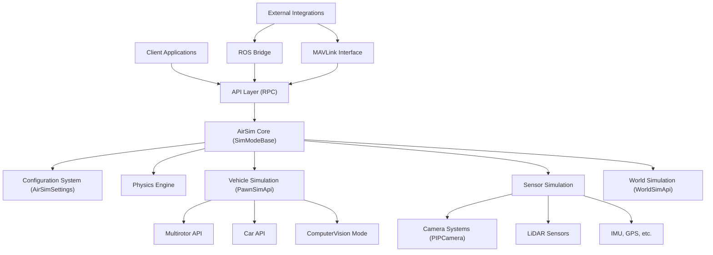

Sources: [README.md:7-20]()), [AirLib/include/common/AirSimSettings.hpp:30-37](), [Unreal/Plugins/AirSim/Source/SimMode/SimModeBase.cpp:30-45]()

### Client-Server Communication

AirSim uses a client-server architecture where clients communicate with the simulation via RPC (Remote Procedure Call):

```mermaid
graph TD
    subgraph "Client Side"
        A1["Python Client (client.py)"]
        A2["C++ Client (RpcLibClientBase)"]
        A3["ROS Nodes"]
        A4["DroneShell CLI"]
    end
    
    subgraph "Communication Layer"
        B1["RPC Interface"]
        B2["MAVLink Protocol"]
        B3["ROS Messages/Services"]
    end
    
    subgraph "Server Side (AirSim)"
        C1["RPC Server (RpcLibServerBase)"]
        C2["Vehicle API (VehicleApiBase)"]
        C3["World API (WorldSimApi)"]
        C4["Sensor APIs"]
    end
    
    subgraph "Simulation Core"
        D1["Physics Engine"]
        D2["Vehicle Models (PawnSimApi)"]
        D3["Sensor Simulation"]
        D4["Rendering (PIPCamera)"]
    end
    
    A1 --> B1
    A2 --> B1
    A3 --> B3
    A4 --> B1
    
    B1 --> C1
    B2 --> C2
    B3 --> C1
    
    C1 --> C2
    C1 --> C3
    C1 --> C4
    
    C2 --> D2
    C3 --> D1
    C4 --> D3
    D2 --> D1
    D1 --> D4
    D3 --> D4
```

Sources: [PythonClient/airsim/client.py:12-20](), [AirLib/src/api/RpcLibClientBase.cpp:49-70](), [AirLib/src/api/RpcLibServerBase.cpp:42-80]()

## Core Components

### Simulation Modes

AirSim supports different simulation modes depending on the vehicle type:

| Simulation Mode | Description | Main Class |
|-----------------|-------------|------------|
| Multirotor | Simulates drones with realistic physics | `SimModeWorldMultiRotor` |
| Car | Simulates cars with PhysX-based physics | `SimModeCar` |
| ComputerVision | No vehicle simulation, focuses on camera/sensor data | `SimModeComputerVision` |

Sources: [Unreal/Plugins/AirSim/Source/SimHUD/SimHUD.cpp:6-8](), [AirLib/include/common/AirSimSettings.hpp:42-44]()

### Vehicle System

Vehicle simulation in AirSim follows a layered architecture:

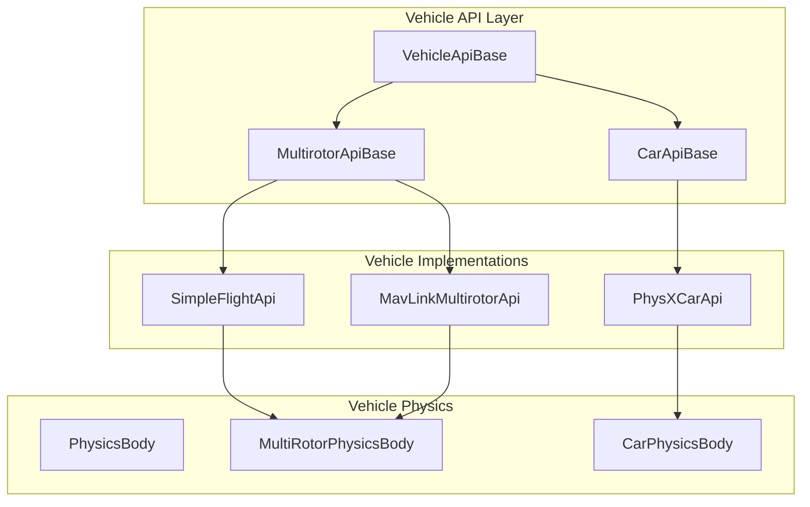

Sources: [AirLib/include/common/AirSimSettings.hpp:31-37](), [AirLib/include/api/VehicleSimApiBase.hpp:19-31](), [Unreal/Plugins/AirSim/Source/PawnSimApi.h:25-40]()

### Sensor Systems

AirSim simulates various sensors needed for autonomous vehicle research:

| Sensor Type | Description | Main Classes |
|-------------|-------------|--------------|
| Cameras | RGB, depth, segmentation, surface normals, etc. | `PIPCamera`, `UnrealImageCapture` |
| LiDAR | Point cloud data | `LidarSimple` |
| IMU | Acceleration and angular velocity | `ImuBase` |
| GPS | Geolocation data | `GpsBase` |
| Barometer | Altitude data | `BarometerBase` |
| Magnetometer | Compass/orientation data | `MagnetometerBase` |
| Distance Sensor | Obstacle detection | `DistanceBase` |

Sources: [Unreal/Plugins/AirSim/Source/PIPCamera.cpp:39-48](), [AirLib/include/common/AirSimSettings.hpp:232-256]()

## Configuration System

AirSim is configured using a `settings.json` file that allows customization of:

- Vehicle types and settings
- Camera and sensor configurations
- Recording settings
- Environment parameters
- Physics engine settings
- API and communication settings

The settings are managed by the `AirSimSettings` class, which parses the JSON file and provides configuration to all components of the system.

Sources: [AirLib/include/common/AirSimSettings.hpp:385-416](), [AirLib/include/common/AirSimSettings.hpp:435-480]()

## API System

AirSim provides APIs for:

1. **Vehicle Control**
   - Movement commands (e.g., moveByVelocity, moveToPosition)
   - State retrieval (e.g., getPosition, getOrientation)
   - Vehicle-specific controls (e.g., arm/disarm, takeoff/land for drones)

2. **Sensor Data Retrieval**
   - Camera images (RGB, depth, segmentation, etc.)
   - LiDAR point clouds
   - IMU, GPS, and other sensor readings

3. **World Manipulation**
   - Object creation and manipulation
   - Environment control (weather, time of day)
   - Simulation control (pause, reset, etc.)

APIs are accessible through:
- Python client (`client.py`)
- C++ client (`RpcLibClientBase`)
- ROS interface
- Direct C++ API within the simulation

Sources: [PythonClient/airsim/client.py:13-147](), [AirLib/include/api/RpcLibClientBase.hpp:35-80](), [Unreal/Plugins/AirSim/Source/WorldSimApi.h:12-52]()

## External Integrations

### ROS Integration

AirSim provides ROS integration that allows:
- Publishing sensor data to ROS topics
- Subscribing to control commands from ROS
- Using ROS services for high-level operations

### MAVLink Integration

AirSim can communicate with MAVLink-compatible flight controllers:
- Software-in-the-loop (SITL) with PX4 or ArduPilot
- Hardware-in-the-loop (HITL) testing
- Connection to ground control stations like QGroundControl

Sources: [AirLib/include/common/AirSimSettings.hpp:292-344](), [Unreal/Plugins/AirSim/Source/WorldSimApi.cpp:28-40]()

## Getting Started

To use AirSim:

1. Download precompiled binaries or build from source
2. Configure `settings.json` for your needs
3. Connect using Python, C++, or other client interfaces
4. Control vehicles and retrieve sensor data through the API

For more detailed examples, see [Usage Examples](#1.3).

Sources: [README.md:24-60](), [docs/use_precompiled.md:1-7]()

---

# Page: Installation and Setup

# Installation and Setup

<details>
<summary>Relevant source files</summary>

The following files were used as context for generating this wiki page:

- [.gitignore](.gitignore)
- [README.md](README.md)
- [Unreal/Environments/Blocks/.gitignore](Unreal/Environments/Blocks/.gitignore)
- [Unreal/Environments/Blocks/Blocks.uproject](Unreal/Environments/Blocks/Blocks.uproject)
- [Unreal/Environments/Blocks/GenerateProjectFiles.sh](Unreal/Environments/Blocks/GenerateProjectFiles.sh)
- [build.cmd](build.cmd)
- [build.sh](build.sh)
- [build_docs.sh](build_docs.sh)
- [cmake/cmake-modules/CommonSetup.cmake](cmake/cmake-modules/CommonSetup.cmake)
- [docs/build_linux.md](docs/build_linux.md)
- [docs/build_macos.md](docs/build_macos.md)
- [docs/build_windows.md](docs/build_windows.md)
- [docs/code_structure.md](docs/code_structure.md)
- [docs/coding_guidelines.md](docs/coding_guidelines.md)
- [docs/flight_controller.md](docs/flight_controller.md)
- [docs/images/unreal_versions.png](docs/images/unreal_versions.png)
- [docs/modify_recording_data.md](docs/modify_recording_data.md)
- [docs/playback.md](docs/playback.md)
- [docs/unreal_custenv.md](docs/unreal_custenv.md)
- [docs/unreal_upgrade.md](docs/unreal_upgrade.md)
- [docs/use_precompiled.md](docs/use_precompiled.md)
- [mkdocs.yml](mkdocs.yml)
- [setup.sh](setup.sh)

</details>


This document provides comprehensive instructions for installing and setting up AirSim on Windows, Linux, and macOS. It covers installation options including using precompiled binaries and building from source code. For information about API usage after installation, see [Core APIs](#3) and [Python Client API](#3).

## Installation Options

AirSim can be installed using precompiled binaries or built from source.

### Diagram: AirSim Installation Workflow

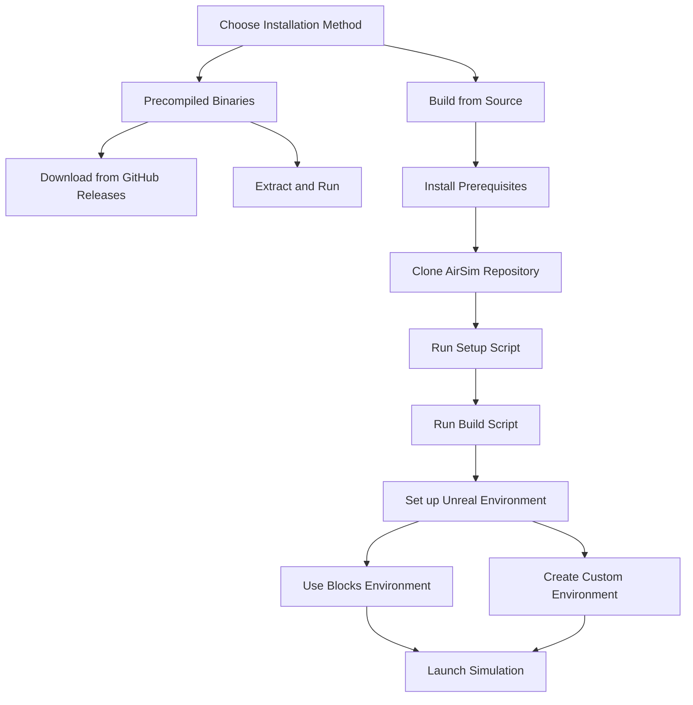

Sources: [README.md:24-38](https://github.com/microsoft/AirSim/blob/master/README.md), [docs/use_precompiled.md:1-13]()

## Using Precompiled Binaries

The quickest way to get started with AirSim is to download precompiled binaries:

### Windows and Linux
1. Download binaries for your chosen environment from the [AirSim GitHub releases page](https://github.com/microsoft/AirSim/releases)
2. Extract the files (use 7zip for multi-part archives - .001, .002, etc.)
3. Run the executable to start the simulation

### macOS
Precompiled binaries are not available for macOS. You'll need to build from source.

For lower-end GPUs, you can run AirSim in reduced resolution mode:
- Windows: Create a `run.bat` file with `start EnvironmentName -ResX=640 -ResY=480 -windowed`
- Linux: Use `./Blocks.sh -ResX=640 -ResY=480 -windowed`

Sources: [docs/use_precompiled.md:1-37]()

## Building from Source

### Prerequisites

| Platform | Requirements |
|----------|--------------|
| Windows  | - Windows 10 (64-bit)<br>- Visual Studio 2022 with Desktop C++ Development, Windows 10 SDK 10.0.19041<br>- Unreal Engine 4.27 |
| Linux    | - Ubuntu 18.04 LTS (recommended)<br>- LLVM/Clang 8<br>- CMake 3.10.0+ |
| macOS    | - macOS Catalina (10.15) or newer<br>- LLVM/Clang from Homebrew<br>- CMake 3.19.2+ |

Sources: [docs/build_windows.md:1-18](), [docs/build_linux.md:1-12](), [docs/build_macos.md:1-12]()

### Build System Architecture

The following diagram illustrates how the build scripts compile and assemble AirSim components:

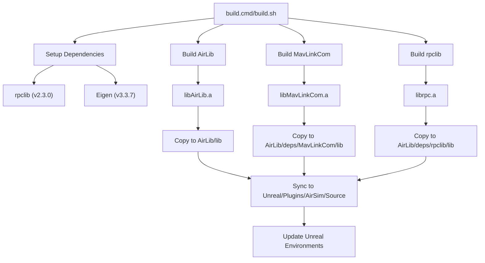

Sources: [build.cmd:83-143](), [build.sh:98-143](), [cmake/cmake-modules/CommonSetup.cmake:1-100]()

### Windows Build Instructions

1. **Install Unreal Engine 4.27**
   - Download and install the Epic Games Launcher
   - In the Unreal Engine tab, install UE 4.27
   - Make sure UE 4.27 is set as "current" using the dropdown next to the Launch button

2. **Install Visual Studio 2022**
   - Select "Desktop Development with C++" and "Windows 10 SDK 10.0.19041"
   - Also select the latest .NET Framework SDK under "Individual Components"

3. **Clone and Build AirSim**
   - Start "Developer Command Prompt for VS 2022"
   - Clone the repository: `git clone https://github.com/Microsoft/AirSim.git`
   - Navigate to the AirSim directory: `cd AirSim`
   - Run the build script: `build.cmd`

4. **Build Unreal Project**
   - Open the Unreal Engine
   - Navigate to the Blocks environment in `AirSim\Unreal\Environments\Blocks`
   - Double-click the .sln file to open the project in Visual Studio
   - Set "Blocks" as the StartUp project and ensure build configuration is "Development Editor" and "x64"
   - Build and run the project

Sources: [docs/build_windows.md:1-50](), [build.cmd:1-224]()

### Linux Build Instructions

1. **Register with Epic Games and Build Unreal Engine**
   ```bash
   git clone -b 4.27 git@github.com:EpicGames/UnrealEngine.git
   cd UnrealEngine
   ./Setup.sh
   ./GenerateProjectFiles.sh
   make
   ```

2. **Clone and Build AirSim**
   ```bash
   git clone https://github.com/Microsoft/AirSim.git
   cd AirSim
   ./setup.sh
   ./build.sh  # Use ./build.sh --debug for debug build
   ```

3. **Launch Unreal Engine with AirSim**
   ```bash
   cd UnrealEngine
   ./Engine/Binaries/Linux/UE4Editor
   ```
   - Choose Browse and select `AirSim/Unreal/Environments/Blocks/Blocks.uproject`
   - If prompted to rebuild, choose Yes
   - After Unreal Editor loads, press Play button

Sources: [docs/build_linux.md:15-66](), [setup.sh:1-202](), [build.sh:1-159]()

### macOS Build Instructions

1. **Install Unreal Engine 4.27**
   - Download and install the Epic Games Launcher
   - In the Library tab, install Unreal Engine 4.27
   - Make sure UE 4.27 is set as "current"

2. **Clone and Build AirSim**
   ```bash
   git clone https://github.com/Microsoft/AirSim.git
   cd AirSim
   ./setup.sh
   ./build.sh
   ```

3. **Generate and Open Unreal Project**
   ```bash
   cd AirSim/Unreal/Environments/Blocks
   ./GenerateProjectFiles.sh /Users/Shared/Epic\ Games/UE_4.27/
   ```
   - Open the generated Blocks.xcworkspace
   - Build and run the project

Sources: [docs/build_macos.md:13-56](), [Unreal/Environments/Blocks/GenerateProjectFiles.sh:1-30]()

## Setting Up the Unreal Environment

After building AirSim, you need to set up an Unreal environment:

### AirSim Components in Unreal Engine

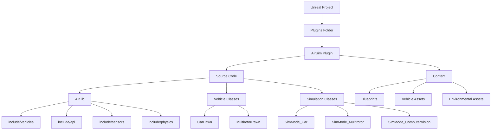

Sources: [docs/code_structure.md:1-54]()

### Using the Blocks Environment

The easiest way to get started is with the provided Blocks environment:

1. Navigate to `AirSim/Unreal/Environments/Blocks`
2. For Windows:
   - Open the .sln file
   - Set "Blocks" as the StartUp project
   - Set the build configuration to "Development Editor" and "x64"
   - Build and run

3. For Linux:
   - Launch Unreal Editor: `./UnrealEngine/Engine/Binaries/Linux/UE4Editor`
   - Browse to Blocks.uproject: `AirSim/Unreal/Environments/Blocks/Blocks.uproject`
   - After Unreal Editor loads, press Play

4. For macOS:
   - Open the generated Blocks.xcworkspace
   - Press Build and run in XCode
   - After Unreal Editor loads, press Play

### Creating a Custom Environment

To use AirSim with your own Unreal environment:

1. Create or obtain an Unreal project
2. Copy `AirSim/Unreal/Plugins` folder to your project's root folder
3. Edit your project's .uproject file to include AirSim:
   ```json
   {
     "FileVersion": 3,
     "EngineAssociation": "4.27",
     "Modules": [
       {
         "Name": "YourProjectName",
         "Type": "Runtime",
         "LoadingPhase": "Default",
         "AdditionalDependencies": [
           "AirSim"
         ]
       }
     ],
     "Plugins": [
       {
         "Name": "AirSim",
         "Enabled": true
       }
     ]
   }
   ```
4. In Unreal Editor, go to `Window/World Settings` and set `GameMode Override` to `AirSimGameMode`
5. Go to 'Edit->Editor Preferences', search for 'CPU' and ensure that 'Use Less CPU when in Background' is unchecked

Sources: [docs/unreal_custenv.md:1-145](), [Unreal/Environments/Blocks/Blocks.uproject:1-30]()

## Configuring AirSim

AirSim can be configured through the `settings.json` file located in:
- Windows: `Documents\AirSim`
- Linux/macOS: `~/Documents/AirSim`

Basic configuration to set vehicle type:
```json
{
  "SettingsVersion": 1.2,
  "SimMode": "Multirotor"  // or "Car" or "ComputerVision"
}
```

For detailed configuration options, see [Settings](#2).

Sources: [README.md:67-81]()

## Remote Control Setup (Optional)

For manual control of a multirotor:
- You can use a remote control (RC) such as an Xbox controller
- Alternatively, use APIs for programmatic control
- In Computer Vision mode, you can move around using keyboard controls

See [Remote Control](#1.3) for more details.

Sources: [README.md:49-53](), [docs/build_windows.md:29-34](), [docs/build_linux.md:67-72](), [docs/build_macos.md:60-65]()

## Troubleshooting Common Issues

### Windows
- Ensure you're using Visual Studio 2022
- Make sure you have all required Visual Studio components installed
- AirSim requires Unreal Engine 4.27; other versions may cause compatibility issues

### Linux
- If encountering issues building Unreal Engine, check Epic Games documentation
- Run `sudo apt-get update` and ensure you have all required development libraries
- Permission issues might require using `sudo` for certain operations

### macOS
- Make sure you have the correct version of LLVM/Clang and CMake installed
- XCode and command-line tools may be required for some operations

### General Issues
- If using a lower-end GPU, run in lower resolution mode as described in the precompiled binaries section
- If experiencing crashes or performance issues, check the settings.json configuration
- Make sure all prerequisites are installed correctly before building

Sources: [.gitignore:1-406](), [build.cmd:56-62](), [build.sh:76-79]()

## Next Steps

After successful installation, you can:
1. Learn about [API usage](#3) for programmatic control
2. Configure [settings.json](#2) for customized simulation
3. Create a [custom environment](#1.2) for your specific needs
4. Set up [remote control](#1.3) for manual flight

---

# Page: Core Architecture

# Core Architecture

<details>
<summary>Relevant source files</summary>

The following files were used as context for generating this wiki page:

- [AirLib/AirLib.vcxproj](AirLib/AirLib.vcxproj)
- [AirLib/AirLib.vcxproj.filters](AirLib/AirLib.vcxproj.filters)
- [AirLib/include/api/RpcLibClientBase.hpp](AirLib/include/api/RpcLibClientBase.hpp)
- [AirLib/include/api/VehicleSimApiBase.hpp](AirLib/include/api/VehicleSimApiBase.hpp)
- [AirLib/include/api/WorldSimApiBase.hpp](AirLib/include/api/WorldSimApiBase.hpp)
- [AirLib/include/common/AirSimSettings.hpp](AirLib/include/common/AirSimSettings.hpp)
- [AirLib/src/api/RpcLibClientBase.cpp](AirLib/src/api/RpcLibClientBase.cpp)
- [AirLib/src/api/RpcLibServerBase.cpp](AirLib/src/api/RpcLibServerBase.cpp)
- [AirLibUnitTests/AirLibUnitTests.vcxproj](AirLibUnitTests/AirLibUnitTests.vcxproj)
- [DroneServer/DroneServer.vcxproj](DroneServer/DroneServer.vcxproj)
- [DroneShell/DroneShell.vcxproj](DroneShell/DroneShell.vcxproj)
- [Examples/Examples.vcxproj](Examples/Examples.vcxproj)
- [HelloCar/HelloCar.vcxproj](HelloCar/HelloCar.vcxproj)
- [HelloDrone/HelloDrone.vcxproj](HelloDrone/HelloDrone.vcxproj)
- [MavLinkCom/MavLinkCom.vcxproj](MavLinkCom/MavLinkCom.vcxproj)
- [MavLinkCom/MavLinkTest/MavLinkTest.vcxproj](MavLinkCom/MavLinkTest/MavLinkTest.vcxproj)
- [PythonClient/airsim/client.py](PythonClient/airsim/client.py)
- [SGM/src/sgmstereo/sgmstereo.vcxproj](SGM/src/sgmstereo/sgmstereo.vcxproj)
- [SGM/src/stereoPipeline/stereoPipeline.vcxproj](SGM/src/stereoPipeline/stereoPipeline.vcxproj)
- [Unity/AirLibWrapper/AirsimWrapper/Source/PawnSimApi.cpp](Unity/AirLibWrapper/AirsimWrapper/Source/PawnSimApi.cpp)
- [Unity/AirLibWrapper/AirsimWrapper/Source/PawnSimApi.h](Unity/AirLibWrapper/AirsimWrapper/Source/PawnSimApi.h)
- [Unity/AirLibWrapper/AirsimWrapper/Source/WorldSimApi.cpp](Unity/AirLibWrapper/AirsimWrapper/Source/WorldSimApi.cpp)
- [Unity/AirLibWrapper/AirsimWrapper/Source/WorldSimApi.h](Unity/AirLibWrapper/AirsimWrapper/Source/WorldSimApi.h)
- [Unreal/Plugins/AirSim/Content/Blueprints/BP_CameraDirector.uasset](Unreal/Plugins/AirSim/Content/Blueprints/BP_CameraDirector.uasset)
- [Unreal/Plugins/AirSim/Content/Blueprints/BP_SimHUDWidget.uasset](Unreal/Plugins/AirSim/Content/Blueprints/BP_SimHUDWidget.uasset)
- [Unreal/Plugins/AirSim/Source/AirBlueprintLib.cpp](Unreal/Plugins/AirSim/Source/AirBlueprintLib.cpp)
- [Unreal/Plugins/AirSim/Source/AirBlueprintLib.h](Unreal/Plugins/AirSim/Source/AirBlueprintLib.h)
- [Unreal/Plugins/AirSim/Source/CameraDirector.cpp](Unreal/Plugins/AirSim/Source/CameraDirector.cpp)
- [Unreal/Plugins/AirSim/Source/CameraDirector.h](Unreal/Plugins/AirSim/Source/CameraDirector.h)
- [Unreal/Plugins/AirSim/Source/PIPCamera.cpp](Unreal/Plugins/AirSim/Source/PIPCamera.cpp)
- [Unreal/Plugins/AirSim/Source/PIPCamera.h](Unreal/Plugins/AirSim/Source/PIPCamera.h)
- [Unreal/Plugins/AirSim/Source/PawnSimApi.cpp](Unreal/Plugins/AirSim/Source/PawnSimApi.cpp)
- [Unreal/Plugins/AirSim/Source/PawnSimApi.h](Unreal/Plugins/AirSim/Source/PawnSimApi.h)
- [Unreal/Plugins/AirSim/Source/SimHUD/SimHUD.cpp](Unreal/Plugins/AirSim/Source/SimHUD/SimHUD.cpp)
- [Unreal/Plugins/AirSim/Source/SimHUD/SimHUD.h](Unreal/Plugins/AirSim/Source/SimHUD/SimHUD.h)
- [Unreal/Plugins/AirSim/Source/SimHUD/SimHUDWidget.h](Unreal/Plugins/AirSim/Source/SimHUD/SimHUDWidget.h)
- [Unreal/Plugins/AirSim/Source/SimMode/SimModeBase.cpp](Unreal/Plugins/AirSim/Source/SimMode/SimModeBase.cpp)
- [Unreal/Plugins/AirSim/Source/SimMode/SimModeBase.h](Unreal/Plugins/AirSim/Source/SimMode/SimModeBase.h)
- [Unreal/Plugins/AirSim/Source/WorldSimApi.cpp](Unreal/Plugins/AirSim/Source/WorldSimApi.cpp)
- [Unreal/Plugins/AirSim/Source/WorldSimApi.h](Unreal/Plugins/AirSim/Source/WorldSimApi.h)

</details>


## Purpose and Scope

This document describes the core architectural components of AirSim, their interactions, and the primary communication model used in the system. It covers the simulation engine, API interfaces, client-server communication, and key classes that form the foundation of the AirSim platform. 

For information about vehicle configuration, see [Vehicle Configuration](#2.1). For details on sensor setup, see [Sensor Configuration](#2.2). For examples of using the Python client API, see [Python Client API](#3).

## High-Level Architecture Overview

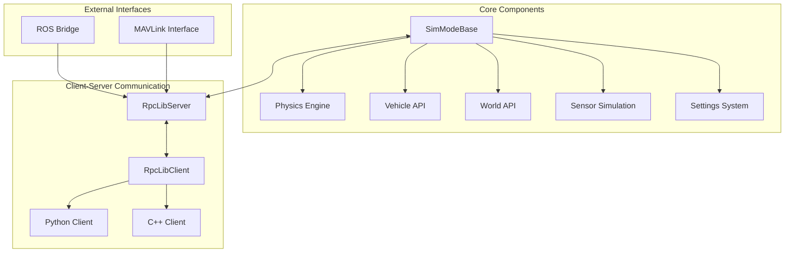

AirSim consists of several interconnected systems:

1. **SimModeBase**: The central controller that manages the simulation environment
2. **API Server**: Exposes simulation functionality to external clients through RPC
3. **Vehicle APIs**: Interfaces for controlling vehicles (cars, multirotors)
4. **World API**: Interface for interacting with the simulation world (objects, environment)
5. **Sensor Simulation**: Systems for cameras, LiDAR, IMU, and other sensors
6. **Settings System**: Configuration management through settings.json

Sources: [Unreal/Plugins/AirSim/Source/SimMode/SimModeBase.h](), [AirLib/include/api/WorldSimApiBase.hpp](), [AirLib/include/api/RpcLibServerBase.hpp]()

## Client-Server Architecture

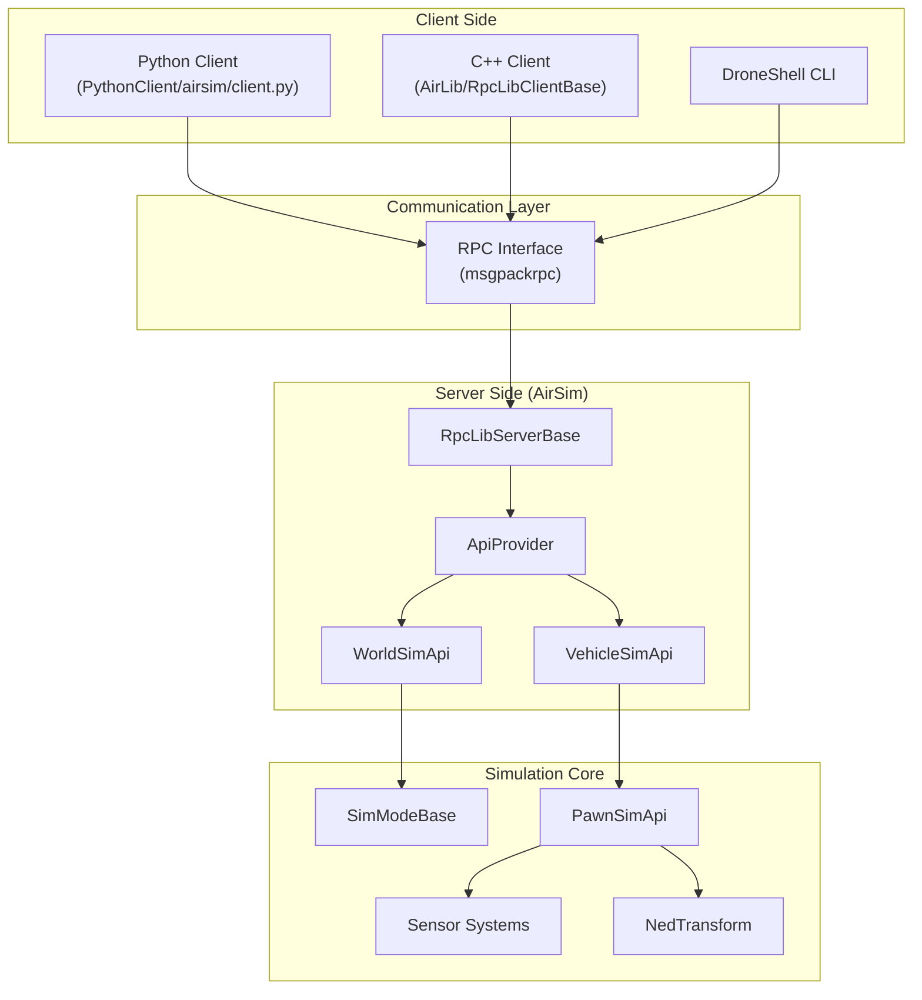

The client-server architecture allows multiple clients to connect to the simulation:

1. **Clients** (Python, C++, DroneShell) communicate with AirSim via RPC calls
2. **RpcLibServerBase** handles incoming requests and routes them to the appropriate APIs
3. **ApiProvider** manages access to vehicle and world simulation APIs
4. **Simulation Core** implements the actual simulation logic

Sources: [PythonClient/airsim/client.py](), [AirLib/src/api/RpcLibClientBase.cpp](), [AirLib/src/api/RpcLibServerBase.cpp]()

## Core Components in Detail

### SimModeBase

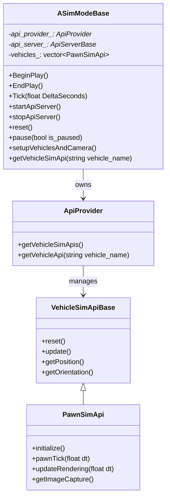

The `ASimModeBase` class (defined in [Unreal/Plugins/AirSim/Source/SimMode/SimModeBase.h]()) is the central controller of the simulation. Key methods include:

- `BeginPlay()`: Initializes the simulation, including physics, vehicles, and API server
- `startApiServer()`: Creates and starts the RPC server for client connections
- `setupVehiclesAndCamera()`: Creates vehicle pawns and cameras based on settings
- `getVehicleSimApi()`: Provides access to specific vehicle APIs

SimModeBase also manages the global NED (North-East-Down) transform, which converts between simulation and real-world coordinates.

Sources: [Unreal/Plugins/AirSim/Source/SimMode/SimModeBase.cpp](), [Unreal/Plugins/AirSim/Source/SimMode/SimModeBase.h]()

### RPC Server and Client

AirSim uses the RpcLib library for client-server communication:

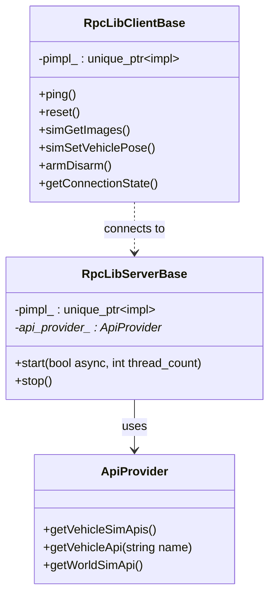

The API server (`RpcLibServerBase` in [AirLib/src/api/RpcLibServerBase.cpp]()) exposes simulation functionality through RPC calls. Each client connects to this server to interact with the simulation.

The client side (`RpcLibClientBase` in [AirLib/src/api/RpcLibClientBase.cpp]() or `client.py` in [PythonClient/airsim/client.py]()) provides methods that map to server functions, making it easy to control the simulation programmatically.

Sources: [AirLib/src/api/RpcLibServerBase.cpp](), [AirLib/src/api/RpcLibClientBase.cpp](), [PythonClient/airsim/client.py]()

### World and Vehicle APIs

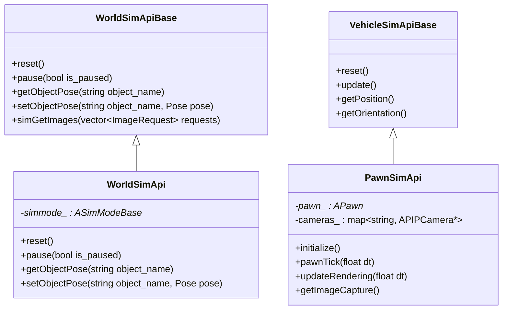

AirSim has two main API interfaces:

1. **WorldSimApi** ([Unreal/Plugins/AirSim/Source/WorldSimApi.cpp]()): Interacts with the simulation world, managing objects, environment, and physics
2. **PawnSimApi** ([Unreal/Plugins/AirSim/Source/PawnSimApi.cpp]()): Controls vehicles, handling position, orientation, sensors, and camera views

These APIs are exposed through the RPC server, allowing clients to interact with both the world and vehicles.

Sources: [Unreal/Plugins/AirSim/Source/WorldSimApi.h](), [Unreal/Plugins/AirSim/Source/PawnSimApi.h](), [AirLib/include/api/WorldSimApiBase.hpp]()

### Settings System

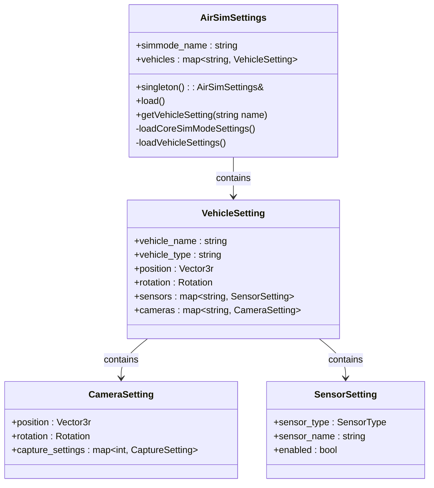

The `AirSimSettings` class ([AirLib/include/common/AirSimSettings.hpp]()) manages configuration from the settings.json file. It stores:

- Global simulation settings (physics engine, time of day)
- Vehicle settings (type, position, sensors)
- Camera settings (position, resolution, field of view)
- Recording settings

The settings are loaded at startup and accessed throughout the application using the singleton pattern.

Sources: [AirLib/include/common/AirSimSettings.hpp]()

### Camera System

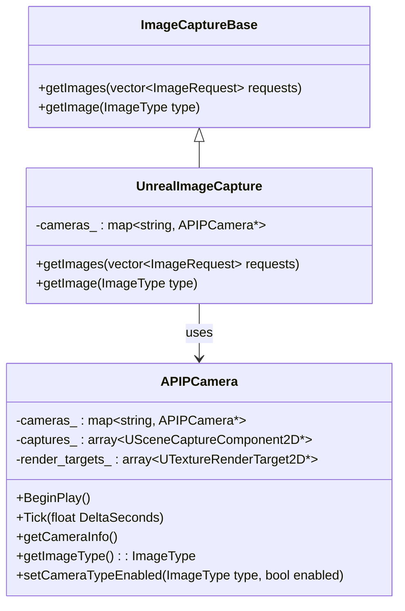

The camera system is based on the `APIPCamera` class ([Unreal/Plugins/AirSim/Source/PIPCamera.cpp]()), which supports multiple camera types:

- RGB (Scene)
- Depth
- Segmentation
- Surface Normals
- Infrared
- Optical Flow

Each camera can be independently enabled/disabled and configured with different resolutions, field of view, and post-processing settings.

Sources: [Unreal/Plugins/AirSim/Source/PIPCamera.h](), [Unreal/Plugins/AirSim/Source/PIPCamera.cpp]()

## Initialization Flow

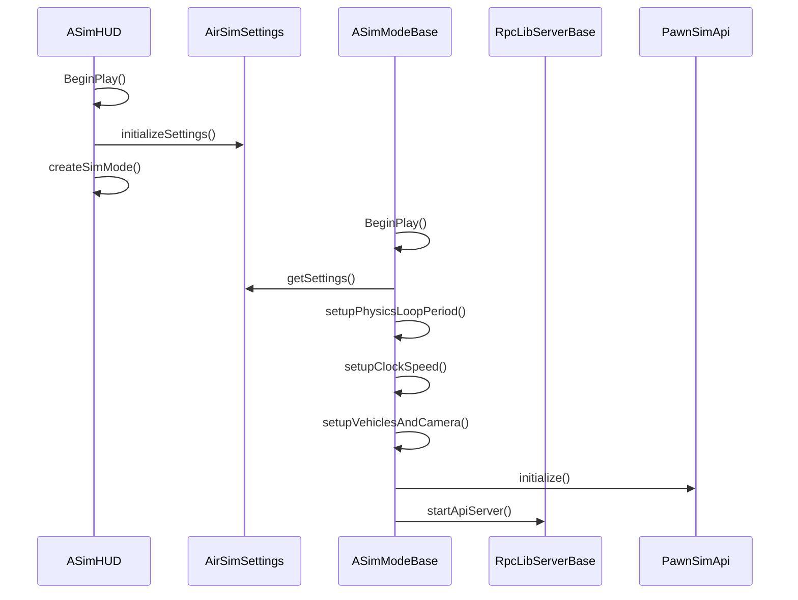

When AirSim starts, the initialization sequence is:

1. `ASimHUD` begins play and initializes settings from settings.json
2. It creates an appropriate SimMode based on the configuration
3. SimMode sets up physics, timing, vehicles, and cameras
4. Each vehicle's `PawnSimApi` is initialized
5. The API server is started to accept client connections

Sources: [Unreal/Plugins/AirSim/Source/SimHUD/SimHUD.cpp](), [Unreal/Plugins/AirSim/Source/SimMode/SimModeBase.cpp]()

## Client-Side API Usage

The most common way to interact with AirSim is through the Python client API. Here's how the communication flow works:

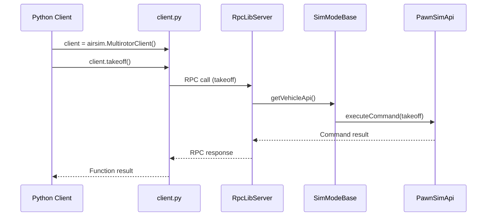

The Python client wraps RPC calls to the server, which then routes commands to the appropriate vehicle or world API.

Sources: [PythonClient/airsim/client.py](), [AirLib/src/api/RpcLibClientBase.cpp](), [AirLib/src/api/RpcLibServerBase.cpp]()

## Coordinate Systems and Transforms

AirSim uses multiple coordinate systems and transforms between them:

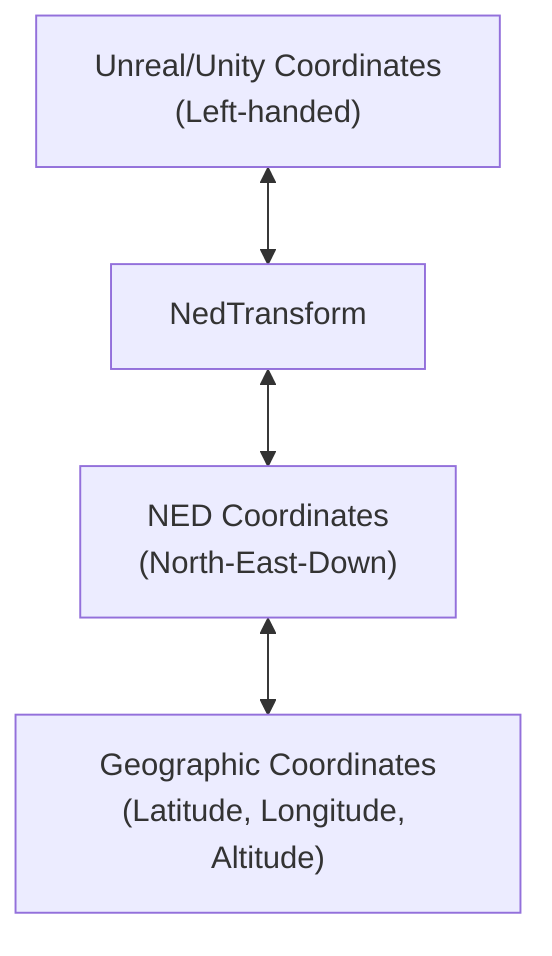

The `NedTransform` class handles conversions between:
- Engine coordinates (Unreal/Unity, left-handed)
- NED coordinates (North-East-Down, used in aviation)
- Geographic coordinates (latitude, longitude, altitude)

This allows for seamless integration with real-world navigation and control systems.

Sources: [Unreal/Plugins/AirSim/Source/NedTransform.h](), [Unreal/Plugins/AirSim/Source/PawnSimApi.cpp]()

## Sensor Architecture

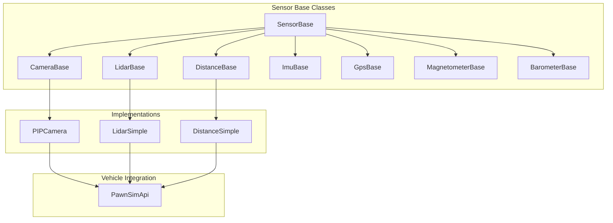

AirSim provides a flexible sensor architecture with base classes for different sensor types and specific implementations. Each sensor can be configured through settings.json and accessed through the vehicle API.

Sources: [Unreal/Plugins/AirSim/Source/PIPCamera.h](), [AirLib/include/sensors/lidar/LidarSimple.hpp]()

## Conclusion

AirSim's core architecture is designed around a client-server model with clear separation between the simulation core and client interfaces. The modular design allows for:

1. Supporting multiple vehicle types through a common API
2. Adding new sensors and capabilities without changing client code
3. Cross-platform support (Unreal, Unity) through abstraction layers
4. Integration with external systems like ROS and MAVLink

This design makes AirSim a powerful and flexible platform for autonomous vehicle research and development.

Sources: [SimModeBase.cpp](), [WorldSimApi.cpp](), [PawnSimApi.cpp](), [RpcLibClientBase.cpp](), [RpcLibServerBase.cpp]()

---

# Page: Usage Examples

# Usage Examples

<details>
<summary>Relevant source files</summary>

The following files were used as context for generating this wiki page:

- [AirLib/include/api/VehicleApiBase.hpp](AirLib/include/api/VehicleApiBase.hpp)
- [Examples/Examples.vcxproj.filters](Examples/Examples.vcxproj.filters)
- [Examples/main.cpp](Examples/main.cpp)
- [HelloCar/main.cpp](HelloCar/main.cpp)
- [HelloDrone/main.cpp](HelloDrone/main.cpp)
- [HelloSpawnedDrones/HelloSpawnedDrones.cpp](HelloSpawnedDrones/HelloSpawnedDrones.cpp)
- [HelloSpawnedDrones/HelloSpawnedDrones.vcxproj](HelloSpawnedDrones/HelloSpawnedDrones.vcxproj)
- [HelloSpawnedDrones/HelloSpawnedDrones.vcxproj.filters](HelloSpawnedDrones/HelloSpawnedDrones.vcxproj.filters)
- [PythonClient/PythonClient.pyproj](PythonClient/PythonClient.pyproj)
- [docs/apis_cpp.md](docs/apis_cpp.md)

</details>


This page provides practical examples of how to use AirSim's API for controlling vehicles and collecting simulation data. You'll find guidance on using both C++ and Python interfaces for common tasks such as vehicle control, sensor data retrieval, and computer vision applications. For information about the core architecture, see [Core Architecture](#1.2), and for detailed API documentation, see [Python Client API](#3) or [C++ API and Examples](#4).

## Example Organization

AirSim provides examples in multiple programming languages and for different vehicle types:

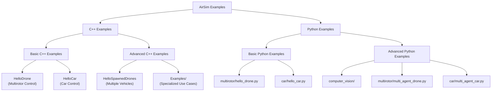

Sources: [PythonClient/PythonClient.pyproj:27-97](), [HelloDrone/main.cpp](), [HelloCar/main.cpp](), [HelloSpawnedDrones/HelloSpawnedDrones.cpp]()

## Basic Vehicle Control

### Hello Drone (C++)

The HelloDrone example demonstrates basic control of a multirotor drone using C++:

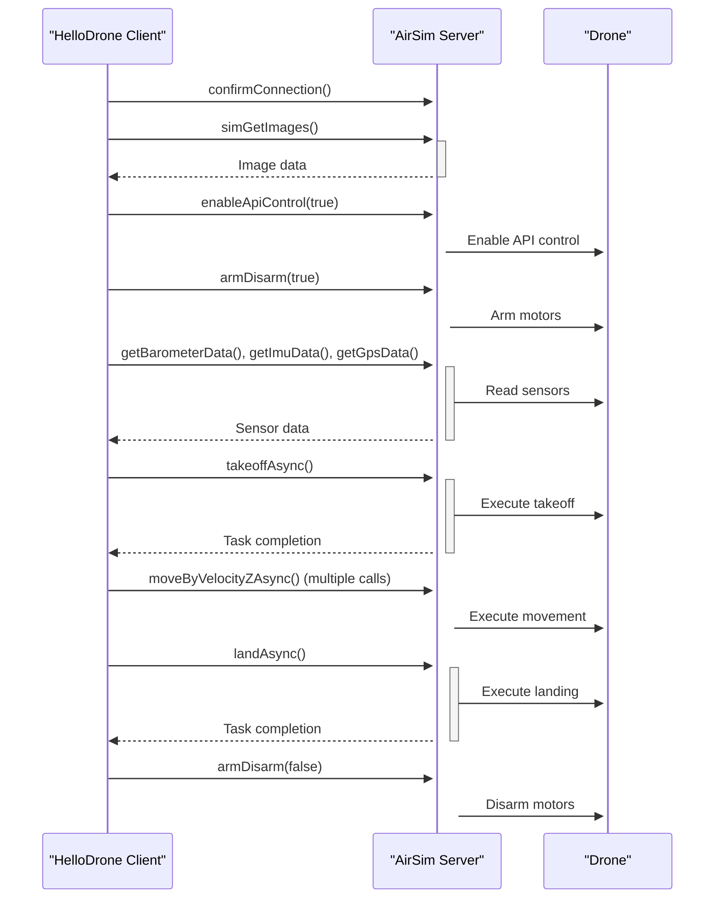

Key operations demonstrated:
- Connecting to the AirSim server and confirming connection
- Getting camera images from the drone
- Reading sensor data (barometer, IMU, GPS, magnetometer)
- Taking off, flying in a square pattern, and landing
- Arming and disarming the vehicle

Sources: [HelloDrone/main.cpp:21-139]()

### Hello Car (C++)

The HelloCar example demonstrates basic control of a car:

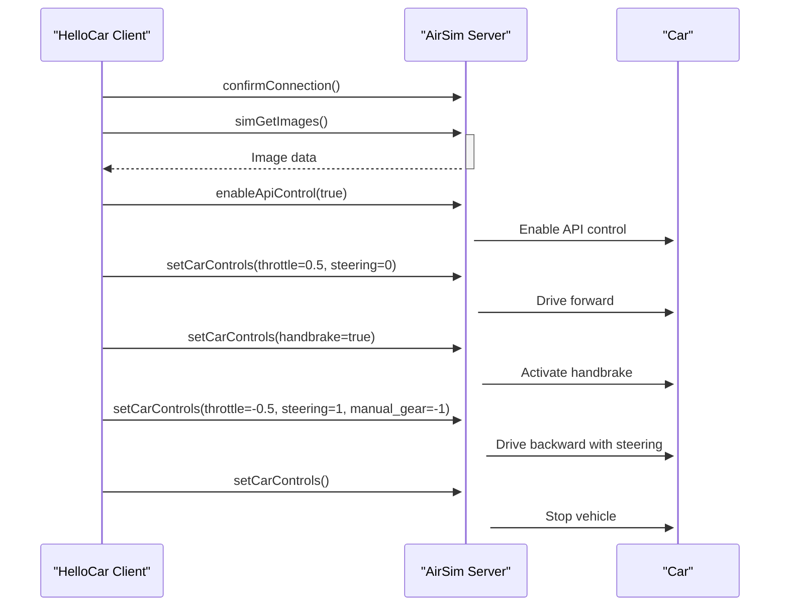

Key operations demonstrated:
- Connecting to the AirSim server
- Capturing camera images 
- Setting car controls (throttle, steering, handbrake)
- Switching to manual gear for reverse driving

Sources: [HelloCar/main.cpp:25-89]()

### Python Examples

AirSim provides equivalent Python examples for both vehicles:

- **hello_drone.py**: Demonstrates drone control with the Python API
- **hello_car.py**: Demonstrates car control with the Python API

The Python API follows similar patterns to the C++ examples with a more concise syntax. These examples are located in `PythonClient/multirotor/` and `PythonClient/car/` directories.

Sources: [PythonClient/PythonClient.pyproj:89-96]()

## Advanced Usage Examples

### Multi-Vehicle Control

The HelloSpawnedDrones example demonstrates how to spawn and control multiple drones programmatically:

```mermaid
graph TD
    subgraph "HelloSpawnedDrones Application"
        A["main()"]
        B["runSingleClient() Thread 1<br>vehicle_name=UAV_0"]
        C["runSingleClient() Thread 2<br>vehicle_name=UAV_1"]
        D["runSingleClient() Thread N<br>vehicle_name=UAV_N"]
        
        A --> B
        A --> C
        A --> D
    end
    
    subgraph "Client API Calls"
        E["1. confirmConnection()"]
        F["2. simAddVehicle()"]
        G["3. enableApiControl()"]
        H["4. armDisarm(true)"]
        I["5. takeoffAsync()"]
        J["6. moveByVelocityZAsync()"]
        K["7. landAsync()"]
        L["8. armDisarm(false)"]
    end
    
    B --> E
    B --> F
    B --> G
    B --> H
    B --> I
    B --> J
    B --> K
    B --> L
    
    C --> E
    C --> F
    C --> G
    C --> H
    C --> I
    C --> J
    C --> K
    C --> L
```

Key features demonstrated:
- Creating multiple vehicles dynamically using `simAddVehicle()`
- Controlling each vehicle in a separate thread
- Coordinating vehicles to fly at different altitudes 
- Vehicle-specific API calls using the vehicle name parameter

Sources: [HelloSpawnedDrones/HelloSpawnedDrones.cpp:18-119](), [HelloSpawnedDrones/HelloSpawnedDrones.cpp:121-164]()

### Computer Vision Examples

AirSim includes several examples for computer vision applications:

- **cv_mode.py**: Demonstrates using AirSim in Computer Vision mode
- **cv_capture.py**: Shows how to capture images from different camera types
- **segmentation.py**: Demonstrates semantic segmentation with AirSim
- **ground_truth.py**: Shows how to extract ground truth data

These examples demonstrate capturing various image types:
- RGB images (`ImageType.Scene`)
- Depth maps (`ImageType.DepthPlanar`)
- Segmentation maps (`ImageType.Segmentation`)
- Surface normals (`ImageType.SurfaceNormals`)

Sources: [PythonClient/PythonClient.pyproj:44-53]()

## API Interaction Patterns

Most AirSim examples follow similar patterns for interacting with the API:

```mermaid
graph TD
    A["1. Initialize Client<br>(Multirotor or Car)"] --> B["2. confirmConnection()"]
    B --> C{"Vehicle Type?"}
    
    C -->|"Multirotor"| D["3. enableApiControl()"]
    C -->|"Car"| E["3. enableApiControl()"]
    
    D --> F["4. armDisarm(true)"]
    F --> G["5. takeoffAsync()"]
    G --> H["6. Movement Commands<br>moveByVelocityAsync()<br>moveToPositionAsync()<br>moveOnPathAsync()"]
    H --> I["7. landAsync()"]
    I --> J["8. armDisarm(false)"]
    
    E --> K["4. Car Control Commands<br>setCarControls()"]
    
    subgraph "Sensor Data Access (Any Time)"
        L["getImuData()"]
        M["getBarometerData()"]
        N["getGpsData()"]
        O["getLidarData()"]
        P["simGetImages()"]
    end
```

Sources: [HelloDrone/main.cpp:21-139](), [HelloCar/main.cpp:25-89](), [AirLib/include/api/VehicleApiBase.hpp:36-224]()

## Specialized Examples

### Stand-Alone Sensors

The Examples folder contains specialized examples for:

- **StandAloneSensors**: Demonstrates how to generate IMU, barometer, and magnetometer data independently of vehicle simulation
- **StandAlonePhysics**: Shows how to use AirSim's physics engine independently
- **DataCollection**: Contains tools for generating data for machine learning, including stereo image pairs

Sources: [Examples/main.cpp:15-52](), [Examples/main.cpp:54-61](), [Examples/main.cpp:63-83]()

### Depth Navigation

AirSim includes examples for depth-based navigation:

- **DepthNavThreshold**: Simple depth-based obstacle avoidance
- **DepthNavCost**: More sophisticated cost-based navigation using depth information

These examples demonstrate how to use depth information from cameras to navigate through environments autonomously.

Sources: [Examples/main.cpp:93-123](), [Examples/main.cpp:125-167]()

## Example-to-Architecture Mapping

This diagram shows how the examples map to AirSim's architecture:

```mermaid
graph TD
    subgraph "Client Applications"
        A["C++ Examples<br>HelloDrone<br>HelloCar<br>HelloSpawnedDrones"]
        B["Python Examples<br>hello_drone.py<br>hello_car.py<br>CV Examples"]
    end
    
    subgraph "Client API Layer"
        C["MultirotorRpcLibClient"]
        D["CarRpcLibClient"]
        E["Python airsim Package"]
    end
    
    subgraph "Communication Layer"
        F["RPC Protocol"]
    end
    
    subgraph "Server API Layer"
        G["MultirotorApiBase"]
        H["CarApiBase"]
        I["VehicleApiBase"]
    end
    
    subgraph "Simulation Core"
        J["Vehicle Physics"]
        K["Sensor Simulation"]
        L["World Simulation"]
    end
    
    A --> C
    A --> D
    B --> E
    C --> F
    D --> F
    E --> F
    F --> G
    F --> H
    I --> G
    I --> H
    G --> J
    G --> K
    H --> J
    H --> K
    J --> L
    K --> L
```

Sources: [AirLib/include/api/VehicleApiBase.hpp:29-35](), [HelloDrone/main.cpp:12-22](), [HelloCar/main.cpp:12-25]()

## Getting Started with Examples

To run the examples:

1. **C++ Examples**:
   - Build the AirSim solution in Visual Studio 
   - Run the desired example executable (HelloDrone, HelloCar, etc.)

2. **Python Examples**:
   - Install the AirSim package: `pip install airsim`
   - Navigate to the PythonClient directory
   - Run the desired example: `python multirotor/hello_drone.py`

3. **Common Requirements**:
   - Make sure the UE4 editor or packaged game with AirSim is running
   - For car examples, ensure settings.json has `"SimMode": "Car"`
   - For drone examples, ensure settings.json has `"SimMode": "Multirotor"`

For more detailed API documentation, see the [Python API](#3) or [C++ API](#4) pages.

---

# Page: Configuration System

# Configuration System

<details>
<summary>Relevant source files</summary>

The following files were used as context for generating this wiki page:

- [AirLib/include/common/AirSimSettings.hpp](AirLib/include/common/AirSimSettings.hpp)
- [Unreal/Plugins/AirSim/Content/Blueprints/BP_CameraDirector.uasset](Unreal/Plugins/AirSim/Content/Blueprints/BP_CameraDirector.uasset)
- [Unreal/Plugins/AirSim/Content/Blueprints/BP_SimHUDWidget.uasset](Unreal/Plugins/AirSim/Content/Blueprints/BP_SimHUDWidget.uasset)
- [Unreal/Plugins/AirSim/Source/AirBlueprintLib.cpp](Unreal/Plugins/AirSim/Source/AirBlueprintLib.cpp)
- [Unreal/Plugins/AirSim/Source/AirBlueprintLib.h](Unreal/Plugins/AirSim/Source/AirBlueprintLib.h)
- [Unreal/Plugins/AirSim/Source/CameraDirector.cpp](Unreal/Plugins/AirSim/Source/CameraDirector.cpp)
- [Unreal/Plugins/AirSim/Source/CameraDirector.h](Unreal/Plugins/AirSim/Source/CameraDirector.h)
- [Unreal/Plugins/AirSim/Source/PIPCamera.cpp](Unreal/Plugins/AirSim/Source/PIPCamera.cpp)
- [Unreal/Plugins/AirSim/Source/PIPCamera.h](Unreal/Plugins/AirSim/Source/PIPCamera.h)
- [Unreal/Plugins/AirSim/Source/SimHUD/SimHUD.cpp](Unreal/Plugins/AirSim/Source/SimHUD/SimHUD.cpp)
- [Unreal/Plugins/AirSim/Source/SimHUD/SimHUD.h](Unreal/Plugins/AirSim/Source/SimHUD/SimHUD.h)
- [Unreal/Plugins/AirSim/Source/SimHUD/SimHUDWidget.h](Unreal/Plugins/AirSim/Source/SimHUD/SimHUDWidget.h)
- [Unreal/Plugins/AirSim/Source/SimMode/SimModeBase.cpp](Unreal/Plugins/AirSim/Source/SimMode/SimModeBase.cpp)
- [Unreal/Plugins/AirSim/Source/SimMode/SimModeBase.h](Unreal/Plugins/AirSim/Source/SimMode/SimModeBase.h)
- [docs/apis.md](docs/apis.md)
- [docs/custom_drone.md](docs/custom_drone.md)
- [docs/image_apis.md](docs/image_apis.md)
- [docs/px4_build.md](docs/px4_build.md)
- [docs/px4_lockstep.md](docs/px4_lockstep.md)
- [docs/px4_setup.md](docs/px4_setup.md)
- [docs/px4_sitl.md](docs/px4_sitl.md)
- [docs/px4_sitl_wsl2.md](docs/px4_sitl_wsl2.md)
- [docs/remote_control.md](docs/remote_control.md)
- [docs/settings.md](docs/settings.md)

</details>


The AirSim Configuration System provides a centralized way to customize the simulation environment, vehicles, sensors, and other aspects of the AirSim simulator. This document explains how the configuration system works, its architecture, and how to use it effectively to configure AirSim for different scenarios.

## Overview

AirSim uses a configuration system based on JSON files to allow users to customize the simulation environment. The main configuration file is called `settings.json`, and it contains settings for the simulation mode, vehicles, cameras, sensors, and other aspects of the simulation.

The configuration system is designed to be flexible and extensible, allowing users to customize almost every aspect of the simulation. It supports a variety of settings, from basic ones like selecting the vehicle type to advanced ones like configuring sensor parameters.

Sources: [AirLib/include/common/AirSimSettings.hpp:22-237](), [docs/settings.md:1-42]()

## Configuration Sources and Loading Order

AirSim searches for settings in the following order, using the first match found:

```mermaid
flowchart TD
    A["Command Line Path Arg
    (-settings=path/to/settings.json)"] --> B["Settings Found?"]
    B -->|Yes| C["Use These Settings"]
    B -->|No| D["Command Line JSON Arg
    (-settings={'key':'value'})"]
    D --> E["Settings Found?"]
    E -->|Yes| C
    E -->|No| F["Executable Folder
    (settings.json)"]
    F --> G["Settings Found?"]
    G -->|Yes| C
    G -->|No| H["Launch Folder
    (settings.json)"]
    H --> I["Settings Found?"]
    I -->|Yes| C
    I -->|No| J["User Documents
    (Documents/AirSim/settings.json)"]
    J --> K["Settings Found?"]
    K -->|Yes| C
    K -->|No| L["Create Default Settings"]
    L --> C
```

If no settings file is found, AirSim creates a default `settings.json` file in the user's Documents/AirSim folder with minimal settings.

Sources: [Unreal/Plugins/AirSim/Source/SimHUD/SimHUD.cpp:319-334](), [docs/settings.md:3-26]()

## Settings Initialization Process

When AirSim starts, it initializes the configuration system through the following process:

```mermaid
sequenceDiagram
    participant SimHUD as "SimHUD"
    participant AirSimSettings as "AirSimSettings"
    participant Settings as "Settings"
    
    SimHUD->>SimHUD: initializeSettings()
    SimHUD->>SimHUD: getSettingsText()
    SimHUD->>AirSimSettings: initializeSettings(settingsText)
    AirSimSettings->>Settings: loadJSonString(settingsText)
    AirSimSettings->>AirSimSettings: checkSettingsVersion()
    AirSimSettings->>AirSimSettings: loadCoreSimModeSettings()
    AirSimSettings->>AirSimSettings: loadLevelSettings()
    AirSimSettings->>AirSimSettings: loadDefaultCameraSetting()
    AirSimSettings->>AirSimSettings: loadCameraDirectorSetting()
    AirSimSettings->>AirSimSettings: loadSubWindowsSettings()
    AirSimSettings->>AirSimSettings: loadViewModeSettings()
    AirSimSettings->>AirSimSettings: loadSegmentationSetting()
    AirSimSettings->>AirSimSettings: loadPawnPaths()
    AirSimSettings->>AirSimSettings: loadOtherSettings()
    AirSimSettings->>AirSimSettings: loadDefaultSensorSettings()
    AirSimSettings->>AirSimSettings: loadVehicleSettings()
    AirSimSettings->>AirSimSettings: loadExternalCameraSettings()
    AirSimSettings->>AirSimSettings: loadRecordingSetting()
    AirSimSettings->>AirSimSettings: loadClockSettings()
    SimHUD->>AirSimSettings: load(simmode_getter)
```

This process ensures that all settings are properly loaded and validated before the simulation starts.

Sources: [Unreal/Plugins/AirSim/Source/SimHUD/SimHUD.cpp:219-234](), [AirLib/include/common/AirSimSettings.hpp:435-456]()

## Configuration Structure

The AirSim configuration file is a hierarchical JSON document with the following main sections:

```mermaid
classDiagram
    class AirSimSettings {
        +SettingsVersion: float
        +SimMode: string
        +ClockType: string
        +ClockSpeed: float
        +PhysicsEngineName: string
        +OriginGeopoint: HomeGeoPoint
        +TimeOfDay: TimeOfDaySetting
        +Vehicles: Map~string, VehicleSetting~
        +CameraDefaults: CameraSetting
        +Recording: RecordingSetting
        +SegmentationSettings: SegmentationSetting
        +ExternalCameras: Map~string, CameraSetting~
    }
    
    class VehicleSetting {
        +VehicleType: string
        +DefaultVehicleState: string
        +AutoCreate: bool
        +PawnPath: string
        +EnableCollisions: bool
        +EnableCollisionPassthrough: bool
        +RC: RCSettings
        +Cameras: Map~string, CameraSetting~
        +Sensors: Map~string, SensorSetting~
        +X, Y, Z: float
        +Pitch, Roll, Yaw: float
    }
    
    class CameraSetting {
        +X, Y, Z: float
        +Pitch, Roll, Yaw: float
        +CaptureSettings: Map~int, CaptureSetting~
        +NoiseSettings: Map~int, NoiseSetting~
        +Gimbal: GimbalSetting
    }
    
    class SensorSetting {
        +SensorType: int
        +Enabled: bool
        +Settings: Settings
    }
    
    AirSimSettings "1" -- "many" VehicleSetting: contains
    AirSimSettings "1" -- "1" CameraSetting: defaults
    VehicleSetting "1" -- "many" CameraSetting: contains
    VehicleSetting "1" -- "many" SensorSetting: contains
```

Sources: [AirLib/include/common/AirSimSettings.hpp:47-417](), [docs/settings.md:43-153]()

## Accessing Settings in Code

AirSim provides a singleton pattern to access settings throughout the codebase:

```mermaid
flowchart TD
    A["Code Needing Settings"] -->|"AirSimSettings::singleton()"| B["AirSimSettings Instance"]
    B -->|"getSettings()"| C["SimModeBase"]
    C -->|"provides settings to"| D["Vehicle APIs"]
    C -->|"provides settings to"| E["Sensor APIs"]
    C -->|"provides settings to"| F["Recording System"]
    C -->|"provides settings to"| G["World Simulation"]
```

The `AirSimSettings::singleton()` method returns a reference to the global AirSimSettings instance, which can be used to access all configured settings.

Sources: [AirLib/include/common/AirSimSettings.hpp:422-426](), [Unreal/Plugins/AirSim/Source/SimMode/SimModeBase.cpp:434-437]()

## Key Settings Components

The AirSim configuration system includes several key components:

### SimMode

The `SimMode` setting determines which simulation mode to use:

- `"Multirotor"`: Drone simulation
- `"Car"`: Car simulation
- `"ComputerVision"`: Computer vision mode (no physics)
- `""`: Prompt user to select mode

Sources: [AirLib/include/common/AirSimSettings.hpp:42-44](), [docs/settings.md:212-218]()

### Vehicles

The `Vehicles` section contains settings for each vehicle in the simulation. Each vehicle has a name and type, along with numerous configuration options:

```
{
  "Vehicles": {
    "SimpleFlight": {
      "VehicleType": "SimpleFlight",
      "AutoCreate": true,
      "Sensors": {
        "Imu": {
          "SensorType": 2,
          "Enabled": true
        }
      },
      "Cameras": {
        "front_center": {
          "CaptureSettings": [
            {
              "ImageType": 0,
              "Width": 640,
              "Height": 480
            }
          ]
        }
      }
    }
  }
}
```

Sources: [AirLib/include/common/AirSimSettings.hpp:257-289](), [docs/settings.md:366-207]()

### Cameras

Camera settings allow configuration of both attached vehicle cameras and external cameras:

```mermaid
classDiagram
    class CameraSetting {
        +Position: Vector3r
        +Rotation: Rotation
        +CaptureSettings: Map
        +NoiseSettings: Map
        +Gimbal: GimbalSetting
    }
    
    class CaptureSetting {
        +ImageType: int
        +Width: int
        +Height: int
        +FOV_Degrees: float
        +AutoExposureSpeed: float
        +MotionBlurAmount: float
    }
    
    class NoiseSetting {
        +Enabled: bool
        +ImageType: int
        +RandContrib: float
        +RandSpeed: float
        +RandSize: float
        +RandDensity: float
        +HorzWaveContrib: float
    }
    
    CameraSetting "1" -- "many" CaptureSetting: contains
    CameraSetting "1" -- "many" NoiseSetting: contains
```

Sources: [AirLib/include/common/AirSimSettings.hpp:198-218](), [docs/settings.md:312-355]()

### Sensors

AirSim supports various sensors that can be configured through settings:

- IMU
- GPS
- Magnetometer
- Barometer
- Distance Sensor
- Lidar

Each sensor has its own configuration parameters defined in the settings.

Sources: [AirLib/include/common/AirSimSettings.hpp:225-255](), [docs/settings.md:216-218](), [docs/lidar.md]()

## Using Settings to Configure the Simulation

### Basic Configuration

A minimal settings.json file might look like:

```json
{
  "SettingsVersion": 1.2,
  "SimMode": "Multirotor"
}
```

This configures AirSim to use the multirotor simulation mode with default settings.

Sources: [docs/settings.md:29-36]()

### Vehicle Configuration

To configure a vehicle, add a `Vehicles` section:

```json
{
  "SettingsVersion": 1.2,
  "SimMode": "Multirotor",
  "Vehicles": {
    "MyDrone": {
      "VehicleType": "SimpleFlight",
      "X": 0, "Y": 0, "Z": -2,
      "Yaw": 90
    }
  }
}
```

This creates a drone named "MyDrone" using the SimpleFlight flight controller, positioned at coordinates (0, 0, -2) with a 90-degree yaw rotation.

Sources: [docs/settings.md:159-178]()

### Camera Configuration

To configure cameras, add a `Cameras` section within a vehicle:

```json
{
  "Vehicles": {
    "MyDrone": {
      "Cameras": {
        "high_res": {
          "CaptureSettings": [
            {
              "ImageType": 0,
              "Width": 1920,
              "Height": 1080,
              "FOV_Degrees": 90
            }
          ]
        }
      }
    }
  }
}
```

This configures a high-resolution camera for the drone.

Sources: [docs/settings.md:183-196](), [docs/image_apis.md:186-207]()

### Recording Configuration

To configure recording, add a `Recording` section:

```json
{
  "Recording": {
    "RecordOnMove": true,
    "RecordInterval": 0.05,
    "Folder": "D:\\AirSimRecordings",
    "Enabled": true
  }
}
```

This enables recording whenever the vehicle moves, saving data to the specified folder.

Sources: [AirLib/include/common/AirSimSettings.hpp:67-84](), [docs/settings.md:266-286]()

## Configuration Versioning

AirSim configuration files include a `SettingsVersion` field to ensure compatibility with different versions of AirSim:

```mermaid
flowchart TD
    A["Load settings.json"] --> B["Check SettingsVersion"]
    B --> C{"Version >= MinimumVersion?"}
    C -->|Yes| D["Use settings as-is"]
    C -->|No| E{"Default settings?"}
    E -->|Yes| F["Auto-upgrade"]
    E -->|No| G{"Keys need updating?"}
    G -->|Yes| H["Show error message"]
    G -->|No| I["Auto-upgrade"]
    F --> D
    I --> D
    H --> J["Exit or continue with warnings"]
```

The current minimum settings version is 1.2. If an older settings file is used, AirSim will attempt to upgrade it or show an error message.

Sources: [AirLib/include/common/AirSimSettings.hpp:381-382](), [AirLib/include/common/AirSimSettings.hpp:521-567]()

## Settings API

AirSim provides several programmatic ways to work with settings:

1. **Creating Default Settings**:
   ```cpp
   AirSimSettings::createDefaultSettingsFile();
   ```

2. **Loading Settings from JSON**:
   ```cpp
   AirSimSettings::initializeSettings(json_string);
   ```

3. **Adding a Vehicle at Runtime**:
   ```cpp
   AirSimSettings::singleton().addVehicleSetting(vehicle_name, vehicle_type, pose, pawn_path);
   ```

4. **Getting a Vehicle Setting**:
   ```cpp
   const VehicleSetting* setting = AirSimSettings::singleton().getVehicleSetting(vehicle_name);
   ```

Sources: [AirLib/include/common/AirSimSettings.hpp:467-505](), [Unreal/Plugins/AirSim/Source/SimMode/SimModeBase.cpp:651-677]()

## Integration with Other Systems

The configuration system integrates with several other components of AirSim:

```mermaid
flowchart TD
    A["AirSimSettings"] -->|"configures"| B["SimModeBase"]
    A -->|"configures"| C["PIPCamera"]
    A -->|"configures"| D["VehicleSimApiBase"]
    A -->|"configures"| E["ApiServerBase"]
    A -->|"configures"| F["RecordingThread"]
    A -->|"configures"| G["SensorBase"]
    
    B -->|"creates"| H["VehiclePawns"]
    B -->|"creates"| I["ApiProvider"]
    C -->|"provides imaging for"| D
    D -->|"communicates via"| E
    F -->|"uses"| C
    G -->|"attached to"| D
```

This integration ensures that all components are properly configured according to the user's settings.

Sources: [Unreal/Plugins/AirSim/Source/SimMode/SimModeBase.cpp:142-147](), [Unreal/Plugins/AirSim/Source/PIPCamera.cpp:362-417]()

## Common Configuration Scenarios

### Multi-Vehicle Simulation

To configure multiple vehicles:

```json
{
  "Vehicles": {
    "Drone1": {
      "VehicleType": "SimpleFlight",
      "X": 0, "Y": 0, "Z": -2
    },
    "Drone2": {
      "VehicleType": "SimpleFlight",
      "X": 5, "Y": 0, "Z": -2
    }
  }
}
```

Sources: [docs/multi_vehicle.md]()

### PX4 SITL Integration

To configure PX4 Software-in-the-Loop:

```json
{
  "Vehicles": {
    "PX4": {
      "VehicleType": "PX4Multirotor",
      "UseSerial": false,
      "UseTcp": true,
      "TcpPort": 4560,
      "ControlPortLocal": 14540,
      "ControlPortRemote": 14580
    }
  }
}
```

Sources: [docs/px4_sitl.md:54-86](), [docs/px4_setup.md:32-53]()

## Debugging Configuration Issues

When facing configuration issues, check the following:

1. **Settings File Location**: Ensure the settings.json file is in one of the expected locations.
2. **JSON Format**: Validate the JSON syntax using a JSON validator.
3. **Settings Version**: Make sure the SettingsVersion is at least 1.2.
4. **Log Messages**: Check the AirSim log messages for warnings or errors related to settings.

AirSim logs configuration-related warnings to help diagnose issues:

```cpp
for (const auto& warning : AirSimSettings::singleton().warning_messages) {
    UAirBlueprintLib::LogMessageString(warning, "", LogDebugLevel::Failure);
}
```

Sources: [Unreal/Plugins/AirSim/Source/SimHUD/SimHUD.cpp:227-233]()

## Conclusion

The AirSim Configuration System provides a flexible and powerful way to customize the simulation environment. By understanding how the system works and the available configuration options, users can tailor AirSim to their specific needs, whether they're working on drone research, autonomous driving, or computer vision applications.

For detailed information on specific configuration options, refer to the [settings documentation](settings.md).

---

# Page: Vehicle Configuration

# Vehicle Configuration

<details>
<summary>Relevant source files</summary>

The following files were used as context for generating this wiki page:

- [AirLib/include/common/AirSimSettings.hpp](AirLib/include/common/AirSimSettings.hpp)
- [AirLib/include/vehicles/multirotor/firmwares/mavlink/MavLinkMultirotorApi.hpp](AirLib/include/vehicles/multirotor/firmwares/mavlink/MavLinkMultirotorApi.hpp)
- [MavLinkCom/include/MavLinkConnection.hpp](MavLinkCom/include/MavLinkConnection.hpp)
- [MavLinkCom/include/MavLinkLog.hpp](MavLinkCom/include/MavLinkLog.hpp)
- [MavLinkCom/include/MavLinkMessageBase.hpp](MavLinkCom/include/MavLinkMessageBase.hpp)
- [MavLinkCom/src/MavLinkConnection.cpp](MavLinkCom/src/MavLinkConnection.cpp)
- [MavLinkCom/src/MavLinkLog.cpp](MavLinkCom/src/MavLinkLog.cpp)
- [MavLinkCom/src/MavLinkMessageBase.cpp](MavLinkCom/src/MavLinkMessageBase.cpp)
- [MavLinkCom/src/impl/MavLinkConnectionImpl.cpp](MavLinkCom/src/impl/MavLinkConnectionImpl.cpp)
- [MavLinkCom/src/impl/MavLinkConnectionImpl.hpp](MavLinkCom/src/impl/MavLinkConnectionImpl.hpp)
- [MavLinkCom/src/serial_com/wifi.cpp](MavLinkCom/src/serial_com/wifi.cpp)
- [PythonClient/multirotor/path.py](PythonClient/multirotor/path.py)
- [PythonClient/multirotor/state.py](PythonClient/multirotor/state.py)
- [PythonClient/multirotor/takeoff.py](PythonClient/multirotor/takeoff.py)
- [Unreal/Plugins/AirSim/Content/Blueprints/BP_CameraDirector.uasset](Unreal/Plugins/AirSim/Content/Blueprints/BP_CameraDirector.uasset)
- [Unreal/Plugins/AirSim/Content/Blueprints/BP_SimHUDWidget.uasset](Unreal/Plugins/AirSim/Content/Blueprints/BP_SimHUDWidget.uasset)
- [Unreal/Plugins/AirSim/Source/AirBlueprintLib.cpp](Unreal/Plugins/AirSim/Source/AirBlueprintLib.cpp)
- [Unreal/Plugins/AirSim/Source/AirBlueprintLib.h](Unreal/Plugins/AirSim/Source/AirBlueprintLib.h)
- [Unreal/Plugins/AirSim/Source/CameraDirector.cpp](Unreal/Plugins/AirSim/Source/CameraDirector.cpp)
- [Unreal/Plugins/AirSim/Source/CameraDirector.h](Unreal/Plugins/AirSim/Source/CameraDirector.h)
- [Unreal/Plugins/AirSim/Source/PIPCamera.cpp](Unreal/Plugins/AirSim/Source/PIPCamera.cpp)
- [Unreal/Plugins/AirSim/Source/PIPCamera.h](Unreal/Plugins/AirSim/Source/PIPCamera.h)
- [Unreal/Plugins/AirSim/Source/SimHUD/SimHUD.cpp](Unreal/Plugins/AirSim/Source/SimHUD/SimHUD.cpp)
- [Unreal/Plugins/AirSim/Source/SimHUD/SimHUD.h](Unreal/Plugins/AirSim/Source/SimHUD/SimHUD.h)
- [Unreal/Plugins/AirSim/Source/SimHUD/SimHUDWidget.h](Unreal/Plugins/AirSim/Source/SimHUD/SimHUDWidget.h)
- [Unreal/Plugins/AirSim/Source/SimMode/SimModeBase.cpp](Unreal/Plugins/AirSim/Source/SimMode/SimModeBase.cpp)
- [Unreal/Plugins/AirSim/Source/SimMode/SimModeBase.h](Unreal/Plugins/AirSim/Source/SimMode/SimModeBase.h)
- [docs/apis.md](docs/apis.md)
- [docs/custom_drone.md](docs/custom_drone.md)
- [docs/image_apis.md](docs/image_apis.md)
- [docs/px4_build.md](docs/px4_build.md)
- [docs/px4_lockstep.md](docs/px4_lockstep.md)
- [docs/px4_setup.md](docs/px4_setup.md)
- [docs/px4_sitl.md](docs/px4_sitl.md)
- [docs/px4_sitl_wsl2.md](docs/px4_sitl_wsl2.md)
- [docs/remote_control.md](docs/remote_control.md)
- [docs/settings.md](docs/settings.md)

</details>


This page explains how to configure vehicles in AirSim, including multirotors, cars, and other supported vehicle types. Vehicle configuration controls the vehicle type, position, sensors, and other characteristics that determine how the vehicle behaves in simulation.

## Overview of Vehicle Configuration

In AirSim, vehicles are defined in the `settings.json` file under the `"Vehicles"` section. Each vehicle has a name (key in the JSON object) and a collection of settings that determine its type, position, orientation, and capabilities.

```mermaid
graph TD
    subgraph "AirSimSettings"
        A["Settings JSON"] --> B["Vehicles Map"]
        B --> C["VehicleSetting"]
        C --> D1["Common Settings"]
        C --> D2["Type-Specific Settings"]
        C --> D3["Camera Settings"]
        C --> D4["Sensor Settings"]
        
        D1 --> E1["Name, Type"]
        D1 --> E2["Position, Rotation"]
        D1 --> E3["Collision Settings"]
        
        D2 --> F1["SimpleFlight Settings"]
        D2 --> F2["PX4 Settings"]
        D2 --> F3["PhysXCar Settings"]
        
        D3 --> G1["Camera Objects"]
        D3 --> G2["Camera Parameters"]
        
        D4 --> H1["Sensor Objects"]
        D4 --> H2["Sensor Parameters"]
    end
```

Sources: [AirLib/include/common/AirSimSettings.hpp:257-290](), [docs/settings.md:366-368]()

## Supported Vehicle Types

AirSim supports several vehicle types, each with their own specific settings:

| Vehicle Type | Description | Configuration Key | 
|--------------|-------------|-------------------|
| Multirotor (SimpleFlight) | Default multirotor with a simple flight controller | `"SimpleFlight"` |
| Multirotor (PX4) | Multirotor using PX4 flight stack | `"PX4"` |
| Car | Physics-based car simulation | `"PhysXCar"` |
| ArduCopter | Multirotor using ArduPilot | `"ArduCopter"` |
| ArduRover | Ground vehicle using ArduPilot | `"ArduRover"` |
| ComputerVision | No vehicle, just cameras | `"ComputerVision"` |

Vehicle type is specified using the `"VehicleType"` setting within each vehicle's configuration object.

Sources: [AirLib/include/common/AirSimSettings.hpp:31-37](), [docs/settings.md:212-218]()

## Vehicle Creation Process

When AirSim starts, it reads the vehicle configuration from `settings.json` and creates vehicles accordingly:

```mermaid
flowchart TD
    A["Load settings.json"] --> B["Parse Vehicle Settings"]
    B --> C["For each vehicle with AutoCreate=true"]
    C --> D{"Is vehicle type supported?"}
    D -->|Yes| E["Create Vehicle Pawn"]
    D -->|No| F["Skip Vehicle"]
    E --> G["Initialize Vehicle API"]
    G --> H["Setup Cameras and Sensors"]
    H --> I["Register with Physics Engine"]
    I --> J["Make Default Vehicle if needed"]
```

Sources: [Unreal/Plugins/AirSim/Source/SimMode/SimModeBase.cpp:680-746](), [Unreal/Plugins/AirSim/Source/SimMode/SimModeBase.cpp:601-630]()

## Common Vehicle Settings

These settings apply to all vehicle types:

| Setting | Description | Default |
|---------|-------------|---------|
| `VehicleType` | Type of vehicle (e.g., "SimpleFlight", "PhysXCar") | - |
| `DefaultVehicleState` | Initial state ("Armed" for drones) | `""` |
| `AutoCreate` | Whether to automatically create the vehicle at startup | `true` |
| `PawnPath` | Custom Unreal pawn blueprint path | `""` |
| `EnableCollisionPassthrogh` | Allow passing through collisions | `false` |
| `EnableCollisions` | Enable collision detection | `true` |
| `AllowAPIAlways` | Always allow API control | `true` |
| `EnableTrace` | Enable debug tracing | `false` |
| `X`, `Y`, `Z` | Position coordinates (NED frame, meters) | `NaN` (use player start) |
| `Pitch`, `Roll`, `Yaw` | Rotation (degrees) | `NaN` (use player start) |

Sources: [AirLib/include/common/AirSimSettings.hpp:257-290](), [docs/settings.md:160-198]()

## Vehicle Type-Specific Settings

### Multirotor Settings

For multirotors (SimpleFlight, PX4, etc.), additional settings include:

```json
{
  "Vehicles": {
    "MyMultirotor": {
      "VehicleType": "SimpleFlight",
      "RC": {
        "RemoteControlID": 0,
        "AllowAPIWhenDisconnected": false
      }
    }
  }
}
```

### PX4/MavLink-specific Settings

For PX4 or other MavLink-based vehicles:

```json
{
  "Vehicles": {
    "PX4Drone": {
      "VehicleType": "PX4",
      "UseSerial": false,
      "UseTcp": true,
      "TcpPort": 4560,
      "ControlPortLocal": 14540,
      "ControlPortRemote": 14580
    }
  }
}
```

Sources: [AirLib/include/common/AirSimSettings.hpp:292-349](), [AirLib/include/vehicles/multirotor/firmwares/mavlink/MavLinkMultirotorApi.hpp:61-75](), [docs/px4_sitl.md:54-86]()

### Car Settings

For PhysXCar vehicles:

```json
{
  "Vehicles": {
    "MyCar": {
      "VehicleType": "PhysXCar",
      "RC": {
        "RemoteControlID": -1
      }
    }
  }
}
```

Sources: [docs/settings.md:179-199]()

## Camera Configuration

Each vehicle can have multiple cameras, defined in the `"Cameras"` section of the vehicle configuration:

```mermaid
graph TD
    subgraph "Vehicle Camera Configuration"
        A["Vehicle Setting"] --> B["Cameras Map"]
        B --> C1["Front Camera"]
        B --> C2["Back Camera"]
        B --> C3["Custom Cameras..."]
        
        C1 --> D1["Position/Rotation"]
        C1 --> D2["Capture Settings"]
        C1 --> D3["Noise Settings"]
        C1 --> D4["Gimbal Settings"]
        
        D2 --> E1["Resolution"]
        D2 --> E2["FOV"]
        D2 --> E3["Image Types"]
        
        D4 --> F1["Stabilization"]
        D4 --> F2["Rotation Control"]
    end
```

Example camera configuration:

```json
"Cameras": {
  "front_center": {
    "CaptureSettings": [
      {
        "ImageType": 0,
        "Width": 640,
        "Height": 480,
        "FOV_Degrees": 90
      }
    ],
    "X": 0.25, "Y": 0, "Z": 0.1,
    "Pitch": 0, "Roll": 0, "Yaw": 0
  }
}
```

Sources: [Unreal/Plugins/AirSim/Source/PIPCamera.cpp:362-416](), [docs/settings.md:76-129](), [docs/image_apis.md:135-148]()

## Sensor Configuration

AirSim supports various sensors that can be attached to vehicles, including IMU, GPS, barometer, magnetometer, distance sensors, and lidar:

```json
"Sensors": {
  "Imu": {
    "SensorType": 2,
    "Enabled": true
  },
  "Gps": {
    "SensorType": 3,
    "Enabled": true
  },
  "Lidar": {
    "SensorType": 6,
    "Enabled": true,
    "NumberOfChannels": 16,
    "PointsPerSecond": 10000
  }
}
```

These sensors are defined in the vehicle's `"Sensors"` section and can be configured with type-specific parameters.

Sources: [AirLib/include/common/AirSimSettings.hpp:232-256](), [docs/settings.md:70-75]()

## Vehicle Position and Orientation

Vehicle position is specified in the NED (North-East-Down) coordinate system in meters relative to the origin point:

```mermaid
graph TD
    subgraph "Vehicle Coordinate System"
        O["Origin (0,0,0)"] --> X["North (+X)"]
        O --> Y["East (+Y)"]
        O --> Z["Down (+Z)"]
        
        O --> V["Vehicle Position"]
        V --> P["X, Y, Z settings"]
        V --> R["Pitch, Roll, Yaw settings"]
    end
```

When `X`, `Y`, `Z`, `Pitch`, `Roll`, or `Yaw` are set to NaN (the default), the vehicle uses the position and orientation from the Player Start location in the Unreal environment.

Sources: [Unreal/Plugins/AirSim/Source/SimMode/SimModeBase.cpp:607-612](), [docs/settings.md:236-237](), [docs/apis.md:236-238]()

## Example Vehicle Configurations

### SimpleFlight Multirotor

```json
"Vehicles": {
  "MyDrone": {
    "VehicleType": "SimpleFlight",
    "DefaultVehicleState": "Armed",
    "EnableCollisions": true,
    "EnableCollisionPassthrogh": false,
    "Cameras": {
      "front_center": {
        "CaptureSettings": [
          {
            "ImageType": 0,
            "Width": 640,
            "Height": 480
          }
        ]
      }
    },
    "X": 0, "Y": 0, "Z": -2,
    "Pitch": 0, "Roll": 0, "Yaw": 90
  }
}
```

### PX4 Multirotor

```json
"Vehicles": {
  "PX4Drone": {
    "VehicleType": "PX4",
    "UseTcp": true,
    "TcpPort": 4560,
    "ControlPortLocal": 14540,
    "ControlPortRemote": 14580,
    "Cameras": {
      "front_center": {
        "CaptureSettings": [
          {
            "ImageType": 0,
            "Width": 640,
            "Height": 480
          }
        ]
      }
    }
  }
}
```

Sources: [docs/px4_sitl.md:54-86](), [docs/settings.md:160-199]()

### PhysXCar

```json
"Vehicles": {
  "MyCar": {
    "VehicleType": "PhysXCar",
    "X": 0, "Y": 0, "Z": 0,
    "EnableCollisions": true,
    "Cameras": {
      "front_center": {
        "CaptureSettings": [
          {
            "ImageType": 0,
            "Width": 640,
            "Height": 480
          }
        ]
      },
      "fpv": {
        "X": 0.25, "Y": 0, "Z": 0.1,
        "CaptureSettings": [
          {
            "ImageType": 0,
            "Width": 640,
            "Height": 480
          }
        ]
      }
    }
  }
}
```

Sources: [docs/settings.md:179-199](), [docs/image_apis.md:140-143]()

## Creating Vehicles at Runtime

AirSim allows you to create vehicles dynamically at runtime using the API:

```python
client.simCreateVehicle("NewDrone", "SimpleFlight", airsim.Pose(airsim.Vector3r(0, 0, -5)), "")
```

This API is implemented in `SimModeBase::createVehicleAtRuntime()`, which creates a new vehicle with the specified name, type, and position.

Sources: [Unreal/Plugins/AirSim/Source/SimMode/SimModeBase.cpp:652-677]()

## Default Vehicle Settings

If no vehicles are specified in `settings.json`, AirSim creates default vehicles based on the simulation mode:
- In Multirotor mode: A SimpleFlight drone
- In Car mode: A PhysXCar

These defaults ensure that you always have a vehicle to control even without explicit configuration.

Sources: [Unreal/Plugins/AirSim/Source/SimHUD/SimHUD.cpp:219-233](), [Unreal/Plugins/AirSim/Source/SimMode/SimModeBase.cpp:700-716]()

---

# Page: Sensor Configuration

# Sensor Configuration

<details>
<summary>Relevant source files</summary>

The following files were used as context for generating this wiki page:

- [AirLib/include/common/AirSimSettings.hpp](AirLib/include/common/AirSimSettings.hpp)
- [Unreal/Plugins/AirSim/Content/Blueprints/BP_CameraDirector.uasset](Unreal/Plugins/AirSim/Content/Blueprints/BP_CameraDirector.uasset)
- [Unreal/Plugins/AirSim/Content/Blueprints/BP_SimHUDWidget.uasset](Unreal/Plugins/AirSim/Content/Blueprints/BP_SimHUDWidget.uasset)
- [Unreal/Plugins/AirSim/Source/AirBlueprintLib.cpp](Unreal/Plugins/AirSim/Source/AirBlueprintLib.cpp)
- [Unreal/Plugins/AirSim/Source/AirBlueprintLib.h](Unreal/Plugins/AirSim/Source/AirBlueprintLib.h)
- [Unreal/Plugins/AirSim/Source/CameraDirector.cpp](Unreal/Plugins/AirSim/Source/CameraDirector.cpp)
- [Unreal/Plugins/AirSim/Source/CameraDirector.h](Unreal/Plugins/AirSim/Source/CameraDirector.h)
- [Unreal/Plugins/AirSim/Source/PIPCamera.cpp](Unreal/Plugins/AirSim/Source/PIPCamera.cpp)
- [Unreal/Plugins/AirSim/Source/PIPCamera.h](Unreal/Plugins/AirSim/Source/PIPCamera.h)
- [Unreal/Plugins/AirSim/Source/SimHUD/SimHUD.cpp](Unreal/Plugins/AirSim/Source/SimHUD/SimHUD.cpp)
- [Unreal/Plugins/AirSim/Source/SimHUD/SimHUD.h](Unreal/Plugins/AirSim/Source/SimHUD/SimHUD.h)
- [Unreal/Plugins/AirSim/Source/SimHUD/SimHUDWidget.h](Unreal/Plugins/AirSim/Source/SimHUD/SimHUDWidget.h)
- [Unreal/Plugins/AirSim/Source/SimMode/SimModeBase.cpp](Unreal/Plugins/AirSim/Source/SimMode/SimModeBase.cpp)
- [Unreal/Plugins/AirSim/Source/SimMode/SimModeBase.h](Unreal/Plugins/AirSim/Source/SimMode/SimModeBase.h)
- [docs/CHANGELOG.md](docs/CHANGELOG.md)
- [docs/airsim_ros_pkgs.md](docs/airsim_ros_pkgs.md)
- [docs/airsim_tutorial_pkgs.md](docs/airsim_tutorial_pkgs.md)
- [docs/apis.md](docs/apis.md)
- [docs/azure.md](docs/azure.md)
- [docs/custom_drone.md](docs/custom_drone.md)
- [docs/distance_sensor.md](docs/distance_sensor.md)
- [docs/image_apis.md](docs/image_apis.md)
- [docs/lidar.md](docs/lidar.md)
- [docs/px4_build.md](docs/px4_build.md)
- [docs/px4_lockstep.md](docs/px4_lockstep.md)
- [docs/px4_setup.md](docs/px4_setup.md)
- [docs/px4_sitl.md](docs/px4_sitl.md)
- [docs/px4_sitl_wsl2.md](docs/px4_sitl_wsl2.md)
- [docs/remote_control.md](docs/remote_control.md)
- [docs/sensors.md](docs/sensors.md)
- [docs/settings.md](docs/settings.md)
- [tools/install_ros_deps.sh](tools/install_ros_deps.sh)

</details>


This page documents how to configure sensors in AirSim. AirSim supports a variety of sensors that can be configured via the `settings.json` file. We'll cover the available sensor types, how to configure them, and how they integrate with the simulation environment.

For information about how to access sensor data using APIs, see [APIs](apis.md).

## Sensor Types in AirSim

AirSim supports the following types of sensors:

| Sensor Type | Enum Value | Description |
|-------------|------------|-------------|
| Camera | N/A* | Various camera types including Scene, Depth, Segmentation, etc. |
| Barometer | 1 | Measures atmospheric pressure |
| IMU | 2 | Inertial Measurement Unit - measures linear acceleration and angular velocity |
| GPS | 3 | Global Positioning System - provides position in the world |
| Magnetometer | 4 | Measures magnetic field |
| Distance Sensor | 5 | Measures distance to nearest object |
| Lidar | 6 | Light Detection and Ranging - creates point cloud of surroundings |

*Cameras are configured differently than other sensors and do not use an enum value.

Sources: [AirLib/include/common/AirSimSettings.hpp:11-256](AirLib/include/common/AirSimSettings.hpp:11-256), [docs/sensors.md:1-26](docs/sensors.md:1-26)

## Sensor Configuration Hierarchy

In AirSim, sensor settings are organized hierarchically in the `settings.json` file:

```mermaid
graph TD
    A["AirSimSettings"] --> B["Vehicles"]
    A --> C["CameraDefaults"]
    A --> E["ExternalCameras"]
    B --> D["Vehicle 1 (e.g., 'SimpleFlight')"]
    B --> F["Vehicle 2 (e.g., 'PhysXCar')"]
    D --> G["Sensors"]
    D --> H["Cameras"]
    G --> I["Sensor 1 (e.g., 'Imu')"]
    G --> J["Sensor 2 (e.g., 'Lidar1')"]
    I --> K["SensorType (e.g., 2 for IMU)"]
    I --> L["Enabled (true/false)"]
    I --> M["Parameters (sensor-specific)"]
    H --> N["Camera 1 (e.g., 'front_center')"]
    H --> O["Camera 2 (e.g., 'front_right')"]
    C --> P["CaptureSettings"]
    C --> Q["NoiseSettings"]
    C --> R["Gimbal"]
    E --> S["External Camera 1"]
    S --> T["CaptureSettings"]
```

Sources: [AirLib/include/common/AirSimSettings.hpp:225-255](AirLib/include/common/AirSimSettings.hpp:225-255), [AirLib/include/common/AirSimSettings.hpp:257-290](AirLib/include/common/AirSimSettings.hpp:257-290), [docs/settings.md:201-208](docs/settings.md:201-208)

## Default Sensors

If no sensors are specified in the `settings.json` file, AirSim provides default sensors based on the vehicle type:

### Multirotor
- IMU
- Magnetometer
- GPS
- Barometer

### Car
- IMU
- GPS

Sources: [docs/sensors.md:16-26](docs/sensors.md:16-26)

## General Sensor Configuration

All sensors (except cameras) follow a common configuration pattern in the `settings.json` file:

```json
{
  "Vehicles": {
    "VehicleName": {
      "Sensors": {
        "SensorName": {
          "SensorType": <sensor_type_enum>,
          "Enabled": true,
          // Sensor-specific parameters...
        }
      }
    }
  }
}
```

Where:
- `VehicleName` is the name of the vehicle (e.g., "SimpleFlight" for drones, "PhysXCar" for cars)
- `SensorName` is a user-defined name for the sensor
- `SensorType` is the enum value from the table above
- `Enabled` is a boolean flag to enable/disable the sensor
- Additional parameters are specific to each sensor type

Sources: [AirLib/include/common/AirSimSettings.hpp:225-255](AirLib/include/common/AirSimSettings.hpp:225-255)

## Camera Configuration

Cameras have a more complex configuration structure compared to other sensors. They're configured under the "Cameras" section of a vehicle and can also have default settings in the "CameraDefaults" section.

### Camera Types

AirSim supports the following camera types, represented by the `ImageType` enum:

| ImageType Value | Description |
|-----------------|-------------|
| 0 | Scene - regular RGB camera view |
| 1 | DepthPlanar - depth map in planar representation |
| 2 | DepthPerspective - depth map in perspective projection |
| 3 | DepthVis - depth visualization |
| 4 | DisparityNormalized - normalized disparity |
| 5 | Segmentation - semantic segmentation |
| 6 | SurfaceNormals - surface normals |
| 7 | Infrared - infrared camera view |
| 8 | OpticalFlow - optical flow |
| 9 | OpticalFlowVis - optical flow visualization |

Sources: [Unreal/Plugins/AirSim/Source/PIPCamera.cpp:39-48](Unreal/Plugins/AirSim/Source/PIPCamera.cpp:39-48), [docs/image_apis.md:212-220](docs/image_apis.md:212-220)

### Camera Settings Structure

```json
{
  "CameraDefaults": {
    "CaptureSettings": [
      {
        "ImageType": 0,
        "Width": 256,
        "Height": 144,
        "FOV_Degrees": 90,
        "AutoExposureSpeed": 100,
        "AutoExposureBias": 0,
        "AutoExposureMaxBrightness": 0.64,
        "AutoExposureMinBrightness": 0.03,
        "MotionBlurAmount": 0,
        "TargetGamma": 1.0,
        "ProjectionMode": "",
        "OrthoWidth": 5.12
      }
    ],
    "NoiseSettings": [
      {
        "Enabled": false,
        "ImageType": 0,
        "RandContrib": 0.2,
        "RandSpeed": 100000.0,
        "RandSize": 500.0,
        "RandDensity": 2,
        "HorzWaveContrib": 0.03,
        "HorzWaveStrength": 0.08,
        "HorzWaveVertSize": 1.0,
        "HorzWaveScreenSize": 1.0,
        "HorzNoiseLinesContrib": 1.0,
        "HorzNoiseLinesDensityY": 0.01,
        "HorzNoiseLinesDensityXY": 0.5,
        "HorzDistortionContrib": 1.0,
        "HorzDistortionStrength": 0.002
      }
    ],
    "Gimbal": {
      "Stabilization": 0,
      "Pitch": 0, "Roll": 0, "Yaw": 0
    }
  },
  "Vehicles": {
    "VehicleName": {
      "Cameras": {
        "CameraName": {
          // Same structure as CameraDefaults, but specific to this camera
        }
      }
    }
  }
}
```

Sources: [AirLib/include/common/AirSimSettings.hpp:136-160](AirLib/include/common/AirSimSettings.hpp:136-160), [AirLib/include/common/AirSimSettings.hpp:162-186](AirLib/include/common/AirSimSettings.hpp:162-186), [AirLib/include/common/AirSimSettings.hpp:128-135](AirLib/include/common/AirSimSettings.hpp:128-135)

## External Cameras

AirSim supports external cameras that aren't attached to any vehicle. These are configured in the "ExternalCameras" section of the `settings.json` file:

```json
{
  "ExternalCameras": {
    "FixedCamera1": {
      "X": 0, "Y": 0, "Z": -2,
      "Pitch": 0, "Roll": 0, "Yaw": 0,
      "CaptureSettings": [
        {
          "ImageType": 0,
          "Width": 1280,
          "Height": 720,
          "FOV_Degrees": 90
        }
      ]
    }
  }
}
```

External cameras have the same configuration options as vehicle-mounted cameras.

Sources: [Unreal/Plugins/AirSim/Source/SimMode/SimModeBase.cpp:464-489](Unreal/Plugins/AirSim/Source/SimMode/SimModeBase.cpp:464-489), [docs/settings.md:201-208](docs/settings.md:201-208)

## Sensor Initialization and Configuration Flow

Let's visualize how sensors are initialized and configured in AirSim:

```mermaid
sequenceDiagram
    participant Settings as "AirSimSettings"
    participant SimMode as "SimModeBase"
    participant Vehicle as "VehicleSimApi"
    participant Sensor as "Sensor Components"
    
    Settings->>Settings: Load settings.json
    Settings->>SimMode: Provide configuration
    SimMode->>SimMode: Initialize simulation
    SimMode->>Vehicle: Create vehicle with settings
    Vehicle->>Vehicle: Create default sensors if none specified
    Vehicle->>Sensor: Initialize each sensor based on settings
    Sensor-->>Vehicle: Sensor initialized
    Vehicle-->>SimMode: Vehicle ready with sensors
    SimMode-->>SimMode: Start simulation
```

Sources: [Unreal/Plugins/AirSim/Source/SimMode/SimModeBase.cpp:680-746](Unreal/Plugins/AirSim/Source/SimMode/SimModeBase.cpp:680-746), [Unreal/Plugins/AirSim/Source/SimHUD/SimHUD.cpp:219-234](Unreal/Plugins/AirSim/Source/SimHUD/SimHUD.cpp:219-234)

## Detailed Sensor Configuration Options

### Barometer Settings

```json
{
  "Sensors": {
    "Barometer": {
      "SensorType": 1,
      "Enabled": true,
      "PressureFactorSigma": 0.0001825
    }
  }
}
```

The `PressureFactorSigma` parameter controls the noise in the pressure reading.

### IMU Settings

```json
{
  "Sensors": {
    "Imu": {
      "SensorType": 2,
      "Enabled": true,
      "AngularRandomWalk": 0.3,
      "GyroBiasStabilityTau": 500,
      "GyroBiasStability": 4.6,
      "VelocityRandomWalk": 0.24,
      "AccelBiasStabilityTau": 800,
      "AccelBiasStability": 36
    }
  }
}
```

Key parameters:
- `AngularRandomWalk`: Angular random walk for gyroscope
- `GyroBiasStabilityTau`: Time constant for gyro bias stability
- `GyroBiasStability`: Gyro bias stability
- `VelocityRandomWalk`: Velocity random walk for accelerometer
- `AccelBiasStabilityTau`: Time constant for accelerometer bias stability
- `AccelBiasStability`: Accelerometer bias stability

### GPS Settings

```json
{
  "Sensors": {
    "Gps": {
      "SensorType": 3,
      "Enabled": true,
      "EphTimeConstant": 0.9,
      "EphInitialError": 0.0,
      "EphFinalError": 0.0,
      "EphMaxError": 0.0,
      "EpvTimeConstant": 0.9,
      "EpvInitialError": 0.0,
      "EpvFinalError": 0.0,
      "EpvMaxError": 0.0
    }
  }
}
```

Key parameters:
- `EphTimeConstant`: Time constant for horizontal position accuracy
- `EphInitialError`: Initial horizontal position accuracy
- `EphFinalError`: Final horizontal position accuracy
- `EphMaxError`: Maximum horizontal position accuracy
- `EpvTimeConstant`: Time constant for vertical position accuracy
- `EpvInitialError`: Initial vertical position accuracy
- `EpvFinalError`: Final vertical position accuracy
- `EpvMaxError`: Maximum vertical position accuracy

### Lidar Settings

```json
{
  "Sensors": {
    "Lidar1": {
      "SensorType": 6,
      "Enabled": true,
      "NumberOfChannels": 16,
      "PointsPerSecond": 10000,
      "X": 0, "Y": 0, "Z": -1,
      "Roll": 0, "Pitch": 0, "Yaw": 0,
      "VerticalFOVUpper": -15,
      "VerticalFOVLower": -25,
      "HorizontalFOVStart": -20,
      "HorizontalFOVEnd": 20,
      "RotationsPerSecond": 10,
      "DrawDebugPoints": true,
      "DataFrame": "SensorLocalFrame"
    }
  }
}
```

Key parameters:
- `NumberOfChannels`: Number of vertical lasers
- `PointsPerSecond`: Number of points captured per second
- `X`, `Y`, `Z`: Position relative to vehicle in meters (NED coordinates)
- `Roll`, `Pitch`, `Yaw`: Orientation in degrees
- `VerticalFOVUpper`/`Lower`: Vertical field of view limits in degrees
- `HorizontalFOVStart`/`End`: Horizontal field of view limits in degrees
- `RotationsPerSecond`: How fast the lidar rotates
- `DrawDebugPoints`: Whether to visualize points in simulation
- `DataFrame`: Coordinate frame for point cloud data

Sources: [docs/lidar.md](docs/lidar.md), [docs/sensors.md](docs/sensors.md)

## Camera Distortion and Effects

AirSim supports simulating camera distortion and various post-processing effects.

### Distortion Parameters

You can set distortion parameters using the API:

```python
client.simSetDistortionParam("K1", 0.1)  # Radial distortion coefficient
client.simSetDistortionParam("K2", 0.2)  # Radial distortion coefficient
client.simSetDistortionParam("K3", 0.0)  # Radial distortion coefficient
client.simSetDistortionParam("P1", 0.01) # Tangential distortion coefficient
client.simSetDistortionParam("P2", 0.01) # Tangential distortion coefficient
```

Sources: [Unreal/Plugins/AirSim/Source/PIPCamera.cpp:342-352](Unreal/Plugins/AirSim/Source/PIPCamera.cpp:342-352), [Unreal/Plugins/AirSim/Source/PIPCamera.cpp:357-360](Unreal/Plugins/AirSim/Source/PIPCamera.cpp:357-360)

### Noise Settings

Camera sensors can simulate various types of noise and artifacts:

```json
"NoiseSettings": {
  "Enabled": true,
  "ImageType": 0,
  "RandContrib": 0.2,        // Random noise contribution
  "RandSpeed": 100000.0,     // How fast noise changes
  "RandSize": 500.0,         // Size of noise blobs
  "RandDensity": 2,          // Density of noise
  "HorzWaveContrib": 0.03,   // Horizontal wave distortion
  "HorzWaveStrength": 0.08,  // Wave strength
  "HorzWaveVertSize": 1.0,   // Vertical size of waves
  "HorzWaveScreenSize": 1.0, // Screen-space size of waves
  "HorzNoiseLinesContrib": 1.0, // Horizontal noise lines
  "HorzNoiseLinesDensityY": 0.01, // Vertical density of lines
  "HorzNoiseLinesDensityXY": 0.5, // Horizontal density of lines
  "HorzDistortionContrib": 1.0,   // Horizontal distortion
  "HorzDistortionStrength": 0.002 // Strength of distortion
}
```

Sources: [AirLib/include/common/AirSimSettings.hpp:162-186](AirLib/include/common/AirSimSettings.hpp:162-186), [Unreal/Plugins/AirSim/Source/PIPCamera.cpp:516-538](Unreal/Plugins/AirSim/Source/PIPCamera.cpp:516-538)

## Sensor Positioning and Orientation

Sensors can be positioned and oriented relative to the vehicle using:

- `X`, `Y`, `Z`: Position in NED (North-East-Down) coordinates
- `Roll`, `Pitch`, `Yaw`: Orientation in degrees

In NED coordinates, +X is North, +Y is East, and +Z is Down, so a negative Z value places the sensor above the vehicle.

Example of positioning a Lidar 1 meter above the vehicle:

```json
{
  "Lidar1": {
    "SensorType": 6,
    "Enabled": true,
    "X": 0, "Y": 0, "Z": -1,  // 1 meter above the vehicle
    "Roll": 0, "Pitch": 0, "Yaw": 45  // Rotated 45 degrees
  }
}
```

Sources: [Unreal/Plugins/AirSim/Source/SimMode/SimModeBase.cpp:605-613](Unreal/Plugins/AirSim/Source/SimMode/SimModeBase.cpp:605-613), [docs/apis.md:237-238](docs/apis.md:237-238)

## Gimbal Configuration

Cameras can be mounted on a simulated gimbal for stabilization:

```json
"Gimbal": {
  "Stabilization": 0.7,  // 0 to 1, how much stabilization to apply
  "Pitch": 0,            // Initial pitch in degrees
  "Roll": 0,             // Initial roll in degrees
  "Yaw": 0               // Initial yaw in degrees
}
```

With stabilization enabled, the camera will maintain its orientation regardless of vehicle movements, simulating a physical gimbal.

Sources: [Unreal/Plugins/AirSim/Source/PIPCamera.cpp:302-318](Unreal/Plugins/AirSim/Source/PIPCamera.cpp:302-318), [docs/settings.md:356-357](docs/settings.md:356-357)

## Complete Camera Configuration Example

Here's a more complete example of configuring a camera with various settings:

```json
{
  "Vehicles": {
    "SimpleFlight": {
      "Cameras": {
        "front_center": {
          "CaptureSettings": [
            {
              "ImageType": 0,  // Scene view
              "Width": 1280,
              "Height": 720,
              "FOV_Degrees": 90,
              "AutoExposureSpeed": 100,
              "AutoExposureBias": 0,
              "AutoExposureMaxBrightness": 0.64,
              "AutoExposureMinBrightness": 0.03,
              "MotionBlurAmount": 0,
              "TargetGamma": 1.0
            },
            {
              "ImageType": 5,  // Segmentation view
              "Width": 1280,
              "Height": 720,
              "FOV_Degrees": 90
            }
          ],
          "NoiseSettings": [
            {
              "Enabled": true,
              "ImageType": 0,
              "RandContrib": 0.2
            }
          ],
          "X": 0.25, "Y": 0, "Z": 0,
          "Pitch": 0, "Roll": 0, "Yaw": 0,
          "Gimbal": {
            "Stabilization": 0.7,
            "Pitch": -10,  // Tilted down slightly
            "Roll": 0,
            "Yaw": 0
          }
        }
      }
    }
  }
}
```

Sources: [AirLib/include/common/AirSimSettings.hpp:198-216](AirLib/include/common/AirSimSettings.hpp:198-216), [Unreal/Plugins/AirSim/Source/PIPCamera.cpp:362-417](Unreal/Plugins/AirSim/Source/PIPCamera.cpp:362-417)

## Conclusion

This document covered how to configure sensors in AirSim. For more detailed information:
- For information about how to retrieve sensor data, see [APIs](apis.md)
- For camera-specific details, see [Image APIs](image_apis.md)
- For lidar-specific information, see [Lidar Documentation](lidar.md)
- For general sensor information, see [Sensors Documentation](sensors.md)

By properly configuring sensors, you can create realistic simulation environments that accurately model the behavior of real-world sensors, which is essential for developing and testing autonomous vehicle algorithms.

---

# Page: Python Client API

# Python Client API

<details>
<summary>Relevant source files</summary>

The following files were used as context for generating this wiki page:

- [AirLib/include/api/RpcLibClientBase.hpp](AirLib/include/api/RpcLibClientBase.hpp)
- [AirLib/include/api/VehicleApiBase.hpp](AirLib/include/api/VehicleApiBase.hpp)
- [AirLib/include/api/VehicleSimApiBase.hpp](AirLib/include/api/VehicleSimApiBase.hpp)
- [AirLib/include/api/WorldSimApiBase.hpp](AirLib/include/api/WorldSimApiBase.hpp)
- [AirLib/src/api/RpcLibClientBase.cpp](AirLib/src/api/RpcLibClientBase.cpp)
- [AirLib/src/api/RpcLibServerBase.cpp](AirLib/src/api/RpcLibServerBase.cpp)
- [PythonClient/PythonClient.pyproj](PythonClient/PythonClient.pyproj)
- [PythonClient/airsim/client.py](PythonClient/airsim/client.py)
- [Unity/AirLibWrapper/AirsimWrapper/Source/PawnSimApi.cpp](Unity/AirLibWrapper/AirsimWrapper/Source/PawnSimApi.cpp)
- [Unity/AirLibWrapper/AirsimWrapper/Source/PawnSimApi.h](Unity/AirLibWrapper/AirsimWrapper/Source/PawnSimApi.h)
- [Unity/AirLibWrapper/AirsimWrapper/Source/WorldSimApi.cpp](Unity/AirLibWrapper/AirsimWrapper/Source/WorldSimApi.cpp)
- [Unity/AirLibWrapper/AirsimWrapper/Source/WorldSimApi.h](Unity/AirLibWrapper/AirsimWrapper/Source/WorldSimApi.h)
- [Unreal/Plugins/AirSim/Source/PawnSimApi.cpp](Unreal/Plugins/AirSim/Source/PawnSimApi.cpp)
- [Unreal/Plugins/AirSim/Source/PawnSimApi.h](Unreal/Plugins/AirSim/Source/PawnSimApi.h)
- [Unreal/Plugins/AirSim/Source/WorldSimApi.cpp](Unreal/Plugins/AirSim/Source/WorldSimApi.cpp)
- [Unreal/Plugins/AirSim/Source/WorldSimApi.h](Unreal/Plugins/AirSim/Source/WorldSimApi.h)

</details>


The Python Client API provides a comprehensive interface for controlling vehicles and accessing sensor data in AirSim. This API enables you to programmatically interact with the simulation environment from Python, making it ideal for developing and testing autonomous vehicle algorithms, computer vision applications, and machine learning models.

This document covers the core functionality and usage of the Python client. For information about specific vehicle controls, see [Vehicle Control API](#3.1), and for sensor data retrieval, see [Sensor Data Retrieval](#3.2).

## Architecture Overview

The Python Client API is built on a client-server architecture. Your Python code (client) communicates with the AirSim simulation (server) through Remote Procedure Calls (RPC) using the msgpack-rpc protocol.

```mermaid
flowchart LR
    subgraph "Python Client"
        PC["VehicleClient"]
        PT["types.py"]
        PU["utils.py"]
    end
    
    subgraph "RPC Layer"
        RPC["msgpackrpc"]
    end
    
    subgraph "AirSim Server"
        WS["WorldSimApi"]
        VS["VehicleSimApi"]
        RPCS["RpcLibServerBase"]
    end
    
    PC -->|"calls"| RPC
    PC -->|"uses"| PT
    PC -->|"uses"| PU
    RPC -->|"communicates with"| RPCS
    RPCS -->|"routes to"| WS
    RPCS -->|"routes to"| VS
```

Sources: [PythonClient/airsim/client.py:1-17](PythonClient/airsim/client.py:1-17), [AirLib/src/api/RpcLibClientBase.cpp:1-66](AirLib/src/api/RpcLibClientBase.cpp:1-66), [AirLib/src/api/RpcLibServerBase.cpp:1-83](AirLib/src/api/RpcLibServerBase.cpp:1-83)

## Installation and Setup

To use the Python Client API, you need to install the `airsim` package:

```bash
pip install msgpack-rpc-python
pip install airsim
```

Alternatively, you can install directly from the AirSim repository:

```bash
pip install msgpack-rpc-python
cd PythonClient
pip install -e .
```

Sources: [PythonClient/PythonClient.pyproj:1-134](PythonClient/PythonClient.pyproj:1-134), [PythonClient/airsim/client.py:6-7](PythonClient/airsim/client.py:6-7)

## Basic Usage

Here's a simple example of how to connect to AirSim and perform basic operations:

```python
import airsim

# Connect to the AirSim simulator
client = airsim.VehicleClient()
client.confirmConnection()

# Enable API control and arm the vehicle
client.enableApiControl(True)
client.armDisarm(True)

# Get state information
position = client.getPosition()
orientation = client.getOrientation()
```

Sources: [PythonClient/airsim/client.py:134-159](PythonClient/airsim/client.py:134-159)

## Client API Class Structure

The Python Client API consists of several key classes and components:

```mermaid
classDiagram
    class VehicleClient {
        +enableApiControl(is_enabled, vehicle_name)
        +isApiControlEnabled(vehicle_name)
        +armDisarm(arm, vehicle_name)
        +simPause(is_paused)
        +simGetImages(requests, vehicle_name, external)
        +simSetVehiclePose(pose, ignore_collision, vehicle_name)
        +... other methods
    }
    
    class MultirotorClient {
        +takeoff(timeout_sec, vehicle_name)
        +land(timeout_sec, vehicle_name)
        +hover(vehicle_name)
        +moveByVelocity(vx, vy, vz, duration, ...)
        +... other multirotor methods
    }
    
    class CarClient {
        +setCarControls(controls, vehicle_name)
        +getCarState(vehicle_name)
        +getCarControls(vehicle_name)
        +... other car methods
    }
    
    VehicleClient <|-- MultirotorClient
    VehicleClient <|-- CarClient
```

Sources: [PythonClient/airsim/client.py:13-793](PythonClient/airsim/client.py:13-793)

## Core API Functions

The Python Client API provides access to several categories of functionality:

### Connection and Configuration

| Method | Description |
|--------|-------------|
| `__init__(ip, port, timeout_value)` | Constructor that establishes connection to the AirSim server |
| `ping()` | Tests if the connection is established |
| `confirmConnection()` | Verifies connection and checks version compatibility |
| `getClientVersion()` | Returns the client API version |
| `getServerVersion()` | Returns the server API version |

Sources: [PythonClient/airsim/client.py:14-48](PythonClient/airsim/client.py:14-48), [PythonClient/airsim/client.py:134-159](PythonClient/airsim/client.py:134-159)

### Common Vehicle Controls

| Method | Description |
|--------|-------------|
| `reset()` | Resets the vehicle to its original starting state |
| `enableApiControl(is_enabled, vehicle_name)` | Enables or disables API control |
| `isApiControlEnabled(vehicle_name)` | Returns true if API control is established |
| `armDisarm(arm, vehicle_name)` | Arms or disarms the vehicle |
| `simSetVehiclePose(pose, ignore_collision, vehicle_name)` | Sets the pose of the vehicle |
| `simGetVehiclePose(vehicle_name)` | Gets the pose of the vehicle |

Sources: [PythonClient/airsim/client.py:19-85](PythonClient/airsim/client.py:19-85), [PythonClient/airsim/client.py:449-474](PythonClient/airsim/client.py:449-474)

### Simulation Control

| Method | Description |
|--------|-------------|
| `simPause(is_paused)` | Pauses or unpauses the simulation |
| `simIsPause()` | Returns true if the simulation is paused |
| `simContinueForTime(seconds)` | Continues the simulation for the specified time |
| `simContinueForFrames(frames)` | Continues the simulation for the specified frames |
| `simSetTimeOfDay(is_enabled, ...)` | Controls the position of the sun in the environment |
| `simEnableWeather(enable)` | Enables or disables weather effects |
| `simSetWeatherParameter(param, val)` | Sets specific weather parameters |

Sources: [PythonClient/airsim/client.py:87-122](PythonClient/airsim/client.py:87-122), [PythonClient/airsim/client.py:222-261](PythonClient/airsim/client.py:222-261)

### Camera and Image Capture

```mermaid
sequenceDiagram
    participant PyClient as "Python Client"
    participant RPC as "RPC Layer"
    participant Server as "AirSim Server"
    participant Camera as "Camera System"
    
    PyClient->>RPC: simGetImage(camera_name, image_type, vehicle_name, external)
    RPC->>Server: Call simGetImage
    Server->>Camera: Request image capture
    Camera-->>Server: Return image data
    Server-->>RPC: Return compressed image bytes
    RPC-->>PyClient: Return image as binary string
    
    PyClient->>PyClient: Process image (e.g., convert to numpy array)
```

| Method | Description |
|--------|-------------|
| `simGetImage(camera_name, image_type, vehicle_name, external)` | Gets a single image from a camera |
| `simGetImages(requests, vehicle_name, external)` | Gets multiple images based on the provided requests |
| `simSetCameraPose(camera_name, pose, vehicle_name, external)` | Sets the pose of a camera |
| `simSetCameraFov(camera_name, fov_degrees, vehicle_name, external)` | Sets the field of view of a camera |
| `simGetCameraInfo(camera_name, vehicle_name, external)` | Gets information about a camera |

Sources: [PythonClient/airsim/client.py:262-344](PythonClient/airsim/client.py:262-344), [PythonClient/airsim/client.py:710-793](PythonClient/airsim/client.py:710-793)

### Sensor APIs

| Method | Description |
|--------|-------------|
| `getImuData(imu_name, vehicle_name)` | Gets data from an IMU sensor |
| `getBarometerData(barometer_name, vehicle_name)` | Gets data from a barometer sensor |
| `getMagnetometerData(magnetometer_name, vehicle_name)` | Gets data from a magnetometer sensor |
| `getGpsData(gps_name, vehicle_name)` | Gets data from a GPS sensor |
| `getDistanceSensorData(distance_sensor_name, vehicle_name)` | Gets data from a distance sensor |
| `getLidarData(lidar_name, vehicle_name)` | Gets data from a lidar sensor |

Sources: [PythonClient/airsim/client.py:841-886](PythonClient/airsim/client.py:841-886)

### Environment and Scene Manipulation

| Method | Description |
|--------|-------------|
| `simListSceneObjects(name_regex)` | Lists objects in the scene that match the regex |
| `simLoadLevel(level_name)` | Loads a level specified by its name |
| `simSpawnObject(object_name, asset_name, pose, scale, physics_enabled, is_blueprint)` | Spawns an object in the world |
| `simDestroyObject(object_name)` | Removes an object from the world |
| `simGetObjectPose(object_name)` | Gets the pose of an object |
| `simSetObjectPose(object_name, pose, teleport)` | Sets the pose of an object |

Sources: [PythonClient/airsim/client.py:544-604](PythonClient/airsim/client.py:544-604)

## Communication Flow

The following diagram illustrates how the Python Client communicates with the AirSim server:

```mermaid
sequenceDiagram
    participant PC as "Python Client (client.py)"
    participant RPC as "RPC Layer (msgpackrpc)"
    participant Server as "AirSim Server (RpcLibServerBase)"
    participant WS as "WorldSimApi"
    participant VS as "VehicleSimApi"
    
    PC->>RPC: Method call (e.g., setPose)
    RPC->>Server: RPC request
    
    alt Vehicle-specific API
        Server->>VS: Route to VehicleSimApi
        VS->>VS: Execute command
        VS-->>Server: Return result
    else World-specific API
        Server->>WS: Route to WorldSimApi
        WS->>WS: Execute command
        WS-->>Server: Return result
    end
    
    Server-->>RPC: RPC response
    RPC-->>PC: Return result to Python
```

Sources: [PythonClient/airsim/client.py:1-17](PythonClient/airsim/client.py:1-17), [AirLib/src/api/RpcLibClientBase.cpp:73-240](AirLib/src/api/RpcLibClientBase.cpp:73-240), [AirLib/src/api/RpcLibServerBase.cpp:84-200](AirLib/src/api/RpcLibServerBase.cpp:84-200)

## Data Types and Structures

The Python Client API uses various data structures to represent vehicle state, sensor data, and simulation parameters:

| Type | Description |
|------|-------------|
| `Pose` | Represents position and orientation |
| `Vector3r` | 3D vector (x, y, z) |
| `Quaternionr` | Quaternion for orientation |
| `ImageRequest` | Request for camera images |
| `ImageResponse` | Response containing image data |
| `CollisionInfo` | Information about collisions |
| `KinematicsState` | Kinematic state of a vehicle |
| `EnvironmentState` | Environment state information |

Sources: [PythonClient/airsim/client.py:4](PythonClient/airsim/client.py:4), [PythonClient/airsim/types.py](PythonClient/airsim/types.py)

## Vehicle-Specific Extensions

The `VehicleClient` is extended by vehicle-specific client classes:

### Multirotor Client

The `MultirotorClient` extends `VehicleClient` with additional methods for multirotor control:

```python
# Example code for multirotor control
client = airsim.MultirotorClient()
client.confirmConnection()
client.enableApiControl(True)
client.armDisarm(True)

# Take off
client.takeoffAsync().join()

# Fly to a position
client.moveToPositionAsync(10, 10, -10, 5).join()

# Land
client.landAsync().join()
```

### Car Client

The `CarClient` extends `VehicleClient` with additional methods for car control:

```python
# Example code for car control
client = airsim.CarClient()
client.confirmConnection()
client.enableApiControl(True)

# Set car controls
controls = airsim.CarControls()
controls.throttle = 1.0
controls.steering = 0.5
client.setCarControls(controls)
```

Sources: [PythonClient/airsim/client.py:13-14](PythonClient/airsim/client.py:13-14)

## Multi-Vehicle Support

The Python Client API supports controlling multiple vehicles in the simulation:

```python
# Connect to the simulation
client = airsim.MultirotorClient()
client.confirmConnection()

# Enable API control for multiple drones
client.enableApiControl(True, "Drone1")
client.enableApiControl(True, "Drone2")

# Arm both drones
client.armDisarm(True, "Drone1")
client.armDisarm(True, "Drone2")

# Control individual drones
client.moveToPositionAsync(10, 0, -10, 5, vehicle_name="Drone1")
client.moveToPositionAsync(-10, 0, -10, 5, vehicle_name="Drone2")
```

Many API functions accept an optional `vehicle_name` parameter to specify which vehicle to control.

Sources: [PythonClient/airsim/client.py:50-58](PythonClient/airsim/client.py:50-58), [PythonClient/airsim/client.py:73-85](PythonClient/airsim/client.py:73-85)

## Error Handling and Connection Management

The Python Client includes error checking and connection management:

```python
try:
    client = airsim.VehicleClient()
    client.confirmConnection()
    # Your code here
except Exception as e:
    print(f"An error occurred: {str(e)}")
finally:
    # Reset API controls when done
    client.enableApiControl(False)
```

The `confirmConnection()` method verifies that:
1. The server is responding to pings
2. Client and server versions are compatible
3. Any version requirements are met

Sources: [PythonClient/airsim/client.py:134-159](PythonClient/airsim/client.py:134-159)

## Summary

The Python Client API provides a comprehensive interface for interacting with the AirSim simulation. It enables control of vehicles, retrieval of sensor data, and manipulation of the environment through a simple Python interface. The client-server architecture allows for flexible deployment options, with the simulation potentially running on a different machine than the client code.

For advanced use cases, the API supports async operations, multi-vehicle control, and detailed simulation parameter adjustments. By understanding the core components of this API, you can develop sophisticated autonomous vehicle algorithms and test them in the AirSim environment.

---

# Page: Vehicle Control API

# Vehicle Control API

<details>
<summary>Relevant source files</summary>

The following files were used as context for generating this wiki page:

- [AirLib/include/api/RpcLibClientBase.hpp](AirLib/include/api/RpcLibClientBase.hpp)
- [AirLib/include/api/VehicleApiBase.hpp](AirLib/include/api/VehicleApiBase.hpp)
- [AirLib/include/api/VehicleSimApiBase.hpp](AirLib/include/api/VehicleSimApiBase.hpp)
- [AirLib/include/api/WorldSimApiBase.hpp](AirLib/include/api/WorldSimApiBase.hpp)
- [AirLib/include/vehicles/multirotor/firmwares/mavlink/MavLinkMultirotorApi.hpp](AirLib/include/vehicles/multirotor/firmwares/mavlink/MavLinkMultirotorApi.hpp)
- [AirLib/src/api/RpcLibClientBase.cpp](AirLib/src/api/RpcLibClientBase.cpp)
- [AirLib/src/api/RpcLibServerBase.cpp](AirLib/src/api/RpcLibServerBase.cpp)
- [MavLinkCom/include/MavLinkConnection.hpp](MavLinkCom/include/MavLinkConnection.hpp)
- [MavLinkCom/include/MavLinkLog.hpp](MavLinkCom/include/MavLinkLog.hpp)
- [MavLinkCom/include/MavLinkMessageBase.hpp](MavLinkCom/include/MavLinkMessageBase.hpp)
- [MavLinkCom/src/MavLinkConnection.cpp](MavLinkCom/src/MavLinkConnection.cpp)
- [MavLinkCom/src/MavLinkLog.cpp](MavLinkCom/src/MavLinkLog.cpp)
- [MavLinkCom/src/MavLinkMessageBase.cpp](MavLinkCom/src/MavLinkMessageBase.cpp)
- [MavLinkCom/src/impl/MavLinkConnectionImpl.cpp](MavLinkCom/src/impl/MavLinkConnectionImpl.cpp)
- [MavLinkCom/src/impl/MavLinkConnectionImpl.hpp](MavLinkCom/src/impl/MavLinkConnectionImpl.hpp)
- [MavLinkCom/src/serial_com/wifi.cpp](MavLinkCom/src/serial_com/wifi.cpp)
- [PythonClient/PythonClient.pyproj](PythonClient/PythonClient.pyproj)
- [PythonClient/airsim/client.py](PythonClient/airsim/client.py)
- [PythonClient/multirotor/path.py](PythonClient/multirotor/path.py)
- [PythonClient/multirotor/state.py](PythonClient/multirotor/state.py)
- [PythonClient/multirotor/takeoff.py](PythonClient/multirotor/takeoff.py)
- [Unity/AirLibWrapper/AirsimWrapper/Source/PawnSimApi.cpp](Unity/AirLibWrapper/AirsimWrapper/Source/PawnSimApi.cpp)
- [Unity/AirLibWrapper/AirsimWrapper/Source/PawnSimApi.h](Unity/AirLibWrapper/AirsimWrapper/Source/PawnSimApi.h)
- [Unity/AirLibWrapper/AirsimWrapper/Source/WorldSimApi.cpp](Unity/AirLibWrapper/AirsimWrapper/Source/WorldSimApi.cpp)
- [Unity/AirLibWrapper/AirsimWrapper/Source/WorldSimApi.h](Unity/AirLibWrapper/AirsimWrapper/Source/WorldSimApi.h)
- [Unreal/Plugins/AirSim/Source/PawnSimApi.cpp](Unreal/Plugins/AirSim/Source/PawnSimApi.cpp)
- [Unreal/Plugins/AirSim/Source/PawnSimApi.h](Unreal/Plugins/AirSim/Source/PawnSimApi.h)
- [Unreal/Plugins/AirSim/Source/WorldSimApi.cpp](Unreal/Plugins/AirSim/Source/WorldSimApi.cpp)
- [Unreal/Plugins/AirSim/Source/WorldSimApi.h](Unreal/Plugins/AirSim/Source/WorldSimApi.h)

</details>


The Vehicle Control API in AirSim enables programmatic control of vehicles within the simulation environment. This document covers the core API functions for controlling vehicles, including basic operations like enabling API control, arming/disarming, and vehicle movement. For information about retrieving sensor data from vehicles, see [Sensor Data Retrieval](#3.2).

## Architecture

The Vehicle Control API is built on a client-server architecture, where commands are sent from a client application to the AirSim simulation server using Remote Procedure Calls (RPC).

```mermaid
graph TD
    subgraph "Client Side"
        A1["Python Client (client.py)"]
        A2["C++ Client (RpcLibClientBase)"]
    end
    
    subgraph "Communication Layer"
        B1["RPC Interface (msgpackrpc)"]
    end
    
    subgraph "Server Side (AirSim)"
        C1["RPC Server (RpcLibServerBase)"]
        C2["VehicleApiBase"]
        C3["VehicleSimApiBase"]
        C4["MultirotorApiBase"]
        C5["CarApiBase"]
    end
    
    A1 --> B1
    A2 --> B1
    B1 --> C1
    C1 --> C2
    C1 --> C3
    C2 --> C4
    C2 --> C5
    C3 ---> C4
    C3 ---> C5
```

Sources:
- [PythonClient/airsim/client.py]()
- [AirLib/src/api/RpcLibClientBase.cpp]()
- [AirLib/src/api/RpcLibServerBase.cpp]()
- [AirLib/include/api/VehicleApiBase.hpp]()
- [AirLib/include/api/VehicleSimApiBase.hpp]()

## Class Hierarchy

The Vehicle Control API follows an object-oriented design with a hierarchy of interfaces and implementations:

```mermaid
classDiagram
    class VehicleApiBase {
        +enableApiControl(bool)
        +isApiControlEnabled() bool
        +armDisarm(bool) bool
        +getHomeGeoPoint() GeoPoint
    }
    
    class VehicleSimApiBase {
        +getPose() Pose
        +setPose(Pose, bool)
        +getCollisionInfo() CollisionInfo
        +getKinematics() Kinematics
    }
    
    class MultirotorApiBase {
        +takeoff(float) bool
        +land(float) bool
        +goHome(float) bool
        +moveByVelocity(float, float, float, float, DrivetrainType, YawMode)
        +moveToPosition(float, float, float, float)
    }
    
    class CarApiBase {
        +setCarControls(CarControls)
        +getCarState() CarState
        +getCarControls() CarControls
    }
    
    class MavLinkMultirotorApi {
        +implementation of MultirotorApiBase methods
    }
    
    VehicleApiBase <|-- MultirotorApiBase
    VehicleApiBase <|-- CarApiBase
    MultirotorApiBase <|-- MavLinkMultirotorApi
```

Sources:
- [AirLib/include/api/VehicleApiBase.hpp]()
- [AirLib/include/api/VehicleSimApiBase.hpp]()
- [AirLib/include/vehicles/multirotor/firmwares/mavlink/MavLinkMultirotorApi.hpp]()

## Common API Functions

These core functions are available for all vehicle types:

| Function | Description |
|----------|-------------|
| `enableApiControl(is_enabled, vehicle_name='')` | Enables/disables API control for the vehicle |
| `isApiControlEnabled(vehicle_name='')` | Checks if API control is enabled |
| `armDisarm(arm, vehicle_name='')` | Arms/disarms the vehicle |
| `reset()` | Resets the vehicle to its original state |
| `simGetVehiclePose(vehicle_name='')` | Gets the current pose of the vehicle |
| `simSetVehiclePose(pose, ignore_collision, vehicle_name='')` | Sets the pose of the vehicle |
| `getHomeGeoPoint(vehicle_name='')` | Gets the home geo-location |

Sources:
- [PythonClient/airsim/client.py:49-86]()
- [AirLib/src/api/RpcLibClientBase.cpp:91-104]()

## Vehicle-Specific APIs

### Multirotor API

The Multirotor API provides functions specific to controlling multirotor aircraft:

| Function | Description |
|----------|-------------|
| `takeoffAsync(timeout_sec=20, vehicle_name='')` | Initiates takeoff and waits for it to complete |
| `landAsync(timeout_sec=60, vehicle_name='')` | Initiates landing and waits for it to complete |
| `goHomeAsync(timeout_sec=3e+38, vehicle_name='')` | Commands the vehicle to return to home position |
| `moveByVelocityAsync(vx, vy, vz, duration, ...)` | Moves the vehicle by velocity components |
| `moveToPositionAsync(x, y, z, velocity, ...)` | Moves the vehicle to a specific position |
| `moveOnPathAsync(path, velocity, ...)` | Moves the vehicle along a specified path |
| `hoverAsync(vehicle_name='')` | Commands the vehicle to hover at the current position |
| `moveByRollPitchYawZAsync(roll, pitch, yaw, z, ...)` | Moves by specifying roll, pitch, yaw angles and z position |
| `moveByRollPitchYawThrottleAsync(roll, pitch, yaw, throttle, ...)` | Moves by specifying roll, pitch, yaw angles and throttle |
| `moveByRollPitchYawrateThrottleAsync(roll, pitch, yaw_rate, throttle, ...)` | Moves by specifying roll, pitch angles, yaw rate and throttle |
| `moveByAngleRatesZAsync(roll_rate, pitch_rate, yaw_rate, z, ...)` | Moves by specifying roll, pitch, yaw rates and z position |
| `moveByAngleRatesThrottleAsync(roll_rate, pitch_rate, yaw_rate, throttle, ...)` | Moves by specifying roll, pitch, yaw rates and throttle |

Sources:
- [PythonClient/airsim/client.py:1083-1399]()
- [PythonClient/multirotor/path.py]()

### Car API

The Car API provides functions specific to controlling cars:

| Function | Description |
|----------|-------------|
| `setCarControls(controls, vehicle_name='')` | Sets controls for the car (throttle, steering, brake) |
| `getCarControls(vehicle_name='')` | Gets the current control settings for the car |
| `getCarState(vehicle_name='')` | Gets the car's current state |

Sources:
- [PythonClient/airsim/client.py:1485-1526]()

## Workflow for Vehicle Control

Here's a typical workflow for controlling a vehicle using the Vehicle Control API:

```mermaid
sequenceDiagram
    participant Client as "Client Application"
    participant API as "AirSim API"
    participant Sim as "Simulation"
    
    Client->>API: Create client (MultirotorClient)
    Client->>API: confirmConnection()
    API->>Client: Connection confirmed
    Client->>API: enableApiControl(True)
    API->>Sim: Enable API Control
    Client->>API: armDisarm(True)
    API->>Sim: Arm Vehicle
    
    Note over Client,Sim: Flight Operations
    Client->>API: takeoffAsync()
    API->>Sim: Execute Takeoff
    API->>Client: Takeoff completed
    Client->>API: moveToPositionAsync(x, y, z, velocity)
    API->>Sim: Move to Position
    API->>Client: Move completed
    
    Note over Client,Sim: Landing and Cleanup
    Client->>API: landAsync()
    API->>Sim: Execute Landing
    API->>Client: Landing completed
    Client->>API: armDisarm(False)
    API->>Sim: Disarm Vehicle
    Client->>API: enableApiControl(False)
    API->>Sim: Disable API Control
```

Sources:
- [PythonClient/multirotor/takeoff.py]()
- [PythonClient/multirotor/navigate.py]()

## Examples

### Basic Control Example

```python
import airsim

# Connect to the AirSim simulator
client = airsim.MultirotorClient()
client.confirmConnection()

# Enable API control and arm the vehicle
client.enableApiControl(True)
client.armDisarm(True)

# Take off and hover at 5 meters
client.takeoffAsync().join()
client.moveToZAsync(-5, 1).join()

# Move to a position (10, 10, -5) at 5 m/s
client.moveToPositionAsync(10, 10, -5, 5).join()

# Land and cleanup
client.landAsync().join()
client.armDisarm(False)
client.enableApiControl(False)
```

### Path Following Example

```python
import airsim

client = airsim.MultirotorClient()
client.confirmConnection()
client.enableApiControl(True)
client.armDisarm(True)

client.takeoffAsync().join()

# Create a path of 3D points
path = [airsim.Vector3r(0, 0, -5),
        airsim.Vector3r(10, 0, -5),
        airsim.Vector3r(10, 10, -5),
        airsim.Vector3r(0, 10, -5),
        airsim.Vector3r(0, 0, -5)]

# Follow the path at 5 m/s
result = client.moveOnPathAsync(path, 5, 
                              120, 
                              airsim.DrivetrainType.ForwardOnly, 
                              airsim.YawMode(False, 0)).join()

client.landAsync().join()
client.armDisarm(False)
```

### Car Control Example

```python
import airsim

# Connect to the AirSim simulator
client = airsim.CarClient()
client.confirmConnection()
client.enableApiControl(True)

# Set car controls
car_controls = airsim.CarControls()
car_controls.throttle = 0.5  # 50% throttle
car_controls.steering = 0.0  # No steering (straight)
client.setCarControls(car_controls)

# Drive for 3 seconds
import time
time.sleep(3)

# Apply brakes
car_controls.throttle = 0.0
car_controls.brake = 1.0
client.setCarControls(car_controls)

# Release control when done
client.enableApiControl(False)
```

Sources:
- [PythonClient/multirotor/path.py]()
- [PythonClient/car/hello_car.py]()

## Error Handling

When using the Vehicle Control API, it's important to handle the following common error conditions:

1. **Connection failures**: Always check the connection status with `confirmConnection()` before sending commands
2. **API control not enabled**: Ensure API control is enabled with `enableApiControl(True)` before sending commands
3. **Vehicle not armed**: For multirotors, ensure the vehicle is armed with `armDisarm(True)` before flight commands
4. **Invalid positions/velocities**: Ensure position and velocity commands are within the vehicle's capabilities
5. **Timeouts**: For async operations, consider using appropriate timeout values

---

# Page: Sensor Data Retrieval

# Sensor Data Retrieval

<details>
<summary>Relevant source files</summary>

The following files were used as context for generating this wiki page:

- [AirLib/include/api/RpcLibClientBase.hpp](AirLib/include/api/RpcLibClientBase.hpp)
- [AirLib/include/api/VehicleSimApiBase.hpp](AirLib/include/api/VehicleSimApiBase.hpp)
- [AirLib/include/api/WorldSimApiBase.hpp](AirLib/include/api/WorldSimApiBase.hpp)
- [AirLib/include/common/CommonStructs.hpp](AirLib/include/common/CommonStructs.hpp)
- [AirLib/src/api/RpcLibClientBase.cpp](AirLib/src/api/RpcLibClientBase.cpp)
- [AirLib/src/api/RpcLibServerBase.cpp](AirLib/src/api/RpcLibServerBase.cpp)
- [PythonClient/airsim/client.py](PythonClient/airsim/client.py)
- [PythonClient/airsim/types.py](PythonClient/airsim/types.py)
- [Unity/AirLibWrapper/AirsimWrapper/Source/PawnSimApi.cpp](Unity/AirLibWrapper/AirsimWrapper/Source/PawnSimApi.cpp)
- [Unity/AirLibWrapper/AirsimWrapper/Source/PawnSimApi.h](Unity/AirLibWrapper/AirsimWrapper/Source/PawnSimApi.h)
- [Unity/AirLibWrapper/AirsimWrapper/Source/WorldSimApi.cpp](Unity/AirLibWrapper/AirsimWrapper/Source/WorldSimApi.cpp)
- [Unity/AirLibWrapper/AirsimWrapper/Source/WorldSimApi.h](Unity/AirLibWrapper/AirsimWrapper/Source/WorldSimApi.h)
- [Unreal/Plugins/AirSim/Source/PawnSimApi.cpp](Unreal/Plugins/AirSim/Source/PawnSimApi.cpp)
- [Unreal/Plugins/AirSim/Source/PawnSimApi.h](Unreal/Plugins/AirSim/Source/PawnSimApi.h)
- [Unreal/Plugins/AirSim/Source/WorldSimApi.cpp](Unreal/Plugins/AirSim/Source/WorldSimApi.cpp)
- [Unreal/Plugins/AirSim/Source/WorldSimApi.h](Unreal/Plugins/AirSim/Source/WorldSimApi.h)
- [docs/CHANGELOG.md](docs/CHANGELOG.md)
- [docs/airsim_ros_pkgs.md](docs/airsim_ros_pkgs.md)
- [docs/airsim_tutorial_pkgs.md](docs/airsim_tutorial_pkgs.md)
- [docs/azure.md](docs/azure.md)
- [docs/distance_sensor.md](docs/distance_sensor.md)
- [docs/lidar.md](docs/lidar.md)
- [docs/sensors.md](docs/sensors.md)
- [tools/install_ros_deps.sh](tools/install_ros_deps.sh)

</details>


This document explains how to retrieve sensor data from the AirSim simulation using the Python Client API. AirSim provides access to various simulated sensors including cameras, IMU, GPS, barometer, magnetometer, distance sensors, and LiDAR. Understanding how to properly retrieve and work with this sensor data is essential for developing and testing autonomous vehicle algorithms.

For information on sensor configuration, see [Configuration System](#2.2).

## Sensor Data Retrieval Architecture

Before diving into specific sensor APIs, it's important to understand how sensor data flows from the simulation to your client application.

```mermaid
graph TD
    subgraph "Simulation Environment"
        A["AirSim Simulator"]
        B["Sensor Simulation"]
        C["Physics Engine"]
    end
    
    subgraph "Server-Side APIs"
        D["WorldSimApi"]
        E["VehicleSimApi"]
    end
    
    subgraph "RPC Layer"
        F["RpcLibServerBase"]
        G["RpcLibClientBase"]
    end
    
    subgraph "Client API"
        H["Python VehicleClient"]
        I["User Application"]
    end
    
    A --> B
    C --> B
    B --> D
    B --> E
    D --> F
    E --> F
    F <--> G
    G --> H
    H --> I
```

Sources: [PythonClient/airsim/client.py](). [AirLib/src/api/RpcLibClientBase.cpp](). [AirLib/src/api/RpcLibServerBase.cpp](). [Unreal/Plugins/AirSim/Source/WorldSimApi.cpp]().

## Available Sensors

AirSim supports the following sensor types:

| Sensor Type | Enum Value | Description | Retrieval Method |
|-------------|------------|-------------|------------------|
| Camera | N/A | RGB, depth, segmentation images | `simGetImage()`, `simGetImages()` |
| IMU | 2 | Acceleration, angular velocity | `getImuData()` |
| Barometer | 1 | Altitude, pressure | `getBarometerData()` |
| Magnetometer | 4 | Magnetic field | `getMagnetometerData()` |
| GPS | 3 | Position in geodetic coordinates | `getGpsData()` |
| Distance Sensor | 5 | Distance measurements | `getDistanceSensorData()` |
| LiDAR | 6 | 3D point cloud data | `getLidarData()` |

Sources: [docs/sensors.md](). [PythonClient/airsim/client.py:840-883]().

## Camera Data Retrieval

Cameras are the most complex sensors in AirSim, offering multiple image types (RGB, depth, segmentation, etc.) and configuration options.

### Single Image Retrieval

To retrieve a single image from a camera, use the `simGetImage()` method:

```python
# Get a scene image from front_center camera
image = client.simGetImage("front_center", airsim.ImageType.Scene)
# Convert to numpy array
img1d = np.frombuffer(image, dtype=np.uint8)
# Reshape to image dimensions
img_rgb = img1d.reshape(height, width, 3)
```

Sources: [PythonClient/airsim/client.py:266-290]().

### Multiple Image Retrieval

For retrieving multiple images at once (more efficient), use the `simGetImages()` method:

```python
# Request RGB and depth images from front camera
requests = [
    airsim.ImageRequest("front_center", airsim.ImageType.Scene),
    airsim.ImageRequest("front_center", airsim.ImageType.DepthPlanar, True)
]
responses = client.simGetImages(requests)
```

Sources: [PythonClient/airsim/client.py:295-310]().

### Image Types

AirSim supports various image types that can be specified in the `ImageRequest`:

```mermaid
classDiagram
    class ImageType {
        Scene: 0
        DepthPlanar: 1
        DepthPerspective: 2
        DepthVis: 3
        DisparityNormalized: 4
        Segmentation: 5
        SurfaceNormals: 6
        Infrared: 7
        OpticalFlow: 8
        OpticalFlowVis: 9
    }
```

Sources: [PythonClient/airsim/types.py:22-60]().

## IMU, GPS, and Other Basic Sensors

AirSim provides simple methods to retrieve data from basic sensors.

### IMU Data

```python
imu_data = client.getImuData()
# Access components
acceleration = imu_data.linear_acceleration
angular_velocity = imu_data.angular_velocity
orientation = imu_data.orientation
```

Sources: [PythonClient/airsim/client.py:841-851]().

### GPS Data

```python
gps_data = client.getGpsData()
# Access components
latitude = gps_data.gnss.geo_point.latitude
longitude = gps_data.gnss.geo_point.longitude
altitude = gps_data.gnss.geo_point.altitude
```

Sources: [PythonClient/airsim/client.py:874-883]().

### Barometer Data

```python
barometer_data = client.getBarometerData()
# Access altitude and pressure
altitude = barometer_data.altitude
pressure = barometer_data.pressure
```

Sources: [PythonClient/airsim/client.py:852-861]().

### Magnetometer Data

```python
magnetometer_data = client.getMagnetometerData()
# Access magnetic field
magnetic_field = magnetometer_data.magnetic_field_body
```

Sources: [PythonClient/airsim/client.py:863-872]().

### Distance Sensor Data

```python
distance_data = client.getDistanceSensorData()
# Access distance
distance = distance_data.distance
```

Sources: [PythonClient/airsim/client.py:885-895]().

## LiDAR Data Retrieval

LiDAR sensors provide 3D point cloud data which is useful for obstacle detection, mapping, and navigation.

```python
lidar_data = client.getLidarData()

# Check if valid data is received
if (len(lidar_data.point_cloud) >= 3):
    # Reshape and parse the point cloud
    points = np.array(lidar_data.point_cloud, dtype=np.float32).reshape(-1, 3)
    
    # Each point is a 3D vector of x,y,z coordinates
    # Process the points as needed
```

LiDAR parameters can be configured in settings.json to control the number of channels, points per second, rotation rate, field of view, etc.

Sources: [docs/lidar.md](). [PythonClient/airsim/client.py]().

## Advanced Sensor Data

### Collision Information

Detect and retrieve information about collisions:

```python
collision_info = client.simGetCollisionInfo()
if collision_info.has_collided:
    position = collision_info.position
    normal = collision_info.normal
    impact_point = collision_info.impact_point
    penetration_depth = collision_info.penetration_depth
    collision_time = collision_info.time_stamp
    object_name = collision_info.object_name
    object_id = collision_info.object_id
```

Sources: [PythonClient/airsim/client.py:439-448]().

### Ground Truth Data

AirSim provides access to ground truth data about vehicle kinematics and environment:

```python
# Get ground truth kinematics
kinematics = client.simGetGroundTruthKinematics()
position = kinematics.position
orientation = kinematics.orientation
linear_velocity = kinematics.linear_velocity
angular_velocity = kinematics.angular_velocity

# Get ground truth environment data
env_data = client.simGetGroundTruthEnvironment()
```

Sources: [PythonClient/airsim/client.py:794-837]().

### Object Detection

AirSim supports an object detection API which can be used to simulate object detection sensors:

```python
# First, add names of objects you want to detect
client.simAddDetectionFilterMeshName("camera_name", airsim.ImageType.Scene, "ObjectName")

# Set detection radius (in cm)
client.simSetDetectionFilterRadius("camera_name", airsim.ImageType.Scene, 200)

# Get detections
detections = client.simGetDetections("camera_name", airsim.ImageType.Scene)

# Process detections
for detection in detections:
    name = detection.name
    relative_pose = detection.relative_pose
    box2D = detection.box2D
    box3D = detection.box3D
```

Sources: [PythonClient/airsim/client.py:635-691]().

## Data Flow Between Client and Server

The following diagram illustrates how sensor data requests flow between the client and server components:

```mermaid
sequenceDiagram
    participant App as "User Application"
    participant PyClient as "Python VehicleClient"
    participant RpcClient as "RpcLibClientBase"
    participant RpcServer as "RpcLibServerBase"
    participant SimAPI as "WorldSimApi/VehicleSimApi"
    participant Sensor as "Sensor Simulation"
    
    App->>PyClient: getLidarData()
    PyClient->>RpcClient: getLidarData()
    RpcClient->>RpcServer: RPC Call "getLidarData"
    RpcServer->>SimAPI: getLidarData()
    SimAPI->>Sensor: Get sensor data
    Sensor-->>SimAPI: Raw sensor data
    SimAPI-->>RpcServer: Processed sensor data
    RpcServer-->>RpcClient: Return LidarData
    RpcClient-->>PyClient: Return LidarData
    PyClient-->>App: Return LidarData
```

Sources: [PythonClient/airsim/client.py](). [AirLib/src/api/RpcLibClientBase.cpp](). [AirLib/src/api/RpcLibServerBase.cpp]().

## Sensor Data Structures

AirSim defines various data structures for different sensor types. Here are the main ones:

```mermaid
classDiagram
    class ImageResponse {
        +bytes image_data_uint8
        +Vector3r camera_position
        +Quaternionr camera_orientation
        +int image_type
        +float time_stamp
        +string message
        +bool pixels_as_float
        +bool compress
        +int width
        +int height
    }
    
    class ImuData {
        +Vector3r angular_velocity
        +Vector3r linear_acceleration
        +Quaternionr orientation
        +float time_stamp
    }
    
    class BarometerData {
        +float altitude
        +float pressure
        +float qnh
        +float time_stamp
    }
    
    class MagnetometerData {
        +Vector3r magnetic_field_body
        +float time_stamp
    }
    
    class GpsData {
        +GnssReport gnss
        +float time_stamp
    }
    
    class DistanceSensorData {
        +float distance
        +float time_stamp
    }
    
    class LidarData {
        +float time_stamp
        +list point_cloud
        +Pose pose
        +PointCloud segmentation
    }
    
    class KinematicsState {
        +Pose pose
        +Twist twist
        +Accelerations accelerations
    }
```

Sources: [PythonClient/airsim/types.py](). [AirLib/include/common/CommonStructs.hpp]().

## Working with Multiple Vehicles

When working with multiple vehicles, you can specify the vehicle name in the sensor data retrieval methods:

```python
# Get IMU data from specific vehicle
imu_data = client.getImuData("imu_sensor_name", "vehicle_name")

# Get camera image from specific vehicle
image = client.simGetImage("camera_name", airsim.ImageType.Scene, "vehicle_name")
```

This applies to all sensor data retrieval methods, allowing you to retrieve data from specific sensors on specific vehicles.

Sources: [PythonClient/airsim/client.py:841-895]().

## Performance Considerations

When retrieving sensor data, especially image and LiDAR data, be mindful of the performance impact:

1. Use `simGetImages()` with multiple requests rather than multiple calls to `simGetImage()` when possible
2. Consider reducing image resolution or LiDAR point density for performance-critical applications
3. Use compressed images and decompress them on the client side to reduce network bandwidth
4. Be mindful of the request frequency to avoid overwhelming the simulation

The data retrieval itself happens via RPC (Remote Procedure Call), so there may be some latency between the client and server, especially over network connections.

Sources: [PythonClient/airsim/client.py:266-310]().

## Example: Basic Sensor Data Collection

Here's a complete example that collects data from multiple sensors:

```python
import airsim
import numpy as np
import time

# Connect to the AirSim simulator
client = airsim.VehicleClient()
client.confirmConnection()

try:
    # Enable API control
    client.enableApiControl(True)
    
    # Get sensor data from various sensors
    imu_data = client.getImuData()
    barometer_data = client.getBarometerData()
    gps_data = client.getGpsData()
    magnetometer_data = client.getMagnetometerData()
    
    # Get LiDAR data
    lidar_data = client.getLidarData()
    if len(lidar_data.point_cloud) >= 3:
        points = np.array(lidar_data.point_cloud, dtype=np.float32).reshape(-1, 3)
        print(f"LiDAR points: {points.shape[0]}")
    
    # Get camera images
    responses = client.simGetImages([
        airsim.ImageRequest("0", airsim.ImageType.Scene),
        airsim.ImageRequest("0", airsim.ImageType.DepthVis)
    ])
    
    for i, response in enumerate(responses):
        if response.pixels_as_float:
            # Depth image
            depth_img = np.array(response.image_data_float, dtype=np.float32)
            print(f"Depth image shape: {depth_img.shape}")
        else:
            # RGB image
            img1d = np.frombuffer(response.image_data_uint8, dtype=np.uint8)
            img_rgb = img1d.reshape(response.height, response.width, 3)
            print(f"RGB image shape: {img_rgb.shape}")
            
finally:
    # Always disable API control before disconnecting
    client.enableApiControl(False)
```

Sources: [PythonClient/airsim/client.py]().

---

# Page: C++ API and Examples

# C++ API and Examples

<details>
<summary>Relevant source files</summary>

The following files were used as context for generating this wiki page:

- [AirLib/AirLib.vcxproj](AirLib/AirLib.vcxproj)
- [AirLib/AirLib.vcxproj.filters](AirLib/AirLib.vcxproj.filters)
- [AirLib/include/common/AirSimSettings.hpp](AirLib/include/common/AirSimSettings.hpp)
- [AirLibUnitTests/AirLibUnitTests.vcxproj](AirLibUnitTests/AirLibUnitTests.vcxproj)
- [DroneServer/DroneServer.vcxproj](DroneServer/DroneServer.vcxproj)
- [DroneShell/DroneShell.vcxproj](DroneShell/DroneShell.vcxproj)
- [Examples/Examples.vcxproj](Examples/Examples.vcxproj)
- [Examples/Examples.vcxproj.filters](Examples/Examples.vcxproj.filters)
- [Examples/main.cpp](Examples/main.cpp)
- [HelloCar/HelloCar.vcxproj](HelloCar/HelloCar.vcxproj)
- [HelloCar/main.cpp](HelloCar/main.cpp)
- [HelloDrone/HelloDrone.vcxproj](HelloDrone/HelloDrone.vcxproj)
- [HelloDrone/main.cpp](HelloDrone/main.cpp)
- [HelloSpawnedDrones/HelloSpawnedDrones.cpp](HelloSpawnedDrones/HelloSpawnedDrones.cpp)
- [HelloSpawnedDrones/HelloSpawnedDrones.vcxproj](HelloSpawnedDrones/HelloSpawnedDrones.vcxproj)
- [HelloSpawnedDrones/HelloSpawnedDrones.vcxproj.filters](HelloSpawnedDrones/HelloSpawnedDrones.vcxproj.filters)
- [MavLinkCom/MavLinkCom.vcxproj](MavLinkCom/MavLinkCom.vcxproj)
- [MavLinkCom/MavLinkTest/MavLinkTest.vcxproj](MavLinkCom/MavLinkTest/MavLinkTest.vcxproj)
- [SGM/src/sgmstereo/sgmstereo.vcxproj](SGM/src/sgmstereo/sgmstereo.vcxproj)
- [SGM/src/stereoPipeline/stereoPipeline.vcxproj](SGM/src/stereoPipeline/stereoPipeline.vcxproj)
- [Unreal/Plugins/AirSim/Content/Blueprints/BP_CameraDirector.uasset](Unreal/Plugins/AirSim/Content/Blueprints/BP_CameraDirector.uasset)
- [Unreal/Plugins/AirSim/Content/Blueprints/BP_SimHUDWidget.uasset](Unreal/Plugins/AirSim/Content/Blueprints/BP_SimHUDWidget.uasset)
- [Unreal/Plugins/AirSim/Source/AirBlueprintLib.cpp](Unreal/Plugins/AirSim/Source/AirBlueprintLib.cpp)
- [Unreal/Plugins/AirSim/Source/AirBlueprintLib.h](Unreal/Plugins/AirSim/Source/AirBlueprintLib.h)
- [Unreal/Plugins/AirSim/Source/CameraDirector.cpp](Unreal/Plugins/AirSim/Source/CameraDirector.cpp)
- [Unreal/Plugins/AirSim/Source/CameraDirector.h](Unreal/Plugins/AirSim/Source/CameraDirector.h)
- [Unreal/Plugins/AirSim/Source/PIPCamera.cpp](Unreal/Plugins/AirSim/Source/PIPCamera.cpp)
- [Unreal/Plugins/AirSim/Source/PIPCamera.h](Unreal/Plugins/AirSim/Source/PIPCamera.h)
- [Unreal/Plugins/AirSim/Source/SimHUD/SimHUD.cpp](Unreal/Plugins/AirSim/Source/SimHUD/SimHUD.cpp)
- [Unreal/Plugins/AirSim/Source/SimHUD/SimHUD.h](Unreal/Plugins/AirSim/Source/SimHUD/SimHUD.h)
- [Unreal/Plugins/AirSim/Source/SimHUD/SimHUDWidget.h](Unreal/Plugins/AirSim/Source/SimHUD/SimHUDWidget.h)
- [Unreal/Plugins/AirSim/Source/SimMode/SimModeBase.cpp](Unreal/Plugins/AirSim/Source/SimMode/SimModeBase.cpp)
- [Unreal/Plugins/AirSim/Source/SimMode/SimModeBase.h](Unreal/Plugins/AirSim/Source/SimMode/SimModeBase.h)
- [docs/apis_cpp.md](docs/apis_cpp.md)

</details>


This document provides a comprehensive guide to using AirSim's C++ API for programmatic control of vehicles, sensor data access, and environment interaction. For information about the Python API, please see [Python Client API](#3).

## Core Architecture

The AirSim C++ API follows a client-server architecture where your C++ application communicates with the AirSim simulation through remote procedure calls (RPC).

```mermaid
graph TD
    subgraph "Client Side (Your C++ Application)"
        A1["MultirotorRpcLibClient"]
        A2["CarRpcLibClient"]
        A3["RpcLibClientBase"]
    end
    
    subgraph "Communication Layer"
        B1["RPC Calls"]
    end
    
    subgraph "Server Side (AirSim)"
        C1["ApiServerBase"]
        C2["SimModeBase"]
        C3["PawnSimApi"]
        C4["VehicleSimApiBase"]
        C5["Sensors"]
    end
    
    A1 -->|"inherits from"| A3
    A2 -->|"inherits from"| A3
    A3 -->|"makes"| B1
    B1 -->|"processed by"| C1
    C1 -->|"calls"| C2
    C2 -->|"manages"| C3
    C3 -->|"implements"| C4
    C4 -->|"reads"| C5
```

Sources: [AirLib/include/api/RpcLibClientBase.hpp](), [Unreal/Plugins/AirSim/Source/SimMode/SimModeBase.cpp:80-176](), [Unreal/Plugins/AirSim/Source/SimMode/SimModeBase.cpp:316-319]()

## Setting Up Your C++ Project

To use the AirSim C++ API in your project, you need to configure the following:

### Include and Library Paths

```
Include folders:
- $(ProjectDir)..\AirLib\deps\rpclib\include
- $(ProjectDir)..\AirLib\deps\eigen3
- $(ProjectDir)..\AirLib\include

Library folders:
- $(ProjectDir)\..\AirLib\deps\MavLinkCom\lib\$(Platform)\$(Configuration)
- $(ProjectDir)\..\AirLib\deps\rpclib\lib\$(Platform)\$(Configuration)
- $(ProjectDir)\..\AirLib\lib\$(Platform)\$(Configuration)

Required libraries:
- rpc.lib
```

The fastest way to understand the setup is to examine the examples included in the AirSim solution: HelloCar and HelloDrone.

Sources: [HelloCar/HelloCar.vcxproj](), [HelloDrone/HelloDrone.vcxproj](), [docs/apis_cpp.md:10-15]()

## Vehicle APIs

AirSim provides specialized client classes for different vehicle types, which all inherit from the base `RpcLibClientBase` class.

### Multirotor API

The `MultirotorRpcLibClient` provides methods to control drones:

```mermaid
classDiagram
    class RpcLibClientBase {
        +confirmConnection()
        +simGetImages(requests)
        +simGetObjectPose(name)
        +simSetObjectPose(name, pose)
        +...
    }
    
    class MultirotorRpcLibClient {
        +takeoffAsync(timeout)
        +landAsync(timeout)
        +moveByVelocityAsync(x, y, z, duration)
        +hoverAsync()
        +getMultirotorState()
        +getImuData()
        +getBarometerData()
        +getGpsData()
        +...
    }
    
    RpcLibClientBase <|-- MultirotorRpcLibClient
```

Sources: [HelloDrone/main.cpp:21-139](), [vehicles/multirotor/api/MultirotorRpcLibClient.hpp]()

### Car API

The `CarRpcLibClient` provides methods to control cars:

```mermaid
classDiagram
    class RpcLibClientBase {
        +confirmConnection()
        +simGetImages(requests)
        +simGetObjectPose(name)
        +simSetObjectPose(name, pose)
        +...
    }
    
    class CarRpcLibClient {
        +setCarControls(controls)
        +getCarState()
        +getCarControls()
        +...
    }
    
    RpcLibClientBase <|-- CarRpcLibClient
```

Sources: [HelloCar/main.cpp:25-95](), [vehicles/car/api/CarRpcLibClient.hpp]()

## Sensor APIs

### Camera and Image Capture

AirSim provides comprehensive APIs for camera control and image capture. You can request different image types (RGB, depth, segmentation, etc.) from multiple cameras attached to a vehicle.

```mermaid
graph TD
    subgraph "Client Code"
        A["client.simGetImages(requests)"]
    end
    
    subgraph "AirSim Server"
        B["SimModeBase"]
        C["PIPCamera"]
        D["SceneCaptureComponent2D"]
        E["UnrealImageCapture"]
        F["ImageResponse"]
    end
    
    A -->|"RPC call"| B
    B -->|"getCamera()"| C
    C -->|"getCaptureComponent()"| D
    D -->|"capture image"| E
    E -->|"process image"| F
    F -->|"return to client"| A
```

Image capture example:

```cpp
// Request images from different cameras with different types
const std::vector<ImageRequest> request{
    ImageRequest("0", ImageType::Scene),           // RGB camera
    ImageRequest("1", ImageType::DepthPlanar, true) // Depth camera
};

// Get the images
const std::vector<ImageResponse>& response = client.simGetImages(request);

// Process the images
for (const ImageResponse& image_info : response) {
    // Access RGB data as uint8 array
    if (!image_info.pixels_as_float) {
        // Use image_info.image_data_uint8
    }
    // Access depth data as float array
    else {
        // Use image_info.image_data_float
    }
}
```

Sources: [Unreal/Plugins/AirSim/Source/PIPCamera.cpp:42-48](), [Unreal/Plugins/AirSim/Source/PIPCamera.cpp:257-299](), [HelloDrone/main.cpp:32-57]()

### IMU, GPS, and Other Sensors

AirSim provides APIs to access other sensor data:

```cpp
// Get barometer data
auto barometer_data = client.getBarometerData();
std::cout << "Altitude: " << barometer_data.altitude << std::endl;

// Get IMU data
auto imu_data = client.getImuData();
std::cout << "Angular velocity: " << imu_data.angular_velocity << std::endl;

// Get GPS data
auto gps_data = client.getGpsData();
std::cout << "GPS position: " << gps_data.gnss.geo_point << std::endl;
```

Sources: [HelloDrone/main.cpp:65-92]()

## Examples

### Controlling a Drone

The following example shows basic drone control operations:

```cpp
// Create the client
msr::airlib::MultirotorRpcLibClient client;

// Connect to the simulator
client.confirmConnection();

// Enable API control and arm
client.enableApiControl(true);
client.armDisarm(true);

// Take off
float takeoff_timeout = 5;
client.takeoffAsync(takeoff_timeout)->waitOnLastTask();

// Fly in a square pattern
float speed = 3.0f;
float size = 10.0f;
float duration = size / speed;
float z = -10.0f; // 10 meters above ground

// Forward
client.moveByVelocityZAsync(speed, 0, z, duration);
std::this_thread::sleep_for(std::chrono::duration<double>(duration));

// Right
client.moveByVelocityZAsync(0, speed, z, duration);
std::this_thread::sleep_for(std::chrono::duration<double>(duration));

// Backward
client.moveByVelocityZAsync(-speed, 0, z, duration);
std::this_thread::sleep_for(std::chrono::duration<double>(duration));

// Left
client.moveByVelocityZAsync(0, -speed, z, duration);
std::this_thread::sleep_for(std::chrono::duration<double>(duration));

// Switch to hover mode
client.hoverAsync()->waitOnLastTask();

// Land
client.landAsync()->waitOnLastTask();

// Disarm
client.armDisarm(false);
```

Sources: [HelloDrone/main.cpp:59-139]()

### Controlling a Car

The following example shows basic car control operations:

```cpp
// Create the client
msr::airlib::CarRpcLibClient client;

// Connect to the simulator
client.confirmConnection();

// Enable API control
client.enableApiControl(true);

// Drive forward
msr::airlib::CarApiBase::CarControls controls;
controls.throttle = 0.5f;
controls.steering = 0.0f;
client.setCarControls(controls);

// Wait for 3 seconds
std::this_thread::sleep_for(std::chrono::seconds(3));

// Apply handbrake
controls.handbrake = true;
client.setCarControls(controls);

// Release handbrake and drive backward
controls.handbrake = false;
controls.throttle = -0.5f;
controls.steering = 0.5f; // Turn while reversing
client.setCarControls(controls);

// Reset controls
client.setCarControls(msr::airlib::CarApiBase::CarControls());
```

Sources: [HelloCar/main.cpp:63-95]()

### Spawning Multiple Vehicles at Runtime

The AirSim C++ API allows spawning additional vehicles dynamically:

```cpp
// Create a client
msr::airlib::MultirotorRpcLibClient client;
client.confirmConnection();

// Spawn a new drone
const std::string vehicle_name = "Drone2";
const msr::airlib::Pose pose(msr::airlib::Vector3r(0, 5.0f, 0), 
                            msr::airlib::Quaternionr(0, 0, 0, 0));
client.simAddVehicle(vehicle_name, "simpleflight", pose, "");

// Control the new drone
client.enableApiControl(true, vehicle_name);
client.armDisarm(true, vehicle_name);
client.takeoffAsync(5, vehicle_name)->waitOnLastTask();
```

Sources: [HelloSpawnedDrones/HelloSpawnedDrones.cpp:30-48](), [Unreal/Plugins/AirSim/Source/SimMode/SimModeBase.cpp:652-676]()

## Advanced Features

### Camera Manipulation

AirSim provides detailed control over camera properties:

```cpp
// Get PIP cameras for the vehicle
const auto& cameras = client.simGetVehicleCameras();

// Configure camera settings
CameraSetting settings;
settings.width = 1280;
settings.height = 720;
settings.fov_degrees = 90.0f;
client.simSetCameraSetting("0", settings);

// Get camera information
const auto camera_info = client.simGetCameraInfo("0");
```

Sources: [Unreal/Plugins/AirSim/Source/PIPCamera.cpp:329-417]()

### Recording Data

You can record simulation data for later analysis:

```cpp
// Start recording
client.startRecording();

// Run your simulation
// ...

// Stop recording
client.stopRecording();
```

Sources: [Unreal/Plugins/AirSim/Source/SimMode/SimModeBase.cpp:491-514]()

## Working with the SimHUD

The SimHUD provides visualization and debugging functions. It manages the API server and handles input events.

```mermaid
graph TD
    subgraph "Unreal Engine"
        A["SimHUD"]
        B["SimHUDWidget"]
        C["SimModeBase"]
        D["ApiServerBase"]
    end
    
    subgraph "External Clients"
        E["C++ Client"]
        F["Python Client"]
    end
    
    A -->|"creates"| C
    A -->|"creates"| B
    C -->|"creates"| D
    D <-->|"RPC communication"| E
    D <-->|"RPC communication"| F
    A -->|"input events"| C
```

The SimHUD:
1. Initializes the simulation mode
2. Creates the API server
3. Sets up keyboard bindings for controlling the simulation
4. Manages recording features
5. Controls view modes and camera settings

Sources: [Unreal/Plugins/AirSim/Source/SimHUD/SimHUD.cpp:19-47](), [Unreal/Plugins/AirSim/Source/SimHUD/SimHUD.cpp:315-337]()

## API Server Implementation

On the server side, the API is implemented by:

```mermaid
graph TD
    A["ApiServerBase"] -->|"abstract class"| B["RpcLibServerBase"]
    B -->|"handles"| C["API Requests"]
    C -->|"calls"| D["SimModeBase"]
    D -->|"manages"| E["PawnSimApi"]
    E -->|"controls"| F["Vehicles"]
    E -->|"reads"| G["Sensors"]
```

The API server:
1. Listens for client connections
2. Processes API requests
3. Dispatches calls to the appropriate simulation components
4. Returns results to the client

Sources: [Unreal/Plugins/AirSim/Source/SimMode/SimModeBase.cpp:315-566]()

## Common Troubleshooting

1. **Connection Issues**: 
   - Make sure AirSim is running and initialized
   - Check that the API server is enabled (`enable_rpc` in settings.json)
   - Verify firewall settings if connecting remotely

2. **Vehicle Control Issues**:
   - Ensure `enableApiControl(true)` is called
   - Check if the vehicle is armed with `armDisarm(true)`
   - Verify that the correct vehicle name is used for multi-vehicle simulations

3. **Build Issues**:
   - Make sure all dependency paths are correctly set
   - Check that the AirLib project is built with the same configuration as your project

Sources: [AirLib/include/api/RpcLibClientBase.hpp](), [HelloDrone/main.cpp:141-145]()

## Conclusion

The AirSim C++ API provides powerful programmatic control over the simulation environment. Through simple client classes, you can control vehicles, access sensor data, and interact with the environment. The examples provided demonstrate the foundation of what's possible, and the modular design allows for extension to support advanced simulation scenarios.

For more complex projects, you may want to explore the additional features available in the [Python API](#3) or consider contributing to the AirSim project directly to extend its capabilities.

---

# Page: DroneShell and DroneServer

# DroneShell and DroneServer

<details>
<summary>Relevant source files</summary>

The following files were used as context for generating this wiki page:

- [DroneServer/main.cpp](DroneServer/main.cpp)
- [DroneShell/src/main.cpp](DroneShell/src/main.cpp)

</details>


DroneShell and DroneServer are command-line tools in AirSim that facilitate drone control through a client-server architecture. These components enable users to interact with multirotor vehicles in both simulation and real-world environments using consistent APIs.

For information about the Python API which provides similar functionality, see [Python Client API](#3).

## Architecture Overview

DroneShell and DroneServer form a client-server pair that connects to AirSim's simulation environment or real drones using MAVLink.

```mermaid
graph TD
    subgraph "User Interface"
        A["DroneShell CLI"]
    end
    
    subgraph "Server Layer"
        B["DroneServer"]
    end
    
    subgraph "Communication Protocol"
        C["RPC Interface"]
        D["MAVLink Protocol"]
    end
    
    subgraph "Vehicle Control"
        E["MavLinkMultirotorApi"]
        F["PX4 Firmware"]
    end
    
    subgraph "AirSim Core / Real Drone"
        G["Physics Engine / Hardware"]
    end
    
    A -->|"Commands"| C
    C -->|"RPC Calls"| B
    B -->|"Vehicle Control"| E
    E -->|"MAVLink Messages"| D
    D -->|"Flight Commands"| F
    F --> G
```

Sources: [DroneShell/src/main.cpp:1425-1431](), [DroneServer/main.cpp:88-94]()

## DroneShell

DroneShell is a command-line interface (CLI) that allows users to send commands to a drone through the DroneServer. It provides a rich set of commands for controlling drones, capturing images, and monitoring drone state.

### Connecting to the Server

DroneShell connects to a server address (default is localhost) specified via command-line arguments:

```
DroneShell [-server 127.0.0.1]
```

Sources: [DroneShell/src/main.cpp:1393-1420]()

### Command Structure

DroneShell commands follow a consistent structure with command names and optional switches for parameters:

```
CommandName -switch1 value1 -switch2 value2
```

Each command is implemented as a class derived from `DroneCommand` and registered with the shell interface.

```mermaid
classDiagram
    class ShellCommand {
        +std::string name
        +std::string help
        +execute(params): bool
        +addSwitch(switch): void
    }
    
    class DroneCommand {
        +getYawMode(): YawMode
        +getDriveTrain(): DrivetrainType
        +addYawModeSwitches(): void
        +addDriveTrainSwitch(): void
        +addLookaheadSwitches(): void
        +addRelativeSwitch(): void
    }
    
    class CommandImplementations {
        +ArmCommand
        +DisarmCommand
        +TakeOffCommand
        +LandCommand
        +MoveToPositionCommand
        +GetImageCommand
        +etc...
    }
    
    ShellCommand <|-- DroneCommand
    DroneCommand <|-- CommandImplementations
```

Sources: [DroneShell/src/main.cpp:52-100](), [DroneShell/src/main.cpp:1461-1525]()

### Available Commands

DroneShell supports numerous commands for drone control and monitoring. Here's a summary of key commands:

| Command | Description | Example |
|---------|-------------|---------|
| Arm | Arms the motors | `Arm` |
| Disarm | Disarms the motors | `Disarm` |
| TakeOff | Initiates takeoff | `TakeOff -z -5` |
| Land | Lands the drone | `Land` |
| GoHome | Returns to takeoff point | `GoHome` |
| MoveToPosition | Moves to a specific position | `MoveToPosition -x 10 -y 20 -z -5` |
| MoveByVelocity | Moves with specified velocity | `MoveByVelocity -vx 1 -vy 0 -vz 0` |
| RotateToYaw | Rotates to specific yaw angle | `RotateToYaw -yaw 90` |
| Hover | Hovers in place | `Hover` |
| GetImage | Captures an image | `GetImage -type scene` |

Most movement commands support additional switches for controlling the drone's behavior:
- `-yaw`, `-yaw_rate`: Control the drone's orientation
- `-duration`: How long to execute the command
- `-drivetrain`: Specify the drivetrain type
- `-r`: Use relative coordinates instead of absolute

Sources: [DroneShell/src/main.cpp:102-1166]()

### Executing Complex Maneuvers

DroneShell includes commands for predefined complex maneuvers:

| Command | Description |
|---------|-------------|
| BackForthByPosition | Moves back and forth along a line |
| SquareByPosition | Flies in a square pattern |
| CircleByPath | Flies in a circle using path commands |
| MoveOnPath | Follows a custom path defined by coordinates |

Sources: [DroneShell/src/main.cpp:754-1166]()

## DroneServer

DroneServer connects to a drone (real or simulated) via MAVLink and exposes an RPC interface for clients like DroneShell to connect to.

### Starting the Server

DroneServer requires a parameter to indicate whether it's connecting to a simulated drone or a real one:

```
DroneServer 0       # For real drone
DroneServer 1       # For simulation
```

Sources: [DroneServer/main.cpp:18-32]()

### Configuration

DroneServer reads configuration from the AirSim settings file, typically located at `~/Documents/AirSim/settings.json`. The settings include:

- MAVLink connection details
- IP addresses and ports for various components
- Serial port settings if using a serial connection

```mermaid
graph TD
    A["settings.json"] -->|"Loaded by"| B["Settings Singleton"]
    B -->|"Provides configuration to"| C["DroneServer"]
    C -->|"Configures"| D["MavLinkMultirotorApi"]
    D -->|"Establishes"| E["MAVLink Connection"]
    E -->|"Communicates with"| F["PX4 Firmware/Simulation"]
```

Sources: [DroneServer/main.cpp:33-86]()

### Server Operation

After initialization, the server performs the following operations in a continuous loop:

1. Process incoming messages from the flight controller
2. Display status messages
3. Send telemetry data to connected clients
4. Process commands from clients

Sources: [DroneServer/main.cpp:107-121]()

## Communication Pipeline

The entire communication pipeline from user input to drone action flows as follows:

```mermaid
sequenceDiagram
    participant User
    participant DroneShell
    participant MultirotorRpcLibClient
    participant DroneServer
    participant MultirotorRpcLibServer
    participant MavLinkMultirotorApi
    participant FlightController as "PX4 Flight Controller"
    
    User->>DroneShell: Enter command
    DroneShell->>MultirotorRpcLibClient: Execute command
    MultirotorRpcLibClient->>MultirotorRpcLibServer: RPC call
    MultirotorRpcLibServer->>MavLinkMultirotorApi: Forward command
    MavLinkMultirotorApi->>FlightController: Send MAVLink message
    FlightController->>MavLinkMultirotorApi: Send state updates
    MavLinkMultirotorApi->>MultirotorRpcLibServer: Update state
    MultirotorRpcLibServer->>MultirotorRpcLibClient: Return results
    MultirotorRpcLibClient->>DroneShell: Display results
    DroneShell->>User: Show command output
```

Sources: [DroneShell/src/main.cpp:32-47](), [DroneServer/main.cpp:88-94]()

## Common Usage Examples

### Basic Flight Operations

To perform a basic flight operation using DroneShell:

1. Start DroneServer:
   ```
   DroneServer 1  # For simulation
   ```

2. In another terminal, start DroneShell:
   ```
   DroneShell
   ```

3. Execute flight commands in sequence:
   ```
   RequestControl
   Arm
   TakeOff
   MoveToPosition -x 10 -y 0 -z -5
   Land
   Disarm
   ```

Sources: [DroneShell/src/main.cpp:1461-1525]()

### Capturing Images

To capture images using DroneShell:

```
GetImage -type scene -name flight_view
GetImage -type depth -name depth_map
GetImage -type segmentation -name segmentation
```

Images are saved to a date-based folder in the AirSim app data directory.

Sources: [DroneShell/src/main.cpp:1271-1371]()

### Executing Complex Maneuvers

For a square pattern flight:

```
SquareByPath -length 5 -velocity 2 -z -5
```

For recording and playing back a flight path:

```
RecordPose  # At various points in flight
PlayPose    # To replay the recorded path
```

Sources: [DroneShell/src/main.cpp:935-1000](), [DroneShell/src/main.cpp:1168-1269]()

## Integrating with Real Drones

When using DroneServer with real drones:

1. Ensure the physical drone is using PX4 firmware
2. Configure the connection settings in `settings.json`:
   - Set `UseSerial` to true for hardware connections
   - Configure serial port and baud rate appropriately
3. Run DroneServer with the real drone parameter:
   ```
   DroneServer 0
   ```

Sources: [DroneServer/main.cpp:27-31](), [DroneServer/main.cpp:71-79]()

This enables using the same DroneShell commands for both simulated and real drones, providing a consistent interface across environments.

---

# Page: Physics Engine

# Physics Engine

<details>
<summary>Relevant source files</summary>

The following files were used as context for generating this wiki page:

- [AirLib/AirLib.vcxproj](AirLib/AirLib.vcxproj)
- [AirLib/AirLib.vcxproj.filters](AirLib/AirLib.vcxproj.filters)
- [AirLib/include/common/common_utils/ScheduledExecutor.hpp](AirLib/include/common/common_utils/ScheduledExecutor.hpp)
- [AirLib/include/physics/FastPhysicsEngine.hpp](AirLib/include/physics/FastPhysicsEngine.hpp)
- [AirLib/include/physics/PhysicsBody.hpp](AirLib/include/physics/PhysicsBody.hpp)
- [AirLib/include/physics/PhysicsWorld.hpp](AirLib/include/physics/PhysicsWorld.hpp)
- [AirLib/include/physics/World.hpp](AirLib/include/physics/World.hpp)
- [AirLibUnitTests/AirLibUnitTests.vcxproj](AirLibUnitTests/AirLibUnitTests.vcxproj)
- [DroneServer/DroneServer.vcxproj](DroneServer/DroneServer.vcxproj)
- [DroneShell/DroneShell.vcxproj](DroneShell/DroneShell.vcxproj)
- [Examples/Examples.vcxproj](Examples/Examples.vcxproj)
- [HelloCar/HelloCar.vcxproj](HelloCar/HelloCar.vcxproj)
- [HelloDrone/HelloDrone.vcxproj](HelloDrone/HelloDrone.vcxproj)
- [MavLinkCom/MavLinkCom.vcxproj](MavLinkCom/MavLinkCom.vcxproj)
- [MavLinkCom/MavLinkTest/MavLinkTest.vcxproj](MavLinkCom/MavLinkTest/MavLinkTest.vcxproj)
- [SGM/src/sgmstereo/sgmstereo.vcxproj](SGM/src/sgmstereo/sgmstereo.vcxproj)
- [SGM/src/stereoPipeline/stereoPipeline.vcxproj](SGM/src/stereoPipeline/stereoPipeline.vcxproj)
- [Unreal/Plugins/AirSim/Source/SimMode/SimModeWorldBase.cpp](Unreal/Plugins/AirSim/Source/SimMode/SimModeWorldBase.cpp)
- [Unreal/Plugins/AirSim/Source/SimMode/SimModeWorldBase.h](Unreal/Plugins/AirSim/Source/SimMode/SimModeWorldBase.h)
- [Unreal/Plugins/AirSim/Source/Vehicles/Multirotor/MultirotorPawnSimApi.cpp](Unreal/Plugins/AirSim/Source/Vehicles/Multirotor/MultirotorPawnSimApi.cpp)
- [Unreal/Plugins/AirSim/Source/Vehicles/Multirotor/MultirotorPawnSimApi.h](Unreal/Plugins/AirSim/Source/Vehicles/Multirotor/MultirotorPawnSimApi.h)

</details>


The AirSim Physics Engine is responsible for simulating realistic physical behavior of vehicles in the simulation environment. This document explains the architecture, implementation, and usage of the physics system that powers AirSim. It covers the internal physics simulation mechanisms, collision handling, and how physics interacts with vehicles and the environment.

## Core Architecture

The physics system in AirSim is designed with a modular architecture that separates physics simulation from vehicle-specific implementations. This separation allows for different physics engines to be used while maintaining consistent behavior across vehicle types.

```mermaid
classDiagram
    class "PhysicsEngineBase" {
        <<abstract>>
        +update()
        +reset()
        +insert(PhysicsBody*)
        +erase_remove(PhysicsBody*)
        +setWind(Vector3r)
    }
    
    class "FastPhysicsEngine" {
        -enable_ground_lock_: bool
        -wind_: Vector3r
        +update()
        +reset()
        +getNextKinematicsNoCollision()
        +getNextKinematicsOnCollision()
        +getDragWrench()
        +getBodyWrench()
    }
    
    class "ExternalPhysicsEngine" {
        +update()
        +reset()
    }
    
    class "PhysicsBody" {
        <<abstract>>
        -mass_: real_T
        -inertia_: Matrix3x3r
        -kinematics_: Kinematics*
        -environment_: Environment*
        -wrench_: Wrench
        -collision_info_: CollisionInfo
        +updateKinematics(State)
        +getWrenchVertex(uint)
        +getDragVertex(uint)
    }
    
    class "World" {
        -physics_engine_: PhysicsEngineBase*
        -executor_: ScheduledExecutor
        +update()
        +reset()
        +pause(bool)
        +isPaused()
        +startAsyncUpdator()
        +stopAsyncUpdator()
    }
    
    class "PhysicsWorld" {
        -world_: World
        -update_period_nanos_: uint64_t
        +lock()
        +unlock()
        +reset()
        +addBody(UpdatableObject*)
        +updateStateReport()
    }
    
    class "ASimModeWorldBase" {
        -physics_world_: PhysicsWorld*
        -physics_engine_: PhysicsEngineBase*
        +createPhysicsEngine()
        +registerPhysicsBody()
    }
    
    PhysicsEngineBase <|-- FastPhysicsEngine
    PhysicsEngineBase <|-- ExternalPhysicsEngine
    PhysicsBody --o PhysicsEngineBase
    PhysicsEngineBase --* World
    World --* PhysicsWorld
    PhysicsWorld --* ASimModeWorldBase
```

**Key Components:**

1. **PhysicsEngineBase**: Abstract base class that defines the interface for all physics engines.
2. **FastPhysicsEngine**: The default physics implementation in AirSim, providing efficient rigid body dynamics.
3. **ExternalPhysicsEngine**: Interface for connecting to external physics engines.
4. **PhysicsBody**: Base class representing physical objects that can be simulated.
5. **World**: Container for physics objects that manages the simulation loop.
6. **PhysicsWorld**: High-level manager for physics simulation within AirSim.
7. **SimModeWorldBase**: Integrates physics into the AirSim simulation environment.

Sources: [AirLib/include/physics/PhysicsEngineBase.hpp](), [AirLib/include/physics/FastPhysicsEngine.hpp](), [AirLib/include/physics/PhysicsBody.hpp](), [AirLib/include/physics/World.hpp](), [AirLib/include/physics/PhysicsWorld.hpp](), [Unreal/Plugins/AirSim/Source/SimMode/SimModeWorldBase.h]()

## Physics Engine Types

AirSim supports multiple physics engine implementations that can be configured through settings:

```mermaid
flowchart TD
    subgraph "Physics Engine Selection"
        A["AirSim Settings"] --> B{"physics_engine_name"}
        B -->|"FastPhysicsEngine"| C["Fast Physics Engine"]
        B -->|"ExternalPhysicsEngine"| D["External Physics Engine"]
        B -->|"empty string"| E["No Physics (Kinematics Only)"]
    end
    
    C --> F["PhysicsWorld"]
    D --> F
    E --> F
    
    F --> G["Vehicle Simulation"]
```

### FastPhysicsEngine

The `FastPhysicsEngine` is the default physics implementation in AirSim. It provides:

- 6DOF rigid body dynamics (three translational, three rotational degrees of freedom)
- Aerodynamic forces including drag
- Collision detection and response
- Ground interaction with optional ground lock

This engine is optimized for vehicle simulation and balances performance with accuracy.

### ExternalPhysicsEngine

The `ExternalPhysicsEngine` provides an interface to connect to external physics engines. This allows for:
- Integration with specialized physics systems
- Custom physics implementations
- Hardware-in-the-loop simulation

### No Physics Engine

AirSim can run without a physics engine, relying solely on kinematics. This is useful for:
- Simplified simulation scenarios
- Performance optimization when physics is not needed
- Custom physics implementations outside AirSim

Sources: [Unreal/Plugins/AirSim/Source/SimMode/SimModeWorldBase.cpp:62-87](), [AirLib/include/physics/FastPhysicsEngine.hpp]()

## Physics Simulation Loop

The physics engine operates in a distinct update loop that can run asynchronously from the rendering and API systems.

```mermaid
sequenceDiagram
    participant W as World
    participant PE as PhysicsEngine
    participant PB as PhysicsBody
    participant E as Environment
    
    loop PhysicsUpdateLoop
        W->>W: Clock step
        W->>PB: Update (forces, control inputs)
        W->>PE: Update
        PE->>PB: Get current kinematics
        PE->>E: Get environment state (gravity, wind)
        PE->>PE: Compute drag forces
        PE->>PE: Compute body forces
        PE->>PE: Check for collisions
        alt Has Collision
            PE->>PE: Compute collision response
        end
        PE->>PB: Update kinematics
        Note over PB: Position and orientation updated
        Note over PB: Velocity and acceleration updated
    end
```

### Update Cycle

Each physics update cycle includes the following steps:

1. **Force computation**:
   - External forces (gravity, wind)
   - Vehicle-specific forces (thrust, control inputs)
   - Aerodynamic forces (drag)

2. **Collision handling**:
   - Detect collisions with the environment
   - Compute collision response (impulses)
   - Apply special handling for ground contact

3. **Kinematics update**:
   - Update position and orientation
   - Update linear and angular velocity
   - Update linear and angular acceleration

### Timing and Synchronization

The physics loop operates at a configurable frequency:

```cpp
// Default physics update period is 3ms (approximately 333Hz)
long long physics_loop_period_ = 3000000LL; //3ms
```

The update frequency can be customized based on simulation requirements - higher frequencies provide more accurate simulation at the cost of performance.

Sources: [AirLib/include/physics/FastPhysicsEngine.hpp:325-450](), [AirLib/include/physics/World.hpp:43-53](), [Unreal/Plugins/AirSim/Source/SimMode/SimModeWorldBase.h:73]()

## Vehicle Physics Integration

AirSim provides specialized physics implementations for different vehicle types that integrate with the core physics engine.

```mermaid
flowchart TD
    subgraph "Vehicle Physics Integration"
        VB["VehicleApiBase"] --> MA["MultirotorApiBase"]
        VB --> CA["CarApiBase"]
        
        MA --> SFA["SimpleFlightApi"]
        MA --> MMA["MavLinkMultirotorApi"]
        
        SFA --> MRPB["MultiRotorPhysicsBody"]
        MMA --> MRPB
        CA --> CPB["CarPhysicsBody"]
        
        MRPB --> PB["PhysicsBody"]
        CPB --> PB
        
        PB --> PE["PhysicsEngine"]
    end
```

### Multirotor Physics

For multirotor vehicles (drones), the physics simulation includes:

- Rotor dynamics and thrust generation
- Aerodynamic forces and moments
- Inertial effects
- Control system integration

The `MultiRotorPhysicsBody` class implements the specialized physics for multirotor vehicles, handling the complex interactions between rotors, aerodynamics, and control inputs.

### Car Physics

Car physics simulation includes:

- Wheel dynamics
- Suspension
- Engine and drivetrain
- Steering and braking

Each vehicle type provides its own implementation of forces and dynamics while using the common physics engine framework for integration, collision detection, and environment interaction.

Sources: [AirLib/include/vehicles/multirotor/MultiRotorPhysicsBody.hpp](), [Unreal/Plugins/AirSim/Source/Vehicles/Multirotor/MultirotorPawnSimApi.cpp:19-24]()

## Collision Handling

AirSim's physics engine implements a sophisticated collision detection and response system.

```mermaid
flowchart TB
    subgraph "Collision Detection & Response"
        CD["Collision Detection"] --> CI["CollisionInfo"]
        CI --> CR["getNextKinematicsOnCollision()"]
        CR --> IMP["Impulse Response"]
        CR --> FDR["Friction & Damping"]
        
        IMP --> NK["Next Kinematics"]
        FDR --> NK
        
        NK --> GL{"Is Ground Lock Enabled?"}
        GL -->|"Yes"| GLK["Apply Ground Lock"]
        GL -->|"No"| NGL["Normal Collision Response"]
        
        GLK --> UK["Update Kinematics"]
        NGL --> UK
    end
```

### Collision Detection

Collision information is passed to the physics engine from the rendering engine, providing:

- Collision point
- Collision normal
- Penetration depth
- Object information

### Collision Response

When a collision is detected, the physics engine:

1. Computes an impulse-based response
2. Applies friction forces at the contact point
3. Updates the vehicle's kinematics

A special case is ground collision, which can use "ground lock" to stabilize vehicles on the ground and prevent bouncing:

```cpp
if (enable_ground_lock && ground_collision) {
    float pitch, roll, yaw;
    VectorMath::toEulerianAngle(next.pose.orientation, pitch, roll, yaw);
    pitch = roll = 0;
    next.pose.orientation = VectorMath::toQuaternion(pitch, roll, yaw);

    //there is a lot of random angular velocity when vehicle is on the ground
    next.twist.angular = Vector3r::Zero();

    // also eliminate any linear velocity due to twist - since we are sitting on the ground there shouldn't be any.
    next.twist.linear = Vector3r::Zero();
    next.pose.position = collision_info.position;
    body.setGrounded(true);

    // but we do want to "feel" the ground when we hit it (we should see a small z-acc bump)
    // equal and opposite our downward velocity.
    next.accelerations.linear = -0.5f * body.getMass() * vcur_avg;
}
```

Sources: [AirLib/include/physics/FastPhysicsEngine.hpp:129-252]()

## Aerodynamic Forces

The physics engine models aerodynamic forces that affect vehicle movement, particularly important for aircraft simulation.

```mermaid
flowchart LR
    subgraph "Aerodynamic Model"
        V["Vehicle Velocity"] --> DV["Drag Vertices"]
        W["Wind Vector"] --> RV["Relative Velocity"]
        V --> RV
        
        RV --> DF["Drag Forces"]
        DV --> DF
        
        DF --> BF["Body Forces"]
        BF --> NK["Kinematics Update"]
    end
```

### Drag Model

The aerodynamic drag model:

1. Computes relative velocity between the vehicle and air (including wind)
2. For each drag vertex on the body:
   - Computes velocity at the vertex
   - Calculates drag force proportional to velocity squared
   - Applies drag force and resulting torque

```cpp
// Use relative velocity of the body wrt wind
const Vector3r relative_vel = linear_vel - wind_world;
const Vector3r linear_vel_body = VectorMath::transformToBodyFrame(relative_vel, orientation);

for (uint vi = 0; vi < body.dragVertexCount(); ++vi) {
    const auto& vertex = body.getDragVertex(vi);
    const Vector3r vel_vertex = linear_vel_body + angular_vel_body.cross(vertex.getPosition());
    const real_T vel_comp = vertex.getNormal().dot(vel_vertex);
    //if vel_comp is -ve then we cull the face. If velocity too low then drag is not generated
    if (vel_comp > kDragMinVelocity) {
        const Vector3r drag_force = vertex.getNormal() * (-vertex.getDragFactor() * air_density * vel_comp * vel_comp);
        const Vector3r drag_torque = vertex.getPosition().cross(drag_force);

        wrench.force += drag_force;
        wrench.torque += drag_torque;
    }
}
```

### Wind Effects

The physics engine supports wind modeling, which affects vehicle movement. The wind is represented as a 3D vector that can be:

1. Set through settings.json
2. Modified at runtime via API calls
3. Used to compute relative airspeed for aerodynamic forces

Sources: [AirLib/include/physics/FastPhysicsEngine.hpp:264-300](), [Unreal/Plugins/AirSim/Source/SimMode/SimModeWorldBase.cpp:76]()

## Physics Engine Configuration

The physics engine can be configured through the settings.json file:

```json
{
  "PhysicsEngineName": "FastPhysicsEngine",
  "FastPhysicsEngine": {
    "EnableGroundLock": true
  },
  "Wind": {
    "X": 0, 
    "Y": 0, 
    "Z": 0
  }
}
```

### Common Configuration Options

| Setting | Description | Default |
|---------|-------------|---------|
| PhysicsEngineName | The physics engine to use (FastPhysicsEngine, ExternalPhysicsEngine, or empty for none) | "" |
| EnableGroundLock | Whether to lock vehicles to the ground when landing/resting | true |
| Wind | 3D vector representing wind velocity in world coordinates | (0,0,0) |

The physics update rate can also be configured in code:

```cpp
void ASimModeWorldBase::setPhysicsLoopPeriod(long long period)
{
    physics_loop_period_ = period;
}
```

Sources: [Unreal/Plugins/AirSim/Source/SimMode/SimModeWorldBase.cpp:62-86](), [AirLib/include/physics/FastPhysicsEngine.hpp:25-27]()

## Integration with Unreal Engine

AirSim's physics engine integrates with the Unreal Engine through a well-defined interface, allowing the simulation to leverage both systems:

```mermaid
flowchart TD
    subgraph "Unreal Engine Integration"
        UE["Unreal Engine"] --> CE["Collision Engine"]
        UE --> RP["Rendering Pipeline"]
        UE --> UEP["Unreal Physics"]
        
        CE --> CI["Collision Information"]
        CI --> ASP["AirSim Physics"]
        
        ASP --> PB["Physics Bodies"]
        PB --> RS["Rendering State"]
        RS --> RP
    end
```

The key aspects of this integration include:

1. **Collision information flow**: Unreal Engine detects collisions and passes this information to AirSim's physics
2. **Rendering state updates**: AirSim's physics updates vehicle positions and orientations, which are then used for rendering
3. **Synchronization**: The physics loop runs independently but can be synchronized with the rendering frame rate

This separation allows AirSim to maintain its own specialized physics for vehicle simulation while leveraging Unreal Engine's powerful rendering and collision detection capabilities.

Sources: [Unreal/Plugins/AirSim/Source/SimMode/SimModeWorldBase.cpp](), [Unreal/Plugins/AirSim/Source/Vehicles/Multirotor/MultirotorPawnSimApi.cpp:50-65]()

## Advanced Scenarios: Pause and Resume

AirSim's physics engine supports pausing and resuming simulation, which is useful for debugging, analysis, or synchronizing with external systems:

```cpp
// Pause physics simulation
void ASimModeWorldBase::pause(bool is_paused)
{
    physics_world_->pause(is_paused);
    ASimModeBase::pause(is_paused);
}

// Continue simulation for a specific time
void ASimModeWorldBase::continueForTime(double seconds)
{
    physics_world_->continueForTime(seconds);
}

// Continue simulation for a specific number of frames
void ASimModeWorldBase::continueForFrames(uint32_t frames)
{
    physics_world_->continueForFrames(frames);
}
```

This functionality is implemented using a scheduled executor that manages the physics update thread, allowing precise control over simulation timing.

Sources: [Unreal/Plugins/AirSim/Source/SimMode/SimModeWorldBase.cpp:89-137](), [AirLib/include/common/common_utils/ScheduledExecutor.hpp]()

## Conclusion

AirSim's physics engine provides a robust and flexible system for simulating vehicle dynamics in virtual environments. Its modular design allows for different physics implementations while maintaining a consistent interface for vehicle control and sensor simulation.

The physics engine balances accuracy with performance, providing realistic behavior for autonomous vehicle development and testing. Features like ground lock, collision response, and aerodynamic modeling make it particularly suitable for drone and car simulation.

By understanding the physics engine architecture and configuration options, users can tailor the simulation to their specific needs, whether for simple testing or high-fidelity physics research.

---

# Page: ROS Integration

# ROS Integration

<details>
<summary>Relevant source files</summary>

The following files were used as context for generating this wiki page:

- [ros/src/airsim_ros_pkgs/CMakeLists.txt](ros/src/airsim_ros_pkgs/CMakeLists.txt)
- [ros/src/airsim_ros_pkgs/include/airsim_ros_wrapper.h](ros/src/airsim_ros_pkgs/include/airsim_ros_wrapper.h)
- [ros/src/airsim_ros_pkgs/include/airsim_settings_parser.h](ros/src/airsim_ros_pkgs/include/airsim_settings_parser.h)
- [ros/src/airsim_ros_pkgs/include/pd_position_controller_simple.h](ros/src/airsim_ros_pkgs/include/pd_position_controller_simple.h)
- [ros/src/airsim_ros_pkgs/launch/airsim_node.launch](ros/src/airsim_ros_pkgs/launch/airsim_node.launch)
- [ros/src/airsim_ros_pkgs/launch/position_controller_simple.launch](ros/src/airsim_ros_pkgs/launch/position_controller_simple.launch)
- [ros/src/airsim_ros_pkgs/package.xml](ros/src/airsim_ros_pkgs/package.xml)
- [ros/src/airsim_ros_pkgs/rviz/default.rviz](ros/src/airsim_ros_pkgs/rviz/default.rviz)
- [ros/src/airsim_ros_pkgs/scripts/car_joy.py](ros/src/airsim_ros_pkgs/scripts/car_joy.py)
- [ros/src/airsim_ros_pkgs/src/airsim_node.cpp](ros/src/airsim_ros_pkgs/src/airsim_node.cpp)
- [ros/src/airsim_ros_pkgs/src/airsim_ros_wrapper.cpp](ros/src/airsim_ros_pkgs/src/airsim_ros_wrapper.cpp)
- [ros/src/airsim_ros_pkgs/src/airsim_settings_parser.cpp](ros/src/airsim_ros_pkgs/src/airsim_settings_parser.cpp)
- [ros/src/airsim_ros_pkgs/src/pd_position_controller_simple.cpp](ros/src/airsim_ros_pkgs/src/pd_position_controller_simple.cpp)
- [ros/src/airsim_tutorial_pkgs/launch/front_stereo_and_center_mono/default.rviz](ros/src/airsim_tutorial_pkgs/launch/front_stereo_and_center_mono/default.rviz)
- [ros/src/airsim_tutorial_pkgs/launch/front_stereo_and_center_mono/depth_to_pointcloud.launch](ros/src/airsim_tutorial_pkgs/launch/front_stereo_and_center_mono/depth_to_pointcloud.launch)
- [ros/src/airsim_tutorial_pkgs/scripts/multi_drone_json_creator.py](ros/src/airsim_tutorial_pkgs/scripts/multi_drone_json_creator.py)
- [ros2/src/airsim_ros_pkgs/include/airsim_ros_wrapper.h](ros2/src/airsim_ros_pkgs/include/airsim_ros_wrapper.h)
- [ros2/src/airsim_ros_pkgs/include/pd_position_controller_simple.h](ros2/src/airsim_ros_pkgs/include/pd_position_controller_simple.h)
- [ros2/src/airsim_ros_pkgs/src/airsim_node.cpp](ros2/src/airsim_ros_pkgs/src/airsim_node.cpp)
- [ros2/src/airsim_ros_pkgs/src/airsim_ros_wrapper.cpp](ros2/src/airsim_ros_pkgs/src/airsim_ros_wrapper.cpp)
- [ros2/src/airsim_ros_pkgs/src/airsim_settings_parser.cpp](ros2/src/airsim_ros_pkgs/src/airsim_settings_parser.cpp)
- [ros2/src/airsim_ros_pkgs/src/pd_position_controller_simple.cpp](ros2/src/airsim_ros_pkgs/src/pd_position_controller_simple.cpp)
- [ros2/src/airsim_ros_pkgs/src/pd_position_controller_simple_node.cpp](ros2/src/airsim_ros_pkgs/src/pd_position_controller_simple_node.cpp)

</details>


This document describes the integration between AirSim and the Robot Operating System (ROS). It covers the architecture, setup process, available functionalities, and usage patterns for both ROS 1 and ROS 2 implementations.

## 1. Overview

AirSim provides ROS integration to leverage ROS's extensive ecosystem for robotics development. This integration allows users to:

- Control vehicles in AirSim using ROS interfaces
- Access sensor data (cameras, IMU, GPS, etc.) through ROS topics
- Utilize ROS tools for visualization, debugging, and algorithm development
- Connect AirSim simulations with existing ROS-based robotics stacks

The integration is available for both ROS 1 (Melodic/Noetic) and ROS 2 (Foxy/Galactic), with similar functionality but different API implementations reflecting the differences between ROS versions.

## 2. Architecture

The ROS integration architecture consists of several key components:

```mermaid
graph TD
    subgraph "AirSim"
        A[AirSim Core] --> B[RPC Interface]
    end
    
    subgraph "ROS Bridge Layer"
        C["AirsimROSWrapper"] --> D["ROS Publishers<br/>(IMU, GPS, Images, etc.)"]
        C --> E["ROS Subscribers<br/>(Control Commands)"]
        C --> F["ROS Services<br/>(Takeoff, Land, etc.)"]
        C --> G["TF Broadcaster<br/>(Transform Tree)"]
    end
    
    subgraph "ROS Ecosystem"
        H["ROS Nodes<br/>(User Applications)"]
        I["Visualization Tools<br/>(RViz)"]
        J["Navigation Stack"]
        K["Position Controller"]
    end
    
    B <--> C
    D --> H
    E <-- Commands --> H
    F <-- Service Calls --> H
    G --> I
    H --> J
    H --> K
    K --> E
```

### 2.1 Key Components

1. **AirsimROSWrapper**: The central component that bridges AirSim and ROS. It:
   - Connects to AirSim via RPC
   - Creates ROS publishers for sensor data
   - Sets up subscribers for control commands
   - Establishes service servers for actions like takeoff and landing
   - Manages coordinate frame transformations

2. **PID Position Controller**: An optional component that provides high-level position control commands based on waypoints.

3. **Message Types**: Custom message types defined in the `airsim_ros_pkgs` package for communication.

4. **Coordinate Systems**: Manages transformations between AirSim's NED (North-East-Down) and ROS's ENU (East-North-Up) coordinate systems.

## 3. Communication Flow

```mermaid
sequenceDiagram
    participant AirSim
    participant ROSWrapper as AirSimROSWrapper
    participant ROSTopics as ROS Topics
    participant ROSNodes as User ROS Nodes
    
    %% Initialize
    Note over AirSim,ROSNodes: Initialization
    ROSWrapper->>AirSim: Connect via RPC
    ROSWrapper->>ROSWrapper: Initialize publishers/subscribers
    ROSWrapper->>ROSTopics: Advertise topics & services
    
    %% Runtime Loop
    Note over AirSim,ROSNodes: Runtime Loop
    loop Every update cycle
        AirSim->>ROSWrapper: Vehicle states, sensor data
        ROSWrapper->>ROSTopics: Publish vehicle states (odom, imu, etc.)
        ROSWrapper->>ROSTopics: Publish sensor data (images, lidar, etc.)
        ROSNodes->>ROSTopics: Subscribe to vehicle/sensor data
        ROSNodes->>ROSTopics: Publish control commands
        ROSTopics->>ROSWrapper: Forward control commands
        ROSWrapper->>AirSim: Send control commands
        ROSNodes->>ROSWrapper: Call services (takeoff, land, etc.)
        ROSWrapper->>AirSim: Execute service requests
    end
```

## 4. Setting Up ROS with AirSim

### 4.1 Prerequisites

- ROS installed (Melodic/Noetic for ROS 1, Foxy/Galactic for ROS 2)
- AirSim built from source
- Catkin workspace (ROS 1) or Colcon workspace (ROS 2)

### 4.2 Building the ROS Wrapper

For ROS 1:

1. Clone AirSim and build it
2. Set up a catkin workspace and clone or link the AirSim repo to the `src` directory
3. Build the workspace with `catkin build` or `catkin_make`

For ROS 2:

1. Clone AirSim and build it
2. Set up a colcon workspace and clone or link the AirSim repo to the `src` directory 
3. Build the workspace with `colcon build --packages-select airsim_ros_pkgs`

### 4.3 Launch Files

The package includes several launch files to start the AirSim ROS bridge:

- `airsim_node.launch`: Launches the main ROS wrapper
- `position_controller_simple.launch`: Launches the PID position controller
- Other specialized launch files for specific scenarios

## 5. Core Components

### 5.1 AirsimROSWrapper

The core component connecting AirSim with ROS is the `AirsimROSWrapper` class:

```mermaid
classDiagram
    class AirsimROSWrapper {
        -RpcLibClientBase* airsim_client_
        -std::unordered_map~string, VehicleROS*~ vehicle_name_ptr_map_
        -tf2_ros::TransformBroadcaster tf_broadcaster_
        +initialize_airsim()
        +initialize_ros()
        +create_ros_pubs_from_settings_json()
        -update_state()
        -publish_vehicle_state()
        -publish_sensor_data()
        -drone_state_timer_cb()
        -img_response_timer_cb()
        -takeoff_srv_cb()
        -land_srv_cb()
        -car_cmd_cb()
        -vel_cmd_body_frame_cb()
    }
    
    class VehicleROS {
        +std::string vehicle_name
        +ros::Publisher odom_local_pub
        +ros::Publisher global_gps_pub
        +ros::Publisher env_pub
        +std::vector~SensorPublisher~ sensor_pubs
    }
    
    class MultiRotorROS {
        +msr::airlib::MultirotorState curr_drone_state
        +ros::Subscriber vel_cmd_body_frame_sub
        +ros::ServiceServer takeoff_srvr
        +ros::ServiceServer land_srvr
    }
    
    class CarROS {
        +msr::airlib::CarApiBase::CarState curr_car_state
        +ros::Subscriber car_cmd_sub
        +ros::Publisher car_state_pub
    }
    
    VehicleROS <|-- MultiRotorROS
    VehicleROS <|-- CarROS
    AirsimROSWrapper "1" *-- "many" VehicleROS
```

Key methods include:
- `initialize_ros()`: Sets up ROS publishers, subscribers, and services
- `initialize_airsim()`: Connects to AirSim via RPC
- Various callback methods for handling commands and publishing data

### 5.2 Position Controller

The `PIDPositionController` provides higher-level position control for vehicles:

- Accepts position goals via ROS services
- Implements a PID controller for position tracking
- Publishes velocity commands to AirSim

```mermaid
sequenceDiagram
    participant User
    participant PosCtrl as PIDPositionController
    participant Wrapper as AirsimROSWrapper
    participant AirSim
    
    User->>PosCtrl: SetLocalPosition service call
    PosCtrl->>PosCtrl: Store target position
    
    loop Control Loop
        AirSim->>Wrapper: Vehicle state
        Wrapper->>PosCtrl: Odometry update
        PosCtrl->>PosCtrl: Compute PID control
        PosCtrl->>Wrapper: Publish velocity command
        Wrapper->>AirSim: Send velocity command
    end
```

## 6. Available Topics and Services

### 6.1 Main Topics

| Topic | Type | Description |
|-------|------|-------------|
| `~/[vehicle_name]/odom_local_ned` | `nav_msgs/Odometry` | Vehicle odometry in NED frame |
| `~/[vehicle_name]/imu/[imu_name]` | `sensor_msgs/Imu` | IMU data |
| `~/[vehicle_name]/gps/[gps_name]` | `sensor_msgs/NavSatFix` | GPS data |
| `~/[vehicle_name]/lidar/[lidar_name]` | `sensor_msgs/PointCloud2` | LiDAR point cloud |
| `~/[vehicle_name]/[camera_name]/[img_type]` | `sensor_msgs/Image` | Camera images (various types) |
| `~/[vehicle_name]/vel_cmd_body_frame` | `airsim_ros_pkgs/VelCmd` | Velocity commands in body frame |
| `~/[vehicle_name]/vel_cmd_world_frame` | `airsim_ros_pkgs/VelCmd` | Velocity commands in world frame |
| `~/[vehicle_name]/car_cmd` | `airsim_ros_pkgs/CarControls` | Car control commands |
| `~/[vehicle_name]/car_state` | `airsim_ros_pkgs/CarState` | Car state information |

### 6.2 Services

| Service | Type | Description |
|---------|------|-------------|
| `~/[vehicle_name]/takeoff` | `airsim_ros_pkgs/Takeoff` | Command to takeoff |
| `~/[vehicle_name]/land` | `airsim_ros_pkgs/Land` | Command to land |
| `~/reset` | `airsim_ros_pkgs/Reset` | Reset the simulation |
| `~/local_position_goal` | `airsim_ros_pkgs/SetLocalPosition` | Set position goal in local frame |
| `~/gps_goal` | `airsim_ros_pkgs/SetGPSPosition` | Set position goal in GPS coordinates |

## 7. Coordinate Frames

AirSim ROS Bridge handles the coordinate frame transformations between:

- AirSim's NED (North-East-Down) coordinate system
- ROS's ENU (East-North-Up) coordinate system

The bridge publishes the necessary TF transforms:

```
world_ned (AirSim's world frame)
└── world_enu (ROS standard frame)
    └── [vehicle_name] (Vehicle frame)
        ├── [vehicle_name]/odom_local_enu (Vehicle odometry frame)
        ├── [camera_name]/[camera_type] (Camera frames)
        └── [lidar_name] (LiDAR frames)
```

## 8. Configuring Sensors

Sensors in AirSim are configured through the `settings.json` file, and the ROS wrapper automatically creates corresponding publishers based on this configuration.

Example sensor configuration in `settings.json`:

```
{
  "SeeDocsAt": "https://github.com/Microsoft/AirSim/blob/master/docs/settings.md",
  "SettingsVersion": 1.2,
  "SimMode": "Multirotor",
  "Vehicles": {
    "drone_1": {
      "VehicleType": "SimpleFlight",
      "Cameras": {
        "front_center_custom": {
          "CaptureSettings": [
            {
              "ImageType": 0,
              "Width": 640,
              "Height": 480
            }
          ]
        }
      },
      "Sensors": {
        "LidarCustom": {
          "SensorType": 6,
          "Enabled": true
        }
      }
    }
  }
}
```

## 9. Using the ROS Integration

### 9.1 Basic Usage

1. Start the AirSim environment
2. Launch the ROS wrapper:
   ```
   # For ROS 1
   roslaunch airsim_ros_pkgs airsim_node.launch
   
   # For ROS 2
   ros2 launch airsim_ros_pkgs airsim_node.launch.py
   ```

3. Use ROS tools to interact with AirSim:
   ```
   # View camera images
   rosrun image_view image_view image:=/airsim_node/drone_1/front_center_custom/Scene
   
   # Visualize data in RViz
   rosrun rviz rviz -d $(rospack find airsim_ros_pkgs)/rviz/default.rviz
   ```

### 9.2 Controlling Vehicles

#### 9.2.1 Using the Position Controller

1. Launch the position controller:
   ```
   roslaunch airsim_ros_pkgs position_controller_simple.launch
   ```

2. Send position goals:
   ```
   # Set local position
   rosservice call /airsim_node/local_position_goal "x: 10.0
   y: 10.0
   z: -2.0
   yaw: 0.0
   vehicle_name: 'drone_1'"
   
   # Set GPS position
   rosservice call /airsim_node/gps_goal "latitude: 47.641468
   longitude: -122.140165
   altitude: 100.0
   yaw: 0.0
   vehicle_name: 'drone_1'"
   ```

#### 9.2.2 Direct Vehicle Control

For direct control of a multirotor:

```
# Velocity command in body frame
rostopic pub /airsim_node/drone_1/vel_cmd_body_frame airsim_ros_pkgs/VelCmd "header:
  seq: 0
  stamp: {secs: 0, nsecs: 0}
  frame_id: ''
twist:
  linear: {x: 1.0, y: 0.0, z: 0.0}
  angular: {x: 0.0, y: 0.0, z: 0.0}"
```

For controlling a car:

```
# Car command
rostopic pub /airsim_node/PhysXCar/car_cmd airsim_ros_pkgs/CarControls "header:
  seq: 0
  stamp: {secs: 0, nsecs: 0}
  frame_id: ''
throttle: 0.5
brake: 0.0
steering: 0.0
handbrake: false
manual: false
manual_gear: 0
gear_immediate: true"
```

### 9.3 Working with Multiple Vehicles

AirSim ROS wrapper automatically detects all vehicles defined in the settings file and creates corresponding topics and services. Each vehicle has its own namespace (e.g., `/airsim_node/drone_1/`, `/airsim_node/drone_2/`).

For controlling multiple vehicles simultaneously, you can use the group command topics:

```
rostopic pub /airsim_node/all_robots/vel_cmd_body_frame airsim_ros_pkgs/VelCmd "..."
```

## 10. Implementation Details

### 10.1 ROS Node Structure

```mermaid
graph TD
    subgraph "AirSim ROS Node"
        A[main] --> B[AirsimROSWrapper]
        B --> C[initialize_ros]
        B --> D[initialize_airsim]
        B --> E[create_ros_pubs_from_settings_json]
        B --> F[Timer Callbacks]
        F --> G[img_response_timer_cb]
        F --> H[drone_state_timer_cb]
        F --> I[lidar_timer_cb]
    end
    
    subgraph "Position Controller Node"
        J[main] --> K[PIDPositionController]
        K --> L[update_control_cmd_timer_cb]
        K --> M[Service Callbacks]
        M --> N[local_position_goal_srv_cb]
        M --> O[gps_goal_srv_cb]
    end
```

### 10.2 Communication Classes

The ROS wrapper uses the following key classes to manage communication with AirSim:

1. `AirsimROSWrapper`: The main class managing all ROS interactions
2. `VehicleROS`: Base class for vehicle-specific functionality
3. `MultiRotorROS`: Derived class for multirotor vehicles
4. `CarROS`: Derived class for car vehicles
5. `SensorPublisher`: Handles publishing of sensor data

### 10.3 Message Flow

1. Sensor data from AirSim → ROS
   - AirSim provides data via RPC calls
   - `AirsimROSWrapper` processes data
   - Data published to ROS topics

2. Commands from ROS → AirSim
   - ROS nodes publish commands to topics
   - `AirsimROSWrapper` receives commands via subscribers
   - Commands are sent to AirSim via RPC

## 11. Differences Between ROS 1 and ROS 2 Implementations

The ROS 1 and ROS 2 implementations share the same core functionality but differ in API design:

| Feature | ROS 1 | ROS 2 |
|---------|-------|-------|
| Node Structure | `airsim_node.cpp` | `airsim_node.cpp` with sub-nodes |
| Threading | Uses `ros::AsyncSpinner` | Uses ROS 2 executors |
| Parameters | Parameter server | ROS 2 parameters API |
| Services | Using boost::function | Using std::function and lambdas |
| Message Types | ROS 1 messages | ROS 2 messages |
| Build System | catkin | colcon |

## 12. Advanced Usage

### 12.1 Using with External Planners

The ROS integration allows you to use AirSim with external path planners and navigation stacks:

1. Set up a position controller to accept waypoints
2. Generate waypoints with your planner
3. Send waypoints to the position controller
4. The controller handles low-level vehicle control

### 12.2 Joystick Control

The package includes support for joystick control of vehicles:

```
# For car control with joystick
roslaunch airsim_ros_pkgs airsim_node.launch
rosrun joy joy_node
rosrun airsim_ros_pkgs car_joy.py
```

## 13. Troubleshooting

Common issues and solutions:

1. **No connection to AirSim**
   - Ensure AirSim is running before starting ROS nodes
   - Check IP address if running on different machines

2. **Missing sensor topics**
   - Verify sensor configuration in `settings.json`
   - Check topic names with `rostopic list`

3. **Coordinate frame issues**
   - Verify that `world_frame_id` parameter matches your setup
   - Check TF tree with `rosrun tf2_tools view_frames.py`

4. **Performance issues**
   - Adjust update rates in launch files
   - Reduce image resolution in settings

## References

The AirSim ROS integration consists of several key components found in:

- [ros/src/airsim_ros_pkgs/src/airsim_ros_wrapper.cpp]() - Main ROS 1 wrapper implementation
- [ros2/src/airsim_ros_pkgs/src/airsim_ros_wrapper.cpp]() - Main ROS 2 wrapper implementation
- [ros/src/airsim_ros_pkgs/src/pd_position_controller_simple.cpp]() - Position controller for ROS 1
- [ros2/src/airsim_ros_pkgs/src/pd_position_controller_simple.cpp]() - Position controller for ROS 2
- [ros/src/airsim_ros_pkgs/include/airsim_ros_wrapper.h]() - Header for ROS 1 wrapper
- [ros2/src/airsim_ros_pkgs/include/airsim_ros_wrapper.h]() - Header for ROS 2 wrapper

For additional information on AirSim settings, refer to the AirSim documentation.

---

# Page: ROS1 Integration

# ROS1 Integration

<details>
<summary>Relevant source files</summary>

The following files were used as context for generating this wiki page:

- [ros/src/airsim_ros_pkgs/CMakeLists.txt](ros/src/airsim_ros_pkgs/CMakeLists.txt)
- [ros/src/airsim_ros_pkgs/include/airsim_ros_wrapper.h](ros/src/airsim_ros_pkgs/include/airsim_ros_wrapper.h)
- [ros/src/airsim_ros_pkgs/launch/airsim_node.launch](ros/src/airsim_ros_pkgs/launch/airsim_node.launch)
- [ros/src/airsim_ros_pkgs/launch/position_controller_simple.launch](ros/src/airsim_ros_pkgs/launch/position_controller_simple.launch)
- [ros/src/airsim_ros_pkgs/package.xml](ros/src/airsim_ros_pkgs/package.xml)
- [ros/src/airsim_ros_pkgs/rviz/default.rviz](ros/src/airsim_ros_pkgs/rviz/default.rviz)
- [ros/src/airsim_ros_pkgs/src/airsim_node.cpp](ros/src/airsim_ros_pkgs/src/airsim_node.cpp)
- [ros/src/airsim_ros_pkgs/src/airsim_ros_wrapper.cpp](ros/src/airsim_ros_pkgs/src/airsim_ros_wrapper.cpp)
- [ros/src/airsim_ros_pkgs/src/pd_position_controller_simple.cpp](ros/src/airsim_ros_pkgs/src/pd_position_controller_simple.cpp)
- [ros/src/airsim_tutorial_pkgs/launch/front_stereo_and_center_mono/default.rviz](ros/src/airsim_tutorial_pkgs/launch/front_stereo_and_center_mono/default.rviz)
- [ros/src/airsim_tutorial_pkgs/launch/front_stereo_and_center_mono/depth_to_pointcloud.launch](ros/src/airsim_tutorial_pkgs/launch/front_stereo_and_center_mono/depth_to_pointcloud.launch)
- [ros/src/airsim_tutorial_pkgs/scripts/multi_drone_json_creator.py](ros/src/airsim_tutorial_pkgs/scripts/multi_drone_json_creator.py)

</details>


This document details the integration between AirSim and ROS1 (Robot Operating System), allowing users to leverage ROS's extensive ecosystem with AirSim's simulation capabilities. For information about ROS2 integration, see page [ROS2 Integration](#6.2).

## Architecture Overview

The AirSim ROS1 integration provides a bridge between AirSim's simulation environment and the ROS ecosystem. This allows AirSim-simulated vehicles and sensors to communicate with ROS nodes, enabling the use of standard ROS tools like RViz, tf, navigation stacks, and custom algorithms.

```mermaid
graph TD
    subgraph "AirSim Simulation"
        A["AirSim Core"]
        B["Physics Engine"]
        C["Vehicle Models"]
        D["Sensor Simulation"]
    end
    
    subgraph "ROS Bridge Layer"
        E["AirsimROSWrapper"]
        F["AirsimSettingsParser"]
        G["PD Position Controller"]
    end
    
    subgraph "ROS Ecosystem"
        H["ROS Topics"]
        I["ROS Services"]
        J["TF Frames"]
        K["ROS Tools (RViz, etc.)"]
        L["Custom ROS Nodes"]
    end
    
    A --> E
    B --> E
    C --> E
    D --> E
    
    E --> F
    E --> H
    E --> I
    E --> J
    
    G --> H
    H --> G
    
    H --> K
    I --> K
    J --> K
    H --> L
    L --> H
```

Sources: [ros/src/airsim_ros_pkgs/src/airsim_ros_wrapper.cpp:1-110](), [ros/src/airsim_ros_pkgs/include/airsim_ros_wrapper.h:1-100]()

## Core Components

### AirsimROSWrapper

The central component of the ROS1 integration is the `AirsimROSWrapper` class, which facilitates bidirectional communication between AirSim and ROS. It's responsible for:

1. Creating ROS publishers for AirSim sensor data
2. Setting up subscribers to receive commands
3. Implementing service handlers for vehicle operations
4. Managing coordinate frame transformations
5. Converting between AirSim and ROS data types

```mermaid
classDiagram
    class AirsimROSWrapper {
        +initialize_ros()
        +initialize_airsim()
        +create_ros_pubs_from_settings_json()
        +drone_state_timer_cb()
        +img_response_timer_cb()
        +lidar_timer_cb()
        +Vehicle Command Callbacks
        +Vehicle Service Handlers
    }
    
    class VehicleROS {
        +vehicle_name: string
        +odom_local_pub
        +global_gps_pub
        +env_pub
        +sensor_pubs[]
        +lidar_pubs[]
        +tf_msg_vec[]
    }
    
    class MultiRotorROS {
        +curr_drone_state
        +vel_cmd_body_frame_sub
        +vel_cmd_world_frame_sub
        +takeoff_srvr
        +land_srvr
    }
    
    class CarROS {
        +curr_car_state
        +car_cmd_sub
        +car_state_pub
        +car_cmd
    }
    
    VehicleROS <|-- MultiRotorROS
    VehicleROS <|-- CarROS
    AirsimROSWrapper *-- VehicleROS
```

Sources: [ros/src/airsim_ros_pkgs/include/airsim_ros_wrapper.h:118-399](), [ros/src/airsim_ros_pkgs/src/airsim_ros_wrapper.cpp:28-111]()

### PD Position Controller

A simple PD (Proportional-Derivative) position controller is provided to enable easy position control for drones:

```mermaid
classDiagram
    class PIDPositionController {
        +PIDParams params_
        +DynamicConstraints constraints_
        +Position3D curr_position_
        +Position3D target_position_
        +Error3D curr_error_
        +Error3D prev_error_
        +update_control_cmd_timer_cb()
        +compute_control_cmd()
        +enforce_dynamic_constraints()
        +publish_control_cmd()
    }
    
    class PIDParams {
        +kp_x, kp_y, kp_z, kp_yaw
        +kd_x, kd_y, kd_z, kd_yaw
        +reached_thresh_xyz
        +reached_yaw_degrees
    }
    
    class DynamicConstraints {
        +max_vel_horz_abs
        +max_vel_vert_abs
        +max_yaw_rate_degree
    }
    
    PIDPositionController --> PIDParams
    PIDPositionController --> DynamicConstraints
```

Sources: [ros/src/airsim_ros_pkgs/src/pd_position_controller_simple.cpp:3-341]()

## Setup and Configuration

### Installation

The AirSim ROS packages are built using standard catkin tools:

1. Clone the AirSim repository
2. Set up ROS dependencies
3. Build the packages using catkin

The CMakeLists.txt includes necessary dependencies like tf2, cv_bridge, image_transport, and others.

Sources: [ros/src/airsim_ros_pkgs/CMakeLists.txt:1-142](), [ros/src/airsim_ros_pkgs/package.xml:1-46]()

### Launch Files

AirSim's ROS integration can be started using launch files:

```
# Basic AirSim Node
roslaunch airsim_ros_pkgs airsim_node.launch

# With Position Controller
roslaunch airsim_ros_pkgs position_controller_simple.launch
```

The airsim_node.launch file starts the main AirSim ROS wrapper with configurable parameters:

```xml
<node name="airsim_node" pkg="airsim_ros_pkgs" type="airsim_node" output="$(arg output)">
    <param name="is_vulkan" type="bool" value="false" /> 
    <param name="update_airsim_img_response_every_n_sec" type="double" value="0.05" /> 
    <param name="update_airsim_control_every_n_sec" type="double" value="0.01" />
    <param name="update_lidar_every_n_sec" type="double" value="0.01" />
    <param name="publish_clock" type="bool" value="$(arg publish_clock)" />
    <param name="host_ip" type="string" value="$(arg host)" />
</node>
```

Sources: [ros/src/airsim_ros_pkgs/launch/airsim_node.launch:1-20](), [ros/src/airsim_ros_pkgs/launch/position_controller_simple.launch:1-19]()

## ROS Interface

### Topics and Message Types

The AirSim ROS wrapper automatically creates topics based on the vehicle configuration in settings.json. The following table shows the main topic patterns:

| Topic Pattern | Message Type | Description |
|---------------|--------------|-------------|
| `/airsim_node/<vehicle_name>/odom_local_ned` | `nav_msgs/Odometry` | Vehicle odometry (NED frame) |
| `/airsim_node/<vehicle_name>/odom_local_enu` | `nav_msgs/Odometry` | Vehicle odometry (ENU frame) |
| `/airsim_node/<vehicle_name>/global_gps` | `sensor_msgs/NavSatFix` | Global GPS position |
| `/airsim_node/<vehicle_name>/imu/<sensor_name>` | `sensor_msgs/Imu` | IMU data |
| `/airsim_node/<vehicle_name>/lidar/<sensor_name>` | `sensor_msgs/PointCloud2` | LiDAR point cloud |
| `/airsim_node/<vehicle_name>/<camera_name>/<image_type>` | `sensor_msgs/Image` | Camera images (Scene, Depth, etc.) |
| `/airsim_node/<vehicle_name>/environment` | `airsim_ros_pkgs/Environment` | Environment data |
| `/airsim_node/<vehicle_name>/car_state` | `airsim_ros_pkgs/CarState` | Car state (for car simulations) |

Command topics include:

| Topic Pattern | Message Type | Description |
|---------------|--------------|-------------|
| `/airsim_node/<vehicle_name>/vel_cmd_body_frame` | `airsim_ros_pkgs/VelCmd` | Velocity command in body frame |
| `/airsim_node/<vehicle_name>/vel_cmd_world_frame` | `airsim_ros_pkgs/VelCmd` | Velocity command in world frame |
| `/airsim_node/<vehicle_name>/car_cmd` | `airsim_ros_pkgs/CarControls` | Car control commands |
| `/airsim_node/gimbal_angle_quat_cmd` | `airsim_ros_pkgs/GimbalAngleQuatCmd` | Gimbal control using quaternions |
| `/airsim_node/gimbal_angle_euler_cmd` | `airsim_ros_pkgs/GimbalAngleEulerCmd` | Gimbal control using Euler angles |

Additionally, there are group command topics for controlling multiple vehicles:

| Topic Pattern | Message Type | Description |
|---------------|--------------|-------------|
| `/airsim_node/all_robots/vel_cmd_body_frame` | `airsim_ros_pkgs/VelCmd` | Velocity command for all drones |
| `/airsim_node/group_of_robots/vel_cmd_body_frame` | `airsim_ros_pkgs/VelCmdGroup` | Velocity command for a group of drones |

Sources: [ros/src/airsim_ros_pkgs/src/airsim_ros_wrapper.cpp:112-350]()

### Services

The wrapper provides the following services:

| Service Name | Service Type | Description |
|--------------|--------------|-------------|
| `/airsim_node/<vehicle_name>/takeoff` | `airsim_ros_pkgs/Takeoff` | Command drone to take off |
| `/airsim_node/<vehicle_name>/land` | `airsim_ros_pkgs/Land` | Command drone to land |
| `/airsim_node/reset` | `airsim_ros_pkgs/Reset` | Reset the simulation |
| `/airsim_node/all_robots/takeoff` | `airsim_ros_pkgs/Takeoff` | Take off all drones |
| `/airsim_node/all_robots/land` | `airsim_ros_pkgs/Land` | Land all drones |
| `/airsim_node/group_of_robots/takeoff` | `airsim_ros_pkgs/TakeoffGroup` | Take off a group of drones |
| `/airsim_node/group_of_robots/land` | `airsim_ros_pkgs/LandGroup` | Land a group of drones |
| `/airsim_node/local_position_goal` | `airsim_ros_pkgs/SetLocalPosition` | Set position goal in local frame |
| `/airsim_node/gps_goal` | `airsim_ros_pkgs/SetGPSPosition` | Set position goal using GPS coordinates |

Sources: [ros/src/airsim_ros_pkgs/src/airsim_ros_wrapper.cpp:352-449](), [ros/src/airsim_ros_pkgs/src/pd_position_controller_simple.cpp:105-260]()

### TF Frames

The wrapper publishes TF transforms for vehicle frames and sensor frames:

```mermaid
graph TD
    A["world_ned"] --> B["world_enu"]
    B --> C["vehicle_name"]
    C --> D["vehicle_name/odom_local_enu"]
    D --> E["lidar_name"]
    D --> F["camera_name_body/static"]
    D --> G["camera_name_optical/static"]
    C --> H["camera_name_body"]
    C --> I["camera_name_optical"]
```

The world frame can be configured to use either NED (North-East-Down) or ENU (East-North-Up) coordinate systems. The default is NED to match AirSim's internal representation.

Sources: [ros/src/airsim_ros_pkgs/src/airsim_ros_wrapper.cpp:244-259](), [ros/src/airsim_ros_pkgs/src/airsim_ros_wrapper.cpp:356-400]()

## Vehicle Control

### Drone Control

Drones can be controlled via velocity commands in either body frame or world frame:

```mermaid
sequenceDiagram
    participant User as "ROS User Node"
    participant Topics as "ROS Topics"
    participant Wrapper as "AirsimROSWrapper"
    participant AirSim as "AirSim API"
    
    User->>Topics: /airsim_node/drone_1/vel_cmd_body_frame
    Topics->>Wrapper: vel_cmd_body_frame_cb()
    Wrapper->>Wrapper: Process command
    Wrapper->>AirSim: moveByVelocityBodyFrameAsync()
    
    alt Position Control
        User->>Topics: /airsim_node/local_position_goal
        Topics->>Wrapper: PIDPositionController
        Wrapper->>Wrapper: compute_control_cmd()
        Wrapper->>Topics: /airsim_node/drone_1/vel_cmd_world_frame
        Topics->>Wrapper: vel_cmd_world_frame_cb()
        Wrapper->>AirSim: moveByVelocityAsync()
    end
    
    alt Take off/Land
        User->>Topics: /airsim_node/drone_1/takeoff
        Topics->>Wrapper: takeoff_srv_cb()
        Wrapper->>AirSim: takeoffAsync()
        
        User->>Topics: /airsim_node/drone_1/land
        Topics->>Wrapper: land_srv_cb()
        Wrapper->>AirSim: landAsync()
    end
```

Sources: [ros/src/airsim_ros_pkgs/src/airsim_ros_wrapper.cpp:487-603](), [ros/src/airsim_ros_pkgs/src/pd_position_controller_simple.cpp:290-341]()

### Car Control

Cars are controlled via throttle, steering, brake, and other parameters:

```mermaid
sequenceDiagram
    participant User as "ROS User Node"
    participant Topics as "ROS Topics"
    participant Wrapper as "AirsimROSWrapper"
    participant AirSim as "AirSim API"
    
    User->>Topics: /airsim_node/car_1/car_cmd
    Topics->>Wrapper: car_cmd_cb()
    Wrapper->>Wrapper: Process command
    Wrapper->>AirSim: setCarControls()
```

Sources: [ros/src/airsim_ros_pkgs/src/airsim_ros_wrapper.cpp:466-480]()

### Position Controller

The PD position controller enables waypoint navigation by converting position goals to velocity commands:

```mermaid
graph TD
    A["Position Goal"] --> B["PIDPositionController"]
    B --> C["Compute Error"]
    C --> D["Apply PD Control"]
    D --> E["Enforce Constraints"]
    E --> F["Publish Velocity Command"]
    F --> G["AirsimROSWrapper"]
    G --> H["AirSim API"]
```

Sources: [ros/src/airsim_ros_pkgs/src/pd_position_controller_simple.cpp:262-341]()

## Sensor Data

### Camera Images

Camera images from AirSim are published as ROS sensor_msgs/Image messages. Multiple image types are supported:

1. Scene - RGB images
2. DepthPlanar - Depth images
3. DepthPerspective - Perspective depth
4. DepthVis - Visualized depth
5. DisparityNormalized - Normalized disparity
6. Segmentation - Semantic segmentation
7. SurfaceNormals - Surface normals
8. Infrared - Infrared images

Example of converting AirSim depth images to point clouds:

```xml
<node pkg="nodelet" type="nodelet" name="airsim_depth2cloud" args="load depth_image_proc/point_cloud_xyzrgb depth_to_pointcloud_manager">
    <remap from="depth_registered/image_rect" to="/airsim_node/drone_1/front_left_custom/DepthPlanar"/>
    <remap from="depth_registered/points" to="/airsim_node/drone_1/front_left_custom/DepthPlanar/registered/points"/>
    <remap from="rgb/image_rect_color" to="/airsim_node/drone_1/front_left_custom/Scene"/>
    <remap from="rgb/camera_info" to="/airsim_node/drone_1/front_left_custom/Scene/camera_info"/>
</node>
```

Sources: [ros/src/airsim_ros_pkgs/src/airsim_ros_wrapper.cpp:193-233](), [ros/src/airsim_tutorial_pkgs/launch/front_stereo_and_center_mono/depth_to_pointcloud.launch:1-18]()

### LiDAR Data

LiDAR data is published as sensor_msgs/PointCloud2 messages. The wrapper converts AirSim's LiDAR data format to ROS point cloud format.

Sources: [ros/src/airsim_ros_pkgs/src/airsim_ros_wrapper.cpp:727-786]()

### IMU, GPS, and Other Sensors

The wrapper publishes various other sensor data:

- IMU data as sensor_msgs/Imu
- GPS data as sensor_msgs/NavSatFix
- Barometer data as airsim_ros_pkgs/Altimeter
- Magnetometer data as sensor_msgs/MagneticField
- Distance sensor data as sensor_msgs/Range

Sources: [ros/src/airsim_ros_pkgs/src/airsim_ros_wrapper.cpp:243-281]()

## Coordinate Systems

AirSim uses the NED (North-East-Down) coordinate system internally, while ROS typically uses ENU (East-North-Up). The wrapper handles conversion between these coordinate systems:

```mermaid
graph TD
    subgraph "AirSim (NED)"
        A["X = North"]
        B["Y = East"]
        C["Z = Down"]
    end
    
    subgraph "ROS (ENU)"
        D["X = East"]
        E["Y = North"]
        F["Z = Up"]
    end
    
    G["AirsimROSWrapper"] -- "Convert" --> A
    G -- "Convert" --> B
    G -- "Convert" --> C
    G -- "Convert" --> D
    G -- "Convert" --> E
    G -- "Convert" --> F
```

The coordinate system can be configured via ROS parameters:
- `coordinate_system_enu` (boolean): Use ENU coordinates if true
- `world_frame_id`: The name of the world frame

Sources: [ros/src/airsim_ros_pkgs/src/airsim_ros_wrapper.cpp:94-100](), [ros/src/airsim_ros_pkgs/src/airsim_ros_wrapper.cpp:680-725]()

## Usage Examples

### Visualizing in RViz

AirSim provides RViz configuration files to visualize data:

```bash
roslaunch airsim_ros_pkgs airsim_node.launch
rosrun rviz rviz -d $(rospack find airsim_ros_pkgs)/rviz/default.rviz
```

The RViz configuration shows the TF tree, point clouds, and odometry:

Sources: [ros/src/airsim_ros_pkgs/rviz/default.rviz:1-294]()

### Multi-Drone Control

For controlling multiple drones, you can use the group command topics and services:

```python
# Python example for controlling a group of drones
vel_cmd_group_pub = rospy.Publisher('/airsim_node/group_of_robots/vel_cmd_body_frame', VelCmdGroup, queue_size=1)
cmd = VelCmdGroup()
cmd.vehicle_names = ['drone_1', 'drone_2', 'drone_3']
cmd.twist.linear.x = 1.0  # Forward velocity
vel_cmd_group_pub.publish(cmd)
```

```bash
# Take off multiple drones
rosservice call /airsim_node/group_of_robots/takeoff "vehicle_names: ['drone_1', 'drone_2', 'drone_3']
waitOnLastTask: true"
```

Sources: [ros/src/airsim_ros_pkgs/src/airsim_ros_wrapper.cpp:508-528](), [ros/src/airsim_tutorial_pkgs/scripts/multi_drone_json_creator.py:1-78]()

## Conclusion

The AirSim ROS1 integration provides a robust bridge between AirSim's simulation capabilities and the ROS ecosystem. This enables users to leverage ROS tools for perception, navigation, and control while using AirSim's high-fidelity simulation.

For more information on general AirSim usage, refer to the [Overview](#1) page.

---

# Page: ROS2 Integration

# ROS2 Integration

<details>
<summary>Relevant source files</summary>

The following files were used as context for generating this wiki page:

- [ros/src/airsim_ros_pkgs/include/airsim_settings_parser.h](ros/src/airsim_ros_pkgs/include/airsim_settings_parser.h)
- [ros/src/airsim_ros_pkgs/include/pd_position_controller_simple.h](ros/src/airsim_ros_pkgs/include/pd_position_controller_simple.h)
- [ros/src/airsim_ros_pkgs/scripts/car_joy.py](ros/src/airsim_ros_pkgs/scripts/car_joy.py)
- [ros/src/airsim_ros_pkgs/src/airsim_settings_parser.cpp](ros/src/airsim_ros_pkgs/src/airsim_settings_parser.cpp)
- [ros2/src/airsim_ros_pkgs/include/airsim_ros_wrapper.h](ros2/src/airsim_ros_pkgs/include/airsim_ros_wrapper.h)
- [ros2/src/airsim_ros_pkgs/include/pd_position_controller_simple.h](ros2/src/airsim_ros_pkgs/include/pd_position_controller_simple.h)
- [ros2/src/airsim_ros_pkgs/src/airsim_node.cpp](ros2/src/airsim_ros_pkgs/src/airsim_node.cpp)
- [ros2/src/airsim_ros_pkgs/src/airsim_ros_wrapper.cpp](ros2/src/airsim_ros_pkgs/src/airsim_ros_wrapper.cpp)
- [ros2/src/airsim_ros_pkgs/src/airsim_settings_parser.cpp](ros2/src/airsim_ros_pkgs/src/airsim_settings_parser.cpp)
- [ros2/src/airsim_ros_pkgs/src/pd_position_controller_simple.cpp](ros2/src/airsim_ros_pkgs/src/pd_position_controller_simple.cpp)
- [ros2/src/airsim_ros_pkgs/src/pd_position_controller_simple_node.cpp](ros2/src/airsim_ros_pkgs/src/pd_position_controller_simple_node.cpp)

</details>


This page documents AirSim's integration with Robot Operating System 2 (ROS2), providing a comprehensive bridge between AirSim and the ROS2 ecosystem. For information about the ROS1 integration, see [ROS1 Integration](#6.1).

## Overview

The AirSim ROS2 integration enables you to control vehicles (both cars and drones) in the AirSim simulation through ROS2 interfaces, and access all sensor data through standard ROS2 topics. This integration makes it easier to use AirSim within a broader robotics workflow, leveraging ROS2's improved messaging infrastructure, quality of service settings, and modern design patterns.

## Architecture

The ROS2 integration follows a layered architecture that bridges AirSim's internal APIs to the ROS2 ecosystem.

### High-Level Architecture Diagram

```mermaid
graph TD
    subgraph "AirSim Simulation"
        A1["AirSim Core"]
        A2["Vehicle APIs"]
        A3["Sensor Simulation"]
    end
    
    subgraph "ROS2 Integration Layer"
        B1["AirsimROSWrapper"]
        B2["Vehicle Representations"]
        B3["Sensor Converters"]
        B4["PID Position Controller"]
    end
    
    subgraph "ROS2 Ecosystem"
        C1["ROS2 Nodes"]
        C2["rviz2 Visualization"]
        C3["Navigation"]
        C4["Custom Applications"]
    end
    
    A1 <--> A2
    A1 <--> A3
    A2 <--> B1
    A3 <--> B1
    B1 <--> B2
    B1 <--> B3
    B1 <--> B4
    B2 <--> C1
    B3 <--> C1
    B4 <--> C1
    C1 <--> C2
    C1 <--> C3
    C3 <--> C4
```

Sources: [ros2/src/airsim_ros_pkgs/src/airsim_ros_wrapper.cpp](), [ros2/src/airsim_ros_pkgs/include/airsim_ros_wrapper.h](), [ros2/src/airsim_ros_pkgs/src/airsim_node.cpp]()

### Component Diagram

```mermaid
graph TD
    subgraph "Core Components"
        A["airsim_node"]
        B["AirsimROSWrapper"]
        C["Vehicle Classes"]
        D["PID Position Controller"]
    end
    
    subgraph "Vehicle Classes"
        C --> C1["VehicleROS"]
        C1 --> C2["MultiRotorROS"]
        C1 --> C3["CarROS"]
    end
    
    subgraph "Client Communications"
        E["RpcLibClientBase"]
        E1["MultirotorRpcLibClient"]
        E2["CarRpcLibClient"]
    end
    
    subgraph "ROS2 Communication"
        F["Publishers"]
        G["Subscribers"]
        H["Services"]
    end
    
    A --> B
    B --> C
    B --> E
    E --> E1
    E --> E2
    B --> F
    B --> G
    B --> H
    D --> F
```

Sources: [ros2/src/airsim_ros_pkgs/src/airsim_node.cpp](), [ros2/src/airsim_ros_pkgs/src/airsim_ros_wrapper.cpp:27-59](), [ros2/src/airsim_ros_pkgs/include/airsim_ros_wrapper.h:115-137]()

## Core Classes and Components

### AirsimROSWrapper

The central component of the ROS2 integration is the `AirsimROSWrapper` class, which handles:

1. Connection to AirSim simulation
2. Creation of ROS2 publishers, subscribers, and services
3. Conversion between AirSim data formats and ROS2 messages
4. Management of vehicle representations
5. Coordination of sensor data acquisition and publishing

```mermaid
classDiagram
    class AirsimROSWrapper {
        -std::unique_ptr<msr::airlib::RpcLibClientBase> airsim_client_
        -std::unordered_map<std::string, std::unique_ptr<VehicleROS>> vehicle_name_ptr_map_
        -std::vector<image_transport::Publisher> image_pub_vec_
        -std::vector<SensorPublisher> sensor_publishers
        +initialize_ros()
        +initialize_airsim()
        +create_ros_pubs_from_settings_json()
        +drone_state_timer_cb()
        +img_response_timer_cb()
        +lidar_timer_cb()
    }
    
    class VehicleROS {
        #std::string vehicle_name_
        #rclcpp::Publisher<nav_msgs::msg::Odometry> odom_local_pub_
        #std::vector<SensorPublisher> sensor_pubs
        #nav_msgs::msg::Odometry curr_odom_
    }
    
    class MultiRotorROS {
        -msr::airlib::MultirotorState curr_drone_state_
        -rclcpp::Subscription<airsim_interfaces::msg::VelCmd> vel_cmd_body_frame_sub_
        -bool has_vel_cmd_
        -VelCmd vel_cmd_
    }
    
    class CarROS {
        -msr::airlib::CarApiBase::CarState curr_car_state_
        -rclcpp::Subscription<airsim_interfaces::msg::CarControls> car_cmd_sub_
        -bool has_car_cmd_
        -msr::airlib::CarApiBase::CarControls car_cmd_
    }
    
    VehicleROS <|-- MultiRotorROS
    VehicleROS <|-- CarROS
    AirsimROSWrapper --> VehicleROS
```

Sources: [ros2/src/airsim_ros_pkgs/include/airsim_ros_wrapper.h:103-374](), [ros2/src/airsim_ros_pkgs/src/airsim_ros_wrapper.cpp:27-59]()

### Vehicle Representation Classes

The ROS2 integration uses three main classes for vehicle representation:

1. `VehicleROS`: Base abstract class for all vehicles
2. `MultiRotorROS`: Extends `VehicleROS` for multirotor (drone) specific functionality
3. `CarROS`: Extends `VehicleROS` for car specific functionality

Each vehicle instance in the simulation gets its own instance of the appropriate derived class, which manages the vehicle's state, subscriptions, publishers, and services.

Sources: [ros2/src/airsim_ros_pkgs/include/airsim_ros_wrapper.h:133-191]()

### PID Position Controller

The ROS2 integration includes a basic PID position controller (`PIDPositionController`) that enables high-level control of vehicle position:

- Accepts position goals (either local coordinates or GPS coordinates)
- Computes control commands using PID control
- Publishes velocity commands to move the vehicle to the target position

This controller runs as a separate ROS2 node alongside the main AirSim node.

Sources: [ros2/src/airsim_ros_pkgs/include/pd_position_controller_simple.h](), [ros2/src/airsim_ros_pkgs/src/pd_position_controller_simple.cpp](), [ros2/src/airsim_ros_pkgs/src/pd_position_controller_simple_node.cpp]()

## ROS2 Topics and Services

The ROS2 integration exposes AirSim functionality through a variety of ROS2 topics and services:

### Common Topics

| Topic | Type | Description |
|-------|------|-------------|
| `~/<vehicle_name>/odom_local_ned` | `nav_msgs/msg/Odometry` | Vehicle odometry in NED frame |
| `~/<vehicle_name>/global_gps` | `sensor_msgs/msg/NavSatFix` | Global GPS position |
| `~/<vehicle_name>/environment` | `airsim_interfaces/msg/Environment` | Environment data (air pressure, temperature, etc.) |
| `~/origin_geo_point` | `airsim_interfaces/msg/GPSYaw` | Origin GPS coordinates |
| `~/clock` | `rosgraph_msgs/msg/Clock` | Simulation clock (if enabled) |

### Multirotor-Specific Topics

| Topic | Type | Description |
|-------|------|-------------|
| `~/<vehicle_name>/vel_cmd_body_frame` | `airsim_interfaces/msg/VelCmd` | Velocity command in body frame |
| `~/<vehicle_name>/vel_cmd_world_frame` | `airsim_interfaces/msg/VelCmd` | Velocity command in world frame |
| `~/all_robots/vel_cmd_body_frame` | `airsim_interfaces/msg/VelCmd` | Velocity command for all vehicles in body frame |
| `~/all_robots/vel_cmd_world_frame` | `airsim_interfaces/msg/VelCmd` | Velocity command for all vehicles in world frame |
| `~/group_of_robots/vel_cmd_body_frame` | `airsim_interfaces/msg/VelCmdGroup` | Velocity command for a group of vehicles in body frame |
| `~/group_of_robots/vel_cmd_world_frame` | `airsim_interfaces/msg/VelCmdGroup` | Velocity command for a group of vehicles in world frame |
| `~/gimbal_angle_quat_cmd` | `airsim_interfaces/msg/GimbalAngleQuatCmd` | Gimbal angle command (quaternion) |
| `~/gimbal_angle_euler_cmd` | `airsim_interfaces/msg/GimbalAngleEulerCmd` | Gimbal angle command (Euler angles) |

### Car-Specific Topics

| Topic | Type | Description |
|-------|------|-------------|
| `~/<vehicle_name>/car_cmd` | `airsim_interfaces/msg/CarControls` | Car control commands |
| `~/<vehicle_name>/car_state` | `airsim_interfaces/msg/CarState` | Car state information |

### Sensor Topics

| Topic | Type | Description |
|-------|------|-------------|
| `~/<vehicle_name>/<camera_name>/<image_type>` | `sensor_msgs/msg/Image` | Camera images (various types) |
| `~/<vehicle_name>/<camera_name>/<image_type>/camera_info` | `sensor_msgs/msg/CameraInfo` | Camera calibration info |
| `~/<vehicle_name>/lidar/<lidar_name>` | `sensor_msgs/msg/PointCloud2` | LiDAR point cloud |
| `~/<vehicle_name>/imu/<imu_name>` | `sensor_msgs/msg/Imu` | IMU data |
| `~/<vehicle_name>/gps/<gps_name>` | `sensor_msgs/msg/NavSatFix` | GPS data |
| `~/<vehicle_name>/magnetometer/<mag_name>` | `sensor_msgs/msg/MagneticField` | Magnetometer data |
| `~/<vehicle_name>/distance/<distance_name>` | `sensor_msgs/msg/Range` | Distance sensor data |
| `~/<vehicle_name>/altimeter/<alt_name>` | `airsim_interfaces/msg/Altimeter` | Altimeter data |

### Services

| Service | Type | Description |
|---------|------|-------------|
| `~/<vehicle_name>/takeoff` | `airsim_interfaces/srv/Takeoff` | Take off (multirotors only) |
| `~/<vehicle_name>/land` | `airsim_interfaces/srv/Land` | Land (multirotors only) |
| `~/all_robots/takeoff` | `airsim_interfaces/srv/Takeoff` | Take off all vehicles |
| `~/all_robots/land` | `airsim_interfaces/srv/Land` | Land all vehicles |
| `~/group_of_robots/takeoff` | `airsim_interfaces/srv/TakeoffGroup` | Take off a group of vehicles |
| `~/group_of_robots/land` | `airsim_interfaces/srv/LandGroup` | Land a group of vehicles |
| `~/reset` | `airsim_interfaces/srv/Reset` | Reset the simulation |
| `~/local_position_goal` | `airsim_interfaces/srv/SetLocalPosition` | Set position goal (if using PID controller) |
| `~/gps_goal` | `airsim_interfaces/srv/SetGPSPosition` | Set GPS goal (if using PID controller) |

Sources: [ros2/src/airsim_ros_pkgs/src/airsim_ros_wrapper.cpp:114-326](), [ros2/src/airsim_ros_pkgs/src/pd_position_controller_simple.cpp:82-85]()

## Position Controller Usage

The PID position controller can be used for automated vehicle control. It runs as a separate node that:

1. Subscribes to the vehicle's odometry and the simulation's origin GPS coordinates
2. Provides services to set position goals (either in local coordinates or GPS coordinates)
3. Computes velocity commands to reach those goals using PID control
4. Publishes these commands to the appropriate velocity command topics

### Position Controller Parameters

| Parameter | Description | Default Value |
|-----------|-------------|---------------|
| `kp_x`, `kp_y`, `kp_z` | Proportional gains | 0.5 |
| `kp_yaw` | Proportional gain for yaw | 0.5 |
| `kd_x`, `kd_y`, `kd_z` | Derivative gains | 0.1 |
| `kd_yaw` | Derivative gain for yaw | 0.1 |
| `reached_thresh_xyz` | Position threshold for goal reached | 0.5 m |
| `reached_yaw_degrees` | Yaw threshold for goal reached | 5.0 degrees |
| `max_vel_horz_abs` | Maximum horizontal velocity | 1.0 m/s |
| `max_vel_vert_abs` | Maximum vertical velocity | 0.5 m/s |
| `max_yaw_rate_degree` | Maximum yaw rate | 10.0 degrees/s |
| `update_control_every_n_sec` | Control update rate | configurable |

Sources: [ros2/src/airsim_ros_pkgs/include/pd_position_controller_simple.h:30-76](), [ros2/src/airsim_ros_pkgs/src/pd_position_controller_simple.cpp:4-33]()

## Getting Started

### 1. Building the ROS2 Package

The AirSim ROS2 integration is contained in the `ros2` directory of the AirSim repository. To build it:

1. Build AirSim according to standard instructions
2. Navigate to the `ros2` directory
3. Build using colcon:
   ```
   colcon build
   ```

### 2. Launching the ROS2 Node

Before launching, you need to start the AirSim simulation. Then:

1. Source the ROS2 workspace:
   ```
   source install/setup.bash
   ```

2. Launch the AirSim ROS2 node:
   ```
   ros2 run airsim_ros_pkgs airsim_node --ros-args -p host_ip:=localhost
   ```

3. To use the position controller (optional):
   ```
   ros2 run airsim_ros_pkgs pid_position_controller_simple_node
   ```

### 3. Configurable Parameters

| Parameter | Description | Default |
|-----------|-------------|---------|
| `host_ip` | IP address of the AirSim simulation | "localhost" |
| `is_vulkan` | Whether Vulkan is being used (affects image encoding) | false |
| `world_frame_id` | Frame ID for the world coordinate system | "world_ned" |
| `update_airsim_control_every_n_sec` | Update rate for control commands | varies |
| `update_airsim_img_response_every_n_sec` | Update rate for images | varies |
| `update_lidar_every_n_sec` | Update rate for LiDAR data | varies |

Sources: [ros2/src/airsim_ros_pkgs/src/airsim_ros_wrapper.cpp:96-112](), [ros2/src/airsim_ros_pkgs/src/airsim_node.cpp:5-14]()

## Vehicle Control Examples

### Controlling Multirotors

To send velocity commands to a multirotor in the body frame:

```
ros2 topic pub /airsim_node/<vehicle_name>/vel_cmd_body_frame airsim_interfaces/msg/VelCmd \
  "{twist: {linear: {x: 1.0, y: 0.0, z: 0.0}, angular: {z: 0.0}}}"
```

To take off a multirotor:

```
ros2 service call /airsim_node/<vehicle_name>/takeoff airsim_interfaces/srv/Takeoff
```

### Controlling Cars

To send control commands to a car:

```
ros2 topic pub /airsim_node/<vehicle_name>/car_cmd airsim_interfaces/msg/CarControls \
  "{throttle: 0.5, steering: 0.0, brake: 0.0, handbrake: false, manual: false, gear_immediate: true, manual_gear: 1}"
```

### Using the Position Controller

To send a local position goal:

```
ros2 service call /airsim_node/local_position_goal airsim_interfaces/srv/SetLocalPosition \
  "{x: 10.0, y: 10.0, z: -2.0, yaw: 0.0}"
```

To send a GPS position goal:

```
ros2 service call /airsim_node/gps_goal airsim_interfaces/srv/SetGPSPosition \
  "{latitude: 47.641468, longitude: -122.140165, altitude: 122.0, yaw: 0.0}"
```

Sources: [ros2/src/airsim_ros_pkgs/src/airsim_ros_wrapper.cpp:483-545](), [ros2/src/airsim_ros_pkgs/src/pd_position_controller_simple.cpp:115-229]()

## Conclusion

The AirSim ROS2 integration provides a comprehensive bridge between AirSim and the ROS2 ecosystem, enabling the use of AirSim in modern robotics workflows. The integration supports both multirotors and cars, exposes all sensor data through standard ROS2 interfaces, and includes a basic position controller for automated vehicle control.

By leveraging this integration, developers can use the extensive tools and libraries available in the ROS2 ecosystem while benefiting from AirSim's high-fidelity simulation capabilities.

---

# Page: MAVLink Integration

# MAVLink Integration

<details>
<summary>Relevant source files</summary>

The following files were used as context for generating this wiki page:

- [AirLib/include/vehicles/multirotor/firmwares/mavlink/MavLinkMultirotorApi.hpp](AirLib/include/vehicles/multirotor/firmwares/mavlink/MavLinkMultirotorApi.hpp)
- [MavLinkCom/MavLinkTest/Commands.cpp](MavLinkCom/MavLinkTest/Commands.cpp)
- [MavLinkCom/MavLinkTest/Commands.h](MavLinkCom/MavLinkTest/Commands.h)
- [MavLinkCom/MavLinkTest/main.cpp](MavLinkCom/MavLinkTest/main.cpp)
- [MavLinkCom/include/MavLinkConnection.hpp](MavLinkCom/include/MavLinkConnection.hpp)
- [MavLinkCom/include/MavLinkLog.hpp](MavLinkCom/include/MavLinkLog.hpp)
- [MavLinkCom/include/MavLinkMessageBase.hpp](MavLinkCom/include/MavLinkMessageBase.hpp)
- [MavLinkCom/include/MavLinkNode.hpp](MavLinkCom/include/MavLinkNode.hpp)
- [MavLinkCom/include/MavLinkVehicle.hpp](MavLinkCom/include/MavLinkVehicle.hpp)
- [MavLinkCom/src/MavLinkConnection.cpp](MavLinkCom/src/MavLinkConnection.cpp)
- [MavLinkCom/src/MavLinkLog.cpp](MavLinkCom/src/MavLinkLog.cpp)
- [MavLinkCom/src/MavLinkMessageBase.cpp](MavLinkCom/src/MavLinkMessageBase.cpp)
- [MavLinkCom/src/MavLinkNode.cpp](MavLinkCom/src/MavLinkNode.cpp)
- [MavLinkCom/src/MavLinkVehicle.cpp](MavLinkCom/src/MavLinkVehicle.cpp)
- [MavLinkCom/src/impl/MavLinkConnectionImpl.cpp](MavLinkCom/src/impl/MavLinkConnectionImpl.cpp)
- [MavLinkCom/src/impl/MavLinkConnectionImpl.hpp](MavLinkCom/src/impl/MavLinkConnectionImpl.hpp)
- [MavLinkCom/src/impl/MavLinkFtpClientImpl.cpp](MavLinkCom/src/impl/MavLinkFtpClientImpl.cpp)
- [MavLinkCom/src/impl/MavLinkNodeImpl.cpp](MavLinkCom/src/impl/MavLinkNodeImpl.cpp)
- [MavLinkCom/src/impl/MavLinkNodeImpl.hpp](MavLinkCom/src/impl/MavLinkNodeImpl.hpp)
- [MavLinkCom/src/impl/MavLinkVehicleImpl.cpp](MavLinkCom/src/impl/MavLinkVehicleImpl.cpp)
- [MavLinkCom/src/impl/MavLinkVehicleImpl.hpp](MavLinkCom/src/impl/MavLinkVehicleImpl.hpp)
- [MavLinkCom/src/serial_com/wifi.cpp](MavLinkCom/src/serial_com/wifi.cpp)
- [PythonClient/multirotor/path.py](PythonClient/multirotor/path.py)
- [PythonClient/multirotor/state.py](PythonClient/multirotor/state.py)
- [PythonClient/multirotor/takeoff.py](PythonClient/multirotor/takeoff.py)

</details>


This page documents the MAVLink integration in AirSim, which enables communication between AirSim and external flight controllers or ground control stations using the MAVLink protocol. MAVLink (Micro Air Vehicle Link) is a lightweight messaging protocol commonly used for communication with drones and other unmanned vehicles.

For information about PX4 integration specifically, see [PX4 Integration](#7.1).

## Overview

AirSim's MAVLink integration allows for both software-in-the-loop (SITL) and hardware-in-the-loop (HITL) testing with flight controllers. It supports connecting to external MAVLink-capable systems like PX4, communicating vehicle state information, receiving control commands, and simulating sensor data.

```mermaid
graph TD
    subgraph "AirSim Core"
        A["AirSim"] --> B["MavLinkMultirotorApi"]
        B --> C["MultirotorApiBase"]
    end
    
    subgraph "MAVLink Communication"
        B --> D["MavLinkVehicle"]
        D --> E["MavLinkConnection"]
        E --> F["Transport Layer<br>(UDP/TCP/Serial)"]
        E --> G["MavLinkLog"]
    end
    
    subgraph "External Systems"
        F --> H["PX4 Autopilot"]
        F --> I["QGroundControl"]
        F --> J["Custom MAVLink Nodes"]
    end
    
    subgraph "Simulation"
        B --> K["Sensor Simulation<br>(IMU, GPS, Barometer)"]
        B --> L["Vehicle Control"]
    end
```

Sources: [AirLib/include/vehicles/multirotor/firmwares/mavlink/MavLinkMultirotorApi.hpp:46-59](), [MavLinkCom/MavLinkTest/main.cpp:97-172]()

## Key Components

### MavLinkMultirotorApi

The `MavLinkMultirotorApi` class is the core of the MAVLink integration, implementing the `MultirotorApiBase` interface to provide MAVLink-specific functionality:

- Initializes and manages MAVLink connections
- Handles sensor simulation for HITL/SITL
- Processes incoming MAVLink messages
- Implements vehicle control methods (takeoff, land, move, etc.)
- Manages telemetry data transmission

```mermaid
classDiagram
    class MultirotorApiBase {
        +reset()
        +update()
        +getVehicleParams()
        +enableApiControl()
        +isApiControlEnabled()
        +armDisarm()
        +takeoff()
        +land()
        +goHome()
        +moveByVelocity()
        +moveToPosition()
        +hover()
    }
    
    class MavLinkMultirotorApi {
        -MavLinkVehicle vehicle
        -SensorCollection sensors
        -bool is_simulation_mode
        +initialize()
        +update()
        +getHomeGeoPoint()
        +sendTelemetry()
        -sendHILSensor()
        -sendHILGps()
    }
    
    MultirotorApiBase <|-- MavLinkMultirotorApi
```

Sources: [AirLib/include/vehicles/multirotor/firmwares/mavlink/MavLinkMultirotorApi.hpp:46-143]()

### MavLinkConnection

The `MavLinkConnection` class manages communication with external MAVLink systems through different transport mechanisms:

- UDP for network-based communication (typical for SITL)
- TCP for reliable network connections
- Serial for direct hardware connections (typical for HITL)

It handles message serialization/deserialization and provides subscribe/unsubscribe mechanisms for message handlers.

Sources: [MavLinkCom/src/impl/MavLinkConnectionImpl.cpp:50-72](), [MavLinkCom/include/MavLinkConnection.hpp:52-77]()

### MavLinkVehicle

The `MavLinkVehicle` class provides high-level control over MAVLink-capable vehicles:

- Arming/disarming the vehicle
- Takeoff and landing
- Setting flight modes
- Position and velocity control
- Retrieving vehicle state information

Sources: [MavLinkCom/src/MavLinkVehicle.cpp:25-41](), [MavLinkCom/include/MavLinkVehicle.hpp:25-39]()

### MavLinkLog

The `MavLinkLog` system handles logging of MAVLink communications for debugging and analysis:

- Binary logging in .mavlink format
- JSON logging for human-readable analysis
- Timestamped message recording

Sources: [MavLinkCom/src/MavLinkLog.cpp:14-146](), [MavLinkCom/include/MavLinkLog.hpp:18-45]()

## Communication Flow

The communication flow between AirSim and external MAVLink systems follows this pattern:

```mermaid
sequenceDiagram
    participant AirSim as "AirSim Core"
    participant MLMA as "MavLinkMultirotorApi"
    participant MLV as "MavLinkVehicle"
    participant MLC as "MavLinkConnection"
    participant External as "External MAVLink System"
    
    AirSim->>MLMA: initialize()
    MLMA->>MLV: connect()
    MLV->>MLC: openAllConnections()
    MLC->>External: Connect (UDP/TCP/Serial)
    
    loop Heartbeat
        MLMA->>External: send MavLinkHeartbeat
        External->>MLMA: send MavLinkHeartbeat
    end
    
    loop Sensor Simulation
        AirSim->>MLMA: update()
        MLMA->>External: send HIL_SENSOR
        MLMA->>External: send HIL_GPS
        MLMA->>External: send DISTANCE_SENSOR
    end
    
    loop Vehicle Control
        External->>MLC: send COMMAND_LONG
        MLC->>MLV: handleMessage()
        MLV->>MLMA: Execute command
        MLMA->>AirSim: Update vehicle state
    end
```

Sources: [AirLib/include/vehicles/multirotor/firmwares/mavlink/MavLinkMultirotorApi.hpp:126-232](), [MavLinkCom/src/impl/MavLinkConnectionImpl.cpp:404-578]()

## Configuration Options

MAVLink integration in AirSim can be configured through the `settings.json` file:

| Setting | Description | Default |
|---------|-------------|---------|
| `LocalHostIp` | IP address of local interface to use | `"127.0.0.1"` |
| `UseSerial` | Use serial connection instead of UDP | `false` |
| `SerialPort` | Name of serial port (if UseSerial is true) | `""` |
| `SerialBaudRate` | Baud rate for serial connection | `115200` |
| `UdpIp` | Remote IP address for UDP connection | `"127.0.0.1"` |
| `UdpPort` | Remote port for UDP connection | `14560` |
| `UseTcp` | Use TCP connection instead of UDP | `false` |
| `TcpPort` | Port for TCP connection | `4560` |
| `LogViewerHostIp` | IP address for MavLink Log Viewer | `"127.0.0.1"` |
| `LogViewerPort` | Port for MavLink Log Viewer | `14388` |
| `QgcHostIp` | IP address for QGroundControl | `"127.0.0.1"` |
| `QgcPort` | Port for QGroundControl | `14550` |

Example configuration:

```json
{
  "SettingsVersion": 1.2,
  "SimMode": "Multirotor",
  "Vehicles": {
    "PX4": {
      "VehicleType": "PX4Multirotor",
      "UseSerial": false,
      "UseTcp": true,
      "TcpPort": 4560,
      "ControlPortLocal": 14540,
      "ControlPortRemote": 14580,
      "params": {
        "NAV_RCL_ACT": 0,
        "NAV_DLL_ACT": 0
      }
    }
  }
}
```

Sources: [AirLib/include/vehicles/multirotor/firmwares/mavlink/MavLinkMultirotorApi.hpp:61-75](), [MavLinkCom/MavLinkTest/main.cpp:102-139]()

## Supported MAVLink Messages

AirSim's MAVLink integration handles a variety of MAVLink message types:

### Outgoing Messages (AirSim to External)

| Message | Purpose |
|---------|---------|
| `HEARTBEAT` | Connection maintenance |
| `HIL_SENSOR` | Simulated IMU, barometer data |
| `HIL_GPS` | Simulated GPS data |
| `HIL_STATE_QUATERNION` | Simulated vehicle attitude |
| `DISTANCE_SENSOR` | Simulated distance sensor readings |
| `SYSTEM_TIME` | Synchronization of simulation time |

### Incoming Messages (External to AirSim)

| Message | Purpose |
|---------|---------|
| `HEARTBEAT` | Connection maintenance |
| `COMMAND_LONG` | Vehicle commands (arm, takeoff, etc.) |
| `SET_POSITION_TARGET_LOCAL_NED` | Position control |
| `SET_ATTITUDE_TARGET` | Attitude control |
| `HIL_ACTUATOR_CONTROLS` | Control surface/motor commands |
| `STATUSTEXT` | Status and error messages |

Sources: [AirLib/include/vehicles/multirotor/firmwares/mavlink/MavLinkMultirotorApi.hpp:164-214](), [MavLinkCom/src/impl/MavLinkVehicleImpl.cpp:152-418]()

## HIL (Hardware-in-the-Loop) Mode

AirSim supports HIL mode for testing with real flight controller hardware. In this mode:

1. AirSim simulates sensor data (IMU, GPS, barometer, etc.)
2. This data is sent to the flight controller via MAVLink
3. The flight controller processes the data and sends back actuator commands
4. AirSim applies these commands to the simulated vehicle

```mermaid
graph TD
    subgraph "AirSim"
        A["Physics Simulation"] --> B["Sensor Simulation"]
        B --> C["MavLinkMultirotorApi"]
        F["Vehicle Dynamics"] --> A
    end
    
    subgraph "MAVLink"
        C --> D["HIL_SENSOR, HIL_GPS, etc."]
        E["HIL_ACTUATOR_CONTROLS"] --> F
    end
    
    subgraph "Flight Controller"
        D --> G["Sensor Fusion"]
        G --> H["Flight Control Algorithms"]
        H --> E
    end
```

Sources: [AirLib/include/vehicles/multirotor/firmwares/mavlink/MavLinkMultirotorApi.hpp:164-193](), [MavLinkCom/MavLinkTest/main.cpp:406-431]()

## SITL (Software-in-the-Loop) Mode

For SITL testing, AirSim connects to a software-based flight controller (like PX4 SITL):

1. The connection is typically established via UDP or TCP
2. AirSim and the flight controller run on the same or different machines
3. The same sensor simulation and control flow as HIL is used

Sources: [MavLinkCom/MavLinkTest/main.cpp:113-118]()

## Offboard Control

AirSim supports MAVLink offboard control mode, allowing it to directly control the vehicle's position, velocity, or attitude:

```mermaid
graph TD
    subgraph "Control Methods"
        A["moveToPosition()"] --> G["Offboard Control"]
        B["moveByVelocity()"] --> G
        C["moveByAttitude()"] --> G
    end
    
    subgraph "MAVLink Messages"
        G --> D["SET_POSITION_TARGET_LOCAL_NED"]
        G --> E["SET_ATTITUDE_TARGET"]
    end
    
    subgraph "Flight Controller"
        D --> F["Position Controller"]
        E --> H["Attitude Controller"]
    end
```

Sources: [AirLib/include/vehicles/multirotor/firmwares/mavlink/MavLinkMultirotorApi.hpp:757-812](), [MavLinkCom/src/impl/MavLinkVehicleImpl.cpp:586-650]()

## Common Use Cases

### 1. Connecting to PX4 SITL

```python
import setup_path
import airsim
import sys

# Connect to the drone
client = airsim.MultirotorClient()
client.confirmConnection()
client.enableApiControl(True)

# Arm the drone
client.armDisarm(True)

# Take off
client.takeoffAsync().join()

# Move to a position
client.moveToPositionAsync(10, 0, -5, 5).join()

# Land
client.landAsync().join()
```

Sources: [PythonClient/multirotor/takeoff.py:13-32](), [PythonClient/multirotor/path.py:10-54]()

### 2. Hardware-in-the-Loop Testing

For HITL testing with real flight controller hardware, configure the serial connection in `settings.json`:

```json
{
  "Vehicles": {
    "PX4": {
      "VehicleType": "PX4Multirotor",
      "UseSerial": true,
      "SerialPort": "COM4",  // or "/dev/ttyACM0" on Linux
      "SerialBaudRate": 115200
    }
  }
}
```

Sources: [MavLinkCom/src/impl/MavLinkConnectionImpl.cpp:107-121]()

## Troubleshooting

### Common Issues

| Issue | Possible Solution |
|-------|-------------------|
| Connection failures | Check if the flight controller is running and port settings are correct |
| "command rejected" messages | Ensure the vehicle is armed and in the correct flight mode |
| Sensor data not received | Verify HIL mode is properly configured on the flight controller |
| Vehicle doesn't respond to commands | Check if AirSim has API control enabled (`enableApiControl(True)`) |
| Erratic behavior | Check for conflicts in control (e.g., RC override, safety switches) |

Sources: [AirLib/include/vehicles/multirotor/firmwares/mavlink/MavLinkMultirotorApi.hpp:223-232](), [MavLinkCom/src/impl/MavLinkConnectionImpl.cpp:223-244]()

### Viewing MAVLink Messages

You can enable MAVLink logging to analyze the communication:

```json
{
  "Vehicles": {
    "PX4": {
      "LogViewerHostIp": "127.0.0.1",
      "LogViewerPort": 14388,
      "LogMavlinkToFile": true,
      "LogsDirectory": "path/to/logs"
    }
  }
}
```

The logs can be viewed with tools like QGroundControl or MAVLink Inspector.

Sources: [AirLib/include/vehicles/multirotor/firmwares/mavlink/MavLinkMultirotorApi.hpp:351-383](), [MavLinkCom/src/MavLinkLog.cpp:49-78]()

## Integration with External Tools

AirSim's MAVLink integration works with various external tools:

- **QGroundControl**: For mission planning and vehicle monitoring
- **MAVLink Inspector**: For debugging MAVLink communication
- **PX4 SITL**: For software-in-the-loop testing with PX4
- **Custom MAVLink applications**: Using the same protocol

Sources: [MavLinkCom/MavLinkTest/main.cpp:138-139](), [AirLib/include/vehicles/multirotor/firmwares/mavlink/MavLinkMultirotorApi.hpp:351-357]()

---

# Page: PX4 Integration

# PX4 Integration

<details>
<summary>Relevant source files</summary>

The following files were used as context for generating this wiki page:

- [AirLib/include/vehicles/multirotor/firmwares/mavlink/MavLinkMultirotorApi.hpp](AirLib/include/vehicles/multirotor/firmwares/mavlink/MavLinkMultirotorApi.hpp)
- [MavLinkCom/MavLinkTest/Commands.cpp](MavLinkCom/MavLinkTest/Commands.cpp)
- [MavLinkCom/MavLinkTest/Commands.h](MavLinkCom/MavLinkTest/Commands.h)
- [MavLinkCom/MavLinkTest/main.cpp](MavLinkCom/MavLinkTest/main.cpp)
- [MavLinkCom/include/MavLinkConnection.hpp](MavLinkCom/include/MavLinkConnection.hpp)
- [MavLinkCom/include/MavLinkLog.hpp](MavLinkCom/include/MavLinkLog.hpp)
- [MavLinkCom/include/MavLinkMessageBase.hpp](MavLinkCom/include/MavLinkMessageBase.hpp)
- [MavLinkCom/include/MavLinkNode.hpp](MavLinkCom/include/MavLinkNode.hpp)
- [MavLinkCom/include/MavLinkVehicle.hpp](MavLinkCom/include/MavLinkVehicle.hpp)
- [MavLinkCom/src/MavLinkConnection.cpp](MavLinkCom/src/MavLinkConnection.cpp)
- [MavLinkCom/src/MavLinkLog.cpp](MavLinkCom/src/MavLinkLog.cpp)
- [MavLinkCom/src/MavLinkMessageBase.cpp](MavLinkCom/src/MavLinkMessageBase.cpp)
- [MavLinkCom/src/MavLinkNode.cpp](MavLinkCom/src/MavLinkNode.cpp)
- [MavLinkCom/src/MavLinkVehicle.cpp](MavLinkCom/src/MavLinkVehicle.cpp)
- [MavLinkCom/src/impl/MavLinkConnectionImpl.cpp](MavLinkCom/src/impl/MavLinkConnectionImpl.cpp)
- [MavLinkCom/src/impl/MavLinkConnectionImpl.hpp](MavLinkCom/src/impl/MavLinkConnectionImpl.hpp)
- [MavLinkCom/src/impl/MavLinkFtpClientImpl.cpp](MavLinkCom/src/impl/MavLinkFtpClientImpl.cpp)
- [MavLinkCom/src/impl/MavLinkNodeImpl.cpp](MavLinkCom/src/impl/MavLinkNodeImpl.cpp)
- [MavLinkCom/src/impl/MavLinkNodeImpl.hpp](MavLinkCom/src/impl/MavLinkNodeImpl.hpp)
- [MavLinkCom/src/impl/MavLinkVehicleImpl.cpp](MavLinkCom/src/impl/MavLinkVehicleImpl.cpp)
- [MavLinkCom/src/impl/MavLinkVehicleImpl.hpp](MavLinkCom/src/impl/MavLinkVehicleImpl.hpp)
- [MavLinkCom/src/serial_com/wifi.cpp](MavLinkCom/src/serial_com/wifi.cpp)
- [PythonClient/multirotor/path.py](PythonClient/multirotor/path.py)
- [PythonClient/multirotor/state.py](PythonClient/multirotor/state.py)
- [PythonClient/multirotor/takeoff.py](PythonClient/multirotor/takeoff.py)

</details>


This page documents the integration between AirSim and the PX4 flight controller. It explains how AirSim establishes communication with PX4, the architecture of the integration, and the features it provides. This integration enables both Hardware-in-the-Loop (HITL) and Software-in-the-Loop (SITL) simulation modes with PX4. If you're looking for information about general MAVLink integration, see [MAVLink Integration](#7).

## Overview

AirSim provides robust integration with PX4, a popular open-source flight controller firmware used in many drones and unmanned aerial vehicles. This integration allows users to develop and test PX4-specific applications within AirSim's simulation environment.

The integration relies on the MAVLink protocol, which is a lightweight messaging protocol designed specifically for unmanned vehicles. AirSim implements a MAVLink interface that can communicate with PX4 either running as a Software-in-the-Loop (SITL) simulation or on actual hardware for Hardware-in-the-Loop (HITL) simulation.

### Communication Architecture

```mermaid
graph TB
    subgraph "AirSim"
        A["MavLinkMultirotorApi"] --> B["MavLinkConnection"]
        C["Simulated Sensors"] --> A
    end
    
    B <-->|"MAVLink Protocol"| D["PX4 Flight Stack"]
    
    subgraph "PX4"
        D --> E["Flight Controller"]
        D --> F["Position Estimator"]
        D --> G["Control Algorithms"]
        G --> H["Motor Controllers"]
    end
    
    A -->|"Vehicle Control"| I["Simulated Vehicle"]
    H -->|"Actuator Commands"| B
```

Sources: [AirLib/include/vehicles/multirotor/firmwares/mavlink/MavLinkMultirotorApi.hpp:47-738](), [MavLinkCom/src/impl/MavLinkVehicleImpl.cpp:111-155]()

## Integration Components

### MavLinkMultirotorApi

The `MavLinkMultirotorApi` class is the core component that handles communication with PX4. It inherits from `MultirotorApiBase` and implements the necessary interfaces to control a multirotor vehicle through MAVLink.

```mermaid
classDiagram
    class MultirotorApiBase {
        +virtual void initialize()
        +virtual void update()
        +virtual bool armDisarm(bool arm)
        +virtual bool takeoff()
        +virtual bool land()
        +virtual bool goHome()
    }
    
    class MavLinkMultirotorApi {
        -MavLinkConnection connection_
        -MavLinkNode hilNode_
        -bool is_armed_
        -bool got_first_heartbeat_
        -VehicleState current_state_
        
        +void initialize(MavLinkConnectionInfo connection_info, SensorCollection* sensors, bool is_simulation)
        +void update()
        +bool armDisarm(bool arm)
        +bool takeoff(float timeout_sec)
        +bool land(float timeout_sec)
        +bool goHome(float timeout_sec)
        -void sendHILSensor(Vector3r angular_velocity, Vector3r acceleration, Vector3r magnetic_field, float pressure_alt, float altitude)
    }
    
    MultirotorApiBase <|-- MavLinkMultirotorApi
```

Sources: [AirLib/include/vehicles/multirotor/firmwares/mavlink/MavLinkMultirotorApi.hpp:46-853]()

The class handles all aspects of communication with PX4, including:

- Initializing the MAVLink connection
- Sending simulated sensor data to PX4
- Receiving actuator controls from PX4
- Processing vehicle commands (arm/disarm, takeoff, landing, etc.)
- Tracking vehicle state

### Connection Types

AirSim supports multiple connection methods to communicate with PX4:

1. **Serial Connection**: Used typically for hardware-in-the-loop testing with real PX4 hardware
2. **UDP Connection**: Common for SITL testing, allows communication over network
3. **TCP Connection**: Alternative for SITL, provides reliable connection

```mermaid
graph LR
    A["AirSim"] --> B["MavLinkConnection"]
    B -->|"Serial"| C["PX4 Hardware"]
    B -->|"UDP"| D["PX4 SITL"]
    B -->|"TCP"| D
```

Sources: [MavLinkCom/src/impl/MavLinkConnectionImpl.cpp:50-121]()

## Hardware-in-the-Loop vs. Software-in-the-Loop

AirSim provides two primary modes for working with PX4:

### Hardware-in-the-Loop (HITL)

In HITL mode, AirSim communicates with actual PX4 hardware (like a Pixhawk controller). This allows for testing flight software on the real hardware while the sensors and physical environment are simulated.

```mermaid
sequenceDiagram
    participant AirSim
    participant MavLinkMultirotorApi
    participant PX4Hardware
    
    AirSim->>MavLinkMultirotorApi: Simulated sensor data (IMU, GPS, etc.)
    MavLinkMultirotorApi->>PX4Hardware: HIL_SENSOR, HIL_GPS messages
    PX4Hardware->>MavLinkMultirotorApi: HIL_ACTUATOR_CONTROLS messages
    MavLinkMultirotorApi->>AirSim: Apply actuator controls to simulated vehicle
```

Sources: [AirLib/include/vehicles/multirotor/firmwares/mavlink/MavLinkMultirotorApi.hpp:126-174]()

### Software-in-the-Loop (SITL)

In SITL mode, both AirSim and PX4 are running in software simulation. PX4 SITL is a compiled version of the PX4 firmware that can run directly on your development computer.

```mermaid
sequenceDiagram
    participant AirSim
    participant MavLinkMultirotorApi
    participant PX4SITL
    
    AirSim->>MavLinkMultirotorApi: Simulated sensor data
    MavLinkMultirotorApi->>PX4SITL: HIL_SENSOR, HIL_GPS messages (UDP/TCP)
    PX4SITL->>MavLinkMultirotorApi: HIL_ACTUATOR_CONTROLS messages
    MavLinkMultirotorApi->>AirSim: Apply actuator controls to simulated vehicle
```

Sources: [MavLinkCom/MavLinkTest/main.cpp:116-117]()

## Lock-Step Simulation

AirSim provides a "lock-step" mode for PX4 simulation that ensures perfect synchronization between AirSim and PX4. In this mode, AirSim waits for PX4 to process each set of sensor data before advancing the simulation, ensuring deterministic behavior.

```mermaid
sequenceDiagram
    participant AirSim
    participant MavLinkMultirotorApi
    participant PX4
    
    Note over AirSim,PX4: Lock-Step Mode
    
    AirSim->>MavLinkMultirotorApi: update() called
    MavLinkMultirotorApi->>PX4: Send HIL_SENSOR message
    MavLinkMultirotorApi->>AirSim: Wait for actuator response
    PX4->>MavLinkMultirotorApi: Send HIL_ACTUATOR_CONTROLS message
    MavLinkMultirotorApi->>AirSim: Proceed with simulation
```

This feature is configured in the `settings.json` file:

```json
{
  "Vehicles": {
    "PX4": {
      "LockStep": true
    }
  }
}
```

Sources: [AirLib/include/vehicles/multirotor/firmwares/mavlink/MavLinkMultirotorApi.hpp:140-153]()

## Data Flow

The communication between AirSim and PX4 involves several types of data:

### Sensor Data (AirSim to PX4)

AirSim simulates various sensors and sends their data to PX4:

1. **IMU Data**: Accelerometer and gyroscope readings
2. **GPS Data**: Position, velocity, and altitude
3. **Barometer Data**: Pressure and altitude
4. **Magnetometer Data**: Magnetic field readings
5. **Distance Sensor Data**: Distance measurements

Sources: [AirLib/include/vehicles/multirotor/firmwares/mavlink/MavLinkMultirotorApi.hpp:164-174]()

### Actuator Controls (PX4 to AirSim)

PX4 processes the sensor data, runs its control algorithms, and sends back actuator control commands:

```mermaid
graph LR
    A["PX4"] -->|"HIL_ACTUATOR_CONTROLS"| B["MavLinkMultirotorApi"]
    B -->|"rotor_controls_"| C["Simulated Rotors"]
```

Sources: [AirLib/include/vehicles/multirotor/firmwares/mavlink/MavLinkMultirotorApi.hpp:319-326]()

### Commands and Telemetry

In addition to the primary sensor and actuator data, AirSim and PX4 exchange various commands and telemetry:

1. **Commands**: AirSim can send commands to PX4 (arm/disarm, takeoff, land, etc.)
2. **Heartbeats**: Regular messages confirming connectivity
3. **Vehicle State**: PX4 sends status updates, mode changes, etc.

Sources: [AirLib/include/vehicles/multirotor/firmwares/mavlink/MavLinkMultirotorApi.hpp:337-507]()

## Configuration

### PX4 Settings in AirSim

To configure PX4 integration in AirSim, add the following to your `settings.json` file:

```json
{
  "SettingsVersion": 1.2,
  "SimMode": "Multirotor",
  "Vehicles": {
    "PX4": {
      "VehicleType": "PX4Multirotor",
      "UseSerial": false,
      "UseTcp": true,
      "TcpPort": 4560,
      "ControlIp": "127.0.0.1",
      "ControlPort": 14580,
      "LockStep": true,
      "Parameters": {
        "NAV_RCL_ACT": 0,
        "NAV_DLL_ACT": 0
      }
    }
  }
}
```

This configuration:
- Sets up a TCP connection to PX4 SITL on localhost
- Enables lock-step simulation
- Configures PX4 parameters (disabling RC loss and data link loss failsafes)

### Starting PX4 SITL for AirSim

To use PX4 SITL with AirSim, you need to compile and run PX4 with the AirSim configuration. The typical command to start PX4 SITL is:

```bash
make px4_sitl_default none_iris
```

For HITL testing with hardware, you need to:
1. Flash PX4 firmware to your flight controller
2. Connect the controller to your computer
3. Configure AirSim to use the appropriate serial port

## Programming with PX4 in AirSim

### Using the Python API

The AirSim Python API provides an easy way to control PX4-enabled vehicles:

```python
import airsim
import time

# Connect to the vehicle
client = airsim.MultirotorClient()
client.confirmConnection()
client.enableApiControl(True)

# Arm the drone
client.armDisarm(True)

# Take off
client.takeoffAsync().join()

# Fly to a position
client.moveToPositionAsync(10, 0, -10, 5).join()

# Land
client.landAsync().join()

# Disarm
client.armDisarm(False)
```

Sources: [PythonClient/multirotor/path.py:1-56]()

### Vehicle State Monitoring

You can monitor the state of the PX4-controlled vehicle:

```python
state = client.getMultirotorState()
print(f"Armed: {state.armed}")
print(f"Position: {state.kinematics_estimated.position}")
print(f"Orientation: {state.kinematics_estimated.orientation}")
```

Sources: [PythonClient/multirotor/state.py:1-21]()

## Troubleshooting

### Common Issues

1. **Connection Problems**:
   - Check that PX4 SITL is running correctly
   - Verify that the IP addresses and ports in `settings.json` match your PX4 configuration
   - Ensure there are no firewalls blocking communication

2. **Sensor Data Issues**:
   - If PX4 reports sensor errors, check the AirSim configuration
   - For GPS issues, ensure that the simulated drone has a clear view of the sky

3. **Control Problems**:
   - Ensure that API control is enabled: `client.enableApiControl(True)`
   - Verify that the drone is armed before attempting takeoff
   - Check flight modes and make sure PX4 is in the expected mode

4. **Lock-Step Issues**:
   - If lock-step mode causes timeouts, it may indicate performance problems
   - Try disabling lock-step mode for better performance if exact timing is not critical

Sources: [AirLib/include/vehicles/multirotor/firmwares/mavlink/MavLinkMultirotorApi.hpp:222-226](), [AirLib/include/vehicles/multirotor/firmwares/mavlink/MavLinkMultirotorApi.hpp:144-149]()

## Conclusion

The PX4 integration in AirSim provides a powerful platform for developing and testing PX4-based drone applications in a simulated environment. Whether using SITL for rapid development or HITL for hardware verification, AirSim offers a comprehensive solution for PX4 development.

The integration leverages the MAVLink protocol to establish a robust communication channel between AirSim and PX4, allowing for realistic sensor simulation and accurate vehicle control. This enables developers to test their PX4 flight code thoroughly before deploying it on real drones.

Sources: [AirLib/include/vehicles/multirotor/firmwares/mavlink/MavLinkMultirotorApi.hpp:47-853](), [MavLinkCom/src/impl/MavLinkVehicleImpl.cpp:111-155](), [MavLinkCom/MavLinkTest/main.cpp:104-117]()

---

# Page: Data Types and Structures

# Data Types and Structures

<details>
<summary>Relevant source files</summary>

The following files were used as context for generating this wiki page:

- [AirLib/include/common/AirSimSettings.hpp](AirLib/include/common/AirSimSettings.hpp)
- [AirLib/include/common/CommonStructs.hpp](AirLib/include/common/CommonStructs.hpp)
- [PythonClient/airsim/types.py](PythonClient/airsim/types.py)
- [Unreal/Plugins/AirSim/Content/Blueprints/BP_CameraDirector.uasset](Unreal/Plugins/AirSim/Content/Blueprints/BP_CameraDirector.uasset)
- [Unreal/Plugins/AirSim/Content/Blueprints/BP_SimHUDWidget.uasset](Unreal/Plugins/AirSim/Content/Blueprints/BP_SimHUDWidget.uasset)
- [Unreal/Plugins/AirSim/Source/AirBlueprintLib.cpp](Unreal/Plugins/AirSim/Source/AirBlueprintLib.cpp)
- [Unreal/Plugins/AirSim/Source/AirBlueprintLib.h](Unreal/Plugins/AirSim/Source/AirBlueprintLib.h)
- [Unreal/Plugins/AirSim/Source/CameraDirector.cpp](Unreal/Plugins/AirSim/Source/CameraDirector.cpp)
- [Unreal/Plugins/AirSim/Source/CameraDirector.h](Unreal/Plugins/AirSim/Source/CameraDirector.h)
- [Unreal/Plugins/AirSim/Source/PIPCamera.cpp](Unreal/Plugins/AirSim/Source/PIPCamera.cpp)
- [Unreal/Plugins/AirSim/Source/PIPCamera.h](Unreal/Plugins/AirSim/Source/PIPCamera.h)
- [Unreal/Plugins/AirSim/Source/SimHUD/SimHUD.cpp](Unreal/Plugins/AirSim/Source/SimHUD/SimHUD.cpp)
- [Unreal/Plugins/AirSim/Source/SimHUD/SimHUD.h](Unreal/Plugins/AirSim/Source/SimHUD/SimHUD.h)
- [Unreal/Plugins/AirSim/Source/SimHUD/SimHUDWidget.h](Unreal/Plugins/AirSim/Source/SimHUD/SimHUDWidget.h)
- [Unreal/Plugins/AirSim/Source/SimMode/SimModeBase.cpp](Unreal/Plugins/AirSim/Source/SimMode/SimModeBase.cpp)
- [Unreal/Plugins/AirSim/Source/SimMode/SimModeBase.h](Unreal/Plugins/AirSim/Source/SimMode/SimModeBase.h)

</details>


This document provides a comprehensive overview of the core data types and structures used throughout AirSim. These structures are essential for representing vehicle state, sensor data, configuration settings, and communication between different components of the system. For information about the API functions that operate on these data types, see the [Python Client API](#3) and [C++ API and Examples](#4) pages.

## Core Data Structures

AirSim uses a collection of fundamental data structures to represent positions, orientations, and physics properties across the simulation environment.

### Vector and Quaternion Types

```mermaid
classDiagram
    class "Vector3r" {
        +float x_val
        +float y_val
        +float z_val
        +static nanVector3r()
        +containsNan()
        +dot(Vector3r)
        +cross(Vector3r)
        +get_length()
        +distance_to(Vector3r)
    }
    
    class "Quaternionr" {
        +float w_val
        +float x_val
        +float y_val
        +float z_val
        +static nanQuaternionr()
        +containsNan()
        +dot(Quaternionr)
        +cross(Quaternionr)
        +rotate(Quaternionr)
        +conjugate()
        +inverse()
        +get_length()
    }
    
    class "Pose" {
        +Vector3r position
        +Quaternionr orientation
        +static nanPose()
        +containsNan()
    }
    
    Pose --> "1" Vector3r
    Pose --> "1" Quaternionr
```

Sources:
- [AirLib/include/common/CommonStructs.hpp:89-263](AirLib/include/common/CommonStructs.hpp:89-263)
- [PythonClient/airsim/types.py:89-263](PythonClient/airsim/types.py:89-263)

These fundamental data types are used extensively throughout AirSim to represent:

- **Vector3r**: 3D vectors for position, velocity, and angular measurements
- **Quaternionr**: Orientation representation using quaternions
- **Pose**: Combined position and orientation

Both C++ and Python implementations include utility methods for mathematical operations (dot products, cross products), conversions, and utilities to check for NaN values.

### Physical Property Types

```mermaid
classDiagram
    class "Twist" {
        +Vector3r linear
        +Vector3r angular
        +static zero()
    }
    
    class "Wrench" {
        +Vector3r force
        +Vector3r torque
        +static zero()
    }
    
    class "Momentums" {
        +Vector3r linear
        +Vector3r angular
        +static zero()
    }
    
    class "Accelerations" {
        +Vector3r linear
        +Vector3r angular
        +static zero()
    }
    
    Twist --> "2" Vector3r
    Wrench --> "2" Vector3r
    Momentums --> "2" Vector3r
    Accelerations --> "2" Vector3r
```

Sources:
- [AirLib/include/common/CommonStructs.hpp:16-125](AirLib/include/common/CommonStructs.hpp:16-125)

The physical property structures represent various dynamic properties:

- **Twist**: Combines linear and angular velocity
- **Wrench**: Combines force and torque
- **Momentums**: Linear and angular momentum
- **Accelerations**: Linear and angular acceleration

These data types are primarily used in the physics engine and vehicle simulation components to model realistic dynamics.

### Covariance and State Types

```mermaid
classDiagram
    class "PoseWithCovariance" {
        +Pose pose
        +vector<real_T> covariance
    }
    
    class "TwistWithCovariance" {
        +Twist twist
        +vector<real_T> covariance
    }
    
    class "Odometry" {
        +PoseWithCovariance pose
        +TwistWithCovariance twist
    }
    
    Odometry --> "1" PoseWithCovariance
    Odometry --> "1" TwistWithCovariance
    PoseWithCovariance --> "1" Pose
    TwistWithCovariance --> "1" Twist
```

Sources:
- [AirLib/include/common/CommonStructs.hpp:127-164](AirLib/include/common/CommonStructs.hpp:127-164)

These structures combine physical properties with uncertainty information:

- **PoseWithCovariance**: Position and orientation with associated uncertainty matrix
- **TwistWithCovariance**: Velocities with associated uncertainty matrix
- **Odometry**: Full state estimate including both pose and velocity with uncertainties

These structures are used in state estimation, sensor fusion, and control algorithms where tracking uncertainty is important.

## Geographic Data Types

```mermaid
classDiagram
    class "GeoPoint" {
        +double latitude
        +double longitude
        +float altitude
        +set(double, double, float)
        +to_string()
    }
    
    class "HomeGeoPoint" {
        +GeoPoint home_geo_point
        +double lat_rad
        +double lon_rad
        +double cos_lat
        +double sin_lat
        +initialize(GeoPoint)
    }
    
    HomeGeoPoint --> "1" GeoPoint
```

Sources:
- [AirLib/include/common/CommonStructs.hpp:166-217](AirLib/include/common/CommonStructs.hpp:166-217)
- [PythonClient/airsim/types.py:274-279](PythonClient/airsim/types.py:274-279)

Geographic data types are used to represent global positioning information:

- **GeoPoint**: Represents a point in geographic coordinates (latitude, longitude, altitude)
- **HomeGeoPoint**: Extends GeoPoint with precalculated values for coordinate transformations

These are essential for GPS-related functionality and mapping between global and local coordinate systems.

## Camera and Imaging Types

```mermaid
classDiagram
    class "ImageType" {
        +Scene
        +DepthPlanar
        +DepthPerspective
        +DepthVis
        +DisparityNormalized
        +Segmentation
        +SurfaceNormals
        +Infrared
        +OpticalFlow
        +OpticalFlowVis
    }
    
    class "ProjectionMatrix" {
        +float matrix[4][4]
        +setTo(float)
    }
    
    class "CameraInfo" {
        +Pose pose
        +float fov
        +ProjectionMatrix proj_mat
    }
    
    class "ImageRequest" {
        +string camera_name
        +ImageType image_type
        +bool pixels_as_float
        +bool compress
    }
    
    class "ImageResponse" {
        +uint8[] image_data_uint8
        +float[] image_data_float
        +Vector3r camera_position
        +Quaternionr camera_orientation
        +uint64 time_stamp
        +string message
        +float pixels_as_float
        +bool compress
        +int width
        +int height
        +ImageType image_type
    }
    
    CameraInfo --> "1" Pose
    CameraInfo --> "1" ProjectionMatrix
    ImageRequest --> "1" ImageType
    ImageResponse --> "1" ImageType
    ImageResponse --> "1" Vector3r
    ImageResponse --> "1" Quaternionr
```

Sources:
- [AirLib/include/common/CommonStructs.hpp:220-271](AirLib/include/common/CommonStructs.hpp:220-271)
- [PythonClient/airsim/types.py:22-60](PythonClient/airsim/types.py:22-60)
- [PythonClient/airsim/types.py:311-337](PythonClient/airsim/types.py:311-337)
- [Unreal/Plugins/AirSim/Source/PIPCamera.h:29-30](Unreal/Plugins/AirSim/Source/PIPCamera.h:29-30)
- [Unreal/Plugins/AirSim/Source/PIPCamera.cpp:39-48](Unreal/Plugins/AirSim/Source/PIPCamera.cpp:39-48)

The camera and imaging types are used for controlling cameras and acquiring different types of images:

- **ImageType**: Enum defining different image types (RGB, depth, segmentation, etc.)
- **ProjectionMatrix**: Represents a camera projection matrix for 3D-to-2D transformations
- **CameraInfo**: Contains camera state information including pose, field of view, and projection matrix
- **ImageRequest**: Used to request images from cameras
- **ImageResponse**: Contains the response data from image requests

These types are central to AirSim's computer vision capabilities and allow for requesting various sensor data types.

## Collision and Detection Types

```mermaid
classDiagram
    class "CollisionInfo" {
        +bool has_collided
        +Vector3r normal
        +Vector3r impact_point
        +Vector3r position
        +float penetration_depth
        +uint64 time_stamp
        +string object_name
        +int object_id
    }
    
    class "Box2D" {
        +Vector2r min
        +Vector2r max
    }
    
    class "Box3D" {
        +Vector3r min
        +Vector3r max
    }
    
    CollisionInfo --> "3" Vector3r
```

Sources:
- [AirLib/include/common/CommonStructs.hpp:232-255](AirLib/include/common/CommonStructs.hpp:232-255)
- [AirLib/include/common/CommonStructs.hpp:273-298](AirLib/include/common/CommonStructs.hpp:273-298)
- [PythonClient/airsim/types.py:264-273](PythonClient/airsim/types.py:264-273)

These types provide information about collisions and spatial bounding:

- **CollisionInfo**: Contains detailed information about a collision event
- **Box2D/Box3D**: Represent 2D and 3D bounding boxes defined by min/max points

These are used in collision detection, object recognition, and spatial reasoning tasks.

## Configuration and Settings Structures

AirSim has an extensive settings system that uses nested structures to organize configuration parameters.

```mermaid
classDiagram
    class "AirSimSettings" {
        +string simmode_name
        +string level_name
        +vector<SubwindowSetting> subwindow_settings
        +RecordingSetting recording_setting
        +SegmentationSetting segmentation_setting
        +TimeOfDaySetting tod_setting
        +bool engine_sound
        +bool log_messages_visible
        +HomeGeoPoint origin_geopoint
        +map<string, PawnPath> pawn_paths
        +map<string, VehicleSetting*> vehicles
        +CameraSetting camera_defaults
        +CameraDirectorSetting camera_director
    }
    
    class "VehicleSetting" {
        +string vehicle_name
        +string vehicle_type
        +string default_vehicle_state
        +string pawn_path
        +bool allow_api_always
        +bool auto_create
        +Vector3r position
        +Rotation rotation
        +map<string, CameraSetting> cameras
        +map<string, SensorSetting*> sensors
        +RCSettings rc
    }
    
    class "CameraSetting" {
        +Vector3r position
        +Rotation rotation
        +GimbalSetting gimbal
        +map<int, CaptureSetting> capture_settings
        +map<int, NoiseSetting> noise_settings
    }
    
    class "SensorSetting" {
        +SensorBase::SensorType sensor_type
        +string sensor_name
        +bool enabled
        +Settings settings
    }
    
    AirSimSettings --> "*" "SubwindowSetting"
    AirSimSettings --> "1" "RecordingSetting"
    AirSimSettings --> "1" "SegmentationSetting"
    AirSimSettings --> "1" "TimeOfDaySetting"
    AirSimSettings --> "1" "HomeGeoPoint"
    AirSimSettings --> "*" "PawnPath"
    AirSimSettings --> "*" "VehicleSetting"
    AirSimSettings --> "1" "CameraSetting"
    AirSimSettings --> "1" "CameraDirectorSetting"
    VehicleSetting --> "*" "CameraSetting"
    VehicleSetting --> "*" "SensorSetting"
    VehicleSetting --> "1" "RCSettings"
    CameraSetting --> "*" "CaptureSetting"
    CameraSetting --> "*" "NoiseSetting"
    CameraSetting --> "1" "GimbalSetting"
```

Sources:
- [AirLib/include/common/AirSimSettings.hpp:23-437](AirLib/include/common/AirSimSettings.hpp:23-437)
- [Unreal/Plugins/AirSim/Source/SimMode/SimModeBase.cpp:402-437](Unreal/Plugins/AirSim/Source/SimMode/SimModeBase.cpp:402-437)

The configuration system is hierarchical:

- **AirSimSettings**: The root structure containing all simulation settings
- **VehicleSetting**: Configuration for individual vehicles including type, position, and sensors
- **CameraSetting**: Configuration for cameras including position, rotation, and capture settings
- **SensorSetting**: Base structure for different sensor types

Specialized sensor settings include:
- **BarometerSetting**, **ImuSetting**, **GpsSetting**, **MagnetometerSetting**, **DistanceSetting**, **LidarSetting**

These settings structures are populated from a `settings.json` file at startup and control most aspects of the simulation.

## Vehicle Control Structures

```mermaid
classDiagram
    class "RCData" {
        +uint64 timestamp
        +float pitch, roll, throttle, yaw
        +int switch1, switch2, switch3, switch4
        +int switch5, switch6, switch7, switch8
        +bool is_initialized
        +bool is_valid
    }
    
    class "YawMode" {
        +bool is_rate
        +float yaw_or_rate
    }
    
    class "DrivetrainType" {
        +enum MaxDegreeOfFreedom
        +enum ForwardOnly
    }
    
    class "CarControls" {
        +float throttle
        +float steering
        +float brake
        +bool handbrake
        +bool is_manual_gear
        +int manual_gear
        +bool gear_immediate
        +set_throttle(float, bool)
    }
```

Sources:
- [PythonClient/airsim/types.py:62-64](PythonClient/airsim/types.py:62-64)
- [PythonClient/airsim/types.py:279-310](PythonClient/airsim/types.py:279-310)
- [PythonClient/airsim/types.py:338-369](PythonClient/airsim/types.py:338-369)

These structures provide control inputs for different vehicle types:

- **RCData**: Represents remote control inputs for vehicles
- **YawMode**: Specifies yaw control mode (rate or angle)
- **DrivetrainType**: Enum for different drivetrain configurations
- **CarControls**: Specific controls for car vehicles

These structures are used in the vehicle-specific APIs to send control commands to simulated vehicles.

## Data Flow Between Components

The following diagram shows how the data structures are used in the communication flow between different components of AirSim:

```mermaid
flowchart TD
    subgraph "Client Side"
        Client["Python/C++ Client"]
        ClientTypes["Client Data Types
        (Vector3r, Quaternion, 
        ImageRequest, etc.)"]
    end
    
    subgraph "API Layer"
        API["API Server
        (RPC-based)"]
        SerDes["Serialization/
        Deserialization"]
    end
    
    subgraph "Simulation Core"
        VehicleAPIs["Vehicle APIs
        (MultirotorAPI, CarAPI)"]
        PhysicsEngine["Physics Engine"]
        SensorSim["Sensor Simulation"]
        Rendering["Unreal Rendering"]
    end
    
    subgraph "Configuration"
        Settings["AirSimSettings"]
        JSON["settings.json"]
    end
    
    Client <--> ClientTypes
    ClientTypes <--> SerDes
    SerDes <--> API
    API <--> VehicleAPIs
    VehicleAPIs <--> PhysicsEngine
    VehicleAPIs <--> SensorSim
    SensorSim <--> Rendering
    JSON --> Settings
    Settings --> VehicleAPIs
    Settings --> SensorSim
    Settings --> PhysicsEngine
```

Sources:
- [Unreal/Plugins/AirSim/Source/SimMode/SimModeBase.cpp:123-128](Unreal/Plugins/AirSim/Source/SimMode/SimModeBase.cpp:123-128)
- [Unreal/Plugins/AirSim/Source/SimMode/SimModeBase.cpp:535-556](Unreal/Plugins/AirSim/Source/SimMode/SimModeBase.cpp:535-556)
- [Unreal/Plugins/AirSim/Source/SimHUD/SimHUD.cpp:219-238](Unreal/Plugins/AirSim/Source/SimHUD/SimHUD.cpp:219-238)

Data structures flow through the system in several key ways:
1. **Client to Server**: Data types are serialized and sent across the RPC boundary
2. **Settings to Components**: Configuration structures define the behavior of vehicles and sensors
3. **Physics to Rendering**: Physical state structures are transformed into rendering updates
4. **Sensors to Client**: Sensor data (like images) flow from the simulation back to the client

## C++ to Python Type Mapping

AirSim provides both C++ and Python interfaces with equivalent data structures:

| C++ Type | Python Type | Purpose |
|----------|-------------|---------|
| `Vector3r` | `Vector3r` | 3D vector representation |
| `Quaternionr` | `Quaternionr` | Quaternion for orientation |
| `Pose` | `Pose` | Position and orientation |
| `ImageType` (enum) | `ImageType` (class) | Types of images available |
| `AirSimSettings` | N/A (internal) | Configuration settings |
| `CollisionInfo` | `CollisionInfo` | Collision information |
| `RCData` | `RCData` | Remote control data |
| `ImageRequest` | `ImageRequest` | Request for image data |
| `ImageResponse` | `ImageResponse` | Response with image data |
| `GeoPoint` | `GeoPoint` | Geographic coordinates |
| `YawMode` | `YawMode` | Yaw control mode |
| `CarControls` | `CarControls` | Car control inputs |
| `DrivetrainType` (enum) | `DrivetrainType` (class) | Drivetrain configurations |

Sources:
- [AirLib/include/common/CommonStructs.hpp](AirLib/include/common/CommonStructs.hpp)
- [PythonClient/airsim/types.py](PythonClient/airsim/types.py)

The Python client uses the `MsgpackMixin` class for serialization and deserialization of these types when communicating with the AirSim server, allowing seamless translation between the C++ and Python representations.

## Camera Director and Viewport System

```mermaid
classDiagram
    class "CameraDirectorMode" {
        +CAMERA_DIRECTOR_MODE_FPV
        +CAMERA_DIRECTOR_MODE_GROUND_OBSERVER
        +CAMERA_DIRECTOR_MODE_FLY_WITH_ME
        +CAMERA_DIRECTOR_MODE_MANUAL
        +CAMERA_DIRECTOR_MODE_SPRINGARM_CHASE
        +CAMERA_DIRECTOR_MODE_BACKUP
        +CAMERA_DIRECTOR_MODE_NODISPLAY
        +CAMERA_DIRECTOR_MODE_FRONT
    }
    
    class "SubwindowSetting" {
        +int window_index
        +ImageType image_type
        +bool visible
        +string camera_name
        +string vehicle_name
        +bool external
    }
    
    class "CameraDirector" {
        +SpringArmComponent* SpringArm
        +PIPCamera* ExternalCamera
        +getMode()
        +setMode(CameraDirectorMode)
        +initializeForBeginPlay()
        +getFpvCamera()
        +getExternalCamera()
        +getBackupCamera()
    }
```

Sources:
- [Unreal/Plugins/AirSim/Source/CameraDirector.h:12-23](Unreal/Plugins/AirSim/Source/CameraDirector.h:12-23)
- [Unreal/Plugins/AirSim/Source/CameraDirector.cpp:45-98](Unreal/Plugins/AirSim/Source/CameraDirector.cpp:45-98)
- [AirLib/include/common/AirSimSettings.hpp:46-65](AirLib/include/common/AirSimSettings.hpp:46-65)
- [Unreal/Plugins/AirSim/Source/SimHUD/SimHUD.cpp:98-115](Unreal/Plugins/AirSim/Source/SimHUD/SimHUD.cpp:98-115)

The camera director system manages viewports and camera perspectives in AirSim:

- **CameraDirectorMode**: Defines different camera view modes (FPV, chase, etc.)
- **SubwindowSetting**: Configuration for the visualization subwindows
- **CameraDirector**: Manages camera transitions and positioning

These components work together to provide flexible visualization options for the simulation, including first-person views, chase cameras, and external observer viewpoints.

## Summary

AirSim's data types and structures form a comprehensive system for representing physical state, sensor data, and configuration parameters. The core mathematical types (vectors, quaternions, poses) provide the foundation, while specialized structures for vehicles, cameras, and sensors build upon them. The configuration system uses nested structures to organize complex settings hierarchically.

Understanding these data structures is crucial for effectively using the AirSim API and extending the system with new functionality. The equivalent representations in C++ and Python ensure consistency across different client interfaces.