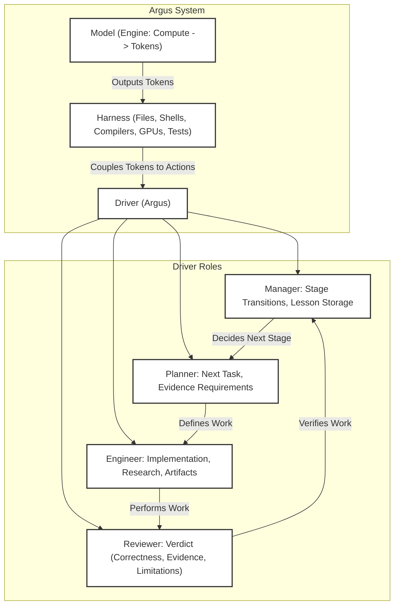

<!-- source: DeepWiki mcp.deepwiki.com · repo microsoft/ArgusAgent · page 1 Overview · fetched 2026-10-26 -->

# 1. Overview

Relevant source files

The following files were used as context for generating this wiki page:

- [.gitignore](.gitignore)
- [README.md](README.md)
- [README.zh-CN.md](README.zh-CN.md)

Argus is a system designed for persistent, reviewed autonomy in research and engineering tasks. It enables long-running agent work that can plan, execute, verify, pause, and continue beyond a single model turn [README.md:11-12](). This page provides a high-level overview of Argus's core concepts, its architectural roles, and the overall repository structure.

## The Driver-Harness Model

Argus operates on a "Driver-Harness" model [README.md:35](). In this model, a **model** is an engine that processes compute and outputs tokens. A **harness** is the mechanism that connects these tokens to real-world tools like files, shells, compilers, GPUs, and tests. The **Driver** is the decision-maker, determining the next action, evaluating results, and knowing when to seek human intervention [README.md:37-41]().

Unlike other agent systems where a human typically fills the Driver's seat, Argus takes on this role itself, distributing its responsibilities across four distinct roles: Manager, Planner, Engineer, and Reviewer [README.md:43-44](). These roles are intentionally designed with strict authority boundaries to prevent them from performing each other's jobs [README.md:44-45]().

### Argus Roles and Responsibilities

The four core roles in Argus are:

*   **Manager**: Owns stage transitions and determines where admitted lessons are stored. It is explicitly *not* allowed to perform the work it is admitting [README.md:46-49]().
*   **Planner**: Owns the next task and defines the evidence required for its completion. It is *not* allowed to move the campaign to the next stage [README.md:46-50]().
*   **Engineer**: Responsible for implementation, research, experiments, and artifacts. It is *not* allowed to declare its own work complete [README.md:46-51]().
*   **Reviewer**: Owns the verdict on correctness, evidence, and limitations, and can return a `blocked` status. Crucially, it runs in a **read-only** mode and cannot edit anything [README.md:46-52]().

This separation of concerns ensures that the worker cannot grade its own work, reducing the need for constant human oversight [README.md:60-61]().

**Title: Argus Driver-Harness Model and Role Split**

Sources: [README.md:35-52]()

## Repository Layout

The Argus codebase is organized into several key directories, each serving a specific purpose in the overall system architecture.

**Title: Argus Repository High-Level Structure**

```mermaid
graph TD
    A[Argus Repository] --> B[argus_skill/: Core Runtime & Logic]
    A --> C[frontend/: User Interfaces]
    A --> D[desktop-tauri/: Desktop Application]
    A --> E[tests/: Test Suite]
    A --> F[docs/: Documentation]

    subgraph "argus_skill/"
        B1[core/]
        B2[apps/]
        B3[daemon/]
        B4[life/]
        B5[agent_cli/]
        B6[adapters/]
        B7[tools/]
        B8[builtin_skills/]
        B9[wiki/]
        B10[verticals/]
        B11[webapi/]
        B12[integrations/]
        B13[release_tools/]
        B14[maintenance/]
    end

    subgraph "frontend/"
        C1[web/]
        C2[core/]
        C3[tui/]
    end

    subgraph "desktop-tauri/"
        D1[src-tauri/]
        D2[desktop_backend_entry.py]
        D3[build scripts]
    end

    subgraph "docs/"
        F1[guides/]
        F2[technical_report/]
        F3[assets/]
    end

    B --> B1 & B2 & B3 & B4 & B5 & B6 & B7 & B8 & B9 & B10 & B11 & B12 & B13 & B14
    C --> C1 & C2 & C3
    D --> D1 & D2 & D3
    F --> F1 & F2 & F3
```

Sources: [README.md:1-128](), [README.zh-CN.md:1-179](), [.gitignore:1-132]()

*   **`argus_skill/`**: This is the core Python package containing the runtime logic, application components, daemon services, agent CLI integrations, tools, built-in skills, wiki system, vertical domains, web API, and release utilities.
    *   For details on the core runtime architecture, see [Core Runtime Architecture](#2).
    *   For details on agent CLI backends, see [Agent CLI Backends and Execution](#3).
    *   For details on skills and knowledge accumulation, see [Skills, Wiki and Knowledge Accumulation](#4).
    *   For details on verticals and domain packs, see [Verticals and Domain Packs](#5).
    *   For details on the Web API, see [Interfaces: Web API, Frontends and Desktop](#6).
*   **`frontend/`**: Contains the user interface components, including the React web application (`web/`), shared frontend core components (`core/`), and the Terminal User Interface (`tui/`).
    *   For details on the web frontend and TUI, see [Interfaces: Web API, Frontends and Desktop](#6).
*   **`desktop-tauri/`**: Houses the Tauri-based desktop application, including the Rust host (`src-tauri/`), the frozen Python backend entry point (`desktop_backend_entry.py`), and associated build/staging scripts.
    *   For details on the desktop application, see [Interfaces: Web API, Frontends and Desktop](#6).
*   **`tests/`**: Contains the comprehensive test suite for the entire codebase.
    *   For details on the testing strategy, see [Build, Release and Quality Infrastructure](#8).
*   **`docs/`**: Stores all documentation, including user guides, examples, and the technical report.
    *   For details on documentation, see [Documentation and Technical Report](#9).

## Getting Started and Installation

Argus supports various Agent CLI backends, including `GitHub Copilot CLI`, `Pi`, `OpenAI Codex CLI`, `Claude Code`, `Cursor CLI`, `OpenCode`, `Grok Build`, `Qoder`, and `DeepSeek Harness` [README.md:65-66](). Installation can be done either by installing directly from the source repository's `main` branch or by using packaged desktop releases [README.md:117-128](). All platforms require Node.js 22.12+ and an authenticated Agent CLI [README.md:94-96]().

For detailed installation instructions, platform-specific setup, and information on `argus doctor` health checks, see [Getting Started and Installation](#1.1).

## Repository Map and Project Governance

The repository is structured to facilitate development and maintenance. Key directories include `argus_skill/` for the core logic, `frontend/` for user interfaces, `desktop-tauri/` for the desktop application, `tests/` for quality assurance, and `docs/` for documentation [README.md:1-128]().

For a directory-by-directory tour of the repository, along with details on contribution guidelines, code of conduct, security, support, licensing, and Git hygiene configuration, see [Repository Map and Project Governance](#1.2).

## Engineering Conventions

Argus emphasizes a "minimal-rigorous-work" approach to engineering. This includes principles like the shortest control path, avoiding prohibited abstractions, ensuring error transparency, and maintaining review discipline.

For a comprehensive understanding of the engineering conventions that govern all code changes, see [Engineering Conventions](#1.3).

---

