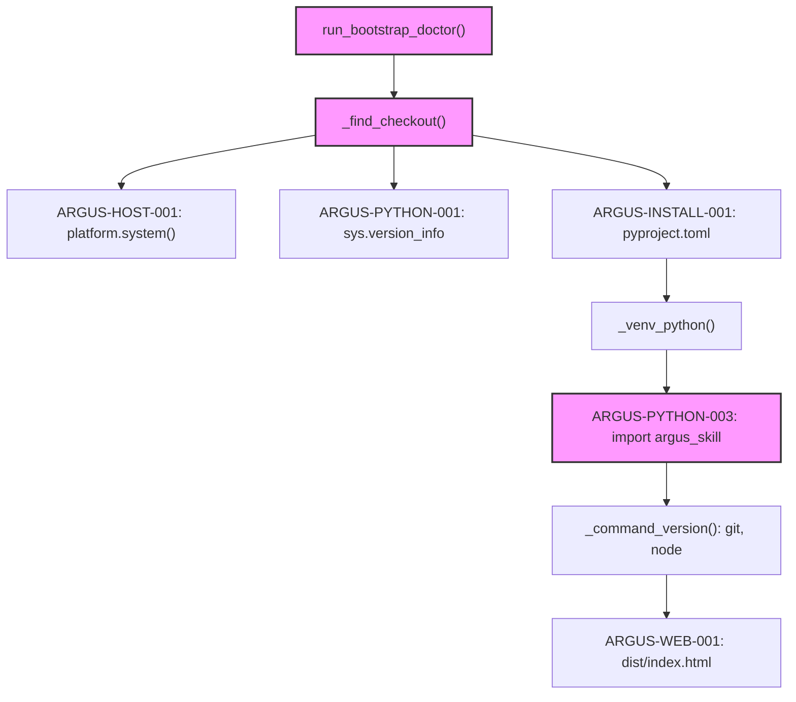
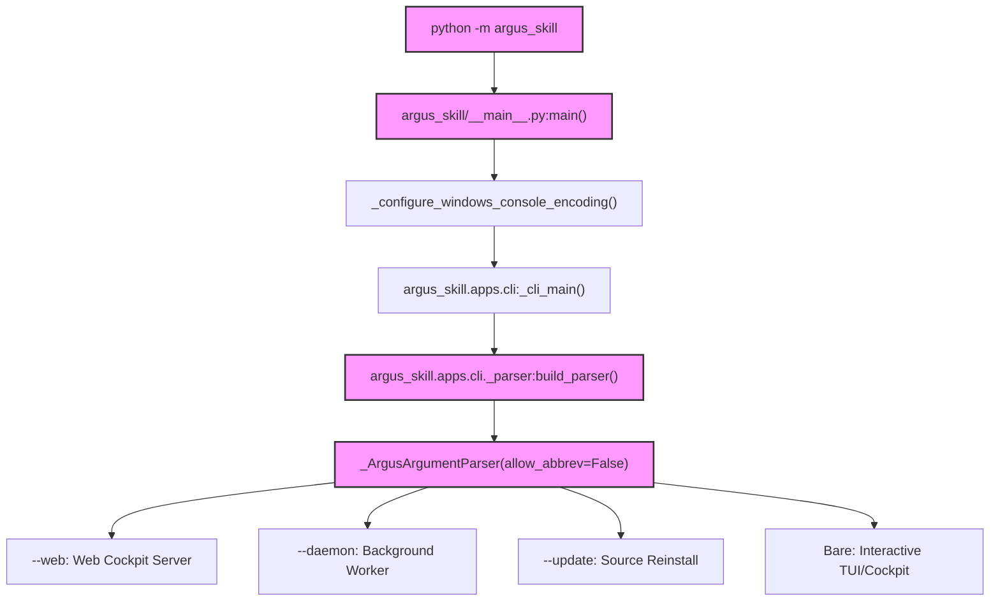

<!-- source: DeepWiki mcp.deepwiki.com · repo microsoft/ArgusAgent · page 1.1 Getting Started and Installation · fetched 2026-10-26 -->

# Getting Started and Installation

<details>
<summary>Relevant source files</summary>

The following files were used as context for generating this wiki page:

- [README.md](README.md)
- [argus_doctor.py](argus_doctor.py)
- [argus_skill/__main__.py](argus_skill/__main__.py)
- [argus_skill/apps/cli/_parser.py](argus_skill/apps/cli/_parser.py)

</details>


This page details the installation channels, supported Agent CLI backends, platform prerequisites, diagnostic health checks via `argus doctor`, and the unified command-line entrypoint architecture for Argus.

---

## 1. Supported Agent CLI Backends and Prerequisites

Argus operates as a harness that couples language models to local environments through external coding agent CLIs. The core runtime requires Python 3.11+ [README.md:17] and Node.js 22.12+ [README.md:95], along with at least one authenticated agent backend [README.md:96]. 

The supported backends, their underlying packages, and authentication requirements are resolved by the runner backend subsystem:

| Agent CLI | Backend Identifier | Installation Command | Authentication Method |
|---|---|---|---|
| GitHub Copilot CLI | `copilot` [README.md:108] | `npm install -g @github/copilot` [README.md:108] | `copilot login` [README.md:108] |
| OpenAI Codex CLI | `codex` [README.md:109] | `npm install -g @openai/codex@latest` [README.md:109] | `codex login` [README.md:109] |
| Claude Code | `claude` [README.md:110] | `npm install -g @anthropic-ai/claude-code` [README.md:110] | Run `claude`, then `/login` [README.md:110] |
| Cursor CLI | `cursor` [README.md:111] | `curl https://cursor.com/install -fsS \| bash` [README.md:111] | `agent login` or `CURSOR_API_KEY` [README.md:111] |
| Pi | `pi` [README.md:112] | `npm install -g --ignore-scripts @earendil-works/pi-coding-agent` [README.md:112] | Run `pi`, then `/login` [README.md:112] |
| OpenCode | `opencode` [README.md:113] | Official install guide [README.md:113] | `opencode auth login` [README.md:113] |
| Grok Build | `grok` [README.md:114] | Official install guide [README.md:114] | `grok login` [README.md:114] |
| Qoder CLI | `qoder` [README.md:115] | `npm install -g @qoder-ai/qodercli` [README.md:115] | `qodercli login` [README.md:115] |
| DeepSeek Harness | `dsh` [README.md:116] | `npm install -g @deepseek-ai/dsh` [README.md:116] | Configure `DEEPSEEK_API_KEY` [README.md:116] |

Sources: [README.md:92-117]

---

## 2. Installation Channels: Source vs. Desktop Release

Argus provides two distinct distribution channels that serve different deployment requirements:

1. **Source Installation**: Directly clones or installs from the official source repository (`microsoft/ArgusAgent` for official releases, or `lbx154/Argus` for development previews) [README.md:29-33, 118-123]. This channel is intended for developers, researchers, and users running custom verticals or making source code modifications.
2. **Desktop Release**: Pre-packaged Windows executables and platform bundles distributed through GitHub Releases (`microsoft/ArgusAgent/releases` or `lbx154/Argus/releases`) [README.md:124-128]. The desktop shell wraps the frozen Python backend via PyInstaller within a Tauri host container.

Sources: [README.md:28-34, 118-128]

---

## 3. The `argus doctor` Diagnostic Subsystem

To verify environment health, Python runtime availability, and toolchains, Argus includes a standalone bootstrap diagnostics script implemented entirely using the Python standard library: `argus_doctor.py` [argus_doctor.py:1-13].

### Diagnostic Checks and Codes

The `run_bootstrap_doctor()` function evaluates the local host and returns a structured list of findings containing diagnostic codes [argus_doctor.py:80-189]:

- **`ARGUS-HOST-001`**: Validates underlying host operating system, release architecture, and kernel metadata [argus_doctor.py:83-88].
- **`ARGUS-PYTHON-001`**: Asserts that the bootstrap Python interpreter meets the minimum version requirement (`>= 3.11`) [argus_doctor.py:89-96].
- **`ARGUS-INSTALL-001`**: Locates a valid Argus source checkout containing `pyproject.toml` and `argus_skill/` via `_find_checkout()` [argus_doctor.py:25-45, 97-103].
- **`ARGUS-PYTHON-002` / `ARGUS-PYTHON-003`**: Verifies virtual environment isolation (`.venv/`) and successful test imports of the `argus_skill` package [argus_doctor.py:105-141].
- **`ARGUS-GIT-001` / `ARGUS-NODE-001` / `ARGUS-POWERSHELL-001`**: Checks binary availability and executable versions for `git`, `node`, and Windows `powershell` on `PATH` [argus_doctor.py:143-155].
- **`ARGUS-WEB-001`**: Verifies the presence of compiled frontend distribution assets (`frontend/web/dist/index.html` and `frontend/tui/bundle/argus.mjs`) [argus_doctor.py:157-169].
- **`ARGUS-DESKTOP-001`**: Inspects Tauri desktop development manifests and Cargo dependencies (`desktop-tauri/src-tauri/Cargo.toml`) [argus_doctor.py:170-185].


*Figure 1.1.1: Bootstrap diagnostics evaluation workflow mapping diagnostic codes to validation functions in `argus_doctor.py`.*

Sources: [argus_doctor.py:1-189]

---

## 4. CLI Entrypoints and Argument Parsing Architecture

Argus exposes a unified command-line interface configured via `pyproject.toml` entry points and implemented in `argus_skill/__main__.py` and `argus_skill/apps/cli/_parser.py`.

### Execution Entrypoint

When executing `python -m argus_skill`, execution delegates to `argus_skill/__main__.py`, which initializes Windows console encoding compatibility and invokes `_cli_main` [argus_skill/__main__.py:1-22]:

```python
def main(argv: list[str] | None = None) -> int:
    """Run the Python CLI with a Windows-safe text console."""
    _configure_windows_console_encoding()
    return _cli_main(argv)
```
[argus_skill/__main__.py:15-18]

### Argument Parser Structure

Argument parsing is managed by `build_parser()` in `argus_skill/apps/cli/_parser.py`, which constructs an instance of `_ArgusArgumentParser` [argus_skill/apps/cli/_parser.py:43-70]. To prevent subcommand option collisions (such as `--init` in `wiki ingest --init`), prefix abbreviation is explicitly disabled (`allow_abbrev=False`) [argus_skill/apps/cli/_parser.py:83].

The parser registers flags for:
- Human cockpit modes (`--web`, `--watch`, bare execution) [argus_skill/apps/cli/_parser.py:11-17, 85-202]
- 7x24 background daemon orchestration (`--daemon`, `--daemon-fg`, `--daemon-stop`, `--drain`, `--status`) [argus_skill/apps/cli/_parser.py:102-141]
- Maintenance and diagnostics (`--update`, `--gc`, `--config-help`) [argus_skill/apps/cli/_parser.py:92-94, 142-174]


*Figure 1.1.2: Entrypoint execution flow bridging execution invocation to argument parsing and mode dispatch.*

Sources: [argus_skill/__main__.py:1-22], [argus_skill/apps/cli/_parser.py:1-202]

---

