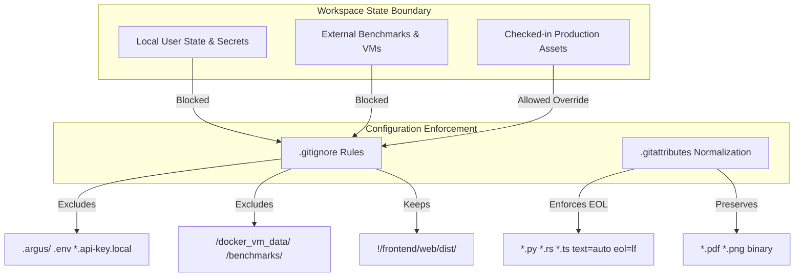

<!-- source: DeepWiki mcp.deepwiki.com · repo microsoft/ArgusAgent · page 1.2 Repository Map and Project Governance · fetched 2026-10-26 -->

# Repository Map and Project Governance

Relevant source files

The following files were used as context for generating this wiki page:

- [.gitattributes](.gitattributes)
- [.gitignore](.gitignore)
- [CODE_OF_CONDUCT.md](CODE_OF_CONDUCT.md)
- [LICENSE](LICENSE)
- [SECURITY.md](SECURITY.md)
- [SUPPORT.md](SUPPORT.md)

This page provides a comprehensive technical tour of the `ArgusAgent` repository structure, project governance policies, compliance documentation, and git hygiene configurations. It establishes the layout of top-level directories, core sub-packages, governance frameworks, and exclusion boundaries that maintain repository integrity.

---

## 1. Top-Level Directory Layout

The repository is organized into distinct functional domains separating the core runtime engine (`argus_skill`), user-facing interfaces (`frontend`, `desktop-tauri`), domain-specific logic (`verticals`), and operational support (`tests`, `docs`, `plugins`).

*   `argus_skill/`: The core Python package containing the runtime orchestration loop, role definitions (Manager, Planner, Engineer, Reviewer), agent CLI adapters, toolsets, daemons, verticals, and web API server.
*   `frontend/`: User interface packages including the React web application (`frontend/web`), shared frontend components (`frontend/core`), and terminal user interface (`frontend/tui`).
*   `desktop-tauri/`: Tauri-based desktop wrapper containing the Rust host (`src-tauri`) and integration scripts for bundled Python execution.
*   `tests/`: Comprehensive test suites mirroring the structure of `argus_skill/` packages (`core`, `life`, `manager`, `skills`, `webapi`, `tools`, `daemon`, `desktop`).
*   `docs/`: User guides, technical documentation, design specs, and brand assets.
*   `technical_report/`: Research documentation, campaign evidence bundles, and benchmark artifacts.
*   `plugins/`, `integrations/`, `companions/`: Ecosystem extensions, companion apps (such as `companions/FLYWHEEL`), and provider bridges.

Sources: `[.gitignore:1-134]`, `[LICENSE:1-22]()`

---

## 2. Project Governance and Compliance Documentation

The repository incorporates standard Microsoft open-source governance and security policies to maintain compliance, clear licensing, and secure vulnerability reporting workflows.

### Licensing and Copyright
The project is licensed under the **MIT License**, sharing copyright between `lbx154` and `Microsoft Corporation` [LICENSE:1-4](). The license permits free use, modification, and distribution under standard MIT terms [LICENSE:6-22]().

### Code of Conduct
Contributor behavior is governed by the **Microsoft Open Source Code of Conduct** [CODE_OF_CONDUCT.md:1-3](). The document directs questions, concerns, or moderation support to `opencode@microsoft.com` or internal Microsoft moderation channels [CODE_OF_CONDUCT.md:9-10]().

### Security Policies
Security vulnerabilities must **not** be reported through public GitHub issues [SECURITY.md:8](). Reporting instructions, contact protocols, and Microsoft security guidance are centralized via `https://aka.ms/SECURITY.md` [SECURITY.md:10-12]().

### Support and Issue Tracking
Bug tracking and feature requests are managed via GitHub Issues [SUPPORT.md:13-17](). Support scope and community engagement channels are detailed in `SUPPORT.md` [SUPPORT.md:11-25]().

Sources: `[CODE_OF_CONDUCT.md:1-11]`, `[LICENSE:1-23]`, `[SECURITY.md:1-13]`, `[SUPPORT.md:1-26]`

---

## 3. Git Hygiene and Configuration

The repository enforces strict git hygiene via `.gitattributes` and `.gitignore` configurations, preventing local scratch files, sensitive credentials, and bulky benchmark VM images from entering version control while explicitly tracking production build artifacts.

### Line Ending Normalization (`.gitattributes`)
The `.gitattributes` file normalizes text files to `lf` line endings automatically while marking binary assets (`.ico`, `.jpeg`, `.jpg`, `.pdf`, `.png`, `.pptx`, `.woff2`, etc.) to prevent corruption during cross-platform contributions [`.gitattributes:1-12`]().

### Exclusion Rules and Checked-In Artifacts (`.gitignore`)
The `.gitignore` configuration excludes python caches, virtual environments (`.venv/`, `venv/`), user state (`skills/`, `.autors/`, `.argus-skill/`, `.argus_subagents/`), local secrets (`*.api-key.local`, `.env`, `secrets.json`) [`.gitignore:1-89`](). 

Crucially, the production web bundle located at `/frontend/web/dist/` is intentionally checked in and release-verified, overriding standard build output exclusions [`.gitignore:11-13`](). Furthermore, bulky local benchmark datasets, docker VM images (`/docker_vm_data/`), and proprietary VC/business materials (`/vc_materials/`, `docs/Argus_VC_Deck.pdf`) are explicitly blocked [`.gitignore:90-129`]().

Sources: `[.gitattributes:1-12]`, `[.gitignore:1-134]`

---

## 4. Repository Architecture and Code Entity Mapping

The following diagram bridges the natural language space of repository directories and governance documents to their concrete code entities and configuration paths within the codebase.

```mermaid
graph TD
    subgraph "Natural Language Space"
        Repo["ArgusAgent Repository Root"]
        Core["Core Runtime Engine"]
        UI["User Interfaces & Desktop"]
        Gov["Project Governance"]
        GitConf["Git Hygiene Config"]
    end

    subgraph "Code Entity Space"
        Repo --> CorePkg["argus_skill/"]
        Repo --> FrontPkg["frontend/"]
        Repo --> TauriPkg["desktop-tauri/"]
        Repo --> TestPkg["tests/"]
        
        Core --> CoreRuntime["argus_skill/core/"]
        Core --> AppsRuntime["argus_skill/apps/loop.py"]
        Core --> ManagerRole["argus_skill/manager/"]
        
        UI --> WebDist["frontend/web/dist/"]
        UI --> TauriHost["desktop-tauri/src-tauri/"]
        
        Gov --> CoC["CODE_OF_CONDUCT.md"]
        Gov --> Sec["SECURITY.md"]
        Gov --> Lic["LICENSE"]
        Gov --> Sup["SUPPORT.md"]
        
        GitConf --> Gi[" .gitignore "]
        GitConf --> Ga[" .gitattributes "]
    end
```

*Figure 1: Mapping high-level repository domains to concrete code and documentation entities.*

Sources: `[.gitattributes:1-12]`, `[.gitignore:1-134]`, `[CODE_OF_CONDUCT.md:1-11]`, `[LICENSE:1-23]`, `[SECURITY.md:1-13]`, `[SUPPORT.md:1-26]`

---

## 5. Artifact Exclusion and Verification Boundary

The repository boundary distinguishes between local mutable user state, excluded scratch directories, and version-controlled release artifacts.

*Figure 2: Enforcement boundaries managed by `.gitignore` and `.gitattributes` across workspace states.*

Sources: `[.gitattributes:1-12]`, `[.gitignore:1-134]`

---

