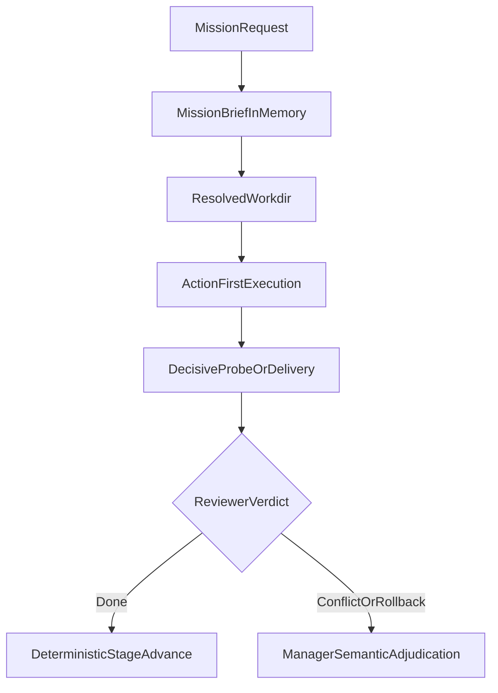

<!-- source: DeepWiki mcp.deepwiki.com · repo microsoft/ArgusAgent · page 1.3 Engineering Conventions · fetched 2026-10-26 -->

# Engineering Conventions

<details>
<summary>Relevant source files</summary>

The following files were used as context for generating this wiki page:

- [.agents/skills/minimal-rigorous-work/SKILL.md](.agents/skills/minimal-rigorous-work/SKILL.md)
- [.github/instructions/minimal-engineering.instructions.md](.github/instructions/minimal-engineering.instructions.md)
- [PRIVATE_TODO.md](PRIVATE_TODO.md)
- [PRIVATE_TODO.zh-CN.md](PRIVATE_TODO.zh-CN.md)

</details>


## Purpose and Scope

This page defines the core engineering conventions, minimal rigorous work skills, and architectural guardrails that govern all code changes, control plane decisions, and refactoring efforts across the ArgusAgent repository. These constraints ensure that the system maintains high execution efficiency, deterministic state transitions, and transparent error handling without accumulating ceremonial abstractions or redundant verification loops.

Sources: [.agents/skills/minimal-rigorous-work/SKILL.md:1-32](), [.github/instructions/minimal-engineering.instructions.md:1-51]()

---

## The Minimal-Rigorous-Work Skill & Instructions

All implementation, research, planning, review, and orchestration activities must follow the `minimal-rigorous-work` runtime skill configuration and the repository-wide `minimal-engineering` coding instructions (`**/*.{py,ts,tsx,js,mjs}`). 

Key principles enforced by these guidelines include:
- **Shortest Control Path**: Solve tasks completely using the most direct clear control path. Start from requested behavior, real entry points, and observable evidence [._agents/skills/minimal-rigorous-work/SKILL.md:8-11](), [._github/instructions/minimal-engineering.instructions.md:8-10]().
- **Prohibited Abstractions**: Unless demonstrated requirements mandate them, code changes must not introduce hashes (including SHA-256 for identifiers or correctness), UUIDs, random tokens, custom idempotency/deduplication keys, retries, backoff, circuit breakers, fallback chains, compatibility layers, speculative locks, future fields, or placeholder interfaces [._agents/skills/minimal-rigorous-work/SKILL.md:16-19](), [._github/instructions/minimal-engineering.instructions.md:24-33]().
- **Contract Reuse**: Reuse existing contracts and helpers. Do not add unrelated features, refactors, dependencies, roles, layers, configuration, or artifacts [._agents/skills/minimal-rigorous-work/SKILL.md:12-13]().

```mermaid
graph TD
    A["RequestOrTask"] --> B["ShortestControlPath"]
    B --> C{HasDemonstratedRequirement}
    C -- "No" --> D["RejectProhibitedAbstractions"]
    C -- "Yes" --> E["ValidateBoundary"]
    D --> F["DirectLocalCodeExecution"]
    E --> F
    F --> G["ExplicitErrorHandling"]

    sub-graph "Prohibited Items"
        D1["Hashes/UUIDs"]
        D2["SpeculativeLocks"]
        D3["SuccessShadedDegradation"]
    end
```
*Figure 1: Control path selection mapping natural language requirements to direct code entity execution while filtering prohibited abstractions.*

Sources: [._agents/skills/minimal-rigorous-work/SKILL.md:1-33](), [._github/instructions/minimal-engineering.instructions.md:1-52]()

---

## Error Transparency and Authority Boundaries

Argus mandates strict error transparency and explicit protection of critical boundaries. 

- **Error Transparency**: Defects must never be hidden behind broad exception catches, empty results, default values, or success-shaped degradation [._agents/skills/minimal-rigorous-work/SKILL.md:20-21](), [._github/instructions/minimal-engineering.instructions.md:34-35](). 
- **Boundary Validation**: Real input, authority, persistence, security, money, citations, and irreversible actions must always be explicitly validated. Established internal invariants should be trusted rather than re-verified redundantly across every layer [._agents/skills/minimal-rigorous-work/SKILL.md:14-15](), [._github/instructions/minimal-engineering.instructions.md:11-13]().
- **Local Repair**: Routine local failures are repaired locally; escalation occurs only when scope, semantics, data integrity, authority, or irreversible effects change [._github/instructions/minimal-engineering.instructions.md:22-23]().

Sources: [._agents/skills/minimal-rigorous-work/SKILL.md:14-21](), [._github/instructions/minimal-engineering.instructions.md:11-35]()

---

## Action-First Control Plane and Execution Efficiency

Reflecting architectural improvements specified in internal coordination backlogs (such as `ARGUS-P0-05`), the control plane prioritizes immediate execution over audit completeness and redundant file reads [.[PRIVATE_TODO.md:62-92](), [PRIVATE_TODO.zh-CN.md:56-80]()].

- **Runtime-Owned `MissionBrief`**: In-memory context bundles containing the canonical workdir, stage, git state, changed paths, available hardware/tools, native test commands, and latest decisive results are maintained to avoid redundant repository-wide file crawling [.[PRIVATE_TODO.md:94-98](), [PRIVATE_TODO.zh-CN.md:82-86]()].
- **Decisive Check Finality**: An accepted decisive check remains settled until its inputs change or contradictions appear [._github/instructions/minimal-engineering.instructions.md:19-21](). Reviewers are restricted to the changed surface and acceptance evidence without reopening settled questions [.[PRIVATE_TODO.md:110-111](), [PRIVATE_TODO.zh-CN.md:96-97]()].


*Figure 2: Action-first control plane architecture bridging runtime brief initialization to deterministic stage progression.*

Sources: [.[PRIVATE_TODO.md:62-117](), [PRIVATE_TODO.zh-CN.md:56-102]()

---

## Review Discipline and Team Execution

- **Independent Read-Only Review**: Reviews must be conducted independently and read-only. Verification targets the changed user-visible path, broadening only when the blast radius is broad [._agents/skills/minimal-rigorous-work/SKILL.md:29-30]().
- **Real Parallelism**: Parallel and team execution must involve disjoint writable paths, explicit completion evidence, and one lead-owned synthesis. They are not ceremonial wrappers [._github/instructions/minimal-engineering.instructions.md:40-44]().
- **Honest Reporting**: Agents must report `BLOCKED` or `UNTESTED` honestly and terminate execution immediately when requested outcomes are achieved [._agents/skills/minimal-rigorous-work/SKILL.md:31-32]().

Sources: [._agents/skills/minimal-rigorous-work/SKILL.md:29-32](), [._github/instructions/minimal-engineering.instructions.md:40-46]()

---

