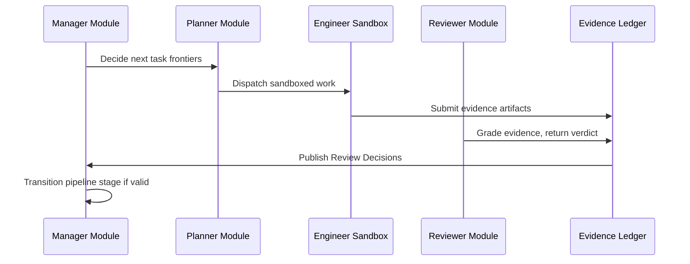

<!-- source: DeepWiki mcp.deepwiki.com · repo microsoft/ArgusAgent · page 10 Glossary · fetched 2026-10-26 -->

# Glossary

<details>
<summary>Relevant source files</summary>

The following files were used as context for generating this wiki page:

- [.agents/skills/minimal-rigorous-work/SKILL.md](.agents/skills/minimal-rigorous-work/SKILL.md)
- [.github/instructions/minimal-engineering.instructions.md](.github/instructions/minimal-engineering.instructions.md)
- [.github/workflows/tests.yml](.github/workflows/tests.yml)
- [ARGUS_IMPRESSIVE_RESULTS.md](ARGUS_IMPRESSIVE_RESULTS.md)
- [README.md](README.md)
- [argus_skill/__init__.py](argus_skill/__init__.py)

</details>


This glossary provides detailed definitions of key Argus-specific terms, concepts, architectural components, data structures, and domain vocabulary. It connects each term to relevant parts of the codebase and explains implementations, data flow, and key classes or functions. Two mermaid diagrams visually bridge the natural language domain with code entities to assist developer orientation. This page is a leaf node and serves as a definitive reference for technical contributors familiarizing themselves with Argus internals.

---

## Driver / Harness

**Driver**: The "seat" in the Agent system that orchestrates autonomous work by deciding what to do next, assessing outcomes, and controlling task flow. Traditionally human-operated; in Argus, it is split into specialized roles for persistent autonomy.

**Harness**: The mechanical drivetrain coupling LLM token streams to external system actions such as filesystem, shell, compilation, GPUs, and test execution.

**Implementation**: The Argus "Driver" model is split across four clearly divided roles — Manager, Planner, Engineer, Reviewer — each restricted by authority boundaries (see their entries). The Driver "harness" is realized through backends and adapters, such as the `agent_cli` backend implementations and the `DeepSeek Harness (DSH)`, which control token flow to/from the external coding-agent CLIs and orchestrate external resource usage.

The high-level references are described in the README introduction, especially in these lines:
```markdown
A **model** is an engine: it burns compute and puts out tokens. A **harness** is the drivetrain that couples those tokens to files, shells, compilers, GPUs, and tests. The **Driver** is the seat — choosing what to do next, judging whether the last result was any good, and knowing when to stop and ask. 

Argus takes the Driver's seat, splitting it across four roles deliberately not allowed to do each other's jobs:

| Role    | Owns                                | May NOT do                   |
|---------|------------------------------------|-----------------------------|
| Manager | Stage transitions, lessons stored  | Perform the admitted work    |
| Planner | Next task and its evidence          | Move campaign to next stage  |
| Engineer| Implementation, research, artifacts| Declare its own work complete|
| Reviewer| Verdict (correctness, evidence)    | Edit anything; read-only     |

Credentials, payment, irreversible actions, and publication always stop for a human.
```
(Sources: `README.md:35-54`)

### Harness code pointers:
- Agent CLI backends and runner adapters live in `argus_skill/agent_cli` and `argus_skill/adapters/agent_cli_backend`.
- The DSH (DeepSeek Harness) is a specialized harness adapter with API keys and model routing.
- Harnesses integrate with the subagent pool for parallel work and GPU leasing (`argus_skill/tools`).
  
---

## Manager / Planner / Engineer / Reviewer

These four roles decompose the autonomous Driver seat into distinct bounded authorities that enforce disciplined workflow and improve reliability.

| Role     | Description                                                                                                                                       | Key Classes / Modules                       |
|----------|---------------------------------------------------------------------------------------------------------------------------------------------------|--------------------------------------------|
| Manager  | Controls pipeline **stage transitions**, decides when the campaign moves forward or applies a new lesson, and manages the **front door** routing. | `argus_skill/manager` modules, manager session tests, front door dispatch logic             |
| Planner  | Selects the **next task frontier** with its required evidence specs, coordinating task breakdown and evidence consumption.                       | Planner modules under `argus_skill/life`, planning context, `test_planner_effort_resolution.py` |
| Engineer | Executes the actual work under sandboxed constraints (implementation, experiments, artifact generation).                                         | Engineer sandbox (`argus_skill/apps/engineer_sandbox.py`), team execution in `tools/subagent_pool.py` |
| Reviewer | Produces independent **verdicts** on evidence correctness, limitation, and completeness. Reviewer is **read-only** and does not modify state.      | Review policy, verdict models in `argus_skill/core/review.py`, reviewer role prompts         |

**Data flow between roles** follows a pipeline loop:  
*The Manager* determines state → *Planner* picks next work and plan → *Engineer* produces results → *Reviewer* grades and returns verdict → loop continues.

### Diagram: Roles and Their Code Bindings

```mermaid
flowchart TB
  subgraph "Role: Manager"
    MStage["Stage transitions, lessons"]
    MFrontDoor["Front door / dispatch"]
  end

  subgraph "Role: Planner"
    PTask["Next task frontier selection"]
    PEvidenceSpec["Evidence spec"]
  end

  subgraph "Role: Engineer"
    ESandbox["Sandboxed implementation"]
    EArtifacts["Artifacts generation"]
    ESubagentPool["Subagent pool"]
  end

  subgraph "Role: Reviewer"
    RVerdict["Independent verdict"]
    RReadOnly["Read-only"]
  end

  MStage --> PTask
  PTask --> ESandbox
  ESandbox --> RVerdict
  RVerdict --> MStage

  %% Code bindings
  MStage -.->|manager session, front_door| argus_skill/manager
  PTask -.->|planning context, pipeline_state| argus_skill/life, argus_skill/planner
  ESandbox -.->|engineer sandbox, subagent pool| argus_skill/apps/engineer_sandbox.py, tools/subagent_pool.py
  RVerdict -.->|review policies, review decisions| argus_skill/core/review.py
```

Sources: `README.md:35-54`, tests/planner/test_execution_host_failure.py, argus_skill/manager/*, argus_skill/apps/engineer_sandbox.py, argus_skill/core/review.py, argus_skill/tools/subagent_pool.py

---

## Campaign

A **campaign** is a bounded episodic run or project focusing on a research, engineering, or evaluation problem. Campaigns have defined scopes, milestones (pipeline stages), and rigor requirements.

They consist of:

- Pipeline stages with transitions managed by the Manager
- Tasks planned and executed by the Planner and Engineer
- Evidence collected and reviewed
- Status reflecting progress and severity of issues

The authoritative campaign definitions, protocols, and admission bars are recorded in documents like the *Argus Impressive Results Candidate Campaigns* (`ARGUS_IMPRESSIVE_RESULTS.md`).

A campaign's state flows through the core runtime modules: pipeline state, session state, contracts, and evidence ledgers, described fully in `argus_skill/core/pipeline_state.py` and `argus_skill/core/session.py`.

---

## Stage Certificate

A **stage certificate** is a record or token confirming that a pipeline stage has been completed and verified correctly. It certifies that a certain milestone or phase in the campaign has passed review.

Certificates contain evidence digests, review decisions, and verification results. They are used by the Manager to authorize stage transitions.

---

## Vertical

A **vertical** is a domain pack or specialized knowledge base built on top of the stable Argus core. Verticals isolate domain-specific logic, evidence contracts, scoring metrics, and task decoding from the core runtime and authority-boundary layers.

Examples include research, math, physics, kernel engineering, software, literary domains, and others.

Verticals declare themselves via base classes and register with the vertical registry. These are found in:
- `argus_skill/verticals/_base.py`
- `argus_skill/verticals/_registry.py`
- Domain packs such as `argus_skill/verticals/research/`, `argus_skill/verticals/kernel_engineering/`, etc.

---

## Skill Admission

**Skills** are modular capabilities that the Argus software can execute. **Admission** is the process of reviewing and integrating a skill into the system's skill catalog.

The lifecycle includes authoring, review by the Reviewer role, testing, and scoping to appropriate verticals or projects.

The skill system is implemented in `argus_skill/skills/` with a key API class `Skill` (`argus_skill/skills/store.py`), and skill loops running via `SkillLoop` in `argus_skill/loop.py`.

---

## Wiki Finding

A **wiki finding** is a source-linked piece of reusable knowledge or evidence recorded in the integrated internal wiki system for long-term retrieval and scope-based reuse.

Wiki findings are stored, indexed, and matched against claim contexts to avoid redundant work.

Implementation details are in `argus_skill/wiki/` which manages templates, collectors, and the proof ledger.

---

## Evidence Ledger

The **evidence ledger** is the persistent state repository tracking submitted evidence artifacts, review statuses, and verification results for claims processed during a campaign.

It underpins traceability and auditability. Evidence ledger code resides in `argus_skill/core/evidence_ledger.py`, where functions track and reconcile evidence states.

---

## Task Frontier

A **task frontier** defines the current set of work items for the Planner and Engineer to execute, along with associated evidence requirements and priority.

The frontier advances as evidence arrives and reviews conclude.

The task frontier is represented in the pipeline state and managed by the Manager and Planner roles in modules like `argus_skill/life/planner.py`.

---

## Front Door

The **front door** is the Manager-controlled routing and dispatch interface controlling entry into stages, tasks, or external calls.

It validates transitions, prevents unauthorized stage changes, and ensures systematic flow control.

Code handling front door logic is in `argus_skill/manager/front_door.py` and related Manager sessions.

---

## Mission View

The **mission view** is a live higher-level snapshot representation of campaign progress, stage status, task frontline, and resource states exposed to the frontend and API clients.

It aggregates data from pipeline state, evidence ledger, and role session states.

Relevant code is under `argus_skill/manager/mission_view.py` and web API route handlers in `argus_skill/webapi/`.

---

## Subagent Pool

The **subagent pool** manages multiple parallel subordinate agents (subagents) for distributed or concurrent task execution. It handles spawn control, lifecycle, GPU leasing, resource accounting, and task dispatch to subagents.

Implementation is located in `argus_skill/tools/subagent_pool.py` and coordinated by the team execution framework.

---

## Workspace Lease

A **workspace lease** is a lock or ephemeral permission granting an agent exclusive write access to a sandboxed workspace (filesystem directory or environment) for task execution.

Workspace leases prevent conflicted file writes and enforce isolated work.

The lease and locking mechanisms appear in `argus_skill/locks/workspace_lease.py` and associated file lock utilities.

---

## Capability Vault

The **capability vault** is a secured store of authorized capabilities such as API credentials, tokens, and secrets used by various components, especially harnesses and adapters.

It manages access control for resources necessary during execution.

The vault is implemented in `argus_skill/tools/capability_vault.py`.

---

## PORTABLE_TESTS

`PORTABLE_TESTS` is an environment variable listing test modules guaranteed to run on all supported platforms (Linux, macOS, Windows). This set excludes code paths requiring POSIX-only features (e.g., `os.fork`) unavailable on Windows.

The CI workflow (`.github/workflows/tests.yml`) uses this list to run a portable test subset on macOS and Windows to detect regressions.

Example excerpt from the test config:
```yaml
PORTABLE_TESTS: >-
  tests/life/test_chat_render.py
  tests/core/test_release.py
  tests/webapi/test_manager_rotation.py
  ...
```
(Sources: `.github/workflows/tests.yml:33-74`)

---

## Frozen Backend

The **frozen backend** is the bundled Python runtime environment created using PyInstaller or similar packaging to embed the Argus backend with its dependencies into a standalone executable for desktop deployment.

It is coupled with the Tauri-based Rust host in the `desktop-tauri` directory for Windows desktop releases.

---

## ACP (Agent Control Protocol)

ACP is an internal routing and control protocol for dispatching and controlling agent CLI commands and backend turns in the Argus runtime.

ACP routes tokens, manages prompt delivery, turns, and recovery scenarios for supported native backends like Copilot, Codex, etc.

Implementation lives primarily in `argus_skill/agent_cli/acp.py` and related runner files.

---

## DSH (DeepSeek Harness)

DSH is a harness adapter specifically targeting DeepSeek's native CLI backend with specialized partial input buffering, API key handling, and turn control.

DSH is implemented in `argus_skill/agent_cli/dsh.py` and uses environment variable configuration (`DEEPSEEK_API_KEY`) for authentication.

---

## KDA (Kernel-driven Attention)

KDA refers to techniques for kernel-level acceleration of attention mechanisms in transformer models. Argus tracks developments and candidate merges of KDA kernels as part of performance campaigns.

KDA is part of the candidate campaigns in the impressive results roadmap, described in documents like `ARGUS_IMPRESSIVE_RESULTS.md`.

---

## W2A4

W2A4 is a named candidate campaign focusing on GEMM kernel optimization for improved runtime performance on target hardware.

It appears as ARGUS-IR-05 in the impressive results campaign candidate list, defined with a status vocabulary entry `exploration`.

---

## Status Vocabulary

Argus uses a controlled vocabulary to label campaign, task, and evidence statuses:

| Status               | Meaning                                                                         |
|----------------------|---------------------------------------------------------------------------------|
| `exploration`        | Problem or feasibility gate not locked down yet.                                |
| `candidate`          | Direction exists but protocol or baselines are immature.                        |
| `active`             | Executable campaign with defined metrics.                                      |
| `certified`          | Internal repeated measurements; Reviewer passed audit.                         |
| `externally-verified`| Confirmed by external reproducibility, leaderboard, or formal proof.           |
| `shipped`            | Publicly available code, product, or result.                                   |
| `retired`            | Route abandoned; negative evidence retained.                                  |

Defined for campaign lifecycle control and evidence reliability. These statuses are embedded in campaign metadata.
(Sources: `ARGUS_IMPRESSIVE_RESULTS.md:78-88`)

---

## Blast Radius

The **blast radius** defines the scope of impact when making code or workflow changes. Argus emphasizes minimal and rigorous work to contain the blast radius:

- Local failures repaired locally
- Avoid broad guards or ceremony
- Independent review when blast radius broadens

Referenced in engineering conventions for disciplined code changes.
(Sources: `.github/instructions/minimal-engineering.instructions.md`)

---

## Canonical Contract

A **canonical contract** is the single authoritative data structure passed between roles representing the current task or job at hand, including all immutable required inputs and state.

Argus enforces passing only one canonical contract plus role-specific deltas to reduce complexity and reliance on duplicated logic.

This approach is a core principle in the `minimal-rigorous-work` skill and engineering instructions.
(Sources: `.agents/skills/minimal-rigorous-work/SKILL.md`, `.github/instructions/minimal-engineering.instructions.md`)

---

# Diagrams Bridging Natural Language Terms to Code Entities

## Diagram 1: Key Argus Runtime Components and their Corresponding Code Modules

```mermaid
graph TD
  NLDriver["Driver (seat)"] -->|Split to roles| Roles("Manager / Planner / Engineer / Reviewer")
  Roles -->|Manager impl.| Manager["argus_skill/manager/*"]
  Roles -->|Planner impl.| Planner["argus_skill/life/planner.py"]
  Roles -->|Engineer impl.| Engineer["argus_skill/apps/engineer_sandbox.py"]
  Roles -->|Reviewer impl.| Reviewer["argus_skill/core/review.py"]

  NLHarness["Harness (drivetrain)"] --> AgentCLI["argus_skill/agent_cli/"]
  NLHarness --> AgentCliBackend["argus_skill/adapters/agent_cli_backend/"]
  NLHarness --> DSH["argus_skill/agent_cli/dsh.py (DeepSeek Harness)"]
  NLHarness --> SubagentPool["argus_skill/tools/subagent_pool.py"]

  Campaign["Campaign, Pipeline State"] --> CorePipeline["argus_skill/core/pipeline_state.py"]
  Campaign --> EvidenceLedger["argus_skill/core/evidence_ledger.py"]
  Campaign --> StageCertificate["Manager sessions"]

  Skills["Skill Catalog"] --> SkillsStore["argus_skill/skills/store.py"]
  Skills --> SkillLoop["argus_skill/loop.py"]
  Wiki["Wiki and Proof Ledger"] --> WikiModules["argus_skill/wiki/"]

  FrontDoor["Front Door / Dispatch"] --> ManagerFrontDoor["argus_skill/manager/front_door.py"]

  WorkspaceLease["Workspace Lease"] --> Locks["argus_skill/locks/workspace_lease.py"]
  CapabilityVault["Capability Vault"] --> Vault["argus_skill/tools/capability_vault.py"]
```



## Diagram 2: Argus Roles Data and Control Flow in Code



---

# References Summary

| Term                  | Example Code Location / Related Docs                                |
|-----------------------|----------------------------------------------------------------------|
| Driver / Harness      | `README.md:35-54`, `argus_skill/agent_cli/`, `argus_skill/adapters/agent_cli_backend/`, `argus_skill/tools/subagent_pool.py` |
| Manager, Planner, Engineer, Reviewer | `argus_skill/manager/`, `argus_skill/life/planner.py`, `argus_skill/apps/engineer_sandbox.py`, `argus_skill/core/review.py` |
| Campaign              | `argus_skill/core/pipeline_state.py`, `argus_skill/core/session.py`, `ARGUS_IMPRESSIVE_RESULTS.md`                  |
| Stage Certificate     | Manager session code, `argus_skill/manager/front_door.py`                          |
| Vertical              | `argus_skill/verticals/_base.py`, `argus_skill/verticals/_registry.py`             |
| Skill Admission       | `argus_skill/skills/store.py`, `argus_skill/loop.py`                               |
| Wiki Finding          | `argus_skill/wiki/`                                                                  |
| Evidence Ledger       | `argus_skill/core/evidence_ledger.py`                                              |
| Task Frontier         | `argus_skill/life/planner.py`                                                      |
| Front Door            | `argus_skill/manager/front_door.py`                                                |
| Mission View          | `argus_skill/manager/mission_view.py`, `argus_skill/webapi/`                       |
| Subagent Pool         | `argus_skill/tools/subagent_pool.py`                                               |
| Workspace Lease       | `argus_skill/locks/workspace_lease.py`                                            |
| Capability Vault      | `argus_skill/tools/capability_vault.py`                                           |
| PORTABLE_TESTS        | `.github/workflows/tests.yml`                                                      |
| Frozen Backend        | `desktop-tauri/` containing Rust + frozen Python backend packaging                 |
| ACP                   | `argus_skill/agent_cli/acp.py`                                                     |
| DSH                   | `argus_skill/agent_cli/dsh.py`                                                     |
| KDA                   | Campaign definitions in `ARGUS_IMPRESSIVE_RESULTS.md`                              |
| W2A4                  | Campaign definitions in `ARGUS_IMPRESSIVE_RESULTS.md`                              |
| Status Vocabulary     | `ARGUS_IMPRESSIVE_RESULTS.md:78-88`                                                |
| Blast Radius          | `.github/instructions/minimal-engineering.instructions.md`                         |
| Canonical Contract    | `.agents/skills/minimal-rigorous-work/SKILL.md`, `.github/instructions/minimal-engineering.instructions.md` |

---

This concludes the Argus wiki page on the Glossary. It serves as a detailed technical reference linking natural language domain terms to precise code entities and implementation concepts, facilitating contributions and deep understanding of ArgusAgent internals. For further exploration, consult the code paths and docs indicated above.

Sources:  
`README.md:35-54`,  
`.github/instructions/minimal-engineering.instructions.md`,  
`.agents/skills/minimal-rigorous-work/SKILL.md`,  
`.github/workflows/tests.yml`,  
`ARGUS_IMPRESSIVE_RESULTS.md:40-88`,  
`argus_skill/__init__.py`,  
`argus_skill/manager/`,  
`argus_skill/life/planner.py`,  
`argus_skill/apps/engineer_sandbox.py`,  
`argus_skill/core/review.py`,  
`argus_skill/core/evidence_ledger.py`,  
`argus_skill/skills/store.py`,  
`argus_skill/wiki/`,  
`argus_skill/tools/subagent_pool.py`,  
`argus_skill/tools/capability_vault.py`,  
`argus_skill/locks/workspace_lease.py`,  
`argus_skill/agent_cli/`,  
`argus_skill/adapters/agent_cli_backend/`,  
`desktop-tauri/`