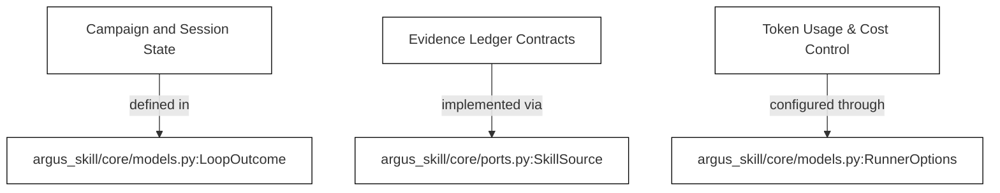
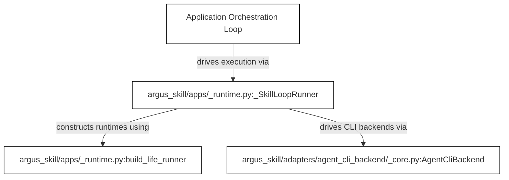

<!-- source: DeepWiki mcp.deepwiki.com · repo microsoft/ArgusAgent · page 2 Core Runtime Architecture · fetched 2026-10-26 -->

# Core Runtime Architecture

Relevant source files

The following files were used as context for generating this wiki page:

- [argus_skill/__init__.py](argus_skill/__init__.py)
- [argus_skill/adapters/agent_cli_backend/_core.py](argus_skill/adapters/agent_cli_backend/_core.py)
- [argus_skill/apps/_runtime.py](argus_skill/apps/_runtime.py)

The core runtime architecture of Argus provides the foundational machinery that drives supervised, skill-driven coding agent campaigns. It coordinates campaign and session state, manages pipeline stages, tracks cost and evidence ledgers, and executes the runtime loop across distinct agent roles (Manager, Planner, Engineer, and Reviewer). 

For detailed information on specific subsystems, refer to the child pages:
- Core State, Contracts and Ledgers: See [Core State, Contracts and Ledgers](#2.1)
- Application Runtime and Orchestration Loop: See [Application Runtime and Orchestration Loop](#2.2)
- Roles and Authority Boundaries: See [Roles: Manager, Planner, Engineer, Reviewer](#2.3)
- Daemon and Life Layer: See [Daemon, Life Layer and Long-Running Sessions](#2.4)

Sources: `argus_skill/__init__.py:1-32` [argus_skill/__init__.py:1-32](), `argus_skill/apps/_runtime.py:1-94` [argus_skill/apps/_runtime.py:1-94]()

---

## 2.1. Core State, Contracts and Ledgers

The core state and ledger modules maintain the persistent truth of an active campaign. Campaign state models the execution lifecycle, tracking iterations, review decisions, and output payloads via foundational models [argus_skill/__init__.py:11-16](). Evidence ledgers and project contracts ensure that all progress is verifiable against domain criteria, while cost controls and token usage trackers constrain consumption across execution passes.

For a deep dive into pipeline state definitions, vertical contracts, evidence ledgers, token pricing, knobs, and locking primitives (`file_lock`, `daemon_lock`, `workspace_lease`), see [Core State, Contracts and Ledgers](#2.1).

*Figure 1: Natural Language Space to Code Entity Space mapping for Core State and Ledgers.*

Sources: `argus_skill/__init__.py:11-32` [argus_skill/__init__.py:11-32]()

---

## 2.2. Application Runtime and Orchestration Loop

The application runtime orchestrates how missions are executed, transitioned through pipeline stages, and supervised across multiple turns. The core runner coordinates backend selection, planning context injection, self-reply mechanisms, and watch modes without binding directly to a specific presentation layer or terminal framework [argus_skill/apps/_runtime.py:1-17]().

For complete implementation details on stage transitions, planning context assembly, the supervisor, inbox handling, and `loop.py`, see [Application Runtime and Orchestration Loop](#2.2).

*Figure 2: Natural Language Space to Code Entity Space mapping for the Application Runtime and Loop.*

Sources: `argus_skill/apps/_runtime.py:79-94` [argus_skill/apps/_runtime.py:79-94](), `argus_skill/adapters/agent_cli_backend/_core.py:116-150` [argus_skill/adapters/agent_cli_backend/_core.py:116-150]()

---

## 2.3. Roles: Manager, Planner, Engineer, Reviewer

Argus enforces strict authority boundaries by dividing responsibilities among four specialized roles:
- **Manager**: Acts as the front door, deciding stage progression, dispatching work, and managing overall campaign direction.
- **Planner**: Deconstructs high-level objectives into tactical task frontiers.
- **Engineer**: Executes modifications within isolated sandboxes utilizing underlying coding agent CLIs.
- **Reviewer**: Inspects outputs and issues formal review verdicts (`ReviewDecision`) [argus_skill/__init__.py:13-13]().

For details on prompts, role implementations, and team execution semantics, see [Roles: Manager, Planner, Engineer, Reviewer](#2.3).

Sources: `argus_skill/__init__.py:11-16` [argus_skill/__init__.py:11-16]()

---

## 2.4. Daemon, Life Layer and Long-Running Sessions

To support campaigns that span multiple hours or days beyond a single model interaction turn, the daemon and life layer provide persistent supervision. This subsystem maintains project lifecycles, appends to event logs, bridges chat interfaces (such as Telegram and Feishu), and manages failure circuits and terminal states.

For architecture and implementation details on long-running session management, see [Daemon, Life Layer and Long-Running Sessions](#2.4).

Sources: `argus_skill/apps/_runtime.py:1-25` [argus_skill/apps/_runtime.py:1-25]()

---

