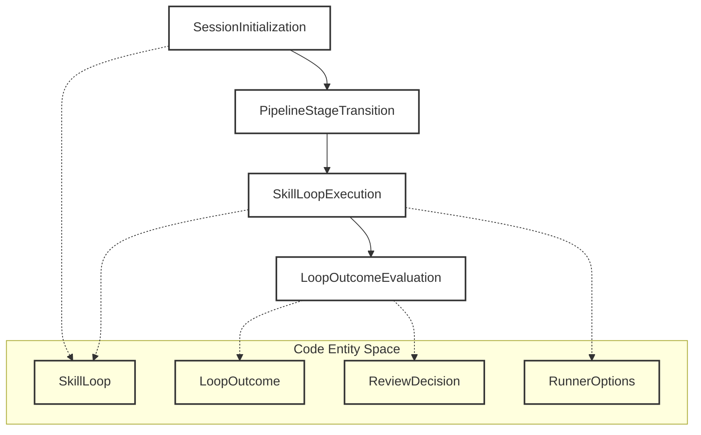
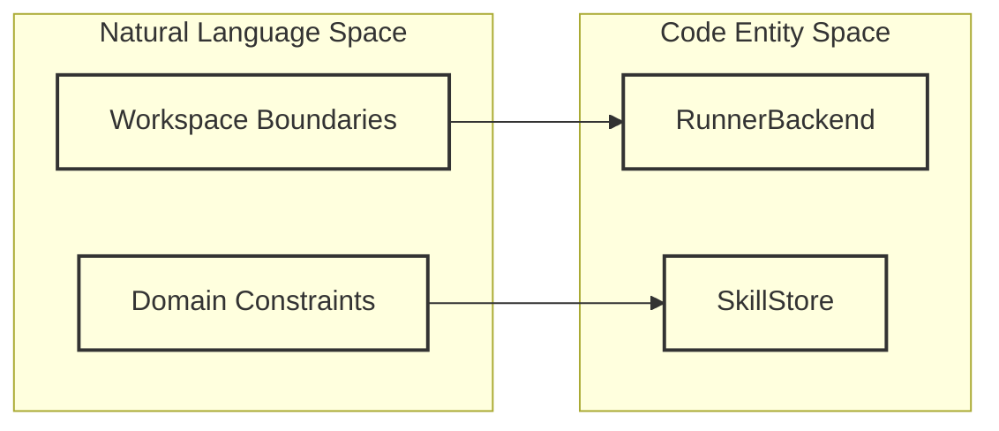

<!-- source: DeepWiki mcp.deepwiki.com · repo microsoft/ArgusAgent · page 2.1 Core State, Contracts and Ledgers · fetched 2026-10-26 -->

# Core State, Contracts and Ledgers

<details>
<summary>Relevant source files</summary>

The following files were used as context for generating this wiki page:

- [argus_skill/__init__.py](argus_skill/__init__.py)
- [argus_skill/adapters/agent_cli_backend/_core.py](argus_skill/adapters/agent_cli_backend/_core.py)
- [argus_skill/adapters/agent_cli_backend/_runtime.py](argus_skill/adapters/agent_cli_backend/_runtime.py)

</details>


This page details the core runtime state management, execution contracts, evidence logging, cost accounting, configuration knobs, concurrency primitives, and event schemas within `argus_skill/core`. These subsystems form the persistent and reviewed autonomy layer that drives multi-role coding campaigns in Argus.

---

### 1. Pipeline State and Session Management

The pipeline state and session layer coordinates campaign progression across stages. It tracks current execution state, historical step transitions, and active configuration parameters required by actors (Manager, Planner, Engineer, Reviewer). Session states are serialized to disk to enable long-running and resumable agent executions.

*   `LoopOutcome`: Encapsulates the terminal or intermediate result of a execution cycle [argus_skill/__init__.py:12-12]().
*   `ReviewDecision`: Records the verdict and feedback issued by the Reviewer role [argus_skill/__init__.py:13-13]().
*   `RunnerOptions`: Defines execution-time parameters, extra arguments, and limits passed to backend runners [argus_skill/__init__.py:14-14]().



Sources: `argus_skill/__init__.py:11-16`

---

### 2. Project and Vertical Contracts

Project and vertical contracts enforce boundaries, environment prerequisites, and domain-specific validation rules. Contracts prevent unauthorized modifications outside the campaign scope and ensure that vertical-specific tasks adhere to strict conformance standards before stage progression.

*   **Vertical Contracts**: Define domain constraints, required evidence schemas, and evaluation harnesses.
*   **Project Contracts**: Define target file paths, allowed tool permissions, and resource constraints per workspace.



Sources: `argus_skill/__init__.py:17-19`

---

### 3. Evidence Ledger and Proof Management

The evidence ledger records verifiable artifacts, test results, benchmark metrics, and execution outputs produced during a campaign. It underpins the proof management subsystem, ensuring that every claim made by an agent role is backed by an entry in the ledger.

*   **Evidence Records**: Structured entries containing artifact hashes, execution logs, and verification statuses.
*   **Proof Verification**: Automated checks validating ledger entries against expected benchmark criteria.

Sources: `argus_skill/__init__.py:11-32`

---

### 4. Cost Control, Pricing and Token Usage

The cost control subsystem monitors resource consumption, tracks token usage across model turns, and applies pricing models to prevent budget overruns during long-running engineering campaigns.

*   `UsageAccumulator`: Aggregates input tokens, output tokens, and estimated cost across subprocess invocations [argus_skill/adapters/agent_cli_backend/_result.py]().
*   **Budget Monitors**: Enforce hard and soft limits on execution time and financial expenditure.

Sources: `argus_skill/adapters/agent_cli_backend/_core.py:116-172`, `argus_skill/adapters/agent_cli_backend/_runtime.py:15-64`

---

### 5. Knobs and Environment Configurations

Configuration knobs control runtime tuning parameters, idle timeouts, and feature flags without requiring code modifications.

*   `env_int`: Helper utility for reading integer-valued environment variables with fallback defaults [argus_skill/adapters/agent_cli_backend/_core.py:18-18]().
*   **Timeout Knobs**: Configure soft, stalled, and hard idle watchdogs for agent CLI subprocesses (`ARGUS_SKILL_RUNNER_SOFT_IDLE_SECONDS`, `ARGUS_SKILL_RUNNER_STALLED_IDLE_SECONDS`, `ARGUS_SKILL_RUNNER_HARD_IDLE_SECONDS`) [argus_skill/adapters/agent_cli_backend/_core.py:34-39]().

Sources: `argus_skill/adapters/agent_cli_backend/_core.py:18-39`

---

### 6. Concurrency, Locks and Leases

Concurrency primitives prevent workspace corruption and race conditions when multiple agent loops or daemon threads operate on the same environment.

*   `_RepeatedToolCallGuard`: Thread-safe execution guard preventing infinite repetition of identical tool calls [argus_skill/adapters/agent_cli_backend/_core.py:40-113]().
*   **File Locks & Daemon Locks**: Synchronize access to shared state files and daemon endpoints.
*   **Workspace Lease**: Manages exclusive write access to target repositories during active execution phases.

```mermaid
graph TD
    A["ProcessSpawn"] --> B["RepeatedToolCallGuard"]
    B -->| "Detects Infinite Loop" | C["InterruptExecution"]
    B -->| "Normal Operation" | D["StreamStdoutStderr"]

    subgraph CodeEntities ["Code Entity Space"]
        E["_RepeatedToolCallGuard"]
        F["AgentCliBackend"]
        G["AgentIOLogger"]
    end

    A -.-> F
    B -.-> E
    D -.-> G

    classDef default fill:none,stroke:#333,stroke-width:2px;
```

Sources: `argus_skill/adapters/agent_cli_backend/_core.py:40-113`

---

### 7. Event Catalog and Payload Schemas

The event catalog defines structured telemetry events emitted during pipeline execution. Payload schemas guarantee consistent serialization for live UI streaming, loggers, and external API consumers.

*   `AgentIOLogger`: Intercepts and formats stream lines from agent subprocesses into structured event payloads [argus_skill/adapters/agent_cli_backend/_core.py:172]().
*   **Event Sinks**: External consumers that ingest event payloads for TUI rendering and dashboard updates.

Sources: `argus_skill/adapters/agent_cli_backend/_core.py:165-172`, `argus_skill/adapters/agent_cli_backend/_runtime.py:15-64`

---

