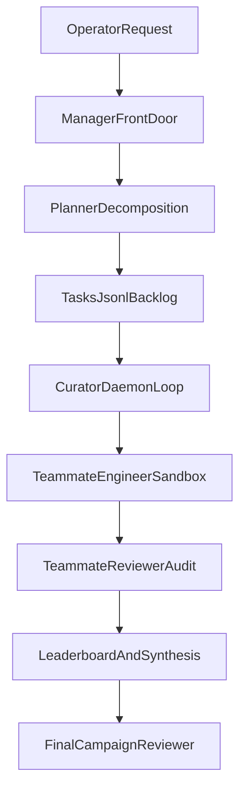
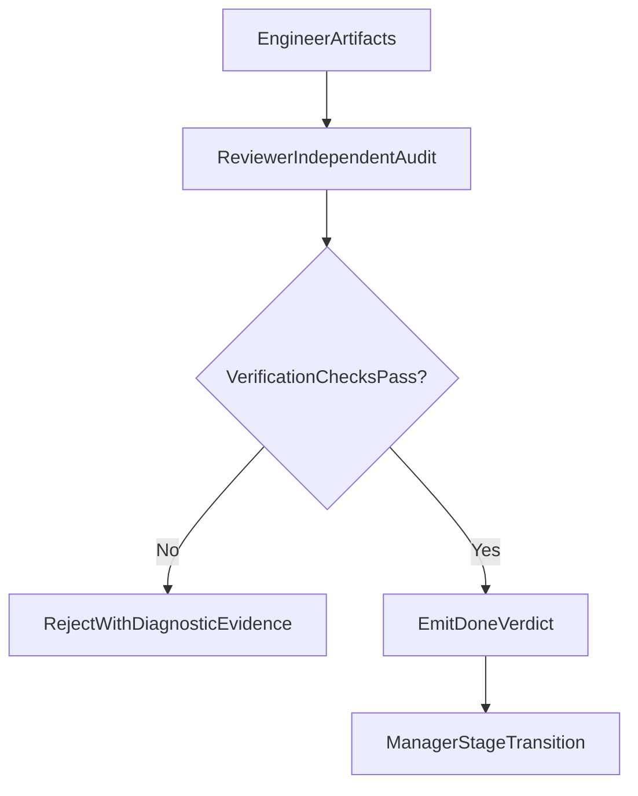
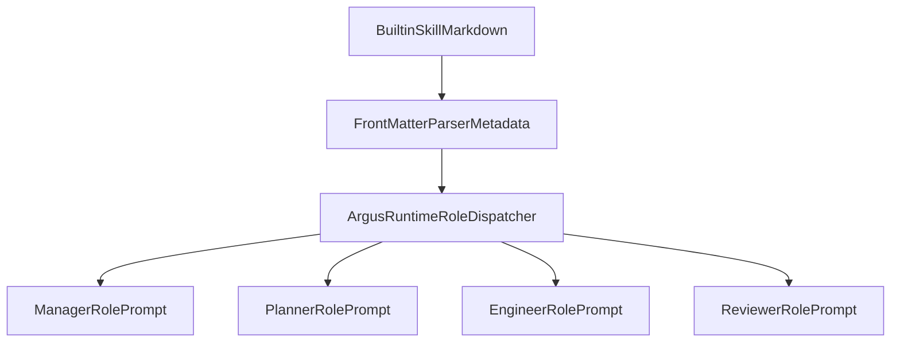

<!-- source: DeepWiki mcp.deepwiki.com · repo microsoft/ArgusAgent · page 2.3 Roles: Manager, Planner, Engineer, Reviewer · fetched 2026-10-26 -->

# Roles: Manager, Planner, Engineer, Reviewer

Relevant source files

The following files were used as context for generating this wiki page:

- [argus_skill/builtin_skills/agent-team-lead.md](argus_skill/builtin_skills/agent-team-lead.md)
- [argus_skill/builtin_skills/curator/argus-curator-role.md](argus_skill/builtin_skills/curator/argus-curator-role.md)
- [argus_skill/builtin_skills/engineer/argus-engineer-role.md](argus_skill/builtin_skills/engineer/argus-engineer-role.md)
- [argus_skill/builtin_skills/manager/argus-manager-role.md](argus_skill/builtin_skills/manager/argus-manager-role.md)

## Purpose and Scope
This document details the authority boundaries, implementation mechanics, prompt architectures, and execution workflows for the four core agent roles in the Argus framework: **Manager**, **Planner**, **Engineer**, and **Reviewer**. It covers how the orchestration layer separates high-level supervision from task planning, sandbox implementation, and read-only verification, alongside team execution and curator mechanics.

---

## 1. Role Authority Boundaries and Matrix

Argus strictly separates responsibilities to prevent role drift and ensure that execution is always audited independently. The **Manager** serves as the operator's single point of contact and holds sole authority over project stage transitions [argus_skill/builtin_skills/manager/argus-manager-role.md:6-9](). The **Planner** decomposes objectives into structured work items or team backlogs. The **Engineer** executes the code, analysis, or experiments within the sandbox [argus_skill/builtin_skills/engineer/argus-engineer-role.md:6-8](). The **Reviewer** operates strictly read-only to audit evidence against acceptance criteria.

| Role | Primary Responsibility | Key Restrictions | Source File Citation |
| :--- | :--- | :--- | :--- |
| **Manager** | Front door, stage decisions, dispatcher | Cannot write application code directly; only role to alter campaign stages. | `[argus_skill/builtin_skills/manager/argus-manager-role.md:6-9]()` |
| **Planner** | Task decomposition, dependency mapping, team structuring | Cannot change project stages; does not execute work units. | `[argus_skill/builtin_skills/agent-team-lead.md:16-18]()` |
| **Engineer** | Implementation, tool execution, evidence gathering | Must preserve task scope; prohibited from fabricating results. | `[argus_skill/builtin_skills/engineer/argus-engineer-role.md:10-18]()` |
| **Reviewer** | Independent verification, artifact auditing | Strictly read-only; cannot alter code or execute fixes. | `[argus_skill/builtin_skills/agent-team-lead.md:19-20]()` |

Sources: `[argus_skill/builtin_skills/manager/argus-manager-role.md:1-28]()`, `[argus_skill/builtin_skills/engineer/argus-engineer-role.md:1-29]()`, `[argus_skill/builtin_skills/agent-team-lead.md:1-82]()`

---

## 2. Manager: Front Door, Stage Decider, and Dispatch

The Manager acts as the orchestrator's front door. Incoming user prompts, conversation threads, and configuration updates are first ingested by the Manager [argus_skill/builtin_skills/manager/argus-manager-role.md:10-14](). 

### Key Responsibilities
* **Stage Transitions**: The Manager evaluates current project evidence to advance, hold, or revert campaign stages [argus_skill/builtin_skills/manager/argus-manager-role.md:15-15](). Neither the Planner nor the Reviewer possesses the authority to apply stage changes [argus_skill/builtin_skills/manager/argus-manager-role.md:19-21]().
* **Routing**: Distinguishes between interactive chat, control commands, configuration adjustments, and persistent campaign loops [argus_skill/builtin_skills/manager/argus-manager-role.md:10-12]().
* **Intervention Supervision**: Manages observed runtime defects by routing them through the standard planning loop [argus_skill/builtin_skills/manager/argus-manager-role.md:16-18]().

Sources: `[argus_skill/builtin_skills/manager/argus-manager-role.md:1-28]()`

---

## 3. Planner, Team Execution, and Curator Mechanics

When a campaign requires parallel execution, the Planner or Team Lead establishes a rolling backlog managed by a daemon-resident **Curator** [argus_skill/builtin_skills/agent-team-lead.md:10-11]().

### Team Formation and Rolling Backlog
Teams are formed only when tasks are genuinely independent, have non-overlapping writable paths (`owns_paths`), and possess distinct completion evidence [argus_skill/builtin_skills/agent-team-lead.md:24-30](). 

*Figure 2.3.1: Natural Language Space to Code Entity Space for Team Execution and Role Dispatch.*

### Curator Mechanics
The Curator operates on two cadences [argus_skill/builtin_skills/curator/argus-curator-role.md:12-15]():
1. **Mechanical (Deterministic)**: Maintains concurrency limits, spawns teammate missions, reaps finished/wedged processes, and folds result shards into the leaderboard without LLM involvement.
2. **Distill (LLM-driven)**: Reads the folded leaderboard and emits a concise `strategy.md` outlining the highest-expected-value next moves for stalled targets [argus_skill/builtin_skills/curator/argus-curator-role.md:16-23](). The Curator never writes application code or modifies teammate files [argus_skill/builtin_skills/curator/argus-curator-role.md:24-29]().

Sources: `[argus_skill/builtin_skills/agent-team-lead.md:1-83]`, `[argus_skill/builtin_skills/curator/argus-curator-role.md:1-31]()`

---

## 4. Engineer Sandbox and Execution Discipline

The Engineer implements changes within the designated project workspace.

### Implementation Flow
* **Context Ingestion**: Reads the operator objective, active vertical guidance, and project state before modifying files [argus_skill/builtin_skills/engineer/argus-engineer-role.md:10-12]().
* **Execution & Verification**: Uses real tools and project commands. Fabrication of results or success-shaped fallbacks is strictly prohibited [argus_skill/builtin_skills/engineer/argus-engineer-role.md:13-15](). Long-running tasks are delegated via supervised subagent interfaces with asynchronous run tracking [argus_skill/builtin_skills/engineer/argus-engineer-role.md:20-22]().
* **Evidence Preparation**: Summarizes modifications, affected files, and verification checks to prepare the work for independent audit [argus_skill/builtin_skills/engineer/argus-engineer-role.md:27-29]().

Sources: `[argus_skill/builtin_skills/engineer/argus-engineer-role.md:1-29]()`

---

## 5. Reviewer Verdicts and Verification Discipline

The Reviewer operates independently to validate artifacts produced by the Engineer or team leads.

*Figure 2.3.2: Reviewer Audit Flow and Verdict Transmission.*

### Verdict Structure
* **Read-Only Enforced**: The Reviewer cannot edit files, run write operations, or alter campaign states.
* **Deterministic Verification**: Audits execution logs, test output, and measurement shards against the declared acceptance criteria.
* **Terminal Status**: Successful validation results in the canonical verdict string `done`, permitting the Manager to evaluate subsequent stages [argus_skill/builtin_skills/manager/argus-manager-role.md:26-28]().

Sources: `[argus_skill/builtin_skills/manager/argus-manager-role.md:1-29]`, `[argus_skill/builtin_skills/agent-team-lead.md:1-82]()`

---

## 6. Role Prompt Architecture and Mapping

Argus roles are instantiated through specialized prompt packages located under `argus_skill/builtin_skills/`. Each role configuration maps natural language directives to structured execution expectations.

*Figure 2.3.3: Mapping Role Prompts to Runtime Dispatchers.*

Sources: `[argus_skill/builtin_skills/manager/argus-manager-role.md:1-5]`, `[argus_skill/builtin_skills/engineer/argus-engineer-role.md:1-5]`, `[argus_skill/builtin_skills/curator/argus-curator-role.md:1-5]`, `[argus_skill/builtin_skills/agent-team-lead.md:1-5]()`

---

