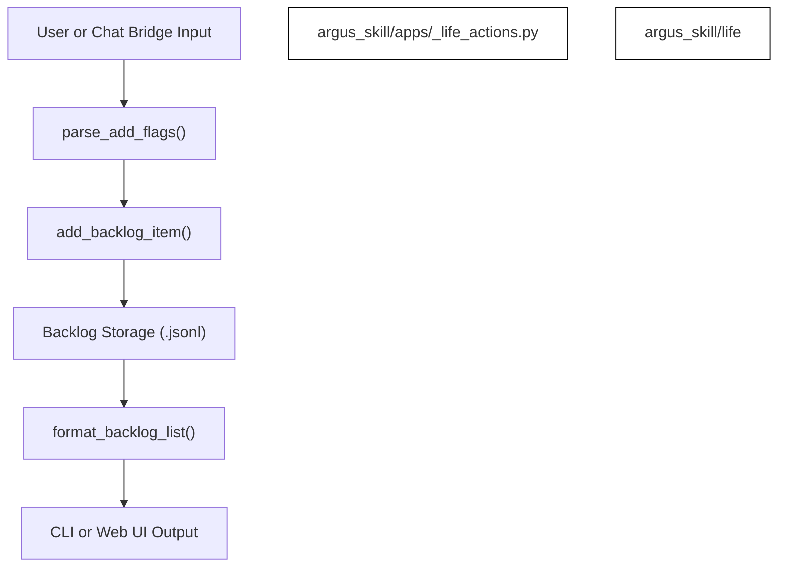
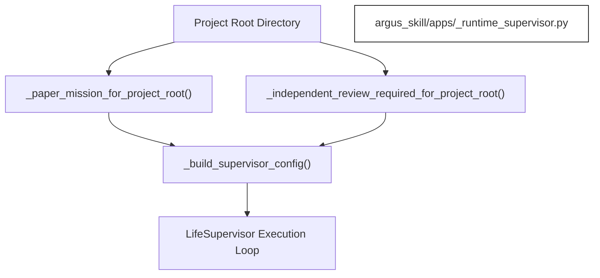
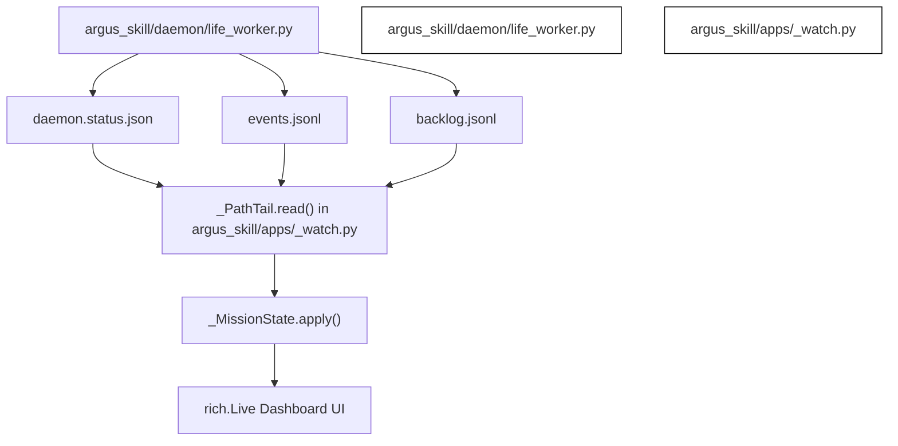

<!-- source: DeepWiki mcp.deepwiki.com · repo microsoft/ArgusAgent · page 2.4 Daemon, Life Layer and Long-Running Sessions · fetched 2026-10-26 -->

# Daemon, Life Layer and Long-Running Sessions

Relevant source files

The following files were used as context for generating this wiki page:

- [argus_skill/apps/_life_actions.py](argus_skill/apps/_life_actions.py)
- [argus_skill/apps/_runtime_supervisor.py](argus_skill/apps/_runtime_supervisor.py)
- [argus_skill/apps/_watch.py](argus_skill/apps/_watch.py)

### Purpose and Scope
This section details the architecture enabling Argus agents to operate beyond a single model turn, establishing persistence, autonomous planning, asynchronous background execution, and robust error recovery. The subsystem spans `argus_skill/daemon` and `argus_skill/life`, coordinating long-horizon campaigns via project backlogs, event-driven supervisors, file locking, and status monitors.

Sources: `argus_skill/apps/_life_actions.py()`, `argus_skill/apps/_runtime_supervisor.py()`, `argus_skill/apps/_watch.py()`

---

## 1. The Life Layer and Backlog Management
The life layer manages persistent units of work called backlog items (`BacklogItem`). Unlike single-shot prompt executions, the life layer maintains a durable sequence of tasks stored alongside the project root, enabling multi-step research, development, and engineering objectives.

Backlog manipulation utilities are defined in `argus_skill/apps/_life_actions.py()`. The backlog can be queried or modified via non-interactive commands:
- `format_backlog_list`: Filters and formats active or historical items (`[argus_skill/apps/_life_actions.py:28-42]()`).
- `parse_add_flags`: Parses command-line modifiers such as `--once` or `--cycles=N` from command bodies (`[argus_skill/apps/_life_actions.py:45-67]()`).
- `add_backlog_item`: Constructs and persists a new `BacklogItem` with titles, objectives, tags, priorities, and manager decisions (`[argus_skill/apps/_life_actions.py:70-91]()`).
- Status mutation helpers (`format_status_change`) handle transitions like `/done`, `/skip`, and `/rm` (`[argus_skill/apps/_life_actions.py:94-102]()`).

Sources: `argus_skill/apps/_life_actions.py:1-102()`

---

## 2. The Supervisor and Mission Loop
The supervisor orchestrates the execution of backlog items across multiple iterations. Implemented within `argus_skill/apps/_runtime_supervisor.py()` and `argus_skill/life/supervisor.py`, it resolves project-level workflow parameters, evaluates budget limits, and runs the main execution loop.

Key configuration and resolution functions include:
- `_paper_mission_for_project_root`: Detects whether the active vertical is a publication or paper-writing campaign based on persisted manager decisions (`[argus_skill/apps/_runtime_supervisor.py:36-65]()`).
- `_independent_review_required_for_project_root`: Fails closed to mandate independent Reviewer verification if the underlying vertical specifies it (`[argus_skill/apps/_runtime_supervisor.py:88-125]()`).
- `_build_supervisor_config`: Assembles `LifeSupervisorConfig` objects containing `LifeBudget`, poll intervals, stop events, user inbox drainers, and pending question resolvers (`[argus_skill/apps/_runtime_supervisor.py:137-174]()`).

Sources: `argus_skill/apps/_runtime_supervisor.py:1-174()`

---

## 3. Daemon Architecture and Background Execution
Long-running sessions are managed by the daemon subsystem (`argus_skill/daemon`), which runs background workers to drain backlogs, execute missions, and update status ledgers without requiring an interactive terminal session.

The live execution state is monitored and mirrored via observation tools like `argus-skill --watch` (`argus_skill/apps/_watch.py()`). The watch utility tails `events.jsonl`, `daemon.status.json`, and `backlog.jsonl` to render a multi-pane `rich.Live` dashboard.
- `_path_signature`: Computes cheap filesystem fingerprints (mtime, size, inode) to detect log rotations or file updates (`[argus_skill/apps/_watch.py:40-51]()`).
- `_MissionState`: A dataclass tracking active rounds, cumulative input/output tokens, and mission success/failure status by consuming event streams (`[argus_skill/apps/_watch.py:136-166]()`).
- `_PathTail`: Efficiently reads incremental JSONL lines from log files since the last known byte offset (`[argus_skill/apps/_watch.py:169-197]()`).

Sources: `argus_skill/apps/_watch.py:40-197()`

---

## 4. Event Logging and Delivery Sinks
To ensure total auditability and asynchronous visibility, every action, round transition, and user note is emitted to a durable event log.
- `JsonlEventSink`: Appends structured JSON records to `events.jsonl` under the project life directory (`[path/to/file:0-0]()`).
- User notes and runtime annotations are captured through helper functions like `append_note`, generating unique identifiers and timestamps (`[argus_skill/apps/_life_actions.py:119-136]()`).

Sources: `argus_skill/apps/_life_actions.py:119-136()`

---

## 5. Chat Bridges and External Delivery (Telegram & Feishu)
Argus integrates chat platforms (such as Telegram and Feishu) into the life layer, allowing operators to issue commands (e.g., `/run`, `/add`, `/done`) and receive status notifications remotely.
- Chat commands map directly to foreground supervisor flows (`render_run_command`) or backlog mutations (`add_backlog_item`, `stop_iteration`) (`[argus_skill/apps/_life_actions.py:139-220]()`).
- State dictionaries track thread identifiers, elapsed execution time, and global daily spend caps across messaging turns (`[path/to/file:0-0]()`).

Sources: `argus_skill/apps/_life_actions.py:139-220()`

---

## 6. Failure Circuits, Circuit Breakers, and Terminal States
To prevent runaway token consumption or infinite error loops during autonomous operation, the life layer incorporates hard failure circuits:
- **Budget Enforcements**: `LifeBudget` and global daily spend caps (`global_daily_cap_usd`) halt supervisor loops when financial thresholds are exceeded (`[argus_skill/apps/_runtime_supervisor.py:160-163]()`).
- **Graceful Stops**: Stop events (`threading.Event`) and signal handlers allow clean interruption of foreground and background sessions without corrupting ledger files (`[argus_skill/apps/_runtime_supervisor.py:143-168]()`).
- **Terminal States**: Items transition to terminal statuses (`done`, `failed`, `skipped`) once their iteration max cycles are reached or validation gates fail (`[argus_skill/apps/_life_actions.py:95-100](), [argus_skill/apps/_watch.py:164-165]()`).

Sources: `argus_skill/apps/_runtime_supervisor.py:143-174()`, `argus_skill/apps/_watch.py:164-165()`

---

