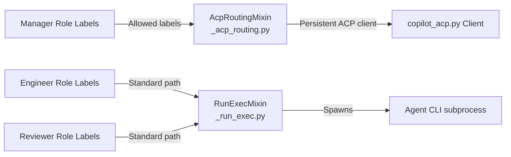
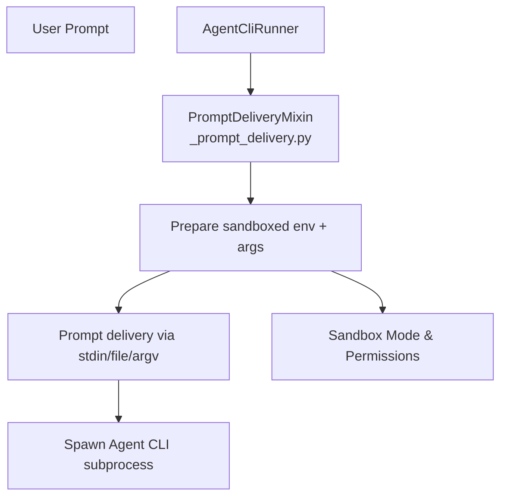
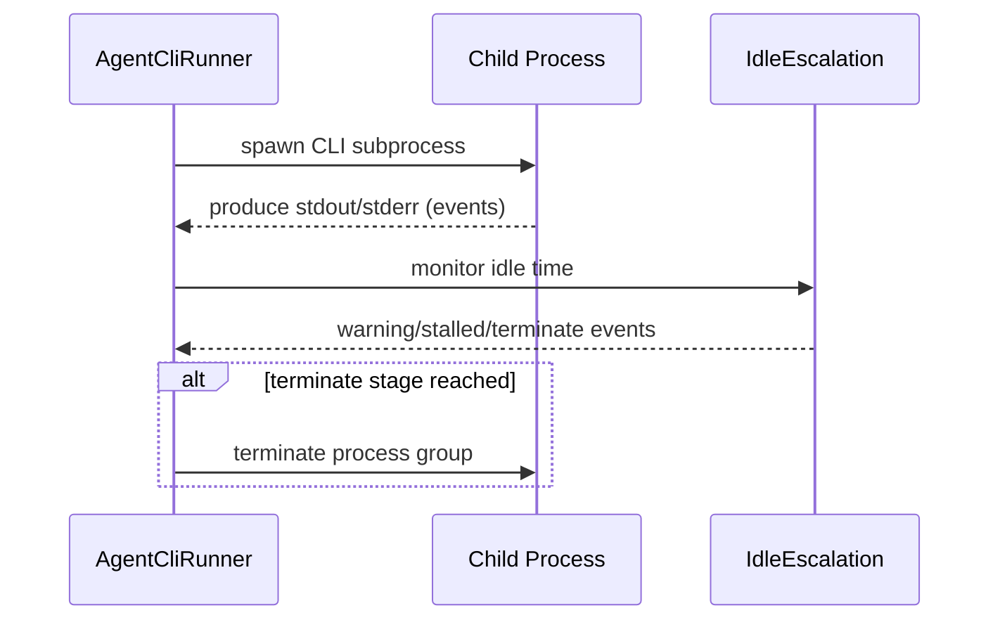
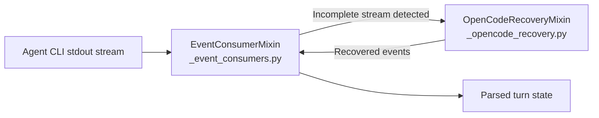
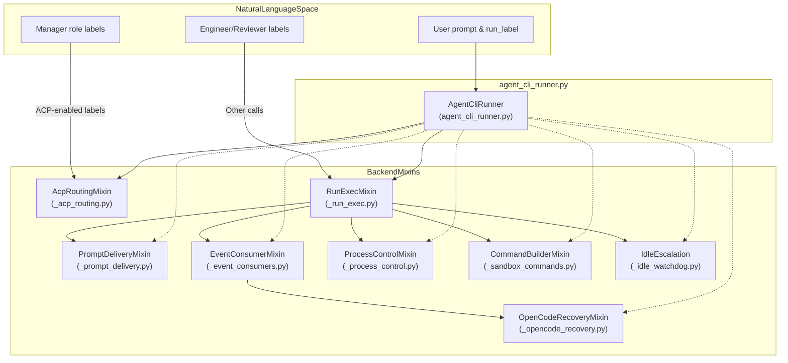

<!-- source: DeepWiki mcp.deepwiki.com · repo microsoft/ArgusAgent · page 3.1 agent_cli Runner Internals · fetched 2026-10-26 -->

# agent_cli Runner Internals

<details>
<summary>Relevant source files</summary>

The following files were used as context for generating this wiki page:

- [argus_skill/agent_cli/LICENSE](argus_skill/agent_cli/LICENSE)
- [argus_skill/agent_cli/_acp_routing.py](argus_skill/agent_cli/_acp_routing.py)
- [argus_skill/agent_cli/_dsh_overlay.patch.yml](argus_skill/agent_cli/_dsh_overlay.patch.yml)
- [argus_skill/agent_cli/_env.py](argus_skill/agent_cli/_env.py)
- [argus_skill/agent_cli/_event_consumers.py](argus_skill/agent_cli/_event_consumers.py)
- [argus_skill/agent_cli/_idle_watchdog.py](argus_skill/agent_cli/_idle_watchdog.py)
- [argus_skill/agent_cli/_opencode_recovery.py](argus_skill/agent_cli/_opencode_recovery.py)
- [argus_skill/agent_cli/_process_control.py](argus_skill/agent_cli/_process_control.py)
- [argus_skill/agent_cli/_prompt_delivery.py](argus_skill/agent_cli/_prompt_delivery.py)
- [argus_skill/agent_cli/_run_exec.py](argus_skill/agent_cli/_run_exec.py)
- [argus_skill/agent_cli/_sandbox_commands.py](argus_skill/agent_cli/_sandbox_commands.py)
- [argus_skill/agent_cli/agent_cli_runner.py](argus_skill/agent_cli/agent_cli_runner.py)
- [argus_skill/agent_cli/copilot_acp.py](argus_skill/agent_cli/copilot_acp.py)
- [argus_skill/agent_cli/copilot_home.py](argus_skill/agent_cli/copilot_home.py)
- [argus_skill/agent_cli/models.py](argus_skill/agent_cli/models.py)
- [argus_skill/agent_cli/runner_backend.py](argus_skill/agent_cli/runner_backend.py)

</details>


This page documents in detail the implementation and internal workings of the `agent_cli` runner subsystem in the Argus codebase, located primarily in the `argus_skill/agent_cli` package. This subsystem is responsible for selecting and managing the appropriate agent CLI backend (such as Codex, Claude, Copilot, OpenCode, Grok, Pi, DSH), delivering prompts safely to child CLI processes, controlling their lifecycle and streams with watchdogs, routing ACP sessions for Copilot, handling Copilot home directory isolation, recovering truncated OpenCode event streams, enforcing sandbox commands, maintaining a models registry, and applying the DSH overlay environment.

The `AgentCliRunner` class is the primary interface; its behavior is composed from several internal mixin modules covering different functionalities. This page explains the key classes, data flow, and subsystems cooperating inside `agent_cli`, supported by mermaid diagrams which bridge natural language system concepts to specific code entities.

---

## 1. Purpose and Scope

The `agent_cli` runner implements Argus's capabilities to interface with various external AI code generation/backends through their CLI interfaces. It encapsulates:

- Selecting and launching the correct CLI backend executable.
- Delivering large and sensitive prompts safely via temporary files or stdin.
- Managing the child process lifecycle with process-group management.
- Streaming and parsing backend JSON events.
- Applying sandbox policies and runtime environment isolation.
- A persistent fast-path routing for Copilot classification via ACP sessions.
- Special handling for OpenCode event recovery after truncated output.
- The DSH headless overlay environment patching and customizations.
- An idle watchdog triggering warnings, stalls, and termination if the child stalls.
- Registry and qualification of backend models and variants.
- Handling subagent/spawned agents via DSH subagent overlays.

All behavioral logic is implemented across multiple mixin classes combined inside `AgentCliRunner`, which callers invoke via `run_exec()` to execute a turn on the chosen backend.

---

## 2. agent_cli Core Class: `AgentCliRunner`

### 2.1 Overview

The `AgentCliRunner` class centralizes the runner functionality and composes multiple mixin classes each implementing a limited responsibility. It is defined in `argus_skill/agent_cli/agent_cli_runner.py` lines 93-139.

```python
class AgentCliRunner(
    AcpRoutingMixin,
    RunExecMixin,
    CommandBuilderMixin,
    PromptDeliveryMixin,
    EventConsumerMixin,
    OpenCodeRecoveryMixin,
    ProcessControlMixin,
):
    ...
```

- **Initialization** (`__init__` lines 120-139): sets the backend, resolves the CLI executable path, stores an optional event callback, applies default CLI args, and manages ACP client scope state.

- The class owns no global state beyond the ACP scope string, delegating all behavior to its composed mixins.

### 2.2 Key Responsibilities

- **Backend selection**: via constructor `backend` enum and resolution of runner binary CLI.

- **ACP session lifecycle and routing**: Maintains persistent Copilot ACP clients for fast-path Manager control-plane labels, avoiding cold start overheads.

- **Prompt delivery**: safely passing large or sensitive prompts to CLI subprocesses using temporary files or stdin.

- **Sandbox command and argv construction** for all backends — applying policies such as restricting tool usage.

- **Process control**: management of process groups, spawning, termination, and cleanup.

- **Stream processing**: turn output JSON event parsing and detection of provider turn completions or tool activity.

- **Idle watchdog**: staged escalation logic that triggers warnings, stalls, and termination when a backend stalls.

- **OpenCode recovery**: patching incomplete streams by reading intermediate session exports or local DB snapshots.

- **DSH environment patching**: for persistent, isolated environments with built-in sandbox/tool restrictions.

---

## 3. Runner Backend and ACP Routing

`agent_cli` supports multiple backends selectable at runtime. Some have special behaviors, notably Copilot's ACP fast-path.

### 3.1 ACP Routing for Copilot Manager Roles

- The `AcpRoutingMixin` (file `_acp_routing.py` lines 45-171) manages routing labeled runs through persistent ACP client processes instead of spawning one-shot CLI processes.

- A fixed, overridable allowlist of Manager run labels defines which calls use warm ACP sessions (e.g. `"manager-frontdoor-classify"`, `"manager-quick-reply"`).

- The mixin tracks ACP client scopes and manages prewarming and closing clients per scope.

- The method `_run_exec_acp` sends prompts to ACP clients and returns results or fallback to the ordinary CLI path.

- Non-manager roles or labels not in the allowlist bypass ACP routing.

### Diagram: "Natural Language Roles to ACP Routing and Code Entities"



Sources: `argus_skill/agent_cli/_acp_routing.py:45-171`(), `argus_skill/agent_cli/agent_cli_runner.py:93-139`(), `argus_skill/agent_cli/_run_exec.py:88-174`()

---

## 4. Prompt Delivery and Sandbox Environment

The `PromptDeliveryMixin` (`_prompt_delivery.py` lines 116-200) is responsible for safe passing of prompts to backends.

### 4.1 Safe Prompt Delivery

- Prompts can be very large and must not leak on process arguments.

- For most backends, prompt text is delivered via a temporary file or piped stdin.

- For `DSH` backend, since it has no stdin or `--prompt-file`, the prompt is either included as an argv string (if small enough) or written to a well-known temporary markdown file inside the working directory, with a directive argument referencing the file.

- The mixin also applies environment modifications for certain backends (e.g. disabling Pi update pings).

### 4.2 Sandbox Policies

- The sandbox is controlled at command-line argument and environment variable level.

- The sandbox can restrict tool usage (`--allow-all` vs `--allow-tool` flags), define safe write directories (`-s <mode>`), or allow full access for tests/dangerous flags.

- The prompt delivery and sandbox command construction cooperate to enforce these policies.

### Diagram: "Prompt Delivery Flow and Sandbox Environment"



Sources: `argus_skill/agent_cli/_prompt_delivery.py:116-200`(), `argus_skill/agent_cli/_sandbox_commands.py:1-190`(), `argus_skill/agent_cli/agent_cli_runner.py:93-139`()

---

## 5. Process Control and Idle Watchdog

Responsible for controlling the lifecycle of spawned CLI subprocesses, their termination, and managing idle timeouts.

### 5.1 Process Control

- The `ProcessControlMixin` (`_process_control.py` lines 55-184) provides process spawn options (hidden window on Windows, new session on POSIX), resolution of executable paths, and termination of child processes including children in separate groups.

- Supports robust termination on timeouts or keyboard interrupts.

### 5.2 Idle Watchdog

- The `IdleEscalation` dataclass (`_idle_watchdog.py` lines 12-58) manages staged idle escalation: warning, stalled, and terminate stages based on configured idle thresholds (seconds).

- Once a stage fires it only emits once until reset.

- The runner uses this to avoid silent hangs and apply scalable enforcement, especially important for backends with slow or failing operations.

### Diagram: "Process Lifecycle and Idle Watchdog"



Sources: `argus_skill/agent_cli/_process_control.py:55-184`(), `argus_skill/agent_cli/_idle_watchdog.py:12-58`()

---

## 6. Event Streaming and OpenCode Recovery

### 6.1 EventConsumers

- `EventConsumerMixin` (`_event_consumers.py` lines 81-174+) parses JSON event streams from the CLI stdout.

- It detects the end of provider turns, tool usage, assistant messages, etc., following the dialects of various backends (Copilot, Claude family, Cursor, Grok, OpenCode, Pi).

- It also accumulates multi-part messages for streaming backends like OpenCode.

### 6.2 OpenCode Recovery

- OpenCode CLI sometimes emits truncated JSON before the terminal event.

- `OpenCodeRecoveryMixin` (`_opencode_recovery.py` lines 17-181) attempts to recover the full event list by calling `opencode export <thread_id>` or, if that fails, reading the local session sqlite DB, parsing assistant message chunks, and reconstructing missing events.

- This increases robustness for OpenCode backend turns, preventing partial results.

### Diagram: "Event Consumption and OpenCode Recovery Pipeline"



Sources: `argus_skill/agent_cli/_event_consumers.py:81-174`(), `argus_skill/agent_cli/_opencode_recovery.py:17-181`()

---

## 7. Sandbox Commands and Models Registry

### 7.1 CommandBuilderMixin

- The `CommandBuilderMixin` (`_sandbox_commands.py`, partial) constructs the backend CLI command-line arguments, applying sandbox mode switches, disabling write capabilities, live search toggles, working directory isolation, and other guards.

- Ensures that dangerous flags like `--dangerously-bypass-approvals-and-sandbox` only appear when explicitly allowed.

### 7.2 Models Resolution

- There are helper functions to resolve and qualify models per backend, for example:

  - OpenCode requires provider-qualified model IDs.
  - Pi disables per-turn update pings via environment variables.
  - Logs unqualified model IDs once per backend/model combination.

- Environment-based configuration flags influence this resolution.

---

## 8. DSH (DeepSeek Shell) Overlay Handling

- `argus_skill/agent_cli/_dsh_overlay.patch.yml` is a YAML patch applied on every headless `dsh` boot (using `dsh --patch`) for:

  - Injecting default model/provider selections from environment variables.
  - Disabling all tools for Manager fast-path calls, matching prompt restrictions.
  - Setting approval policies consistent with Argus sandbox settings.
  - Configuring subagent models to inherit or override from parents.

- This patch ensures consistent runtime environments and policy enforcement inside the DSH ecosystem.

---

## 9. Data Flow Summary

### Mermaid Diagram: End-to-End Execution Flow



---

## 10. Summary of Key Functions and Classes

| Code Entity                          | Location                                 | Description                                    |
|------------------------------------|------------------------------------------|------------------------------------------------|
| `AgentCliRunner`                   | `agent_cli_runner.py:93-139`              | Main runner class composed of all internal mixins. Handles CLI backend turns.      |
| `AcpRoutingMixin`                  | `_acp_routing.py:45-171`                   | Manages Copilot ACP persistent client fast-path routing for Manager labels.       |
| `PromptDeliveryMixin`              | `_prompt_delivery.py:116-200`              | Controls safe passing of large prompts to CLI subprocesses, temp files, stdin.    |
| `RunExecMixin`                    | `_run_exec.py:88-174`                      | Public `run_exec()` interface and phased implementation: start gate, spawn, stream, finalize. |
| `EventConsumerMixin`               | `_event_consumers.py:81-174`                | Parses backend JSON event streams, detects tool usage and turn completion.         |
| `OpenCodeRecoveryMixin`            | `_opencode_recovery.py:17-181`              | Recovers truncated OpenCode CLI event streams via session export or DB read.      |
| `ProcessControlMixin`              | `_process_control.py:55-184`                 | Subprocess spawning, termination, executable resolution, and process group handling. |
| `IdleEscalation`                   | `_idle_watchdog.py:12-58`                   | Idle watchdog stages for escalation: warning, stalled, termination.               |
| `CommandBuilderMixin`              | `_sandbox_commands.py:1-190`                 | Constructs CLI commands with sandbox and tool usage policy enforcement.            |

---

## 11. Environment Tuning and Models Registry

- Environment variables prefixed with `ARGUS_SKILL_` tune runner behavior (e.g. idle timeouts, prompt delivery, capture line counts).

- Model identifiers are qualified according to backend rules. For example, OpenCode requires provider/model format (`provider/modelid`).

- Pi disables telemetry and update pings via special env vars in the child process environment.

- Warnings are logged once per unqualified model/backend combination to encourage explicit config.

---

# References and Sources

- `argus_skill/agent_cli/agent_cli_runner.py:18-139`  
- `argus_skill/agent_cli/_acp_routing.py:45-171`  
- `argus_skill/agent_cli/_prompt_delivery.py:116-200`  
- `argus_skill/agent_cli/_run_exec.py:88-174`  
- `argus_skill/agent_cli/_event_consumers.py:81-174`  
- `argus_skill/agent_cli/_opencode_recovery.py:17-181`  
- `argus_skill/agent_cli/_idle_watchdog.py:12-58`  
- `argus_skill/agent_cli/_process_control.py:55-184`  
- `argus_skill/agent_cli/_sandbox_commands.py:1-190`  
- `argus_skill/agent_cli/_dsh_overlay.patch.yml`  

---

This concludes the comprehensive internal technical overview of agent_cli runner mechanisms in Argus.

---

