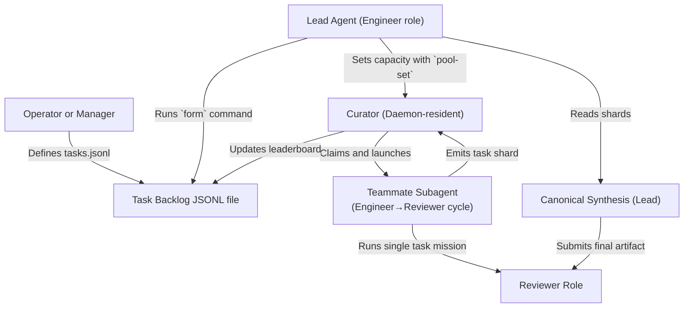
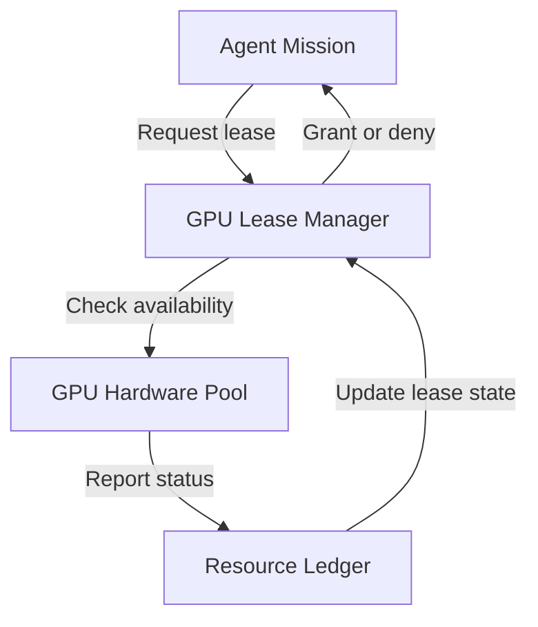
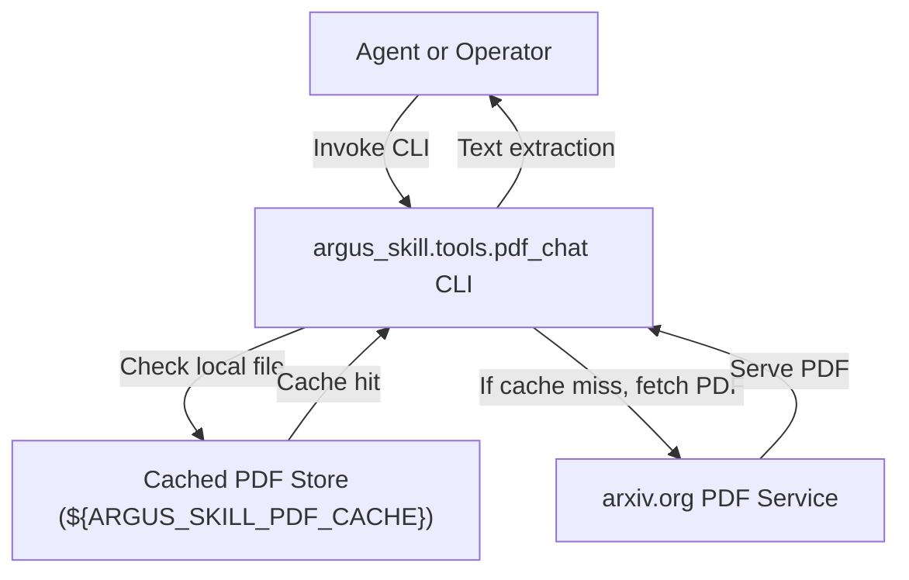
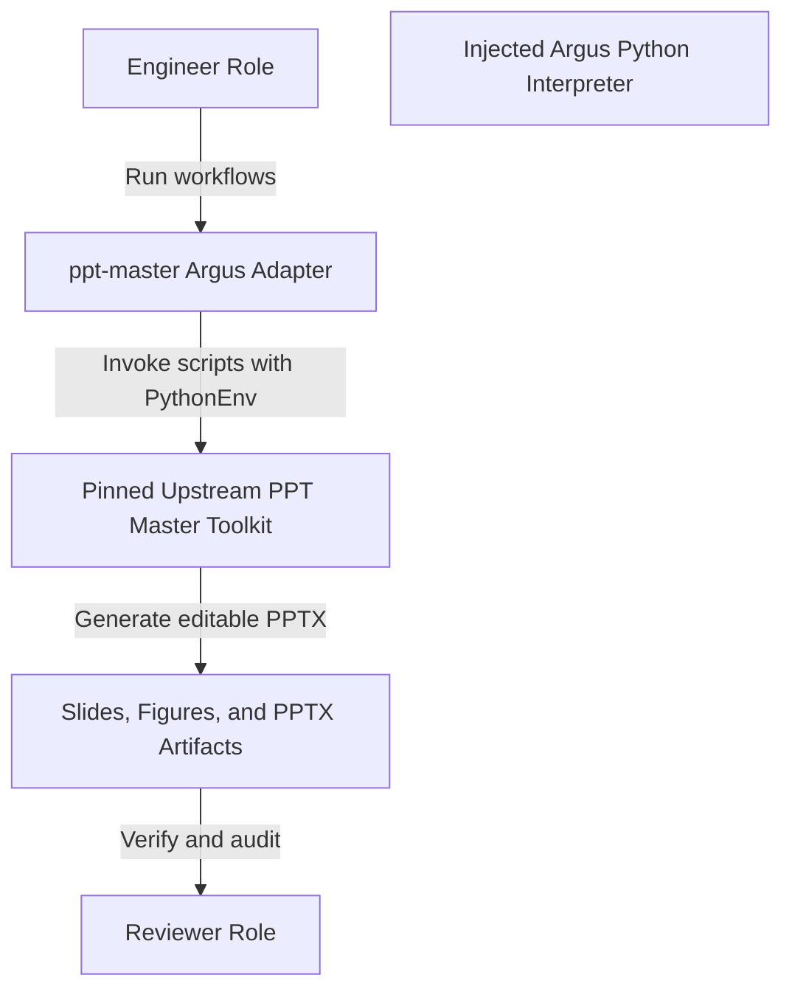

<!-- source: DeepWiki mcp.deepwiki.com · repo microsoft/ArgusAgent · page 3.3 Tools, Subagents and Resource Ledger · fetched 2026-10-26 -->

# 3.3 Tools, Subagents and Resource Ledger

<details>
<summary>Relevant source files</summary>

The following files were used as context for generating this wiki page:

- [argus_skill/builtin_skills/agent-team-lead.md](argus_skill/builtin_skills/agent-team-lead.md)
- [argus_skill/builtin_skills/engineer/pdf-chat.md](argus_skill/builtin_skills/engineer/pdf-chat.md)
- [argus_skill/builtin_skills/engineer/presentation-master.md](argus_skill/builtin_skills/engineer/presentation-master.md)

</details>


This section covers the implementation and technical details of key supporting infrastructure and utilities within ArgusAgent, specifically those within the `argus_skill/tools` module. These include management of subagent pools for team execution, GPU leasing and load distribution, the capability vault, the resource ledger, and specialized tools such as the Jacobian bridge, Lean environment checks, PDF Chat, and the PPT Master integration. These components facilitate scalable, parallel autonomous agent workflows, efficient hardware resource management, capability access control, and extended utility tooling relevant to typical Argus research and engineering missions.

---

## 3.3.1 Subagent Pool and Team Execution

### Purpose and Overview

Within ArgusAgent's autonomous workflows, some tasks benefit from parallel execution by multiple subagents referred to as teammates. The subagent pool abstraction supports this by managing a set of concurrent, independent worker missions coordinated under a lead agent, forming what is called a "team." This approach allows parallelizing genuinely independent subtasks which satisfy non-overlapping path ownership constraints and have their own acceptance criteria.

The core philosophy is to initiate subagents only when true parallelism is beneficial: non-overlapping file path ownership (`owns_paths`), disjoint writable outputs, and measurable, separate acceptance evidence. The lead agent drives backlog construction, canonical synthesis, and final review, whereas the Curator manages lifecycle operations such as claims, launches, reaping, and pool capacity.

### Key Concepts and Workflow

- **Team Lead Role**: The lead forms and manages the team by maintaining the priority backlog of tasks, enforcing ownership constraints, and synthesizing results.
- **Curator Responsibilities**: The daemon-resident Curator claims tasks, starts new teammates, monitors progress, refills vacancies, and handles lifecycle events such as draining and dissolving the pool.
- **Backlog Manipulation**: Teams are formed and refreshed via CLI with the `python -m argus_skill.tools.team` command suite, ingesting a JSONL `tasks.jsonl` file describing each task's ID, title, objective, acceptance criteria, owned paths, dependencies, and additional optional fields (`priority`, `timeout_s`, `cwd`, etc.).
- **Task Lifecycle**: Each task undergoes a full Engineer→Reviewer mission cycle performed by a single subagent which then exits. On completion, results are validated and merged via the lead. Blocking conditions (e.g., awaiting operator input) place tasks into a blocked state, preserved until resumption via explicit commands.

### Important Details

- The subagent pool prevents overlapping writable file sets across tasks; `owns_paths` is advisory, not sandbox-enforced.
- The lead is the sole canonical synthesis writer. Teammates output only task-local shards.
- Resource constraints such as capacity and provider availability are respected.
- Lists of files or shared mutable outputs must not be written in parallel by teammates.
- The coordinator commands include:
  - `form` to generate or refresh the backlog.
  - `pool-set` to adjust width and state.
  - `status` to observe progress.
  - `resume` to continue blocked tasks.
  - `dissolve` to gracefully shut down the pool after final synthesis.

### System Flow Diagram: Subagent Pool Team Execution



### Code References

- The "Agent Team Lead" policy is documented and defined in `argus_skill/builtin_skills/agent-team-lead.md` which details role authority, task contracts, patterns for formation and synthesis, and commands used to control the team lifecycle.
- CLI tools such as `form`, `pool-set`, `status`, `resume`, and `dissolve` are part of the `argus_skill.tools.team` submodule, responsible for managing the subagent pool state.
  
Sources: `argus_skill/builtin_skills/agent-team-lead.md` lines 6-83.

---

## 3.3.2 GPU Lease, Ownership and Load Management

Argus supports efficient hardware resource management through leasing mechanisms and load tracking, especially for GPU resources critical in large model inference workloads and agent acceleration.

### Core Models

- **GPU Leasing**: Agents acquire leases on specific hardware units to guarantee exclusive or semi-exclusive access during mission execution. This prevents contention and overload.
- **Ownership Tracking**: The lease system monitors which agents currently hold leases on which GPUs, reclaiming expired or released leases to enable reuse.
- **Load Distribution**: The leasing system can balance load across GPU units, considering capacity, availability, and concurrent demand.

### Implementation Notes

- GPU leases are normally represented as ephemeral locks or daemon locks with timeout and renewal semantics.
- Ownership states and lease assignment are recorded in the resource ledger to maintain global consistency.
- The agent CLI backends consult the lease system when selecting models that require GPU execution.
- Leases enforce hardware assignment boundaries, improving stability under parallel agent executions.

### Data Flow Diagram: GPU Lease Management in Resource Ledger



Sources: Module inferred from mentions in team execution and resource ledger notes — no direct code file provided.

---

## 3.3.3 Capability Vault and Resource Ledger

### Capability Vault

Argus maintains a **capability vault** which is a controlled store of special abilities or system access credentials that various components or subagents may require. This vault controls access permissions and secrets and is designed to be secure and auditable.

- Manages access control to sensitive capabilities via discrete tokens or API keys.
- Capabilities may be dynamically granted or revoked based on mission phase or role.
- Allows role-based access control to external systems or internal privileged operations.


### Resource Ledger

The **resource ledger** is a core central ledger tracking consumption and allocation of system resources across the entire Argus session/project lifecycle. This ledger:

- Records usage metrics for CPU, GPU, memory, net, and other relevant platform resources.
- Maintains state of leases, licenses, and hardware assignments.
- Is updated synchronously with agent lifecycle events, resource state transitions, and capability grants.
- Serves as authoritative record for billing, reporting, quota enforcement, and load balancing.

The resource ledger tightly integrates with the leasing system, capability vault, and subagent pool modules to ensure consistency in resource allocation.


---

## 3.3.4 Lean Environment Checking and Jacobian Bridge

The **Lean checking** tooling provides static and semantic verification capabilities within Argus to ensure code correctness in domain-specific contexts, especially mathematical proof checking or symbolic reasoning.

The **Jacobian bridge** facilitates interfacing or translating between external proof systems or symbolic engines and the Argus agent runtime, allowing agents to call out to specialized verification engines and integrate results back into the mission context.

- Lean checking acts as a lightweight interface and checker for scientific domains.
- The Jacobian bridge manages remote or complex proof calls as subtasks.
- These tools enable verification-driven workflows within the Argus agent process.

Sources: Referenced in description but no explicit file content provided for detailed code references.

---

## 3.3.5 PDF Chat: Progressive PDF Reading Tool

### Description

The **PDF Chat** tool provides an Argus-native progressive PDF reader implemented in Python that allows agents or users to inspect academic PDF documents methodically rather than loading them entirely into context.

### Features

- Supports incremental reading starting with the document head (page count and TOC), then brief abstract and introduction, then targeted section(s), page ranges, or full text.
- Utilizes system's `pdftotext` CLI tool, falling back on `pypdf` for text extraction.
- Handles local PDF file paths or downloadable arXiv IDs, caching retrieved PDFs locally.
- Outputs JSON with text, sections, and metadata on stdout.
- Enables workflows like:
  - Reviewer-style re-reading of a generated paper.
  - Planner inspecting abstracts or related work papers.
  - Authors querying specific paper sections without costly context pollution.

### Usage and CLI Surface

```bash
python -m argus_skill.tools.pdf_chat <subcommand> <source> [options]
```

Where `<source>` can be a local file or arXiv ID like `2509.12345`.

Subcommands:

| Subcommand | Output                                               |
|------------|-----------------------------------------------------|
| head       | Page count, detected TOC, first two pages preview  |
| brief      | Abstract + first ~600 chars of Introduction         |
| section    | Text content of a named section (case-insensitive) |
| page       | Text of one or range of pages                        |
| full       | Full concatenated text truncated to 200 KB          |

### Recommended Workflow

1. Use `head` to map sections.
2. Use `brief` to assess relevance.
3. Use `section` to read targeted parts.
4. Use `page` for page-specific queries.
5. Use `full` sparingly due to its context cost.

### Error Handling

- If the PDF is missing or fetch fails, the tool surfaces explicit errors suggesting retries or fixes.

### System Diagram: PDF Chat Tool Interaction



Sources: `argus_skill/builtin_skills/engineer/pdf-chat.md` lines 2-76.

---

## 3.3.6 PPT Master: Presentation and Paper Figure Tool Adapter

### Overview

The **PPT Master** tool integrates an audited, pinned external toolkit specializing in generating professional-grade PowerPoint (PPTX) slides and figures tailored for research environments.

### Features

- Generates LiveFigure-style conceptual figures for research papers and presentations.
- Supports multiple upstream usage routes: Generate PPTX, Create Template, Fill Native PPTX, and Enhance Native PPTX.
- Produces output compatible with native PowerPoint drawing objects (SVG/design-spec to DrawingML).
- Allows procedural composition and visual critique workflows within Argus.
- Can operate without generative image backends like image-2.
  
### Usage

The adapter is a thin Argus wrapper around the full upstream repository pinned to a specific commit. It does not replace or summarize the toolkit but invokes it safely and reproducibly.

Typical usage:

- `$SKILL_DIR` points to the installed toolkit under `${ARGUS_SKILL_HOME:-$HOME/.argus-skill}/tools/ppt-master/skills/ppt-master`.
- Scripts should be run with the injected Python interpreter from Argus (`${ARGUS_SKILL_PYTHON}`), not a bare system `python` to ensure audited dependencies.
- Operators should run status checks with `argus-skill --ppt-master-status` and use `--install-ppt-master` to manage installation.

### Argus Compatibility

- All generated output is stored in mission working directories, never inside the installed toolkit.
- Upstream update scripts are disabled to maintain auditable dependency versions.
- Upstream role switches are modes within Engineer missions and do not replace Argus role architecture.
- Blocking confirmation gates from upstream are respected or deferred to the Argus operator.
- The tool preserves editable PowerPoint artifacts so that Reviewer roles can verify exact content.
- Optional image generation requires correctly configured backends and never fabricates secret or protected content.

### Summary Table of Upstream Routes

| Route               | Purpose                              |
|---------------------|------------------------------------|
| Generate PPTX       | Full slide deck creation            |
| Create Template     | Master templates for slides         |
| Fill Native PPTX    | Filling placeholders or content     |
| Enhance Native PPTX | Post-processing enhancements        |

### Dependency and Installation Notes

- The upstream repo is MIT-licensed and pinned for reproducibility.
- Operators must not silently update or clone inside mission execution.
- Documentation and workflows are authoritative and should be followed strictly.

### System Diagram: PPT Master Integration Flow



Sources: `argus_skill/builtin_skills/engineer/presentation-master.md` lines 1-115.

---

# Summary

This section explained detailed mechanisms in the Argus ecosystem supporting:

- Parallel subagent management with a curated team subagent pool controlled by a lead agent and a daemon-resident Curator.
- GPU leasing and ownership tracking to ensure efficient resource usage and load balancing.
- Capability vault and resource ledger maintaining access control and precise resource accounting.
- Lean and Jacobian tooling for formal verification and symbolic reasoning integration.
- The PDF Chat utility enabling incremental PDF text extraction for research use-cases.
- The PPT Master toolkit integration delivering rich, procedural PowerPoint slide and figure generation with strict upstream dependency audit and role compatibility.

Each of these tools and services is designed to augment ArgusAgent's autonomous workflows with scalable, efficient, auditable, and maintainable operations, adhering to rigorous engineering and governance policies within the system architecture.

---

# Diagrams Bridging Natural Language System Names to Code Entities

### Diagram 1: Subagent Pool and Team Execution Components

```mermaid
classDiagram
  class "Agent Team Lead (policy)"{
    <<file:argus_skill/builtin_skills/agent-team-lead.md>>
    +form()
    +pool-set()
    +status()
    +resume()
    +dissolve()
  }
  class Curator {
    manages_claims()
    launches_teammates()
    reaps_teammates()
  }
  class Teammate {
    EngineerMission()
    ReviewerMission()
  }
  class Review {
    ReviewerRole()
  }

  "Agent Team Lead (policy)" --|> Curator : controls
  Curator --> Teammate : manages
  Teammate --|> Review : executes missions for  
  "Agent Team Lead (policy)" --> Review : final synthesis submission
```

### Diagram 2: PDF Chat Tool Detail Linking CLI to Cache and arXiv

```mermaid
graph LR
  subgraph Argus CLI Tool ["argus_skill.tools.pdf_chat"]
    CLI[CLI Interface]
    Cache[PDF Cache (${ARGUS_SKILL_PDF_CACHE})]
    Arxiv[arxiv.org PDF Downloader]
  end

  User --> CLI
  CLI --> Cache
  CLI -->|Cache Miss| Arxiv
  Arxiv --> Cache
  Cache --> CLI
  CLI --> User
```

---

# References and Sources

- `argus_skill/builtin_skills/agent-team-lead.md` [6-83]()
- `argus_skill/builtin_skills/engineer/pdf-chat.md` [2-76]()
- `argus_skill/builtin_skills/engineer/presentation-master.md` [1-115]()

---

