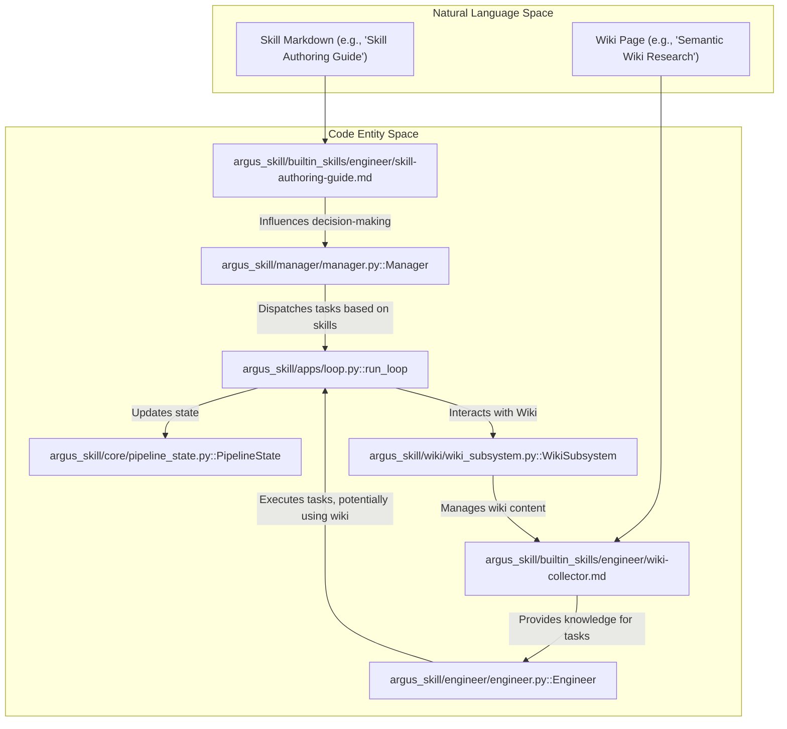
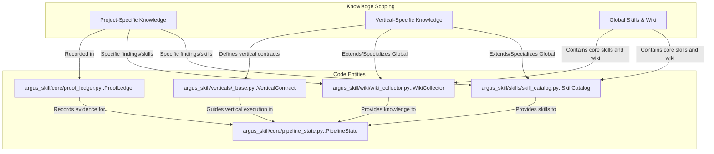

<!-- source: DeepWiki mcp.deepwiki.com · repo microsoft/ArgusAgent · page 4 Skills, Wiki and Knowledge Accumulation · fetched 2026-10-26 -->

# Skills, Wiki and Knowledge Accumulation

Relevant source files

The following files were used as context for generating this wiki page:

- [argus_skill/builtin_skills/__init__.py](argus_skill/builtin_skills/__init__.py)
- [argus_skill/builtin_skills/engineer/skill-authoring-guide.md](argus_skill/builtin_skills/engineer/skill-authoring-guide.md)
- [argus_skill/builtin_skills/engineer/wiki-collector.md](argus_skill/builtin_skills/engineer/wiki-collector.md)

Argus is designed to continuously improve its capabilities and knowledge without requiring explicit retraining of its underlying language models. This page provides a high-level overview of how Argus achieves this through its "Skills" and "Wiki" subsystems, which allow it to accumulate and apply expertise across different scopes: project-specific, vertical-specific, and global.

Skills represent distilled expertise and methodologies that guide Argus's actions, while the Wiki serves as a structured knowledge base for factual findings and evidence. Together, they enable Argus to learn from its experiences, generalize solutions, and maintain a verifiable record of its understanding.

For detailed information on specific aspects, please refer to the child pages:
- [Built-in Skill Catalog](#4.1) — A tour of the pre-packaged skills.
- [Skill Authoring and Review Lifecycle](#4.2) — How new skills are created, refined, and integrated.
- [Wiki and Proof Ledger](#4.3) — The structure and function of Argus's knowledge base.

## Skills: Distilled Expertise for Action

Skills are the operational knowledge units within Argus. They encapsulate reusable methods, best practices, and problem-solving strategies that an agent can apply to various tasks. Unlike traditional code, skills are often expressed in natural language (Markdown) and are designed to be read and interpreted by other agents, fostering a continuous learning and refinement cycle.

The core idea behind skills is to generalize lessons from specific missions into broadly applicable expertise. When an agent encounters a novel problem or identifies a more efficient approach, this learning can be codified into a new skill or used to optimize an existing one. This process ensures that successful strategies are captured and made available for future use, preventing the re-discovery of solutions.

### Skill Authoring and Evolution

The creation and refinement of skills are guided by meta-skills like `engineer/skill-authoring-guide.md` [argus_skill/builtin_skills/engineer/skill-authoring-guide.md:1-71](). This guide outlines the principles for writing effective skills, emphasizing generalization over transcription, and focusing on methods rather than specific answers. Skills are categorized into modes:
- **CREATE**: For entirely new problem classes [argus_skill/builtin_skills/engineer/skill-authoring-guide.md:20-25]().
- **OPTIMIZE**: To sharpen existing skills based on new insights [argus_skill/builtin_skills/engineer/skill-authoring-guide.md:27-30]().
- **ABSORB**: To integrate successful patterns into existing skills [argus_skill/builtin_skills/engineer/skill-authoring-guide.md:32-35]().

The quality bar for skills is high, demanding real expertise, actionable guidance, and honesty about limitations [argus_skill/builtin_skills/engineer/skill-authoring-guide.md:38-50](). This ensures that the skill base remains valuable and does not accumulate "false learning" [argus_skill/builtin_skills/engineer/skill-authoring-guide.md:53-59]().

For a detailed exploration of the skill catalog and the authoring process, see [Built-in Skill Catalog](#4.1) and [Skill Authoring and Review Lifecycle](#4.2).

Sources:
- [argus_skill/builtin_skills/__init__.py:1-2]()
- [argus_skill/builtin_skills/engineer/skill-authoring-guide.md:1-71]()

## Wiki: Source-Linked Knowledge Accumulation

The Argus Wiki serves as a structured repository for declarative knowledge, findings, and evidence. Unlike skills, which focus on *how* to do things, the Wiki focuses on *what* is known. It is designed to store factual information, research findings, and insights, always linked back to their primary sources. This source-linking is crucial for maintaining the verifiability and trustworthiness of the knowledge base.

The Wiki is organized semantically, with pages dedicated to specific concepts or findings. A key principle is to avoid creating a "source database" or arbitrary tags; instead, knowledge is integrated directly into semantically named pages [argus_skill/builtin_skills/engineer/wiki-collector.md:28-29]().

### Knowledge Collection and Verification

The process of collecting and integrating knowledge into the Wiki is guided by skills such as `engineer/wiki-collector.md` [argus_skill/builtin_skills/engineer/wiki-collector.md:1-49](). This skill outlines a workflow for identifying knowledge gaps, searching primary sources, and updating minimal semantic Wiki pages. It emphasizes:
1.  **Concrete Queries**: Deriving specific questions from identified knowledge gaps [argus_skill/builtin_skills/engineer/wiki-collector.md:13]().
2.  **Primary Sources**: Fetching real primary sources or repository artifacts, never fabricating citations [argus_skill/builtin_skills/engineer/wiki-collector.md:14]().
3.  **Semantic Pages**: Creating or refining semantically named pages under `pages/` if evidence supports durable knowledge [argus_skill/builtin_skills/engineer/wiki-collector.md:15-16]().
4.  **Source Citation**: Citing real URLs or artifact paths within the page body [argus_skill/builtin_skills/engineer/wiki-collector.md:17]().
5.  **INDEX.md**: Maintaining a concise semantic link in `INDEX.md` [argus_skill/builtin_skills/engineer/wiki-collector.md:19]().

The Wiki also supports an "Optional Insight" section [argus_skill/builtin_skills/engineer/wiki-collector.md:31-49]() where interpretations, non-obvious patterns, or hypotheses can be captured, explicitly labeled as interpretations rather than established facts. This allows for the accumulation of higher-level understanding while maintaining a clear distinction from raw factual evidence.

For a deeper dive into the Wiki's structure and the proof ledger, see [Wiki and Proof Ledger](#4.3).

Sources:
- [argus_skill/builtin_skills/engineer/wiki-collector.md:1-49]()

## Bridging Natural Language and Code Entities

The interaction between natural language descriptions of skills and wiki entries, and their underlying code implementation, is crucial for Argus's operation. Skills, while written in Markdown, directly influence the execution paths and decision-making logic within the Argus runtime.

### Diagram: Skill-Driven Execution Flow

**Diagram 1: Skill and Wiki Influence on Argus Runtime**

This diagram illustrates how the natural language content of skills and wiki pages (`A`, `B`) directly maps to specific Markdown files in the codebase (`C`, `D`). These files are then interpreted by core Argus components like the `Manager` (`G`) and `Engineer` (`H`) roles, influencing their decision-making and task execution within the `run_loop` (`F`). The `WikiSubsystem` (`I`) is the code entity responsible for managing and interacting with the wiki content.

Sources:
- [argus_skill/builtin_skills/engineer/skill-authoring-guide.md:1-71]()
- [argus_skill/builtin_skills/engineer/wiki-collector.md:1-49]()
- [argus_skill/core/pipeline_state.py]()
- [argus_skill/apps/loop.py]()
- [argus_skill/manager/manager.py]()
- [argus_skill/engineer/engineer.py]()
- [argus_skill/wiki/wiki_subsystem.py]()

### Diagram: Knowledge Flow and Scoping

**Diagram 2: Knowledge Flow and Scoping within Argus**

This diagram illustrates how knowledge is scoped within Argus, from project-specific findings to global skills and wiki entries. The `SkillCatalog` (`K`) and `WikiCollector` (`W`) are central code entities that manage the aggregation and retrieval of skills and wiki content across these scopes. `VerticalContract` (`VC`) defines the boundaries and expectations for vertical-specific knowledge, while the `ProofLedger` (`PL`) records evidence, ensuring that all accumulated knowledge is verifiable and linked to its source. All this knowledge ultimately feeds into the `PipelineState` (`PS`) to inform agent actions.

Sources:
- [argus_skill/skills/skill_catalog.py]()
- [argus_skill/wiki/wiki_collector.py]()
- [argus_skill/core/proof_ledger.py]()
- [argus_skill/verticals/_base.py]()
- [argus_skill/core/pipeline_state.py]()

---

