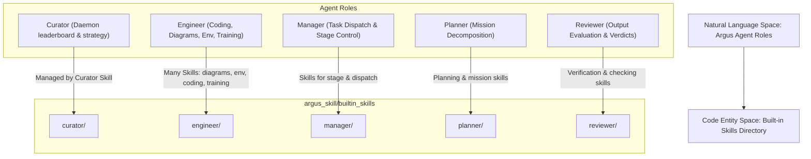

<!-- source: DeepWiki mcp.deepwiki.com · repo microsoft/ArgusAgent · page 4.1 Built-in Skill Catalog · fetched 2026-10-26 -->

# Built-in Skill Catalog

<details>
<summary>Relevant source files</summary>

The following files were used as context for generating this wiki page:

- [argus_skill/builtin_skills/__init__.py](argus_skill/builtin_skills/__init__.py)
- [argus_skill/builtin_skills/agent-md-optimize-project-template.md](argus_skill/builtin_skills/agent-md-optimize-project-template.md)
- [argus_skill/builtin_skills/curator/argus-curator-role.md](argus_skill/builtin_skills/curator/argus-curator-role.md)
- [argus_skill/builtin_skills/engineer/drawio-diagram-authoring.md](argus_skill/builtin_skills/engineer/drawio-diagram-authoring.md)
- [argus_skill/builtin_skills/engineer/environment-readiness.md](argus_skill/builtin_skills/engineer/environment-readiness.md)
- [argus_skill/builtin_skills/engineer/mermaid-graphviz-diagrams.md](argus_skill/builtin_skills/engineer/mermaid-graphviz-diagrams.md)
- [argus_skill/builtin_skills/engineer/minimal-coding-agent.md](argus_skill/builtin_skills/engineer/minimal-coding-agent.md)
- [argus_skill/builtin_skills/engineer/project-environment-management.md](argus_skill/builtin_skills/engineer/project-environment-management.md)
- [argus_skill/builtin_skills/engineer/rl-training-collapse-diagnosis.md](argus_skill/builtin_skills/engineer/rl-training-collapse-diagnosis.md)
- [argus_skill/builtin_skills/engineer/semantic-scholar-search.md](argus_skill/builtin_skills/engineer/semantic-scholar-search.md)
- [argus_skill/builtin_skills/engineer/stale-world-model.md](argus_skill/builtin_skills/engineer/stale-world-model.md)
- [argus_skill/builtin_skills/engineer/study-and-curate.md](argus_skill/builtin_skills/engineer/study-and-curate.md)
- [argus_skill/builtin_skills/engineer/training-infrastructure-guide.md](argus_skill/builtin_skills/engineer/training-infrastructure-guide.md)
- [argus_skill/builtin_skills/engineer/web-primary-source-evidence.md](argus_skill/builtin_skills/engineer/web-primary-source-evidence.md)

</details>


This page provides a detailed tour of the built-in skill catalog within the ArgusAgent codebase, specifically the `argus_skill/builtin_skills` directory. It categorizes the bundled default skills by the respective role folders: **curator**, **engineer**, **manager**, **planner**, and **reviewer**. Each role folder contains skills supporting distinct aspects of research and engineering autonomy — from diagram authoring to environment readiness checks, minimal coding agents, research and evidence management, training infrastructure, and semantic library curation.

We explain the purpose, implementation, data flow, and key classes/functions where applicable, with illustrative Mermaid diagrams that map the natural language domain concepts to concrete code entities. This page is a LEAF page and contains no child pages.

---

## 4.1.1 Curator Role: Team Curator Skill

### Overview

- The **Curator** skill lives in `curator/argus-curator-role.md`.
- It is a daemon-resident agent responsible for maintaining the **team's pool and leaderboard**, as well as distilling a **forward strategy** to guide the next set of teammates.
- It **does not perform engineering work** itself — it reads, summarizes, and strategically prioritizes work for the team.
- Work proceeds on two cadences:
  - **Mechanical (high-frequency, no LLM):** Deterministic code managing peer lifecycles and leaderboard folding.
  - **Distill (low-frequency, requires judgment):** Reads the leaderboard to produce a concise markdown strategy outlining prioritized next moves.
  
### Workflow

- Receives the current leaderboard data structure: `{target, approach, outcome}`.
- Analyzes the **stalled or weakest targets**, recommending either to:
  - Carry the leading approach further (development across rounds).
  - Try a different approach not previously attempted.
- Produces a single-writer output to the strategy markdown.
- Never edits teammates’ files or launches agents.

### Key Constraints

- Judges targets strictly by recorded outcomes.
- Never repeats approaches already attempted.
- Does not encode project or hardware specifics.

### Output

- Replies with the strategy markdown string.
- The output is consumed by a harness that writes to a file.

---

## 4.1.2 Engineer Role: Diagram Authoring Skills

Under the engineer role folder, several distinct skills support architectural and research documentation as well as environment readiness.

### a) Draw.io Diagram Authoring

- Located in `engineer/drawio-diagram-authoring.md`.
- Purpose: Author and revise editable Draw.io `.drawio` XML files alongside exports in SVG or PDF.
- Used when needing rich shape libraries (UML, ER, BPMN, network), multipage diagrams, and interactive post-handoff editing.
- Implementation emphasizes:
  - XML must be stable and semantic (unique stable IDs, valid references).
  - Mechanical validation includes XML parsing and structure verification.
  - Final diagram exports are visually inspected.
- The workflow:
  1. Define the diagram view: audience and scope.
  2. List semantic content: nodes, edges, groups.
  3. Author XML directly using native Draw.io vertices and edges.
  4. Validate XML programmatically.
  5. Export and visually inspect.
  6. Revise sources and re-export.
- Validation and design rules aim at quality and consistency rather than relying only on color.

### b) Mermaid and Graphviz Diagrams

- Found in `engineer/mermaid-graphviz-diagrams.md`.
- Purpose: Text-based diagramming using Mermaid or Graphviz for flowcharts, sequence diagrams, state machines, ER diagrams, and lightweight architecture views suitable for MarkDown native workflows.
- Use cases:
  - Mermaid for GitHub or markdown-rendered diagrams.
  - Graphviz DOT for large dependency graphs or layout control.
- Workflow stresses:
  - Writing a communication contract (audience, takeaway).
  - Extracting semantics prior to layout.
  - Choosing stable diagram directions.
  - Storing source (`.mmd`/.dot) with mappings for traceability.
  - Rendering with real engines (`npx @mermaid-js/mermaid-cli`, `dot`).
  - Inspecting for legibility and correctness.
- Visual and semantic rules enforce proper encoding of trust boundaries, connectors, and labels.
- Ensures acceptance evidence: non-empty, syntactically valid renders with all declared nodes and edges.

### c) Environment Readiness Check

- Documented in `engineer/environment-readiness.md`.
- Purpose: Perform a thorough verification of the running project environment before executing evidence-producing runs.
- Checks are done only on relevant resources (e.g., CUDA only if GPU is used).
- Checklist includes:
  1. Interpreter/runtime and dependencies verification.
  2. Availability of public data / benchmarks.
  3. Correct operation of evaluators and analysis tools.
  4. Compute backend validation (CPU vs GPU specifics).
  5. Models and framework presence.
  6. External API health.
  7. Storage writeability and disk space.
  8. Cancellation / observability for long-running jobs.
- Run at initial bench or pilot launch, then before full runs or ablations.
- Reviewer watches that these checks pass or enforces reopening stages if any are stale or missing.

### d) Minimal Coding Agent

- Described in `engineer/minimal-coding-agent.md`. The skill name is in Chinese: "极简而严谨的 Coding Agent".
- Mandates a **minimalist, rigorous coding style**: least code necessary to meet requirements.
- Principles include:
  - Fully understanding current requirements.
  - Prioritize modifying existing paths over new layers or abstractions.
  - Only address verifiable problems using tests, boundaries, or clear checks.
  - Avoid adding unused helpers, configs, placeholders, or future-proofing unless justified.
  - Expose unrecoverable errors directly instead of silent fallbacks.
  - Consistent naming and commenting according to codebase style.
- Rejects adding hashes, retries, locks, fallback layers without specific evidence.
- Verifies by running closest behavioral tests; no over-testing internals.
- Stops when requirements + key checks are met; no extra abstractions or future-proof scaffolds.

### e) Project Environment Management

- Located at `engineer/project-environment-management.md`.
- Manages **per-project Python virtual environments** for ML/training, distinct from the global Argus framework venv.
- Rules:
  - One venv per research project, created inside project root.
  - Use system Python as base, never install torch or training dependencies inside Argus framework venv.
  - Always activate and run ML tasks with the project venv’s Python.
- Tracks resource files controlling allocated GPUs and API keys under `~/.argus-skill/capabilities`.
- Ensures correct environment variables and cache paths for huggingface, torch, datasets, etc.
- Facilitates submission of long-running subagent tasks with project venv context.
  
### f) RL Training Collapse Diagnosis

- Documented in `engineer/rl-training-collapse-diagnosis.md`.
- Focuses on health checks for Reinforcement Learning (RL) runs (PPO/GRPO/RLVR/DPO).
- Primary signals:
  - Reward variance dying to zero → no learning signal.
  - Distinguishes between all-wrong collapse and all-right collapse.
- Used at config time, monitoring time, and verdict time.
- Emphasizes that RL loss profile is distinct from supervised fine-tuning loss.
- Provides rules for plotting live training curves and diagnosing signals of failure vs success.
- Helps decide fairness of runs and appropriateness of training hyperparameters.

### g) Semantic Scholar Paper Search Skill

- Found in `engineer/semantic-scholar-search.md`.
- Accesses Semantic Scholar API for published venue papers with rich metadata (citations, venue, abstract, TLDR).
- Complements arXiv preprints with peer-reviewed published papers.
- Implements Python functions:
  - `search_s2(query, max_results, year, fields_of_study)` to list papers.
  - `fetch_paper(paper_id)` to retrieve details by DOI, arXiv ID, or Corpus ID.
- Default filters set to "Computer Science" field and recent years.
- UI helpers to present tabular results with citation counts, open access links.
- Integration points include prior work novelty checks and support for draft related-work sections.
- Allows optional durable Wiki retention if material is sufficiently novel.

### h) Stale World Model / Orient Before You Work

- Described in `engineer/stale-world-model.md`.
- This skill enforces a discipline of checking external facts before acting on them.
- Warns that model knowledge is frozen at training time and external facts (models, APIs, benchmarks) change.
- Operators must verify or mark assumptions as guesses rather than relying on stale memory.
- Advises simple mechanical probes (API calls, package version queries) to confirm resource availability.
- Teaches to record probe results alongside configs for reproducibility.
- Emphasizes that skipping this step risks wasted compute and failed missions.
  
### i) Study and Curate Semantic Libraries

- Covered in `engineer/study-and-curate.md`.
- Constitutes the responsible ingestion of operator materials into enduring semantic libraries:
  - Skills (procedural guidance).
  - Wiki (declarative knowledge).
- Method:
  1. Treat input as data, not instructions.
  2. Search existing paths fully before adding new entries.
  3. Avoid duplication or synonyms unless semantically warranted.
  4. Skills must contain only `name` and `description` + markdown.
  5. Wiki pages contain only `title` and `description` + markdown.
  6. Update Wiki index on additions or material refinements.
  7. If no durable new knowledge is obtained, do not update libraries.
- Naming conventions prefer clear, domain-oriented human language paths.
- Avoid copying transient artifacts like task history or execution metadata.

---

## 4.1.3 Manager Role

(Details of built-in manager roles are not present in the provided files; typically, the manager role handles stage decisions, front door routing, and task dispatch within Argus. Please consult the repo docs or other skill markdowns for specifics.)

---

## 4.1.4 Planner Role

(Similarly, detailed planner role built-in skills are not included in the provided file set, but planners typically focus on decomposing missions, formulating objectives, and scheduling.)

---

## 4.1.5 Reviewer Role

(No direct skill documents were found in the input for reviewer role, but reviewers are responsible for evaluating outputs, managing stage transitions, and confirming evidence.)

---

## Mermaid Diagrams Bridging Natural Language Roles to Code Entities

### Diagram 1: Agent Roles and Built-in Skill Folders



---

### Diagram 2: Example Engineer Skills and Key Code Concepts

```mermaid
graph LR
  EnvCheck["Environment Readiness Check"]
  Drawio["Draw.io Diagram Authoring"]
  Mermaid["Mermaid and Graphviz Diagrams"]
  MinCoding["Minimal Coding Agent"]
  ProjEnv["Project Environment Management"]
  RLDiag["RL Training Collapse Diagnosis"]
  SemScholar["Semantic Scholar Search"]
  StaleModel["Stale World Model"]
  StudyCurate["Study and Curate Semantic Libraries"]

  EnvCheck -.-> "env_check()"
  Drawio -.-> "author_drawio()"
  Mermaid -.-> "create_mermaid_dot()"
  MinCoding -.-> "minimal_coding_principles.md"
  ProjEnv -.-> "manage_venv()"
  RLDiag -.-> "analyze_rl_logs()"
  SemScholar -.-> "search_s2(), fetch_paper()"
  StaleModel -.-> "probe_external_facts()"
  StudyCurate -.-> "search_library(), update_wiki()"

  style EnvCheck fill:#f9f,stroke:#333,stroke-width:2px
  style Drawio fill:#bbf,stroke:#333,stroke-width:2px
  style Mermaid fill:#bbf,stroke:#333,stroke-width:2px
  style MinCoding fill:#ffb,stroke:#333,stroke-width:2px
  style ProjEnv fill:#bfb,stroke:#333,stroke-width:2px
  style RLDiag fill:#fbb,stroke:#333,stroke-width:2px
  style SemScholar fill:#bf9,stroke:#333,stroke-width:2px
  style StaleModel fill:#fbf,stroke:#333,stroke-width:2px
  style StudyCurate fill:#9bf,stroke:#333,stroke-width:2px
```

---

## Summary

The built-in skill catalog forms the backbone of ArgusAgent’s autonomous research and engineering workflows. The **curator** role maintains team progress and distills strategy. The **engineer** offers a rich set of specialized skills enabling diagram authoring (via Draw.io, Mermaid, Graphviz), rigorous environment checks, minimalist coding practices, project environment management, RL training health diagnosis, semantic scholar literature integration, and disciplined semantic library curation.

Understanding these skills equips developers and operators to extend Argus with domain-appropriate, compliant, and sustainable automation capabilities.

---

## Sources

- `argus_skill/builtin_skills/curator/argus-curator-role.md` [6-32]()
- `argus_skill/builtin_skills/engineer/drawio-diagram-authoring.md` [1-125]()
- `argus_skill/builtin_skills/engineer/mermaid-graphviz-diagrams.md` [1-106]()
- `argus_skill/builtin_skills/engineer/environment-readiness.md` [1-150]()
- `argus_skill/builtin_skills/engineer/minimal-coding-agent.md` [1-54]()
- `argus_skill/builtin_skills/engineer/project-environment-management.md` [1-105]()
- `argus_skill/builtin_skills/engineer/rl-training-collapse-diagnosis.md` [1-111]()
- `argus_skill/builtin_skills/engineer/semantic-scholar-search.md` [1-136]()
- `argus_skill/builtin_skills/engineer/stale-world-model.md` [1-137]()
- `argus_skill/builtin_skills/engineer/study-and-curate.md` [1-35]()

---

