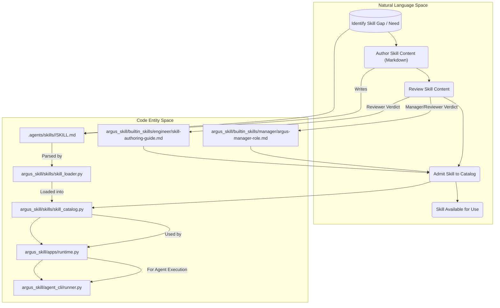

<!-- source: DeepWiki mcp.deepwiki.com · repo microsoft/ArgusAgent · page 4.2 Skill Authoring and Review Lifecycle · fetched 2026-10-26 -->

# Skill Authoring and Review Lifecycle

<details>
<summary>Relevant source files</summary>

The following files were used as context for generating this wiki page:

- [.agents/skills/minimal-rigorous-work/SKILL.md](.agents/skills/minimal-rigorous-work/SKILL.md)
- [argus_skill/builtin_skills/engineer/skill-authoring-guide.md](argus_skill/builtin_skills/engineer/skill-authoring-guide.md)
- [argus_skill/builtin_skills/manager/argus-manager-role.md](argus_skill/builtin_skills/manager/argus-manager-role.md)

</details>


This page details the process by which new skills are created, reviewed, admitted into the system, and packaged for runtime use. It covers the conceptual framework for skill development, the review mechanisms, and the technical aspects of skill packaging.

## Skill Authoring Principles

Skill authoring in Argus is guided by principles that emphasize reusability, precision, and evidence-driven development. A skill is not merely a set of instructions for a single task but "distilled expertise that a future agent reads and keeps evolving" [argus_skill/builtin_skills/engineer/skill-authoring-guide.md:12-12](). The goal is to transfer a reusable method, not just the content of a specific mission [argus_skill/builtin_skills/engineer/skill-authoring-guide.md:13-13]().

The `minimal-rigorous-work` skill [argus_skill/builtin_skills/engineer/skill-authoring-guide.md:1-4]() outlines the core philosophy for all work, including skill authoring. Key tenets include:
*   **Shortest clear control path**: Solve the current task completely with the most direct approach [argus_skill/builtin_skills/engineer/skill-authoring-guide.md:8-8]().
*   **Evidence-driven**: Start from requested behavior and observable evidence; do not fix bugs that cannot be reproduced [argus_skill/builtin_skills/engineer/skill-authoring-guide.md:10-11]().
*   **Lean development**: Reuse existing contracts and helpers; avoid adding unrelated features, refactors, or dependencies [argus_skill/builtin_skills/engineer/skill-authoring-guide.md:12-13]().
*   **Explicit errors**: Do not hide defects behind broad catches or default values [argus_skill/builtin_skills/engineer/skill-authoring-guide.md:20-21]().
*   **Token efficiency**: Use tokens by reducing uncertainty and repeated context [argus_skill/builtin_skills/engineer/skill-authoring-guide.md:22-23]().
*   **Reusable lessons**: Record lessons only when reproduced evidence shows they generalize, and scope them narrowly [argus_skill/builtin_skills/engineer/skill-authoring-guide.md:26-27]().

### Skill Authoring Guide

The `Skill Authoring Guide` [argus_skill/builtin_skills/engineer/skill-authoring-guide.md:1-4]() is a meta-skill that provides explicit instructions for authoring or optimizing skills. It defines three modes for skill development:

1.  **CREATE**: When no existing skill matched a mission, and a fixable gap was identified. The author writes a new playbook for the class of task, not just the specific instance [argus_skill/builtin_skills/engineer/skill-authoring-guide.md:20-23]().
2.  **OPTIMIZE**: When a matched skill was used but a problem remained. The lesson is folded into the existing skill, sharpening it without bloat [argus_skill/builtin_skills/engineer/skill-authoring-guide.md:25-28]().
3.  **ABSORB**: When a matched skill helped a mission succeed. The reusable mechanism or order of operations that led to success is incorporated into the skill [argus_skill/builtin_skills/engineer/skill-authoring-guide.md:30-33]().

The guide emphasizes a high "Quality bar" [argus_skill/builtin_skills/engineer/skill-authoring-guide.md:38-38](), focusing on generalization, real expertise, actionable methods, and honesty. It also includes "Anti-false-learning" rules [argus_skill/builtin_skills/engineer/skill-authoring-guide.md:52-52](), ensuring that only real, reusable corrections are encoded and that the outcome definition (metrics, verifiers) remains unchanged [argus_skill/builtin_skills/engineer/skill-authoring-guide.md:59-60]().

A skill's output format is Markdown with two frontmatter fields: `name` and `description` [argus_skill/builtin_skills/engineer/skill-authoring-guide.md:67-68]().

Sources:
*   [argus_skill/builtin_skills/engineer/skill-authoring-guide.md:1-69]()
*   [.agents/skills/minimal-rigorous-work/SKILL.md:1-32]()

## Skill Review and Admission

The review process for skills is integral to maintaining the quality and integrity of the Argus system. While the `Skill Authoring Guide` empowers the author with judgment, the `Manager` and `Reviewer` roles play crucial parts in the lifecycle.

### Manager's Role in Skill Lifecycle

The `Manager` is responsible for routing reusable knowledge to the correct project or shared layer [argus_skill/builtin_skills/manager/argus-manager-role.md:15-15](). This implies that the Manager oversees the admission of new or optimized skills into the system, ensuring they align with the overall project objectives and are appropriately scoped. The Manager also routes observed, reproducible runtime defects through the ordinary planning loop [argus_skill/builtin_skills/manager/argus-manager-role.md:16-16](), which can trigger skill optimization or creation.

### Reviewer's Role in Skill Lifecycle

The `Reviewer` provides verdicts on the work performed, including skill changes. While the `Planner` and `Reviewer` may recommend stage changes, they do not apply them [argus_skill/builtin_skills/manager/argus-manager-role.md:21-21](). For framework maintenance, which includes skill updates, the `Reviewer` determines if the work is complete before it can be considered for deployment [argus_skill/builtin_skills/manager/argus-manager-role.md:26-27](). This ensures that skill changes meet the required quality bar.

### Skill Tidy

The concept of "skill_tidy" (mentioned in the page description) refers to the process of maintaining the skill catalog, ensuring skills are well-formed, relevant, and adhere to the authoring guidelines. This likely involves automated checks and potentially manual curation to prevent skill bloat and ensure clarity.

### Skill Scoping

Skills are scoped to ensure their applicability and prevent over-generalization. The `Skill Authoring Guide` emphasizes scoping new skills to the "class of task (the operator/problem family), not this one instance" [argus_skill/builtin_skills/engineer/skill-authoring-guide.md:21-22](). This ensures that skills are broadly useful while remaining focused.

Sources:
*   [argus_skill/builtin_skills/manager/argus-manager-role.md:1-28]()
*   [argus_skill/builtin_skills/engineer/skill-authoring-guide.md:21-22]()

## Skill Packaging and Runtime

Skills are packaged in a way that makes them discoverable and executable by the Argus runtime. This involves specific file structures and metadata.

### `.agents/.claude-plugin` Skill Packaging

Skills are typically stored as Markdown files with specific frontmatter. For example, the `minimal-rigorous-work` skill is located at `.agents/skills/minimal-rigorous-work/SKILL.md` [argus_skill/builtin_skills/engineer/skill-authoring-guide.md:1-4](). This directory structure suggests that skills can be organized within an `.agents` directory, potentially for agent-specific or plugin-specific contexts. The `.claude-plugin` reference in the page description implies that skills can also be packaged as part of a Claude plugin, adhering to its manifest and packaging requirements.

The frontmatter of a skill Markdown file includes `name` and `description` fields [argus_skill/builtin_skills/engineer/skill-authoring-guide.md:67-68](). These fields are crucial for the system to identify and understand the purpose of each skill.

### `skills/` Runtime Package

The `skills/` runtime package (likely `argus_skill/skills` or a similar structure) is where the Argus system accesses and executes skills. This package would contain the logic for:
*   **Skill Discovery**: Identifying available skills based on their file paths and frontmatter.
*   **Skill Matching**: Determining which skill is most relevant to a given mission or task.
*   **Skill Execution**: Interpreting the Markdown content of a skill and guiding the agent's actions based on its instructions.

The `argus_skill/builtin_skills` directory [argus_skill/builtin_skills/engineer/skill-authoring-guide.md:1-4]() contains pre-defined skills, organized by role (e.g., `engineer`, `manager`). This structure allows for clear categorization and access to skills relevant to different agent roles.

### Skill Lifecycle Diagram

The following diagram illustrates the high-level flow of skill authoring, review, and packaging.


**Diagram: Skill Authoring to Runtime Flow**

Sources:
*   [argus_skill/builtin_skills/engineer/skill-authoring-guide.md:1-4]()
*   [argus_skill/builtin_skills/engineer/skill-authoring-guide.md:67-68]()
*   [argus_skill/builtin_skills/manager/argus-manager-role.md:15-16]()
*   [argus_skill/builtin_skills/manager/argus-manager-role.md:26-27]()

### Skill Packaging Details

Skills are essentially Markdown files with a YAML frontmatter. This simple format allows for human-readable and easily version-controlled skill definitions.

```yaml
---
name: "Skill Name"
description: "A brief description of what this skill does."
---

# Skill Title

Detailed instructions and methodology for the skill.
This can include:
- When to use this skill.
- Step-by-step procedures.
- Examples.
- Failure modes and how to handle them.
- Anti-patterns or things to avoid.
```

This structure is consistent across all skills, whether they are built-in or newly authored. The `name` and `description` fields are critical for programmatic discovery and matching.

Sources:
*   [argus_skill/builtin_skills/engineer/skill-authoring-guide.md:67-69]()

---

