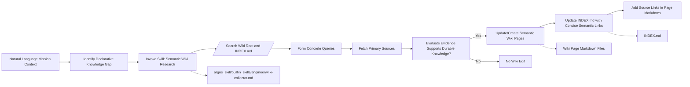
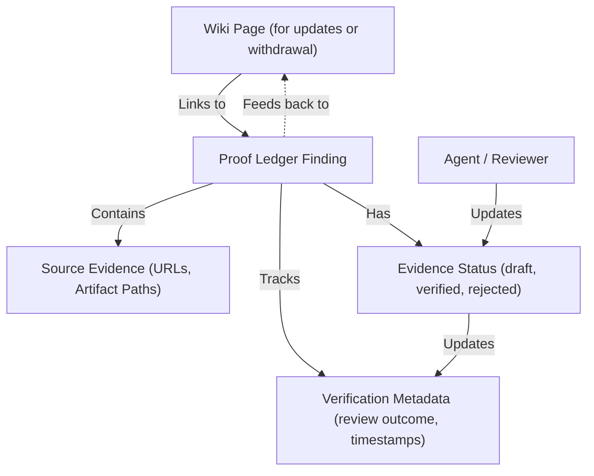

<!-- source: DeepWiki mcp.deepwiki.com · repo microsoft/ArgusAgent · page 4.3 Wiki and Proof Ledger · fetched 2026-10-26 -->

# 4.3 Wiki and Proof Ledger

<details>
<summary>Relevant source files</summary>

The following files were used as context for generating this wiki page:

- [argus_skill/builtin_skills/engineer/study-and-curate.md](argus_skill/builtin_skills/engineer/study-and-curate.md)
- [argus_skill/builtin_skills/engineer/wiki-collector.md](argus_skill/builtin_skills/engineer/wiki-collector.md)

</details>


## Purpose and Scope

This page details the implementation and operation of the *Wiki and Proof Ledger* subsystem within ArgusAgent. The system is responsible for accumulating verifiable knowledge and source-linked findings via semantic Wiki pages and managing evidence status for claims. It consists primarily of skill-driven semantic templates for research and curation, as well as structured ledgers that track proof and verification states.

The design enables Argus to improve iteratively without retraining by persistent knowledge gathering, semantic refinement, evidence verification, and transparent documentation of findings. This supports the *persistent, reviewed autonomy* mandate by anchoring declarative knowledge with evidence and enabling lifecycle tracking of claims.

---

## Architecture Overview

The system integrates two tightly related components:

- **Wiki subsystem (`argus_skill/wiki`)**: A collection of semantic templates and "collector" skills used to search for, verify, and curate declarative knowledge claims. It stores source-linked wiki pages scoped by project, vertical, and global domains.

- **Proof Ledger (`proof_ledger`)**: A ledger tracking the provenance, status, and verification of evidence supporting knowledge claims on the Wiki. It ties findings to sources and maintains evidence metadata, enabling verification and audit.

These components together enable a rigorous workflow for knowledge acquisition: identifying concrete knowledge gaps, researching primary sources, updating minimally semantic Wiki pages, and linking them to verifiable evidence noted in the proof ledger.

### Data Flow and Workflow

1. **Knowledge Gap Identification**: Agents detect missing or incorrect declarative knowledge from mission context, triggering Wiki skill usage.

2. **Semantic Research and Collection**: The Wiki "collector" skill performs targeted searches in primary sources (research papers, docs, artifact paths) to fill the gap.

3. **Wiki Page Update**: Minimal semantic updates to the Wiki pages (title, description, and Markdown with source links) are made. Semantic naming conventions prevent duplication and ensure clarity.

4. **Proof Ledger Entry**: Each finding is linked to verifiable evidence in the ledger, recording its source, status, and verification metadata.

5. **Review and Verification**: The knowledge claim and its evidence pass through review cycles to confirm validity before admission into the permanent knowledge base.

### Role of Skills in the Wiki Subsystem

- **Semantic Wiki Research skill (`engineer/wiki-collector.md`)** instructs how to perform primary source research, create or update Wiki pages only with durable, verifiable knowledge, and maintain the Wiki index.

- **Study and Curate skill (`engineer/study-and-curate.md`)** guides faithful edits and semantic refinement of existing Wiki or Skill paths, emphasizing separation of procedural vs declarative knowledge, strict naming conventions, and prevention of duplication.

---

## Detailed Components

### Wiki Subsystem (`argus_skill/wiki`)

This subsystem consists of semantic templates and skill-driven collectors:

- **Semantic Wiki Pages**: Pages are simple Markdown files under a project-scoped directory, with required frontmatter for `title` and `description` followed by source-linked content.

- **INDEX.md**: A specialized index that maps and catalogs all semantic Wiki pages, updated whenever a page is added or materially refined.

- **Skill Templates**: Agents use skills like *Semantic Wiki Research* to determine knowledge gaps, query evidence, and compose minimal durable pages with source citations.

- **Naming and Semantic Conventions**:
  - Wiki pages emphasize *domain, subsystem, capability*, and *mechanism* using ordinary language.
  - No opaque IDs, numeric fallbacks, or collision suffixes.
  - Avoid duplication by inspecting existing pages and deciding to refine or create genuinely new concepts.

- **Frontmatter Structure**:
  ```markdown
  ---
  title: "Semantic Knowledge Page Title"
  description: "Brief, verifiable summary of the knowledge claim."
  ---
  ```
  Followed by Markdown body with factual, source-cited content and optional interpreted insights labeled as such.

- **Insight Section** (Optional): For interpretations or hypotheses derived from evidence, explicitly marked to keep fact/opinion distinct.

### Proof Ledger

- Maintains source-linked findings that have evidence supporting declarative knowledge claims.

- Tracks:
  - Provenance of sources (links, artifact references).
  - Evidence status (draft, verified, rejected).
  - Verification metadata (review outcomes, timestamps).

- Enables linking claims in Wiki pages back to actual evidence instance records for transparency and audit.

---

## Key Classes and Functions

While direct code for the Wiki subsystem and proof ledger is scattered, the essential operational logic is captured in the skills and ledger contracts:

- **Skills** (`argus_skill/builtin_skills/engineer/wiki-collector.md` and `study-and-curate.md`):
  - Define procedural rules to guide agent research behavior and semantic editing.
  - Enforce minimal, semantic, source-backed updates to Wiki pages.
  - Handle index maintenance (`INDEX.md`).

- **Proof Ledger**:
  - Implements data structures to record findings coupled with evidence.
  - Interfaces allow marking evidence states, linking claims to sources, and querying verification status.
  - Integrates with engineering and review subsystems for claim validation.

---

## Mermaid Diagrams

### Diagram 1: Semantic Wiki Research Workflow Bridging Natural Language and Code Entities



**Explanation**: This diagram highlights the natural language to code transition where mission context prompts invoking the `wiki-collector` skill code which then reads and updates semantic wiki markdown pages and the index file. The agent follows a strict workflow that controls adding only evidence-backed durable knowledge.

---

### Diagram 2: Proof Ledger Connections and Metadata Flow



**Explanation**: This diagram describes how a semantic knowledge claim on a Wiki page references a linked finding in the proof ledger associated to real source evidence. The ledger tracks status and verification metadata that agents and reviewers update, completing a continuous evidence lifecycle that can feed back into improving or withdrawing Wiki claims.

---

## Summary

The *Wiki and Proof Ledger* subsystem provides a rigorous, semantically driven framework for declarative knowledge accumulation in Argus. It bridges lifelike natural language research and explanation with underlying source code entities managing templates, pages, and ledgers. Semantic Wiki research is guided by well-defined skill templates emphasizing durable, verifiable knowledge supported by real evidence. The Proof Ledger ensures claims are traceable, status tracked, and can be verified or refuted transparently.

Together, they enable ongoing knowledge curation and verification—crucial to Argus’ autonomy and iterative self-improvement capabilities.

---

## Sources

- `argus_skill/builtin_skills/engineer/wiki-collector.md:2-50`  
- `argus_skill/builtin_skills/engineer/study-and-curate.md:1-35`

---

