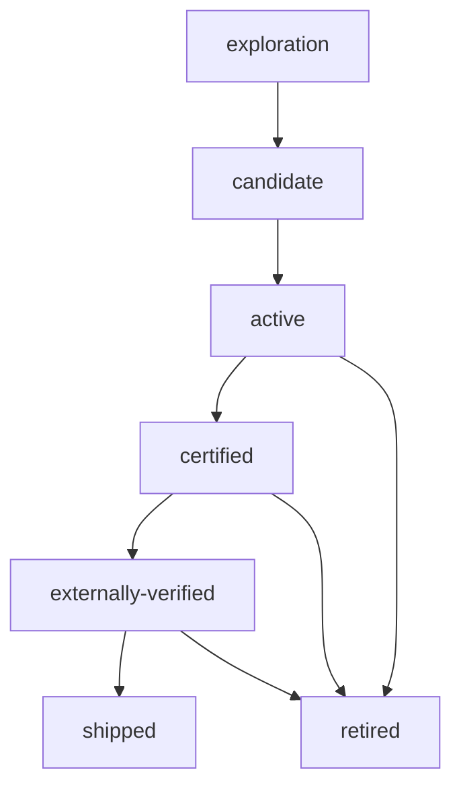
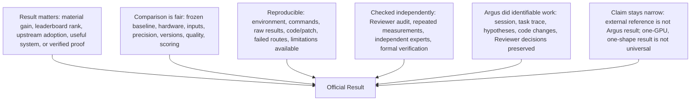

<!-- source: DeepWiki mcp.deepwiki.com · repo microsoft/ArgusAgent · page 5 Verticals and Domain Packs · fetched 2026-10-26 -->

# Verticals and Domain Packs

Relevant source files

The following files were used as context for generating this wiki page:

- [ARGUS_IMPRESSIVE_RESULTS.md](ARGUS_IMPRESSIVE_RESULTS.md)

The Argus system is designed around a flexible "vertical" model, allowing it to tackle diverse problem domains while maintaining a stable, unchanging core. This page introduces the concept of verticals and domain packs, outlining how they are structured, registered, and integrated into the Argus framework. Verticals encapsulate domain-specific knowledge, tools, and evaluation methodologies, enabling Argus to perform specialized tasks ranging from scientific research to software engineering and creative writing.

The core principle is that domain packs are built against a stable Argus core, ensuring no authority-boundary references from the core into specific verticals. This design promotes modularity, maintainability, and extensibility. Each vertical defines its specific contracts for evidence, metrics, and data domains, allowing for tailored evaluation and reporting.

## Vertical Framework and Registry

The vertical framework provides the foundational components for defining and managing domain-specific operations within Argus. This includes base classes, a central registry, and contracts that govern how verticals interact with the core system. Key components like `_base`, `_registry`, `_data_domain`, `optimization_base`, `metric_evidence`, `path_evidence`, `research_bridge`, and `vertical_contract` define how a vertical is declared, loaded, and executed. This framework ensures that each vertical adheres to a consistent structure, allowing the Argus core to seamlessly integrate and orchestrate diverse domain-specific tasks.

For details, see [Vertical Framework and Registry](#5.1).

## Research, Math and Science Verticals

This group of verticals focuses on scientific and mathematical problem-solving. The `research/` vertical is the largest, encompassing a broad range of scientific inquiry. Other specialized verticals include `math`, `math_synth`, `physics`, `chemistry_domain`, `materials`, `medical`, `ale_last_exam`, and `quant`. Each of these verticals comes with its own evaluation harnesses, designed to rigorously test and validate Argus's performance in their respective domains. These verticals leverage Argus's capabilities for automated experimentation, data analysis, and hypothesis testing in complex scientific contexts.

For details, see [Research, Math and Science Verticals](#5.2).

## Kernel, Chip and Speedrun Verticals

This category of verticals is dedicated to performance optimization and hardware-related engineering tasks. Verticals like `kernel_engineering`, `kernelbench`, `chip_design`, `digital_circuit`, `nanogpt_speedrun`, `nanochat`, `speedrun`, and `software` are designed to drive GPU kernel optimization campaigns, chip design verification, and performance speedruns. These verticals often involve low-level code manipulation, performance profiling, and rigorous benchmarking to achieve significant speedups or design improvements.

For details, see [Kernel, Chip and Speedrun Verticals](#5.3).

## Writing and Learning Verticals

The writing and learning verticals demonstrate Argus's capabilities in creative and educational domains. This group includes `fiction_writing`, `literary`, `literary_editor`, `prose`, `classical_poetry`, `modern_poetry`, `learning`, and `argus_maintenance`. These verticals focus on tasks such as generating creative text, editing, analyzing literary works, and facilitating learning processes. They often involve sophisticated natural language understanding and generation capabilities, along with specialized evaluation reports pipelines to assess the quality and effectiveness of the generated content or learning outcomes.

For details, see [Writing and Learning Verticals](#5.4).

## Impressive Results Campaign Protocol

The "Impressive Results" (IR) campaign protocol, documented as `ARGUS-IR-01` through `ARGUS-IR-06`, defines a rigorous standard for admitting and verifying significant achievements by Argus. This protocol outlines the admission bar, a status vocabulary (e.g., `exploration`, `candidate`, `active`, `certified`, `externally-verified`, `shipped`, `retired`), requirements for baselines, reproducibility, and independent verification rules. It ensures that any claim of an "impressive result" is backed by robust evidence and can be independently reproduced and verified.

**Impressive Results Campaign Status Vocabulary**

Sources: [ARGUS_IMPRESSIVE_RESULTS.md:78-88]()

The protocol emphasizes fairness in comparison, reproducibility of results, independent checking, and clear attribution of Argus's identifiable work. It also mandates that claims remain narrow, distinguishing between external references and actual Argus results.

**Admission Bar for Official Results**

Sources: [ARGUS_IMPRESSIVE_RESULTS.md:61-77]()

For details, see [Impressive Results Campaign Protocol](#5.5).

---

