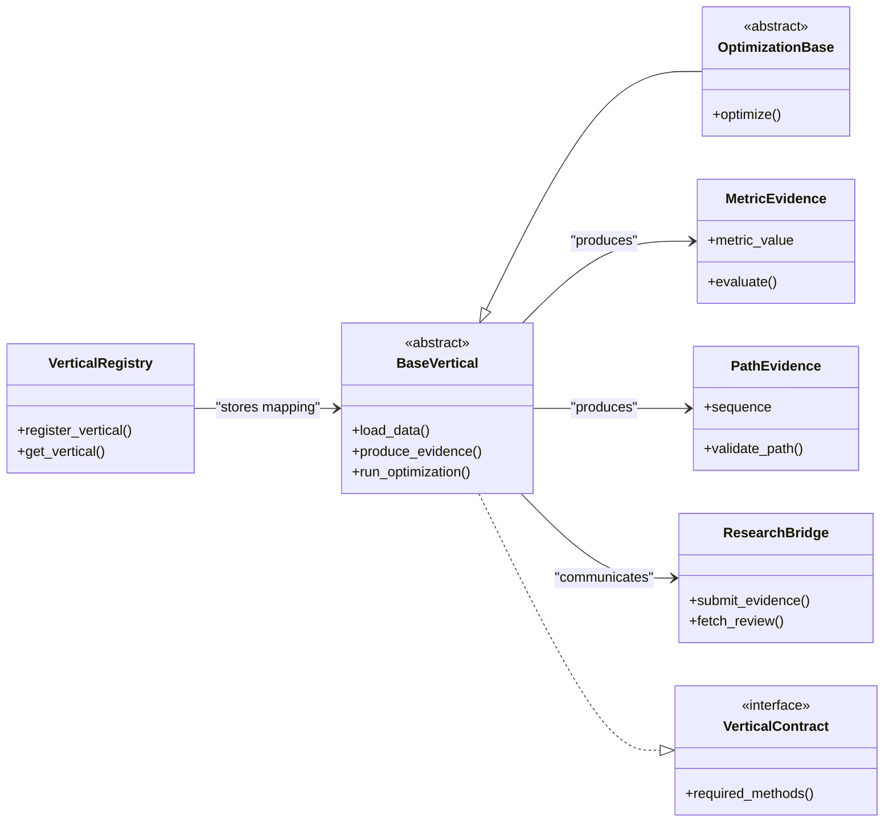

<!-- source: DeepWiki mcp.deepwiki.com · repo microsoft/ArgusAgent · page 5.1 Vertical Framework and Registry · fetched 2026-10-26 -->

# Vertical Framework and Registry

<details>
<summary>Relevant source files</summary>

The following files were used as context for generating this wiki page:

- [ARGUS_IMPRESSIVE_RESULTS.md](ARGUS_IMPRESSIVE_RESULTS.md)
- [argus_skill/__init__.py](argus_skill/__init__.py)

</details>


This page details the vertical architecture within Argus, focusing on how verticals—domain-specific knowledge and behavior packages—are declared, structured, and loaded. It reviews key foundational modules such as `_base`, `_registry`, `_data_domain`, `optimization_base`, `metric_evidence`, `path_evidence`, `research_bridge`, and `vertical_contract`. Together, these components establish the contract boundaries, base classes, evidence handling structures, and the registry mechanism that enable Argus to modularly incorporate application domains as “verticals.”

---

## 1. Purpose and Scope

A **vertical** in Argus encapsulates domain-specific logic, data contracts, evidence paradigms, and optimization schemas that extend the core Argus framework without breaking its core abstractions. Verticals isolate domain knowledge, allowing the framework to run uniformly across many distinct scientific, engineering, or research areas.

This framework and registry system:

- Defines base classes and abstract contracts verticals must follow.
- Provides rich domain data structures and evidence representation.
- Registers verticals to auto-discover and instantiate domain-specific behavior dynamically.
- Bridges vertical declarations to runtime use throughout Argus.

---

## 2. Core Components of the Vertical Framework

### 2.1. Vertical Base: `argus_skill.verticals._base`

The `_base` module establishes abstract base classes and protocols that vertical implementations extend. It enforces the core contract for verticals, such as metric computation, evidence production, and optimization linkage.

Key abstractions include:

- **BaseVertical**: Abstract base class defining the lifecycle and key interface methods a vertical must implement.
- **OptimizationBase**: Abstract base for vertical-specific optimization strategies.
- Evidence-related base classes for metric evaluation (`MetricEvidence`) and path-dependent results (`PathEvidence`).

These base classes prevent domain leakage into the core system by standardizing the vertical contract.

### 2.2. Domain and Optimization Bases: `argus_skill.verticals._data_domain` and `optimization_base`

- `_data_domain` defines domain-specific data handling strategies allowing verticals to manage specialized data schemas within their boundaries.
- `optimization_base` provides hooks and base implementations for vertical-specific campaign optimization logic — for example, iterative refinement techniques or evidence scoring tailored to a domain.

### 2.3. Evidence Classes: `metric_evidence`, `path_evidence`

These modules focus on representing, collecting, and managing evidence produced by verticals.

- **MetricEvidence** represents scalar or structured metric results from tests or experiments in a vertical.
- **PathEvidence** tracks evidence that depends on multi-step or path-sensitive computations, e.g., a sequence of transformations or proofs.

### 2.4. Bridge and Contract: `research_bridge` and `vertical_contract`

- `research_bridge` provides a linkage mechanism connecting vertical-specific research results back into Argus's more general evidence ledger and review framework. It enables cross-vertical communication for research and trial evidence.
  
- `vertical_contract` defines the precise interface contracts that verticals must fulfill to register and operate within the Argus system. This includes required method signatures, expected behavior on evidence submission, and contractual constraints on vertical isolation.

---

## 3. Vertical Registry: `argus_skill.verticals._registry`

The **vertical registry** module is the centralized mechanism that registers all vertical implementations. This registry allows the framework to:

- Discover installed verticals at runtime.
- Map vertical names to their respective base classes.
- Instantiate verticals dynamically based on configuration or context.

The registry maintains an internal mapping with metadata and provides APIs to fetch vertical classes by key or alias.

---

## 4. Data Flow and Lifecycle of a Vertical

The vertical lifecycle typically proceeds as follows:

1. **Declaration**: A vertical is implemented by subclassing base classes defined in `_base` and related modules, implementing required methods per `vertical_contract`.

2. **Registration**: The vertical class is registered in the vertical registry (`_registry`) with identifying keys.

3. **Loading**: At runtime, Argus queries the registry to list or instantiate verticals based on project or campaign configuration.

4. **Operation**: Vertical instances execute domain-specific logic such as data loading, evidence production, metric computation, and optimization via inherited base methods.

5. **Evidence Bridging**: Results are wrapped in evidence objects (`metric_evidence`, `path_evidence`) and passed through `research_bridge` to integrate with Argus's global review and ledger systems.

---

## 5. Key Classes and Functions (Summary)

| Module                     | Entity                   | Role / Description                                              |
|----------------------------|--------------------------|----------------------------------------------------------------|
| `argus_skill.verticals._base`    | `BaseVertical`           | Abstract base class for verticals; defines core API.           |
|                            | `OptimizationBase`       | Vertical-specific optimization strategy base.                  |
| `argus_skill.verticals._data_domain` | Domain data classes       | Data schema management specific to verticals.                   |
| `metric_evidence`            | `MetricEvidence`         | Encapsulates metric results with evaluation logic.             |
| `path_evidence`              | `PathEvidence`           | Tracks evidence with multistep or sequential dependency.       |
| `research_bridge`            | Bridge classes           | Connects vertical research output to Argus-wide ledger.        |
| `vertical_contract`          | Contract definitions     | Defines and enforces the vertical API and isolation contracts. |
| `_registry`                  | Vertical registry object | Registers and provides vertical lookup functionality.          |

---

## 6. Vertical Framework Mermaid Diagrams

### 6.1. Vertical Framework Structure and Relationships



---

### 6.2. Natural Language to Code Entity Bridge: Vertical Declaration and Loading

```mermaid
flowchart TD
    NL["Natural Language: Declare Vertical"] --> Base[BaseVertical class subclassing]
    Base --> Register[Register vertical in _registry]
    Register --> Load[Runtime loads vertical by registry key]
    Load --> Instantiate[Instantiate vertical class]
    Instantiate --> Evidence[Vertical produces MetricEvidence | PathEvidence]
    Evidence --> Bridge[ResearchBridge submits evidence to Argus ledger]

    class Base "argus_skill.verticals._base:BaseVertical"
    class Register "argus_skill.verticals._registry"
    class Evidence "metric_evidence, path_evidence"
    class Bridge "research_bridge"
```

---

## 7. Summary

In summary, the vertical framework in Argus uses a disciplined abstraction pattern to isolate domain-specific logic and data. By defining strong base classes, contracts, evidence structures, and a robust registry, verticals provide extendable, maintainable, and discoverable domain knowledge that integrates smoothly with Argus's core autonomy and evidence-led engineering model.

---

## Sources

- `argus_skill/verticals/_base.py`
- `argus_skill/verticals/_registry.py`
- `argus_skill/verticals/_data_domain.py`
- `argus_skill/verticals/optimization_base.py`
- `argus_skill/verticals/metric_evidence.py`
- `argus_skill/verticals/path_evidence.py`
- `argus_skill/verticals/research_bridge.py`
- `argus_skill/verticals/vertical_contract.py`
- `argus_skill/__init__.py` [1-35]()

---

