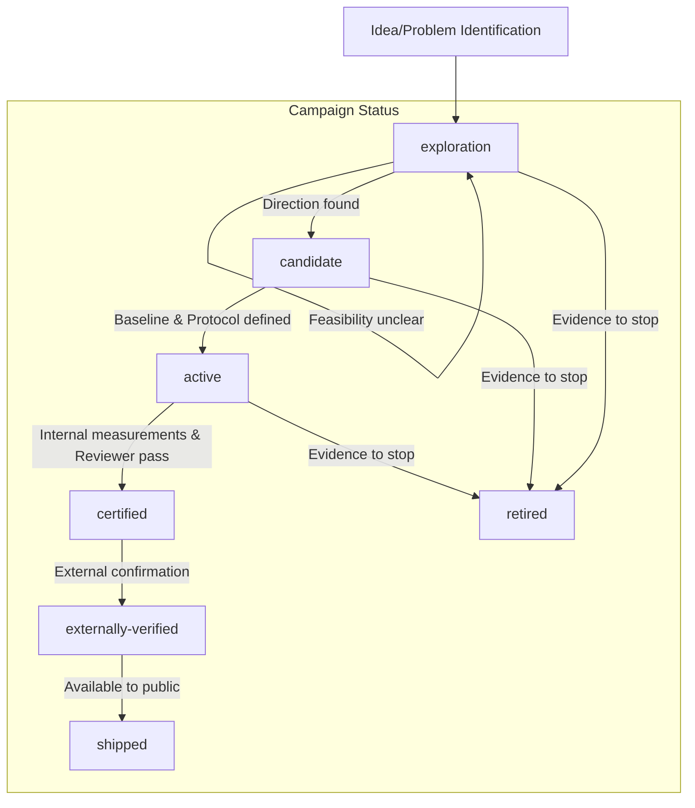

<!-- source: DeepWiki mcp.deepwiki.com · repo microsoft/ArgusAgent · page 5.2 Research, Math and Science Verticals · fetched 2026-10-26 -->

# Research, Math and Science Verticals

<details>
<summary>Relevant source files</summary>

The following files were used as context for generating this wiki page:

- [ARGUS_IMPRESSIVE_RESULTS.md](ARGUS_IMPRESSIVE_RESULTS.md)
- [argus_skill/builtin_skills/engineer/semantic-scholar-search.md](argus_skill/builtin_skills/engineer/semantic-scholar-search.md)

</details>


This page details the various research, mathematical, and scientific verticals supported by Argus. These verticals represent distinct domains where Argus can apply its autonomous capabilities, each with specific evaluation harnesses and objectives. The verticals discussed include `research/` (the largest vertical), `math`, `math_synth`, `physics`, `chemistry_domain`, `materials`, `medical`, `ale_last_exam`, and `quant`. Each vertical is designed to address specific challenges and leverage domain-specific knowledge and tools.

## Research Vertical

The `research/` vertical is the broadest and most encompassing, designed to support general scientific inquiry and literature review. It leverages tools for searching academic databases and synthesizing information.

### Semantic Scholar Search Skill

A core component of the `research/` vertical is the `semantic-scholar-search` skill. This skill enables Argus to search published venue papers (IEEE, ACM, Springer, etc.) via the Semantic Scholar API. It complements arXiv searches by providing access to peer-reviewed literature with citation counts, venue metadata, and TLDRs (Too Long; Didn't Read summaries).

The skill's API usage is defined by Python functions for searching and fetching papers:
- `search_s2(query, max_results=10, year=None, fields_of_study=None)`: This function constructs a URL for the Semantic Scholar API to search for papers based on a `query`, `max_results`, optional `year` filters (e.g., "2022-" or "2020-2024"), and `fields_of_study` (e.g., "Computer Science"). It fetches fields such as `title`, `authors`, `year`, `venue`, `citationCount`, `abstract`, `externalIds`, `openAccessPdf`, `tldr`, and `publicationTypes`.
- `fetch_paper(paper_id)`: This function retrieves detailed information for a specific paper using its ID (DOI, ArXiv ID, S2 ID). It fetches additional fields like `references` and `citations`.

[argus_skill/builtin_skills/engineer/semantic-scholar-search.md:23-57]()

The workflow for the `semantic-scholar-search` skill involves several steps:
1.  **Parse Query**: Determine search parameters such as main query terms, year filters (defaulting to the last 3 years for recent work), field filters (defaulting to "Computer Science" for ML/AI), and publication types.
2.  **Execute Search**: Apply recommended defaults like `fields_of_study = "Computer Science"`, `year = "2022-"`, and `max_results = 10`.
3.  **De-duplicate Against arXiv**: For each result, check `externalIds.ArXiv` to identify papers also available on arXiv, noting unique venue-only papers.
4.  **Present Results**: Format the search results in a markdown table, including `Title`, `Venue`, `Year`, `Citations`, and `Authors`. For each paper, provide DOI links, TLDRs, open-access PDF links, and arXiv IDs if available.
5.  **Detailed Summary (top 5)**: Provide a more detailed summary for the top 5 results, including `Venue`, `Year`, `Citations`, `Authors`, `Abstract`, and a 1-2 sentence `Key contribution`.

[argus_skill/builtin_skills/engineer/semantic-scholar-search.md:68-112]()

Key rules for this skill emphasize filtering by `fieldsOfStudy` to reduce noise, prominently displaying `citationCount`, showing `venue` metadata, handling rate limiting with an optional API key, falling back to the first sentence of the abstract if `TLDR` is null, and always providing `DOI` links.
[argus_skill/builtin_skills/engineer/semantic-scholar-search.md:114-122]()

This skill integrates with other Argus functionalities, such as `novelty-check` for prior work identification and supports drafting related-work sections for papers. It complements general web searches for comprehensive literature coverage.
[argus_skill/builtin_skills/engineer/semantic-scholar-search.md:124-128]()

### Diagram: Semantic Scholar Search Workflow

```mermaid
graph TD
    A[User Query] --> B{Parse Query Parameters};
    B --> C{Determine Search Filters};
    C -- "Default: CS, last 3 years, 10 results" --> D[Construct S2 API Request];
    D -- "https://api.semanticscholar.org/graph/v1/paper/search" --> E[Execute S2 Search (search_s2)];
    E -- "JSON Response" --> F{Process Results};
    F --> G{De-duplicate with arXiv};
    G --> H[Format Tabular Results];
    H --> I[Generate Detailed Summaries (Top 5)];
    I --> J[Present to User];
    J -- "Optional: Wiki Retention" --> K{Evaluate for Durable Knowledge};
    K -- "If durable" --> L[Create/Refine Wiki Page];
    K -- "If not durable" --> M[No Wiki Edit];

    subgraph "Semantic Scholar API Interaction"
        D -- "urllib.request.Request" --> E;
    end
    subgraph "Argus Internal Processing"
        B; C; F; G; H; I; J; K; L; M;
    end
```
Sources: [argus_skill/builtin_skills/engineer/semantic-scholar-search.md:23-132]()

## Math, Physics, Chemistry, Materials, and Medical Verticals

These verticals focus on specific scientific and engineering disciplines. They are designed to handle domain-specific problem-solving, data analysis, and knowledge synthesis. While the specific tools and evaluation harnesses for each are not detailed in the provided context, they generally involve:
*   **Domain-specific libraries and APIs**: Integration with specialized computational tools (e.g., NumPy, SciPy for math; RDKit for chemistry; specific simulation software for physics/materials).
*   **Data interpretation**: Skills to parse and understand domain-specific data formats (e.g., spectral data, medical images, material properties).
*   **Problem-solving frameworks**: Structured approaches to tackle common problems within the domain (e.g., solving differential equations, predicting material properties, diagnosing medical conditions).
*   **Evaluation harnesses**: Mechanisms to verify the correctness and efficacy of Argus's outputs, often involving comparison against known solutions, experimental data, or expert review.

The `math_synth` vertical likely focuses on synthetic math problems, potentially for training or benchmarking Argus's mathematical reasoning capabilities.

## ALE Last Exam and Quant Verticals

These verticals target specific, high-stakes problem domains:
*   **`ale_last_exam`**: This likely refers to tasks related to passing advanced-level exams, potentially in various subjects. This would involve comprehensive knowledge retrieval, complex reasoning, and structured answer generation. The evaluation harness would be based on exam scoring criteria.
*   **`quant`**: This vertical is geared towards quantitative finance, involving tasks such as algorithmic trading, financial modeling, risk assessment, and data analysis in financial markets. This would require integration with financial data sources, advanced statistical and mathematical tools, and rigorous backtesting for evaluation.

## Impressive Results Campaign Protocol

The `ARGUS_IMPRESSIVE_RESULTS.md` document outlines the protocol for defining, tracking, and verifying "Impressive Results" (IRs) across various verticals, including research, math, and science. This protocol ensures that any claim of a significant achievement by Argus is reproducible, independently verifiable, and transparently documented.

### Admission Bar

Every official result must satisfy the following criteria:
*   **The result matters**: Material performance gain, real leaderboard rank, upstream adoption, useful system, or independently checked mathematical proof/counterexample.
*   **The comparison is fair**: Frozen baseline, consistent hardware, inputs, precision, versions, quality bar, and scoring.
*   **It is reproducible**: Environment, commands, raw results, code/patch, failed routes, and limitations are available.
*   **It was checked independently**: Reviewer audit, repeated measurements, independent experts, or formal verification.
*   **Argus did identifiable work**: Session, task trace, hypotheses, code changes, and Reviewer decisions are preserved; human contributions are disclosed separately.
*   **The claim stays narrow**: External references are not Argus results, and single-instance results are not universal.

[ARGUS_IMPRESSIVE_RESULTS.md:61-77]()

### Status Vocabulary

A standardized vocabulary is used to track the progress and confidence level of each campaign:
*   `exploration`: Problem or feasibility gate not locked.
*   `candidate`: Direction exists, but no reliable baseline and protocol yet.
*   `active`: Executable campaign and measurement protocol exist.
*   `certified`: Repeated internal measurements and independent Reviewer passed.
*   `externally-verified`: Confirmed by upstream, a leaderboard, an external reproduction, or independent experts.
*   `shipped`: Available as usable code, a product, or a public result.
*   `retired`: Evidence says to stop that route; negative result and reason retained.

[ARGUS_IMPRESSIVE_RESULTS.md:79-88]()

### Candidate Board

The candidate board lists ongoing or planned campaigns for impressive results. Examples include:
*   **ARGUS-IR-01**: Sol-Engine / Sol-Attn optimization (`candidate` status). Requires representative repeated end-to-end gain plus a usable patch/PR.
*   **ARGUS-IR-02**: FLA `chunk_kda` (`active` status). Focuses on closing an SM100 fix and preserving a D128 lesson.
*   **ARGUS-IR-03**: MiniMax-H3 Speedrun (`candidate` status). Requires a frozen public protocol and a reproducible, quality-qualified result.
*   **ARGUS-IR-04**: MiniMax-H3 from datacenter to desktop (`candidate` status). Requires reproducible same-device gain with explicitly declared fidelity/quantization tier.
*   **ARGUS-IR-05**: W2A4 GEMM (`exploration` status). Focuses on quality feasibility first, then real-shape kernel and end-to-end gains.
*   **ARGUS-IR-06**: Prove or refute one Erdős problem (`exploration` status). Requires a frozen exact statement and independently verified proof/counterexample.

[ARGUS_IMPRESSIVE_RESULTS.md:91-98]()

### Diagram: Impressive Results Campaign Lifecycle


Sources: [ARGUS_IMPRESSIVE_RESULTS.md:79-88]()

### Sol-Engine / Sol-Attn Optimization (ARGUS-IR-01)

This campaign focuses on optimizing Sol-Engine, NVLabs' inference-engineering codebase for accelerating high-resolution video diffusion models. Sol-Engine combines various acceleration techniques, including caching, sparse attention, and mixed-precision computation. Argus's goal is to achieve a representative repeated end-to-end gain and produce a usable patch or pull request.

[ARGUS_IMPRESSIVE_RESULTS.md:102-114]()

Sources: [ARGUS_IMPRESSIVE_RESULTS.md:1-114]()

---

