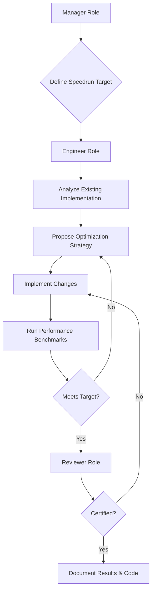

<!-- source: DeepWiki mcp.deepwiki.com · repo microsoft/ArgusAgent · page 5.3 Kernel, Chip and Speedrun Verticals · fetched 2026-10-26 -->

# Kernel, Chip and Speedrun Verticals

<details>
<summary>Relevant source files</summary>

The following files were used as context for generating this wiki page:

- [ARGUS_IMPRESSIVE_RESULTS.md](ARGUS_IMPRESSIVE_RESULTS.md)
- [argus_skill/builtin_skills/engineer/training-infrastructure-guide.md](argus_skill/builtin_skills/engineer/training-infrastructure-guide.md)

</details>


This page details the implementation and purpose of several Argus verticals focused on GPU kernel engineering, chip design, and performance speedruns. These verticals leverage Argus's capabilities to optimize low-level code, explore hardware design, and achieve significant performance gains in specific computational tasks. The core idea is to provide a structured environment for Argus to conduct campaigns related to performance, often involving deep dives into GPU architecture and assembly.

Sources:
- [ARGUS_IMPRESSIVE_RESULTS.md:1-896]()
- [argus_skill/builtin_skills/engineer/training-infrastructure-guide.md:1-62]()

## Kernel Engineering and Benchmarking

The `kernel_engineering` and `kernelbench` verticals are designed to tackle the optimization of GPU kernels. A "kernel" in this context refers to a low-level GPU program for a single operation [ARGUS_IMPRESSIVE_RESULTS.md:45-45](). Optimizing these kernels can lead to significant performance improvements, though a faster kernel does not automatically make the whole application faster [ARGUS_IMPRESSIVE_RESULTS.md:45-46]().

These verticals are crucial for campaigns like `ARGUS-IR-01` (Optimize Sol-Engine / Sol-Attn) and `ARGUS-IR-02` (FLA `chunk_kda`), which aim to achieve representative end-to-end gains and merge usable patches upstream [ARGUS_IMPRESSIVE_RESULTS.md:93-94](). The focus is on identifying hot paths and applying techniques like caching and sparse attention to accelerate diffusion models and other computationally intensive tasks [ARGUS_IMPRESSIVE_RESULTS.md:52-52]().

The process often involves:
1.  **Identifying performance bottlenecks**: Analyzing existing code to pinpoint kernels that consume the most time.
2.  **Proposing optimizations**: Argus, acting as an Engineer, might suggest changes to kernel code, leveraging its understanding of GPU architecture.
3.  **Benchmarking**: Running rigorous benchmarks to quantify the performance impact of proposed changes. This includes ensuring fair comparisons against frozen baselines, using consistent hardware, inputs, and quality bars [ARGUS_IMPRESSIVE_RESULTS.md:67-68]().
4.  **Reproducibility**: Ensuring that all results are reproducible, with environment details, commands, raw results, and code changes available [ARGUS_IMPRESSIVE_RESULTS.md:69-70]().
5.  **Independent Verification**: Results are checked independently by Reviewers, often involving repeated measurements [ARGUS_IMPRESSIVE_RESULTS.md:71-72]().

### Kernel Optimization Workflow

The following diagram illustrates a typical workflow for kernel optimization within these verticals.

```mermaid
graph TD
    A[Engineer Role] --> B{Identify Hot Path};
    B --> C[Analyze Kernel Code];
    C --> D[Propose Optimization (e.g., CUDA, Triton)];
    D --> E[Implement Changes];
    E --> F[Run Benchmarks];
    F --> G{Performance Gain?};
    G -- Yes --> H[Reviewer Role];
    G -- No --> C;
    H --> I{Certified?};
    I -- Yes --> J[Generate Patch/PR];
    J --> K[Upstream Integration];
    I -- No --> D;
```
**Diagram: Kernel Optimization Workflow**

Sources:
- [ARGUS_IMPRESSIVE_RESULTS.md:45-46]()
- [ARGUS_IMPRESSIVE_RESULTS.md:52-52]()
- [ARGUS_IMPRESSIVE_RESULTS.md:67-68]()
- [ARGUS_IMPRESSIVE_RESULTS.md:69-70]()
- [ARGUS_IMPRESSIVE_RESULTS.md:71-72]()
- [ARGUS_IMPRESSIVE_RESULTS.md:93-94]()

## Chip Design and Digital Circuit Verticals

The `chip_design` and `digital_circuit` verticals extend Argus's capabilities into hardware-level optimization and exploration. These verticals are designed to handle tasks related to the design and verification of digital circuits, potentially involving hardware description languages (HDLs) and simulation tools.

While the provided context doesn't detail specific implementations for these verticals, their existence implies Argus's ability to:
*   **Understand and generate HDL code**: Argus would need to comprehend Verilog, VHDL, or similar languages.
*   **Interact with EDA tools**: This could involve running simulations, synthesis, or place-and-route tools.
*   **Verify designs**: Potentially using formal verification methods or testbench generation.

The `ARGUS-IR-05` campaign, focusing on `W2A4 GEMM`, is an example that could involve chip-level considerations. This campaign aims to achieve quality feasibility first, then real-shape kernel and end-to-end gains on platforms like B200, H100, and RTX 5090 [ARGUS_IMPRESSIVE_RESULTS.md:97-97](). This suggests an exploration into how different precision levels (e.g., W2A4 for weights and activations) impact hardware performance, which is a common concern in chip design for AI accelerators.

### Hardware Design Exploration

```mermaid
graph TD
    A[Engineer Role] --> B{Design Specification};
    B --> C[Generate HDL (e.g., Verilog)];
    C --> D[Simulate Circuit];
    D --> E{Meets Performance/Power?};
    E -- Yes --> F[Synthesize Design];
    E -- No --> C;
    F --> G[Place & Route];
    G --> H[Verify Layout];
    H --> I[Reviewer Role];
```
**Diagram: Hardware Design Exploration Workflow**

Sources:
- [ARGUS_IMPRESSIVE_RESULTS.md:97-97]()

## Speedrun Verticals: `nanogpt_speedrun`, `nanochat`, `speedrun`, `software`

These verticals are dedicated to achieving rapid and efficient implementations or optimizations of specific software projects, often with a focus on performance or resource efficiency. The term "speedrun" implies a goal of completing a task as quickly or efficiently as possible, often against a baseline or a specific target.

The `nanogpt_speedrun` and `nanochat` verticals likely involve optimizing implementations of small-scale GPT models or chat applications. This could include:
*   **Code optimization**: Refactoring, algorithmic improvements, or leveraging specific hardware features.
*   **Resource reduction**: Minimizing memory footprint or computational cost.
*   **Deployment efficiency**: Streamlining the process of getting a model or application running.

The `ARGUS-IR-03` (MiniMax-H3 Speedrun) and `ARGUS-IR-04` (MiniMax-H3 from datacenter to desktop) campaigns are prime examples of speedrun objectives [ARGUS_IMPRESSIVE_RESULTS.md:95-96](). These campaigns aim for:
*   **Frozen public protocol**: Establishing a clear, reproducible benchmark.
*   **Reproducible, quality-qualified results**: Ensuring the speedrun is not just fast but also correct and reliable.
*   **Same-device gain with declared fidelity/quantization**: Demonstrating performance improvements on specific hardware while maintaining quality.

The `software` vertical is a broader category that encompasses general software optimization and development tasks, often with a performance slant. The "Training Infrastructure Guide" skill [argus_skill/builtin_skills/engineer/training-infrastructure-guide.md:1-62]() is relevant here, as it emphasizes using maintained frameworks and configuring experiments for real-world scenarios, which is crucial for efficient software development and speedruns. It guides the Engineer role to:
*   Choose appropriate frameworks (e.g., TRL, LLaMA-Factory for SFT; vLLM for large-scale inference) [argus_skill/builtin_skills/engineer/training-infrastructure-guide.md:19-25]().
*   Configure experiments with task-capable backbones, realistic sequence lengths, and strong baselines [argus_skill/builtin_skills/engineer/training-infrastructure-guide.md:33-38]().
*   Use allocated hardware efficiently, adjusting parameters like batch size and precision based on observed throughput [argus_skill/builtin_skills/engineer/training-infrastructure-guide.md:44-50]().

### Speedrun Campaign Flow


**Diagram: Speedrun Campaign Flow**

Sources:
- [ARGUS_IMPRESSIVE_RESULTS.md:95-96]()
- [argus_skill/builtin_skills/engineer/training-infrastructure-guide.md:1-62]()
- [argus_skill/builtin_skills/engineer/training-infrastructure-guide.md:19-25]()
- [argus_skill/builtin_skills/engineer/training-infrastructure-guide.md:33-38]()
- [argus_skill/builtin_skills/engineer/training-infrastructure-guide.md:44-50]()

---

