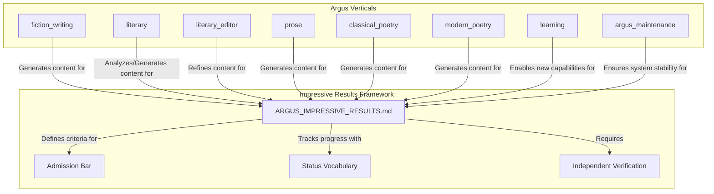

<!-- source: DeepWiki mcp.deepwiki.com · repo microsoft/ArgusAgent · page 5.4 Writing and Learning Verticals · fetched 2026-10-26 -->

# Writing and Learning Verticals

<details>
<summary>Relevant source files</summary>

The following files were used as context for generating this wiki page:

- [.gitignore](.gitignore)
- [ARGUS_IMPRESSIVE_RESULTS.md](ARGUS_IMPRESSIVE_RESULTS.md)

</details>


This page details the implementation and purpose of the writing and learning verticals within the Argus Agent framework. These verticals include `fiction_writing`, `literary`, `literary_editor`, `prose`, `classical_poetry`, `modern_poetry`, `learning`, and `argus_maintenance`. Each vertical provides specialized capabilities for tasks related to their respective domains, often including evaluation report pipelines.

## Overview of Writing Verticals

The writing verticals are designed to enable Argus to engage with and generate various forms of text, from creative fiction to structured prose and poetry. They leverage the core Argus framework to understand, analyze, and produce content, often incorporating domain-specific evaluation mechanisms.

### `fiction_writing` Vertical

The `fiction_writing` vertical focuses on generating and evaluating fictional narratives. This involves understanding plot structures, character development, dialogue, and descriptive language. A key aspect of this vertical is its evaluation pipeline, which generates reports on the quality and adherence to fictional writing principles.

The evaluation reports for `fiction_writing` are generated and timestamped, and their outputs are typically excluded from version control to prevent unnecessary bloat and allow for regeneration. This is indicated by the `.gitignore` entry: `argus_skill/verticals/fiction_writing/evaluations/reports/` [./.gitignore:66-67]().

### `literary` and `literary_editor` Verticals

The `literary` vertical is geared towards the analysis and generation of literary texts, encompassing a broader range of styles and forms than just fiction. The `literary_editor` vertical builds upon this by focusing on the refinement and critique of literary works, potentially suggesting improvements in style, grammar, and thematic consistency.

### `prose` Vertical

The `prose` vertical handles general non-poetic written language. This can include essays, articles, technical documentation, or any other form of continuous written text. It focuses on clarity, coherence, and logical flow.

### Poetry Verticals: `classical_poetry` and `modern_poetry`

These two verticals specialize in the generation and analysis of poetry. `classical_poetry` would likely focus on traditional forms, meter, rhyme schemes, and established poetic conventions. `modern_poetry`, in contrast, would explore free verse, contemporary themes, and experimental structures.

## Learning and Maintenance Verticals

Beyond creative writing, Argus also includes verticals for learning and self-maintenance.

### `learning` Vertical

The `learning` vertical is designed to enable Argus to acquire new knowledge and skills. This could involve processing new information, understanding concepts, and integrating them into its knowledge base. This vertical is crucial for the continuous improvement of the agent without requiring explicit retraining.

### `argus_maintenance` Vertical

The `argus_maintenance` vertical is dedicated to the self-monitoring, diagnosis, and upkeep of the Argus system itself. This vertical might involve tasks such as:
*   **Health Checks:** Running diagnostic tools like `argus doctor` [1.1. Getting Started and Installation]() to ensure system integrity.
*   **Update Management:** Managing updates to the Argus core, skills, and other components.
*   **Log Analysis:** Reviewing system logs to identify potential issues or areas for optimization.
*   **Resource Management:** Monitoring and optimizing resource usage.

## Evaluation Reports Pipeline

Many of these verticals, particularly the writing ones, incorporate evaluation report pipelines. These pipelines are critical for assessing the quality and effectiveness of the generated content or the performance of the vertical's tasks.

The general flow for an evaluation report pipeline involves:
1.  **Task Execution:** The vertical performs its designated task (e.g., generating a piece of fiction).
2.  **Evaluation Metrics:** Specific metrics relevant to the vertical's domain are applied to the output. For `fiction_writing`, this might include metrics for plot coherence, character consistency, or descriptive richness.
3.  **Report Generation:** A structured report is generated, detailing the evaluation results. These reports often include quantitative scores and qualitative feedback.
4.  **Storage and Review:** The reports are stored, often in a dedicated directory like `argus_skill/verticals/fiction_writing/evaluations/reports/` [./.gitignore:66-67](), for human review and analysis.

### Diagram: Evaluation Report Pipeline

```mermaid
graph TD
    A[Vertical Task Execution] --> B{Apply Evaluation Metrics};
    B --> C[Generate Evaluation Report];
    C --> D[Store Report (e.g., argus_skill/verticals/fiction_writing/evaluations/reports/)];
    D --> E[Human Review and Analysis];
```
Sources: [./.gitignore:66-67]()

## Integration with Impressive Results Campaigns

The performance and capabilities of these verticals can be showcased through "Impressive Results" (IR) campaigns, as outlined in `ARGUS_IMPRESSIVE_RESULTS.md` [./ARGUS_IMPRESSIVE_RESULTS.md:1-896](). While the current `ARGUS_IMPRESSIVE_RESULTS.md` primarily focuses on performance optimization and scientific problems, the framework for defining and verifying impressive results is applicable to writing and learning verticals as well.

For a writing vertical, an "impressive result" could be:
*   Generating a novel that passes a Turing test for human authorship.
*   Producing poetry that wins a literary award.
*   Consistently editing texts to a professional standard.

The "Admission bar" [./ARGUS_IMPRESSIVE_RESULTS.md:61-77]() and "Status vocabulary" [./ARGUS_IMPRESSIVE_RESULTS.md:79-88]() defined for IR campaigns would apply:
*   **The result matters:** e.g., a published work, a recognized literary achievement.
*   **The comparison is fair:** e.g., against human-authored baselines or established literary standards.
*   **It is reproducible:** e.g., the prompts and conditions leading to the generated text are documented.
*   **It was checked independently:** e.g., by literary critics or independent evaluators.
*   **Argus did identifiable work:** the session, task trace, and decisions are preserved.
*   **The claim stays narrow:** specific to the genre, style, or task.

### Diagram: Vertical Contribution to Impressive Results


Sources: [./ARGUS_IMPRESSIVE_RESULTS.md:1-896]()

---

