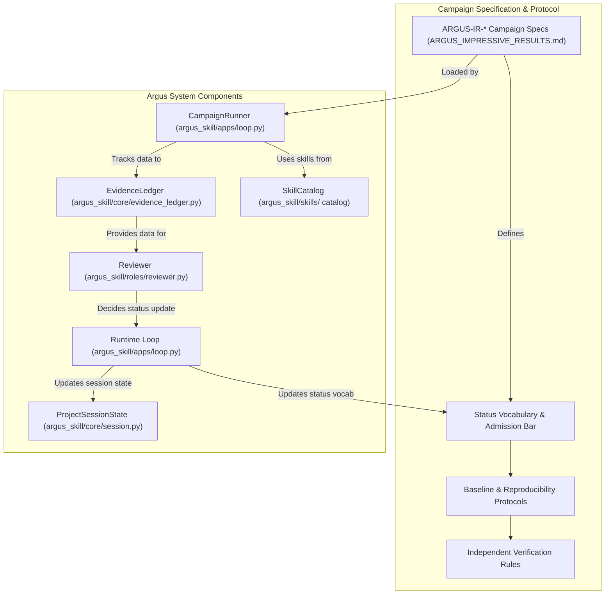
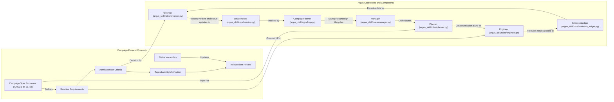

<!-- source: DeepWiki mcp.deepwiki.com · repo microsoft/ArgusAgent · page 5.5 Impressive Results Campaign Protocol · fetched 2026-10-26 -->

# 5.5 Impressive Results Campaign Protocol

Relevant source files

The following files were used as context for generating this wiki page:

- [ARGUS_IMPRESSIVE_RESULTS.md](ARGUS_IMPRESSIVE_RESULTS.md)
- [ARGUS_IMPRESSIVE_RESULTS.zh-CN.md](ARGUS_IMPRESSIVE_RESULTS.zh-CN.md)

## Purpose and Scope

This page documents the specifications, expectations, and operational protocol for the Argus Impressive Results campaigns (ARGUS-IR-01 through ARGUS-IR-06). These campaigns seek to produce high-impact, independently verifiable and reproducible results demonstrating Argus's capability in substantial research or engineering domains. This page details:

- Each campaign's focus and status vocabulary.
- The admission bar defining what qualifies as an impressive result for Argus.
- Baselines, reproducibility requirements, and independent verification rules.
- Protocol for data management preserving evidence and transparent human involvement.

This is a LEAF wiki page; it does not have child pages but references code files and documentation which contain campaign implementations and status updates.

---

## 1. Campaign Overview and Admission Bar

The Argus Impressive Results Campaigns are deliberately curated projects intended to produce outcomes that:

- **Matter:** They deliver material performance gains, true leaderboard ranks, upstream adoption, useful systems, or independently checked proof or counterexamples.
- **Are Fair Comparisons:** Using frozen baselines on identical hardware, inputs, precisions, versions, quality bars, and scoring methodologies. No cherry-picking or headline claims from one convenient shape or sample.
- **Are Reproducible:** Complete environment specs, command lines, raw results, code or patches, failure routes, and limitations are made available.
- **Are Independently Verified:** Reviewed by experts or reviewers separate from initial authors, through repeated measurements or formal math verification.
- **Show Argus Contribution:** Preserve sessions, traces, hypotheses, code changes, and reviewer decisions. Separately disclose any human contributions.
- **Maintain Narrow Claims:** External references or one-GPU/one-shape results cannot be used as universal claims for Argus.

### Status Vocabulary

Campaigns adopt a shared progression status vocabulary, tracking maturity stages from inception through external validation and shipping:

| Status             | Meaning                                                              |
|--------------------|----------------------------------------------------------------------|
| `exploration`      | Feasibility or problem boundaries not yet locked in.                 |
| `candidate`        | Potential approach identified, but no reliable baseline/protocol.     |
| `active`           | Executable campaign and measurement protocols exist.                 |
| `certified`        | Internal repeated measurements done, with Reviewer audit passed.     |
| `externally-verified` | Confirmed by external sources: upstream project, leaderboard, or experts. |
| `shipped`          | Result integrated into usable code, product, or publicly available.  |
| `retired`          | Negative or no-longer-promising route; evidence preserved for record.|

---

## 2. Campaigns Specification (ARGUS-IR-01..06)

Below is a summary of the current known campaigns with their targets, platform scope, and minimum requirements for official result inclusion.

| ID          | Focus Area                                  | Status          | Platforms         | Minimal Pass Condition                            |
|-------------|--------------------------------------------|-----------------|-------------------|--------------------------------------------------|
| ARGUS-IR-01 | Sol-Engine / Sol-Attn optimization          | `candidate`     | B200, H100        | Representative repeated end-to-end gain plus usable patch/PR |
| ARGUS-IR-02 | FLA `chunk_kda`: SM100 fix closure and D128 lesson preservation | `active`        | B200, Hopper CI   | PR #1109 merged or external reproduction; no broad D64 claim |
| ARGUS-IR-03 | MiniMax-H3 Speedrun                         | `candidate`     | B200, H100        | Frozen public protocol and reproducible, quality-qualified result |
| ARGUS-IR-04 | MiniMax-H3 transition: datacenter to desktop | `candidate`     | DGX Spark, RTX 5090 | Reproducible gain on same device baseline with fidelity/quantization explicitly declared |
| ARGUS-IR-05 | W2A4 GEMM                                  | `exploration`   | B200, H100, RTX 5090 | Quality feasibility passed first; then true-shape kernel and end-to-end gains |
| ARGUS-IR-06 | Proof or refute one Erdős problem          | `exploration`   | CPU/GPU + proof tools | Exact frozen statement and independently verified proof or counterexample |

### Campaign Details Highlights

- **ARGUS-IR-01** focuses on improving video diffusion model inference using Sol-Engine's NVLabs baseline by deploying attention optimizations, quantization, kernel fusion, sparse attention, and token pruning.
- **ARGUS-IR-02** aims to finalize the SM100 fix in Flash Linear Attention (FLA) and maintain lessons learned from D128 configurations.
- **ARGUS-IR-03 and -04** campaign to reproduce and adapt MiniMax-H3 speedrun benchmarks across datacenter and desktop environments with explicit fidelity tracking.
- **ARGUS-IR-05** explores W2A4 GEMM kernel and end-to-end feasibility as a foundational step before practical optimization.
- **ARGUS-IR-06** addresses a mathematical challenge by formal proof or counterexample using CPUs, GPUs, and verification toolchains.

---

## 3. Implementation and Data Flow

Campaigns operate as missions in the Argus runtime, each defined by a frozen model checkpoint, fixed input shapes (batch size, sequence length, attention heads, dimension per head), baseline run environment, and measurement protocols. They leverage Argus's persistent autonomy, multi-role orchestration, and evidence ledgering.

### Key Components Involved

- **Campaign Specification Files** define the frozen configuration, hardware, quality bars, and acceptance criteria. For example, ARGUS-IR-01 and ARGUS-IR-02 have detailed outlines in `ARGUS_IMPRESSIVE_RESULTS.md` [ARGUS_IMPRESSIVE_RESULTS.md:1-192]().
- **Evidence Ledger** collects raw and processed measurements, retains audit trails linking hypotheses, code changes, and reviewer verdicts.
- **Reviewer Module** evaluates results for independent verification, performs hypothesis checks, and certifies reproducibility.
- **Skill Catalog** provides admitted skills scoped to verticals relevant to the campaign (e.g., performance kernels, mathematical proofs).
- **Runtime Execution Loop** manages campaign progress from exploration through candidate, active, certification, external verification, and eventual shipping or retiring.

### Data Flow Mermaid Diagram: Natural Language Campaign to Code Entities

_Sources: ARGUS_IMPRESSIVE_RESULTS.md [1-192](), argus_skill/apps/loop.py [various](), argus_skill/core/evidence_ledger.py [various](), argus_skill/roles/reviewer.py [various](), argus_skill/skills/catalog [various](), argus_skill/core/session.py [various]()_

---

## 4. Admission Bar: Criteria for Acceptance

Campaign results must meet all these criteria to be included as "Impressive Results" by Argus:

| Criterion                      | Description                                                                                      |
|-------------------------------|------------------------------------------------------------------------------------------------|
| Material Impact                | Demonstrate clear, substantial gain (speed, leaderboard rank, upstream product use, proof).    |
| Fairness                      | Compare to frozen baseline with identical parameters, hardware, version, and measurement protocol. |
| Reproducibility               | Provide environment details, commands, raw logs, code/patches, failed routes, limitations.     |
| Independent Verification      | Reviewer audits, repeat measurements, external experts or formal tools must confirm findings.  |
| Identifiable Argus Involvement| Sessions, hypotheses, code changes, and reviewer logs preserved to show Argus's role.          |
| Niche Claim                   | Narrow scope claims only; avoid broad extrapolation or claiming external references as Argus result. |

---

## 5. Reproducibility and Verification Rules

To ensure trustworthiness and scientific rigor, campaigns enforce:

- **Frozen Model Checkpoint and Code:** No drift allowed in weights/configuration during repeated measurements.
- **Fixed Hardware and Software Stack:** Explicit listing of GPU model, drivers, OS, runtime library versions.
- **Workload Determinism:** Same input parameters, random seeds, concurrency profiles, batch sizes, and warm-up specifications.
- **Measurement Protocol:** At least N=10 paired timing runs or equivalent to reduce noise misinterpretation.
- **Data Preservation:** Sessions, input/output payloads, timing breakdowns, and state snapshots stored in the Argus evidence ledger.
- **Independent Audit:** Reviews by domain experts in separate role verifying correctness and quality.
- **Clear Human Contribution Disclosure:** Any manual fixes or heuristic adjustments are distinguished, kept minimal, and recorded.

---

## 6. Baseline Management

Each campaign starts with a *baseline* — a frozen version employing official weights, configurations, and performance parameters serving as a reference for improvements. Specifications mandate:

- Baseline release is documented with commit hashes.
- Baseline hardware and software environment are specified and preserved.
- The baseline run includes profiling breakdowns, audio-visual quality checks where applicable, and peak memory measurements.
- Repeat runs on alternate machines are required to confirm baseline stability before new work begins.
- All new patches must explicitly reference which baseline they improve upon.

---

## 7. End-to-End Workflow Summary and Roles

The protocol uses Argus's role-based modular runtime with the following main actors:

- **Manager:** Decides campaign stage transitions and dispatches candidate missions.
- **Planner:** Crafts detailed mission plans from campaign specs, ensuring baseline adherence.
- **Engineer:** Performs code changes, benchmarks, profiling, and implements optimizations.
- **Reviewer:** Independently audits results, confirms reproducibility, quality, and compliance with evidence standards.

### Campaign Lifecycle Mermaid Diagram Bridging Natural Language and Code Roles

_Sources: ARGUS_IMPRESSIVE_RESULTS.md [1-192](), argus_skill/roles/manager.py [various](), argus_skill/roles/planner.py [various](), argus_skill/roles/engineer.py [various](), argus_skill/roles/reviewer.py [various](), argus_skill/core/evidence_ledger.py [various](), argus_skill/core/session.py [various](), argus_skill/apps/loop.py [various]()_

---

## 8. Key Functions and Classes

### CampaignRunner (`argus_skill/apps/loop.py`)

- Entrypoint that instantiates campaign execution.
- Consumes campaign specs, applies status vocab operations.
- Drives Role actors: triggering Manager, Planner, Engineer, Reviewer steps.
- Logs session and evidence state.

### EvidenceLedger (`argus_skill/core/evidence_ledger.py`)

- Stores raw input/output and benchmarking data.
- Links data records to hypotheses, code changes, review verdicts.
- Ensures traceability and auditability.

### Reviewer (`argus_skill/roles/reviewer.py`)

- Analyzes evidence ledger entries.
- Applies admission bar criteria.
- Provides independent audit and final verdicts.
- Updates campaign status vocabulary based on findings.

---

## Summary Table: Impressive Results Campaign Concepts to Code Elements

| Concept                          | Code Component                              | Role in Protocol                              |
|---------------------------------|---------------------------------------------|-----------------------------------------------|
| Campaign Specification           | `ARGUS_IMPRESSIVE_RESULTS.md`                | Written specification, campaign design params|
| Campaign Lifecycle Orchestration | `CampaignRunner` (`argus_skill/apps/loop.py`) | Executes campaigns based on spec and state    |
| Role separation                 | `manager.py`, `planner.py`, `engineer.py`, `reviewer.py` | Authority and task specialization             |
| Evidence Preservation            | `EvidenceLedger` (`evidence_ledger.py`)     | Records and links data and audit information  |
| Session State Tracking           | `SessionState` (`session.py`)                | Maintains campaign context and status vocab   |

---

## References

- [ARGUS_IMPRESSIVE_RESULTS.md](ARGUS_IMPRESSIVE_RESULTS.md) (lines 1-192): Campaign specs, admission bar, status vocabulary, and background explanations.
- Argus core runtime modules: `argus_skill/apps/loop.py`, `argus_skill/core/evidence_ledger.py`, `argus_skill/roles/*.py`, `argus_skill/core/session.py`.
- Definitions of status vocabulary and campaign lifecycle tracked in the runtime loop and roles.

---

This protocol ensures that Argus's Impressive Results campaigns become tangible, replicable, independently validated milestones rather than mere plans or demos. It codifies the work needed to claim "impressive" achievements that contribute to advancing research and engineering with transparency and rigor.

---

