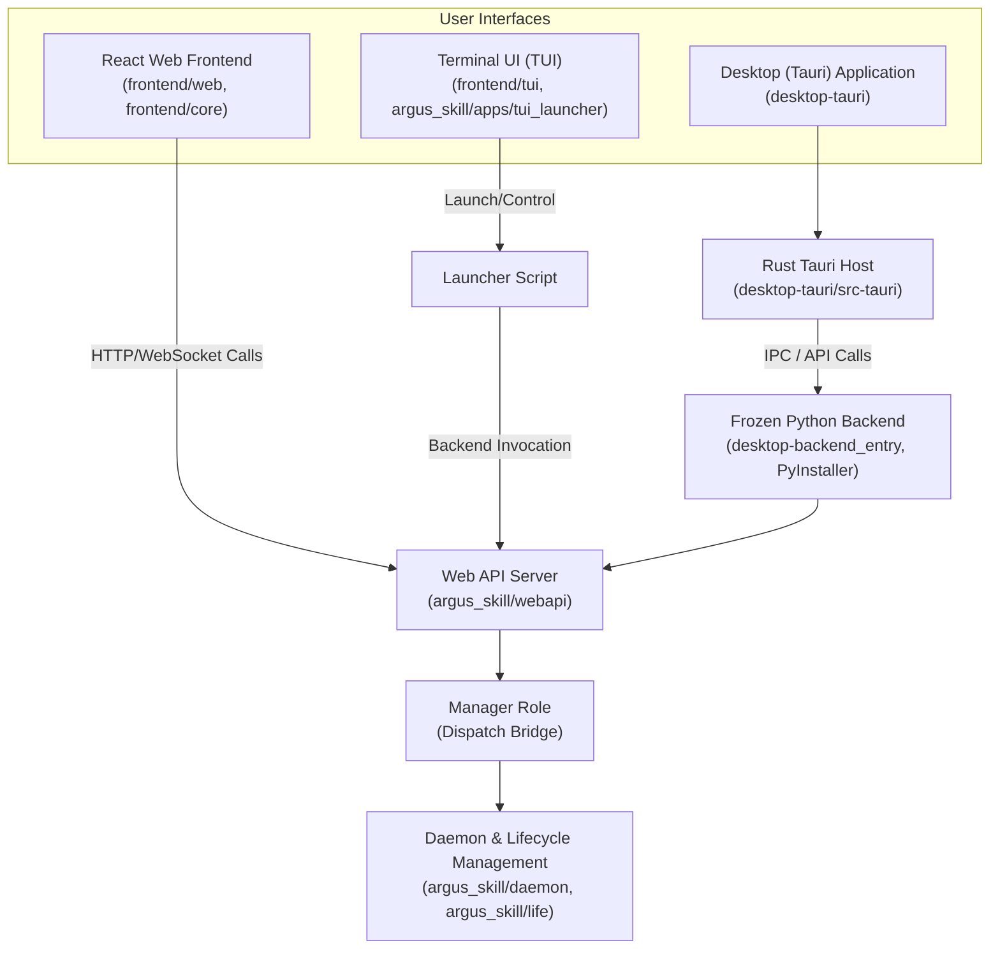

<!-- source: DeepWiki mcp.deepwiki.com · repo microsoft/ArgusAgent · page 6 Interfaces: Web API, Frontends and Desktop · fetched 2026-10-26 -->

# Interfaces: Web API, Frontends and Desktop

Relevant source files

The following files were used as context for generating this wiki page:

- [.github/workflows/tests.yml](.github/workflows/tests.yml)
- [argus_skill/apps/tui_launcher.py](argus_skill/apps/tui_launcher.py)

This section outlines the primary user-facing interfaces of ArgusAgent: the HTTP/WebSocket Web API server, the React-based web frontend, the Terminal User Interface (TUI), and the Tauri-based Windows desktop application. These interfaces provide different modalities to interact with Argus, each tailored to distinct usage contexts and user preferences. This parent page introduces their roles and how they fit together at a high level, while detailed technical and architectural information is delegated to the respective child pages.

---

## Overview of Interfaces

Argus provides multiple user-facing surfaces that enable users to interact with and manage research, engineering, and autonomy workflows in a persistent and collaborative fashion. These interfaces include:

- **Web API Server:** An HTTP/WebSocket backend that exposes routes for project management, mission control, artifact handling, pairing, diagnostics, and other stateful operations essential for long-running campaigns and autonomy management.

- **React Web Frontend:** A modern Single Page Application (SPA) using React, which interacts with the Web API to present a rich UI for mission mapping, research workbenches, project dashboards, and internationalized interactions.

- **Terminal UI (TUI):** A text-mode user interface built with Ink, suitable for usage strictly within terminal environments. It supports launcher flows, live "follow" views, and other modes useful for quick or remote interactions when graphical environments are unavailable.

- **Desktop (Tauri) Application:** A native Windows desktop client combining a Rust-based Tauri host with a frozen Python backend. This delivery consolidates the full Argus experience into a standalone executable with integrated update, build, and signing workflows.

These interfaces collectively enable comprehensive control and visibility over Argus projects and agents, addressing multiple operating conditions and user preferences from automated background services to interactive visualizations.

---

## Web API Server

The Web API server forms the backbone of Argus’s remote and programmatic control. Implemented in `argus_skill/webapi`, it offers:

- HTTP and WebSocket endpoints implementing protocols for project CRUD operations and session state management.
- Integration with the Manager role as a bridge dispatching commands and managing autonomous workflows.
- Mission map feeds for live visualization of project progress.
- Artifact and attachment management supporting evidence and deliverable tracking.
- Facilities for device pairing and QR-code based authorization flows.
- Diagnostics endpoints, daemon lifecycle control, and source update checks.

This server is designed for extensibility and long-running stateful campaign management, enabling frontends to provide responsive and robust user experiences.

For technical details of the Web API, see [Web API Server](#6.1).

---

## React Web Frontend

The React-based web frontend is rooted in `frontend/web` and `frontend/core`. It delivers:

- A modular React app structured around hooks and API clients communicating with the Web API.
- Mission map visualizations for strategic oversight.
- Research workbench modules to author, review, and run experiments.
- Internationalization (i18n) support for a global user base.
- A committed production-ready distribution bundle ensures release integrity and version parity.

This frontend targets browser-based usage, providing an intuitive graphical interface with rich interactivity and seamless integration with backend workflows.

For comprehensive details on the web frontend architecture and operation, see [Web Frontend](#6.2).

---

## Terminal UI (TUI)

The Terminal UI offers a text-based cockpit that runs inside a terminal emulator. Key aspects include:

- Implemented in `frontend/tui` with invoicing functions leveraging the Ink React-like terminal UI library.
- `argus_skill/apps/tui_launcher` manages the launcher flow, including automatic port assignment and environment detection.
- Support for follow mode, enabling live terminal monitoring of project states.
- Bundled tests ensure consistent rendering and behavior across platforms.

The TUI is especially useful for environments lacking graphical support or when a lightweight interface is preferred.

For more on the TUI design, usage patterns, and testing, see [Terminal UI](#6.3).

---

## Desktop (Tauri) Application

The Desktop client is a Windows native application combining Rust and Python technologies:

- The host is a Rust Tauri application located in `desktop-tauri/src-tauri`.
- The Python backend is packaged and frozen via PyInstaller, entry point at `desktop_backend_entry`.
- Build and staging scripts automate packaging, signing, and updater manifest creation.
- Supports updater mechanisms and signing requirements necessary for Windows desktop application deployment.

This application offers a seamless, installable desktop experience integrating all Argus components with native OS capabilities.

Detailed insights into the desktop app development and deployment are available at [Desktop (Tauri) Application](#6.4).

---

## Interfaces Integration Diagram

This diagram illustrates how the user interfaces relate to the core Web API server and the internal components such as the Manager role and daemon lifecycle. The Desktop app notably hosts a frozen Python backend communicated with via the Rust Tauri host, which ultimately connects to the Web API services serving the autonomy workflows.

---

## Summary

This section summarized the user-facing surfaces of ArgusAgent:

- The **Web API Server** offering the programmatic and networked interface.
- The **React Web Frontend** for browser-based interaction.
- The **Terminal UI** for lightweight, console-bound interaction.
- The **Desktop Tauri Application** for rich native Windows experience.

Each interface exploits the Web API server as a central source of truth and command dispatch, while integrating different frontend technologies and runtime environments optimized for their context.

For detailed documentation on each interface, please refer to the following child pages:

- [Web API Server](#6.1)
- [Web Frontend](#6.2)
- [Terminal UI](#6.3)
- [Desktop (Tauri) Application](#6.4)

---

Sources:  
- `argus_skill/webapi` (server implementation),  
- `frontend/web`, `frontend/core` (React frontend),  
- `frontend/tui`, `argus_skill/apps/tui_launcher.py` (terminal UI),  
- `desktop-tauri/src-tauri`, `desktop-backend_entry`, PyInstaller packaging scripts (desktop app).

---

