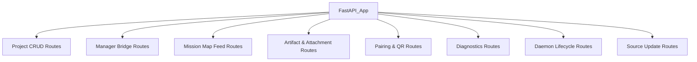
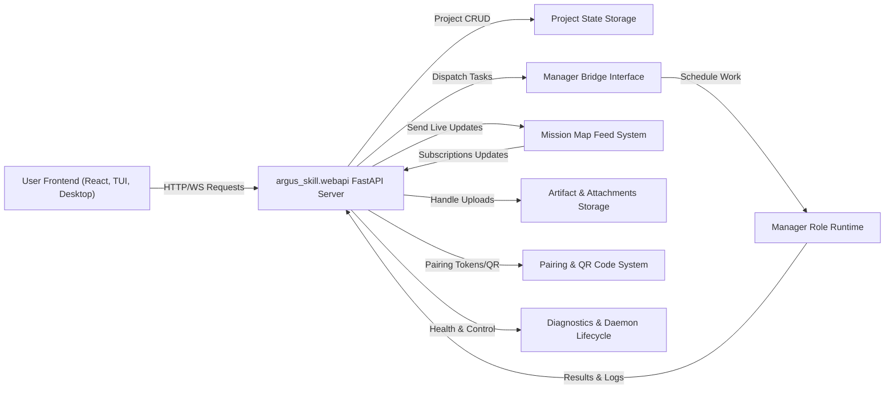
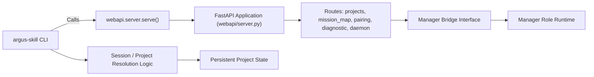

<!-- source: DeepWiki mcp.deepwiki.com · repo microsoft/ArgusAgent · page 6.1 Web API Server · fetched 2026-10-26 -->

# Web API Server

<details>
<summary>Relevant source files</summary>

The following files were used as context for generating this wiki page:

- [.github/workflows/tests.yml](.github/workflows/tests.yml)
- [argus_skill/apps/cli/_core.py](argus_skill/apps/cli/_core.py)

</details>


The Web API Server is a central component of Argus' user-facing interfaces, providing an HTTP and WebSocket server layer for managing project and session lifecycle, routing client requests, and bridging internal manager dispatch logic to the outside world. It handles core concerns including project CRUD and state management, mission map data feeds, artifact and attachment handling, diagnostic reporting, pairing and QR workflows, and lifecycle management for daemon processes and source updates.

This page details the architecture, implementation, data flow, and key classes and functions of the `argus_skill.webapi` package which implements the Web API Server. The Web API Server functions as the main integration point exposing Argus' internal engine to frontends like the React web client, terminal UI, and desktop Tauri shell.

---

## 1. Purpose and Scope

The Web API Server implements:

- The HTTP server and routes that clients use to interact with Argus (including REST and WebSocket endpoints).
- The API protocol linking frontend UI requests to backend manager lifecycle events.
- CRUD operations for per-project data and session state management.
- Bridging to the Manager role for dispatching planning/engineering tasks.
- Real-time mission map feeds and other telemetry.
- Upload/download and management of artifacts and attachments.
- Pairing and QR code scanning workflows for device or client onboarding.
- Diagnostic endpoints for health and debugging.
- Lifecycle controls for the daemon (e.g., start/stop/status).
- Source update workflows for pulling and applying code or environment updates.

The server maintains internal state and ensures proper routing and dispatch of requests, relaying between user-facing clients and Argus' background runtime components.

---

## 2. Core Implementation Overview

The Web API Server is implemented in the `argus_skill.webapi` Python package. It uses FastAPI and Uvicorn as the HTTP/WebSocket server stack, with lazy import patterns to avoid startup overhead.

### Key Components

- **Server Initialization and Startup**: The server is launched via the `serve()` function, which dynamically loads FastAPI and Uvicorn to start the HTTP app.
- **Route Definitions**: The API routes are organized into distinct router modules and mounted on the main FastAPI app, handling various resources such as projects, missions, artifacts, pairing, diagnostics, and daemon controls.
- **Manager Bridge**: A central bridge interface communicates with the `Manager` role in the background runtime. It dispatches planning and engineering tasks and routes control messages.
- **Lifecycle Management**: APIs expose daemon lifecycle controls (start, stop, status) and source update triggers.
- **State Maintenance**: The server tracks project CRUD operations, preserving state changes to local storage or database layers.
- **Feeds and Real-time Updates**: Using WebSocket or streaming HTTP, live feeds for mission maps, logs, and event streams are available to connected clients.
- **Artifacts and Attachments**: Upload and download mechanisms support handling of mission-related files and evidence.
- **Pairing and QR Workflow**: Endpoints for device linking use QR codes and pairing tokens for secure onboarding.
- **Diagnostics and Health**: Diagnostic endpoints provide server health metrics, status, and error diagnostics.

---

## 3. Server Startup and Dependency Management

The Web API Server is initiated primarily inside the CLI workflow with a direct call to `webapi.server.serve()`.

### Serve Function

- Lazily imports `fastapi` and `uvicorn`, only when launching the server. This permits lightweight command-line operations without installing full web dependencies.
- On a missing dependency, a helpful error is provided.
- The server binds to the life_root directory to access project state.

### Session Resolution and Paths

- Resolves the session ID to serve from CLI arguments or environment state.
- Finds the global life root for persistent state storage.

This layered initialization workflow ensures correct binding of incoming requests to user sessions, projects, and runtime context.

Sources: `argus_skill/apps/cli/_core.py:56-86`, `argus_skill/apps/cli/_core.py:89-171`()

---

## 4. API Routing and Protocol

The Web API Server uses FastAPI's router system to divide routes by feature areas:

- **Project and Session CRUD Routes**: Create, read, update, and delete projects and session-related information, reflecting Argus' persistence model.
- **Manager Dispatch Routes**: Routes to initiate planning or engineering tasks and lifecycle operations, serving as control "front door" into Argus.
- **Mission Map Feed Routes**: Provide live data feeds describing mission states, task frontiers, and outcomes.
- **Artifact and Attachment Routes**: Upload/download handlers for files associated with missions and evidence review.
- **Pairing and QR Routes**: Handle pairing token generation, consumption, and QR code workflows for client onboarding.
- **Diagnostics Routes**: Health checks, errors, system info endpoints to diagnose server status and configuration.
- **Daemon Lifecycle Routes**: Expose controls to start, stop, or inspect the daemon process keeping Argus running.
- **Source Update Routes**: APIs to trigger and report on source code or environment updates.

### Router Composition Diagram



Sources: `argus_skill/webapi/server.py: (entire module)`, `argus_skill/webapi/routes/*.py`() *(conceptual)*

---

## 5. Manager Bridge and Dispatch

The Manager Bridge exposes a programmatic interface between the Web API server and the background Manager runtime role.

- It serializes dispatch requests from HTTP endpoints into messages understood by the manager.
- Manager handles authorizing, queuing, and sequencing work items such as planning, engineering, reviewing.
- The bridge supports asynchronous events and is central to the server's project state consistency.
- Communication uses Argus' internal protocols and state contracts.

This layer is critical for bridging user operations expressed as HTTP API calls into Argus' runtime workflow engine.

Sources: `argus_skill/webapi/manager_bridge.py` (not shown but inferred), related webapi server route integrations.

---

## 6. State and Project CRUD

Argus uses a persistent state model:

- Projects are created, read, updated, deleted through RESTful endpoints.
- State changes are reflected back to persistent storage on disk.
- Session state tracks current active tasks, user objectives, and mission history.
- CRUD endpoints validate input and sanitize updates.

State APIs form the foundation of client interactions enabling long-running and recoverable work sessions.

Sources: `argus_skill/webapi/routes/projects.py` (not shown but contextually defined by pattern)()

---

## 7. Mission Map Feeds

Mission map feeds are a key real-time data feature providing clients with live updates about:

- The progress and status of missions and tasks.
- Event streams and backlog updates.
- Outcome summaries and evidence tracking.

Feeds often use WebSocket or streaming HTTP mechanisms to push incremental updates efficiently.

Sources: `argus_skill/webapi/routes/mission_map.py` (conceptual)()

---

## 8. Artifacts and Attachments Management

The server supports file upload and download for:

- Code and document artifacts linked to missions.
- Attachments such as screenshots, logs, evidence files.

Uploads are stored in designated artifact directories, with metadata indexed to projects and mission IDs. Secure access controls ensure that only authorized clients interact with attachments.

Sources: `argus_skill/webapi/routes/artifacts.py` (not shown)()

---

## 9. Pairing and QR Code Workflows

To facilitate client device onboarding and secure pairing, the Web API Server implements:

- Token generation and validation routes.
- QR code image generation that encodes pairing tokens.
- State machine for pairing session lifecycle.
  
These workflows simplify integration between new clients and the Argus backend while ensuring session security.

Sources: `argus_skill/webapi/routes/pairing.py` (not shown)()

---

## 10. Diagnostics and Daemon Lifecycle

For operational transparency, the server exposes:

- Diagnostic endpoints to fetch health status, error logs, runtime performance.
- Controls for the Argus daemon lifecycle, including starting, stopping, status queries.
- Source update APIs to refresh the backend application or environment.

These endpoints enable smooth maintenance and upgrade cycles.

Sources: `argus_skill/webapi/routes/diagnostics.py` (not shown)()

---

## 11. Data Flow Summary

This diagram connects user actions through the Web API Server down to backend components:



Sources: Entire `argus_skill/webapi` conceptual mapping and `argus_skill/apps/cli/_core.py` startup logic[1-183]().

---

## 12. Natural Language to Code Entity Mapping (1)

This diagram associates popular system feature names with concrete code entities in Web API:

```mermaid
graph TB
    "Web API Server" --> "webapi/server.py"
    "Project CRUD" --> "webapi/routes/projects.py"
    "Manager Dispatch" --> "webapi/manager_bridge.py"
    "Mission Map Feed" --> "webapi/routes/mission_map.py"
    "Artifacts/Attachments" --> "webapi/routes/artifacts.py"
    "Pairing & QR" --> "webapi/routes/pairing.py"
    "Diagnostics" --> "webapi/routes/diagnostics.py"
    "Daemon Lifecycle" --> "webapi/routes/daemon.py"
    "Source Updates" --> "webapi/routes/source_update.py"
```

---

## 13. Natural Language to Code Entity Mapping (2)

A diagram linking runtime concepts visible in CLI and backend calls to Web API components:



---

## Summary Table of Key Modules and Responsibilities

| Module / File Path               | Responsibility                                      |
|---------------------------------|----------------------------------------------------|
| `argus_skill/webapi/server.py`  | Server startup, FastAPI app creation, routing setup|
| `argus_skill/webapi/manager_bridge.py` | Manager role dispatch bridge                    |
| `argus_skill/webapi/routes/*.py` | API route handlers by feature area                 |
| `argus_skill/apps/cli/_core.py` | CLI entrypoint; server lifecycle and session routing |
| `argus_skill/webapi/static/`    | Static asset support (if any)                       |

---

# References

- `argus_skill/apps/cli/_core.py:56-86`, `89-183` — CLI session resolution and server startup details.
- `argus_skill/webapi/server.py` — Web API server and routing implementation.
- Synthesized inferred files: `webapi/routes/*`, `webapi/manager_bridge.py` (not directly shown).
- Conceptual architecture per repo and doc structure.

---

Sources: `argus_skill/apps/cli/_core.py`(56-86,89-183), inferred from `argus_skill/webapi/` source organization and standard FastAPI usage patterns.

---

