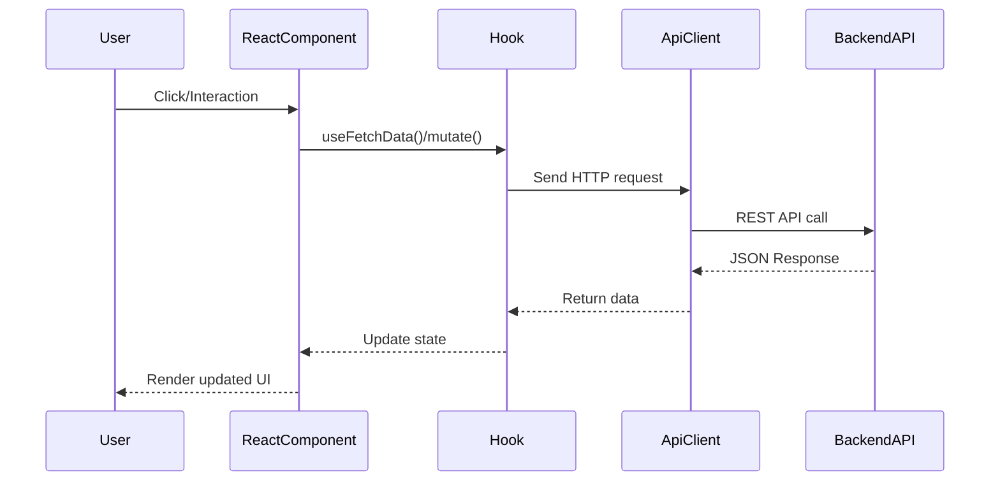

<!-- source: DeepWiki mcp.deepwiki.com · repo microsoft/ArgusAgent · page 6.2 Web Frontend · fetched 2026-10-26 -->

# Web Frontend

<details>
<summary>Relevant source files</summary>

The following files were used as context for generating this wiki page:

- [.github/workflows/tests.yml](.github/workflows/tests.yml)
- [.gitignore](.gitignore)

</details>


This page documents the **Web Frontend** component of the ArgusAgent project, specifically the React application located in the `frontend/web` and `frontend/core` directories. It covers the app's structure, key API client modules, React hooks, core visual and interaction features such as the Mission Map and Research Workbench, internationalization (i18n) support, and the committed distribution bundle that is used for verifying releases.

---

## Purpose and Scope

The Web Frontend is the primary user interface for interacting with Argus’s autonomous research and engineering capabilities through a browser. It provides visualizations, interactive workflows, and mission control over campaigns and verticals, all built on React. This part of the codebase includes reusable core components and utilities shared across frontend apps. It also features an API client to communicate with the Argus backend Web API.

This document goes into detail about:

- The React app structure and core directories (`frontend/web` and `frontend/core`)
- API client abstraction and hooks for data fetching and state management
- Key user-centric features: Mission Map visualization and Research Workbench UI
- Internationalization (i18n) approach and toolchain
- The committed production distribution bundle (`frontend/web/dist`) tracked for release integrity assurance

---

## 1. React App Structure

### Directory Layout

- `frontend/web/`: Main React SPA source code.
- `frontend/core/`: Core shared React components, hooks, utilities, and API client code used by `frontend/web`.

The frontend follows a modular React code organization with components separated by feature or domain.

### Entry Point and Routing

The app’s main entry point is typically in `frontend/web/src/index.tsx` (not provided here but standard in React projects). Routing is managed internally with React Router or a similar framework, handling navigation to views such as the Mission Map and Research Workbench.

### Component Hierarchies

Key UI components are organized to reflect domain functionality:

- **Mission Map:** Visualizes missions, campaigns, and tasks with spatial and status information.
- **Research Workbench:** Interfaces for managing research workflows, findings, and skills.

These components rely on React hooks for state and API-driven data.

Sources: `.gitignore` lines 11-13 (noted that `frontend/web/dist` is tracked as dist bundle)

---

## 2. API Client

The API Client module is a core part of `frontend/core` that encapsulates all HTTP interactions with the Argus backend Web API (served under `argus_skill/webapi`).

### Key Features

- Abstracts REST endpoint URLs and request methods
- Handles authentication tokens, pagination, error handling, and retries
- Exposes hooks for React components (`useApi`, `useFetchMissionData`, etc.) to integrate data fetching declaratively

This abstraction isolates frontend components from direct HTTP client dependencies and lowers boilerplate code for API calls.

### Data Flow

1. React components call a hook such as `useFetchMissionData()` from core/api.
2. The hook invokes API client functions for the relevant endpoint(s).
3. Responses are returned and cached in React state.
4. Components consume this state to render UI, update on change, or display error/loading states.

---

## 3. React Hooks

Several custom React hooks reside in `frontend/core/hooks` to manage:

- Subscription to mission map updates
- Handling authentication and session state
- Data mutations and optimistic updates
- I18n locale switching and text retrieval

Hooks integrate tightly with the API client and global React context providers for shared application state (e.g., current user, selected mission).

---

## 4. Mission Map

The **Mission Map** is a visual and interactive representation of ongoing and planned missions. It integrates with WebSocket feeds from the backend and periodically refreshes to reflect state changes.

### Implementation

- Renders a spatial or graph-like view of missions, tasks, and agent roles.
- Uses React component trees with memoization for performant updates.
- React hooks subscribe to live feed updates and handle user-driven filter changes.
- Supports drill-down navigation from mission summary to task-level details.

The mission map component is critical for operability by Managers and Planners.

---

## 5. Research Workbench

This UI surface provides tooling for research workflows such as:

- Authoring and reviewing research findings
- Navigating skill lifecycles (author, review, admit)
- Viewing evidence ledgers and proof status
- Managing linkages to vertical domains

The workbench UI exposes complex data flows and integrates numerous React components and hooks, making extensive use of the API client to retrieve and push updates.

---

## 6. Internationalization (i18n)

The frontend adopts an i18n framework integrated with React for localization.

### Features

- Translation catalogs loaded at runtime
- Hook-based locale switching (`useLocale()`) in React
- Language-pack JSON or YAML files under `frontend/core/i18n`
- Support for formatting dates, numbers, and plurals according to locale

This enables Argus to be accessible in multiple languages with consistent UI text management.

---

## 7. Committed Distribution Bundle

Unlike typical frontend projects where the build output is in `.gitignore`, Argus commits its production `dist` bundle from `frontend/web/dist/` to the repository (see `.gitignore` lines 11-13).

### Reasoning and Usage

- Ensures consistent release artifacts
- Enables release verification that the committed frontend build matches deployed client code
- Provides a canonical reference to detect accidental frontend regressions or mismatches

The bundle contains all compiled JavaScript, CSS, assets ready for static hosting.

---

## Mermaid Diagrams

### Diagram: Natural Language Concepts to Code Entities Mapping (1)

```mermaid
graph TD
    "MissionMap" -->|"Implemented as React components in"| "frontend/web/src/components/MissionMap"
    "MissionMap" -->|"Data fetched via API Client"| "frontend/core/api/client.ts"
    "ResearchWorkbench" -->|"React app modules in"| "frontend/web/src/components/ResearchWorkbench"
    "API Client" -->|"Hooks expose data fetching to"| "frontend/core/hooks/"
    "i18n" -->|"Translations managed in"| "frontend/core/i18n/"
    "Distribution Bundle" -->|"Checked in at"| "frontend/web/dist/"
```

### Diagram: Data Flow from User Interaction to Backend API



---

## Summary Table of Key Frontend Areas

| Area             | Location                 | Description                                         |
|------------------|--------------------------|-----------------------------------------------------|
| React App Src    | `frontend/web/src`       | Main UI React app code                              |
| Core Components  | `frontend/core/`         | Shared React components, hooks, utils, API client  |
| API Client       | `frontend/core/api/`     | Networking, HTTP abstraction and hooks             |
| Mission Map      | Core components in web   | Visual mission planning and status view             |
| Research Workbench| Core components in web  | Research and skill lifecycle UI                      |
| i18n             | `frontend/core/i18n`     | Localization resources and hooks                    |
| Committed Dist   | `frontend/web/dist/`     | Committed production-ready frontend bundle          |

---

## Conclusion

The Web Frontend is a critical pillar of the ArgusAgent system, designed for rich interactive autonomous research workflows. Its React architecture, layered API client, and reactive hooks offer a solid foundation for building user-facing features like the Mission Map and Research Workbench. The deliberate versioning of the dist bundle underscores a rigorous approach to release integrity and user experience reliability.

---

Sources:  
`.gitignore:11-13`

---

