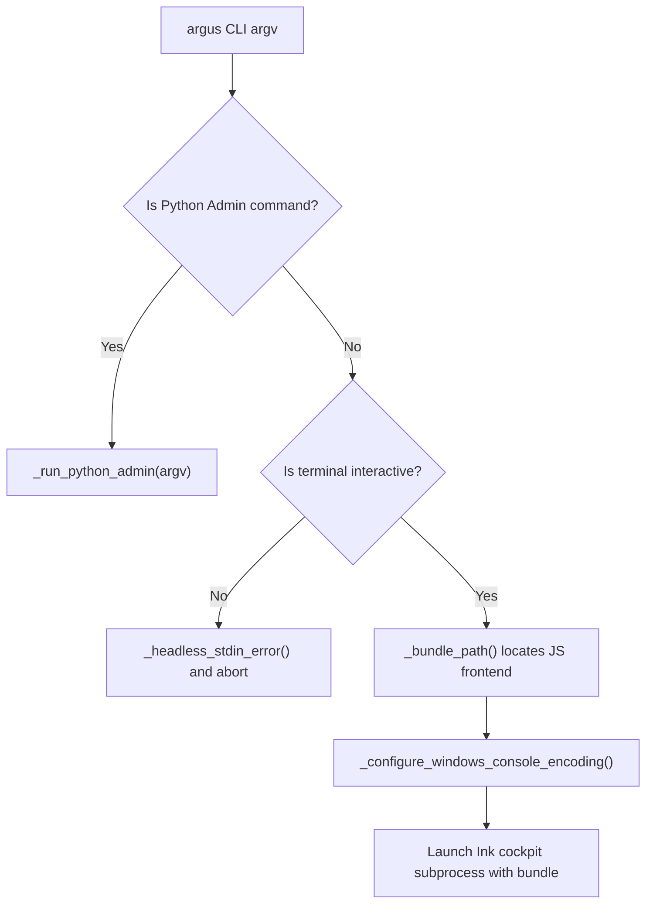
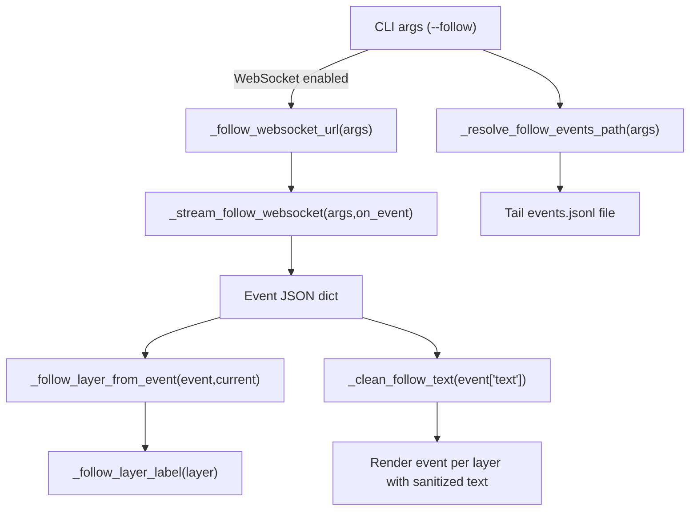
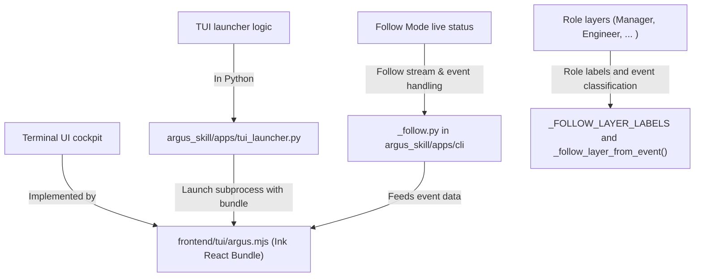
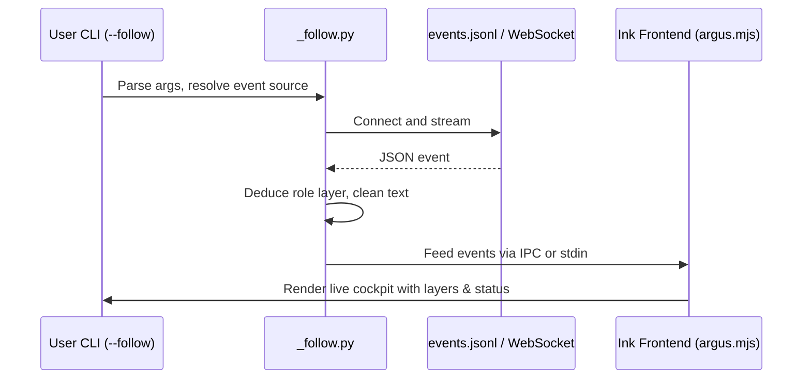

<!-- source: DeepWiki mcp.deepwiki.com · repo microsoft/ArgusAgent · page 6.3 Terminal UI · fetched 2026-10-26 -->

# Terminal UI

Relevant source files

The following files were used as context for generating this wiki page:

- [argus_skill/apps/cli/__init__.py](argus_skill/apps/cli/__init__.py)
- [argus_skill/apps/cli/_follow.py](argus_skill/apps/cli/_follow.py)
- [argus_skill/apps/tui_launcher.py](argus_skill/apps/tui_launcher.py)

This section 6.3 covers the implementation and architecture of the **Terminal User Interface (TUI)** for ArgusAgent. The TUI provides an interactive cockpit for monitoring and controlling Argus campaigns and activities from a terminal. It includes the launcher logic, follow mode display, rendering layers, and bundled automated tests. The two main code components involved are the `frontend/tui` frontend UI bundle and the launcher script `argus_skill/apps/tui_launcher.py`.

---

## Purpose and Scope

The Terminal UI is a command-line frontend to Argus's core functionality designed to run inside a terminal emulator. Unlike the web frontend or desktop apps, the TUI relies on a JavaScript frontend bundle served locally and rendered via the Ink framework (a React-like interface for terminals).

Its main capabilities include:

- Launching the bundled TUI cockpit (Ink app) with automatic environment and dependency checks.
- Providing a "follow mode" live status view of ongoing Argus campaigns, streaming events in real time.
- Streaming durable project events from a local `events.jsonl` file or via a WebSocket from the Argus WebAPI server.
- Rendering status layers aligned to the key roles of Argus (Manager, Engineer, Reviewer, Planner).
- Bundled tests ensure the TUI output behaves as expected.

---

## Launcher Flow: `argus_skill/apps/tui_launcher.py`

The TUI is launched via the `argus` CLI command entrypoint, which routes to the `tui_launcher` module when invoked in TUI mode.

### Key Concepts and Functions

- **Command-line argument handling** distinguishes between pre-launch Python admin commands (e.g. `doctor`, `repair`, `update`) and the actual TUI cockpit launch. This is done based on a predefined set of commands and flags (`_PYTHON_ADMIN_COMMANDS`, `_PYTHON_ADMIN_FLAGS`).

- **Bundle Path Resolution**: `_bundle_path()` locates the precompiled JS frontend bundle (`argus.mjs`) for the TUI interface either from environment overrides, wheel-installed layout, or source checkout. This ensures the correct frontend assets load with Ink on startup.

- **Windows Console Encoding**: `_configure_windows_console_encoding()` adjusts stdout/stderr encoding to UTF-8 to support glyphs and multilingual rendering on legacy Windows terminals, avoiding `UnicodeEncodeError`s.

- **Python Admin Invocation**: When detecting Python pre-action commands in `argv`, the launcher hands over to the Python CLI main entrypoint `_run_python_admin()` to handle them.

- **Headless Terminal Check**: `_headless_stdin_error()` checks if stdin is a usable terminal since the Ink frontend requires an interactive terminal and raw-mode stdin.

- **Node.js Version Checks**: The launcher runs checks on Node.js versions supporting the TUI frontend, ensuring compatibility.

- **Entrypoint Flow**: The main launcher logic executes these checks, resolves the frontend bundle, configures environment, and launches the Ink-based TUI cockpit subprocess.

Sources: `argus_skill/apps/tui_launcher.py:1-208`()

---

## Follow Mode: Live Status Streaming (`argus_skill/apps/cli/_follow.py`)

Follow mode is a core TUI feature to display a real-time view of project lifecycle events generated by the Argus runtime. It helps users track the behaviors of the Manager, Engineer, Reviewer, and Planner roles live.

### Event Streaming Sources

- **Local File Tail**: Tail the persistent local `events.jsonl` log file in the project's runtime directory.

- **WebSocket Streaming**: When connected to a local Argus WebAPI server, connect via a WebSocket and consume live event streams for lower-latency updates.

### Key Functions

- `_resolve_follow_events_path()` determines the path to the events log file (`events.jsonl`) based on CLI arguments or project bundle resolution.

- `_follow_websocket_url()` builds the WebSocket URL targeting the WebAPI event stream for live follow.

- `_stream_follow_websocket()` attempts to connect and receive events via WebSocket, calling a user-provided event handler callback for each JSON event. It falls back if connection fails.

- `_follow_layer_from_event()` inspects each event's metadata (`agent_layer` and `type` fields) to deduce which Argus role layer (Manager, Engineer, Reviewer, Planner, or Critic) generated it.

- `_follow_layer_label()` maps internal layer keys to display labels.

- `_clean_follow_text()` sanitizes and redacts secrets from event text before rendering, truncating if necessary unless in full-output mode enabled by environment variables.

- `_verification_summary()` extracts summary badges from verification test output embedded in event text (e.g., testing passed, mypy, ruff).

### Follow Event Data Flow

The user runs `argus --follow` or equivalent CLI command.

This design allows real-time rendering of activity per layer with dynamically updated events and textual summaries.

Sources: `argus_skill/apps/cli/_follow.py:1-203`()

---

## Rendering and UI Components

The TUI frontend rendering itself is implemented in the `frontend/tui` directory as a bundled JavaScript module (`argus.mjs`). This bundle is a React-style Ink application that subscribes to the streaming event feed and renders interactive status views.

Key rendering features include:

- Layered panes showing agent roles' activities (Manager, Engineer, Reviewer, Planner).
- Command output windows with secret redaction and truncation support.
- Activity timelines based on event metadata.
- Verification badges summarizing test pass/fail status.

The `argus_skill/apps/tui_launcher.py` module ensures the proper frontend bundle is found, Node.js version is adequate, and the Ink app launches in a properly encoded terminal environment.

---

## Integrated TUI Tests

The TUI includes bundled automated tests that simulate CLI commands including `--follow` to validate rendering output correctness and event handling. These tests help ensure the robustness of:

- Event stream parsing (both file and WebSocket sources).
- Role-layer classification from event metadata.
- Text cleaning/redaction and verification summary extraction.
- Terminal encoding and fallback behavior on unsupported systems or missing terminals.

---

## Natural Language to Code Entity Mapping Diagrams

### Mapping System Features to Code Entities

### Data Flow for Follow Mode Event Handling

---

## Summary

The Argus Terminal UI provides a robust, terminal-native user interface for supervising long-running autonomous workflows. Its launcher in `argus_skill/apps/tui_launcher.py` handles environment setup, command dispatching, and session launch. The follow mode implemented in `argus_skill/apps/cli/_follow.py` supports streaming of project events from durable logs or live WebSocket streams, classifying them by role layer and sanitizing text before rendering. The frontend bundle in `frontend/tui` renders these streams visually with a layered Ink React interface.

This tightly integrated architecture allows seamless terminal user experiences for real-time monitoring of Argus autonomous agent lifecycle and activities.

---

# References and Sources

- `argus_skill/apps/tui_launcher.py:1-208`  
- `argus_skill/apps/cli/_follow.py:1-203`

---

