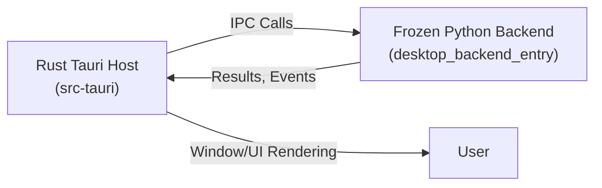
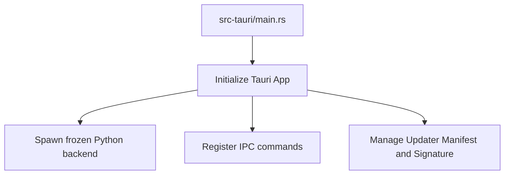
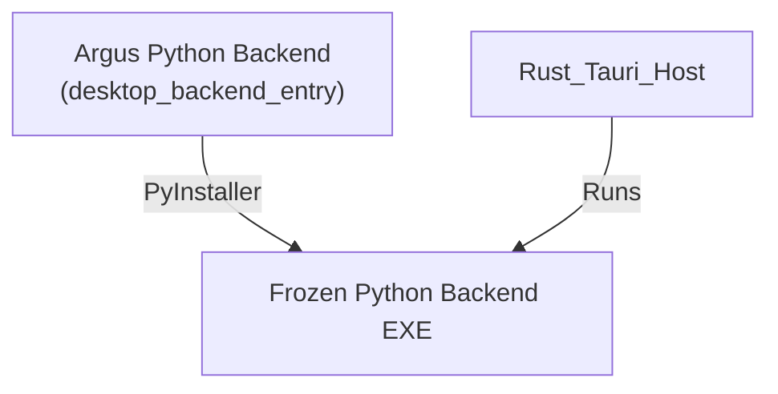
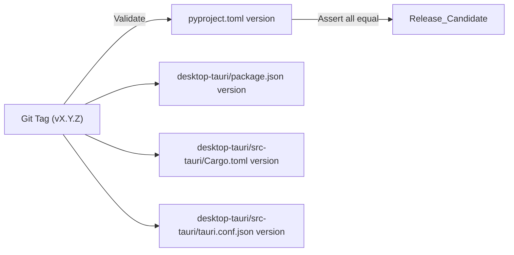

<!-- source: DeepWiki mcp.deepwiki.com · repo microsoft/ArgusAgent · page 6.4 Desktop (Tauri) Application · fetched 2026-10-26 -->

# Desktop (Tauri) Application

<details>
<summary>Relevant source files</summary>

The following files were used as context for generating this wiki page:

- [.github/workflows/release.yml](.github/workflows/release.yml)
- [.github/workflows/tests.yml](.github/workflows/tests.yml)

</details>


The Desktop (Tauri) Application in ArgusAgent serves as the Windows native desktop client, combining a Rust-based Tauri host frontend with a frozen Python backend. This section details the architecture, build system, data flow, and update mechanism of the desktop application, illustrating how the Rust host and Python backend interact, and how signing and manifest requirements ensure trusted updates.

---

## Purpose and Scope

The desktop-tauri subdirectory contains the Windows desktop client implementation. It is composed of:

- A Rust Tauri host (`src-tauri`), providing the native windowing, system integration, and WebView frontend.
- A frozen Python backend executable created via PyInstaller (`desktop_backend_entry`).
- Scripts to build and stage releases, including backend freezing and Tauri bundling.
- Updater manifest files and signing requirements to ensure secure automatic updates.

This leaf page addresses the structure, interoperation, and release procedures specific to this desktop client.

---

## Architecture Overview

### Dual-Process Model

The Desktop (Tauri) Application employs a dual-process architecture:

- **Rust Tauri Host**: Uses the Tauri framework to create a native Windows window rendering a web UI. Written primarily in Rust (`desktop-tauri/src-tauri`), it handles frontend views using web technology and system-level features like update management.

- **Frozen Python Backend**: A PyInstaller-built executable encapsulates the Argus Python core backend (`desktop_backend_entry`). It runs the agent logic, model coordination, and session management, exposing a backend API that the Tauri host calls into for operations.

The two processes communicate through IPC mechanisms offered by Tauri to delegate backend tasks and retrieve state or command results.



**Sources:** `.github/workflows/release.yml:117-133` (build scripts) and general repo layout references.

---

## Rust src-tauri Host

### Role

The `src-tauri` folder contains the Rust host application. It wraps the frontend UI and communicates directly with the frozen Python backend process. Key responsibilities include:

- Spawning and managing lifecycle of the frozen backend executable.
- Serving the embedded web UI within a native window shell.
- Handling system calls like notifications and file access.
- Managing the update process with manifests and digital signature verification.

### Key Components and Functions

- **Main entry**: The `main.rs` file (not explicitly shown) initializes the Tauri runtime, registers backend commands, and sets up application windows.

- **Updater integration**: The updater subsystem reads a manifest (`latest.json`) generated during build, verifying signatures before applying live upgrades.

- **Build artifacts**: Tauri compiles to native Windows executables signed according to the required key for trusted distribution.



**Sources:** `.github/workflows/release.yml:120-133` (build and signing steps), inferred from file naming conventions.

---

## Frozen Python Backend

### Role

The frozen Python backend is created by packing the Argus Python environment and backend entry point (`desktop_backend_entry`) into a single binary using PyInstaller. This artifact:

- Runs the main CLI/backend logic in a portable, self-contained manner.
- Is invoked by the Rust host process on application launch.
- Processes requests sent via IPC from the Rust frontend, such as managing campaigns or returning data.
- Does not directly manage UI — delegated to the Rust/Tauri side.

### Implementation Highlights

- The primary Python entrypoint is `desktop_backend_entry`.
- PyInstaller is used with a version locked to `>=6.11,<7` for reproducible builds.
- The backend is built during Windows release pipelines and staged for installer packaging.



**Sources:** `.github/workflows/release.yml:110-133`

---

## Build and Release Process

### Windows Build Workflow

- On Windows runners, the release pipeline installs dependencies:
  - Python 3.12 and PyInstaller pinned at `>=6.11,<7`.
  - Node.js 22.12 for frontend dependencies.
- The Python backend is frozen using PowerShell script `build-backend.ps1`.
- Frontend web assets are built and integrated.
- The Tauri desktop application is built and code signed using secrets-provided private keys.
- Finally, the installers `.exe` and signature `.sig` files and the updater manifest `latest.json` are staged for release.

### Signing and Manifest Requirements

- A private key and password (`TAURI_SIGNING_PRIVATE_KEY` and `TAURI_SIGNING_PRIVATE_KEY_PASSWORD`) must be supplied to sign the builds.
- The release job verifies that the updater manifest (`latest.json`) and signature files exist and are valid.
- Unsigned updates are disallowed to prevent security risks.

### Version Alignment Checks

Versions are validated at release time for:

- Python package version (from `pyproject.toml`).
- Desktop package \( `package.json` \).
- Cargo manifest version (`Cargo.toml`).
- Tauri configuration version (`tauri.conf.json`).

All must match the release tag to ensure consistency.



**Sources:** `.github/workflows/release.yml:37-69,91-141`

---

## Update Manifest and Signing

### Updater Manifest Layout

The updater manifest (`latest.json`) is generated and signed during the build. It describes the latest available desktop version, installer files, and cryptographic signatures.

### Importance of Signing

Tauri mandates signed release artifacts for secure update installation. The release workflow checks for these signatures:

- Release upload fails if signatures are absent.
- Updater rejects unsigned manifests preventing unsafe auto-updates.

This mechanism prevents flying dangerous or tampered desktop update files to end-users.

---

## Scripts and Support Tools

- `scripts/build-backend.ps1` (Windows PowerShell) freezes the Python backend using PyInstaller.
- `scripts/stage-release.ps1` stages build artifacts into the release directory.
- `argus_skill.release_tools.build_release` Python module coordinates version checks and build orchestration.
- `package.json` scripts in `desktop-tauri` automate Tauri build steps and signing.

---

## Summary Diagram: Desktop (Tauri) Application Data Flow and Build

```mermaid
graph TB
    subgraph Build Pipeline (Windows)
        PythInstaller[PyInstaller: Freeze Python backend] --> FrozenExe[Frozen Python EXE]
        NPMBuild["npm run build (frontend web + desktop-tauri)"] --> FrontendAssets["Compiled frontend assets"]
        TauriBuild["Tauri build + sign"] --> SignedInstaller[Signed EXE Installer + latest.json + sig]
        FrozenExe --> TauriBuild
        FrontendAssets --> TauriBuild
    end
    
    subgraph Runtime
        RustHost["Rust Tauri Host\n(src-tauri)"] --> IPC["IPC Commands"]
        IPC --> PythonBackend["Frozen Python Backend"]
        User["User"] --> RustHost
    end
```

**Sources:** `.github/workflows/release.yml:110-141,119-133`

---

## Key File Paths Summary

| Component                 | Location                         | Notes                                    |
|---------------------------|---------------------------------|------------------------------------------|
| Rust Tauri Host           | `desktop-tauri/src-tauri`        | Rust code for native host window and IPC |
| Python Backend Entry      | `desktop_backend_entry` (implied) | Main Python backend CLI frozen via PyInstaller |
| Backend Build Script      | `desktop-tauri/scripts/build-backend.ps1` | PowerShell script to freeze Python backend |
| Release Pipeline          | `.github/workflows/release.yml`  | CI for building, signing, and releasing desktop app |
| Package Version Checks    | `pyproject.toml`, `package.json`, `Cargo.toml`, `tauri.conf.json` | Ensures version parity |

---

This completes the technical overview of the Desktop (Tauri) Application in ArgusAgent. It combines a Rust-based native shell with a frozen Python backend, built and released through a carefully controlled signing and manifest system ensuring secure, consistent Windows desktop applications.

---

# References

Sources:

- `.github/workflows/release.yml:6-193`  
- `.github/workflows/tests.yml:1-180` (for contextual understanding of platform-specific tests and build environment)

---

