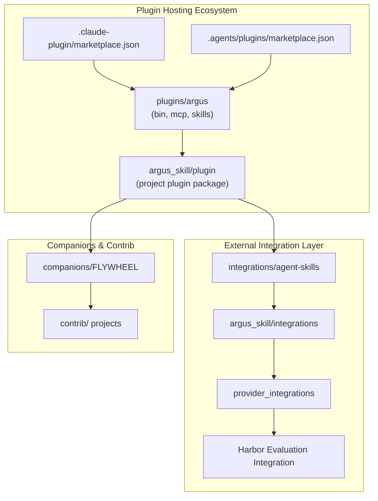

<!-- source: DeepWiki mcp.deepwiki.com · repo microsoft/ArgusAgent · page 7 Plugins, Integrations and Companions · fetched 2026-10-26 -->

# Plugins, Integrations and Companions

<details>
<summary>Relevant source files</summary>

The following files were used as context for generating this wiki page:

- [.agents/plugins/marketplace.json](.agents/plugins/marketplace.json)
- [.claude-plugin/marketplace.json](.claude-plugin/marketplace.json)

</details>


This section provides a high-level overview of how Argus connects to other systems, platforms, and complementary projects. It describes the mechanisms by which Argus can be extended, embedded, and integrated with external hosts and provider ecosystems. Rather than going into the internal implementation details, this page links to dedicated child pages that fully document the various plugin manifests, integration adapters, and companion applications.

---

## Plugin Marketplace and MCP Bridge

Argus is packaged as a plugin that can be hosted inside third-party agent platforms using a marketplace and plugin bridge model. Two manifest files govern this integration:

- `.claude-plugin/marketplace.json`  
- `.agents/plugins/marketplace.json`  

Both describe the "argus" plugin, specifying version, category, and installation/authentication policies. The plugin implementation lives under the `plugins/argus` directory, containing binaries, MCP (Multi-Channel Protocol) bridge components, and skill extensions. The `argus_skill/plugin` package contains code specifically focused on hosting Argus as a plugin.

This approach enables Argus to run as a hosted skill inside other agent frameworks, receiving input, dispatching work, and returning results within the host’s plugin lifecycle.

For detailed technical coverage, see [Plugin Marketplace and MCP Bridge](#7.1).

### Marketplace Manifest Structure (Example)

```json
{
  "name": "argus",
  "plugins": [
    {
      "name": "argus",
      "source": {
        "source": "local",
        "path": "./plugins/argus"
      },
      "policy": {
        "installation": "AVAILABLE",
        "authentication": "ON_INSTALL"
      },
      "category": "Productivity"
    }
  ]
}
```

---

## External Integrations and Provider Bridges

Argus supports external integrations to bridge with other agent ecosystems and provider APIs. The integrations enable runtime orchestration, skill execution, and evaluation toolchains that link Argus’s internal pipeline with outside systems.

Key components include:

- `integrations/agent-skills` — implements argus runtime orchestration logic integrating with agent skill frameworks.
- `argus_skill/integrations` — internal adapter code to connect with various external providers.
- `provider_integrations` — specialized adapters for different AI model providers or API bridges.
- Harbor evaluation integration — a dedicated integration to run benchmark and evaluation campaigns via Harbor.

This setup allows Argus to orchestrate complex workflows across heterogeneous agent domains and provider environments, facilitating a modular, scalable architecture.

For details, see [External Integrations and Provider Bridges](#7.2).

---

## Companions and Contrib Projects

The Argus repo hosts several companion and contribution projects that augment core functionality or provide complementary tools and workflows:

- `companions/FLYWHEEL` — a full-stack satellite project including backend services, a frontend application, prompt sets, and deployment via `docker-compose`. FLYWHEEL acts as an adjacent ecosystem to Argus, enhancing user interaction and management features.
- `contrib/` — contains diverse contributor projects, such as `figure-studio` (visualization tooling) and `pi-research-workflow-skill` (a skill aligning Pi agent workflows with Argus themes).

These projects are loosely coupled with the Argus core but provide essential expanded capabilities. They live in the same monorepo for ease of development and versioning consistency.

For more, see [Companions and Contrib Projects](#7.3).

---

## Summary Diagram: How Argus Plugins and Integrations Connect



---

This organization allows Argus to operate both as a standalone autonomous agent framework and as a hosted plugin skill, while simultaneously integrating with external providers and evolving through companion modules.

---

For technical implementation and API specifics, please consult the linked child pages dedicated to each of these major components:

- [Plugin Marketplace and MCP Bridge](#7.1)  
- [External Integrations and Provider Bridges](#7.2)  
- [Companions and Contrib Projects](#7.3)

---

Sources:  
`.claude-plugin/marketplace.json:1-16`  
`.agents/plugins/marketplace.json:1-20`

---

